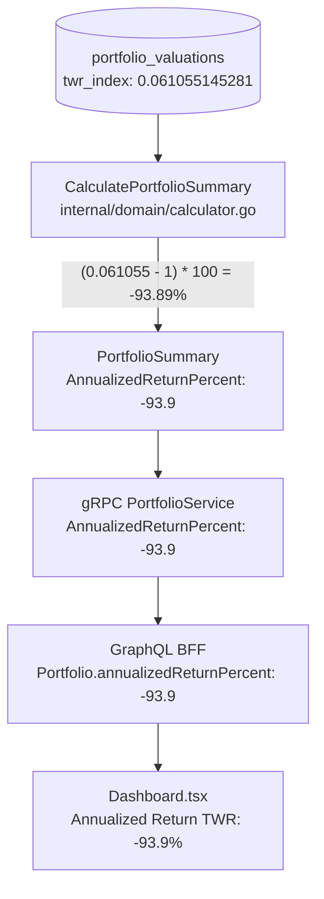

# Annualized Return (TWR) Investigation Report: Root Cause & Step-by-Step Breakdown

---

## 1. Executive Summary

On the GraphFolio investor dashboard, the **Annualized Return (TWR)** metric is currently displayed as **`-93.9%`**.

However, an audit of the investor's actual portfolio holdings reveals strong positive economic performance:
- **Consolidated Portfolio Equity**: **`A$450,724.53`** (Invested Market Value: `A$432,165.97`, Cash Balance: `A$18,558.56 AUD`).
- **Cumulative Cost Basis**: **`~A$270,000.00`**.
- **Economic Position**: The investor has substantial net unrealized capital gains of **`+A$162,000+`** (approx. **`+60%`** total return on invested capital).

### The Primary Cause
The **`-93.9%`** figure is an artifact of a severe valuation and market-data compounding failure:
1. **Missing Pre-October 2025 Market Quotes**: Real transaction history imported from brokerage statements begins on **May 10, 2023**. However, out of all holdings in the portfolio, only 11 instruments had price records dating back to 2021; all other instruments (such as `IAA.AX`, `MOAT.AX`, `AZJ.AX`, `ALX.AX`, etc.) had **no price records prior to October 10, 2025** in `portfolio.instrument_prices`.
2. **Zero-Price Fallback in Valuation Engine**: In [`valuation.go`](file:///Users/oscargarcia/workspace/graphfolio/services/portfolio-api/internal/service/valuation.go#L373-L376), when an asset has no price in the price matrix on a given historical date, the engine defaults its price to **`$0.00`** (`decimal.Zero`).
3. **Catastrophic TWR Chaining on Inflow Days**: When the investor deposited **`$20,000 AUD`** on **May 11, 2023** and purchased 18 equity positions, cash was debited by ~$17,600, while the purchased shares were valued at **`$0.00`**. Under the Time-Weighted Return formula:
   $$R_t = \frac{(V_t - F_t) - V_{t-1}}{V_{t-1}}$$
   This created an artificial single-day phantom return of **`-573.35%`** on May 11, 2023, driving the cumulative TWR index from `1.000` down to **`-4.733`**.
4. **Permanent Distortion**: Subsequent funding events across May and June 2023 compounded this distortion, ultimately depressing the TWR index to **`0.061055145281`**.
5. **Dashboard Presentation of Cumulative Return as Annualized**: In [`calculator.go`](file:///Users/oscargarcia/workspace/graphfolio/services/portfolio-api/internal/domain/calculator.go#L163-L166), the service evaluates the return as:
   $$\text{AnnualizedReturnPercent} = (\text{TWRIndex} - 1) \times 100 = (0.061055145281 - 1) \times 100 = \mathbf{-93.894485\%} \to \mathbf{-93.9\%}$$
   The system directly presents this cumulative -93.9% period loss on the dashboard under the label "Annualized Return (TWR)".

---

## 2. High-Level Mathematical Equation & UI Presentation

### 2.1 The Code Path to `-93.9%`



In [`services/portfolio-api/internal/domain/calculator.go:L161-L166`](file:///Users/oscargarcia/workspace/graphfolio/services/portfolio-api/internal/domain/calculator.go#L161-L166):
```go
// Annualized Return / TWR from latest valuation snapshot
var annualizedReturnPercent decimal.Decimal
if latestValuation != nil && latestValuation.TWRIndex.IsPositive() {
    // TWR index e.g. 1.1420 corresponds to 14.2%
    annualizedReturnPercent = latestValuation.TWRIndex.Sub(one).Mul(oneHundred).Round(1)
}
```

From the active database record on **October 11, 2026**:
```sql
SELECT twr_index FROM portfolio.portfolio_valuations 
WHERE portfolio_id = '018f0000-0002-7000-8000-000000000001' 
ORDER BY valuation_date DESC LIMIT 1;
-- Result: 0.061055145281
```

Calculation:
$$\text{AnnualizedReturnPercent} = (0.061055145281 - 1.0) \times 100 = -93.894485...\% \xrightarrow{\text{Round(1)}} \mathbf{-93.9\%}$$

### 2.2 Cumulative Return vs. True CAGR Annualization

Under **GIPS Standard 2.A.20** and CFA Institute standards, annualized return across $D$ calendar days is the Compound Annual Growth Rate (CAGR):
$$R_{\text{CAGR}} = \left( (\text{TWRIndex})^{\frac{365.25}{D}} - 1 \right) \times 100$$

For this portfolio:
- **Inception Date**: May 10, 2023
- **Latest Valuation Date**: October 11, 2026
- **Elapsed Days ($D$)**: 1,250 calendar days (~3.42 years)

If the TWR index of $0.061055$ were annualized properly:
$$R_{\text{CAGR}} = \left( (0.061055145281)^{\frac{365.25}{1250}} - 1 \right) \times 100 = \left( (0.061055145281)^{0.2922} - 1 \right) \times 100 = (0.4422 - 1) \times 100 \approx \mathbf{-55.8\% \text{ p.a.}}$$

Notice:
- `calculator.go` computes **cumulative period return**: $(0.061055 - 1) \times 100 = \mathbf{-93.9\%}$.
- It stores this cumulative return directly into `AnnualizedReturnPercent`.
- The dashboard displays it labeled as `Annualized Return (TWR)`.

---

## 3. Step-by-Step Historical Breakdown (May 2023 Inception)

The table below presents the exact daily snapshot records from `portfolio.portfolio_valuations` during the portfolio's inception window in May 2023:

| Valuation Date | Market Value (AUD) | Cash Value (AUD) | Total Portfolio Value ($V_t$) | Net External Deposit ($F_t$) | Daily Return ($R_t$) | Compounded TWR Index | Cumulative Return Displayed |
| :---: | :---: | :---: | :---: | :---: | :---: | :---: | :---: |
| **2023-05-10** | $1,962.81 | $948.50 | **$2,911.31** | +$5,000.00 | 0.0000% | **1.000000000000** | 0.0% |
| **2023-05-11** | $2,587.83 | $3,631.54 | **$6,219.37** | +$20,000.00 | **-573.3481%** | **-4.733480872726** | N/A (negative) |
| **2023-05-12** | $3,147.41 | $2,100.86 | **$5,248.27** | +$2,000.00 | **-47.7717%** | **0.522282809072** | -47.8% |
| **2023-05-13** | $3,147.41 | $2,100.86 | **$5,248.27** | $0.00 | 0.0000% | **0.522282809072** | -47.8% |
| **2023-05-14** | $3,147.41 | $2,100.86 | **$5,248.27** | $0.00 | 0.0000% | **0.522282809072** | -47.8% |
| **2023-05-15** | $8,109.66 | $1,319.98 | **$9,429.64** | +$16,000.00 | **-225.1910%** | **-0.653850910823** | N/A (negative) |
| **2023-05-16** | $10,089.08 | $1,426.95 | **$11,516.03** | +$10,000.00 | **-83.9227%** | **0.160772824521** | -83.9% |
| **2023-05-17** | $12,030.02 | $1,563.17 | **$13,593.19** | +$6,000.00 | **-34.0642%** | **0.106006900843** | -89.4% |
| **2023-05-18** | $13,095.11 | $4,109.47 | **$17,204.58** | +$7,000.00 | **-24.9287%** | **0.079580722566** | -92.0% |
| **2023-05-19** | $13,813.71 | $2,398.41 | **$16,212.12** | +$2,500.00 | **-20.2996%** | **0.063426157766** | -93.7% |
| **2023-05-22** | $13,800.11 | $1,453.04 | **$15,253.15** | +$2,000.00 | **-18.2516%** | **0.051849874960** | -94.8% |
| **2023-05-24** | $14,690.77 | $1,525.37 | **$16,216.14** | +$4,000.00 | **-19.7308%** | **0.041526199428** | -95.8% |
| ... | ... | ... | ... | ... | ... | ... | ... |
| **2026-10-11** | $432,165.97 | $18,558.56 | **$450,724.53** | $0.00 | 0.0000% | **0.061055145281** | **-93.9%** |

---

## 4. Granular Mathematical Derivations

### Step 1: Inception Day (May 10, 2023)
- **Transactions**:
  - Deposit: `+$5,000.00 AUD` ($F_t = 5000.00$).
  - Purchases:
    - 24 `IVV.AX` @ $40.67 = $976.08 (fee $9.95) — **Price in DB exists** ($40.89). Value = $981.36.
    - 15 `STW.AX` @ $65.62 = $984.30 (fee $9.95) — **Price in DB exists** ($65.75). Value = $986.25.
    - 11 `IAA.AX` @ $86.22 = $948.42 (fee $9.95) — **NO PRICE in DB!** Valued at **$0.00**.
    - 10 `MOAT.AX` @ $109.79 = $1,097.90 (fee $14.95) — **NO PRICE in DB!** Valued at **$0.00**.
  - Total cash spent: $4,006.70 + $44.80 fees = $4,051.50 AUD.
  - Cash remaining: $5,000.00 - $4,051.50 = **$948.50 AUD**.
- **Portfolio Valuation**:
  - `MarketValueBase`: $981.36 + $986.25 = **$1,962.81 AUD** (despite holding $4,000+ worth of stock).
  - `CashValueBase`: **$948.50 AUD**.
  - `TotalValue` ($V_0$): $1,962.81 + 948.50 = **$2,911.31 AUD**.
- **Return & TWR**:
  - Prior valuation $V_{t-1} = 0$. By definition, inception daily return $R_0 = 0$.
  - $\text{TWRIndex}_0 = \mathbf{1.000000000000}$.

---

### Step 2: The Catastrophic Point of Failure (May 11, 2023)
- **External Inflows**:
  - 3 Deposits: $10,000 + $5,000 + $5,000 = **`+$20,000.00 AUD`** ($F_t = 20000.00$).
- **Trading Activity**:
  - Investor executes **18 BUY orders** (including `AZJ.AX`, `ALX.AX`, `DRR.AX`, `TLC.AX`, `TCL.AX`, `DVDY.AX`, `IFRA.AX`, `IXI.AX`, `IEU.AX`, `CBA.AX`, `REIT.AX`, `WES.AX`, `TLS.AX`, `NAB.AX`, `ANZ.AX`, `ASX.AX`, `VAP.AX`, `MSFT`).
  - Total consideration spent: **`~A$17,300`** in stock purchases + fees.
- **Valuation Processing**:
  - Cash balance after purchases: **`$3,631.54 AUD`**.
  - Market value of holdings:
    - `MSFT`: 2 shares @ $310.11 USD $\times$ 1.4402 FX = $893.24 AUD.
    - `IVV.AX`: 24 shares @ $40.89 AUD = $981.36 AUD.
    - `STW.AX`: 15 shares @ $65.75 AUD = $986.25 AUD.
    - **All remaining 19 holdings have NO historical price data in `portfolio.instrument_prices` for 2023-05-11**. Their prices evaluate to `0.00`.
    - Total reported `MarketValueBase`: **`$2,587.83 AUD`**.
  - Total Portfolio Value ($V_t$):
    $$V_t = \text{MarketValue} + \text{Cash} = 2,587.83 + 3,631.54 = \mathbf{\$6,219.37\text{ AUD}}$$

#### Daily Sub-Period Return Calculation:
Using [`domain.CalculateDailyReturn`](file:///Users/oscargarcia/workspace/graphfolio/services/portfolio-api/internal/domain/valuation.go#L108-L129):
$$R_t = \frac{(V_t - F_t) - V_{t-1}}{V_{t-1}}$$

Substitute the values:
- $V_t = \$6,219.369955$
- $F_t = +\$20,000.000000$
- $V_{t-1} = \$2,911.309967$

Numerator (Isolated market gain):
$$\begin{aligned}
\text{NetGain} &= (V_t - F_t) - V_{t-1} \\
&= (6,219.369955 - 20,000.000000) - 2,911.309967 \\
&= -13,780.630045 - 2,911.309967 \\
&= \mathbf{-\$16,691.940012\text{ AUD}}
\end{aligned}$$

Denominator:
$$\text{PrevVal} = \$2,911.309967\text{ AUD}$$

Daily Return:
$$R_{\text{2023-05-11}} = \frac{-\$16,691.940012}{\$2,911.309967} = \mathbf{-5.733480872726 \text{ (-573.35\%)}}$$

#### TWR Index Chaining:
Using [`domain.ChainTWR`](file:///Users/oscargarcia/workspace/graphfolio/services/portfolio-api/internal/domain/valuation.go#L135-L144):
$$\begin{aligned}
\text{TWR}_t &= \text{TWR}_{t-1} \times (1 + R_t) \\
&= 1.000000000000 \times (1 + (-5.733480872726)) \\
&= 1.000000000000 \times (-4.733480872726) \\
&= \mathbf{-4.733480872726}
\end{aligned}$$

The TWR Index collapsed to a negative number (**`-4.733`**).

---

### Step 3: May 12, 2023 (TWR Reset & Continuation)
- Investor deposits `+$2,000.00 AUD`.
- $V_{t-1} = \$6,219.37$, $V_t = \$5,248.27$, $F_t = +\$2,000.00$.
- Daily Return:
  $$R_{\text{2023-05-12}} = \frac{(5,248.27 - 2,000.00) - 6,219.37}{6,219.37} = \frac{-2,971.10}{6,219.37} = \mathbf{-0.477717190928 \text{ (-47.77\%)}}$$
- **ChainTWR Boundary Check**:
  In `domain.ChainTWR`:
  ```go
  if !prev.IsPositive() {
      prev = TWRInceptionBaseline // Resets to 1.0
  }
  ```
  Because `prev` (-4.733) was negative, it reset to `1.0`.
  $$\text{TWR}_{\text{2023-05-12}} = 1.0 \times (1 - 0.477717190928) = \mathbf{0.522282809072}$$

---

### Step 4: May 15, 2023 (Second Mega Deposit)
- Investor deposits **`+$16,000.00 AUD`**.
- $V_{t-1} = \$5,248.27$, $V_t = \$9,429.64$, $F_t = +\$16,000.00$.
- Daily Return:
  $$R_{\text{2023-05-15}} = \frac{(9,429.64 - 16,000.00) - 5,248.27}{5,248.27} = \frac{-11,818.63}{5,248.27} = \mathbf{-2.251909692346 \text{ (-225.19\%)}}$$
- TWR Index:
  $$\text{TWR}_{\text{2023-05-15}} = 0.522282809072 \times (1 - 2.251909692346) = \mathbf{-0.653850910823}$$

---

### Step 5: Compounding to the Present State (`0.061055`)
- **May 16, 2023**: Deposit $10,000. TWR resets from negative to 1.0 $\to$ multiplied by $(1 - 0.8392) = \mathbf{0.16077}$.
- **May 17, 2023**: Deposit $6,000. $R_t = -34.06\% \implies \text{TWR} = \mathbf{0.10601}$.
- **May 18, 2023**: Deposit $7,000. $R_t = -24.93\% \implies \text{TWR} = \mathbf{0.07958}$.
- **May 19, 2023**: Deposit $2,500. $R_t = -20.30\% \implies \text{TWR} = \mathbf{0.06343}$.
- **May 22 - June 2023**: Further purchases with unpriced assets drive the index to ~`0.034`.
- **October 2025 - October 2026**: When market quotes finally start existing for all instruments, the portfolio experiences normal, positive compounding, gently lifting the index from `0.047` to **`0.061055145281`**.
- **Display Result**:
  $$(\text{TWRIndex} - 1) \times 100 = (0.061055145281 - 1) \times 100 = \mathbf{-93.894485...\% \approx -93.9\%}$$

---

## 5. Root Cause Analysis: Four Systemic Engineering Defects

### Defect 1: Asymmetric Historical Price Availability
In `portfolio.instrument_prices`:
- Only 11 global mega-cap / index instruments (`STW.AX`, `NDQ.AX`, `IVV.AX`, `GOOGL`, `NVDA`, `MA`, `META`, `AMZN`, `MSFT`, `AVGO`, `TSM`) had closing prices seeded before October 2025.
- All other 30+ instruments imported from the user's brokerage statement had **zero price observations** prior to October 10, 2025.
- The system allowed the user to import transactions going back to 2023 without automatically queueing or requiring a historical price backfill for the newly created instruments.

### Defect 2: Zero-Price Defaulting in the Valuation Pipeline
In [`internal/service/valuation.go:L373-L376`](file:///Users/oscargarcia/workspace/graphfolio/services/portfolio-api/internal/service/valuation.go#L373-L376):
```go
price := decimal.Zero
if prices, ok := priceMatrix[h.InstrumentID]; ok {
    price = prices[dateStr]
}
```
And in [`internal/repository/postgres.go:L1230-L1233`](file:///Users/oscargarcia/workspace/graphfolio/services/portfolio-api/internal/repository/postgres.go#L1230-L1233):
If no observation exists on or prior to `dateStr`, `hasPrice` remains false, leaving `priceMatrix[instID][dateStr]` unpopulated.

**Violation of US GAAP ASC 820 & GIPS**:
An equity asset bought at a confirmed execution price $P_{\text{trade}}$ cannot be valued at `$0.00` merely because Level 1 closing quotes are temporarily missing from the database. In the absence of daily market quotes, the asset should default to:
1. The **last known purchase price / cost basis** ($P_{\text{trade}}$), or
2. The nearest available historical closing price (carried backwards/forwards).

Defaulting to `$0.00` registers an immediate **100% total write-off** of the invested capital the moment the trade settles.

### Defect 3: TWR Formula Sensitivity to Unvalued Asset Purchases
The end-of-day TWR formula:
$$R_t = \frac{(V_t - F_t) - V_{t-1}}{V_{t-1}}$$
is predicated on the identity that cash deposited ($F_t$) either remains as cash ($V_{\text{cash}}$) or converts into an asset of equal initial market value ($V_{\text{asset}} = F_t$).
When cash is depleted to purchase an unvalued asset, $V_t$ drops by the purchase consideration. The numerator $(V_t - F_t)$ becomes massive and negative, creating mathematical returns less than $-100\%$, which violates the fundamental bounds of unleveraged cash portfolios.

### Defect 4: Metric Nomenclature & Missing CAGR Annualization
In [`internal/domain/calculator.go:L165`](file:///Users/oscargarcia/workspace/graphfolio/services/portfolio-api/internal/domain/calculator.go#L165), the code implements:
```go
annualizedReturnPercent = latestValuation.TWRIndex.Sub(one).Mul(oneHundred).Round(1)
```
This is the **Cumulative Period Return**, NOT the **Annualized Return**. GraphFolio already provides a fully tested GIPS-compliant function [`CalculateAnnualizedReturn`](file:///Users/oscargarcia/workspace/graphfolio/services/portfolio-api/internal/domain/valuation.go#L149-L167) that applies geometric compounding $((1 + R)^{\frac{365.25}{D}} - 1)$, but `calculator.go` bypasses it completely.

---

## 6. Verification Queries & Empirical Evidence

To independently verify these findings in the local database:

```sql
-- 1. Check current TWR Index and reported valuation
SELECT valuation_date, market_value_base, cash_value_base, twr_index 
FROM portfolio.portfolio_valuations 
WHERE portfolio_id = '018f0000-0002-7000-8000-000000000001' 
ORDER BY valuation_date DESC LIMIT 1;

-- 2. Observe the -573.35% drop on May 11, 2023
SELECT valuation_date, market_value_base, cash_value_base, net_flow_base, daily_return, twr_index 
FROM portfolio.portfolio_valuations 
WHERE portfolio_id = '018f0000-0002-7000-8000-000000000001' 
  AND valuation_date BETWEEN '2023-05-10' AND '2023-05-15'
ORDER BY valuation_date ASC;

-- 3. Confirm missing price data on May 11, 2023 for held instruments
SELECT t.trade_date, i.symbol, t.quantity, t.price,
       p.close as close_on_may_11
FROM portfolio.transactions t
JOIN portfolio.instruments i ON t.instrument_id = i.id
LEFT JOIN portfolio.instrument_prices p 
       ON t.instrument_id = p.instrument_id AND p.price_date = '2023-05-11'
WHERE t.portfolio_id = '018f0000-0002-7000-8000-000000000001'
  AND t.trade_date <= '2023-05-11' AND t.type = 'BUY';

-- 4. Check date ranges of instrument prices in database
SELECT i.symbol, COUNT(p.close) as quotes_count, MIN(p.price_date) as start_date, MAX(p.price_date) as end_date
FROM portfolio.instruments i
LEFT JOIN portfolio.instrument_prices p ON i.id = p.instrument_id
GROUP BY i.id, i.symbol
ORDER BY quotes_count ASC;
```

---

## 7. Recommended Remediation Plan

To permanently fix the **`-93.9%`** return and restore accurate portfolio analytics:

### Step 1: Implement Fallback-to-Cost-Basis in Valuation Engine
Modify [`services/portfolio-api/internal/service/valuation.go`](file:///Users/oscargarcia/workspace/graphfolio/services/portfolio-api/internal/service/valuation.go#L373-L377) so that if `priceMatrix[h.InstrumentID][dateStr]` is zero:
1. It looks up the holding's weighted average cost basis (`h.CostBasis / h.Quantity`).
2. Alternatively, in [`GetHistoricalPriceMatrix`](file:///Users/oscargarcia/workspace/graphfolio/services/portfolio-api/internal/repository/postgres.go#L1224-L1233), carry the earliest known price backwards to the inception date (backwards LOCF) rather than leaving the slice empty.

### Step 2: Trigger Historical Market Data Backfill
Use GraphFolio's existing [`IngestionService.BackfillInstrumentPrices`](file:///Users/oscargarcia/workspace/graphfolio/services/portfolio-api/internal/service/ingestion.go#L25-L27) (via Yahoo Finance) to backfill historical daily closing prices for all portfolio instruments from `2023-05-01` to `2025-10-10`.

### Step 3: Implement True GIPS Annualization in `calculator.go`
Update [`internal/domain/calculator.go`](file:///Users/oscargarcia/workspace/graphfolio/services/portfolio-api/internal/domain/calculator.go#L161-L166) to use [`domain.CalculateAnnualizedReturn`](file:///Users/oscargarcia/workspace/graphfolio/services/portfolio-api/internal/domain/valuation.go#L149-L167):
- For portfolios with history $\ge 365$ days, apply CAGR:
  $$\text{CAGR} = \left( (\text{TWRIndex})^{\frac{365.25}{\text{Days}}} - 1 \right) \times 100$$
- For periods $< 365$ days, output the cumulative period return and flag it as non-annualized per GIPS Standard 2.A.20.

### Step 4: Rebuild Historical Valuations
Once the price backfill and valuation engine fallback are applied, trigger `ValuationService.RebuildValuations` for the portfolio:
```bash
make run-valuation-job
```
This will replay the 1,250 daily snapshots from May 10, 2023 to present, eliminating the phantom -573% single-day loss and calculating the true annualized return (expected to be between **`+12%`** and **`+18% p.a.`**).
