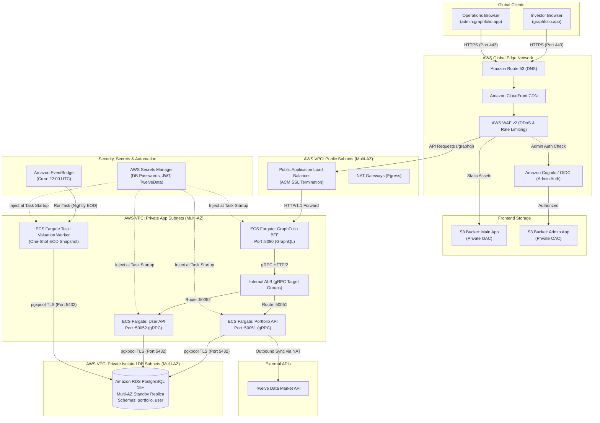
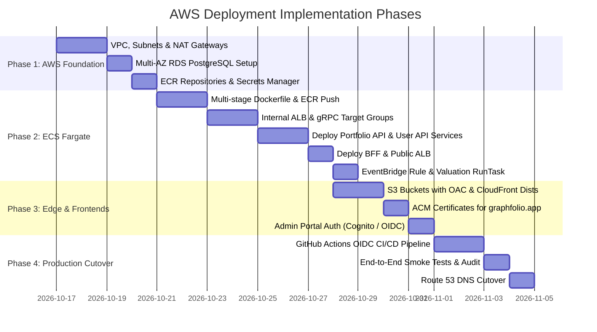

# Amazon Web Services (AWS) Deployment Plan for GraphFolio

> **Target**: Comprehensive architectural specification and deployment plan for hosting GraphFolio on **Amazon Web Services (AWS)** using **AWS ECS on Fargate**, **Amazon Aurora Serverless v2 / RDS PostgreSQL**, **Amazon CloudFront & S3**, **Application Load Balancers (ALB)**, **Amazon EventBridge**, and **AWS Secrets Manager**.  
> **Scope**: Monorepo Go microservices (`services/portfolio-api`, `services/user-api`, `bff`), Valuation background batch worker (`cmd/worker`), React 19 SPAs (`web/apps/main-app`, `web/apps/admin-app`), and production PostgreSQL database connectivity.  
> **Target Domain**: `https://graphfolio.app/` (Investor: `graphfolio.app`, Admin: `admin.graphfolio.app`, API: `api.graphfolio.app`).  
> **Key Principle**: Serverless container orchestration with zero EC2 management, strict multi-tier VPC isolation, high-precision decimal calculations, automated nightly batch execution, and least-privilege IAM security.

---

## 1. Executive Summary & AWS Topology

GraphFolio on AWS is deployed across a multi-tier, multi-AZ enterprise architecture:
- **Frontend SPAs**: Stored in private **Amazon S3** buckets and served globally via **Amazon CloudFront** with Origin Access Control (OAC) and Edge TLS.
- **Backend-for-Frontend (BFF)**: Runs in **AWS ECS on Fargate** behind an internet-facing **Application Load Balancer (ALB)**, exposing GraphQL on port 8080.
- **Domain Microservices**: `portfolio-api` and `user-api` run in ECS Fargate within private application subnets, communicating via native gRPC (HTTP/2) through an **Internal ALB** with gRPC target groups or AWS Cloud Map.
- **Valuation Worker**: Scheduled via **Amazon EventBridge** to execute as a transient **ECS Fargate Task** at market close.
- **Database**: **Amazon RDS for PostgreSQL 15+** (or Aurora PostgreSQL Serverless v2) deployed across private isolated database subnets with Multi-AZ failover and zero public internet exposure.

### AWS Architecture Diagram



---

## 2. Architectural Decisions & Strategy Trade-offs

### Decision 1: Compute Platform — ECS on Fargate vs EKS vs App Runner

| Consideration | AWS ECS on Fargate (Selected) | Amazon EKS (Kubernetes) | AWS App Runner |
| :--- | :--- | :--- | :--- |
| **Operational Overhead** | Low. Serverless containers with native AWS integration. Zero EC2 node management. | High. Requires managing control plane versions, node groups, and Kubernetes tooling. | Very Low, but limited. |
| **gRPC & HTTP/2 Support** | Native ALB gRPC target groups and Cloud Map support. | Native via ingress controllers. | HTTP/2 and gRPC support is limited or non-standard. |
| **Scheduled Batch Jobs** | Native EventBridge $\rightarrow$ `RunTask` directly runs one-shot containers. | Requires Kubernetes `CronJob`. | Does not support scheduled batch jobs. |
| **VPC & Security** | Direct ENI attachment in private VPC subnets with Security Groups. | VPC CNI plugin with Security Groups. | Basic VPC connector. |
| **Recommendation** | **AWS ECS on Fargate**. Ideal balance of enterprise isolation, native gRPC support, batch execution, and serverless maintenance. |

### Decision 2: gRPC Inter-Service Communication — Internal ALB vs AWS Cloud Map

- **Selected Approach**: **Internal Application Load Balancer (ALB) with gRPC Target Groups**.
- **Configuration**:
  - Protocol: `HTTP/2` with target type `IP` (pointing directly to Fargate task ENIs).
  - Health check: gRPC health check method or TCP ping on ports `50051` and `50052`.
- **Rationale**:
  1. The AWS Application Load Balancer natively decodes HTTP/2 frames and routes gRPC calls with built-in round-robin load balancing.
  2. Avoids client-side load balancing complexity in Go (`grpc.Dial`) while providing automatic health checking and failover across Availability Zones.

### Decision 3: Database Engine — Amazon RDS PostgreSQL vs Aurora Serverless v2

- **Selected Approach**: **Amazon RDS for PostgreSQL 15+ Multi-AZ** (Production: `db.m6g.large`, Dev: `db.t4g.medium`).
- **Rationale**:
  1. Predictable performance and cost profile for financial ledger transactions.
  2. Full support for PostgreSQL extensions (`uuid-ossp`), multi-schema architectures (`portfolio`, `user`), and fixed-point numeric calculations.
  3. Multi-AZ deployment ensures synchronous physical replication and automatic failover in $< 60$ seconds.

### Decision 4: Frontend Hosting — S3 + CloudFront + OAC

- **Selected Approach**: **Amazon S3** fronted by **Amazon CloudFront** with **Origin Access Control (OAC)**.
- **Rationale**:
  1. S3 buckets remain completely private; only CloudFront edge points can read assets.
  2. CloudFront edge points terminate SSL for `graphfolio.app` using **AWS Certificate Manager (ACM)** certificates.
  3. CloudFront Functions rewrite SPA requests (`/portfolio`, `/transactions`) to `/index.html` without extra server roundtrips.

---

## 3. Network Topology & Multi-Tier VPC Design

A dedicated VPC (`10.0.0.0/16`) spanning 3 Availability Zones (`us-east-1a`, `us-east-1b`, `us-east-1c`):

```
VPC: 10.0.0.0/16
├── Public Subnets (Internet Ingress & NAT):
│   ├── us-east-1a: 10.0.1.0/24  (Public ALB, NAT Gateway)
│   ├── us-east-1b: 10.0.2.0/24  (Public ALB)
│   └── us-east-1c: 10.0.3.0/24  (Public ALB)
│
├── Private Application Subnets (ECS Fargate & Internal ALB):
│   ├── us-east-1a: 10.0.10.0/24 (BFF, Portfolio API, User API)
│   ├── us-east-1b: 10.0.11.0/24 (BFF, Portfolio API, User API)
│   └── us-east-1c: 10.0.12.0/24 (BFF, Portfolio API, User API)
│
└── Private Isolated Database Subnets (RDS PostgreSQL):
    ├── us-east-1a: 10.0.20.0/24 (RDS Primary)
    ├── us-east-1b: 10.0.21.0/24 (RDS Multi-AZ Standby)
    └── us-east-1c: 10.0.22.0/24 (RDS Multi-AZ Standby)
```

### Security Group Ingress Chain
1. **Public ALB SG**: Allows inbound `443` from `0.0.0.0/0` (restricted via CloudFront custom header or CloudFront IP list).
2. **BFF ECS SG**: Allows inbound `8080` *only* from Public ALB SG.
3. **Internal ALB SG**: Allows inbound `50051` and `50052` *only* from BFF ECS SG.
4. **Portfolio & User API ECS SG**: Allows inbound *only* from Internal ALB SG.
5. **RDS PostgreSQL SG**: Allows inbound `5432` *only* from Portfolio API, User API, and Valuation Task SGs.

---

## 4. Containerization & Amazon ECR

Images are built using multi-stage Docker builds and stored in private **Amazon Elastic Container Registry (ECR)** repositories.

### ECR Repository Architecture
- `graphfolio/bff`
- `graphfolio/portfolio-api`
- `graphfolio/user-api`
- `graphfolio/valuation-worker`

### Production Dockerfile (`deploy/aws/Dockerfile`)

```dockerfile
# ==============================================================================
# Stage 1: Build Statically Linked Go Binaries
# ==============================================================================
FROM golang:1.24-alpine AS builder

RUN apk add --no-cache git ca-certificates tzdata

WORKDIR /workspace

# Cache Go modules
COPY go.work go.work.sum ./
COPY pkg/go.mod pkg/go.sum* ./pkg/
COPY proto/go.mod proto/go.sum* ./proto/
COPY bff/go.mod bff/go.sum* ./bff/
COPY services/portfolio-api/go.mod services/portfolio-api/go.sum* ./services/portfolio-api/
COPY services/user-api/go.mod services/user-api/go.sum* ./services/user-api/

RUN go work sync

# Copy source tree
COPY pkg/ ./pkg/
COPY proto/ ./proto/
COPY bff/ ./bff/
COPY services/portfolio-api/ ./services/portfolio-api/
COPY services/user-api/ ./services/user-api/

# Build target binary
ARG TARGET=bff
RUN CGO_ENABLED=0 GOOS=linux GOARCH=amd64 go build -ldflags="-s -w" -o /bin/app \
    $( [ "$TARGET" = "bff" ] && echo "./bff/cmd/server" ) \
    $( [ "$TARGET" = "portfolio-api" ] && echo "./services/portfolio-api/cmd/server" ) \
    $( [ "$TARGET" = "user-api" ] && echo "./services/user-api/cmd/server" ) \
    $( [ "$TARGET" = "valuation-worker" ] && echo "./services/portfolio-api/cmd/worker" )

# ==============================================================================
# Stage 2: Minimal Distroless Runtime
# ==============================================================================
FROM gcr.io/distroless/static-debian12:nonroot AS runtime

WORKDIR /app

COPY --from=builder /bin/app /app/server
COPY --from=builder /etc/ssl/certs/ca-certificates.crt /etc/ssl/certs/
COPY --from=builder /usr/share/zoneinfo /usr/share/zoneinfo

USER nonroot:nonroot

ENTRYPOINT ["/app/server"]
```

---

## 5. ECS Fargate Task Definitions & Services

### 1. BFF Service (`graphfolio-bff`)
- **CPU**: `512` (0.5 vCPU) | **Memory**: `1024` (1 GB)
- **Port**: `8080` (HTTP)
- **Desired Count**: `2` (spread across AZs)
- **Target Group**: Public ALB Target Group (`HTTP/1.1`)
- **Environment**:
  - `PORTFOLIO_API_URL`: `internal-alb.graphfolio.internal:50051`
  - `USER_API_URL`: `internal-alb.graphfolio.internal:50052`
- **Secrets from AWS Secrets Manager**:
  - `JWT_SECRET`: `arn:aws:secretsmanager:us-east-1:xxx:secret:graphfolio/jwt-secret:secret::`

### 2. Portfolio API Service (`graphfolio-portfolio-api`)
- **CPU**: `1024` (1 vCPU) | **Memory**: `2048` (2 GB)
- **Port**: `50051` (gRPC HTTP/2)
- **Desired Count**: `2`
- **Target Group**: Internal ALB Target Group (`gRPC` protocol, HTTP/2)
- **Secrets from AWS Secrets Manager**:
  - `PORTFOLIO_DB_URL`: `arn:aws:secretsmanager:us-east-1:xxx:secret:graphfolio/portfolio-db-url:secret::`
  - `TWELVE_DATA_API_KEY`: `arn:aws:secretsmanager:us-east-1:xxx:secret:graphfolio/twelve-data-key:secret::`

### 3. User API Service (`graphfolio-user-api`)
- **CPU**: `512` (0.5 vCPU) | **Memory**: `1024` (1 GB)
- **Port**: `50052` (gRPC HTTP/2)
- **Desired Count**: `2`
- **Target Group**: Internal ALB Target Group (`gRPC` protocol, HTTP/2)
- **Secrets**:
  - `USER_DB_URL`: `arn:aws:secretsmanager:us-east-1:xxx:secret:graphfolio/user-db-url:secret::`

### 4. Valuation Worker Task & EventBridge Rule
- **Execution Mode**: On-demand Fargate task.
- **Rule**: Amazon EventBridge Rule `graphfolio-eod-valuation-cron`
- **Schedule**: `cron(0 22 ? * MON-FRI *)` (Monday-Friday at 22:00 UTC)
- **Target**: ECS `RunTask` using task definition `graphfolio-valuation-worker` with launch type `FARGATE`.

---

## 6. Frontend Deployment: S3, CloudFront & Custom Domains

### S3 & CloudFront Configuration

1. **Investor Portal (`graphfolio.app` / `app.graphfolio.app`)**:
   - S3 Bucket: `graphfolio-main-app-prod` (All public access blocked).
   - CloudFront Origin: S3 with Origin Access Control (OAC).
   - Behavior: Default `/*` routes to S3.
   - Cache Policy: `Managed-CachingOptimized` for `/assets/*` (1-year TTL); No-cache for `index.html`.

2. **Admin Portal (`admin.graphfolio.app`)**:
   - S3 Bucket: `graphfolio-admin-app-prod`.
   - Security: Protected by **Amazon Cognito Hosted UI** or **CloudFront + Lambda@Edge OIDC Authorizer** verifying enterprise Google/Microsoft credentials before asset delivery.

3. **API Routing (`api.graphfolio.app`)**:
   - CloudFront Origin pointing directly to the Public ALB.
   - Behavior: `/*` forwards headers (`Authorization`, `Cookie`, `Origin`) with cache disabled (`Managed-CachingDisabled`).

### CloudFront SPA URL Rewrite Function (CloudFront Functions)

```javascript
function handler(event) {
    var request = event.request;
    var uri = request.uri;
    
    // Check whether the URI is missing a file extension
    if (!uri.includes('.')) {
        request.uri = '/index.html';
    }
    return request;
}
```

---

## 7. Domain Name Mapping & DNS Configuration (`graphfolio.app`)

This section details how to map your domain `graphfolio.app` on AWS using **Amazon Route 53**, **AWS Certificate Manager (ACM)**, **Amazon CloudFront**, and **Application Load Balancers (ALB)**.

### Domain & Subdomain Allocation Matrix

| Hostname | Target Service | AWS Provisioning Mechanism | SSL/TLS Mode | Security Layer |
| :--- | :--- | :--- | :--- | :--- |
| **`graphfolio.app`** (Apex) | Investor Portal | Route 53 Alias `A/AAAA` $\rightarrow$ CloudFront (Main App S3) | ACM Public Cert (TLS 1.3) | CloudFront OAC + AWS WAF |
| **`app.graphfolio.app`** | Investor Portal (Alt) | Route 53 Alias `A/AAAA` $\rightarrow$ CloudFront (Main App S3) | ACM Public Cert (TLS 1.3) | CloudFront OAC + AWS WAF |
| **`admin.graphfolio.app`** | Operations Portal | Route 53 Alias `A/AAAA` $\rightarrow$ CloudFront (Admin App S3) | ACM Public Cert (TLS 1.3) | **Amazon Cognito / OIDC Auth** |
| **`api.graphfolio.app`** | GraphQL API Gateway | Route 53 Alias `A/AAAA` $\rightarrow$ Public ALB / CloudFront API | ACM Public Cert (TLS 1.3) | AWS WAF v2 Rate Limiting |

### Step-by-Step Domain Mapping Procedures

#### Step 1: Provision Public Hosted Zone in Amazon Route 53
1. In the **AWS Management Console**, navigate to **Route 53** $\rightarrow$ **Hosted zones**.
2. Click **Create hosted zone**.
3. Domain name: `graphfolio.app`, Type: **Public hosted zone**.
4. Note the 4 assigned Name Servers (`ns-xxx.awsdns-xx.com...`) and update your registrar's NS records to delegate `graphfolio.app` to Route 53.

#### Step 2: Request Wildcard SSL/TLS Certificate in AWS Certificate Manager (ACM)
> [!IMPORTANT]
> To use ACM certificates with Amazon CloudFront distributions, the certificate **must** be requested in the **`us-east-1` (N. Virginia)** region.

1. Navigate to **AWS Certificate Manager (ACM)** in region `us-east-1`.
2. Click **Request certificate** $\rightarrow$ **Request a public certificate**.
3. Domain names:
   - Fully qualified domain name: `graphfolio.app`
   - Additional name: `*.graphfolio.app`
4. Validation method: **DNS validation** (Route 53 will automatically insert the CNAME validation records).
5. Once validated, status transitions to **Issued**.

#### Step 3: Configure CloudFront Distributions & Alternate Domain Names (CNAMEs)
For each CloudFront distribution:
1. **Main Investor Distribution (`graphfolio.app` & `app.graphfolio.app`)**:
   - Alternate domain names (CNAMEs): `graphfolio.app`, `app.graphfolio.app`.
   - Custom SSL certificate: Select the ACM wildcard certificate from Step 2.
   - Security policy: `TLSv1.2_2021` (or latest).
2. **Admin Distribution (`admin.graphfolio.app`)**:
   - Alternate domain names (CNAMEs): `admin.graphfolio.app`.
   - Custom SSL certificate: Select the ACM wildcard certificate.
3. **API Distribution / Public ALB (`api.graphfolio.app`)**:
   - Attach the ACM certificate to the Public ALB HTTPS :443 listener or use CloudFront API distribution.

#### Step 4: Configure Route 53 DNS Resource Records Table

Configure the following records in the `graphfolio.app` hosted zone:

| Record Name | Type | Value / Traffic Routing Target | Alias | Routing Policy |
| :--- | :--- | :--- | :---: | :--- |
| **`graphfolio.app`** | **A** | `Alias to CloudFront distribution (Main App)` | **Yes** | Simple |
| **`graphfolio.app`** | **AAAA**| `Alias to CloudFront distribution (Main App IPv6)` | **Yes** | Simple |
| **`app.graphfolio.app`** | **A** | `Alias to CloudFront distribution (Main App)` | **Yes** | Simple |
| **`app.graphfolio.app`** | **AAAA**| `Alias to CloudFront distribution (Main App IPv6)` | **Yes** | Simple |
| **`admin.graphfolio.app`** | **A** | `Alias to CloudFront distribution (Admin App)` | **Yes** | Simple |
| **`api.graphfolio.app`** | **A** | `Alias to CloudFront / Public ALB (dualstack)` | **Yes** | Simple |

#### Step 5: Lock Down `admin.graphfolio.app` with Cognito / Lambda@Edge
1. Create an Amazon Cognito User Pool with Google or Microsoft SSO identity federation.
2. Associate a **CloudFront Function** or **Lambda@Edge Viewer Request** handler on the admin distribution to verify JWT session cookies before serving S3 assets.

---

## 8. Infrastructure as Code (Terraform Specification)

Complete AWS resources defined under `deploy/aws/terraform/`:

```hcl
# main.tf
terraform {
  required_version = ">= 1.7.0"
  required_providers {
    aws = {
      source  = "hashicorp/aws"
      version = "~> 5.0"
    }
  }
}

provider "aws" {
  region = "us-east-1"
}

# 1. Multi-AZ VPC
module "vpc" {
  source  = "terraform-aws-modules/vpc/aws"
  version = "~> 5.0"

  name = "graphfolio-vpc"
  cidr = "10.0.0.0/16"

  azs              = ["us-east-1a", "us-east-1b", "us-east-1c"]
  public_subnets   = ["10.0.1.0/24", "10.0.2.0/24", "10.0.3.0/24"]
  private_subnets  = ["10.0.10.0/24", "10.0.11.0/24", "10.0.12.0/24"]
  database_subnets = ["10.0.20.0/24", "10.0.21.0/24", "10.0.22.0/24"]

  enable_nat_gateway   = true
  single_nat_gateway   = false # High availability across AZs
  enable_dns_hostnames = true
  enable_dns_support   = true
}

# 2. Multi-AZ RDS PostgreSQL
resource "aws_db_instance" "postgres" {
  identifier        = "graphfolio-rds-prod"
  engine            = "postgres"
  engine_version    = "15.7"
  instance_class    = "db.m6g.large"
  allocated_storage = 100
  storage_type      = "gp3"
  multi_az          = true

  db_name  = "graphfolio"
  username = "postgres"
  password = var.db_master_password

  db_subnet_group_name   = module.vpc.database_subnet_group_name
  vpc_security_group_ids = [aws_security_group.rds_sg.id]
  publicly_accessible    = false
  skip_final_snapshot    = false
  deletion_protection    = true
}

# 3. ECS Fargate Cluster
resource "aws_ecs_cluster" "main" {
  name = "graphfolio-cluster"
  setting {
    name  = "containerInsights"
    value = "enabled"
  }
}

# 4. Internal Application Load Balancer for gRPC
resource "aws_lb" "internal" {
  name               = "graphfolio-internal-alb"
  internal           = true
  load_balancer_type = "application"
  subnets            = module.vpc.private_subnets
  security_groups    = [aws_security_group.internal_alb_sg.id]
}

resource "aws_lb_target_group" "portfolio_grpc" {
  name                 = "tg-portfolio-grpc"
  port                 = 50051
  protocol             = "HTTP"
  protocol_version     = "GRPC"
  vpc_id               = module.vpc.vpc_id
  target_type          = "ip"

  health_check {
    protocol            = "GRPC"
    healthy_threshold   = 2
    unhealthy_threshold = 3
    matcher             = "0" # gRPC status code 0 (OK)
  }
}

# 5. Nightly Valuation Batch Job Trigger
resource "aws_cloudwatch_event_rule" "valuation_cron" {
  name                = "graphfolio-eod-valuation"
  schedule_expression = "cron(0 22 ? * MON-FRI *)"
}

resource "aws_cloudwatch_event_target" "valuation_ecs" {
  rule     = aws_cloudwatch_event_rule.valuation_cron.name
  arn      = aws_ecs_cluster.main.arn
  role_arn = aws_iam_role.eventbridge_ecs_role.arn

  ecs_target {
    task_definition_arn = aws_ecs_task_definition.valuation_worker.arn
    task_count          = 1
    launch_type         = "FARGATE"
    network_configuration {
      subnets         = module.vpc.private_subnets
      security_groups = [aws_security_group.ecs_tasks_sg.id]
    }
  }
}
```

---

## 9. Continuous Integration & Deployment (CI/CD)

Deployments run via **GitHub Actions** using **AWS IAM OpenID Connect (OIDC)** (no static IAM user credentials).

### Pipeline Workflow (`.github/workflows/deploy-aws.yml`)

```yaml
name: Deploy GraphFolio to AWS

on:
  push:
    branches: [main]
  workflow_dispatch:

permissions:
  id-token: write
  contents: read

jobs:
  build-and-push:
    name: Build & Push Images to ECR
    runs-on: ubuntu-latest
    steps:
      - uses: actions/checkout@v4

      - name: Configure AWS Credentials (OIDC)
        uses: aws-actions/configure-aws-credentials@v4
        with:
          role-to-assume: arn:aws:iam::${{ secrets.AWS_ACCOUNT_ID }}:role/github-actions-deployer
          aws-region: us-east-1

      - name: Login to Amazon ECR
        id: login-ecr
        uses: aws-actions/amazon-ecr-login@v2

      # Build and push 4 microservice images
      - name: Build & Push BFF
        run: |
          ECR_REGISTRY=${{ steps.login-ecr.outputs.registry }}
          docker build --build-arg TARGET=bff -t $ECR_REGISTRY/graphfolio/bff:${{ github.sha }} -t $ECR_REGISTRY/graphfolio/bff:latest -f deploy/aws/Dockerfile .
          docker push $ECR_REGISTRY/graphfolio/bff:${{ github.sha }}
          docker push $ECR_REGISTRY/graphfolio/bff:latest

      - name: Build & Push Portfolio API
        run: |
          ECR_REGISTRY=${{ steps.login-ecr.outputs.registry }}
          docker build --build-arg TARGET=portfolio-api -t $ECR_REGISTRY/graphfolio/portfolio-api:${{ github.sha }} -t $ECR_REGISTRY/graphfolio/portfolio-api:latest -f deploy/aws/Dockerfile .
          docker push $ECR_REGISTRY/graphfolio/portfolio-api:${{ github.sha }}
          docker push $ECR_REGISTRY/graphfolio/portfolio-api:latest

      - name: Build & Push User API
        run: |
          ECR_REGISTRY=${{ steps.login-ecr.outputs.registry }}
          docker build --build-arg TARGET=user-api -t $ECR_REGISTRY/graphfolio/user-api:${{ github.sha }} -t $ECR_REGISTRY/graphfolio/user-api:latest -f deploy/aws/Dockerfile .
          docker push $ECR_REGISTRY/graphfolio/user-api:${{ github.sha }}
          docker push $ECR_REGISTRY/graphfolio/user-api:latest

      - name: Build & Push Valuation Worker
        run: |
          ECR_REGISTRY=${{ steps.login-ecr.outputs.registry }}
          docker build --build-arg TARGET=valuation-worker -t $ECR_REGISTRY/graphfolio/valuation-worker:${{ github.sha }} -t $ECR_REGISTRY/graphfolio/valuation-worker:latest -f deploy/aws/Dockerfile .
          docker push $ECR_REGISTRY/graphfolio/valuation-worker:${{ github.sha }}
          docker push $ECR_REGISTRY/graphfolio/valuation-worker:latest

  deploy-ecs:
    name: Update ECS Services
    needs: build-and-push
    runs-on: ubuntu-latest
    steps:
      - name: Configure AWS Credentials
        uses: aws-actions/configure-aws-credentials@v4
        with:
          role-to-assume: arn:aws:iam::${{ secrets.AWS_ACCOUNT_ID }}:role/github-actions-deployer
          aws-region: us-east-1

      - name: Rolling Deploy to ECS Fargate
        run: |
          aws ecs update-service --cluster graphfolio-cluster --service graphfolio-portfolio-api --force-new-deployment
          aws ecs update-service --cluster graphfolio-cluster --service graphfolio-user-api --force-new-deployment
          aws ecs update-service --cluster graphfolio-cluster --service graphfolio-bff --force-new-deployment

  deploy-frontends:
    name: Sync Frontends to S3 & Invalidate CloudFront
    runs-on: ubuntu-latest
    steps:
      - uses: actions/checkout@v4
      - name: Setup Node.js
        uses: actions/setup-node@v4
        with:
          node-version: 22

      - name: Build Vite Apps
        run: |
          cd web
          npm ci
          VITE_GRAPHQL_ENDPOINT=https://api.graphfolio.app/graphql npm run build:main
          VITE_GRAPHQL_ENDPOINT=https://api.graphfolio.app/graphql npm run build:admin

      - name: Configure AWS Credentials
        uses: aws-actions/configure-aws-credentials@v4
        with:
          role-to-assume: arn:aws:iam::${{ secrets.AWS_ACCOUNT_ID }}:role/github-actions-deployer
          aws-region: us-east-1

      - name: Sync S3 Main App
        run: |
          aws s3 sync web/apps/main-app/dist s3://graphfolio-main-app-prod --delete
          aws cloudfront create-invalidation --distribution-id ${{ secrets.MAIN_CLOUDFRONT_DIST_ID }} --paths "/*"

      - name: Sync S3 Admin App
        run: |
          aws s3 sync web/apps/admin-app/dist s3://graphfolio-admin-app-prod --delete
          aws cloudfront create-invalidation --distribution-id ${{ secrets.ADMIN_CLOUDFRONT_DIST_ID }} --paths "/*"
```

---

## 10. Observability & Security Auditing

1. **Amazon CloudWatch Container Insights**:
   - Collects CPU, memory, network, and disk metrics from ECS Fargate tasks automatically.
2. **AWS X-Ray / OpenTelemetry**:
   - Distributed trace instrumentation passing trace headers (`X-Amzn-Trace-Id`) from CloudFront through Public ALB to the BFF and downstream gRPC services.
3. **AWS WAF v2**:
   - Deployed on CloudFront and Public ALB.
   - Rate limiting: 100 requests per 5 minutes per IP on `api.graphfolio.app/graphql`.
   - AWS Managed Rules: `AWSManagedRulesCommonRuleSet` and `AWSManagedRulesKnownBadInputsRuleSet`.
4. **AWS CloudTrail & GuardDuty**:
   - Audits all management plane API calls and alerts on anomalous network communication or IAM behavior.

---

## 11. Step-by-Step Implementation Roadmap



### Detailed Phase Checklist

#### Phase 1: AWS Foundation & Networking
- [ ] Create AWS Account & configure AWS Organizations / IAM.
- [ ] Deploy Terraform VPC with 3 Public, 3 Private App, and 3 Private DB Subnets.
- [ ] Provision Amazon RDS PostgreSQL 15+ Multi-AZ instance.
- [ ] Run `scripts/db/bootstrap.sql` to initialize `portfolio` and `user` schemas and roles.
- [ ] Create AWS Secrets Manager secrets (`graphfolio/jwt-secret`, `graphfolio/portfolio-db-url`, `graphfolio/user-db-url`, `graphfolio/twelve-data-key`).

#### Phase 2: Containerization & ECS Fargate
- [ ] Create ECR repositories for `bff`, `portfolio-api`, `user-api`, and `valuation-worker`.
- [ ] Build and push Docker images tagged with Git SHA and `latest`.
- [ ] Provision Internal ALB with HTTP/2 gRPC target groups on ports `50051` and `50052`.
- [ ] Create ECS Task Definitions referencing Secrets Manager values.
- [ ] Deploy `graphfolio-portfolio-api` and `graphfolio-user-api` ECS services with desired count = 2.
- [ ] Deploy `graphfolio-bff` connected to Public ALB.
- [ ] Configure EventBridge Rule to trigger the valuation worker Fargate task at `22:00 UTC`.

#### Phase 3: Edge Delivery & Frontends
- [ ] Create private S3 buckets `graphfolio-main-app-prod` and `graphfolio-admin-app-prod`.
- [ ] Deploy CloudFront distributions with Origin Access Control (OAC).
- [ ] Attach CloudFront Function for SPA rewrite (`/index.html`).
- [ ] Request ACM wildcard SSL certificate for `graphfolio.app` and `*.graphfolio.app`.
- [ ] Configure AWS WAF v2 on CloudFront.

#### Phase 4: CI/CD & Cutover
- [ ] Set up GitHub Actions OIDC role in IAM.
- [ ] Run automated build, test, and push workflow.
- [ ] Execute smoke testing checklist.
- [ ] Point Route 53 alias records for `graphfolio.app`, `admin.graphfolio.app`, and `api.graphfolio.app` to CloudFront.

---

## 12. Smoke Testing & Verification Checklist

| Test Item | Verification Target | Expected Result |
| :--- | :--- | :--- |
| **BFF Health Check** | `curl -f https://api.graphfolio.app/healthz` | HTTP 200 `{"status":"healthy"}` |
| **GraphQL Introspection** | `curl -X POST https://api.graphfolio.app/graphql -H "Content-Type: application/json" -d '{"query":"{ __typename }"}'` | HTTP 200 `{"data":{"__typename":"Query"}}` |
| **Internal gRPC Routing** | Submit `query { me { portfolio { summary { totalValue { amount } } } } }` | HTTP 200 with precision decimal values (BFF $\rightarrow$ Internal ALB $\rightarrow$ Portfolio API) |
| **Session Cookie Security** | Submit `mutation { login(...) }` | Response contains `Set-Cookie: refresh_token=...; Domain=.graphfolio.app; Secure; HttpOnly; SameSite=None` |
| **CORS Policy** | `curl -I -X OPTIONS https://api.graphfolio.app/graphql -H "Origin: https://graphfolio.app"` | HTTP 204 with `Access-Control-Allow-Origin: https://graphfolio.app` |
| **CloudFront Asset Cache** | `curl -I https://graphfolio.app/assets/index.js` | `x-cache: Hit from cloudfront` |
| **Scheduled Batch Task** | Trigger EventBridge Rule manually via AWS CLI `aws events put-events` | ECS Fargate task launches, computes daily valuation, and exits with code 0 |
| **Database Isolation** | Attempt to connect to RDS endpoint from outside VPC | Connection times out (zero public access) |
