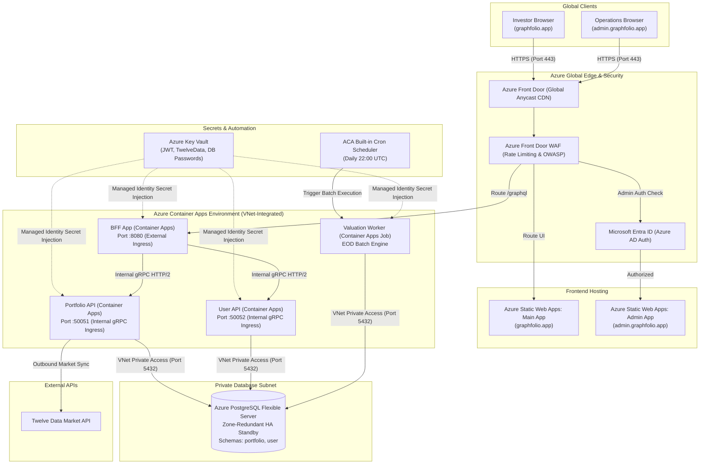
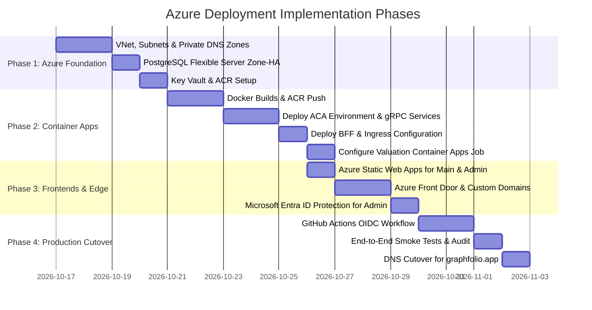

# Microsoft Azure Deployment Plan for GraphFolio

> **Target**: Comprehensive architectural specification and deployment plan for hosting GraphFolio on **Microsoft Azure** using **Azure Container Apps (ACA)**, **Azure Database for PostgreSQL - Flexible Server (Zone-Redundant HA)**, **Azure Front Door**, **Azure Static Web Apps (SWA)**, **Azure Key Vault**, and **Azure Container Apps Jobs**.  
> **Scope**: Monorepo Go microservices (`services/portfolio-api`, `services/user-api`, `bff`), Valuation background batch worker (`cmd/worker`), React 19 SPAs (`web/apps/main-app`, `web/apps/admin-app`), and production PostgreSQL database connectivity.  
> **Target Domain**: `https://graphfolio.app/` (Investor: `graphfolio.app`, Admin: `admin.graphfolio.app`, API: `api.graphfolio.app`).  
> **Key Principle**: Modern serverless container orchestration, built-in gRPC microservice mesh over HTTP/2, private virtual network isolation, zero-downtime zone redundancy, and enterprise Microsoft Entra ID (Azure AD) security.

---

## 1. Executive Summary & Azure Topology

GraphFolio on Microsoft Azure is architected around a serverless, microservice-native container foundation:
- **Frontend SPAs**: Deployed to **Azure Static Web Apps (SWA)** or Azure Blob Storage fronted by **Azure Front Door**, providing global CDN acceleration, custom domain routing, and automatic SSL termination.
- **Backend-for-Frontend (BFF)**: Hosted on **Azure Container Apps (ACA)** with external HTTP ingress on port 8080 terminating client GraphQL queries.
- **Domain Microservices**: `portfolio-api` and `user-api` deployed as internal **Azure Container Apps** communicating over native **gRPC (HTTP/2)** within a secure, private Virtual Network (VNet).
- **Valuation Batch Engine**: An **Azure Container Apps Job** scheduled to run nightly at 22:00 UTC, terminating immediately after snapshot computation.
- **Database**: **Azure Database for PostgreSQL - Flexible Server** with Zone-Redundant High Availability and VNet Private Access (zero public internet exposure).

### Azure Architecture Diagram



---

## 2. Architectural Decisions & Strategy Trade-offs

### Decision 1: Compute Platform — Azure Container Apps (ACA) vs Azure Kubernetes Service (AKS) vs App Service

| Consideration | Azure Container Apps (Selected) | Azure Kubernetes Service (AKS) | Azure App Service (Linux Containers) |
| :--- | :--- | :--- | :--- |
| **Operational Overhead** | Minimal. Serverless Kubernetes abstraction with zero control-plane management. | High. Requires managing cluster upgrades, node pools, and K8s manifests. | Moderate. Limited microservice mesh and gRPC routing. |
| **gRPC & HTTP/2 Support** | Native HTTP/2 gRPC ingress for internal microservices with built-in service discovery. | Native via Ingress-NGINX or Istio. | Complex gRPC proxying configuration. |
| **Scheduled Batch Jobs** | Native **Container Apps Jobs** with built-in cron triggers and event triggers. | Kubernetes `CronJob`. | Requires Azure WebJobs or external Azure Functions. |
| **Cost Profile** | True scale-to-zero per-second billing with free monthly tier (180k vCPU-s, 360k GiB-s). | Fixed cluster node pool costs (~$80–$150/mo minimum). | Fixed App Service Plan tier pricing (~$75/mo minimum). |
| **Recommendation** | **Azure Container Apps & Jobs**. Delivers cloud-native microservice agility, native gRPC, and scale-to-zero cost savings. |

### Decision 2: gRPC Inter-Service Communication — Internal Envoy Ingress

- **Selected Approach**: **Azure Container Apps Internal Ingress with transport `http2` / `auto`**.
- **Configuration**:
  - `portfolio-api`: Ingress `Internal`, Target Port `50051`, Transport: `http2`.
  - `user-api`: Ingress `Internal`, Target Port `50052`, Transport: `http2`.
  - DNS Resolution: Container Apps provides internal service discovery via `http://portfolio-api:50051` and `http://user-api:50052`.
- **Rationale**:
  1. ACA utilizes an embedded Envoy reverse proxy per environment that natively decodes HTTP/2 frames, multiplexes gRPC streams, and handles automatic service discovery without requiring an external load balancer.
  2. Eliminates the need for Azure Application Gateway or Azure Private Link between internal microservices.

### Decision 3: Database & High Availability — Azure PostgreSQL Flexible Server

- **Selected Approach**: **Azure Database for PostgreSQL - Flexible Server** with **Zone-Redundant High Availability** (Production: `Standard_D2ds_v5`, 2 vCPU, 8 GB RAM, 128 GB SSD).
- **Rationale**:
  1. Zone-redundant HA automatically replicates data synchronously across two availability zones with sub-60-second automatic failover.
  2. Integrated into the ACA Virtual Network via **VNet Injection (Delegated Subnet)**, ensuring 100% private database communication with zero public IP exposure.
  3. Native support for `shopspring/decimal`, UUID extensions, and multi-schema partitioning (`portfolio` and `user`).

### Decision 4: Frontend Hosting — Azure Static Web Apps (SWA) vs Azure Blob Storage

- **Selected Approach**: **Azure Static Web Apps (SWA)**.
- **Rationale**:
  1. Global geo-distributed content delivery with automated custom domains and free managed SSL certificates.
  2. Built-in authentication providers for Microsoft Entra ID and Google to protect `admin.graphfolio.app`.
  3. Direct GitHub Actions integration with automated PR preview environments.

---

## 3. Network Topology & Virtual Network (VNet) Design

A dedicated Azure Virtual Network (`10.0.0.0/16`) in `eastus2` spanning 3 Availability Zones:

```
Virtual Network: graphfolio-vnet (10.0.0.0/16)
├── Subnet 1: Container Apps Infrastructure (10.0.1.0/23)
│   └── Delegated to: Microsoft.App/environments (BFF, Portfolio API, User API, Jobs)
│
├── Subnet 2: PostgreSQL Flexible Server (10.0.4.0/24)
│   └── Delegated to: Microsoft.DBforPostgreSQL/flexibleServers (Private Access)
│
└── Subnet 3: Private Endpoints / Management (10.0.5.0/24)
    └── Private Endpoints for Azure Key Vault & Azure Container Registry
```

### Network Security Groups (NSG) Rules
1. **Container Apps Subnet NSG**: Allows inbound `8080` from Azure Front Door (enforced via `X-Azure-FDID` header validation). Denies direct public access to ports `50051` and `50052`.
2. **PostgreSQL Subnet NSG**: Allows inbound `5432` *only* from the Container Apps subnet (`10.0.1.0/23`). Denies all other inbound traffic.

---

## 4. Containerization & Azure Container Registry (ACR)

Images are built using multi-stage Dockerfiles and pushed to private **Azure Container Registry (ACR)** (`graphfolioregistry.azurecr.io`).

### Production Dockerfile (`deploy/azure/Dockerfile`)

```dockerfile
# ==============================================================================
# Stage 1: Build Statically Linked Go Binaries
# ==============================================================================
FROM golang:1.24-alpine AS builder

RUN apk add --no-cache git ca-certificates tzdata

WORKDIR /workspace

# Cache Go modules
COPY go.work go.work.sum ./
COPY pkg/go.mod pkg/go.sum* ./pkg/
COPY proto/go.mod proto/go.sum* ./proto/
COPY bff/go.mod bff/go.sum* ./bff/
COPY services/portfolio-api/go.mod services/portfolio-api/go.sum* ./services/portfolio-api/
COPY services/user-api/go.mod services/user-api/go.sum* ./services/user-api/

RUN go work sync

# Copy source tree
COPY pkg/ ./pkg/
COPY proto/ ./proto/
COPY bff/ ./bff/
COPY services/portfolio-api/ ./services/portfolio-api/
COPY services/user-api/ ./services/user-api/

# Build target binary
ARG TARGET=bff
RUN CGO_ENABLED=0 GOOS=linux GOARCH=amd64 go build -ldflags="-s -w" -o /bin/app \
    $( [ "$TARGET" = "bff" ] && echo "./bff/cmd/server" ) \
    $( [ "$TARGET" = "portfolio-api" ] && echo "./services/portfolio-api/cmd/server" ) \
    $( [ "$TARGET" = "user-api" ] && echo "./services/user-api/cmd/server" ) \
    $( [ "$TARGET" = "valuation-worker" ] && echo "./services/portfolio-api/cmd/worker" )

# ==============================================================================
# Stage 2: Distroless Minimal Runtime
# ==============================================================================
FROM gcr.io/distroless/static-debian12:nonroot AS runtime

WORKDIR /app

COPY --from=builder /bin/app /app/server
COPY --from=builder /etc/ssl/certs/ca-certificates.crt /etc/ssl/certs/
COPY --from=builder /usr/share/zoneinfo /usr/share/zoneinfo

USER nonroot:nonroot

ENTRYPOINT ["/app/server"]
```

---

## 5. Azure Container Apps Specifications

### 1. BFF Service (`graphfolio-bff`)
- **Ingress**: External (Accepting traffic from Azure Front Door)
- **Target Port**: `8080` (HTTP/1.1 and HTTP/2)
- **CPU / Memory**: `0.5 vCPU` / `1.0 GiB`
- **Scale**: Min Replicas: `1` (eliminates cold starts), Max Replicas: `10`
- **Environment Variables**:
  - `PORTFOLIO_API_URL`: `portfolio-api:50051`
  - `USER_API_URL`: `user-api:50052`
- **Secret References (from Key Vault via Managed Identity)**:
  - `JWT_SECRET`: `keyvault-ref:jwt-secret`

### 2. Portfolio API Service (`portfolio-api`)
- **Ingress**: Internal (Accessible only within Container Apps Environment)
- **Target Port**: `50051`
- **Transport**: `http2` (Enables end-to-end gRPC multiplexing)
- **CPU / Memory**: `1.0 vCPU` / `2.0 GiB`
- **Scale**: Min Replicas: `1`, Max Replicas: `10`
- **Secret References**:
  - `PORTFOLIO_DB_URL`: `keyvault-ref:portfolio-db-url`
  - `TWELVE_DATA_API_KEY`: `keyvault-ref:twelve-data-key`

### 3. User API Service (`user-api`)
- **Ingress**: Internal
- **Target Port**: `50052`
- **Transport**: `http2`
- **CPU / Memory**: `0.5 vCPU` / `1.0 GiB`
- **Scale**: Min Replicas: `0` (scales to zero when idle), Max Replicas: `5`
- **Secret References**:
  - `USER_DB_URL`: `keyvault-ref:user-db-url`

### 4. Valuation Worker Batch Job (`graphfolio-valuation-job`)
- **Type**: **Azure Container Apps Job**
- **Trigger**: Schedule (Cron: `0 22 * * 1-5`, UTC Mon-Fri)
- **CPU / Memory**: `1.0 vCPU` / `2.0 GiB`
- **Replica Timeout**: `1800s` (30 mins)
- **Retry Limit**: `1`
- **Secret References**:
  - `PORTFOLIO_DB_URL`: `keyvault-ref:portfolio-db-url`

---

## 6. Frontend Deployment: Azure Static Web Apps & Front Door

### 1. Investor Portal (`graphfolio.app` / `app.graphfolio.app`)
- **Hosting**: Azure Static Web Apps (Standard Tier)
- **Build Output**: `web/apps/main-app/dist`
- **Custom Domain**: `graphfolio.app` with Azure-managed auto-renewing SSL certificate
- **Routing Configuration (`staticwebapp.config.json`)**:
```json
{
  "navigationFallback": {
    "rewrite": "/index.html",
    "exclude": ["/assets/*", "/*.{png,jpg,gif,svg,ico,css,js}"]
  },
  "globalHeaders": {
    "Strict-Transport-Security": "max-age=31536000; includeSubDomains; preload",
    "X-Content-Type-Options": "nosniff",
    "X-Frame-Options": "DENY"
  }
}
```

### 2. Admin Portal (`admin.graphfolio.app`)
- **Hosting**: Azure Static Web Apps (Standard Tier)
- **Build Output**: `web/apps/admin-app/dist`
- **Access Control**: Integrated with **Microsoft Entra ID**; only authenticated members of the `GraphFolio Admins` enterprise security group can access the route.

### 3. Azure Front Door & WAF Configuration
- Routes `https://api.graphfolio.app/graphql` directly to the `graphfolio-bff` ACA ingress.
- Enforces WAF rate limiting: 100 requests per 5 minutes per client IP.
- Enforces SSL/TLS 1.3 termination with HTTP-to-HTTPS redirection.

---

## 7. Domain Name Mapping & DNS Configuration (`graphfolio.app`)

This section details how to map your domain `graphfolio.app` on Microsoft Azure using **Azure DNS**, **Azure Front Door**, **Azure Static Web Apps (SWA)**, and **Microsoft Entra ID**.

### Domain & Subdomain Allocation Matrix

| Hostname | Target Service | Azure Provisioning Mechanism | SSL/TLS Mode | Security Layer |
| :--- | :--- | :--- | :--- | :--- |
| **`graphfolio.app`** (Apex) | Investor Portal | Azure DNS Alias Record $\rightarrow$ Front Door / SWA | Managed Free SSL (TLS 1.3) | Front Door WAF + Global CDN |
| **`app.graphfolio.app`** | Investor Portal (Alt) | Azure DNS CNAME $\rightarrow$ Front Door / SWA | Managed Free SSL (TLS 1.3) | Front Door WAF + Global CDN |
| **`admin.graphfolio.app`** | Operations Portal | Azure DNS CNAME $\rightarrow$ Azure Static Web App | Managed Free SSL (TLS 1.3) | **Microsoft Entra ID (Azure AD)** |
| **`api.graphfolio.app`** | GraphQL API Gateway | Azure DNS CNAME $\rightarrow$ Front Door $\rightarrow$ Container App | Managed Free SSL (TLS 1.3) | Front Door WAF Rate Limiting |

### Step-by-Step Domain Mapping Procedures

#### Step 1: Provision Public DNS Zone in Azure DNS
1. In the **Azure Portal**, search for **DNS zones** $\rightarrow$ click **Create**.
2. Resource Group: `rg-graphfolio-prod`, Name: `graphfolio.app`.
3. Review the assigned Azure Name Servers (`ns1-xx.azure-dns.com...`) and delegate `graphfolio.app` at your domain registrar.

#### Step 2: Map Domains in Azure Front Door
1. In the Azure Portal, navigate to your Azure Front Door profile.
2. Under **Settings** $\rightarrow$ **Domains**, click **+ Add a domain**.
3. Add custom domains:
   - `graphfolio.app` (Apex)
   - `app.graphfolio.app`
   - `admin.graphfolio.app`
   - `api.graphfolio.app`
4. Set **DNS state**: Use Azure DNS zone integration or TXT record validation (`_dnsauth.graphfolio.app`).
5. Set **Certificate management type**: **Azure-managed** (free, auto-renewing SSL certificate).
6. Enable **Minimum TLS version**: **TLS 1.2 / TLS 1.3**.

#### Step 3: Configure Azure Front Door Routing Rules
- **Route 1 (`graphfolio.app` & `app.graphfolio.app`)**:
  - Origin: Azure Static Web Apps (or Blob Storage Static Website).
  - Forwarding protocol: `HTTPS only`.
  - Caching: Enabled with query string caching.
- **Route 2 (`admin.graphfolio.app`)**:
  - Origin: Azure Static Web Apps (Admin App).
  - Linked to Microsoft Entra ID enterprise app registration.
- **Route 3 (`api.graphfolio.app`)**:
  - Origin: `graphfolio-bff` Azure Container App FQDN.
  - Caching: Disabled.
  - Forwarding: Pass all headers, cookies, and CORS methods.

#### Step 4: Configure Azure DNS Zone Records Table

Configure the following records in the `graphfolio.app` DNS Zone:

| Record Name | Type | Value / Routing Target | Alias Record Set | TTL |
| :--- | :--- | :--- | :---: | :--- |
| **`@` (`graphfolio.app`)** | **A** | `Alias to Azure Front Door Profile` | **Yes** | 3600 |
| **`@` (`graphfolio.app`)** | **AAAA**| `Alias to Azure Front Door Profile` | **Yes** | 3600 |
| **`app`** | **CNAME**| `<frontdoor-endpoint>.z01.azurefd.net` | **No** | 3600 |
| **`admin`** | **CNAME**| `<admin-swa-name>.azurestaticapps.net` | **No** | 3600 |
| **`api`** | **CNAME**| `<frontdoor-endpoint>.z01.azurefd.net` | **No** | 3600 |
| **`_dnsauth`** | **TXT** | Azure Front Door validation token | **No** | 3600 |

#### Step 5: Lock Down `admin.graphfolio.app` with Microsoft Entra ID
1. In Azure Portal, navigate to **Microsoft Entra ID** $\rightarrow$ **App registrations** $\rightarrow$ **New registration**.
2. Register `GraphFolio Operations Admin`. Redirect URI: `https://admin.graphfolio.app/.auth/login/aad/callback`.
3. Under **Azure Static Web Apps** for the admin app, configure enterprise authentication in `staticwebapp.config.json` restricting access to authorized Entra security group IDs.

---

## 8. Infrastructure as Code (Terraform Specification)

Complete Terraform definition under `deploy/azure/terraform/`:

```hcl
# main.tf
terraform {
  required_version = ">= 1.7.0"
  required_providers {
    azurerm = {
      source  = "hashicorp/azurerm"
      version = "~> 4.0"
    }
  }
}

provider "azurerm" {
  features {}
}

# 1. Resource Group
resource "azurerm_resource_group" "rg" {
  name     = "rg-graphfolio-prod"
  location = "eastus2"
}

# 2. Virtual Network & Subnets
resource "azurerm_virtual_network" "vnet" {
  name                = "graphfolio-vnet"
  location            = azurerm_resource_group.rg.location
  resource_group_name = azurerm_resource_group.rg.name
  address_space       = ["10.0.0.0/16"]
}

resource "azurerm_subnet" "aca_subnet" {
  name                 = "snet-container-apps"
  resource_group_name  = azurerm_resource_group.rg.name
  virtual_network_name = azurerm_virtual_network.vnet.name
  address_prefixes     = ["10.0.1.0/23"]

  delegation {
    name = "aca-delegation"
    service_delegation {
      name    = "Microsoft.App/environments"
      actions = ["Microsoft.Network/virtualNetworks/subnets/join/action"]
    }
  }
}

resource "azurerm_subnet" "postgres_subnet" {
  name                 = "snet-postgres"
  resource_group_name  = azurerm_resource_group.rg.name
  virtual_network_name = azurerm_virtual_network.vnet.name
  address_prefixes     = ["10.0.4.0/24"]

  delegation {
    name = "postgres-delegation"
    service_delegation {
      name    = "Microsoft.DBforPostgreSQL/flexibleServers"
      actions = ["Microsoft.Network/virtualNetworks/subnets/join/action"]
    }
  }
}

# 3. PostgreSQL Flexible Server (Zone-Redundant HA)
resource "azurerm_postgresql_flexible_server" "postgres" {
  name                   = "psql-graphfolio-prod"
  resource_group_name    = azurerm_resource_group.rg.name
  location               = azurerm_resource_group.rg.location
  version                = "15"
  delegated_subnet_id    = azurerm_subnet.postgres_subnet.id
  private_dns_zone_id    = azurerm_private_dns_zone.postgres.id
  sku_name               = "GP_Standard_D2ds_v5"
  storage_mb             = 131072
  administrator_login    = "postgres"
  administrator_password = var.db_master_password

  high_availability {
    mode                      = "ZoneRedundant"
    standby_availability_zone = "2"
  }

  zone = "1"
}

# 4. Azure Container Apps Managed Environment
resource "azurerm_container_app_environment" "aca_env" {
  name                       = "aca-env-graphfolio"
  location                   = azurerm_resource_group.rg.location
  resource_group_name        = azurerm_resource_group.rg.name
  infrastructure_subnet_id   = azurerm_subnet.aca_subnet.id
}

# 5. Portfolio API Service (Internal gRPC Ingress)
resource "azurerm_container_app" "portfolio_api" {
  name                         = "portfolio-api"
  container_app_environment_id = azurerm_container_app_environment.aca_env.id
  resource_group_name          = azurerm_resource_group.rg.name
  revision_mode                = "Single"

  template {
    min_replicas = 1
    max_replicas = 10

    container {
      name   = "portfolio-api"
      image  = "${azurerm_container_registry.acr.login_server}/graphfolio/portfolio-api:latest"
      cpu    = 1.0
      memory = "2.0Gi"
    }
  }

  ingress {
    external_enabled = false
    target_port      = 50051
    transport        = "http2" # Native gRPC support
  }
}

# 6. BFF Service (External Ingress)
resource "azurerm_container_app" "bff" {
  name                         = "graphfolio-bff"
  container_app_environment_id = azurerm_container_app_environment.aca_env.id
  resource_group_name          = azurerm_resource_group.rg.name
  revision_mode                = "Single"

  template {
    min_replicas = 1
    max_replicas = 10

    container {
      name   = "bff"
      image  = "${azurerm_container_registry.acr.login_server}/graphfolio/bff:latest"
      cpu    = 0.5
      memory = "1.0Gi"

      env {
        name  = "PORTFOLIO_API_URL"
        value = "portfolio-api:50051"
      }
      env {
        name  = "USER_API_URL"
        value = "user-api:50052"
      }
    }
  }

  ingress {
    external_enabled = true
    target_port      = 8080
    traffic_weight {
      percentage      = 100
      latest_revision = true
    }
  }
}
```

---

## 9. Continuous Integration & Deployment (CI/CD)

Deployments run via **GitHub Actions** using **Azure Federated Credentials (OIDC)** (no static client secrets).

### Pipeline Workflow (`.github/workflows/deploy-azure.yml`)

```yaml
name: Deploy GraphFolio to Microsoft Azure

on:
  push:
    branches: [main]
  workflow_dispatch:

permissions:
  id-token: write
  contents: read

jobs:
  build-and-push:
    name: Build & Push Images to ACR
    runs-on: ubuntu-latest
    steps:
      - uses: actions/checkout@v4

      - name: Log in to Azure (OIDC)
        uses: azure/login@v2
        with:
          client-id: ${{ secrets.AZURE_CLIENT_ID }}
          tenant-id: ${{ secrets.AZURE_TENANT_ID }}
          subscription-id: ${{ secrets.AZURE_SUBSCRIPTION_ID }}

      - name: Log in to Azure Container Registry
        run: az acr login --name ${{ secrets.ACR_NAME }}

      # Build & Push 4 Docker Images
      - name: Build & Push BFF
        run: |
          docker build --build-arg TARGET=bff -t ${{ secrets.ACR_NAME }}.azurecr.io/graphfolio/bff:${{ github.sha }} -t ${{ secrets.ACR_NAME }}.azurecr.io/graphfolio/bff:latest -f deploy/azure/Dockerfile .
          docker push ${{ secrets.ACR_NAME }}.azurecr.io/graphfolio/bff:${{ github.sha }}
          docker push ${{ secrets.ACR_NAME }}.azurecr.io/graphfolio/bff:latest

      - name: Build & Push Portfolio API
        run: |
          docker build --build-arg TARGET=portfolio-api -t ${{ secrets.ACR_NAME }}.azurecr.io/graphfolio/portfolio-api:${{ github.sha }} -t ${{ secrets.ACR_NAME }}.azurecr.io/graphfolio/portfolio-api:latest -f deploy/azure/Dockerfile .
          docker push ${{ secrets.ACR_NAME }}.azurecr.io/graphfolio/portfolio-api:${{ github.sha }}
          docker push ${{ secrets.ACR_NAME }}.azurecr.io/graphfolio/portfolio-api:latest

      - name: Build & Push User API
        run: |
          docker build --build-arg TARGET=user-api -t ${{ secrets.ACR_NAME }}.azurecr.io/graphfolio/user-api:${{ github.sha }} -t ${{ secrets.ACR_NAME }}.azurecr.io/graphfolio/user-api:latest -f deploy/azure/Dockerfile .
          docker push ${{ secrets.ACR_NAME }}.azurecr.io/graphfolio/user-api:${{ github.sha }}
          docker push ${{ secrets.ACR_NAME }}.azurecr.io/graphfolio/user-api:latest

      - name: Build & Push Valuation Worker
        run: |
          docker build --build-arg TARGET=valuation-worker -t ${{ secrets.ACR_NAME }}.azurecr.io/graphfolio/valuation-worker:${{ github.sha }} -t ${{ secrets.ACR_NAME }}.azurecr.io/graphfolio/valuation-worker:latest -f deploy/azure/Dockerfile .
          docker push ${{ secrets.ACR_NAME }}.azurecr.io/graphfolio/valuation-worker:${{ github.sha }}
          docker push ${{ secrets.ACR_NAME }}.azurecr.io/graphfolio/valuation-worker:latest

  deploy-apps:
    name: Deploy to Container Apps
    needs: build-and-push
    runs-on: ubuntu-latest
    steps:
      - name: Log in to Azure (OIDC)
        uses: azure/login@v2
        with:
          client-id: ${{ secrets.AZURE_CLIENT_ID }}
          tenant-id: ${{ secrets.AZURE_TENANT_ID }}
          subscription-id: ${{ secrets.AZURE_SUBSCRIPTION_ID }}

      - name: Update Portfolio API Revision
        run: |
          az containerapp update --name portfolio-api --resource-group rg-graphfolio-prod --image ${{ secrets.ACR_NAME }}.azurecr.io/graphfolio/portfolio-api:${{ github.sha }}

      - name: Update User API Revision
        run: |
          az containerapp update --name user-api --resource-group rg-graphfolio-prod --image ${{ secrets.ACR_NAME }}.azurecr.io/graphfolio/user-api:${{ github.sha }}

      - name: Update BFF Revision
        run: |
          az containerapp update --name graphfolio-bff --resource-group rg-graphfolio-prod --image ${{ secrets.ACR_NAME }}.azurecr.io/graphfolio/bff:${{ github.sha }}

  deploy-frontend:
    name: Deploy Static Web Apps
    runs-on: ubuntu-latest
    steps:
      - uses: actions/checkout@v4
      - name: Setup Node.js
        uses: actions/setup-node@v4
        with:
          node-version: 22

      - name: Build Vite Apps
        run: |
          cd web
          npm ci
          VITE_GRAPHQL_ENDPOINT=https://api.graphfolio.app/graphql npm run build:main
          VITE_GRAPHQL_ENDPOINT=https://api.graphfolio.app/graphql npm run build:admin

      - name: Deploy Main App to Azure SWA
        uses: Azure/static-web-apps-deploy@v1
        with:
          azure_static_web_apps_api_token: ${{ secrets.AZURE_SWA_MAIN_TOKEN }}
          app_location: "web/apps/main-app/dist"
          skip_app_build: true

      - name: Deploy Admin App to Azure SWA
        uses: Azure/static-web-apps-deploy@v1
        with:
          azure_static_web_apps_api_token: ${{ secrets.AZURE_SWA_ADMIN_TOKEN }}
          app_location: "web/apps/admin-app/dist"
          skip_app_build: true
```

---

## 10. Observability & Monitoring

1. **Azure Monitor & Log Analytics**:
   - Container Apps stdout and stderr stream directly into a Log Analytics Workspace (`ala-graphfolio-prod`).
2. **Application Insights / OpenTelemetry**:
   - Live metrics streaming, end-to-end distributed transaction tracing (`traceparent`), and application map visualization.
3. **Azure Front Door WAF Metrics**:
   - Tracks rate-limiting violations, blocked SQL injection attempts, and geographical request patterns.

---

## 11. Step-by-Step Implementation Roadmap



### Detailed Phase Checklist

#### Phase 1: Azure Foundation & Networking
- [ ] Create Azure Resource Group `rg-graphfolio-prod` in `eastus2`.
- [ ] Deploy Virtual Network `graphfolio-vnet` with delegated subnets for Container Apps and PostgreSQL.
- [ ] Provision Azure Database for PostgreSQL Flexible Server with Zone-Redundant High Availability.
- [ ] Execute `scripts/db/bootstrap.sql` to initialize `portfolio` and `user` schemas.
- [ ] Deploy Azure Key Vault and configure User-Assigned Managed Identity.

#### Phase 2: Container Apps & Microservices
- [ ] Create Azure Container Registry `graphfolioregistry.azurecr.io`.
- [ ] Build and push Go microservice images (`bff`, `portfolio-api`, `user-api`, `valuation-worker`).
- [ ] Provision Azure Container Apps Environment integrated into the VNet.
- [ ] Deploy `portfolio-api` and `user-api` with transport `http2` and internal ingress.
- [ ] Deploy `graphfolio-bff` with external ingress.
- [ ] Create `graphfolio-valuation-job` scheduled for `22:00 UTC`.

#### Phase 3: Edge & Frontends
- [ ] Deploy Azure Static Web Apps for `main-app` and `admin-app`.
- [ ] Set up custom domains `graphfolio.app` and `admin.graphfolio.app`.
- [ ] Configure Microsoft Entra ID enterprise authentication for `admin.graphfolio.app`.
- [ ] Set up Azure Front Door with WAF rate limiting on `api.graphfolio.app/graphql`.

#### Phase 4: CI/CD & Cutover
- [ ] Configure GitHub Actions OIDC federated credentials in Azure AD.
- [ ] Deploy GitHub Actions workflow `.github/workflows/deploy-azure.yml`.
- [ ] Run full smoke test verification suite.
- [ ] Point apex and subdomain DNS records to Azure Front Door.

---

## 12. Smoke Testing & Verification Checklist

| Test Item | Verification Method | Expected Result |
| :--- | :--- | :--- |
| **BFF Health Check** | `curl -f https://api.graphfolio.app/healthz` | HTTP 200 `{"status":"healthy"}` |
| **GraphQL Introspection** | `curl -X POST https://api.graphfolio.app/graphql -H "Content-Type: application/json" -d '{"query":"{ __typename }"}'` | HTTP 200 `{"data":{"__typename":"Query"}}` |
| **Internal gRPC Multiplexing** | Submit `query { me { portfolio { summary { totalValue { amount } } } } }` | HTTP 200 with precision decimal values (confirms Envoy HTTP/2 gRPC loop) |
| **Session Cookie Security** | Submit `mutation { login(...) }` | Response contains `Set-Cookie: refresh_token=...; Domain=.graphfolio.app; Secure; HttpOnly; SameSite=None` |
| **CORS Policy** | `curl -I -X OPTIONS https://api.graphfolio.app/graphql -H "Origin: https://graphfolio.app"` | HTTP 204 with `Access-Control-Allow-Origin: https://graphfolio.app` |
| **Admin Entra ID Lockdown** | Open `https://admin.graphfolio.app` in incognito browser | Redirected to Microsoft Entra ID / Microsoft 365 login screen |
| **Static Web App Cache** | `curl -I https://graphfolio.app/assets/index.js` | `x-cache: HIT` from Azure edge CDN |
| **Nightly Batch Job Execution** | Trigger `az containerapp job start --name graphfolio-valuation-job` | Job executes, computes snapshot, and terminates with status `Succeeded` |
| **Database VNet Isolation** | Attempt to connect to PostgreSQL endpoint from outside VNet | Connection times out (zero public internet exposure) |
