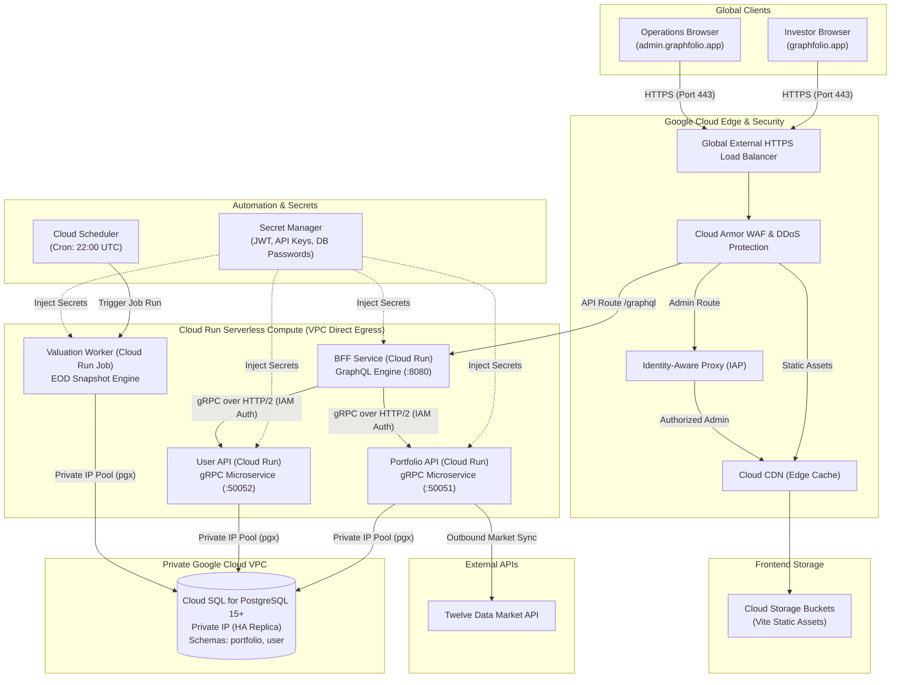
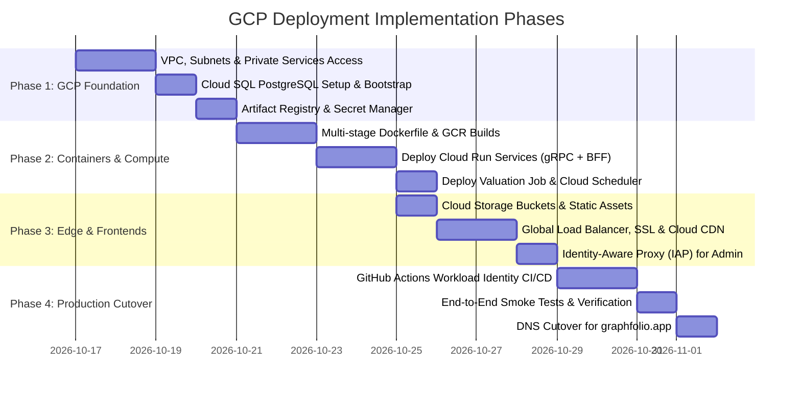

# Google Cloud Platform (GCP) Deployment Plan for GraphFolio

> **Target**: Comprehensive architectural specification and deployment plan for hosting the GraphFolio financial portfolio platform on **Google Cloud Platform (GCP)** using **Cloud Run**, **Cloud SQL for PostgreSQL**, **Cloud Load Balancing & Cloud CDN**, **Cloud Run Jobs**, **Cloud Scheduler**, and **Secret Manager**.  
> **Scope**: Monorepo Go microservices (`services/portfolio-api`, `services/user-api`, `bff`), Valuation background worker (`cmd/worker`), React 19 SPAs (`web/apps/main-app`, `web/apps/admin-app`), and production PostgreSQL database connectivity.  
> **Target Domain**: `https://graphfolio.app/` (Investor: `graphfolio.app`, Admin: `admin.graphfolio.app`, API: `api.graphfolio.app`).  
> **Key Principle**: Serverless agility with zero idle waste, enterprise-grade private networking (no public database access), high-precision decimal calculation preservation, and end-to-end zero-trust security.

---

## 1. Executive Summary & GCP Topology

GraphFolio in GCP is built on a modern serverless container foundation:
- **Frontend SPAs**: Stored in Google Cloud Storage (GCS) and served globally via **Cloud CDN** and the **Global External Application Load Balancer**.
- **Backend-for-Frontend (BFF)**: Hosted on **Cloud Run** terminating client GraphQL queries over HTTPS on port 8080.
- **Domain Microservices**: `portfolio-api` and `user-api` deployed as private **Cloud Run** services communicating via native gRPC (HTTP/2) with IAM service-to-service authentication or private VPC egress.
- **Valuation Worker**: Packaged as a **Cloud Run Job** invoked nightly by **Cloud Scheduler**.
- **Database**: Dedicated **Cloud SQL for PostgreSQL 15+** in a private VPC with automated high availability, continuous WAL archiving, and zero public IP exposure.

### GCP Architecture Diagram



---

## 2. Architectural Decisions & Strategy Trade-offs

### Decision 1: Compute Platform — Cloud Run vs GKE Autopilot

| Consideration | Cloud Run (Selected) | GKE Autopilot |
| :--- | :--- | :--- |
| **Operational Overhead** | Minimal. Fully managed, zero cluster maintenance, zero node upgrades. | Moderate. Requires managing Kubernetes manifests, ingress controllers, and CRDs. |
| **Cost Profile** | True scale-to-zero per-request billing down to 100ms. Zero cost during idle hours. | Minimum cluster management fee (~$74/mo) + minimum node resource allocation. |
| **gRPC & HTTP/2** | Native HTTP/2 end-to-end support with multiplexing and streaming. | Native Kubernetes service networking. |
| **Batch Workloads** | Cloud Run Jobs execute one-shot valuation CLI scripts without keeping a pod alive. | Kubernetes `CronJob` resource. |
| **Recommendation** | **Cloud Run & Cloud Run Jobs**. Matches GraphFolio's lightweight Go binaries and intermittent valuation workloads with maximum operational simplicity. |

### Decision 2: Microservice Topography — Independent Cloud Run Services vs Unified Pod

- **Selected Approach**: **Independent Cloud Run Microservices**.
  - `bff`: Publicly exposed via Load Balancer.
  - `portfolio-api`: Private Cloud Run service (Ingress: `Internal and Cloud Load Balancing`, IAM authentication required).
  - `user-api`: Private Cloud Run service (Ingress: `Internal and Cloud Load Balancing`, IAM authentication required).
- **Rationale**:
  1. Google Cloud Run natively provides Google-managed IAM service-to-service authentication via OIDC ID tokens passed in gRPC `Authorization: Bearer <ID_TOKEN>` metadata.
  2. Independent scaling: High read-query volume on `portfolio-api` during trading hours can scale out horizontally without scaling `user-api`.
  3. Independent deployment rollouts and canary traffic splitting per microservice.

### Decision 3: Database & Networking — Private IP Cloud SQL with Direct VPC Egress

- **Selected Approach**: Cloud SQL for PostgreSQL 15+ configured with **Private IP only** (no Public IP enabled).
- **Connection Method**: Cloud Run **Direct VPC Egress** connected to the VPC subnet.
- **Rationale**:
  1. Eliminates database exposure to the public internet.
  2. Direct VPC Egress bypasses the older Serverless VPC Access Connector bottleneck, delivering lower latency and higher throughput directly to Cloud SQL.
  3. Native support for `pgxpool` with standard PostgreSQL DSNs over TLS.

### Decision 4: Frontend Hosting — Cloud Storage + Cloud CDN vs Firebase Hosting

- **Selected Approach**: **Google Cloud Storage (GCS) + Cloud CDN** integrated behind the Global External Application Load Balancer.
- **Rationale**:
  1. Single unified custom domain routing (`graphfolio.app` for UI, `api.graphfolio.app` or `graphfolio.app/graphql` for API) under a single Google-managed SSL certificate.
  2. Instant edge caching of immutable Vite build artifacts (`/assets/*`).
  3. Seamless integration with **Identity-Aware Proxy (IAP)** to protect the admin portal (`admin.graphfolio.app`) using Google Workspace / Google Account logins.

---

## 3. Containerization & Artifact Registry

We will build optimized, minimal multi-stage container images and publish them to **Google Artifact Registry** (`us-central1-docker.pkg.dev/$PROJECT_ID/graphfolio`).

### Image Inventory
1. `graphfolio-bff`: GraphQL BFF entrypoint (`bff/cmd/server`).
2. `graphfolio-portfolio-api`: Portfolio gRPC microservice (`services/portfolio-api/cmd/server`).
3. `graphfolio-user-api`: User auth gRPC microservice (`services/user-api/cmd/server`).
4. `graphfolio-valuation-worker`: EOD Valuation CLI batch worker (`services/portfolio-api/cmd/worker`).

### Production Multi-Stage Dockerfile (`deploy/gcp/Dockerfile`)

```dockerfile
# ==============================================================================
# Stage 1: Build Binaries with Go 1.24
# ==============================================================================
FROM golang:1.24-alpine AS builder

RUN apk add --no-cache git ca-certificates tzdata

WORKDIR /workspace

# Cache Go modules
COPY go.work go.work.sum ./
COPY pkg/go.mod pkg/go.sum* ./pkg/
COPY proto/go.mod proto/go.sum* ./proto/
COPY bff/go.mod bff/go.sum* ./bff/
COPY services/portfolio-api/go.mod services/portfolio-api/go.sum* ./services/portfolio-api/
COPY services/user-api/go.mod services/user-api/go.sum* ./services/user-api/

RUN go work sync

# Copy source tree
COPY pkg/ ./pkg/
COPY proto/ ./proto/
COPY bff/ ./bff/
COPY services/portfolio-api/ ./services/portfolio-api/
COPY services/user-api/ ./services/user-api/

# Build statically linked binaries with stripped debug symbols
ARG TARGET=bff
RUN CGO_ENABLED=0 GOOS=linux GOARCH=amd64 go build -ldflags="-s -w" -o /bin/app \
    $( [ "$TARGET" = "bff" ] && echo "./bff/cmd/server" ) \
    $( [ "$TARGET" = "portfolio-api" ] && echo "./services/portfolio-api/cmd/server" ) \
    $( [ "$TARGET" = "user-api" ] && echo "./services/user-api/cmd/server" ) \
    $( [ "$TARGET" = "valuation-worker" ] && echo "./services/portfolio-api/cmd/worker" )

# ==============================================================================
# Stage 2: Distroless Minimal Runtime
# ==============================================================================
FROM gcr.io/distroless/static-debian12:nonroot AS runtime

WORKDIR /app

# Copy compiled binary from builder
COPY --from=builder /bin/app /app/server
COPY --from=builder /etc/ssl/certs/ca-certificates.crt /etc/ssl/certs/
COPY --from=builder /usr/share/zoneinfo /usr/share/zoneinfo

USER nonroot:nonroot

ENTRYPOINT ["/app/server"]
```

---

## 4. Google Cloud Run Service Configurations

### 1. BFF Service (`graphfolio-bff`)
- **Port**: `8080` (HTTP/1.1 and HTTP/2)
- **Ingress**: `Internal and Cloud Load Balancing`
- **Authentication**: Unauthenticated (public via Load Balancer)
- **Direct VPC Egress**: Subnet `graphfolio-serverless-subnet` (all traffic or private ranges)
- **Scaling**: Min instances: `1` (eliminates cold starts for interactive users), Max: `10`
- **Environment & Secrets**:
  - `PORTFOLIO_API_URL`: `portfolio-api-xxxx-uc.a.run.app:443`
  - `USER_API_URL`: `user-api-xxxx-uc.a.run.app:443`
  - `JWT_SECRET`: Secret Manager `projects/$PROJECT_ID/secrets/jwt-secret:latest`

### 2. Portfolio API Service (`graphfolio-portfolio-api`)
- **Port**: `50051` (gRPC HTTP/2 end-to-end)
- **Ingress**: `Internal` (Accessible only via VPC and Authorized IAM callers)
- **Execution Environment**: 2nd generation
- **Scaling**: Min instances: `1`, Max: `10`
- **Secrets & Connection**:
  - `PORTFOLIO_DB_URL`: Secret Manager `projects/$PROJECT_ID/secrets/portfolio-db-url:latest`
  - `TWELVE_DATA_API_KEY`: Secret Manager `projects/$PROJECT_ID/secrets/twelve-data-key:latest`

### 3. User API Service (`graphfolio-user-api`)
- **Port**: `50052` (gRPC HTTP/2 end-to-end)
- **Ingress**: `Internal`
- **Scaling**: Min instances: `0`, Max: `5`
- **Secrets**:
  - `USER_DB_URL`: Secret Manager `projects/$PROJECT_ID/secrets/user-db-url:latest`

### 4. Valuation Worker Job (`graphfolio-valuation-job`)
- **Type**: **Cloud Run Job** (Batch execution)
- **Command Arguments**: `["--daemon=false"]` (runs daily snapshot for UTC date)
- **Timeout**: `3600s` (1 hour)
- **Retries**: `1`
- **Trigger**: Cloud Scheduler cron `0 22 * * 1-5` invoking Cloud Run Job API via Service Account `graphfolio-scheduler-sa`.

---

## 5. Cloud SQL for PostgreSQL Setup

### Configuration Specifications
- **Database Engine**: PostgreSQL 15 (Enterprise Edition)
- **Tier**: `db-custom-2-7680` (2 vCPU, 7.5 GB RAM) for Production; `db-f1-micro` for Dev.
- **High Availability**: Regional High Availability (Primary in `us-central1-a`, Standby in `us-central1-b`).
- **Storage**: SSD (100 GB with automatic storage increase enabled).
- **Network**: Private IP via Google Private Services Access (PSA) attached to `graphfolio-vpc`. Public IP explicitly disabled.
- **Flags**:
  - `max_connections`: `200`
  - `autovacuum`: `on`
  - `timezone`: `UTC`

### Database Bootstrap Script
Execute using Google Cloud Shell or a bastion host inside the VPC:

```bash
# 1. Connect via gcloud Cloud SQL proxy
gcloud sql connect graphfolio-postgres --user=postgres --quiet

# 2. Execute bootstrap SQL
\i scripts/db/bootstrap.sql
```

The script idempotently creates schemas `portfolio` and `user`, creates roles `portfolio_svc` and `user_svc`, sets restrictive schema grants, and initializes UUID generation.

---

## 6. Frontend Deployment & Cloud Load Balancing

### Domain Routing Architecture on Global HTTPS Load Balancer

All traffic arrives at the single Anycast IP allocated to the Google Cloud Load Balancer:

| Domain / Path | Backend Target | Features & Security |
| :--- | :--- | :--- |
| `https://graphfolio.app/*` | Cloud Storage Bucket (`graphfolio-main-app`) | Cloud CDN (1-year immutable cache for `/assets/*`, SPA index fallback) |
| `https://app.graphfolio.app/*` | Cloud Storage Bucket (`graphfolio-main-app`) | Cloud CDN |
| `https://admin.graphfolio.app/*` | Cloud Storage Bucket (`graphfolio-admin-app`) | **Identity-Aware Proxy (IAP)** (Requires Google login with authorized domain) |
| `https://api.graphfolio.app/graphql` | Cloud Run Service (`graphfolio-bff`) | Cloud Armor WAF (rate limiting, OWASP rules, CORS validation) |
| `https://api.graphfolio.app/healthz` | Cloud Run Service (`graphfolio-bff`) | Health probe |

### Google-Managed SSL Certificate
Google Cloud automatically provisions and renews SSL certificates for:
- `graphfolio.app`
- `app.graphfolio.app`
- `admin.graphfolio.app`
- `api.graphfolio.app`

---

## 7. Domain Name Mapping & DNS Configuration (`graphfolio.app`)

This section details how to map your domain `graphfolio.app` on Google Cloud Platform using **Cloud DNS**, **Global External Application Load Balancing**, **Google-Managed SSL Certificates**, and **Identity-Aware Proxy (IAP)**.

### Domain & Subdomain Allocation Matrix

| Hostname | Target Service | GCP Provisioning Mechanism | SSL/TLS Mode | Security Layer |
| :--- | :--- | :--- | :--- | :--- |
| **`graphfolio.app`** (Apex) | Investor Portal | Global Load Balancer $\rightarrow$ Backend Bucket (Main App GCS) | Google-Managed Cert (TLS 1.3) | Cloud CDN + Cloud Armor |
| **`app.graphfolio.app`** | Investor Portal (Alt) | Global Load Balancer $\rightarrow$ Backend Bucket (Main App GCS) | Google-Managed Cert (TLS 1.3) | Cloud CDN + Cloud Armor |
| **`admin.graphfolio.app`** | Operations Portal | Global Load Balancer $\rightarrow$ Backend Bucket (Admin App GCS) | Google-Managed Cert (TLS 1.3) | **Identity-Aware Proxy (IAP)** |
| **`api.graphfolio.app`** | GraphQL API Gateway | Global Load Balancer $\rightarrow$ Serverless NEG $\rightarrow$ BFF Cloud Run | Google-Managed Cert (TLS 1.3) | Cloud Armor Rate Limiting |

### Step-by-Step Domain Mapping Procedures

#### Step 1: Provision Public DNS Zone in Cloud DNS
1. In the **Google Cloud Console**, navigate to **Network services** $\rightarrow$ **Cloud DNS**.
2. Click **Create zone**.
3. Zone type: **Public**, Zone name: `graphfolio-public-zone`, DNS name: `graphfolio.app.`.
4. Copy the 4 assigned Google Name Servers (`ns-cloud-xx.googledomains.com...`) and delegate `graphfolio.app` at your domain registrar.

#### Step 2: Reserve Static External Anycast IP Address
A single static IPv4 and IPv6 Anycast address fronts all services globally:
```bash
# Reserve global static external IP addresses
gcloud compute addresses create graphfolio-ipv4 --global --ip-version=IPV4
gcloud compute addresses create graphfolio-ipv6 --global --ip-version=IPV6
```

#### Step 3: Provision Google-Managed Multi-Domain SSL Certificate
Google Cloud automatically validates and provisions auto-renewing SSL certificates across all domains:
```bash
gcloud compute ssl-certificates create graphfolio-ssl-cert \
    --domains="graphfolio.app,app.graphfolio.app,admin.graphfolio.app,api.graphfolio.app" \
    --global
```

#### Step 4: Configure Load Balancer URL Map (Host & Path Rules)
Configure the URL Map on the Global Load Balancer to route hostnames:
1. Host rule `graphfolio.app` & `app.graphfolio.app` $\rightarrow$ Points to backend bucket `graphfolio-main-app` with Cloud CDN enabled.
2. Host rule `admin.graphfolio.app` $\rightarrow$ Points to backend bucket `graphfolio-admin-app` with IAP enabled.
3. Host rule `api.graphfolio.app` $\rightarrow$ Points to backend service `graphfolio-bff-backend` (backed by Cloud Run Serverless Network Endpoint Group - NEG).

#### Step 5: Configure Cloud DNS Zone Records Table

Add the following records in your Cloud DNS zone pointing to your reserved Anycast IP addresses:

| Record Name | Type | Data / Routing Target | TTL | Description |
| :--- | :--- | :--- | :---: | :--- |
| **`graphfolio.app.`** | **A** | `<RESERVED_IPV4_ADDRESS>` | 300 | Apex Load Balancer Anycast IPv4 |
| **`graphfolio.app.`** | **AAAA**| `<RESERVED_IPV6_ADDRESS>` | 300 | Apex Load Balancer Anycast IPv6 |
| **`app.graphfolio.app.`** | **CNAME**| `graphfolio.app.` | 300 | Subdomain Investor Portal |
| **`admin.graphfolio.app.`**| **A** | `<RESERVED_IPV4_ADDRESS>` | 300 | Admin Portal (gated by IAP) |
| **`api.graphfolio.app.`** | **A** | `<RESERVED_IPV4_ADDRESS>` | 300 | GraphQL API & BFF Endpoint |

#### Step 6: Lock Down `admin.graphfolio.app` with Identity-Aware Proxy (IAP)
1. Go to **Security** $\rightarrow$ **Identity-Aware Proxy**.
2. Configure the OAuth Consent Screen (Internal / Workspace user type).
3. Enable IAP on the `admin.graphfolio.app` backend service.
4. Add permissions: Assign role `IAP-secured Web App User` strictly to authorized administrators or Google Workspace group `@graphfolio.app`.

---

## 8. Infrastructure as Code (Terraform Specification)

The complete GCP infrastructure can be managed declaratively under `deploy/gcp/terraform/`.

```hcl
# main.tf
terraform {
  required_version = ">= 1.7.0"
  required_providers {
    google = {
      source  = "hashicorp/google"
      version = "~> 6.0"
    }
  }
}

provider "google" {
  project = var.project_id
  region  = "us-central1"
}

# 1. VPC & Private Service Networking
resource "google_compute_network" "vpc" {
  name                    = "graphfolio-vpc"
  auto_create_subnetworks = false
}

resource "google_compute_subnetwork" "serverless_subnet" {
  name          = "graphfolio-serverless-subnet"
  ip_cidr_range = "10.0.1.0/24"
  region        = "us-central1"
  network       = google_compute_network.vpc.id
}

# 2. Cloud SQL PostgreSQL Instance (Private IP Only)
resource "google_sql_database_instance" "postgres" {
  name             = "graphfolio-pg-prod"
  database_version = "POSTGRES_15"
  region           = "us-central1"

  settings {
    tier              = "db-custom-2-7680"
    availability_type = "REGIONAL"
    disk_type         = "PD_SSD"
    disk_size         = 100
    disk_autoresize   = true

    ip_configuration {
      ipv4_enabled    = false
      private_network = google_compute_network.vpc.id
      ssl_mode        = "ENCRYPTED_ONLY"
    }
  }
}

# 3. Secret Manager Secrets
resource "google_secret_manager_secret" "jwt_secret" {
  secret_id = "jwt-secret"
  replication {
    auto {}
  }
}

# 4. Cloud Run Services
resource "google_cloud_run_v2_service" "bff" {
  name     = "graphfolio-bff"
  location = "us-central1"
  ingress  = "INGRESS_TRAFFIC_INTERNAL_LOAD_BALANCER"

  template {
    scaling {
      min_instance_count = 1
      max_instance_count = 10
    }

    containers {
      image = "us-central1-docker.pkg.dev/${var.project_id}/graphfolio/graphfolio-bff:latest"
      ports {
        container_port = 8080
      }
      env {
        name  = "PORTFOLIO_API_URL"
        value = "${google_cloud_run_v2_service.portfolio_api.uri}:443"
      }
      env {
        name  = "USER_API_URL"
        value = "${google_cloud_run_v2_service.user_api.uri}:443"
      }
    }

    vpc_access {
      network_interfaces {
        network    = google_compute_network.vpc.id
        subnetwork = google_compute_subnetwork.serverless_subnet.id
      }
      egress = "ALL_TRAFFIC"
    }
  }
}

resource "google_cloud_run_v2_service" "portfolio_api" {
  name     = "graphfolio-portfolio-api"
  location = "us-central1"
  ingress  = "INGRESS_TRAFFIC_INTERNAL_ONLY"

  template {
    scaling {
      min_instance_count = 1
      max_instance_count = 10
    }
    containers {
      image = "us-central1-docker.pkg.dev/${var.project_id}/graphfolio/graphfolio-portfolio-api:latest"
      ports {
        name           = "h2c" # gRPC HTTP/2 cleartext/TLS
        container_port = 50051
      }
    }
    vpc_access {
      network_interfaces {
        network    = google_compute_network.vpc.id
        subnetwork = google_compute_subnetwork.serverless_subnet.id
      }
      egress = "ALL_TRAFFIC"
    }
  }
}

# 5. Cloud Scheduler Job for EOD Valuation
resource "google_cloud_scheduler_job" "valuation_cron" {
  name             = "graphfolio-eod-valuation"
  description      = "Triggers daily EOD portfolio valuation snapshot at market close"
  schedule         = "0 22 * * 1-5"
  time_zone        = "Etc/UTC"
  attempt_deadline = "3600s"

  http_target {
    http_method = "POST"
    uri         = "https://us-central1-run.googleapis.com/v2/projects/${var.project_id}/locations/us-central1/jobs/graphfolio-valuation-job:run"
    oauth_token {
      service_account_email = google_service_account.scheduler_sa.email
    }
  }
}
```

---

## 9. Continuous Integration & Deployment (CI/CD)

Deployments use **GitHub Actions** with **Google Workload Identity Federation** (eliminating static service account keys in repository secrets).

### Pipeline Workflow (`.github/workflows/deploy-gcp.yml`)

```yaml
name: Deploy GraphFolio to Google Cloud

on:
  push:
    branches: [main]
  workflow_dispatch:

permissions:
  id-token: write
  contents: read

jobs:
  test-and-build:
    name: Build & Push Images to Artifact Registry
    runs-on: ubuntu-latest
    steps:
      - uses: actions/checkout@v4

      - name: Authenticate to Google Cloud
        uses: google-github-actions/auth@v2
        with:
          workload_identity_provider: 'projects/${{ secrets.GCP_PROJECT_NUMBER }}/locations/global/workloadIdentityPools/github-pool/providers/github-provider'
          service_account: 'github-deployer@${{ secrets.GCP_PROJECT_ID }}.iam.gserviceaccount.com'

      - name: Set up Cloud SDK
        uses: google-github-actions/setup-gcloud@v2

      - name: Configure Docker for Artifact Registry
        run: gcloud auth configure-docker us-central1-docker.pkg.dev --quiet

      # Build and push Go microservice images in parallel
      - name: Build & Push BFF
        run: |
          docker build --build-arg TARGET=bff -t us-central1-docker.pkg.dev/${{ secrets.GCP_PROJECT_ID }}/graphfolio/graphfolio-bff:${{ github.sha }} -t us-central1-docker.pkg.dev/${{ secrets.GCP_PROJECT_ID }}/graphfolio/graphfolio-bff:latest -f deploy/gcp/Dockerfile .
          docker push us-central1-docker.pkg.dev/${{ secrets.GCP_PROJECT_ID }}/graphfolio/graphfolio-bff:${{ github.sha }}
          docker push us-central1-docker.pkg.dev/${{ secrets.GCP_PROJECT_ID }}/graphfolio/graphfolio-bff:latest

      - name: Build & Push Portfolio API
        run: |
          docker build --build-arg TARGET=portfolio-api -t us-central1-docker.pkg.dev/${{ secrets.GCP_PROJECT_ID }}/graphfolio/graphfolio-portfolio-api:${{ github.sha }} -t us-central1-docker.pkg.dev/${{ secrets.GCP_PROJECT_ID }}/graphfolio/graphfolio-portfolio-api:latest -f deploy/gcp/Dockerfile .
          docker push us-central1-docker.pkg.dev/${{ secrets.GCP_PROJECT_ID }}/graphfolio/graphfolio-portfolio-api:${{ github.sha }}
          docker push us-central1-docker.pkg.dev/${{ secrets.GCP_PROJECT_ID }}/graphfolio/graphfolio-portfolio-api:latest

      - name: Build & Push User API
        run: |
          docker build --build-arg TARGET=user-api -t us-central1-docker.pkg.dev/${{ secrets.GCP_PROJECT_ID }}/graphfolio/graphfolio-user-api:${{ github.sha }} -t us-central1-docker.pkg.dev/${{ secrets.GCP_PROJECT_ID }}/graphfolio/graphfolio-user-api:latest -f deploy/gcp/Dockerfile .
          docker push us-central1-docker.pkg.dev/${{ secrets.GCP_PROJECT_ID }}/graphfolio/graphfolio-user-api:${{ github.sha }}
          docker push us-central1-docker.pkg.dev/${{ secrets.GCP_PROJECT_ID }}/graphfolio/graphfolio-user-api:latest

      - name: Build & Push Valuation Job
        run: |
          docker build --build-arg TARGET=valuation-worker -t us-central1-docker.pkg.dev/${{ secrets.GCP_PROJECT_ID }}/graphfolio/graphfolio-valuation-worker:${{ github.sha }} -t us-central1-docker.pkg.dev/${{ secrets.GCP_PROJECT_ID }}/graphfolio/graphfolio-valuation-worker:latest -f deploy/gcp/Dockerfile .
          docker push us-central1-docker.pkg.dev/${{ secrets.GCP_PROJECT_ID }}/graphfolio/graphfolio-valuation-worker:${{ github.sha }}
          docker push us-central1-docker.pkg.dev/${{ secrets.GCP_PROJECT_ID }}/graphfolio/graphfolio-valuation-worker:latest

  deploy-services:
    name: Deploy to Cloud Run
    needs: test-and-build
    runs-on: ubuntu-latest
    steps:
      - uses: actions/checkout@v4
      - name: Authenticate to Google Cloud
        uses: google-github-actions/auth@v2
        with:
          workload_identity_provider: 'projects/${{ secrets.GCP_PROJECT_NUMBER }}/locations/global/workloadIdentityPools/github-pool/providers/github-provider'
          service_account: 'github-deployer@${{ secrets.GCP_PROJECT_ID }}.iam.gserviceaccount.com'

      - name: Deploy Portfolio API
        uses: google-github-actions/deploy-cloudrun@v2
        with:
          service: graphfolio-portfolio-api
          image: us-central1-docker.pkg.dev/${{ secrets.GCP_PROJECT_ID }}/graphfolio/graphfolio-portfolio-api:${{ github.sha }}
          region: us-central1

      - name: Deploy User API
        uses: google-github-actions/deploy-cloudrun@v2
        with:
          service: graphfolio-user-api
          image: us-central1-docker.pkg.dev/${{ secrets.GCP_PROJECT_ID }}/graphfolio/graphfolio-user-api:${{ github.sha }}
          region: us-central1

      - name: Deploy BFF
        uses: google-github-actions/deploy-cloudrun@v2
        with:
          service: graphfolio-bff
          image: us-central1-docker.pkg.dev/${{ secrets.GCP_PROJECT_ID }}/graphfolio/graphfolio-bff:${{ github.sha }}
          region: us-central1

  deploy-frontend:
    name: Build & Sync Frontends to Cloud Storage
    runs-on: ubuntu-latest
    steps:
      - uses: actions/checkout@v4
      - name: Setup Node.js
        uses: actions/setup-node@v4
        with:
          node-version: 22

      - name: Build Web Apps
        run: |
          cd web
          npm ci
          VITE_GRAPHQL_ENDPOINT=https://api.graphfolio.app/graphql npm run build:main
          VITE_GRAPHQL_ENDPOINT=https://api.graphfolio.app/graphql npm run build:admin

      - name: Authenticate to Google Cloud
        uses: google-github-actions/auth@v2
        with:
          workload_identity_provider: 'projects/${{ secrets.GCP_PROJECT_NUMBER }}/locations/global/workloadIdentityPools/github-pool/providers/github-provider'
          service_account: 'github-deployer@${{ secrets.GCP_PROJECT_ID }}.iam.gserviceaccount.com'

      - name: Upload Main App to GCS
        run: |
          gcloud storage rsync -r --delete-unmatched-destination-objects web/apps/main-app/dist gs://${{ secrets.GCP_PROJECT_ID }}-main-app

      - name: Upload Admin App to GCS
        run: |
          gcloud storage rsync -r --delete-unmatched-destination-objects web/apps/admin-app/dist gs://${{ secrets.GCP_PROJECT_ID }}-admin-app
```

---

## 10. Observability, Logging & Security Auditing

1. **Cloud Logging**:
   - Go structured logs (`pkg/logger`) stream directly to stdout/stderr and are indexed in Cloud Logging with trace correlation (`logging.googleapis.com/trace`).
2. **Cloud Trace**:
   - Cloud Run and gRPC interceptors propagate W3C Trace Context (`traceparent`). The Google Load Balancer attaches trace spans, enabling end-to-end distributed latency waterfalls from browser request to PostgreSQL query.
3. **Cloud Armor Security Policies**:
   - Rate limiting: 100 requests per 10 seconds per IP on `api.graphfolio.app/graphql`.
   - OWASP Top 10 Core Rule Set (CRS) inspection.
4. **Cloud Monitoring & Alerting**:
   - Cloud Run 5xx error rate alert threshold > 1% over 5 minutes.
   - Cloud SQL CPU utilization > 80% or available storage < 15%.
   - Nightly valuation job failure alert notifying the incident response Slack/Email channel.

---

## 11. Step-by-Step Implementation Roadmap



### Detailed Phase Checklist

#### Phase 1: GCP Foundation & Networking
- [ ] Create GCP Project: `graphfolio-prod`.
- [ ] Enable APIs: `run.googleapis.com`, `sqladmin.googleapis.com`, `compute.googleapis.com`, `artifactregistry.googleapis.com`, `secretmanager.googleapis.com`, `cloudscheduler.googleapis.com`, `iap.googleapis.com`.
- [ ] Configure `graphfolio-vpc` with `graphfolio-serverless-subnet` (`10.0.1.0/24`).
- [ ] Provision Cloud SQL PostgreSQL 15+ with Private IP and Regional High Availability.
- [ ] Execute `scripts/db/bootstrap.sql` to initialize `portfolio` and `user` schemas.
- [ ] Create Secret Manager entries (`jwt-secret`, `twelve-data-key`, `portfolio-db-url`, `user-db-url`).

#### Phase 2: Containerization & Cloud Run Services
- [ ] Create Artifact Registry repository: `graphfolio`.
- [ ] Test local multi-stage Docker builds for `bff`, `portfolio-api`, `user-api`, and `valuation-worker`.
- [ ] Deploy `graphfolio-portfolio-api` with gRPC HTTP/2 port 50051 and Direct VPC Egress.
- [ ] Deploy `graphfolio-user-api` with gRPC HTTP/2 port 50052 and Direct VPC Egress.
- [ ] Deploy `graphfolio-bff` on port 8080 routing gRPC to the internal Cloud Run endpoints.
- [ ] Configure `graphfolio-valuation-job` Cloud Run Job and link to Cloud Scheduler cron (`0 22 * * 1-5`).

#### Phase 3: Edge Routing, CDN & Frontends
- [ ] Create Cloud Storage buckets: `gs://graphfolio-main-app` and `gs://graphfolio-admin-app`.
- [ ] Build and upload Vite production bundles with `VITE_GRAPHQL_ENDPOINT=https://api.graphfolio.app/graphql`.
- [ ] Set up Global External HTTPS Load Balancer with Google-managed certificates for:
  - `graphfolio.app`
  - `app.graphfolio.app`
  - `admin.graphfolio.app`
  - `api.graphfolio.app`
- [ ] Configure Cloud CDN cache rules for static assets (`/assets/*`).
- [ ] Enable Identity-Aware Proxy (IAP) on `admin.graphfolio.app`.

#### Phase 4: CI/CD & Production Verification
- [ ] Configure Workload Identity Pool and Provider for GitHub Actions.
- [ ] Deploy `.github/workflows/deploy-gcp.yml`.
- [ ] Run complete smoke test suite (Authentication, Holdings Return Attribution, Cash Flow Reports, EOD Valuation Job).
- [ ] Point DNS A/AAAA records at the Load Balancer Anycast IP.

---

## 12. Smoke Testing & Verification Checklist

| Test Item | Verification Command / Target | Expected Result |
| :--- | :--- | :--- |
| **API Healthcheck** | `curl -f https://api.graphfolio.app/healthz` | HTTP 200 `{"status":"healthy"}` |
| **GraphQL Introspection** | `curl -X POST https://api.graphfolio.app/graphql -H "Content-Type: application/json" -d '{"query":"{ __typename }"}'` | HTTP 200 `{"data":{"__typename":"Query"}}` |
| **Internal gRPC Connectivity** | Login via GraphQL and query `me { portfolio { summary { totalValue { amount } } } }` | HTTP 200 with precision decimal values (confirms BFF $\rightarrow$ Portfolio API $\rightarrow$ Cloud SQL pipeline) |
| **Session Cookie Security** | Inspect login response headers | `Set-Cookie: refresh_token=...; Domain=.graphfolio.app; Secure; HttpOnly; SameSite=None` |
| **CORS Policy** | `curl -I -X OPTIONS https://api.graphfolio.app/graphql -H "Origin: https://graphfolio.app"` | HTTP 204 with `Access-Control-Allow-Origin: https://graphfolio.app` |
| **Admin IAP Lockdown** | Open `https://admin.graphfolio.app` in incognito browser | Redirect to Google OAuth Accounts login screen |
| **Cloud CDN Cache Hit** | `curl -I https://graphfolio.app/assets/index.js` | `Age: >0` and `Via: 1.1 google` (Cache Hit) |
| **Valuation Batch Job** | `gcloud run jobs execute graphfolio-valuation-job --region=us-central1` | Job terminates with exit code 0; Cloud Logging reports snapshot created |
| **Zero Public Database IP** | Inspect Cloud SQL network configuration | `ipv4_enabled: false` (Database is completely isolated inside the VPC) |
