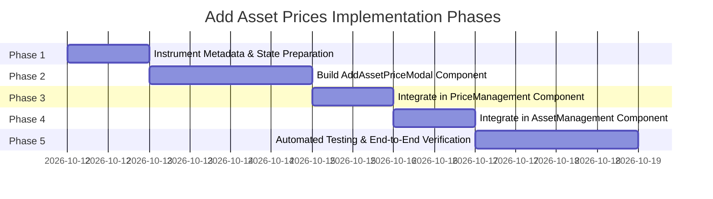

# Add Asset Prices Implementation Plan (Admin Portal)

> **User Story Reference**: [docs/user-stories/add-asset-prices-admin.md](file:///Users/oscargarcia/workspace/graphfolio/docs/user-stories/add-asset-prices-admin.md) (`US-ADM-105`)  
> **Target Applications**: Internal Operations Portal (`web/apps/admin-app`), BFF (`bff/`), Portfolio Microservice (`services/portfolio-api`)  
> **Status**: Completed  

---

## 1. Executive Summary & Goals

The objective of this feature is to deliver a first-class, intuitive **Add Asset Price** workflow in the GraphFolio Internal Operations Portal (`web/apps/admin-app`).

Currently, manual price entry in the Admin Portal is exposed solely through a `+ Manual Price Override` button in `PriceManagement`. This implementation suffers from key usability and operational gaps:
- It relies on free-text symbol input instead of a validated instrument directory.
- It displays no currency context, risking cross-currency pricing errors.
- It is framed with severe warning copy ("Caution: Modifying authoritative ledger..."), obscuring the standard operational use case of adding initial prices for newly registered assets or missing dates.
- It cannot be triggered directly from `AssetManagement` when an asset is registered or audited.
- It lacks conflict awareness: operators receive no feedback on whether they are adding a brand-new closing mark or overwriting an existing one.

This plan details the full implementation of a unified, validated **`AddAssetPriceModal`** component with dual entry points, real-time conflict detection, quote currency locking, and seamless integration with GraphFolio's existing high-precision ledger upsert engine.

---

## 2. Current State vs. Target State

| Dimension | Current State | Target State |
|---|---|---|
| **Entry Point (Price Management)** | `+ Manual Price Override` button in toolbar, opening `PriceOverrideModal`. | Primary `+ Add Asset Price` button (`variant="primary"`) in toolbar, plus `Edit Price` row action. |
| **Entry Point (Asset Management)** | None. Operators must navigate to Price Management and type the ticker. | Dedicated `+ Add Price` action button in the asset directory table row, pre-populating symbol and currency. |
| **Instrument Selection** | Unvalidated free-text `<Input>` requiring manual symbol typing. | Filterable/searchable `<Select>` populated from active instruments: `{SYMBOL} — {Name} [{Currency}]`. |
| **Currency Handling** | Hidden. Operator cannot see or confirm the pricing currency. | Visible currency badge auto-resolved from the selected instrument (e.g. `USD`, `AUD`, `EUR`). |
| **Conflict Detection** | None. Blindly executes upsert with no indication if a price already exists. | Real-time check: when symbol + date match an existing mark, displays a clear informational banner and switches button to `"Update Closing Price"`. |
| **Form Framing & Copy** | Alarmist warning: "Caution: Applying a manual closing price override modifies the authoritative pricing ledger...". | Professional, instructional framing clearly distinguishing new closing marks from updates. |
| **Audit Justification** | Form marks reason as strictly required, hindering rapid initial pricing. | Reason defaults to `"manual"` if omitted, or captures specific operator notes (e.g., `"Manual: AFR EOD Quote"`). |
| **BFF & Backend API** | gRPC `RecordPriceOverride` and GraphQL `recordPriceOverride` already support UPSERT. | Fully utilized without breaking changes. Documented as the authoritative single-price recording mutation. |

---

## 3. Architecture & Data Flow

```mermaid
sequenceDiagram
    autonumber
    actor Admin as Operations Administrator
    participant AM as AssetManagement (:5174)
    participant PM as PriceManagement (:5174)
    participant Modal as AddAssetPriceModal
    participant BFF as GraphQL BFF (:8080)
    participant Svc as portfolio-api (:50051)
    participant DB as PostgreSQL (portfolio schema)

    alt Launched from Asset Management
        Admin->>AM: Clicks "+ Add Price" on asset row (e.g., "NVDA")
        AM->>Modal: Opens with defaultSymbol="NVDA", currency="USD"
    else Launched from Price Management Toolbar
        Admin->>PM: Clicks "+ Add Asset Price"
        PM->>Modal: Opens with active filtered symbol (or first available)
    end

    Admin->>Modal: Adjusts Date or Price input
    Modal->>Modal: Runs conflict check against cached prices
    alt Existing price exists for Date
        Modal->>Modal: Shows Notice: "Existing closing price of $X.XX exists"
        Modal->>Modal: Updates button label to "Update Closing Price"
    else No existing price for Date
        Modal->>Modal: Sets button label to "Record Asset Price"
    end

    Admin->>Modal: Clicks "Record Asset Price" / "Update Closing Price"
    Modal->>Modal: Validates: price > 0, date <= today UTC
    Modal->>BFF: mutation recordPriceOverride(symbol, priceDate, price, reason, recomputeValuations)
    BFF->>Svc: gRPC RecordPriceOverride(RecordPriceOverrideRequest)

    rect rgb(20, 30, 45)
    note over Svc,DB: Atomic Ledger Upsert & Recalibration
    Svc->>DB: SELECT id, currency_code FROM portfolio.instruments WHERE symbol = $symbol
    Svc->>DB: INSERT INTO portfolio.instrument_prices (instrument_id, price_date, price, source, ...) ON CONFLICT DO UPDATE
    DB-->>Svc: InstrumentPrice row
    opt recomputeValuations == true
        Svc->>DB: FindPortfoliosHoldingInstrument(instrument_id)
        Svc->>Svc: Recalibrate valuations & TWR points from priceDate
    end
    end

    Svc-->>BFF: RecordPriceOverrideResponse{price, valuations_recomputed}
    BFF-->>Modal: RecordPriceOverridePayload
    Modal->>PM: Invalidate price cache & refetch table
    Modal->>Admin: Displays success toast: "Closing price recorded for NVDA..."
    Modal->>Modal: Close modal & reset form
```



---

## 4. Layer-by-Layer Technical Specifications

### 4.1 Frontend Component Architecture (`web/apps/admin-app`)

#### 4.1.1 New / Refactored Component: `AddAssetPriceModal.tsx`
Create `web/apps/admin-app/src/components/AddAssetPriceModal.tsx` to replace and expand `PriceOverrideModal.tsx`.

```typescript
export interface InstrumentOption {
  symbol: string;
  name: string;
  currencyCode: string;
}

export interface AddAssetPriceSubmitData {
  symbol: string;
  priceDate: string;
  price: string;
  reason?: string;
  recomputeValuations: boolean;
}

export interface ExistingPriceCheck {
  priceDate: string;
  priceAmount: string;
  currencyCode: string;
}

interface AddAssetPriceModalProps {
  isOpen: boolean;
  onClose: () => void;
  instruments: InstrumentOption[];
  defaultSymbol?: string;
  defaultDate?: string;
  existingPrices?: ExistingPriceCheck[];
  onSubmit: (data: AddAssetPriceSubmitData) => Promise<void>;
}
```

##### Form State & Validations:
1. **Instrument Selection**:
   - Populated from `instruments` list.
   - Selected instrument determines the locked quote currency badge.
2. **Date Picker**:
   - Default: Today's ISO date (`formatISODate(new Date())`).
   - HTML attribute: `max={todayISO}`.
   - Validation guard: If selected date > today UTC, display error `"Price date cannot be in the future"`.
3. **Closing Price**:
   - Number input with precision step `0.0001` or `any`.
   - Maintained as raw string (`price` state).
   - Validation guard: Must be positive numeric string (`!isNaN(num) && num > 0`).
4. **Audit Reason / Source**:
   - Optional text input (`"e.g. Initial valuation, AFR closing print, OTC broker quote"`).
   - If empty on submit, defaults to `"manual"` in the mutation payload.
5. **Recompute Valuations**:
   - Checkbox defaulting to `true`.
6. **Conflict Detection**:
   - Evaluated dynamically whenever `selectedSymbol` or `priceDate` changes against `existingPrices`:
   ```typescript
   const existingRecord = useMemo(() => {
     if (!existingPrices) return null;
     return existingPrices.find((p) => p.priceDate === priceDate);
   }, [existingPrices, priceDate]);
   ```
   - When `existingRecord` is non-null:
     - Render informational alert: `ℹ️ Note: A closing price of ${existingRecord.priceAmount} ${existingRecord.currencyCode} is currently recorded for this date. Submitting will update this mark.`
     - Submit button text becomes: `"Update Closing Price"`.
   - When `existingRecord` is null:
     - Submit button text becomes: `"Record Asset Price"`.

#### 4.1.2 Styles: `AddAssetPriceModal.css`
- Dark glassmorphic container aligned with `@graphfolio/ui` design tokens.
- Currency badge addon prefix inside the price input group.
- Subdued notice banner (`.price-modal__notice`) with neutral/info accents instead of alarmist red warning boxes.

#### 4.1.3 Integration in `PriceManagement.tsx`
1. **State & Modal Replacement**:
   - Replace `isOverrideModalOpen` / `PriceOverrideModal` with `AddAssetPriceModal`.
   - Pass the full instrument metadata list (`allInstruments` query returns `symbol`, `name`, `currencyCode`).
2. **Toolbar Button**:
   - Update primary button to `+ Add Asset Price` (`variant="primary"`).
3. **Table Row Actions**:
   - Rename row button from `Override` to `Edit Price`. Clicking it opens `AddAssetPriceModal` pre-populated with that row's `symbol`, `priceDate`, and current `price`.
4. **Data Sync**:
   - On successful submit, notify with toast, refresh `prices` table, and re-query instrument counts.

#### 4.1.4 Integration in `AssetManagement.tsx`
1. **Row Action Button**:
   - In `AssetManagement.tsx` table actions (alongside `Toggle Status` and `Delete Asset`), add:
   ```tsx
   <Button
     size="sm"
     variant="ghost"
     onClick={() => handleOpenAddPriceForAsset(inst)}
     title="Add closing price for this asset"
   >
     + Add Price
   </Button>
   ```
2. **Modal Hosting**:
   - Embed `AddAssetPriceModal` in `AssetManagement.tsx`.
   - On submission, invoke GraphQL `recordPriceOverride`, display notification toast, and close modal.

---

### 4.2 BFF GraphQL Layer (`bff/`)

The BFF GraphQL layer already exposes the required mutation in [`bff/graph/schema.graphqls`](file:///Users/oscargarcia/workspace/graphfolio/bff/graph/schema.graphqls):

```graphql
input RecordPriceOverrideInput {
  symbol: String!
  priceDate: String! # YYYY-MM-DD
  price: Decimal!
  reason: String
  recomputeValuations: Boolean
}

type RecordPriceOverridePayload {
  price: InstrumentPrice!
  valuationsRecomputed: Boolean!
}

type Mutation {
  recordPriceOverride(input: RecordPriceOverrideInput!): RecordPriceOverridePayload!
}
```

* **Zero Floating-Point Compliance**: The input `price` scalar is deserialized as `decimal.Decimal` via `bff/graph/model/decimal.go`, ensuring zero IEEE 754 precision loss.
* **Compatibility**: Existing integration remains 100% backward-compatible.

---

### 4.3 Portfolio Domain Microservice (`services/portfolio-api/`)

The portfolio microservice already implements the upsert logic in [`services/portfolio-api/internal/service/admin.go`](file:///Users/oscargarcia/workspace/graphfolio/services/portfolio-api/internal/service/admin.go):

1. **Symbol & Date Validation**:
   - Trims and upper-cases `symbol`.
   - Ensures `priceDate <= today UTC midnight`. Returns `ErrFutureDate` (`codes.InvalidArgument`) if future.
   - Ensures `price.IsPositive()`. Returns `ErrInvalidPrice` (`codes.InvalidArgument`) if $\le 0$.
2. **Repository Upsert**:
   - Looks up instrument via `s.repo.FindInstrumentBySymbol(ctx, symbol)`.
   - Calls `s.repo.UpsertInstrumentPrice(ctx, inst.ID, input.PriceDate, input.Price, source)`.
   - Database SQL executes an idempotent `ON CONFLICT (instrument_id, price_date) DO UPDATE`.
3. **Valuation Hook**:
   - If `input.RecomputeValuations` is `true`, queries `FindPortfoliosHoldingInstrument(ctx, inst.ID)`.
   - Recalibrates time-series valuations and TWR sub-period links from that date forward.

---

## 5. Detailed Step-by-Step Implementation Roadmap



### Phase 1: Instrument Metadata & State Preparation
- **Task 1.1**: Update `fetchInstruments` in `PriceManagement.tsx` to retain `{ symbol, name, currencyCode }` records rather than discarding everything except the symbol string.
- **Task 1.2**: Ensure `allInstruments` in `AssetManagement.tsx` exposes the same typed instrument records to pass into the price modal.

### Phase 2: Build `AddAssetPriceModal` Component & Styles
- **Task 2.1**: Implement `web/apps/admin-app/src/components/AddAssetPriceModal.tsx`:
  - Searchable `<Select>` dropdown for instruments with format: `SYMBOL — Name [CURRENCY]`.
  - Auto-locked quote currency badge adjacent to the price input.
  - Date input with `max` attribute set to today.
  - Number input preserving fixed-point string formatting.
  - Audit reason text input with placeholder and default fallback (`"manual"`).
  - Valuation recalculation checkbox.
  - Real-time conflict evaluation displaying the informational overwrite banner when date matches an existing record.
- **Task 2.2**: Implement `web/apps/admin-app/src/components/AddAssetPriceModal.css` matching GraphFolio's dark glassmorphic UI design tokens (`tokens.css`).
- **Task 2.3**: Deprecate / replace `PriceOverrideModal.tsx` while maintaining backward-compatible exports if referenced by legacy tests.

### Phase 3: Integrate in `PriceManagement` Component
- **Task 3.1**: Update toolbar action in `PriceManagement.tsx`:
  - Change button label to `+ Add Asset Price` (`variant="primary"`).
  - Open `AddAssetPriceModal` with the currently active filter symbol (or first available).
- **Task 3.2**: Update table row action:
  - Change row button label from `Override` to `Edit Price`.
  - Pass the row's `symbol`, `priceDate`, and current price to pre-fill the modal in update mode.
- **Task 3.3**: Ensure submission re-queries `fetchPrices()` and updates stat cards (`Latest Pricing Date`, `Authoritative Closing Records`).

### Phase 4: Integrate in `AssetManagement` Component
- **Task 4.1**: Add `+ Add Price` action button to each row in `AssetManagement.tsx` table (next to `Deactivate` / `Delete`).
- **Task 4.2**: Mount `AddAssetPriceModal` in `AssetManagement.tsx`, passing the selected instrument row as `defaultSymbol`.
- **Task 4.3**: Provide submission handler calling GraphQL `recordPriceOverride` and triggering the success toast notification.

### Phase 5: Testing & Verification
- **Task 5.1**: Unit tests for `AddAssetPriceModal`:
  - Form validation: rejection of empty, negative, or zero price strings.
  - Future date rejection.
  - Currency badge updating on instrument selection.
  - Conflict warning banner rendering when symbol/date match existing records.
- **Task 5.2**: Regression test suite run across BFF (`go test ./...`) and frontend (`npm run build` & unit tests).
- **Task 5.3**: End-to-end interactive verification in Admin Portal.

---

## 6. Testing & Quality Assurance Plan

### 6.1 Unit Tests (`AddAssetPriceModal.test.tsx`)

| Test Case | Inputs | Expected Behavior |
|---|---|---|
| **Render defaults** | `defaultSymbol="AAPL"`, `instruments=[{symbol:"AAPL", currencyCode:"USD"}]` | Symbol set to AAPL, currency badge displays "USD", date defaults to today. |
| **Reject future date** | Date set to tomorrow | Form blocked, inline error: `"Price date cannot be in the future"`. |
| **Reject zero / negative price** | Price input `0` or `-5.20` | Form blocked, inline error: `"Closing price must be a positive number"`. |
| **Reject non-numeric price** | Price input `"abc"` | Form blocked, inline error. |
| **Existing price conflict check** | Date matches record in `existingPrices` | Notice banner displayed: `"A closing price of ... exists"`, submit button text is `"Update Closing Price"`. |
| **New price submission** | Date does not match any record | Notice banner hidden, submit button text is `"Record Asset Price"`. |
| **Submit handler invocation** | Valid form data | `onSubmit` called with sanitized string values, loading spinner displayed. |

### 6.2 Manual Verification Walkthrough
1. **Adding initial price for new asset**:
   - Navigate to `http://localhost:5174` (Admin Portal) $\to$ **Asset Management**.
   - Register a new asset (e.g. `SAMPLE.US`).
   - Click `+ Add Price` on the newly registered row.
   - Verify modal opens with `SAMPLE.US` pre-selected and currency `USD` locked.
   - Enter price `50.00` and today's date. Click **Record Asset Price**.
   - Confirm success toast appears.
   - Switch to **Price Management** tab; verify `SAMPLE.US` has a closing price of `$50.00` with source `manual`.
2. **Adding historical backfill price**:
   - In **Price Management**, click `+ Add Asset Price`.
   - Select `MSFT`, choose date `2026-09-15`, enter `425.80`, reason `"Manual: Quarterly review"`.
   - Click **Record Asset Price**. Verify record appears in historical query.
3. **Updating existing price**:
   - Click `Edit Price` on an existing row (or select its date in the modal).
   - Observe conflict notice banner displaying existing price.
   - Update price, click **Update Closing Price**. Verify record updates and source indicates reason.

---

## 7. Rollout & Verification Checklist

- [x] `AddAssetPriceModal.tsx` created with instrument dropdown, currency badge, and conflict detection.
- [x] `AddAssetPriceModal.css` created with design token styling.
- [x] `PriceManagement.tsx` updated with `+ Add Asset Price` primary action button and `Edit Price` row action.
- [x] `AssetManagement.tsx` updated with `+ Add Price` row action button.
- [x] Client-side validation active (zero floating-point strings, future date guard, positive numeric guard).
- [x] Full TypeScript type checking passes (`npm run build` in `web/apps/admin-app`).
- [x] All unit and regression tests pass across frontend and backend.
- [x] Documentation updated in [FEATURES.md](file:///Users/oscargarcia/workspace/graphfolio/FEATURES.md).
