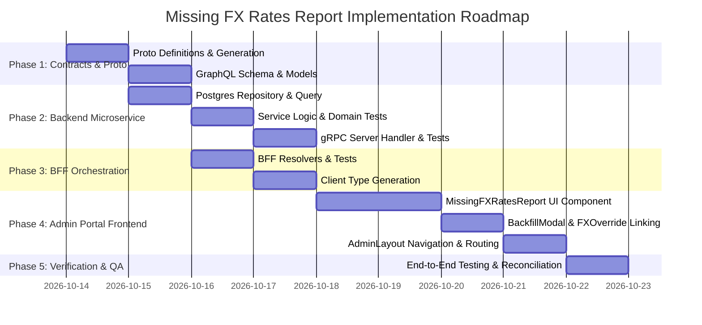

# Missing FX Rates Report & Date Range Backfill Implementation Plan (Admin Portal)

> **Target**: Comprehensive end-to-end implementation plan for the **Missing FX Rates Report** in the internal Admin Portal (`web/apps/admin-app`).  
> **Status**: Completed  
> **Scope**: `proto/portfolio/v1/portfolio.proto`, `services/portfolio-api`, `bff/`, and `web/apps/admin-app`.  
> **User Story Reference**: [admin-missing-fx-rates-report.md](file:///Users/oscargarcia/workspace/graphfolio/docs/user-stories/admin-missing-fx-rates-report.md)  
> **Roadmap Reference**: [FEATURES.md (Feature #32)](file:///Users/oscargarcia/workspace/graphfolio/FEATURES.md#L42)  
> **Key Principle**: Enable financial controllers and operations administrators to rapidly diagnose cross-currency transactions lacking authoritative daily foreign exchange rates on their trade date, and trigger targeted, rate-governed FX backfills ([BackfillModal.tsx](file:///Users/oscargarcia/workspace/graphfolio/web/apps/admin-app/src/components/BackfillModal.tsx)) or manual rate overrides ([FXOverrideModal.tsx](file:///Users/oscargarcia/workspace/graphfolio/web/apps/admin-app/src/components/FXOverrideModal.tsx)) with automatic historical valuation recomputation, strictly preserving GraphFolio's **zero floating-point arithmetic policy**.

---

## 1. Architectural Overview & Workflow

When investors execute or batch import transactions denominated in currencies different from their portfolio's base currency (e.g., buying `AAPL` in `USD` within an `AUD` portfolio, collecting `EUR` dividends, or depositing foreign cash), GraphFolio requires an authoritative daily closing foreign exchange rate in `portfolio.fx_rates` matching the trade date.

Without this rate:
- Trade amounts cannot be accurately converted into the portfolio base currency.
- Cost basis in base currency (`cost_basis_base`) and cash ledger balances become distorted.
- Multi-pillar return attribution cannot isolate **Currency Gain/Loss** from asset capital appreciation.
- External cash flow weighting in GIPS-compliant Modified Dietz returns is corrupted.

```mermaid
sequenceDiagram
    autonumber
    actor Admin as Operations Admin
    participant AdminApp as Admin App (:5174)
    participant Backfill as BackfillModal.tsx
    participant Override as FXOverrideModal.tsx
    participant BFF as GraphQL BFF (:8080)
    participant Svc as Portfolio API (:50051 gRPC)
    participant DB as PostgreSQL (portfolio schema)

    %% 1. Loading the Report
    Admin->>AdminApp: Navigates to "Missing FX Rates"
    AdminApp->>BFF: query missingFXRateTransactions(currencyPair, fromDate, toDate, type, limit, offset)
    BFF->>Svc: gRPC ListMissingFXRateTransactions(ListMissingFXRateTransactionsRequest)
    Svc->>DB: Query cross-currency transactions with anti-join on fx_rates (direct & inverse)
    DB-->>Svc: Rows + totalCount, uniquePairsCount, earliestDate, latestDate
    Svc-->>BFF: ListMissingFXRateTransactionsResponse
    BFF-->>AdminApp: MissingFXRatesReport payload
    AdminApp-->>Admin: Displays KPI summary cards, filters, and itemized missing FX ledger

    %% 2. Triggering Backfill from Report
    alt On-Demand Range Backfill
        Admin->>AdminApp: Clicks "Backfill Pair" on USD/AUD row (Trade Date: 2024-02-14)
        AdminApp->>Backfill: Opens modal pre-populated (currencyPairs: ["USD/AUD"], fromDate: "2024-02-11", toDate: "2024-02-14", backfillFx: true, backfillAssets: false, recomputeValuations: true)
        Admin->>Backfill: Clicks "Execute Backfill"
        Backfill->>BFF: mutation triggerBackfill(input: { ... })
        BFF->>Svc: gRPC TriggerBackfill(...)
        Svc->>DB: Upsert FX rates & trigger RebuildValuations
        Svc-->>BFF: TriggerBackfillResponse { fxRatesSynced: 4, success: true }
        BFF-->>Backfill: Success payload
        Backfill-->>AdminApp: OnSuccess callback triggers report re-fetch
        AdminApp-->>Admin: Success toast; USD/AUD row removed from report
    else Manual FX Rate Override
        Admin->>AdminApp: Clicks "Manual FX" on flagged row
        AdminApp->>Override: Opens modal pre-populated (base: "USD", quote: "AUD", date: "2024-02-14", rate: "1.5280")
        Admin->>Override: Submits override with audit justification
        Override->>BFF: mutation recordFXRateOverride(input: { ... })
        BFF->>Svc: gRPC RecordFXRateOverride(...)
        Svc->>DB: Upsert into portfolio.fx_rates & trigger RebuildValuations
        Svc-->>BFF: Success response
        Override-->>AdminApp: Report re-fetch triggered
        AdminApp-->>Admin: Success toast; row resolved
    end
```

---

## 2. Layer-by-Layer Technical Specifications

### 2.1 Protocol Buffers (`proto/portfolio/v1/portfolio.proto`)

Extend `PortfolioService` with a dedicated RPC to query transactions lacking trade-date foreign exchange marks, returning itemized ledger entries alongside aggregate diagnostic telemetry.

#### 2.1.1 Service RPC Definition
```protobuf
service PortfolioService {
  // ... existing RPCs ...

  // Admin: Missing FX Rates Diagnostic Report
  rpc ListMissingFXRateTransactions(ListMissingFXRateTransactionsRequest) returns (ListMissingFXRateTransactionsResponse) {}
}
```

#### 2.1.2 Message Definitions
```protobuf
message MissingFXRateTransactionItem {
  string            transaction_id       = 1;
  string            portfolio_id         = 2;
  string            portfolio_name       = 3;
  string            portfolio_base_cur   = 4;
  string            trade_date           = 5; // YYYY-MM-DD
  TransactionType   type                 = 6;
  optional string   instrument_id        = 7;
  optional string   symbol               = 8;
  optional string   asset_name           = 9;
  common.v1.Money   amount               = 10;
  string            transaction_cur      = 11;
  string            required_pair        = 12; // e.g. "USD/AUD"
  optional common.v1.Decimal recorded_fx_rate = 13; // Snapshot fx_rate_to_base if present
}

message ListMissingFXRateTransactionsRequest {
  optional string          currency_pair = 1; // Filter e.g. "USD/AUD"
  optional string          from_date     = 2; // YYYY-MM-DD
  optional string          to_date       = 3; // YYYY-MM-DD
  optional TransactionType type          = 4; // BUY, SELL, DIVIDEND, DEPOSIT, etc.
  int32                    limit         = 5; // Default 50, max 200
  int32                    offset        = 6;
}

message ListMissingFXRateTransactionsResponse {
  repeated MissingFXRateTransactionItem items               = 1;
  int32                                 total_count         = 2;
  int32                                 unique_pairs_count  = 3;
  optional string                       earliest_trade_date = 4; // YYYY-MM-DD
  optional string                       latest_trade_date   = 5; // YYYY-MM-DD
}
```

---

### 2.2 Backend Domain & Service Layer (`services/portfolio-api`)

#### 2.2.1 Domain Entities (`internal/domain/missing_fx.go`)
Create domain representations preserving exact fixed-point precision with `shopspring/decimal.Decimal` and `domain.Money`:

```go
package domain

import (
	"time"

	"github.com/shopspring/decimal"
)

// MissingFXRateItem represents a cross-currency transaction lacking an EOD FX rate on trade date.
type MissingFXRateItem struct {
	TransactionID      string
	PortfolioID        string
	PortfolioName      string
	PortfolioBaseCur   string
	TradeDate          time.Time
	Type               TransactionType
	InstrumentID       *string
	Symbol             *string
	AssetName          *string
	Amount             Money
	TransactionCur     string
	RequiredPair       string // Canonical "BASE/QUOTE" format, e.g. "USD/AUD"
	RecordedFXRate     *decimal.Decimal
}

// MissingFXRateFilter specifies query criteria for diagnostic report filtering.
type MissingFXRateFilter struct {
	CurrencyPair *string
	FromDate     *time.Time
	ToDate       *time.Time
	Type         *TransactionType
	Limit        int
	Offset       int
}

// MissingFXRatesReport aggregates paginated missing FX items with summary statistics.
type MissingFXRatesReport struct {
	Items             []MissingFXRateItem
	TotalCount        int
	UniquePairsCount  int
	EarliestTradeDate *time.Time
	LatestTradeDate   *time.Time
}
```

#### 2.2.2 Optimized PostgreSQL Query Pattern (`internal/repository/queries.go`)
Implement a single-pass anti-join query checking both direct (`t.currency_code -> p.base_currency`) and reciprocal inverse (`p.base_currency -> t.currency_code`) rates in `portfolio.fx_rates`. Exclude domestic trades and non-monetary `SPLIT` corporate actions:

```sql
WITH filtered_missing AS (
    SELECT 
        t.id AS transaction_id,
        t.portfolio_id,
        p.name AS portfolio_name,
        p.base_currency AS portfolio_base_currency,
        t.trade_date,
        t.type,
        t.instrument_id,
        COALESCE(i.symbol, '') AS symbol,
        COALESCE(i.name, '') AS asset_name,
        t.amount,
        t.currency_code AS transaction_currency,
        CONCAT(TRIM(t.currency_code), '/', TRIM(p.base_currency)) AS required_pair,
        t.fx_rate_to_base AS recorded_fx_rate
    FROM portfolio.transactions t
    JOIN portfolio.portfolios p ON t.portfolio_id = p.id
    LEFT JOIN portfolio.instruments i ON t.instrument_id = i.id
    -- Check direct FX rate (Transaction Currency -> Portfolio Base Currency)
    LEFT JOIN portfolio.fx_rates fx_direct 
        ON fx_direct.rate_date = t.trade_date
       AND fx_direct.base_currency = t.currency_code 
       AND fx_direct.quote_currency = p.base_currency
    -- Check inverse FX rate (Portfolio Base Currency -> Transaction Currency)
    LEFT JOIN portfolio.fx_rates fx_inverse 
        ON fx_inverse.rate_date = t.trade_date
       AND fx_inverse.base_currency = p.base_currency 
       AND fx_inverse.quote_currency = t.currency_code
    WHERE t.type <> 'SPLIT'
      AND t.currency_code <> p.base_currency
      AND fx_direct.rate IS NULL 
      AND fx_inverse.rate IS NULL
      AND ($1::text IS NULL OR 
           CONCAT(TRIM(t.currency_code), '/', TRIM(p.base_currency)) = $1 OR 
           CONCAT(TRIM(p.base_currency), '/', TRIM(t.currency_code)) = $1)
      AND ($2::date IS NULL OR t.trade_date >= $2)
      AND ($3::date IS NULL OR t.trade_date <= $3)
      AND ($4::portfolio.transaction_type IS NULL OR t.type = $4)
),
aggregates AS (
    SELECT 
        COUNT(*)::int AS total_count,
        COUNT(DISTINCT required_pair)::int AS unique_pairs_count,
        MIN(trade_date) AS earliest_trade_date,
        MAX(trade_date) AS latest_trade_date
    FROM filtered_missing
)
SELECT 
    m.*,
    a.total_count,
    a.unique_pairs_count,
    a.earliest_trade_date,
    a.latest_trade_date
FROM filtered_missing m
CROSS JOIN aggregates a
ORDER BY m.trade_date DESC, m.transaction_id ASC
LIMIT $5 OFFSET $6;
```

#### 2.2.3 Repository Method (`internal/repository/postgres.go`)
- Implement `ListMissingFXRateTransactions(ctx context.Context, filter domain.MissingFXRateFilter) (*domain.MissingFXRatesReport, error)`.
- Map query rows to `domain.MissingFXRateItem`.
- Handle empty results cleanly: return `TotalCount: 0`, `UniquePairsCount: 0`, empty items slice, and `nil` date pointers.

#### 2.2.4 Service Business Logic (`internal/service/admin.go`)
- Validate input bounds: `FromDate <= ToDate` (return `domain.ErrInvalidDateRange` if violated).
- Sanitize pagination parameters: clamp `Limit` to `[1, 200]` (default `50`), enforce `Offset >= 0`.
- Delegate to repository and return domain report payload.

#### 2.2.5 gRPC Server Handler (`internal/server.go`)
- Implement `ListMissingFXRateTransactions(ctx context.Context, req *portfoliopb.ListMissingFXRateTransactionsRequest) (*portfoliopb.ListMissingFXRateTransactionsResponse, error)`.
- Map protobuf request parameters to `domain.MissingFXRateFilter`.
- Convert domain items to `portfoliopb.MissingFXRateTransactionItem` using `pkg/decimalpb.MoneyToProto` and `pkg/decimalpb.DecimalToProto`.

---

### 2.3 Backend-For-Frontend Layer (`bff/`)

#### 2.3.1 GraphQL Schema (`bff/graph/schema.graphqls`)
Extend GraphQL schema with the missing FX rate query, items, and report types:

```graphql
# ------------------------------------------------------------------
# Admin: Missing FX Rates Diagnostic Report Types
# ------------------------------------------------------------------

type MissingFXRateTransactionItem {
  transactionId: ID!
  portfolioId: ID!
  portfolioName: String!
  portfolioBaseCurrency: String!
  tradeDate: String!
  type: TransactionType!
  instrumentId: ID
  symbol: String
  assetName: String
  amount: Money!
  transactionCurrency: String!
  requiredPair: String!
  recordedFxRate: Decimal
}

type MissingFXRatesReport {
  items: [MissingFXRateTransactionItem!]!
  totalCount: Int!
  uniquePairsCount: Int!
  earliestTradeDate: String
  latestTradeDate: String
}

extend type Query {
  missingFXRateTransactions(
    currencyPair: String
    fromDate: String
    toDate: String
    type: TransactionType
    limit: Int = 50
    offset: Int = 0
  ): MissingFXRatesReport!
}
```

#### 2.3.2 GraphQL Resolver (`bff/graph/schema.resolvers.go`)
- Implement `MissingFXRateTransactions` resolver.
- Translate GraphQL arguments into `portfoliopb.ListMissingFXRateTransactionsRequest`.
- Call `r.portfolioClient.ListMissingFXRateTransactions(ctx, req)`.
- Map response using helper functions in `bff/graph/helpers.go`.

---

### 2.4 Internal Admin Portal (`web/apps/admin-app`)

#### 2.4.1 Component Architecture (`src/components/MissingFXRatesReport.tsx` & `.css`)
Create the report UI mirroring the pattern of [MissingPricesReport.tsx](file:///Users/oscargarcia/workspace/graphfolio/web/apps/admin-app/src/components/MissingPricesReport.tsx):

1. **Top Summary KPI Header**:
   - `Unconverted Trades`: Total count with warning styling if `> 0`.
   - `Impacted Pairs`: Count of unique currency pairs.
   - `Earliest Missing Date`: Oldest trade date lacking FX.
   - `Date Span Coverage`: Difference in days between earliest and latest unpriced dates.
2. **Filter & Preset Toolbar**:
   - `Pair Selector`: Dropdown populated with unique pairs found or `ALL`.
   - `Transaction Type Filter`: Filter by `BUY`, `SELL`, `DIVIDEND`, `DEPOSIT`, `WITHDRAWAL`, or `ALL`.
   - `Date Range Picker`: Custom `From Date` and `To Date`.
   - `Presets`: Quick-select buttons for `30D`, `90D`, `YTD`, `1Y`, and `ALL`.
3. **Itemized Diagnostic Table**:
   - Columns: `Trade Date`, `Required Pair`, `Type` (Badge), `Asset / Symbol`, `Transacted Amount`, `Portfolio (Base)`, `Recorded FX`, `Status` (`Missing Fixing`), `Actions`.
4. **Action Integrations**:
   - **"Backfill Pair Range" Button**:
     - Pre-populates and launches [BackfillModal.tsx](file:///Users/oscargarcia/workspace/graphfolio/web/apps/admin-app/src/components/BackfillModal.tsx):
       ```typescript
       initialCurrencyPairs: [item.requiredPair]
       initialFromDate: calculateBufferDate(item.tradeDate, 3) // 3-day buffer for weekends
       initialToDate: item.tradeDate
       initialBackfillFx: true
       initialBackfillAssets: false
       initialRecomputeValuations: true
       ```
   - **"Backfill All Missing FX" Button (Header action)**:
     - Opens [BackfillModal.tsx](file:///Users/oscargarcia/workspace/graphfolio/web/apps/admin-app/src/components/BackfillModal.tsx) with all unique affected currency pairs and bounding dates `[earliestTradeDate, latestTradeDate]`.
   - **"Record Manual FX Rate" Button**:
     - Pre-populates and launches [FXOverrideModal.tsx](file:///Users/oscargarcia/workspace/graphfolio/web/apps/admin-app/src/components/FXOverrideModal.tsx):
       ```typescript
       defaultBaseCurrency: item.transactionCurrency
       defaultQuoteCurrency: item.portfolioBaseCurrency
       defaultRateDate: item.tradeDate
       defaultRate: item.recordedFxRate || ''
       ```
5. **Auto-Reconciliation & Table Refresh**:
   - On successful backfill or manual override completion, re-fetch report data immediately.
   - Display toast notification: `"X foreign exchange rates synced. Report updated."`.

#### 2.4.2 Navigation Integration in Admin Layout
Update [AdminLayout.tsx](file:///Users/oscargarcia/workspace/graphfolio/web/apps/admin-app/src/components/AdminLayout.tsx):
- Add `'missing-fx'` to `AdminTab` type (`'assets' | 'prices' | 'missing-prices' | 'missing-fx' | 'fx' | 'ingestion'`).
- Add navigation item with dynamic alert badge:
  ```tsx
  <button
    type="button"
    className={`admin-nav-item ${currentTab === 'missing-fx' ? 'admin-nav-item--active' : ''}`}
    onClick={() => onTabChange('missing-fx')}
  >
    <span>💱⚠️</span>
    <span>Missing FX Rates</span>
    {missingFXCount > 0 && <Badge variant="warning">{missingFXCount}</Badge>}
  </button>
  ```
- Update [App.tsx](file:///Users/oscargarcia/workspace/graphfolio/web/apps/admin-app/src/App.tsx) to mount `MissingFXRatesReport` when `currentTab === 'missing-fx'`.

---

## 3. Implementation Phases & Milestones



### Phase 1: Protocol Buffers & GraphQL Schema Contracts
- [ ] Add `ListMissingFXRateTransactions` RPC and messages in `proto/portfolio/v1/portfolio.proto`.
- [ ] Compile protobuf files: `make proto`.
- [ ] Add GraphQL types and `missingFXRateTransactions` query to `bff/graph/schema.graphqls`.

### Phase 2: Portfolio Microservice (`services/portfolio-api`)
- [ ] Create `internal/domain/missing_fx.go` with domain structs (`MissingFXRateItem`, `MissingFXRateFilter`, `MissingFXRatesReport`).
- [ ] Add `listMissingFXRateTransactionsSQL` in `internal/repository/queries.go` with dual reciprocal anti-join.
- [ ] Implement repository method in `internal/repository/postgres.go`.
- [ ] Add method to `internal/repository/repository.go` and regenerate mocks (`internal/repository/mocks/mock_repository.go`).
- [ ] Implement service method in `internal/service/admin.go` with date range validation.
- [ ] Add unit tests in `internal/service/admin_test.go` covering empty states, multiple pairs, and filtering.
- [ ] Implement gRPC handler in `internal/server.go` and unit tests in `internal/server_test.go`.
- [ ] Verify Go tests: `cd services/portfolio-api && go test -v ./...`.

### Phase 3: BFF Orchestration (`bff/`)
- [ ] Run GraphQL code generation: `cd bff && go run github.com/99designs/gqlgen generate`.
- [ ] Implement `MissingFXRateTransactions` resolver in `bff/graph/schema.resolvers.go`.
- [ ] Add helper mapping in `bff/graph/helpers.go`.
- [ ] Add unit tests in `bff/graph/schema.resolvers_test.go`.
- [ ] Verify BFF tests: `cd bff && go test -v ./...`.

### Phase 4: Web Admin Portal (`web/apps/admin-app`)
- [ ] Regenerate GraphQL client: `npm run generate` in `packages/api-client`.
- [ ] Build `web/apps/admin-app/src/components/MissingFXRatesReport.tsx` and `MissingFXRatesReport.css`.
- [ ] Connect row actions to [BackfillModal.tsx](file:///Users/oscargarcia/workspace/graphfolio/web/apps/admin-app/src/components/BackfillModal.tsx) with pre-filled currency pairs and buffer dates.
- [ ] Connect secondary actions to [FXOverrideModal.tsx](file:///Users/oscargarcia/workspace/graphfolio/web/apps/admin-app/src/components/FXOverrideModal.tsx).
- [ ] Update `AdminLayout.tsx` and `App.tsx` with `'missing-fx'` tab navigation and alert badge.
- [ ] Add component tests (`MissingFXRatesReport.test.tsx`).
- [ ] Verify frontend build and lint: `cd web && npm run typecheck && npm run test`.

### Phase 5: Verification & End-to-End Validation
- [ ] Insert a foreign trade (e.g. `BUY AAPL` in `USD` inside an `AUD` portfolio on a date lacking `USD/AUD` in `portfolio.fx_rates`).
- [ ] Verify the transaction appears immediately in the Missing FX Rates Report with accurate pair `USD/AUD`.
- [ ] Trigger backfill via `BackfillModal`; verify successful execution, automatic valuation recomputation, and disappearance from the report table.
- [ ] Verify manual rate override via `FXOverrideModal` similarly resolves the gap.

---

## 4. Test Strategy & Acceptance Matrix

| Scenario / Test Case | Layer | Expected Behavior |
| :--- | :--- | :--- |
| **All Cross-Currency Trades Covered** | Repository / DB | Returns `total_count: 0`, empty items, null date boundaries. UI displays green empty state banner. |
| **Direct FX Rate Exists** | Repository / DB | If `(USD, AUD, trade_date)` exists in `portfolio.fx_rates`, transaction is **not** flagged. |
| **Inverse FX Rate Exists** | Repository / DB | If `(AUD, USD, trade_date)` exists in `portfolio.fx_rates`, transaction is **not** flagged (reciprocal resolvable). |
| **Domestic Trades ($t.cur = p.base$)** | Repository / DB | Same-currency transactions are never flagged as missing FX rates. |
| **Non-Monetary Splits (`SPLIT`)** | Repository / DB | Stock split transactions are excluded from FX rate verification. |
| **Cash `DEPOSIT` / `WITHDRAWAL` in Foreign Currency** | Repository / DB | Foreign cash movements without instrument are correctly flagged with `symbol = ""` and `RequiredPair`. |
| **Currency Pair Filtering** | Service / Repository | When filtered by `"USD/AUD"`, returns only matching transactions; adjusts KPI summary counters. |
| **Invalid Date Range Input** | Service / gRPC | Requesting `fromDate > toDate` returns validation error `ErrInvalidDateRange`. |
| **Row "Backfill Pair" Click** | Frontend / Admin App | Opens `BackfillModal` with `currencyPairs: [row.requiredPair]`, `backfillFx: true`, `recomputeValuations: true`. |
| **Row "Manual FX" Click** | Frontend / Admin App | Opens `FXOverrideModal` with pre-filled base, quote, trade date, and existing snapshot rate. |
| **Post-Action Auto-Refresh** | Frontend / Admin App | Report silently re-fetches; resolved transactions are removed and toast notification is rendered. |

---

## 5. Security & Non-Functional Requirements

1. **Database Index Optimization**:
   - The anti-join leverages existing composite primary keys on `portfolio.fx_rates(base_currency, quote_currency, rate_date)` and indexes on `portfolio.transactions(portfolio_id, trade_date)`.
   - Paging with `LIMIT` and `OFFSET` prevents unbounded memory overhead.
2. **Weekend/Holiday Buffer Logic**:
   - Central bank FX feeds (e.g. ECB) do not publish on weekends.
   - Pre-populating `BackfillModal` with a 3-day buffer ensures Saturday/Sunday trades capture the preceding Friday's closing mark.
3. **Strict Zero Floating-Point Arithmetic**:
   - All amounts, quantities, and rates flow through `shopspring/decimal.Decimal` and protobuf `Money`/`Decimal` representations to eliminate binary floating-point rounding errors.
4. **Access Control**:
   - Diagnostic endpoints and on-demand backfill triggers are restricted to internal administrative interfaces (`admin-app`).
