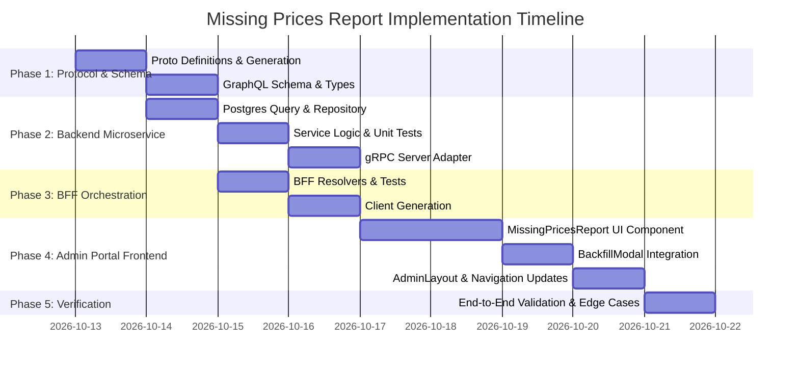

# Missing Prices Report & Date Range Backfill Implementation Plan (Admin Portal)

> **Target**: Comprehensive end-to-end implementation plan for the **Missing Prices Report** in the internal Admin Portal (`web/apps/admin-app`).  
> **Scope**: `proto/portfolio/v1/portfolio.proto`, `services/portfolio-api`, `bff/`, and `web/apps/admin-app`.  
> **User Story Reference**: [admin-missing-prices-report.md](file:///Users/oscargarcia/workspace/graphfolio/docs/user-stories/admin-missing-prices-report.md)  
> **Roadmap Reference**: [FEATURES.md (Feature #29)](file:///Users/oscargarcia/workspace/graphfolio/FEATURES.md#L39)  
> **Key Principle**: Enable financial operators to rapidly identify transactions lacking EOD closing marks on their trade date, and trigger targeted, rate-governed backfills (`BackfillModal`) or manual price overrides (`AddAssetPriceModal`) with automatic historical valuation recomputation, strictly preserving the **zero floating-point policy**.

---

## 1. Architectural Overview & Workflow

When investors enter or batch import transactions (e.g. `BUY`, `SELL`, `DIVIDEND`, `SPLIT`), each trade records an immutable `trade_date`. Portfolio valuation replay engines require corresponding daily closing prices (`portfolio.instrument_prices`) on those trade dates to mark assets to market and attribute performance.

```mermaid
sequenceDiagram
    autonumber
    actor Admin as Operations Admin
    participant AdminApp as Admin App (:5174)
    participant Backfill as BackfillModal.tsx
    participant BFF as GraphQL BFF (:8080)
    participant Svc as Portfolio API (:50051 gRPC)
    participant DB as PostgreSQL (portfolio schema)

    %% 1. Loading the Report
    Admin->>AdminApp: Navigates to "Missing Prices Report"
    AdminApp->>BFF: query missingPriceTransactions(symbol, fromDate, toDate, limit, offset)
    BFF->>Svc: gRPC ListMissingPriceTransactions(ListMissingPriceTransactionsRequest)
    Svc->>DB: Query transactions LEFT JOIN instrument_prices (filter p.close IS NULL)
    DB-->>Svc: Rows + totalCount, uniqueInstruments, dateRangeSpan
    Svc-->>BFF: ListMissingPriceTransactionsResponse
    BFF-->>AdminApp: MissingPriceReport payload
    AdminApp-->>Admin: Displays KPI cards, filters, and itemized missing price ledger

    %% 2. Triggering Backfill from Report
    Admin->>AdminApp: Clicks "Backfill Range" on flagged NVDA row (Trade Date: 2024-03-15)
    AdminApp->>Backfill: Opens modal pre-populated (symbols: ["NVDA"], fromDate: "2024-03-15", toDate: "2024-03-15", backfillAssets: true, recomputeValuations: true)
    Admin->>Backfill: Clicks "Execute Backfill"
    Backfill->>BFF: mutation triggerBackfill(input: { ... })
    BFF->>Svc: gRPC TriggerBackfill(...)
    Svc->>DB: Upsert closing prices & trigger RebuildValuations
    Svc-->>BFF: TriggerBackfillResponse { pricesSynced: 1, success: true }
    BFF-->>Backfill: Success payload
    Backfill-->>AdminApp: OnSuccess callback triggers report re-fetch
    AdminApp-->>Admin: Success toast; NVDA row automatically removed from report
```

---

## 2. Layer-by-Layer Technical Specifications

### 2.1 Protocol Buffers (`proto/portfolio/v1/portfolio.proto`)

Extend `PortfolioService` with a dedicated RPC to query transactions lacking daily closing marks on their trade date, returning both itemized records and aggregate diagnostic summary metrics.

#### 2.1.1 Service RPC Definition
```protobuf
service PortfolioService {
  // ... existing RPCs ...

  // Admin: Missing Prices Diagnostic Report
  rpc ListMissingPriceTransactions(ListMissingPriceTransactionsRequest) returns (ListMissingPriceTransactionsResponse) {}
}
```

#### 2.1.2 Message Definitions
```protobuf
message MissingPriceTransactionItem {
  string            transaction_id  = 1;
  string            portfolio_id    = 2;
  string            instrument_id   = 3;
  string            symbol          = 4;
  string            asset_name      = 5;
  string            exchange_mic    = 6;
  string            trade_date      = 7; // YYYY-MM-DD
  TransactionType   type            = 8;
  common.v1.Decimal quantity        = 9;
  common.v1.Money   execution_price = 10;
  string            currency_code   = 11;
}

message ListMissingPriceTransactionsRequest {
  optional string symbol    = 1;
  optional string from_date = 2; // YYYY-MM-DD
  optional string to_date   = 3; // YYYY-MM-DD
  int32           limit     = 4; // Default 50, max 200
  int32           offset    = 5;
}

message ListMissingPriceTransactionsResponse {
  repeated MissingPriceTransactionItem items                    = 1;
  int32                                total_count              = 2;
  int32                                unique_instruments_count  = 3;
  optional string                      earliest_trade_date      = 4; // YYYY-MM-DD
  optional string                      latest_trade_date        = 5; // YYYY-MM-DD
}
```

---

### 2.2 Backend Domain & Service Layer (`services/portfolio-api`)

#### 2.2.1 Domain Entities (`internal/domain/missing_price.go`)
Create domain representations ensuring zero floating-point arithmetic using `shopspring/decimal`:

```go
package domain

import (
	"time"

	"github.com/shopspring/decimal"
)

type MissingPriceItem struct {
	TransactionID  string
	PortfolioID    string
	InstrumentID   string
	Symbol         string
	AssetName      string
	ExchangeMIC    string
	TradeDate      time.Time
	Type           TransactionType
	Quantity       decimal.Decimal
	ExecutionPrice Money
	CurrencyCode   string
}

type MissingPriceFilter struct {
	Symbol   *string
	FromDate *time.Time
	ToDate   *time.Time
	Limit    int
	Offset   int
}

type MissingPriceReport struct {
	Items                  []MissingPriceItem
	TotalCount             int
	UniqueInstrumentsCount int
	EarliestTradeDate      *time.Time
	LatestTradeDate        *time.Time
}
```

#### 2.2.2 Repository Implementation (`internal/repository/postgres.go`)
Implement the database query utilizing a high-efficiency `LEFT JOIN ... WHERE p.close IS NULL` combined with window functions or aggregation CTEs for total counts and date boundaries:

```sql
WITH filtered_missing AS (
    SELECT 
        t.id AS transaction_id,
        t.portfolio_id,
        t.instrument_id,
        i.symbol,
        i.name AS asset_name,
        COALESCE(i.exchange_code, '') AS exchange_mic,
        t.trade_date,
        t.type,
        t.quantity,
        t.price,
        t.currency_code
    FROM portfolio.transactions t
    JOIN portfolio.instruments i ON t.instrument_id = i.id
    LEFT JOIN portfolio.instrument_prices p 
        ON t.instrument_id = p.instrument_id 
        AND t.trade_date = p.price_date
    WHERE t.instrument_id IS NOT NULL
      AND t.type <> 'DIVIDEND'
      AND p.close IS NULL
      AND ($1::text IS NULL OR UPPER(i.symbol) = UPPER($1))
      AND ($2::date IS NULL OR t.trade_date >= $2)
      AND ($3::date IS NULL OR t.trade_date <= $3)
),
aggregates AS (
    SELECT 
        COUNT(*)::int AS total_count,
        COUNT(DISTINCT instrument_id)::int AS unique_instruments_count,
        MIN(trade_date) AS earliest_trade_date,
        MAX(trade_date) AS latest_trade_date
    FROM filtered_missing
)
SELECT 
    m.*,
    a.total_count,
    a.unique_instruments_count,
    a.earliest_trade_date,
    a.latest_trade_date
FROM filtered_missing m
CROSS JOIN aggregates a
ORDER BY m.trade_date DESC, m.symbol ASC
LIMIT $4 OFFSET $5;
```

#### 2.2.3 Business Logic & Service Method (`internal/service/admin.go`)
- Validate date bounds: `FromDate <= ToDate`.
- Validate pagination parameters: `Limit` clamped to `[1, 200]`, `Offset >= 0`.
- Invoke repository and map domain models.

#### 2.2.4 gRPC Server Adapter (`internal/server.go`)
- Implement `ListMissingPriceTransactions(ctx context.Context, req *portfoliopb.ListMissingPriceTransactionsRequest)`.
- Use `pkg/decimalpb` to map `decimal.Decimal` and `Money` into `common.v1.Decimal` and `common.v1.Money`.
- Return `portfoliopb.ListMissingPriceTransactionsResponse`.

---

### 2.3 Backend-For-Frontend Layer (`bff/`)

#### 2.3.1 GraphQL Schema (`bff/graph/schema.graphqls`)
Extend the GraphQL schema with the missing price query and types:

```graphql
type MissingPriceTransactionItem {
  transactionId: ID!
  portfolioId: ID!
  instrumentId: ID!
  symbol: String!
  assetName: String!
  exchangeMic: String!
  tradeDate: String!
  type: TransactionType!
  quantity: Decimal!
  executionPrice: Money!
  currencyCode: String!
}

type MissingPriceReport {
  items: [MissingPriceTransactionItem!]!
  totalCount: Int!
  uniqueInstrumentsCount: Int!
  earliestTradeDate: String
  latestTradeDate: String
}

extend type Query {
  missingPriceTransactions(
    symbol: String
    fromDate: String
    toDate: String
    limit: Int = 50
    offset: Int = 0
  ): MissingPriceReport!
}
```

#### 2.3.2 GraphQL Resolver (`bff/graph/schema.resolvers.go`)
- Map GraphQL query arguments (`symbol`, `fromDate`, `toDate`, `limit`, `offset`) to `portfoliopb.ListMissingPriceTransactionsRequest`.
- Call `r.portfolioClient.ListMissingPriceTransactions(ctx, req)`.
- Return mapped `model.MissingPriceReport`.

---

### 2.4 Internal Admin Portal (`web/apps/admin-app`)

#### 2.4.1 Component Architecture
Create `web/apps/admin-app/src/components/MissingPricesReport.tsx` (and `MissingPricesReport.css`):
1. **Summary KPI Header**:
   - `Unpriced Transactions` (Count badge with red/amber alert styling if `> 0`).
   - `Affected Instruments` (Count of unique symbols).
   - `Earliest Missing Date` (Oldest unpriced transaction date).
   - `Date Span Coverage` (Days between earliest and latest missing dates).
2. **Filter & Preset Toolbar**:
   - Symbol dropdown (`ALL` or specific ticker symbol).
   - Date range pickers (`fromDate`, `toDate`).
   - Quick preset buttons (`30D`, `90D`, `YTD`, `1Y`, `ALL`).
3. **Itemized Diagnostic Table**:
   - Columns: `Trade Date`, `Symbol / Exchange`, `Asset Name`, `Type` (colored badge), `Quantity`, `Execution Price`, `Status` (Badge: "Missing Closing Mark"), `Actions`.
4. **Action Integrations**:
   - **"Backfill Range" Button**:
     - Opens existing [BackfillModal](file:///Users/oscargarcia/workspace/graphfolio/web/apps/admin-app/src/components/BackfillModal.tsx) with:
       ```typescript
       initialSymbols: [item.symbol]
       initialFromDate: item.tradeDate
       initialToDate: item.tradeDate // or buffer/today
       initialBackfillAssets: true
       initialBackfillFx: false
       initialRecomputeValuations: true
       ```
   - **"Backfill All Missing Ranges" Button (Header action)**:
     - Opens [BackfillModal](file:///Users/oscargarcia/workspace/graphfolio/web/apps/admin-app/src/components/BackfillModal.tsx) pre-filled with all unique affected symbols and `fromDate = earliestTradeDate`, `toDate = latestTradeDate || today`.
   - **"Add Manual Price" Button**:
     - Opens [AddAssetPriceModal](file:///Users/oscargarcia/workspace/graphfolio/web/apps/admin-app/src/components/AddAssetPriceModal.tsx) pre-filled with `symbol`, `priceDate = item.tradeDate`, and suggested closing price set to `item.executionPrice.amount`.
5. **Auto-Refresh Callback**:
   - When either modal successfully finishes, trigger a silent re-fetch of `missingPriceTransactions`.
   - Update UI immediately and display notification toast.

#### 2.4.2 Navigation Integration in Admin Layout
Update [AdminLayout.tsx](file:///Users/oscargarcia/workspace/graphfolio/web/apps/admin-app/src/components/AdminLayout.tsx):
- Add `'missing-prices'` to `AdminTab` type (`'assets' | 'prices' | 'missing-prices' | 'fx' | 'ingestion'`).
- Add navigation item with alert badge indicating unpriced items count if greater than 0:
  ```tsx
  <button
    type="button"
    className={`admin-nav-item ${currentTab === 'missing-prices' ? 'admin-nav-item--active' : ''}`}
    onClick={() => onTabChange('missing-prices')}
  >
    <span>⚠️</span>
    <span>Missing Prices</span>
    {missingCount > 0 && <Badge variant="warning">{missingCount}</Badge>}
  </button>
  ```
- Update [App.tsx](file:///Users/oscargarcia/workspace/graphfolio/web/apps/admin-app/src/App.tsx) to render `MissingPricesReport` when `currentTab === 'missing-prices'`.

---

## 3. Implementation Phases & Milestones



### Phase 1: Contracts & Schema Definition
- [ ] Add `ListMissingPriceTransactions` RPC and messages in `proto/portfolio/v1/portfolio.proto`.
- [ ] Compile protobuf files: `make proto`.
- [ ] Add GraphQL types and `missingPriceTransactions` query to `bff/graph/schema.graphqls`.

### Phase 2: Portfolio Microservice (`services/portfolio-api`)
- [ ] Create `internal/domain/missing_price.go` with domain structs.
- [ ] Implement `ListMissingPriceTransactions` in `internal/repository/postgres.go` with SQL anti-join.
- [ ] Add repository interface methods and mock generation (`make mock-portfolio-repo` or `mockgen`).
- [ ] Implement service method in `internal/service/admin.go` with parameter validation.
- [ ] Add unit tests in `internal/service/admin_test.go`.
- [ ] Implement gRPC handler in `internal/server.go` and tests in `internal/server_test.go`.
- [ ] Run backend tests: `cd services/portfolio-api && go test -v ./...`.

### Phase 3: BFF Orchestration (`bff/`)
- [ ] Run GraphQL code generation: `cd bff && go run github.com/99designs/gqlgen generate`.
- [ ] Implement resolver `MissingPriceTransactions` in `bff/graph/schema.resolvers.go`.
- [ ] Add unit tests in `bff/graph/schema.resolvers_test.go`.
- [ ] Run BFF tests: `cd bff && go test -v ./...`.

### Phase 4: Web Admin Portal (`web/apps/admin-app`)
- [ ] Regenerate GraphQL client: `make generate` or `npm run generate` in `packages/api-client`.
- [ ] Create `web/apps/admin-app/src/components/MissingPricesReport.tsx` and `MissingPricesReport.css`.
- [ ] Connect `BackfillModal` action with pre-populated `symbols`, `fromDate`, `toDate`, and `recomputeValuations`.
- [ ] Connect `AddAssetPriceModal` action for manual price recording.
- [ ] Update `AdminLayout.tsx` to include the "Missing Prices" tab and counter badge.
- [ ] Update `App.tsx` to route to the new tab.
- [ ] Add component unit tests (`MissingPricesReport.test.tsx`).
- [ ] Run frontend checks: `cd web && npm run typecheck && npm run test`.

### Phase 5: End-to-End Verification
- [ ] Seed test transaction with missing price mark (e.g. buy of AAPL on a historical date without EOD mark).
- [ ] Open Admin Portal, verify report flags the transaction with correct badges and date.
- [ ] Click "Backfill Range", execute backfill via `BackfillModal`, verify success notification and table refresh.
- [ ] Verify that upon completion, the transaction disappears from the missing report and valuations are updated.

---

## 4. Test Strategy & Acceptance Matrix

| Scenario / Test Case | Layer | Expected Outcome |
| :--- | :--- | :--- |
| **All transactions priced** | DB / Repository | Returns `total_count: 0`, empty items array, null dates. UI renders green shield empty state. |
| **Single unpriced transaction** | Service / gRPC | Returns 1 item, `total_count: 1`, `unique_instruments_count: 1`, earliest = latest = trade_date. |
| **Multiple dates / multiple symbols** | SQL Query / Repo | Accurately aggregates distinct symbols count and earliest/latest bounding dates across all unpriced rows. |
| **Symbol filter applied** | Service / Repo | Filters items to match symbol; recalculates `total_count` and bounds for filtered subset. |
| **Date range filter applied** | Service / Repo | Clamps item search to `[fromDate, toDate]`. Throws `ErrInvalidDateRange` if `fromDate > toDate`. |
| **Non-instrument transactions** | SQL Query | Cash `DEPOSIT`, `WITHDRAWAL`, pure `INTEREST` without `instrument_id` are never flagged as missing prices. |
| **Row "Backfill Range" Click** | Frontend / Admin App | Opens `BackfillModal` with `symbols: [row.symbol]`, `fromDate: row.tradeDate`, `toDate: row.tradeDate`, `recomputeValuations: true`. |
| **Global "Backfill All" Click** | Frontend / Admin App | Opens `BackfillModal` with all affected symbols and bounding `[earliestTradeDate, latestTradeDate]`. |
| **Successful Backfill Callback** | Frontend / Admin App | Table silently re-fetches and removes remediated transactions from list with toast confirmation. |

---

## 5. Security & Risk Mitigation

1. **Query Performance on Large Ledgers**:
   - The SQL anti-join uses the primary key index on `portfolio.instrument_prices(instrument_id, price_date)` and foreign key index on `portfolio.transactions(instrument_id)`.
   - Server-side `LIMIT` and `OFFSET` strictly prevent memory exhaustion.
2. **Rate Limit Awareness**:
   - The `BackfillModal` displays remaining rate limit tokens before executing outbound vendor requests, preventing vendor API lockouts.
3. **Decimal Precision**:
   - Execution prices and transaction quantities retain exact fixed-point representation (`shopspring/decimal` and protobuf `Money`/`Decimal`), preventing floating-point rounding errors.
