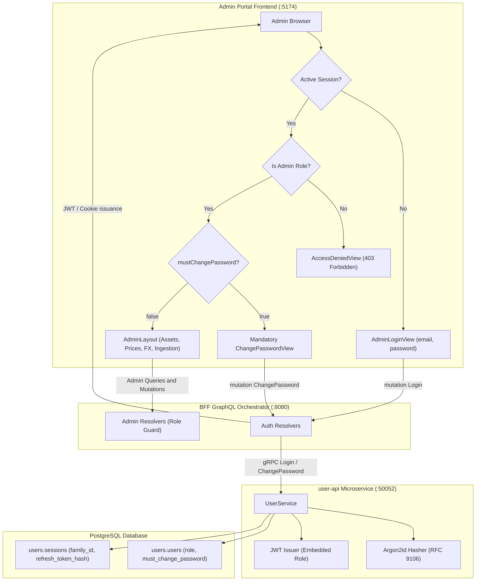
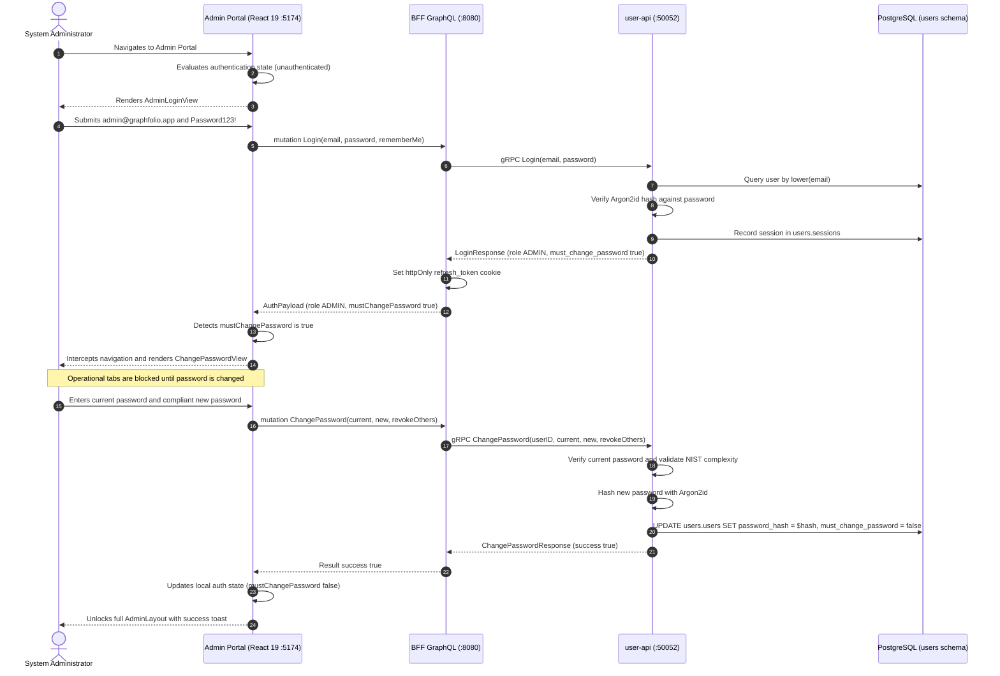

# Implementation Plan: Admin Portal Authentication, Auto-Provisioning & First-Login Password Rotation

> **Feature Reference**: Admin Portal Security, Identity, Auto-Provisioning & Credential Policy  
> **Story Reference**: [admin-portal-login-and-provisioning.md](file:///Users/oscargarcia/workspace/graphfolio/docs/user-stories/admin-portal-login-and-provisioning.md) (Story ID: `US-ADM-103`)  
> **Status**: **DONE**  
> **Security Standards**: OWASP ASVS v4.0 Level 2 (Sections 2.1 & 2.2), NIST SP 800-63B Section 5.1.1.2 (Memorized Secret Verifiers), RFC 9106 (Argon2id), Role-Based Access Control (RBAC)  
> **Target Layers**: Database (`users` schema migrations & seeds), Protocol Buffers (`proto/user/v1/user.proto`), User Microservice (`services/user-api`), BFF Orchestrator (`bff/`), Frontend Monorepo (`web/apps/admin-app`, `web/packages/api-client`, `web/packages/ui`)  

---

## 1. Executive Summary & Architectural Overview

The objective of this feature is to establish a secure, defense-in-depth authentication layer for the GraphFolio Admin Portal (`web/apps/admin-app` running on `:5174`). This prevents unauthenticated users and unauthorized standard investors from accessing financial instrument directories, closing price ledgers, foreign exchange rates, and market ingestion pipelines.

The solution provides:
1. **Automated Admin Account Provisioning**: Idempotent bootstrapping of an initial administrative account (`admin@graphfolio.app` with default password `Password123!`) during database migration or startup.
2. **Role-Based Access Control (RBAC)**: Distinguishes between standard investors (`USER`) and platform administrators (`ADMIN`) across PostgreSQL, JWT access token claims, and BFF GraphQL resolvers.
3. **Mandatory First-Login Password Rotation**: Detects bootstrap credentials via a `must_change_password` flag, blocking all administrative operational tabs and redirecting the administrator to a mandatory password reset view before granting access.
4. **Seamless Session Lifecycle**: Implements silent token refresh via `httpOnly`, `SameSite=Strict` cookies, real-time password complexity evaluation, and session revocation upon logout.

---

### 1.1 Architecture & Workflow Diagram



---

### 1.2 End-to-End Sequence Diagram



---

## 2. Database Schema & Auto-Provisioning (`services/user-api`)

### 2.1 Schema Migration (`000004_add_role_and_password_policy.up.sql`)

Create migration `services/user-api/migrations/000004_add_role_and_password_policy.up.sql`:

```sql
-- Migration: 000004_add_role_and_password_policy.up.sql
-- Description: Add role enum/check, must_change_password flag, and auto-provision admin user

-- 1. Add role and must_change_password columns to users.users
ALTER TABLE users.users
    ADD COLUMN IF NOT EXISTS role                 text    NOT NULL DEFAULT 'USER',
    ADD COLUMN IF NOT EXISTS must_change_password boolean NOT NULL DEFAULT false;

-- 2. Add check constraint for permitted roles
ALTER TABLE users.users
    DROP CONSTRAINT IF EXISTS users_role_check;
ALTER TABLE users.users
    ADD CONSTRAINT users_role_check CHECK (role IN ('USER', 'ADMIN'));

-- 3. High-performance index for role filtering
CREATE INDEX IF NOT EXISTS users_role_idx ON users.users(role);

-- 4. Auto-provision default administrator
-- Email: admin@graphfolio.app
-- Default Password: Password123!
-- Argon2id Hash: $argon2id$v=19$m=65536,t=3,p=4$z48VmX+qFO9X2FkAfV/Z6Q$WW1NOG+O6TwEwlSDkDIfae3Xi0xOePDpNg+rd7lkWsw
INSERT INTO users.users (
    id,
    email,
    password_hash,
    display_name,
    base_currency,
    theme,
    role,
    must_change_password,
    is_active
)
VALUES (
    '018f0000-0000-7000-8000-000000000002',
    'admin@graphfolio.app',
    '$argon2id$v=19$m=65536,t=3,p=4$z48VmX+qFO9X2FkAfV/Z6Q$WW1NOG+O6TwEwlSDkDIfae3Xi0xOePDpNg+rd7lkWsw',
    'System Administrator',
    'USD',
    'DARK',
    'ADMIN',
    true,
    true
)
ON CONFLICT (lower(email)) DO UPDATE
SET role = 'ADMIN'
WHERE users.users.role != 'ADMIN';
```

### 2.2 Schema Down Migration (`000004_add_role_and_password_policy.down.sql`)

Create migration `services/user-api/migrations/000004_add_role_and_password_policy.down.sql`:

```sql
-- Migration: 000004_add_role_and_password_policy.down.sql
DELETE FROM users.users WHERE lower(email) = 'admin@graphfolio.app';
DROP INDEX IF EXISTS users.users_role_idx;
ALTER TABLE users.users DROP CONSTRAINT IF EXISTS users_role_check;
ALTER TABLE users.users DROP COLUMN IF EXISTS must_change_password;
ALTER TABLE users.users DROP COLUMN IF EXISTS role;
```

### 2.3 Development Seed Synchronization (`services/user-api/seeds/dev_seed.sql`)

Update [dev_seed.sql](file:///Users/oscargarcia/workspace/graphfolio/services/user-api/seeds/dev_seed.sql) so that fresh local environments seed both the demo investor and the auto-provisioned admin account:

```sql
-- Seed Admin User (admin@graphfolio.app / Password123!)
INSERT INTO users.users (id, email, password_hash, display_name, base_currency, theme, role, must_change_password, is_active)
VALUES (
    '018f0000-0000-7000-8000-000000000002',
    'admin@graphfolio.app',
    '$argon2id$v=19$m=65536,t=3,p=4$z48VmX+qFO9X2FkAfV/Z6Q$WW1NOG+O6TwEwlSDkDIfae3Xi0xOePDpNg+rd7lkWsw',
    'System Administrator',
    'USD',
    'DARK',
    'ADMIN',
    true,
    true
)
ON CONFLICT (lower(email)) DO NOTHING;
```

---

## 3. Protocol Buffers Contract (`proto/user/v1/user.proto`)

Extend [user.proto](file:///Users/oscargarcia/workspace/graphfolio/proto/user/v1/user.proto) with the `UserRole` enum and `UserPreferences` fields:

```protobuf
enum UserRole {
  USER_ROLE_UNSPECIFIED = 0;
  USER_ROLE_USER        = 1;
  USER_ROLE_ADMIN       = 2;
}

message UserPreferences {
  string   user_id              = 1;
  string   email                = 2;
  string   display_name         = 3;
  string   display_currency     = 4; // 3-letter ISO code: "USD", "EUR", "AUD"
  string   theme                = 5; // "DARK", "LIGHT", "SYSTEM"
  string   created_at           = 6;
  string   updated_at           = 7;
  UserRole role                 = 8; // User or Administrator
  bool     must_change_password = 9; // Requires immediate password rotation
}
```

Regenerate Go proto code across microservices:
```bash
make proto
```

---

## 4. User Microservice Implementation (`services/user-api`)

### 4.1 Domain Model Updates (`internal/domain/user.go`)

Update `User` struct in [internal/domain/user.go](file:///Users/oscargarcia/workspace/graphfolio/services/user-api/internal/domain/user.go):

```go
type User struct {
    ID                 uuid.UUID
    Email              string
    PasswordHash       string
    IsActive           bool
    DisplayName        string
    DisplayCurrency    string
    Theme              string
    Role               string // "USER" or "ADMIN"
    MustChangePassword bool   // true if bootstrap password rotation required
    EmailVerifiedAt    *time.Time
    LastLoginAt        *time.Time
    CreatedAt          time.Time
    UpdatedAt          time.Time
}
```

Add helper constants and validator:
```go
const (
    RoleUser  = "USER"
    RoleAdmin = "ADMIN"
)

func IsValidRole(role string) bool {
    return role == RoleUser || role == RoleAdmin
}
```

### 4.2 Repository Layer Updates (`internal/repository/postgres.go`)

1. **Update SQL Query Strings**:
   - `getUserByIDSQL`: Include `role, must_change_password`.
   - `getUserByEmailSQL`: Include `role, must_change_password`.
   - `createUserSQL`: Insert default `role = 'USER'`, `must_change_password = false`.
   - `updatePasswordSQL`: Add `must_change_password = false` to the `UPDATE` statement:
     ```sql
     UPDATE users.users
     SET password_hash = $1,
         must_change_password = false,
         updated_at = now()
     WHERE id = $2 AND is_active = true;
     ```

2. **Update `scanUser` helper**:
   ```go
   func scanUser(row pgx.Row) (*domain.User, error) {
       var u domain.User
       err := row.Scan(
           &u.ID,
           &u.Email,
           &u.PasswordHash,
           &u.IsActive,
           &u.DisplayName,
           &u.BaseCurrency,
           &u.Theme,
           &u.Role,
           &u.MustChangePassword,
           &u.EmailVerifiedAt,
           &u.LastLoginAt,
           &u.CreatedAt,
           &u.UpdatedAt,
       )
       if err != nil {
           return nil, err
       }
       return &u, nil
   }
   ```

### 4.3 JWT Claims Updates (`internal/auth/jwt.go`)

Embed the user role inside standard JWT claims:

```go
type Claims struct {
    Subject      string `json:"sub"`
    Email        string `json:"email"`
    DisplayName  string `json:"name"`
    BaseCurrency string `json:"currency"`
    Role         string `json:"role"` // "USER" or "ADMIN"
    IssuedAt     int64  `json:"iat"`
    ExpiresAt    int64  `json:"exp"`
}
```

In `userService.issueTokens`:
```go
accessToken, err := auth.GenerateAccessToken(s.jwtSecret, auth.Claims{
    Subject:      user.ID.String(),
    Email:        user.Email,
    DisplayName:  user.DisplayName,
    BaseCurrency: user.DisplayCurrency,
    Role:         user.Role,
    IssuedAt:     now.Unix(),
    ExpiresAt:    now.Add(AccessTokenDuration).Unix(),
})
```

### 4.4 gRPC Server Adapter Updates (`internal/server.go`)

Update `toProtoPreferences` in [internal/server.go](file:///Users/oscargarcia/workspace/graphfolio/services/user-api/internal/server.go):

```go
func toProtoRole(role string) userpb.UserRole {
    if role == domain.RoleAdmin {
        return userpb.UserRole_USER_ROLE_ADMIN
    }
    return userpb.UserRole_USER_ROLE_USER
}

func toProtoPreferences(u *domain.User) *userpb.UserPreferences {
    return &userpb.UserPreferences{
        UserId:             u.ID.String(),
        Email:              u.Email,
        DisplayName:        u.DisplayName,
        DisplayCurrency:    u.DisplayCurrency,
        Theme:              u.Theme,
        Role:               toProtoRole(u.Role),
        MustChangePassword: u.MustChangePassword,
        CreatedAt:          u.CreatedAt.Format(time.RFC3339),
        UpdatedAt:          u.UpdatedAt.Format(time.RFC3339),
    }
}
```

---

## 5. BFF GraphQL Orchestration Layer (`bff/`)

### 5.1 GraphQL Schema Updates (`bff/graph/schema.graphqls`)

Extend [schema.graphqls](file:///Users/oscargarcia/workspace/graphfolio/bff/graph/schema.graphqls):

```graphql
enum UserRole {
  USER
  ADMIN
}

extend type UserPreferences {
  role: UserRole!
  mustChangePassword: Boolean!
}
```

### 5.2 Resolver Mapping (`bff/graph/schema.resolvers.go`)

Update user mapping helper in [schema.resolvers.go](file:///Users/oscargarcia/workspace/graphfolio/bff/graph/schema.resolvers.go):

```go
func toGraphQLRole(role userpb.UserRole) model.UserRole {
    if role == userpb.UserRole_USER_ROLE_ADMIN {
        return model.UserRoleAdmin
    }
    return model.UserRoleUser
}

func mapUserPreferences(pb *userpb.UserPreferences) *model.UserPreferences {
    return &model.UserPreferences{
        UserID:             pb.UserId,
        Email:              pb.Email,
        DisplayName:        pb.DisplayName,
        DisplayCurrency:    pb.DisplayCurrency,
        Theme:              model.Theme(pb.Theme),
        Role:               toGraphQLRole(pb.Role),
        MustChangePassword: pb.MustChangePassword,
        CreatedAt:          &pb.CreatedAt,
        UpdatedAt:          &pb.UpdatedAt,
    }
}
```

### 5.3 RBAC Guard in Admin Resolvers

In [schema.resolvers.go](file:///Users/oscargarcia/workspace/graphfolio/bff/graph/schema.resolvers.go), create an authorization check helper:

```go
func requireAdminRole(ctx context.Context) error {
    claims, ok := middleware.GetClaims(ctx)
    if !ok || claims.Role != "ADMIN" {
        return fmt.Errorf("forbidden: administrative privileges required")
    }
    return nil
}
```

Enforce `requireAdminRole(ctx)` on admin mutations:
- `CreateInstrument`
- `UpdateInstrument`
- `DeleteInstrument`
- `RecordPriceOverride`
- `RecordFXRateOverride`
- `TriggerMarketSync`
- `TriggerBackfill`

### 5.4 Regenerate API Client Codegen

Run GenQL codegen so `@graphfolio/api-client` exports updated types:
```bash
cd web && npm run codegen
```

---

## 6. Frontend Monorepo Implementation (`web/apps/admin-app`)

### 6.1 State Management: `AdminAuthContext`

Create `web/apps/admin-app/src/context/AdminAuthContext.tsx`:
- Provides: `user: AuthUser | null`, `isAuthenticated: boolean`, `isLoading: boolean`, `error: string | null`.
- Functions: `login(email, password)`, `logout()`, `changePassword(current, new, revokeOthers)`, `clearError()`.
- Implements mount-time silent token refresh via `client.mutation({ refreshToken: ... })`.
- If refresh succeeds and `user.role === 'ADMIN'`, populates `user` and schedules next silent refresh timer.
- If refresh returns a non-admin user or fails, marks `isAuthenticated = false`.

### 6.2 UI Components

#### 1. `AdminLoginView` (`web/apps/admin-app/src/components/AdminLoginView.tsx` & `.css`)
- Styled using `@graphfolio/ui` dark glassmorphic tokens.
- Header: GraphFolio logo + `"ADMIN PORTAL"` badge + subtitle `"Restricted Operations & Market Ingestion Console"`.
- Form inputs: Email (`admin@graphfolio.app` placeholder), Password with show/hide eye toggle.
- Submit button with loading spinner during authentication.
- Error banner displaying invalid credentials or network errors.

#### 2. `AdminChangePasswordView` (`web/apps/admin-app/src/components/AdminChangePasswordView.tsx` & `.css`)
- Rendered when `user.mustChangePassword === true`.
- Cannot be closed, dismissed, or bypassed.
- Persistent warning banner:
  > *"Initial credential rotation required. Please replace the auto-provisioned default password before accessing administrative features."*
- Fields:
  - Current Password (pre-filled or prompted for `Password123!`).
  - New Password with real-time `PasswordStrengthMeter` checklist ($\ge 10$ characters, uppercase, lowercase, digit, symbol).
  - Confirm New Password with match indicator.
  - Option to "Sign out of all other sessions".
- Submit action calls `changePassword`, sets `mustChangePassword = false` in context upon success, and triggers transition to `AdminLayout`.

#### 3. `AccessDeniedView` (`web/apps/admin-app/src/components/AccessDeniedView.tsx` & `.css`)
- Rendered when authenticated user has `user.role !== 'ADMIN'`.
- Clean shield icon with message:
  > *"403 Forbidden: Administrator Privileges Required. Your account does not have access to the GraphFolio Admin Portal."*
- Provides an immediate "Sign Out" button to return to the Admin Login screen.

#### 4. Header Profile Menu & Logout in `AdminLayout` (`web/apps/admin-app/src/components/AdminLayout.tsx`)
- Adds an Admin identity pill to the top-right header:
  - Administrator badge (`ADMIN`).
  - User email (e.g. `admin@graphfolio.app`).
  - Quick dropdown menu with:
    - "Change Password" action (opens modal).
    - "Sign Out" action (calls `logout()`, clears client token, redirects to `AdminLoginView`).

### 6.3 Routing & Guard Integration in `App.tsx`

Refactor [web/apps/admin-app/src/App.tsx](file:///Users/oscargarcia/workspace/graphfolio/web/apps/admin-app/src/App.tsx):

```tsx
export default function App() {
  const { user, isAuthenticated, isLoading } = useAdminAuth();

  if (isLoading) {
    return <AdminLoadingScreen />;
  }

  if (!isAuthenticated) {
    return <AdminLoginView />;
  }

  if (user?.role !== 'ADMIN') {
    return <AccessDeniedView />;
  }

  if (user?.mustChangePassword) {
    return <AdminChangePasswordView />;
  }

  return (
    <div className="admin-app-root">
      <AdminLayout ...>
        {/* Existing operational tabs: assets, prices, missing-prices, etc. */}
      </AdminLayout>
    </div>
  );
}
```

---

## 7. Step-by-Step Implementation Checklist

### Phase 1: Database Migration & Auto-Provisioning
- [x] Create `services/user-api/migrations/000004_add_role_and_password_policy.up.sql`.
- [x] Create `services/user-api/migrations/000004_add_role_and_password_policy.down.sql`.
- [x] Update `services/user-api/seeds/dev_seed.sql` with the auto-provisioned admin account.
- [x] Run migrations and verify database records in `users.users`:
  ```bash
  psql -U graphfolio -d graphfolio -c "SELECT id, email, role, must_change_password FROM users.users;"
  ```

### Phase 2: Protocol Buffers Contract
- [x] Add `UserRole` enum and fields to `proto/user/v1/user.proto`.
- [x] Run `make proto` to compile Go protobuf stubs.

### Phase 3: User Microservice Layer (`user-api`)
- [x] Update `internal/domain/user.go` with `Role` and `MustChangePassword`.
- [x] Update repository queries in `internal/repository/postgres.go` to scan and persist `role` and `must_change_password`.
- [x] Ensure `UpdatePassword` sets `must_change_password = false`.
- [x] Embed `role` in JWT claims in `internal/auth/jwt.go`.
- [x] Update `internal/server.go` to map protobuf fields.
- [x] Write unit tests in `internal/service/service_test.go` and `internal/server_test.go`.

### Phase 4: BFF GraphQL Orchestration Layer (`bff`)
- [x] Update `bff/graph/schema.graphqls` with `UserRole` and new fields on `UserPreferences`.
- [x] Update resolver mappings in `bff/graph/schema.resolvers.go`.
- [x] Implement `requireAdminRole` guard on admin mutations.
- [x] Run `make test` on BFF.

### Phase 5: Client Codegen & Web Monorepo
- [x] Run `npm run codegen` in `web/` to update `@graphfolio/api-client`.
- [x] Build `AdminAuthContext` in `web/apps/admin-app/src/context/AdminAuthContext.tsx`.
- [x] Build `AdminLoginView` in `web/apps/admin-app/src/components/AdminLoginView.tsx`.
- [x] Build `AdminChangePasswordView` in `web/apps/admin-app/src/components/AdminChangePasswordView.tsx`.
- [x] Build `AccessDeniedView` in `web/apps/admin-app/src/components/AccessDeniedView.tsx`.
- [x] Update `AdminLayout` with admin header badge and sign-out controls.
- [x] Wire routing guard in `web/apps/admin-app/src/App.tsx`.

### Phase 6: Automated Verification & Testing
- [x] Run microservice tests: `go test ./...` in `services/user-api`.
- [x] Run BFF tests: `go test ./...` in `bff`.
- [x] Run web tests and lint: `npm test` and `npm run lint` in `web`.
- [x] Validate end-to-end admin login, first-login password change, and non-admin denial in the browser.

---

## 8. Test & Verification Plan

| Test ID | Category | Scenario                                                 | Expected Outcome |
|---|---|----------------------------------------------------------|---|
| **TEST-ADM-01** | Database Migration | Run migration 000004 on clean database                   | `users.users` has `role` and `must_change_password` columns; `admin@graphfolio.app` exists with `role='ADMIN'` and `must_change_password=true`. |
| **TEST-ADM-02** | Migration Idempotency | Re-apply migration or restart container                  | Existing credentials and rotated passwords are not overwritten. |
| **TEST-ADM-03** | Microservice Auth | Login with `admin@graphfolio.app` & `Password123!`       | Returns HTTP 200 / gRPC OK with `Role: USER_ROLE_ADMIN` and `MustChangePassword: true`. |
| **TEST-ADM-04** | Password Rotation | Call `ChangePassword` for admin user                     | Updates password hash in `users.users` and flips `must_change_password` to `false`. |
| **TEST-ADM-05** | Complexity Enforcement | Attempt password change with weak password (`test1234`)  | Fails with complexity error; password hash is not modified. |
| **TEST-ADM-06** | BFF Admin Mutation Guard | Standard investor invokes `recordPriceOverride`          | Fails with `403 Forbidden` (`administrative privileges required`). |
| **TEST-ADM-07** | Admin App Route Guard | Navigate to `:5174` without session                      | Renders `AdminLoginView`; operational tabs are not mounted or queried. |
| **TEST-ADM-08** | First-Login Redirection | Admin logs in with `Password123!`                        | Intercepted and routed to `AdminChangePasswordView`; operational tabs remain hidden. |
| **TEST-ADM-09** | Portal Unlock | Admin submits valid new password                         | Transition occurs smoothly to `AdminLayout` with all admin tabs accessible. |
| **TEST-ADM-10** | Non-Admin Denial | Investor (`oscar@graphfolio.app`) logs into admin portal | Displays `AccessDeniedView` with Sign Out button. |
| **TEST-ADM-11** | Silent Token Refresh | Reload browser while authenticated as Admin              | Session is preserved via cookie refresh; user remains logged in. |
| **TEST-ADM-12** | Sign Out | Click "Sign Out" in Admin header                         | Revokes refresh token in `users.sessions`, clears client state, returns to `AdminLoginView`. |

---

## 9. Definition of Done (DoD)

- [x] All database migrations applied successfully with idempotent admin auto-provisioning.
- [x] Protobuf definitions regenerated and consistent across `services/user-api` and `bff`.
- [x] GraphQL schema extended and verified via GenQL codegen (`@graphfolio/api-client`).
- [x] `services/user-api` unit test coverage $\ge 90\%$.
- [x] BFF GraphQL resolver tests pass validating role serialization and admin mutation guarding.
- [x] Admin Portal UI verifies all authentication and route guard states:
  - Unauthenticated access prompts `AdminLoginView`.
  - Submitting `admin@graphfolio.app` with `Password123!` redirects to `AdminChangePasswordView`.
  - Successful password change transitions into `AdminLayout`.
  - Non-admin user receives `AccessDeniedView`.
  - Sign-out invalidates session and returns to login screen.
- [x] All existing repository tests and lint checks pass (`make test`).
