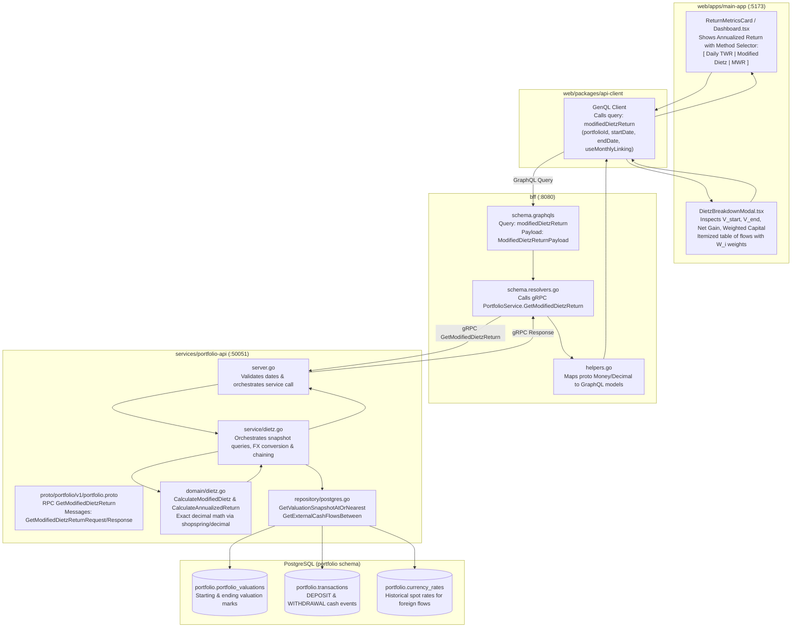
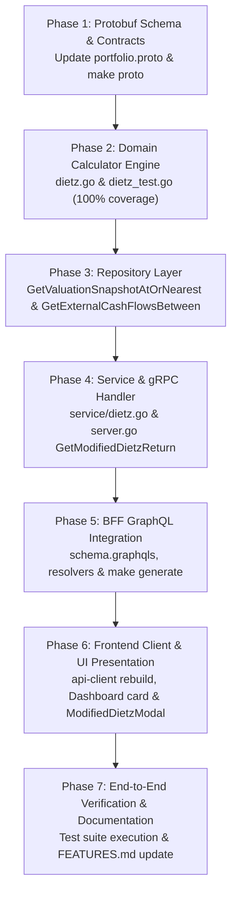

# Implementation Plan: Annualized Return Calculation using the Modified Dietz Method

> **User Story**: [annualized-return-modified-dietz.md](file:///Users/oscargarcia/workspace/graphfolio/docs/user-stories/annualized-return-modified-dietz.md) (`US-PERF-106`)  
> **Status**: Ready for Implementation  
> **Roadmap Reference**: [FEATURES.md (Feature #31)](file:///Users/oscargarcia/workspace/graphfolio/FEATURES.md)  
> **Calculation Standard**: [financial-calculations skill](file:///Users/oscargarcia/workspace/graphfolio/.agents/skills/financial-calculations/SKILL.md) (GIPS® Standard 2.A.20, CFA Institute Performance Attribution)  
> **Target Layers**: Protobuf (`proto/portfolio/v1/`), Domain Microservice (`services/portfolio-api`), BFF (`bff/`), Shared Web Client (`packages/api-client`), Primary Web App (`web/apps/main-app`)  

---

## 1. Executive Summary & Objective

The objective of this feature is to implement the **Modified Dietz Method** as a first-class rate of return calculation engine across GraphFolio. 

While GraphFolio currently computes daily Time-Weighted Return (TWR) using valuation snapshots, daily TWR strictly relies on having unbroken Level 1 closing prices and exchange rates for every single holding on every single calendar day. In contrast, the Modified Dietz Method calculates an analytical, closed-form ($O(1)$) rate of return by weighting each external cash flow (deposit or withdrawal) by the exact proportion of time it was employed in the portfolio during the measurement period.

### Core Objectives
1. **Time-Weighted Capital Attribution**: Calculate the exact time-weight $W_i = \frac{CD - D_i}{CD}$ for each external cash flow, producing the time-weighted average capital employed ($\text{Capital}_{\text{weighted}}$).
2. **GIPS Standard 2.A.20 Compliance**: Strictly enforce the sub-1-year annualization prohibition for periods under 365 calendar days ($CD < 365$), returning non-annualized cumulative period return with `is_annualized: false`.
3. **Compound Geometric Annualization**: For periods spanning 365 days or longer ($CD \ge 365$), calculate geometric CAGR annualization using the Actual/365.25 day-count convention.
4. **Sub-Period Monthly Chaining**: Provide an option for multi-year periods to calculate monthly sub-period Modified Dietz returns and geometrically link them, preventing the long-horizon dilution of linear weights.
5. **Zero Floating-Point Precision**: Implement pure fixed-point mathematics using `shopspring/decimal` with defensive boundary handling against zero/negative weighted capital.
6. **Transparent Investor Inspection**: Expose an interactive performance methodology selector and a step-by-step inspection drawer in the web dashboard, displaying every external cash flow, its assigned time-weight $W_i$, and its contribution to average capital.

---

## 2. Technical Architecture & End-to-End Data Flow



---

## 3. Mathematical & Accounting Specifications

All calculations adhere strictly to the [financial-calculations guidelines](file:///Users/oscargarcia/workspace/graphfolio/.agents/skills/financial-calculations/SKILL.md) and CFA Institute GIPS® standards.

### 3.1 Input Definitions
For a portfolio with base currency $C_{\text{base}}$ evaluated from timestamp $T_{\text{start}}$ to $T_{\text{end}}$:
- **Period Length ($CD$)**:
  $$CD = \max\left(1, \left\lfloor \frac{T_{\text{end}} - T_{\text{start}}}{24\text{ hours}} \right\rfloor\right)$$
- **Starting Valuation ($V_{\text{start}}$)**: Consolidated portfolio valuation (market value of holdings + cash) as of close on $T_{\text{start}}$.
- **Ending Valuation ($V_{\text{end}}$)**: Consolidated portfolio valuation as of close on $T_{\text{end}}$.
- **External Cash Flows ($F_i$)**: All transactions where `type` $\in$ (`DEPOSIT`, `WITHDRAWAL`) occurring at timestamp $t_i \in [T_{\text{start}}, T_{\text{end}}]$.
  - If transaction currency $C_i \ne C_{\text{base}}$, convert to base currency using spot exchange rate on date $t_i$:
    $$F_i = \text{Amount}_i \times \text{FX}(C_i \to C_{\text{base}}, t_i)$$
  - Deposits are positive ($+F_i$); withdrawals are negative ($-F_i$).
  - Internal flows (`BUY`, `SELL`, `DIVIDEND`, `FEE`, `INTEREST`, `SPLIT`) are **strictly excluded**.

### 3.2 Time-Weighting and Capital Employed
For each external cash flow $i$:
- **Day Offset ($D_i$)**:
  $$D_i = \left\lfloor \frac{t_i - T_{\text{start}}}{24\text{ hours}} \right\rfloor \quad \text{clamped to } [0, CD]$$
- **Time-Weight ($W_i$)**:
  $$W_i = \frac{CD - D_i}{CD}$$
  *Precision*: Computed to **8 decimal places** (`DivRound(cdDec, 8)`).
- **Time-Weighted Flow Contribution**:
  $$\text{Contribution}_i = W_i \times F_i$$
- **Weighted Average Capital Employed ($\text{Capital}_{\text{weighted}}$)**:
  $$\text{Capital}_{\text{weighted}} = V_{\text{start}} + \sum_{i=1}^M \left( W_i \times F_i \right)$$

### 3.3 Net Investment Gain & Cumulative Return
- **Net Investment Gain ($\text{Gain}_{\text{net}}$)**:
  $$\text{Gain}_{\text{net}} = V_{\text{end}} - V_{\text{start}} - \sum_{i=1}^M F_i$$
- **Cumulative Period Return ($R_{\text{Dietz}}$)**:
  $$R_{\text{Dietz}} = \frac{\text{Gain}_{\text{net}}}{\text{Capital}_{\text{weighted}}}$$
  $$\text{CumulativeReturnPercent} = R_{\text{Dietz}} \times 100\%$$

### 3.4 GIPS Annualization Rules
```text
IF CD < 365:
    is_annualized = false
    annualized_return_percent = null
    display_label = "Period Return"
ELSE:
    is_annualized = true
    IF (1 + R_Dietz) <= 0:
        annualized_return_percent = -100.00%
    ELSE:
        annualized_return_percent = (((1 + R_Dietz) ^ (365.25 / CD)) - 1) * 100%
    display_label = "Annualized Return p.a."
```

### 3.5 Sub-Period Monthly Chaining (Optional Multi-Year Mode)
When `use_monthly_linking = true` and $CD \ge 365$:
1. Break the range $[T_{\text{start}}, T_{\text{end}}]$ into $K$ calendar month intervals $[m_{\text{start}}, m_{\text{end}}]$.
2. For each month $m$, retrieve monthly starting valuation $V_{m, \text{start}}$, ending valuation $V_{m, \text{end}}$, and monthly external flows.
3. Compute monthly Modified Dietz return $R_m$.
4. Geometrically chain monthly compounding factors:
   $$\text{TWR}_{\text{chained}} = \prod_{m=1}^K (1 + R_m) - 1$$
5. Annualize the chained result over total days $CD$:
   $$R_{\text{chained, annualized}} = \left( (1 + \text{TWR}_{\text{chained}})^{\frac{365.25}{CD}} - 1 \right) \times 100\%$$

---

## 4. Concrete Worked Numerical Scenarios

### Scenario A: 1-Year Period with Mid-Year Deposit
- $T_{\text{start}} = \text{2025-01-01}$, $T_{\text{end}} = \text{2025-12-31}$ ($CD = 365$ days)
- $V_{\text{start}} = \$100,000.00$, $V_{\text{end}} = \$180,000.00$
- External deposit: $\$50,000.00$ on 2025-07-01 ($D_1 = 181$ days)
- $W_1 = \frac{365 - 181}{365} = \frac{184}{365} = 0.50410959$
- $\text{Weighted Amount} = 50,000.00 \times 0.50410959 = \$25,205.48$
- $\text{Capital}_{\text{weighted}} = 100,000.00 + 25,205.48 = \$125,205.48$
- $\text{Gain}_{\text{net}} = 180,000.00 - 100,000.00 - 50,000.00 = \$30,000.00$
- $R_{\text{Dietz}} = \frac{30,000.00}{125,205.48} = 0.2396061 \implies \mathbf{+23.96\%}$
- Since $CD = 365 \ge 365$, annualize:
  $$R_{\text{annualized}} = \left( (1 + 0.2396061)^{\frac{365.25}{365}} - 1 \right) \times 100\% = \mathbf{+23.98\% \text{ p.a.}}$$

### Scenario B: 6-Month Sub-1-Year Period (GIPS Prohibition)
- $T_{\text{start}} = \text{2025-01-01}$, $T_{\text{end}} = \text{2025-06-30}$ ($CD = 181$ days)
- $V_{\text{start}} = \$50,000.00$, $V_{\text{end}} = \$78,000.00$
- External deposit: $\$20,000.00$ on 2025-03-15 ($D_1 = 73$ days)
- $W_1 = \frac{181 - 73}{181} = \frac{108}{181} = 0.59668508$
- $\text{Weighted Amount} = 20,000.00 \times 0.59668508 = \$11,933.70$
- $\text{Capital}_{\text{weighted}} = 50,000.00 + 11,933.70 = \$61,933.70$
- $\text{Gain}_{\text{net}} = 78,000.00 - 50,000.00 - 20,000.00 = \$8,000.00$
- $R_{\text{Dietz}} = \frac{8,000.00}{61,933.70} = 0.129170 \implies \mathbf{+12.92\%}$
- Since $CD = 181 < 365$:
  - `is_annualized = false`
  - `annualized_return_percent = null`
  - Display: `+12.92% (Period Return)`

---

## 5. Layer-by-Layer Implementation Tasks

### 5.1 Layer 1: Protobuf Schema Updates (`proto/portfolio/v1/`)
Modify [portfolio.proto](file:///Users/oscargarcia/workspace/graphfolio/proto/portfolio/v1/portfolio.proto) to declare the gRPC service contracts:

```protobuf
// 1. Add RPC to service PortfolioService:
rpc GetModifiedDietzReturn(GetModifiedDietzReturnRequest) returns (GetModifiedDietzReturnResponse);

// 2. Add Request message:
message GetModifiedDietzReturnRequest {
  string user_id             = 1;
  string start_date          = 2; // YYYY-MM-DD
  string end_date            = 3; // YYYY-MM-DD
  bool   use_monthly_linking = 4; // Optional: geometric chaining over monthly intervals
}

// 3. Add ExternalCashFlowWeight breakdown:
message ExternalCashFlowWeight {
  string            transaction_id  = 1;
  string            date            = 2; // YYYY-MM-DD
  TransactionType   type            = 3; // DEPOSIT or WITHDRAWAL
  common.v1.Money   amount          = 4; // Converted to base currency
  common.v1.Decimal weight          = 5; // W_i = (CD - D_i) / CD
  common.v1.Money   weighted_amount = 6; // W_i * F_i
  common.v1.Money   local_amount    = 7; // Original transaction currency and amount
}

// 4. Add Response message:
message GetModifiedDietzReturnResponse {
  string                          portfolio_id              = 1;
  string                          base_currency             = 2;
  string                          start_date                = 3;
  string                          end_date                  = 4;
  int32                           elapsed_days              = 5;
  common.v1.Money                 start_valuation           = 6;
  common.v1.Money                 end_valuation             = 7;
  common.v1.Money                 net_external_flows        = 8;
  common.v1.Money                 net_investment_gain       = 9;
  common.v1.Money                 weighted_capital_employed = 10;
  common.v1.Decimal               cumulative_return_percent = 11;
  common.v1.Decimal               annualized_return_percent = 12;
  bool                            is_annualized             = 13;
  bool                            is_computable             = 14;
  string                          diagnostic_code           = 15; // OK, ZERO_CAPITAL_EMPLOYED, NEGATIVE_AVERAGE_CAPITAL
  repeated ExternalCashFlowWeight cash_flow_weights         = 16;
}
```
**Compilation Command**:
```bash
make proto
```

---

### 5.2 Layer 2: Domain Calculator Engine (`services/portfolio-api/internal/domain/`)
Create `services/portfolio-api/internal/domain/dietz.go` and comprehensive unit test file `dietz_test.go`:
- Define `ExternalCashFlow` struct: `TransactionID`, `Date`, `Type`, `AmountBase`, `LocalAmount`, `LocalCurrency`.
- Define `ModifiedDietzResult` struct with high-precision fields.
- Implement `CalculateModifiedDietz`:
  - Validates $T_{\text{end}} \ge T_{\text{start}}$ and $CD \ge 1$.
  - Iterates external flows and computes exact $W_i$ and weighted capital.
  - Guards against `Capital_weighted <= 0` (returns diagnostic code `ZERO_CAPITAL_EMPLOYED` or `NEGATIVE_AVERAGE_CAPITAL`).
  - Evaluates sub-1-year GIPS rule ($CD < 365$).
  - For $CD \ge 365$, computes geometric annualization:
    $$\text{annFactor} = \text{math.Pow}(\text{factorFloat}, 365.25 / \text{float64}(CD))$$
- Implement `ChainModifiedDietzSubPeriods`:
  - Geometrically chains multiple sub-period returns $\prod (1 + R_k) - 1$.
  - Computes consolidated weighted capital and annualized return.

---

### 5.3 Layer 3: Repository Persistence & Queries (`services/portfolio-api/internal/repository/`)
In [postgres.go](file:///Users/oscargarcia/workspace/graphfolio/services/portfolio-api/internal/repository/postgres.go) and [queries.go](file:///Users/oscargarcia/workspace/graphfolio/services/portfolio-api/internal/repository/queries.go):

1. **`GetValuationSnapshotAtOrNearest(ctx context.Context, portfolioID uuid.UUID, targetDate time.Time) (*domain.PortfolioValuation, error)`**:
   - Fetches the closest valuation on or immediately preceding `targetDate`:
     ```sql
     SELECT portfolio_id, valuation_date, market_value_base, cash_value_base, net_flow_base, daily_return, twr_index
     FROM portfolio.portfolio_valuations
     WHERE portfolio_id = $1 AND valuation_date <= $2
     ORDER BY valuation_date DESC
     LIMIT 1;
     ```
   - Fallback: If no prior valuation exists (e.g. `targetDate` is before first snapshot), query the earliest available valuation or reconstruct cash balance on that date.

2. **`GetExternalCashFlowsBetween(ctx context.Context, portfolioID uuid.UUID, startDate, endDate time.Time) ([]domain.ExternalCashFlow, error)`**:
   - Queries all external transactions within the date window:
     ```sql
     SELECT 
       t.id, t.trade_date, t.type, t.amount, t.currency_code,
       COALESCE(fx.rate, 1.0) AS fx_rate_to_base
     FROM portfolio.transactions t
     LEFT JOIN portfolio.currency_rates fx 
       ON fx.base_currency = t.currency_code 
      AND fx.quote_currency = $3 
      AND fx.rate_date = t.trade_date
     WHERE t.portfolio_id = $1
       AND t.type IN ('DEPOSIT', 'WITHDRAWAL')
       AND t.trade_date >= $2 AND t.trade_date <= $4
     ORDER BY t.trade_date ASC;
     ```

---

### 5.4 Layer 4: Service Orchestration (`services/portfolio-api/internal/service/`)
Create `services/portfolio-api/internal/service/dietz.go`:
- Define `GetModifiedDietzReturn(ctx context.Context, userID string, startDate, endDate time.Time, useMonthlyLinking bool)` on `PortfolioService`.
- Resolves portfolio by `userID`.
- Retrieves $V_{\text{start}}$ and $V_{\text{end}}$ from repository.
- Retrieves external cash flows within window.
- If `useMonthlyLinking` is false:
  - Invokes `domain.CalculateModifiedDietz`.
- If `useMonthlyLinking` is true and $CD \ge 365$:
  - Partitions window by calendar month boundaries.
  - Computes monthly sub-period results and links them via `domain.ChainModifiedDietzSubPeriods`.
- Converts domain results into protobuf response message.

---

### 5.5 Layer 5: Transport Layer (`services/portfolio-api/internal/server.go`)
Implement the gRPC endpoint in [server.go](file:///Users/oscargarcia/workspace/graphfolio/services/portfolio-api/internal/server.go):
- Validates `user_id`, parses `start_date` and `end_date` (format: `2006-01-02`).
- Calls `s.portfolioService.GetModifiedDietzReturn`.
- Handles errors with appropriate gRPC codes (`codes.InvalidArgument`, `codes.NotFound`, `codes.Internal`).

---

### 5.6 Layer 6: BFF GraphQL Layer (`bff/`)
1. **Schema Updates** ([schema.graphqls](file:///Users/oscargarcia/workspace/graphfolio/bff/graph/schema.graphqls)):
   ```graphql
   extend type Query {
     modifiedDietzReturn(
       startDate: String!
       endDate: String!
       useMonthlyLinking: Boolean
     ): ModifiedDietzReturnPayload!
   }

   type ModifiedDietzReturnPayload {
     portfolioId: ID!
     baseCurrency: String!
     startDate: String!
     endDate: String!
     elapsedDays: Int!
     startValuation: Money!
     endValuation: Money!
     netExternalFlows: Money!
     netInvestmentGain: Money!
     weightedCapitalEmployed: Money!
     cumulativeReturnPercent: Decimal!
     annualizedReturnPercent: Decimal
     isAnnualized: Boolean!
     isComputable: Boolean!
     diagnosticCode: String!
     cashFlowWeights: [ExternalCashFlowWeightItem!]!
   }

   type ExternalCashFlowWeightItem {
     transactionId: ID!
     date: String!
     type: TransactionType!
     amount: Money!
     weight: Decimal!
     weightedAmount: Money!
     localAmount: Money!
   }
   ```
2. **Resolver Updates** ([schema.resolvers.go](file:///Users/oscargarcia/workspace/graphfolio/bff/graph/schema.resolvers.go)):
   - Implement `ModifiedDietzReturn(ctx context.Context, startDate string, endDate string, useMonthlyLinking *bool)` calling gRPC `portfolioClient.GetModifiedDietzReturn`.
3. **Helper Mappings** ([helpers.go](file:///Users/oscargarcia/workspace/graphfolio/bff/graph/helpers.go)):
   - Map proto `ExternalCashFlowWeight` to GraphQL models.
4. **Code Generation**:
   ```bash
   make generate
   ```

---

### 5.7 Layer 7: Shared Client & UI Presentation (`web/`)
1. **Regenerate GraphQL Client**:
   ```bash
   pnpm --filter @graphfolio/api-client build
   ```
2. **Dashboard Performance Metric Selector** ([Dashboard.tsx](file:///Users/oscargarcia/workspace/graphfolio/web/apps/main-app/src/components/Dashboard.tsx)):
   - In `.metric-secondary`, enhance the Annualized Return card:
     ```tsx
     <div className="metric-card metric-card-interactive" onClick={() => setShowDietzModal(true)}>
       <div className="metric-card-header">
         <span className="label">Annualized Return</span>
         <span className="method-tag">Modified Dietz</span>
       </div>
       <span className={`value ${returnPositive ? 'positive' : 'negative'}`}>
         {formatPercent(annualizedReturnPercent, 1)}
       </span>
       <span className="subtext">{isAnnualized ? 'p.a.' : 'Period Return'} • Click to inspect math</span>
     </div>
     ```
3. **Modified Dietz Inspection Modal** (`web/apps/main-app/src/components/ModifiedDietzModal.tsx`):
   - Glassmorphic modal displaying the exact components of the formula:
     - Starting Valuation ($V_{\text{start}}$) and Ending Valuation ($V_{\text{end}}$)
     - Total Net Injections ($F$) and Net Investment Gain ($\text{Gain}_{\text{net}}$)
     - Average Capital Employed ($\text{Capital}_{\text{weighted}}$)
     - GIPS Status badge (`ANNUALIZED (Actual/365.25)` or `PERIOD RETURN (< 365 Days)`)
     - Interactive table of external transactions showing:
       - Date, Type (`DEPOSIT` / `WITHDRAWAL`), Base Amount, Time-Weight ($W_i$), Weighted Capital Contribution ($W_i \times F_i$)

---

## 6. Boundary Conditions & Risk Mitigation Matrix

| Condition | Mathematical Risk | Handling & Mitigation Strategy |
| :--- | :--- | :--- |
| **Elapsed Days $< 365$** | Volatility exaggeration from invalid compounding. | Enforce GIPS Standard 2.A.20: set `is_annualized = false`, omit annualization exponent, output raw cumulative return. |
| **Weighted Capital $\le 0$** | Division by zero or inverted return sign. | Return `is_computable = false`, return `0.00%`, return diagnostic code `ZERO_CAPITAL_EMPLOYED` or `NEGATIVE_AVERAGE_CAPITAL`. |
| **Same-Day Deposit & Withdrawal** | Potential double-weighting. | Same-day transactions share the exact same $D_i$ and $W_i$, netting out linearly without error. |
| **Deposit on Start Date ($D_i = 0$)** | Edge-case boundary weight. | $W_i = \frac{CD - 0}{CD} = 1.00000000$ (treated as available for entire period). |
| **Deposit on End Date ($D_i = CD$)** | Zero contribution weight. | $W_i = \frac{CD - CD}{CD} = 0.00000000$ (increases end valuation and flow $F$, but contributes zero to denominator). |
| **Catastrophic Return $\le -100\%$** | Fractional powers of negative numbers cause math panic. | Clamp annualized return to `-100.00%` when $(1 + R_{\text{Dietz}}) \le 0$. |
| **Foreign Currency Cash Flows** | Distorted weights if unconverted. | Convert foreign deposit/withdrawal to portfolio base currency using historical spot FX rate on the event trade date. |

---

## 7. Verification & Testing Strategy

### 7.1 Unit Testing (`services/portfolio-api/internal/domain/dietz_test.go`)
Table-driven unit tests covering:
- **Test 1**: Zero external flows (reduces to simple holding period return).
- **Test 2**: 1-Year period with mid-year deposit matching Scenario A exactly ($+23.96\%$ cum, $+23.98\%$ ann).
- **Test 3**: Sub-1-year period matching Scenario B ($+12.92\%$ cum, `is_annualized = false`).
- **Test 4**: Deposit on Day 0 ($W = 1.0$) vs Deposit on final day ($W = 0.0$).
- **Test 5**: Division by zero safety when $V_{\text{start}} = 0$ and $F = 0$.
- **Test 6**: Negative capital handling when large mid-period withdrawal occurs.
- **Test 7**: Total loss clamping when $R_{\text{Dietz}} \le -100\%$.
- **Test 8**: Monthly sub-period linking consistency across 2-year horizon.

### 7.2 Service & gRPC Integration Testing (`server_test.go`)
- Mock repository tests validating date parsing, currency normalization, and error translation.
- Contract test verifying protobuf serialization of `ExternalCashFlowWeight`.

### 7.3 BFF GraphQL Testing (`schema.resolvers_test.go`)
- GraphQL query verification testing `modifiedDietzReturn` resolver.
- Decimal scalar precision validation.

### 7.4 Web End-to-End Verification
- Verify dashboard metric card displays annualized return.
- Open `ModifiedDietzModal` and verify that the sum of weighted contributions matches `weightedCapitalEmployed`.
- Verify GIPS indicator correctly shows "Period Return" for timeframes under 1 year.

---

## 8. Rollout Sequence & Phasing



- **Phase 1**: Update `proto/portfolio/v1/portfolio.proto` and run `make proto`.
- **Phase 2**: Implement `domain/dietz.go` and run `go test ./internal/domain/...`.
- **Phase 3**: Implement repository queries in `internal/repository/`.
- **Phase 4**: Implement service orchestration and gRPC endpoint in `server.go`.
- **Phase 5**: Update `bff/graph/schema.graphqls`, regenerate via `make generate`, and implement resolvers.
- **Phase 6**: Rebuild `@graphfolio/api-client`, add UI selector and `ModifiedDietzModal.tsx`.
- **Phase 7**: Run full test suites (`make test`), verify UI, and update documentation.
