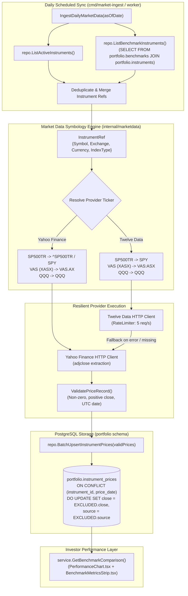

# Implementation Plan: Benchmark Instrument Market Price Ingestion & Historical Backfill

> **User Story**: [benchmark-instrument-price-ingestion.md](file:///Users/oscargarcia/workspace/graphfolio/docs/user-stories/benchmark-instrument-price-ingestion.md) (`US-MKT-016`)  
> **Status**: Proposed  
> **Roadmap Reference**: [FEATURES.md (Feature #34)](file:///Users/oscargarcia/workspace/graphfolio/FEATURES.md#L44)  
> **Calculation & Ingestion Standard**: [financial-calculations skill](file:///Users/oscargarcia/workspace/graphfolio/.agents/skills/financial-calculations/SKILL.md) (GIPS® Standard 2.A Total Return Indexing, CFA Institute Performance Attribution)  
> **Target Layers**: Market Data Pipeline (`services/portfolio-api/internal/marketdata/`), Domain Microservice (`services/portfolio-api`), CLI Worker (`cmd/market-ingest/`), Admin Portal (`web/apps/admin-app`), BFF GraphQL (`bff/`)  

---

## 1. Executive Summary & Objective

In Feature #33 (`US-PERF-107`), GraphFolio delivered the **Portfolio Benchmark Comparison & Relative Performance Analytics** engine, allowing investors to compare their cumulative and annualized portfolio performance against major indices (S&P 500 Total Return `SP500TR`, NASDAQ-100 `QQQ`, ASX 200 `VAS`).

In initial development, historical benchmark quotes in `portfolio.instrument_prices` were seeded with synthetic curves (`demo_seed.sql`). To operate in production, the market data ingestion pipeline must automatically ingest authoritative End-of-Day (EOD) closing marks and support multi-year historical backfills for all configured benchmark instruments.

### Key Objectives
1. **Dedicated Benchmark Instrument Discovery**: Automatically discover and sync closing prices for all instruments registered in `portfolio.benchmarks`, regardless of whether any user holds them in a portfolio.
2. **Multi-Provider Symbology Translation**: Resolve internal benchmark symbols (e.g. `SP500TR`, `VAS`) into provider-compatible tickers across Twelve Data (e.g. `SPY`, `VAS:ASX`) and Yahoo Finance (e.g. `^SP500TR` / `SPY`, `VAS.AX`).
3. **Total Return Adjusted Close (`adjclose`) Ingestion**: Prioritize dividend-reinvested adjusted close marks for ETF proxies so that multi-year benchmark compounding reflects true total return without dividend bias (per GIPS Standard 2.A).
4. **Multi-Year Historical Backfills**: Enable operators to backfill 5–10 years of daily closing prices via CLI (`cmd/market-ingest -symbol SP500TR -from 2015-01-01`) or Admin Portal backfill triggers.
5. **Exchange Calendar Resiliency**: Safely handle national holiday closures across different exchanges (NYSE vs. ASX) without failing the batch sync, pairing with Last Observation Carried Forward (LOCF) alignment.
6. **Strict Fixed-Point Precision**: Preserve exact arbitrary-precision arithmetic (`shopspring/decimal.Decimal` in Go, custom `Decimal` scalars in GraphQL) with zero float32/float64 conversions.

---

## 2. Technical Architecture & Ingestion Data Flow



---

## 3. Technical Specifications & Data Mapping

### 3.1 Benchmark Catalog & Symbology Resolution Matrix

| Benchmark ID | Internal Symbol | Asset Class | Exchange MIC | Currency | Provider Symbology (Twelve Data) | Provider Symbology (Yahoo Finance) | Preferred Ingestion Mark |
| :--- | :--- | :--- | :--- | :--- | :--- | :--- | :--- |
| `SP500TR` | `SP500TR` | `ETF` / `INDEX` | `XNYS` | `USD` | `SPY` (ETF proxy) | `^SP500TR` (fallback: `SPY`) | `adjclose` (Total Return) |
| `NASDAQ100` | `QQQ` | `ETF` | `XNAS` | `USD` | `QQQ` | `QQQ` | `adjclose` (Total Return) |
| `ASX200TR` | `VAS` | `ETF` | `XASX` | `AUD` | `VAS` (`mic_code=XASX`) | `VAS.AX` | `adjclose` (Total Return) |

### 3.2 Ticker Resolution Rules
1. **Index Symbols (`^` prefix)**:
   - Yahoo Finance requires a leading caret for cash indices (e.g. `^SP500TR`, `^GSPC`, `^NDX`, `^AXJO`).
   - If an index symbol fails on Twelve Data (which primarily indexes equities/ETFs on standard tiers), the resilient provider immediately falls back to Yahoo Finance or maps to the pre-configured liquid ETF proxy (`SP500TR` $\to$ `SPY`).
2. **Exchange Suffix Generation**:
   - When querying Yahoo Finance for non-US securities, the exchange MIC code dictates the ticker suffix:
     - `XASX` $\to$ `.AX` (e.g. `VAS` $\to$ `VAS.AX`)
     - `XLON` $\to$ `.L`
     - `XFRA` / `XETR` $\to$ `.DE`
     - `XTSE` $\to$ `.TO`
3. **Total Return Reinvestment Extraction (`adjclose`)**:
   - In Yahoo Finance Chart API (`/v8/finance/chart/{symbol}`), the response payload contains:
     ```json
     {
       "indicators": {
         "quote": [{ "close": [450.25, 452.10] }],
         "adjclose": [{ "adjclose": [455.80, 457.70] }]
       }
     }
     ```
   - For all ETF benchmark proxies (`SPY`, `QQQ`, `VAS`), the parser will extract `adjclose` when available, ensuring dividends are factored into cumulative growth over multi-year periods.

---

## 4. Detailed Step-by-Step Implementation Tasks

### Phase 1: Database & Repository Layer (`services/portfolio-api/internal/repository/`)

1. **Add `listBenchmarkInstrumentsSQL` in `queries.go`**:
   ```sql
   const listBenchmarkInstrumentsSQL = `
   SELECT 
       i.id, i.symbol, i.exchange_code, i.name, i.asset_class, 
       i.currency_code, i.isin, i.is_active
   FROM portfolio.benchmarks b
   JOIN portfolio.instruments i ON b.instrument_id = i.id
   WHERE i.is_active = true
   ORDER BY b.display_order ASC;`
   ```

2. **Extend `Repository` Interface (`repository.go` & `postgres.go`)**:
   ```go
   // ListBenchmarkInstruments returns all instruments configured as benchmarks.
   ListBenchmarkInstruments(ctx context.Context) ([]domain.Instrument, error)
   ```
   Implement in `PostgresRepository` using `r.pool.Query(ctx, listBenchmarkInstrumentsSQL)`.

3. **Regenerate Repository Mocks**:
   Run `go generate ./services/portfolio-api/internal/repository/...` to update `MockRepository`.

4. **Unit Test**:
   Add test case in `postgres_test.go` or repository suite verifying `ListBenchmarkInstruments` retrieves all benchmark instruments.

---

### Phase 2: Market Data Symbology & Provider Layer (`services/portfolio-api/internal/marketdata/`)

1. **Extend `InstrumentRef` in `provider.go`**:
   ```go
   type InstrumentRef struct {
       ID             uuid.UUID
       Symbol         string
       Exchange       string
       Currency       string
       ProviderSymbol string // Optional provider-specific override (e.g. "^SP500TR", "SPY")
       IsTotalReturn  bool   // Whether to prioritize adjusted close (adjclose)
   }
   ```

2. **Implement Provider Ticker Resolution in `equity_provider.go`**:
   - Add helper functions:
     ```go
     func resolveYahooSymbol(inst InstrumentRef) string {
         if inst.ProviderSymbol != "" {
             return inst.ProviderSymbol
         }
         sym := strings.TrimSpace(inst.Symbol)
         // Map internal benchmarks
         switch strings.ToUpper(sym) {
         case "SP500TR":
             return "^SP500TR" // Will fallback to SPY if ^SP500TR has no chart data
         }
         // Append regional exchange suffixes
         switch strings.ToUpper(inst.Exchange) {
         case "XASX", "ASX":
             if !strings.HasSuffix(strings.ToUpper(sym), ".AX") {
                 return sym + ".AX"
             }
         }
         return sym
     }
     ```
   - Add corresponding Twelve Data symbol resolution (`resolveTwelveDataSymbol`), mapping `SP500TR` $\to$ `SPY`.

3. **Extract `adjclose` in `YahooFinanceProvider`**:
   - Update `yahooChartResponse` to parse `chart.result[0].indicators.adjclose[0].adjclose`.
   - In `FetchClosingPrices` and `FetchHistoricalPrices`:
     If `inst.IsTotalReturn` or the benchmark requires total return, prioritize `adjclose[i]` if non-empty and non-null over `close[i]`.

4. **Provider Fallback for Benchmark Indices**:
   - In `ResilientPriceProvider`, if `^SP500TR` returns an error or no quotes on Yahoo, attempt secondary fetch with liquid ETF proxy `SPY`.

5. **Unit Tests**:
   - `TestYahooFinanceProvider_BenchmarkTickerMapping`: Test `VAS` on `XASX` $\to$ `VAS.AX`, `SP500TR` $\to$ `^SP500TR`.
   - `TestYahooFinanceProvider_AdjCloseExtraction`: Test mock Yahoo chart JSON payload containing both `close` and `adjclose`; verify `PriceRecord.ClosePrice` receives `adjclose`.
   - `TestTwelveDataProvider_BenchmarkResolution`: Test `SP500TR` maps to `SPY`.

---

### Phase 3: Ingestion Service Layer (`services/portfolio-api/internal/service/`)

1. **Update `IngestDailyMarketData` in `ingestion.go`**:
   - In Step 1 of `IngestDailyMarketData`:
     ```go
     // Fetch both active portfolio holdings and all configured benchmarks
     activeInsts, err := s.repo.ListActiveInstruments(ctx)
     benchmarkInsts, benchErr := s.repo.ListBenchmarkInstruments(ctx)
     
     // Merge and deduplicate by Instrument ID
     mergedMap := make(map[uuid.UUID]domain.Instrument)
     for _, inst := range activeInsts {
         mergedMap[inst.ID] = inst
     }
     for _, inst := range benchmarkInsts {
         mergedMap[inst.ID] = inst
     }
     ```
   - Convert merged instruments into `marketdata.InstrumentRef` with `IsTotalReturn = true` for benchmarks.
   - Dispatch `s.priceProvider.FetchClosingPrices(ctx, refs, asOfDate)`.
   - Persist valid price records via `s.repo.BatchUpsertInstrumentPrices(ctx, validPrices)`.

2. **Add `BackfillBenchmarkPrices` in `IngestionService`**:
   - Helper to backfill a specific benchmark or all benchmarks over a specified historical range `[fromDate, toDate]`.
   - Automatically handles symbol resolution, chunked date fetching, and batch upsert into `portfolio.instrument_prices`.

3. **Update Admin Backfill Scope in `admin.go`**:
   - In `TriggerBackfill`, when `backfillAssets == true` and `symbols` is empty, ensure the backfill instrument set includes `ListBenchmarkInstruments` so that full catalog backfills include benchmark data.

4. **Unit Tests (`ingestion_test.go`)**:
   - `TestIngestionService_DailySyncIncludesBenchmarks`: Mock `ListActiveInstruments` and `ListBenchmarkInstruments`, assert price provider receives union of both sets.
   - `TestIngestionService_BackfillBenchmarkPrices`: Assert correct calls to price provider and batch upsert.

---

### Phase 4: CLI Worker Enhancements (`cmd/market-ingest/`)

1. **Add Benchmark Support to `cmd/market-ingest/main.go`**:
   - Add CLI flag:
     ```go
     benchmarkFlag := flag.String("benchmark", "", "Specific benchmark ID to backfill (e.g. SP500TR, NASDAQ100, ASX200TR)")
     syncBenchmarks := flag.Bool("all-benchmarks", false, "Backfill all configured benchmarks over date range")
     ```
   - If `-benchmark SP500TR -from 2020-01-01` is provided:
     Look up benchmark via `repo.GetBenchmarkByID` or `repo.FindInstrumentBySymbol`, resolve dates, and call `ingestionSvc.BackfillInstrumentPrices`.
   - In default Daily Ingestion Sync (Mode B), ensure log output summarizes benchmark marks synced alongside portfolio assets.

2. **CLI Test**:
   - Test execution with `-symbol SP500TR -from 2025-01-01 -to 2025-02-01`.

---

### Phase 5: BFF GraphQL & Admin Portal Integration

1. **Admin Diagnostics in `MissingPricesReport.tsx`**:
   - Verify that `MissingPricesReport` displays benchmark instruments when trade/evaluation dates lack quotes.
   - Ensure the "Backfill Range" button opens `BackfillModal` with the benchmark instrument pre-selected.

2. **Backfill Modal Preset (`BackfillModal.tsx`)**:
   - Ensure benchmark instruments (`SP500TR`, `QQQ`, `VAS`) appear in the asset dropdown when selecting specific asset scope.

---

## 5. Error Handling, Rate Limiting & Provider Resilience

1. **Token-Bucket Rate Limiter**:
   - All external HTTP calls to Twelve Data and Yahoo Finance pass through `marketdata.RateLimiter` configured for 5 requests/sec with burst 5.
2. **Exponential Backoff & Retry**:
   - Transient HTTP 429 and 5xx errors retry up to 3 times with exponential backoff and randomized jitter ($100\text{ms} \to 200\text{ms} \to 400\text{ms}$).
3. **Exchange Holiday Toleration**:
   - If an exchange is closed (e.g. Thanksgiving on NYSE), Twelve Data/Yahoo will return no quote for that date. The ingestion service records this as non-fatal, logs provenance, and allows the benchmark comparison engine's LOCF logic to carry forward the previous valid mark.
4. **Zero-Float Precision Policy**:
   - Price values parsed from JSON strings (`json.Number`) are decoded directly into `shopspring/decimal.Decimal` via `decimal.NewFromString`. Float32/float64 types are strictly disallowed.

---

## 6. Test Scenarios & Verification Matrix

| Layer | Test Name | Objective | Target File |
| :--- | :--- | :--- | :--- |
| **Repository** | `TestListBenchmarkInstruments` | Verifies repository queries all active benchmarks from `portfolio.benchmarks` | `postgres_test.go` |
| **Provider** | `TestYahoo_BenchmarkTickerMapping` | Verifies `VAS` on `XASX` becomes `VAS.AX` and `SP500TR` resolves to `^SP500TR` | `equity_provider_test.go` |
| **Provider** | `TestYahoo_AdjustedClosePriority` | Verifies parser selects `adjclose` when available for ETF total return | `equity_provider_test.go` |
| **Provider** | `TestResilient_BenchmarkFallback` | Verifies fallback from Twelve Data to Yahoo Finance when index ticker is unlisted | `equity_provider_test.go` |
| **Service** | `TestDailySync_IncludesBenchmarks` | Verifies `IngestDailyMarketData` unions active instruments and benchmarks | `ingestion_test.go` |
| **Service** | `TestBackfill_BenchmarkHistoricalPrices` | Verifies historical range backfill persists all records via `BatchUpsertInstrumentPrices` | `ingestion_test.go` |
| **CLI** | `TestCLI_BenchmarkFlag` | Verifies `cmd/market-ingest` runs with `-benchmark` flag | CLI manual/integration |

---

## 7. Definition of Done (DoD)

- [ ] `ListBenchmarkInstruments` implemented in `internal/repository/` with unit tests passing.
- [ ] Provider symbology resolution implemented in `internal/marketdata/` for Twelve Data and Yahoo Finance.
- [ ] Adjusted close (`adjclose`) extraction supported for ETF proxies to ensure GIPS Standard 2.A total return accuracy.
- [ ] `IngestionService.IngestDailyMarketData` updated to include all benchmark instruments in daily EOD runs.
- [ ] `cmd/market-ingest` CLI worker updated to support benchmark backfills.
- [ ] Zero floating-point arithmetic verified across all new code paths.
- [ ] Full regression suite passing (`make test`).
- [ ] Documentation updated in [`FEATURES.md`](file:///Users/oscargarcia/workspace/graphfolio/FEATURES.md) and [`AGENTS.md`](file:///Users/oscargarcia/workspace/graphfolio/AGENTS.md).
