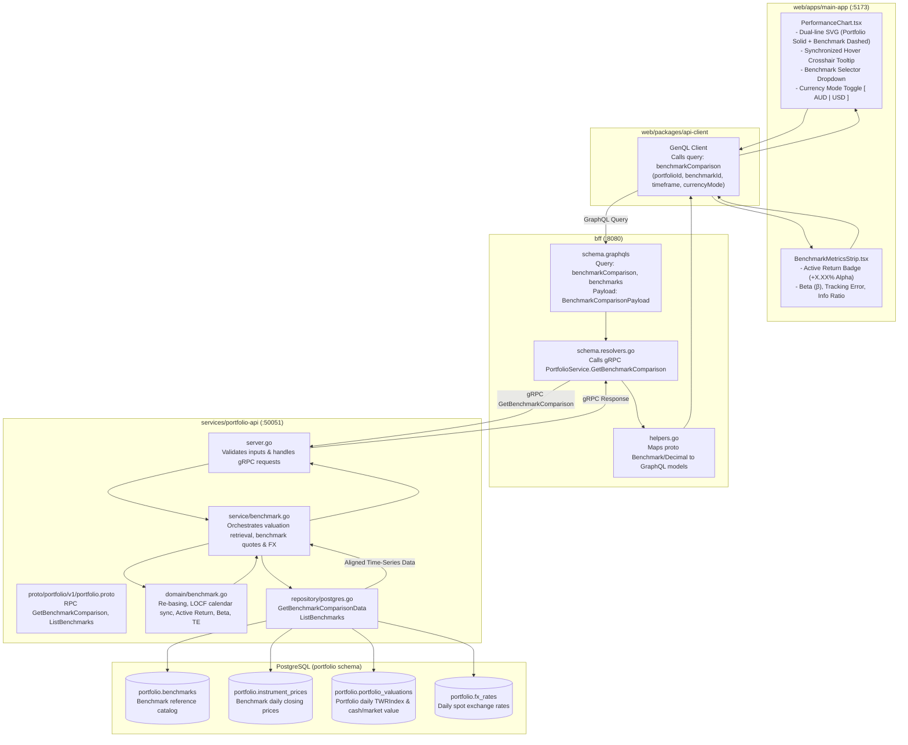
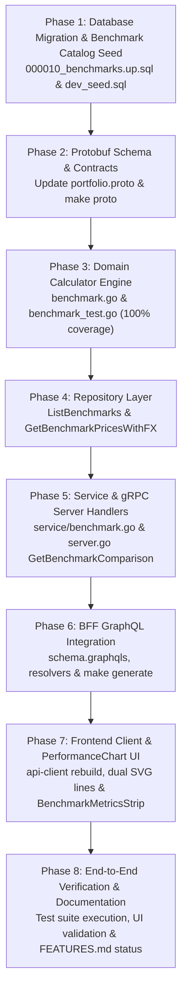

# Implementation Plan: Portfolio Benchmark Comparison & Relative Performance Analytics

> **User Story**: [benchmark-performance-comparison.md](file:///Users/oscargarcia/workspace/graphfolio/docs/user-stories/benchmark-performance-comparison.md) (`US-PERF-107`)  
> **Status**: Completed  
> **Roadmap Reference**: [FEATURES.md (Feature #33)](file:///Users/oscargarcia/workspace/graphfolio/FEATURES.md#L43)  
> **Calculation Standard**: [financial-calculations skill](file:///Users/oscargarcia/workspace/graphfolio/.agents/skills/financial-calculations/SKILL.md) (GIPS® Standard 2.A, CFA Institute Performance Attribution, ASC 820)  
> **Target Layers**: Database (`portfolio.benchmarks`), Protobuf (`proto/portfolio/v1/`), Domain Microservice (`services/portfolio-api`), BFF (`bff/`), Shared Web Client (`packages/api-client`), Primary Web App (`web/apps/main-app`)  

---

## 1. Executive Summary & Objective

The objective of this feature is to deliver an institutional-grade **Benchmark Comparison & Relative Performance Engine** for GraphFolio investors. 

Currently, `PerformanceChart.tsx` plots absolute portfolio valuation over time (`totalValue`) alongside a single cumulative return percentage. However, investors cannot distinguish between broad market beta (e.g., an S&P 500 bull run) and active investment outperformance (alpha). 

This feature enables investors to overlay major market benchmarks (such as the **S&P 500 Total Return**, **NASDAQ-100**, and **ASX 200**) directly against their portfolio performance across any historical timeframe (`1D`, `1W`, `1M`, `1Y`, `ALL`), complete with GIPS-compliant origin re-basing, multi-currency spot translation, and active risk attribution metrics.

### Core Objectives
1. **Time-Weighted Re-Basing to Common Origin**: Normalize both the investor's portfolio (via its unitized daily `TWRIndex`) and the selected benchmark to a common starting point ($0.00\%$ or $100.00$) at the start date $T_{\text{start}}$ of any selected timeframe.
2. **Total Return vs. Price Return Accounting**: Eliminate the common "dividend bias" by prioritizing Total Return benchmarks (`SP500TR`, `SPY`, `VAS`) where cash distributions are reinvested, ensuring fair comparability against a portfolio that accumulates dividends.
3. **Multi-Currency Triangulated FX Translation**: Allow investors to toggle between:
   - **Portfolio Base Currency Mode**: Converts benchmark daily closing prices into the portfolio's base currency (e.g. `USD` S&P 500 translated to `AUD` using daily historical spot FX rates) to measure the true local opportunity cost.
   - **Benchmark Native Currency Mode**: Displays the benchmark in its native currency (`USD`) to evaluate unhedged index performance.
4. **GIPS Standard 2.A.20 Compliance**: Strictly enforce the sub-1-year annualization prohibition for horizons under 365 calendar days ($CD < 365$), presenting non-annualized period returns with `is_annualized: false`.
5. **Active Risk Attribution**: Compute **Active Return (Alpha)**, Portfolio **Beta ($\beta$)**, Annualized **Tracking Error ($\text{TE}$)**, and **Information Ratio ($\text{IR}$)** for periods with $\ge 30$ trading observations.
6. **Interactive Dual-Line SVG Visualization**: Enhance `PerformanceChart.tsx` with a secondary dashed benchmark curve, interactive benchmark selector dropdown, currency mode toggle, and synchronized dual-metric crosshair tooltips.
7. **Strict Zero Floating-Point Arithmetic**: Implement all re-basing, currency conversion, and attribution formulas using `shopspring/decimal.Decimal` in Go and GraphQL `Decimal` scalars.

---

## 2. Technical Architecture & End-to-End Data Flow



---

## 3. Mathematical & Accounting Specifications

### 3.1 Common Origin Re-Basing ($T_0$ Normalization)
Given evaluation window $[T_{\text{start}}, T_{\text{end}}]$ with $N$ trading dates $t_0, t_1, \dots, t_N$ where $t_0 = T_{\text{start}}$:

1. **Portfolio Cumulative Return at Date $t_k$**:
   Derived from the daily unitized TWR index stored in `portfolio.portfolio_valuations`:
   $$R_p(t_k) = \left( \frac{\text{TWRIndex}_p(t_k)}{\text{TWRIndex}_p(t_0)} - 1 \right) \times 100\%$$
   *At $t_0$: $R_p(t_0) = 0.00\%$.*

2. **Benchmark Adjusted Price ($P_{b,\text{adj}}(t)$)**:
   - In **Portfolio Base Currency Mode** ($\text{MODE\_PORTFOLIO\_BASE}$):
     $$P_{b,\text{adj}}(t_k) = P_{b,\text{local}}(t_k) \times \text{FX}(C_{\text{bench}} \to C_{\text{base}}, t_k)$$
   - In **Benchmark Native Mode** ($\text{MODE\_BENCHMARK\_NATIVE}$):
     $$P_{b,\text{adj}}(t_k) = P_{b,\text{local}}(t_k)$$

3. **Benchmark Cumulative Return at Date $t_k$**:
   $$R_b(t_k) = \left( \frac{P_{b,\text{adj}}(t_k)}{P_{b,\text{adj}}(t_0)} - 1 \right) \times 100\%$$
   *At $t_0$: $R_b(t_0) = 0.00\%$.*

4. **Active Return (Excess Spread) at Date $t_k$**:
   $$\text{ActiveReturn}(t_k) = R_p(t_k) - R_b(t_k)$$

---

### 3.2 GIPS Annualization Formulation (GIPS Standard 2.A.20)
Given calendar days elapsed $CD = \text{Days}(T_{\text{start}}, T_{\text{end}})$:

```text
IF CD < 365:
    is_annualized = false
    portfolio_annualized_return_percent = null
    benchmark_annualized_return_percent = null
    active_annualized_return_percent = null
    label = "Period Return"
ELSE:
    is_annualized = true
    R_p,ann = (((1 + (R_p(t_N) / 100)) ^ (365.25 / CD)) - 1) * 100%
    R_b,ann = (((1 + (R_b(t_N) / 100)) ^ (365.25 / CD)) - 1) * 100%
    Active_ann = R_p,ann - R_b,ann
    label = "Annualized Return p.a."
```

---

### 3.3 Active Risk & Attribution Metrics (for $N \ge 30$ Trading Days)
For daily returns $r_{p,k} = \frac{\text{TWRIndex}(t_k)}{\text{TWRIndex}(t_{k-1})} - 1$ and $r_{b,k} = \frac{P_{b,\text{adj}}(t_k)}{P_{b,\text{adj}}(t_{k-1})} - 1$:

1. **Portfolio Beta ($\beta$)**:
   $$\beta = \frac{\sum_{k=1}^N (r_{p,k} - \bar{r}_p)(r_{b,k} - \bar{r}_b)}{\sum_{k=1}^N (r_{b,k} - \bar{r}_b)^2}$$
   *(Guard: If benchmark variance is zero, return `beta = null`).*

2. **Annualized Tracking Error ($\text{TE}$)**:
   $$d_k = r_{p,k} - r_{b,k}, \quad \bar{d} = \frac{1}{N} \sum_{k=1}^N d_k$$
   $$\text{TE} = \sqrt{\frac{1}{N-1} \sum_{k=1}^N (d_k - \bar{d})^2} \times \sqrt{252} \times 100\%$$

3. **Information Ratio ($\text{IR}$)** (computed when $CD \ge 365$ and $\text{TE} > 0$):
   $$\text{IR} = \frac{R_{p,\text{ann}} - R_{b,\text{ann}}}{\text{TE}}$$

---

### 3.4 Calendar & Exchange Holiday Alignment via LOCF
When aligning portfolio valuation dates and benchmark price dates:
- If a market is closed on date $t_k$ (e.g. US Thanksgiving or Australian ANZAC Day), missing benchmark prices or exchange rates are filled using **Last Observation Carried Forward (LOCF)** from the most recent previous trading close.
- For start date $t_0 = T_{\text{start}}$, if the exchange was closed, resolve base price to the latest closing price at or immediately preceding $T_{\text{start}}$ (`GetValuationAtOrBefore`).

---

## 4. Concrete Worked Numerical Scenarios

### Scenario A: Multi-Year Horizon with Currency Translation ($CD = 730$ Days)
- **Investor Base Currency**: `AUD`
- **Selected Benchmark**: `SP500TR` (`USD`)
- **Mode**: `MODE_PORTFOLIO_BASE`
- **Initial Date ($t_0$)**: `2024-10-14`
  - Portfolio $\text{TWRIndex}(t_0) = 1.000000000000$
  - Benchmark local close: $P_b(t_0) = \text{USD } 500.00$
  - Spot rate: $\text{USD/AUD} = 1.5000000000$
  - Benchmark base price: $P_{b,\text{adj}}(t_0) = 500.00 \times 1.50 = \text{AUD } 750.00$
  - Normalization: $R_p(t_0) = 0.00\%$, $R_b(t_0) = 0.00\%$
- **Ending Date ($t_N$)**: `2026-10-14` ($CD = 730$ days)
  - Portfolio $\text{TWRIndex}(t_N) = 1.440000000000 \implies R_p(t_N) = \mathbf{+44.00\%}$
  - Benchmark local close: $P_b(t_N) = \text{USD } 600.00$ ($+20\%$ in USD)
  - Spot rate: $\text{USD/AUD} = 1.5500000000$
  - Benchmark base price: $P_{b,\text{adj}}(t_N) = 600.00 \times 1.55 = \text{AUD } 930.00$
  - Benchmark return in AUD: $R_b(t_N) = \left(\frac{930.00}{750.00} - 1\right) \times 100\% = \mathbf{+24.00\%}$
- **Active Cumulative Return**: $+44.00\% - (+24.00\%) = \mathbf{+20.00\%}$
- **Annualization ($CD = 730 \ge 365$)**:
  - $R_{p,\text{ann}} = \left( (1 + 0.44)^{\frac{365.25}{730}} - 1 \right) \times 100\% = \mathbf{+20.02\% \text{ p.a.}}$
  - $R_{b,\text{ann}} = \left( (1 + 0.24)^{\frac{365.25}{730}} - 1 \right) \times 100\% = \mathbf{+11.39\% \text{ p.a.}}$
  - $\text{Active}_{\text{ann}} = 20.02\% - 11.39\% = \mathbf{+8.63\% \text{ p.a. Alpha}}$

### Scenario B: Sub-1-Year Horizon ($CD = 90$ Days, GIPS Rule)
- Horizon: $90$ calendar days
- Portfolio cumulative return: $R_p = +6.00\%$
- Benchmark cumulative return: $R_b = +4.50\%$
- Output:
  - `is_annualized = false`
  - `portfolio_annualized_return_percent = null`
  - `benchmark_annualized_return_percent = null`
  - `active_cumulative_return_percent = +1.50%`
  - UI displays: `"+1.50% vs S&P 500 (Period Return)"` without annualizing to $(1.06)^{4.05}-1$.

---

## 5. Layer-by-Layer Implementation Tasks

### 5.1 Layer 1: Database Migration & Benchmark Catalog Seed

#### 1. Schema Migration (`services/portfolio-api/migrations/000010_benchmarks.up.sql`)
```sql
-- 000010_benchmarks.up.sql

CREATE TABLE portfolio.benchmarks (
    id            text PRIMARY KEY, -- e.g. 'SP500TR', 'NASDAQ100', 'ASX200TR'
    instrument_id uuid NOT NULL REFERENCES portfolio.instruments(id) ON DELETE CASCADE,
    name          text NOT NULL,
    index_type    text NOT NULL DEFAULT 'TOTAL_RETURN', -- 'TOTAL_RETURN' or 'PRICE_RETURN'
    is_default    boolean NOT NULL DEFAULT false,
    display_order int NOT NULL DEFAULT 0,
    created_at    timestamptz NOT NULL DEFAULT now(),
    updated_at    timestamptz NOT NULL DEFAULT now()
);

CREATE INDEX idx_benchmarks_display_order ON portfolio.benchmarks(display_order ASC);
```

#### 2. Down Migration (`services/portfolio-api/migrations/000010_benchmarks.down.sql`)
```sql
DROP TABLE IF EXISTS portfolio.benchmarks CASCADE;
```

#### 3. Development Seed Data (`services/portfolio-api/seeds/dev_seed.sql`)
Ensure instruments for benchmarks exist in `portfolio.instruments` and seed `portfolio.benchmarks`:
```sql
-- Insert benchmark reference instruments if not existing
INSERT INTO portfolio.instruments (id, symbol, exchange_code, name, asset_class, currency_code, is_active)
VALUES
  ('018f0000-0005-7000-8000-000000000001', 'SP500TR', 'XNYS', 'S&P 500 Total Return Index', 'ETF', 'USD', true),
  ('018f0000-0005-7000-8000-000000000002', 'QQQ',     'XNAS', 'Invesco QQQ Trust (NASDAQ-100)', 'ETF', 'USD', true),
  ('018f0000-0005-7000-8000-000000000003', 'VAS',     'XASX', 'Vanguard Australian Shares Index ETF', 'ETF', 'AUD', true)
ON CONFLICT (symbol, exchange_code) DO NOTHING;

-- Insert benchmark catalog entries
INSERT INTO portfolio.benchmarks (id, instrument_id, name, index_type, is_default, display_order)
VALUES
  ('SP500TR',   '018f0000-0005-7000-8000-000000000001', 'S&P 500 Total Return', 'TOTAL_RETURN', true,  1),
  ('NASDAQ100', '018f0000-0005-7000-8000-000000000002', 'NASDAQ-100 (QQQ)',    'TOTAL_RETURN', false, 2),
  ('ASX200TR',  '018f0000-0005-7000-8000-000000000003', 'ASX 200 (VAS)',       'TOTAL_RETURN', false, 3)
ON CONFLICT (id) DO NOTHING;
```

---

### 5.2 Layer 2: Protocol Buffers Contract (`proto/portfolio/v1/portfolio.proto`)

Add the following messages and RPCs to [portfolio.proto](file:///Users/oscargarcia/workspace/graphfolio/proto/portfolio/v1/portfolio.proto):

```protobuf
enum BenchmarkCurrencyMode {
  BENCHMARK_CURRENCY_MODE_UNSPECIFIED = 0;
  BENCHMARK_CURRENCY_MODE_PORTFOLIO_BASE = 1; // Translated to portfolio base currency via daily FX
  BENCHMARK_CURRENCY_MODE_BENCHMARK_NATIVE = 2; // Expressed in native benchmark currency (unhedged)
}

message Benchmark {
  string id            = 1; // e.g. "SP500TR"
  string symbol        = 2; // e.g. "SP500TR" or "SPY"
  string name          = 3; // e.g. "S&P 500 Total Return"
  string exchange_code = 4; // "XNYS"
  string currency_code = 5; // "USD"
  string index_type    = 6; // "TOTAL_RETURN"
  bool   is_default    = 7;
}

message ListBenchmarksRequest {}

message ListBenchmarksResponse {
  repeated Benchmark benchmarks = 1;
}

message BenchmarkComparisonPoint {
  string            date                     = 1; // YYYY-MM-DD
  common.v1.Decimal portfolio_return_percent = 2; // Cumulative return % from T_start
  common.v1.Decimal benchmark_return_percent = 3; // Cumulative return % from T_start
  common.v1.Decimal active_return_percent    = 4; // portfolio_return - benchmark_return
  common.v1.Money   portfolio_value          = 5; // Absolute portfolio valuation in base currency
  common.v1.Money   benchmark_price_adjusted = 6; // Benchmark price in selected currency mode
}

message BenchmarkMetrics {
  common.v1.Decimal portfolio_cumulative_return_percent = 1;
  common.v1.Decimal benchmark_cumulative_return_percent = 2;
  common.v1.Decimal active_cumulative_return_percent    = 3; // Outperformance (+) or Underperformance (-)
  common.v1.Decimal portfolio_annualized_return_percent = 4; // Null if elapsed < 365 days
  common.v1.Decimal benchmark_annualized_return_percent = 5; // Null if elapsed < 365 days
  common.v1.Decimal active_annualized_return_percent    = 6; // Null if elapsed < 365 days
  bool              is_annualized                       = 7; // GIPS Standard 2.A.20
  common.v1.Decimal beta                                = 8; // Null if observations < 30
  common.v1.Decimal tracking_error_percent              = 9; // Null if observations < 30
  common.v1.Decimal information_ratio                   = 10; // Null if elapsed < 365 or TE == 0
}

message GetBenchmarkComparisonRequest {
  string                user_id       = 1;
  string                benchmark_id  = 2; // e.g. "SP500TR"
  HistoryTimeframe      timeframe     = 3; // 1D, 1W, 1M, 1Y, ALL
  BenchmarkCurrencyMode currency_mode = 4; // BASE or NATIVE
}

message GetBenchmarkComparisonResponse {
  string                            portfolio_id  = 1;
  string                            base_currency = 2;
  Benchmark                         benchmark     = 3;
  BenchmarkCurrencyMode             currency_mode = 4;
  string                            start_date    = 5;
  string                            end_date      = 6;
  int32                             elapsed_days  = 7;
  repeated BenchmarkComparisonPoint points        = 8;
  BenchmarkMetrics                  metrics       = 9;
}

// In service PortfolioService:
rpc ListBenchmarks(ListBenchmarksRequest) returns (ListBenchmarksResponse);
rpc GetBenchmarkComparison(GetBenchmarkComparisonRequest) returns (GetBenchmarkComparisonResponse);
```

**Regenerate Protobuf Go Code**:
```bash
make proto
```

---

### 5.3 Layer 3: Domain Entities & Calculator Engine (`services/portfolio-api/internal/domain/`)

Create `services/portfolio-api/internal/domain/benchmark.go` and `benchmark_test.go`:

1. **Domain Structs**:
   - `Benchmark`: ID, Symbol, Name, ExchangeCode, CurrencyCode, IndexType, IsDefault, InstrumentID.
   - `BenchmarkCurrencyMode`: String enum (`BASE`, `NATIVE`).
   - `BenchmarkComparisonPoint`: Date, PortfolioReturnPercent, BenchmarkReturnPercent, ActiveReturnPercent, PortfolioValue, BenchmarkPriceAdjusted.
   - `BenchmarkMetrics`: PortfolioCumReturn, BenchmarkCumReturn, ActiveCumReturn, PortfolioAnnReturn, BenchmarkAnnReturn, ActiveAnnReturn, IsAnnualized, Beta, TrackingError, InformationRatio.
   - `RawBenchmarkQuote`: Date, ClosePrice, FXRateToBase.

2. **Core Domain Calculators**:
   - `CalculateBenchmarkComparison(baseCurrency string, currencyMode BenchmarkCurrencyMode, valuations []PortfolioValuation, quotes []RawBenchmarkQuote, elapsedDays int) (*BenchmarkComparisonResult, error)`:
     - Handles LOCF date alignment between valuations and quotes.
     - Anchors $t_0$ re-basing for portfolio ($R_p(0) = 0\%$) and benchmark ($R_b(0) = 0\%$).
     - Computes cumulative active return at every point.
     - Applies GIPS sub-1-year rule for annualized metrics ($CD < 365$).
     - Invokes risk calculators (`CalculateBeta`, `CalculateTrackingError`, `CalculateInformationRatio`).
   - Zero floating-point division-by-zero safety guards across all calculations.

3. **Unit Tests (`benchmark_test.go`)**:
   - Test 100% of boundary cases, LOCF gap fills, currency conversion, GIPS sub-1-year rules, and mathematical formulas against concrete worked numbers.

---

### 5.4 Layer 4: Repository Persistence Layer (`services/portfolio-api/internal/repository/`)

In `services/portfolio-api/internal/repository/postgres.go`:

1. **`ListBenchmarks(ctx context.Context) ([]domain.Benchmark, error)`**:
   ```sql
   SELECT b.id, b.name, b.index_type, b.is_default, b.instrument_id,
          i.symbol, i.exchange_code, i.currency_code
   FROM portfolio.benchmarks b
   JOIN portfolio.instruments i ON b.instrument_id = i.id
   ORDER BY b.display_order ASC;
   ```

2. **`GetBenchmarkByID(ctx context.Context, id string) (*domain.Benchmark, error)`**:
   Fetch a single benchmark definition by its ID.

3. **`GetBenchmarkPricesWithFX(ctx context.Context, instrumentID uuid.UUID, quoteCurrency, baseCurrency string, fromDate, toDate time.Time) ([]domain.RawBenchmarkQuote, error)`**:
   Join `portfolio.instrument_prices` with `portfolio.fx_rates` for the benchmark's instrument:
   ```sql
   SELECT 
     p.price_date,
     p.close AS close_price,
     COALESCE(fx.rate, CASE WHEN $2 = $3 THEN 1.0 ELSE NULL END) AS fx_rate_to_base
   FROM portfolio.instrument_prices p
   LEFT JOIN portfolio.fx_rates fx
     ON fx.base_currency = $2
    AND fx.quote_currency = $3
    AND fx.rate_date = p.price_date
   WHERE p.instrument_id = $1
     AND p.price_date >= $4 AND p.price_date <= $5
   ORDER BY p.price_date ASC;
   ```

---

### 5.5 Layer 5: Service Orchestration (`services/portfolio-api/internal/service/`)

Create `services/portfolio-api/internal/service/benchmark.go`:

1. Implement `ListBenchmarks(ctx context.Context)`:
   - Queries repository and returns available active benchmarks.

2. Implement `GetBenchmarkComparison(ctx context.Context, userID, benchmarkID string, timeframe domain.HistoryTimeframe, mode domain.BenchmarkCurrencyMode)`:
   - Resolves portfolio by `userID`.
   - Resolves benchmark by `benchmarkID`.
   - Computes `fromDate` based on `timeframe` using `calculateFromDate`.
   - Queries portfolio valuations: `s.repo.GetPortfolioValuations(ctx, portfolio.ID, fromDate)`.
   - Queries benchmark price quotes: `s.repo.GetBenchmarkPricesWithFX(...)`.
   - Invokes domain calculator `domain.CalculateBenchmarkComparison`.
   - Packages and returns domain results.

---

### 5.6 Layer 6: gRPC Server Handlers (`services/portfolio-api/internal/server.go`)

Implement the gRPC transport adapters in `services/portfolio-api/internal/server.go`:
- `ListBenchmarks(ctx context.Context, req *portfoliov1.ListBenchmarksRequest)`
- `GetBenchmarkComparison(ctx context.Context, req *portfoliov1.GetBenchmarkComparisonRequest)`
  - Validates `user_id`, `benchmark_id`, and enum parameters.
  - Converts domain outputs to protobuf messages using `pkg/decimalpb`.

---

### 5.7 Layer 7: BFF GraphQL Layer (`bff/`)

#### 1. GraphQL Schema Updates (`bff/graph/schema.graphqls`)
```graphql
enum BenchmarkCurrencyMode {
  PORTFOLIO_BASE
  BENCHMARK_NATIVE
}

type Benchmark {
  id: ID!
  symbol: String!
  name: String!
  exchangeCode: String!
  currencyCode: String!
  indexType: String!
  isDefault: Boolean!
}

type BenchmarkComparisonPoint {
  date: String!
  portfolioReturnPercent: Decimal!
  benchmarkReturnPercent: Decimal!
  activeReturnPercent: Decimal!
  portfolioValue: Money!
  benchmarkPriceAdjusted: Money!
}

type BenchmarkMetrics {
  portfolioCumulativeReturnPercent: Decimal!
  benchmarkCumulativeReturnPercent: Decimal!
  activeCumulativeReturnPercent: Decimal!
  portfolioAnnualizedReturnPercent: Decimal
  benchmarkAnnualizedReturnPercent: Decimal
  activeAnnualizedReturnPercent: Decimal
  isAnnualized: Boolean!
  beta: Decimal
  trackingErrorPercent: Decimal
  informationRatio: Decimal
}

type BenchmarkComparisonPayload {
  portfolioId: ID!
  baseCurrency: String!
  benchmark: Benchmark!
  currencyMode: BenchmarkCurrencyMode!
  startDate: String!
  endDate: String!
  elapsedDays: Int!
  points: [BenchmarkComparisonPoint!]!
  metrics: BenchmarkMetrics!
}

extend type Query {
  benchmarks: [Benchmark!]!
  benchmarkComparison(
    benchmarkId: ID!
    timeframe: HistoryTimeframe!
    currencyMode: BenchmarkCurrencyMode = PORTFOLIO_BASE
  ): BenchmarkComparisonPayload!
}
```

#### 2. Code Generation
```bash
cd bff && go run github.com/99designs/gqlgen generate
```

#### 3. Resolver Implementation (`bff/graph/schema.resolvers.go`)
- Implement `Benchmarks(ctx)` and `BenchmarkComparison(ctx, benchmarkId, timeframe, currencyMode)`.
- Convert proto response to GraphQL payload using `bff/graph/helpers.go`.

---

### 5.8 Layer 8: Shared Web Client & Investor Application UI (`web/`)

#### 1. Rebuild GraphQL Client
```bash
pnpm --filter @graphfolio/api-client build
```

#### 2. Component Refactoring: `PerformanceChart.tsx`
Enhance `web/apps/main-app/src/components/PerformanceChart.tsx`:
- **State Management**:
  - `selectedBenchmarkId`: string (defaults to `'SP500TR'` or loaded from `localStorage`).
  - `currencyMode`: `'PORTFOLIO_BASE' | 'BENCHMARK_NATIVE'` (defaults to `'PORTFOLIO_BASE'`).
  - `benchmarkData`: Benchmark comparison payload.
- **Header Controls**:
  - Add benchmark dropdown: `[ None | S&P 500 (SP500TR) | NASDAQ-100 (QQQ) | ASX 200 (VAS) ]`.
  - Add currency toggle: `[ In AUD (Base) | In USD (Native) ]` visible when a benchmark is selected.
- **Dual-Curve SVG Rendering**:
  - When benchmark is active:
    - Compute normalized Y-scale based on `min(portfolio_return, benchmark_return)` to `max(portfolio_return, benchmark_return)`.
    - Draw horizontal baseline at `0.00%`.
    - Render Portfolio Path: Solid stroke with glowing gradient (`#22c55e` or `#3b82f6`).
    - Render Benchmark Path: Contrasting dashed curve (`strokeDasharray="4 4"`, color `#f59e0b` amber/gold).
- **Synchronized Hover Crosshair & Tooltip**:
  - Displays Date, Portfolio Valuation, Portfolio Cumulative %, Benchmark Cumulative %, and Active Return spread ($R_p - R_b$).

#### 3. New Component: `BenchmarkMetricsStrip.tsx`
Render an active return summary strip directly below the chart header:
- **Active Alpha Badge**:
  - Green (`+7.25% Outperforming`) or Red (`-3.10% Underperforming`).
- **Attribution Metrics**:
  - Beta ($\beta$), Annualized Tracking Error ($\text{TE}$), and Information Ratio ($\text{IR}$) with helpful tooltip explanations.

---

## 6. Boundary Conditions & Risk Mitigation Matrix

| Condition | Mathematical Risk | Handling & Mitigation Strategy |
| :--- | :--- | :--- |
| **Elapsed Days $< 365$** | Volatility exaggeration from invalid compounding. | Enforce GIPS Standard 2.A.20: set `is_annualized = false`, return `null` for annualized returns. |
| **Start Date on Holiday/Weekend** | Anchor price $P_b(t_0)$ missing. | Use `GetValuationAtOrBefore` to anchor to the latest preceding closing price. |
| **Exchange Holiday Divergence** | Missing benchmark quote on portfolio trading day. | Fill missing daily prices using Last Observation Carried Forward (LOCF). |
| **Zero Benchmark Price Variance** | Division by zero in Beta calculation $\text{Var}(r_b) = 0$. | Return `beta = null` safely if benchmark variance is zero. |
| **Fewer Than 30 Observations** | Insufficient statistical degrees of freedom for risk metrics. | Omit Beta, Tracking Error, and Info Ratio (set to `null`) when $N < 30$. |
| **Missing Foreign Exchange Rates** | Corrupted benchmark translation in base currency. | Fall back to LOCF on FX rates; if gap exceeds 5 days, return diagnostic alert. |
| **Negative Active Ratio with Zero TE** | Division by zero in Information Ratio. | If $\text{TE} = 0$, return `information_ratio = null`. |

---

## 7. Verification & Testing Strategy

### 7.1 Domain Unit Testing (`benchmark_test.go`)
- **TC-BENCH-01**: Re-basing to $0.00\%$ at $t_0$ for both series.
- **TC-BENCH-02**: Multi-currency conversion via spot FX rate matching Scenario A.
- **TC-BENCH-03**: GIPS sub-1-year prohibition matching Scenario B ($CD = 90$, `is_annualized = false`).
- **TC-BENCH-04**: Compound geometric annualization for multi-year horizons ($CD = 730$).
- **TC-BENCH-05**: Holiday LOCF handling when calendar dates do not overlap.
- **TC-BENCH-06**: Beta and Tracking Error accuracy verification against known statistical distributions.

### 7.2 Service & gRPC Integration Testing (`server_test.go`)
- Mock repository tests verifying query resolution, timeframe clamping, and protobuf serialization.
- Validation that invalid timeframes or unknown benchmark IDs return `codes.InvalidArgument` or `codes.NotFound`.

### 7.3 BFF GraphQL Testing (`schema.resolvers_test.go`)
- Test GraphQL query `benchmarkComparison` with mock gRPC server.
- Verify high-precision string serialization of `Decimal` scalars.

### 7.4 Web End-to-End Verification
- Verify dual-line SVG chart renders smoothly across all timeframes (`1D`, `1W`, `1M`, `1Y`, `ALL`).
- Verify switching currency mode dynamically toggles between `AUD` base-converted return and `USD` native return.
- Verify active return alpha badge updates color and sign based on relative performance.
- Verify user benchmark selection persists in `localStorage` across page refreshes.

---

## 8. Rollout Sequence & Phasing



- **Phase 1: Database**: Apply migration `000010_benchmarks.up.sql` and verify seed data.
- **Phase 2: Proto**: Update `proto/portfolio/v1/portfolio.proto` and compile via `make proto`.
- **Phase 3: Domain**: Implement `internal/domain/benchmark.go` and verify unit tests via `go test ./internal/domain/...`.
- **Phase 4: Repository**: Implement database queries in `internal/repository/postgres.go`.
- **Phase 5: Service & gRPC**: Implement service methods and gRPC endpoints in `internal/service/` and `internal/server.go`.
- **Phase 6: BFF**: Update GraphQL schema in `bff/graph/`, generate bindings, and implement resolvers.
- **Phase 7: Web UI**: Rebuild `@graphfolio/api-client`, integrate dual-curve rendering in `PerformanceChart.tsx`, and add `BenchmarkMetricsStrip.tsx`.
- **Phase 8: Verification**: Run backend and frontend test suites, verify UI in browser, and update documentation.
