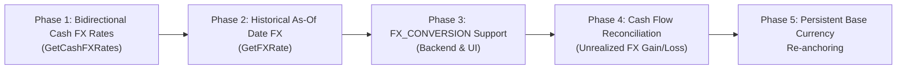

# Cash Balance & FX Conversion Remediation Implementation Plan

> **Target**: Resolve critical calculation flaws and architectural gaps in multi-currency cash balance tracking, spot/historical FX rate resolution, currency conversions, and cash flow reconciliation.  
> **Scope**: `services/portfolio-api`, `bff`, and `web/apps/main-app`  
> **Investigation Reference**: [cash-balance-and-fx-conversion-investigation-report.md](file:///Users/oscargarcia/workspace/graphfolio/docs/reports/cash-balance-and-fx-conversion-investigation-report.md)  
> **Key Principles**:
> 1. Cash balances must be tracked strictly in their native currencies, and consolidated to portfolio base currency using mathematically sound bidirectional direct, inverse, and triangulated rates.
> 2. Historical trade and cash flow transactions must lock in historical exchange rates as of their execution date rather than modern spot rates.
> 3. Currency conversions (`FX_CONVERSION`) must be supported as first-class transactions in both the ledger replay engine and user-facing modals.
> 4. Cash Flow Reports must reconcile against portfolio net worth by explicitly accounting for unrealized currency gains/losses on idle foreign cash holdings.
> 5. Base currency updates must persistently re-anchor transaction `fx_rate_to_base` and recompute tax lots, preventing ledger projection reverts.

---

## User Review Required

> [!IMPORTANT]
> **Key Architectural Decisions for User Alignment**:
> 1. **`FX_CONVERSION` Ledger Representation**: In `AddTransaction`, an FX conversion will record:
>    - `Amount` & `CurrencyCode`: Source cash sold (e.g., `10,000 AUD`).
>    - `Quantity` & `Symbol`: Target cash received (e.g., `6,500 USD`, where `Symbol = "USD"`).
>    - `Price`: Effective exchange rate (e.g., `0.6500`).
>    - `Fee` & `FeeCurrencyCode`: Broker conversion charge (e.g., `15.00 AUD`).
> 2. **Cash Flow Report Reconciliation**: We will introduce an explicit `Unrealized FX Gain/Loss on Cash` item in the Cash Flow Report summary so that $\text{Ending Cash Balance} = \text{Starting Cash} + \text{Net Cash Flow} + \text{Unrealized FX Gain/Loss}$, achieving 100% mathematical reconciliation with the Dashboard.
> 3. **Non-Breaking Query Fallback**: If an FX rate cannot be found even after direct, inverse, and USD triangulation lookups, we will log a warning and return an explicit `ErrFXRateNotFound` or fall back to `1.0` with a diagnostic flag rather than silent failure.

---

## Proposed Changes



---

### Phase 1: Robust Bidirectional & Triangulated Cash FX Rates

#### 1.1 Rewrite `getCashFXRatesSQL` Query
In [`services/portfolio-api/internal/repository/queries.go`](file:///Users/oscargarcia/workspace/graphfolio/services/portfolio-api/internal/repository/queries.go#L224-L229):
Replace the unidirectional `WHERE quote_currency = $1` query with a robust CTE query that checks direct rates, inverse rates ($1 / \text{rate}$), and USD triangulation:

```sql
WITH latest_rates AS (
    SELECT DISTINCT ON (base_currency, quote_currency)
        base_currency, quote_currency, rate
    FROM portfolio.fx_rates
    ORDER BY base_currency, quote_currency, rate_date DESC
)
SELECT 
    c.code AS foreign_currency,
    COALESCE(
        direct.rate,
        CASE WHEN inverse.rate > 0 THEN 1.0 / inverse.rate ELSE NULL END,
        triangulated.rate,
        1.0
    ) AS fx_rate_to_base
FROM portfolio.currencies c
LEFT JOIN latest_rates direct 
    ON direct.base_currency = c.code AND direct.quote_currency = $1
LEFT JOIN latest_rates inverse 
    ON inverse.base_currency = $1 AND inverse.quote_currency = c.code
LEFT JOIN LATERAL (
    SELECT (usd_base.rate / usd_foreign.rate) AS rate
    FROM latest_rates usd_base
    JOIN latest_rates usd_foreign 
      ON usd_foreign.base_currency = 'USD' AND usd_foreign.quote_currency = c.code
    WHERE usd_base.base_currency = 'USD' 
      AND usd_base.quote_currency = $1 
      AND usd_foreign.rate > 0
) triangulated ON (direct.rate IS NULL AND inverse.rate IS NULL)
WHERE c.code <> $1;
```

#### 1.2 Update Repository Method `GetCashFXRates`
In [`services/portfolio-api/internal/repository/postgres.go`](file:///Users/oscargarcia/workspace/graphfolio/services/portfolio-api/internal/repository/postgres.go#L263-L281):
- Execute the updated query.
- Always include `baseCurrency: decimal.NewFromInt(1)` in the returned map.
- Add structured debug logging if a foreign currency has to fall back to `1.0`.

#### 1.3 Testing & Validation
- Add unit tests in [`services/portfolio-api/internal/repository/integration_test.go`](file:///Users/oscargarcia/workspace/graphfolio/services/portfolio-api/internal/repository/integration_test.go) and [`services/portfolio-api/internal/domain/calculator_test.go`](file:///Users/oscargarcia/workspace/graphfolio/services/portfolio-api/internal/domain/calculator_test.go) verifying:
  - Base currency = `USD`, foreign currency = `AUD`, where `fx_rates` only has `base_currency='USD', quote_currency='AUD'`. Verified that `GetCashFXRates` returns `1 / 1.523 = 0.6565988`.
  - Portfolio with multi-currency cash (`USD`, `AUD`, `EUR`) consolidates correctly to both `USD` and `AUD` base currencies.

---

### Phase 2: Historical As-Of Date Resolution in FX Lookups

#### 2.1 Update `GetFXRate` Signature & Repository Queries
In [`services/portfolio-api/internal/repository/repository.go`](file:///Users/oscargarcia/workspace/graphfolio/services/portfolio-api/internal/repository/repository.go#L43):
Change signature to accept an optional/variadic `asOf time.Time`:
```go
GetFXRate(ctx context.Context, fromCurrency, toCurrency string, asOf ...time.Time) (decimal.Decimal, error)
```

In [`services/portfolio-api/internal/repository/queries.go`](file:///Users/oscargarcia/workspace/graphfolio/services/portfolio-api/internal/repository/queries.go#L294-L306):
Update `getDirectFXRateSQL` and `getInverseFXRateSQL` to filter on `rate_date <= $3`:
```sql
getDirectFXRateSQL = `
SELECT rate
FROM portfolio.fx_rates
WHERE base_currency = $1 AND quote_currency = $2
  AND ($3::date IS NULL OR rate_date <= $3)
ORDER BY rate_date DESC
LIMIT 1;`

getInverseFXRateSQL = `
SELECT rate
FROM portfolio.fx_rates
WHERE base_currency = $2 AND quote_currency = $1
  AND ($3::date IS NULL OR rate_date <= $3)
ORDER BY rate_date DESC
LIMIT 1;`
```

#### 2.2 Wire Historical FX Resolution in Transaction Handlers
In [`services/portfolio-api/internal/service/transaction.go`](file:///Users/oscargarcia/workspace/graphfolio/services/portfolio-api/internal/service/transaction.go):
- In `AddTransaction` ([lines 71, 150, 204](file:///Users/oscargarcia/workspace/graphfolio/services/portfolio-api/internal/service/transaction.go#L71)): pass `tradeDate` to `s.repo.GetFXRate(ctx, currencyCode, portfolio.BaseCurrency, tradeDate)`.
- In `UpdateTransaction` ([lines 457, 524, 590](file:///Users/oscargarcia/workspace/graphfolio/services/portfolio-api/internal/service/transaction.go#L457)): pass `tradeDate` to `s.repo.GetFXRate(ctx, currencyCode, portfolio.BaseCurrency, tradeDate)`.
- In `BatchImportTransactions` ([lines 890, 898](file:///Users/oscargarcia/workspace/graphfolio/services/portfolio-api/internal/service/transaction.go#L890)): pass `item.TradeDate` to `s.repo.GetFXRate(ctx, currencyCode, portfolio.BaseCurrency, item.TradeDate)`.

#### 2.3 Testing & Validation
- Regenerate mocks via `make generate-mocks` or updating [`services/portfolio-api/internal/repository/mocks/mock_repository.go`](file:///Users/oscargarcia/workspace/graphfolio/services/portfolio-api/internal/repository/mocks/mock_repository.go).
- Add unit tests in [`services/portfolio-api/internal/service/transaction_test.go`](file:///Users/oscargarcia/workspace/graphfolio/services/portfolio-api/internal/service/transaction_test.go) verifying that historical trades receive historical exchange rates.

---

### Phase 3: First-Class `FX_CONVERSION` Transaction Support

#### 3.1 Update `ProcessLedger` in `services/portfolio-api`
In [`services/portfolio-api/internal/service/projection.go`](file:///Users/oscargarcia/workspace/graphfolio/services/portfolio-api/internal/service/projection.go#L79-L110):
Add handler for `domain.TxTypeFXConversion`:
```go
case domain.TxTypeFXConversion:
    // Amount is source currency cash sold
    // Quantity is target currency cash received
    // Notes or Symbol denotes target currency (e.g. "USD")
    targetCurrency := ""
    if tx.Notes != nil && len(*tx.Notes) == 3 {
        targetCurrency = *tx.Notes
    }
    targetAmount := tx.Amount
    if tx.Quantity != nil && tx.Quantity.IsPositive() {
        targetAmount = *tx.Quantity
    }
    
    // Debit source currency
    cashBalances[tx.CurrencyCode] = cashBalances[tx.CurrencyCode].Sub(tx.Amount)
    
    // Credit target currency
    if targetCurrency != "" {
        cashBalances[targetCurrency] = cashBalances[targetCurrency].Add(targetAmount)
    }
    
    // Deduct fee
    if tx.Fee.IsPositive() {
        feeCurr := tx.CurrencyCode
        if tx.FeeCurrencyCode != nil && *tx.FeeCurrencyCode != "" {
            feeCurr = *tx.FeeCurrencyCode
        }
        cashBalances[feeCurr] = cashBalances[feeCurr].Sub(tx.Fee)
    }
```

#### 3.2 Update `AddTransaction` & `UpdateTransaction` Service Methods
In [`services/portfolio-api/internal/service/transaction.go`](file:///Users/oscargarcia/workspace/graphfolio/services/portfolio-api/internal/service/transaction.go#L239-L288):
- Add support for `case domain.TxTypeFXConversion:`:
  - Validate source currency (`CurrencyCode`) and target currency (`Symbol` or `TargetCurrency`).
  - Validate positive `Amount` (source amount) and positive `Quantity` (target amount) or calculate via `Price` (exchange rate).
  - Calculate `FXRateToBase` relative to portfolio base currency.
  - Insert transaction and trigger `postTransactionUpdate`.

#### 3.3 Update Frontend Modals & Ledger Display
1. In [`web/apps/main-app/src/components/AddTransactionModal.tsx`](file:///Users/oscargarcia/workspace/graphfolio/web/apps/main-app/src/components/AddTransactionModal.tsx):
   - Add `"FX Conversion"` button to the transaction type selector (`BUY`, `SELL`, `DIVIDEND`, `DEPOSIT`, `WITHDRAWAL`, `INTEREST`, `FX_CONVERSION`, `SPLIT`).
   - Render Source Currency, Source Amount, Target Currency, Target Amount / Rate, Fee, and Notes.
2. In [`web/apps/main-app/src/components/TransactionLedger.tsx`](file:///Users/oscargarcia/workspace/graphfolio/web/apps/main-app/src/components/TransactionLedger.tsx):
   - Add filter pill for `FX Conversion`.
   - Render FX Conversion row badge and description (e.g., `Converted 10,000 AUD → 6,500 USD @ 0.6500`).

---

### Phase 4: Cash Flow Report Unrealized FX Reconciliation

#### 4.1 Update `CashFlowSummary` Domain Entity & Protobuf
In [`services/portfolio-api/internal/domain/cash_flow.go`](file:///Users/oscargarcia/workspace/graphfolio/services/portfolio-api/internal/domain/cash_flow.go#L67-L73):
Add `UnrealizedFXGainLoss Money` to `CashFlowSummary`:
```go
type CashFlowSummary struct {
    StartingCashBalance   Money
    TotalInflows          Money
    TotalOutflows         Money
    NetCashFlow           Money
    UnrealizedFXGainLoss  Money
    EndingCashBalance     Money
}
```

In [`proto/portfolio/v1/portfolio.proto`](file:///Users/oscargarcia/workspace/graphfolio/proto/portfolio/v1/portfolio.proto) and [`bff/graph/schema.graphqls`](file:///Users/oscargarcia/workspace/graphfolio/bff/graph/schema.graphqls#L609-L615):
Add field `unrealizedFXGainLoss: Money!` to `CashFlowSummary`.

#### 4.2 Compute Reconciliation in `GetCashFlowReport`
In [`services/portfolio-api/internal/service/cash_flow.go`](file:///Users/oscargarcia/workspace/graphfolio/services/portfolio-api/internal/service/cash_flow.go#L169-L185):
- Fetch the portfolio's spot cash balance at `toDate`:
  $$\text{EndingCashBalance}_{\text{Reconciled}} = \text{TotalCashBase}_{\text{Spot}}(\text{toDate})$$
  $$\text{UnrealizedFXGainLoss} = \text{EndingCashBalance}_{\text{Reconciled}} - (\text{StartingCash} + \text{NetCashFlow})$$
- Populate `UnrealizedFXGainLoss` and set `EndingCashBalance` equal to `EndingCashBalance_Reconciled`.

#### 4.3 Update Frontend Component `CashFlowReport.tsx`
In [`web/apps/main-app/src/components/CashFlowReport.tsx`](file:///Users/oscargarcia/workspace/graphfolio/web/apps/main-app/src/components/CashFlowReport.tsx):
- Display `Unrealized FX Gain/Loss on Cash` in the summary KPI section and the CSV export when non-zero.
- Highlight clean mathematical reconciliation: $\text{Start} + \text{Flows} + \text{FX Delta} = \text{End}$.

---

### Phase 5: Persistent Base Currency Re-anchoring

#### 5.1 Update `UpdatePortfolioBaseCurrency` in Repository
In [`services/portfolio-api/internal/repository/postgres.go`](file:///Users/oscargarcia/workspace/graphfolio/services/portfolio-api/internal/repository/postgres.go#L98-L119):
Add SQL step to re-anchor `portfolio.transactions`:
```sql
UPDATE portfolio.transactions
SET fx_rate_to_base = ROUND((COALESCE(fx_rate_to_base, 1.0) * $2)::numeric, 10)
WHERE portfolio_id = $1;
```
Where `$2` is the conversion rate from old base currency to new base currency.

#### 5.2 Trigger Full Rebuild in Service Layer
In [`services/portfolio-api/internal/service/service.go`](file:///Users/oscargarcia/workspace/graphfolio/services/portfolio-api/internal/service/service.go#L205-L215):
After calling `s.repo.UpdatePortfolioBaseCurrency`:
1. Call `s.RebuildProjections(ctx, userID)` so all tax lots and holdings are rebuilt natively in the new currency.
2. Call `s.RebuildValuations(ctx, userID, nil)` to backfill daily valuation history in the new currency.

---

## 3. Verification Plan

### Automated Tests
1. **Repository Unit & Integration Tests**:
   - `cd services/portfolio-api && go test -v ./internal/repository -run TestGetCashFXRates`
   - `cd services/portfolio-api && go test -v ./internal/repository -run TestGetFXRate_Historical`
2. **Domain Calculator Tests**:
   - `cd services/portfolio-api && go test -v ./internal/domain -run TestCalculatePortfolioSummary_MultiCurrencyCash`
3. **Service & Transaction Tests**:
   - `cd services/portfolio-api && go test -v ./internal/service -run TestPortfolioService_FXConversion`
   - `cd services/portfolio-api && go test -v ./internal/service -run TestGetCashFlowReport_FXReconciliation`
   - `cd services/portfolio-api && go test -v ./internal/service -run TestPortfolioService_UpdatePortfolioBaseCurrency`
4. **BFF GraphQL Tests**:
   - `cd bff && go test -v ./graph/...`
5. **Frontend UI Tests**:
   - `cd web && pnpm test`
   - `cd web/apps/main-app && pnpm build`

### Manual Verification Scenarios
1. **Multi-Currency Cash Display**:
   - Seed or create a portfolio with `5,000 USD` and `2,000 AUD`.
   - Verify Dashboard hero card shows correctly converted consolidated balance ($6,313 USD).
   - Switch user display currency to AUD in preferences; verify cash balance updates dynamically to `~A$9,615 AUD`.
2. **Add FX Conversion Trade**:
   - Use "+ Add Transaction" modal -> select "FX Conversion".
   - Record conversion of 3,000 AUD to 1,950 USD.
   - Verify AUD cash decreases by 3,000 and USD cash increases by 1,950.
3. **Cash Flow Report Reconciliation**:
   - Navigate to Reports -> Cash Flow Report.
   - Verify Starting Cash + Net Flow + Unrealized FX = Ending Cash matches the Dashboard Cash Balance.
