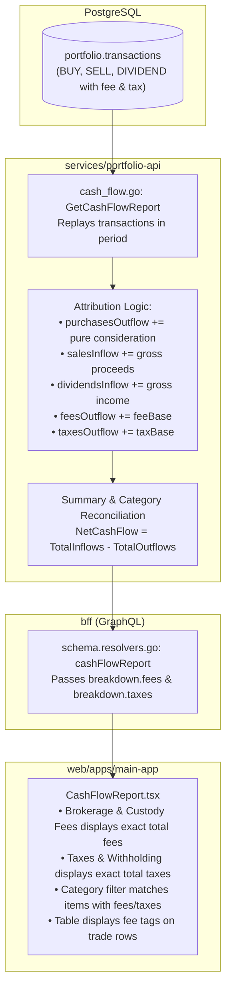

# Implementation Plan: Cash Flow Brokerage Fee & Tax Attribution

> **Target Feature**: Cash Flow Report — Fee & Tax Category Attribution  
> **Status**: Ready for Implementation  
> **Target Layers**: Domain Microservice (`services/portfolio-api`), Primary Web App (`web/apps/main-app`)  
> **Architecture & Standards Reference**: [financial-calculations skill](file:///Users/oscargarcia/workspace/graphfolio/.agents/skills/financial-calculations/SKILL.md), [AGENTS.md](file:///Users/oscargarcia/workspace/graphfolio/AGENTS.md)  

---

## 1. Problem Statement & Executive Summary

### 1.1 The Current Behavior
In the primary investor dashboard (`apps/main-app`), the **Cash Flow Report** displays:
- **Brokerage & Custody Fees**: **`$0.00`** (0%)
- **Taxes & Withholding**: **`$0.00`** (0%)

Even when portfolios have executed hundreds of trades incurring substantial trading commissions (e.g., $9.95 / $19.95 per order on CommSec / IBKR) and received dividends subject to foreign withholding tax, these two outflow breakdown fields remain strictly at zero.

### 1.2 Root Cause Analysis
1. **Trade Fees Bundled into Purchases & Deducted from Sales**:
   In `services/portfolio-api/internal/domain/cash_flow.go` (`CalculateTransactionCashImpact`), trade fees are bundled into `CategoryPurchases` (for `BUY` transactions) and deducted from `CategorySaleProceeds` (for `SELL` transactions).
2. **Category Isolation in the Aggregation Loop**:
   In `services/portfolio-api/internal/service/cash_flow.go` (`GetCashFlowReport`), `feesOutflow` only accumulates transactions where `category == CategoryFees` (i.e., `tx.Type == FEE`), and `taxesOutflow` only accumulates transactions where `category == CategoryTaxes` (i.e., `tx.Type == TAX`).
3. **Absence of Standalone `FEE` / `TAX` Transactions**:
   Neither the manual `AddTransactionModal` nor CSV statement parsers emit standalone `FEE` or `TAX` transactions. All fees are recorded on the `fee` field of `BUY`/`SELL` trades, and withholding taxes on `withholding_tax` of `DIVIDEND` items.
4. **Result**:
   Trade brokerage fees and dividend withholding taxes are hidden within asset purchases, sale proceeds, and dividend inflows, leaving the user-facing "Brokerage & Custody Fees" and "Taxes & Withholding" cards perpetually at zero.

---

## 2. Solution Design & Financial Principles

### 2.1 The Objective
Attribute all incurred trade brokerage fees, transaction fees, and withholding taxes to their designated categories in the **Cash Flow Report** breakdown, while preserving 100% mathematical reconciliation:

$$\text{Ending Cash Balance} = \text{Starting Cash Balance} + \text{Total Inflows} - \text{Total Outflows}$$

$$\text{Total Inflows} = \text{Deposits} + \text{Dividends} + \text{Interest} + \text{Stock Sale Proceeds}$$

$$\text{Total Outflows} = \text{Withdrawals} + \text{Security Purchases} + \text{Brokerage \& Custody Fees} + \text{Taxes \& Withholding}$$

### 2.2 Mathematical Attribution Matrix (Option 1)

For every transaction occurring in the measurement window $[T_{\text{from}}, T_{\text{to}}]$:

| Transaction Type | Consideration / Gross Base ($\text{Amount}_{\text{base}}$) | Fee Base ($\text{Fee}_{\text{base}}$) | Tax Base ($\text{Tax}_{\text{base}}$) | Inflow Category & Amount | Outflow Category & Amount | Net Cash Impact ($\Delta\text{Cash}$) |
| :--- | :--- | :--- | :--- | :--- | :--- | :--- |
| **`BUY`** | $\text{Amount} \times \text{FX}$ | $\text{Fee} \times \text{FX}_{\text{fee}}$ | — | — | **Purchases**: $\text{Amount}_{\text{base}}$ **Fees**: $\text{Fee}_{\text{base}}$ | $-(\text{Amount}_{\text{base}} + \text{Fee}_{\text{base}})$ |
| **`SELL`** | $\text{Amount} \times \text{FX}$ | $\text{Fee} \times \text{FX}_{\text{fee}}$ | — | **Sales Proceeds**: $\text{Amount}_{\text{base}}$ | **Fees**: $\text{Fee}_{\text{base}}$ | $+(\text{Amount}_{\text{base}} - \text{Fee}_{\text{base}})$ |
| **`DIVIDEND`** | $\text{Amount} \times \text{FX}$ | — | $\text{Tax} \times \text{FX}$ | **Dividends**: $\text{Amount}_{\text{base}}$ | **Taxes**: $\text{Tax}_{\text{base}}$ | $+(\text{Amount}_{\text{base}} - \text{Tax}_{\text{base}})$ |
| **`INTEREST`** | $\text{Amount} \times \text{FX}$ | — | $\text{Tax} \times \text{FX}$ | **Interest**: $\text{Amount}_{\text{base}}$ | **Taxes**: $\text{Tax}_{\text{base}}$ | $+(\text{Amount}_{\text{base}} - \text{Tax}_{\text{base}})$ |
| **`DEPOSIT`** | $\text{Amount} \times \text{FX}$ | $\text{Fee} \times \text{FX}_{\text{fee}}$ | — | **Deposits**: $\text{Amount}_{\text{base}}$ | **Fees**: $\text{Fee}_{\text{base}}$ | $+(\text{Amount}_{\text{base}} - \text{Fee}_{\text{base}})$ |
| **`WITHDRAWAL`** | $\text{Amount} \times \text{FX}$ | $\text{Fee} \times \text{FX}_{\text{fee}}$ | — | — | **Withdrawals**: $\text{Amount}_{\text{base}}$ **Fees**: $\text{Fee}_{\text{base}}$ | $-(\text{Amount}_{\text{base}} + \text{Fee}_{\text{base}})$ |
| **`FEE`** | $\text{Amount} \times \text{FX}$ | — | — | — | **Fees**: $\text{Amount}_{\text{base}}$ | $-\text{Amount}_{\text{base}}$ |
| **`TAX`** | $\text{Amount} \times \text{FX}$ | — | — | — | **Taxes**: $\text{Amount}_{\text{base}}$ | $-\text{Amount}_{\text{base}}$ |
| **`SPLIT`** | $0$ | $0$ | $0$ | — | — | $0$ |

### 2.3 Proof of Reconciliation
For any transaction set $\mathcal{T}$:
$$\begin{aligned}
\text{TotalInflows} - \text{TotalOutflows} &= \left( \sum \text{Deposits} + \sum \text{Dividends} + \sum \text{Interest} + \sum \text{Sales} \right) \\
&\quad - \left( \sum \text{Withdrawals} + \sum \text{Purchases} + \sum \text{Fees} + \sum \text{Taxes} \right) \\
&= \sum_{t \in \mathcal{T}} \Delta\text{Cash}_t \\
&= \text{NetCashFlow}
\end{aligned}$$

- $\text{EndingCashBalance} = \text{StartingCashBalance} + \text{NetCashFlow}$.
- **Reconciliation holds to the exact cent ($100.00\%$)** with zero drift across all currencies and transactions.

---

## 3. End-to-End Architectural Data Flow

---

## 4. Implementation Steps by Component

### Phase 1: Microservice Domain & Service Engine (`services/portfolio-api`)
1. **Update `services/portfolio-api/internal/service/cash_flow.go`**:
   - In the transaction loop over `twi in txsWithInst`:
     - Calculate base currency amounts:
       - `amountBase = tx.Amount.Mul(fx)`
       - `feeBase = tx.Fee.Mul(feeFX)`
       - `taxBase = tx.WithholdingTax.Mul(fx)`
     - Replay transactions prior to `fromDate` to compute `startingCash`:
       - `netImpact = CalculateTransactionCashImpact(tx, baseCurrency)`
       - `startingCash = startingCash.Add(netImpact)`
     - For transactions within $[T_{\text{from}}, T_{\text{to}}]$:
       - Maintain `runningBalance = runningBalance.Add(netImpact)`.
       - Increment category breakdown buckets according to the attribution matrix:
         - **`TxTypeBuy`**: `purchasesOutflow += amountBase`, `feesOutflow += feeBase`.
         - **`TxTypeSell`**: `salesInflow += amountBase`, `feesOutflow += feeBase`.
         - **`TxTypeDividend`**: `dividendsInflow += amountBase`, `taxesOutflow += taxBase`.
         - **`TxTypeInterest`**: `interestInflow += amountBase`, `taxesOutflow += taxBase`.
         - **`TxTypeDeposit`, `TxTypeTransferIn`**: `depositsInflow += amountBase`, `feesOutflow += feeBase`.
         - **`TxTypeWithdrawal`, `TxTypeTransferOut`**: `withdrawalsOutflow += amountBase`, `feesOutflow += feeBase`.
         - **`TxTypeFee`**: `feesOutflow += amountBase`.
         - **`TxTypeTax`**: `taxesOutflow += amountBase`.
       - Accumulate totals:
         - `totalInflows = depositsInflow + dividendsInflow + interestInflow + salesInflow`
         - `totalOutflows = withdrawalsOutflow + purchasesOutflow + feesOutflow + taxesOutflow`
         - `netCashFlow = totalInflows - totalOutflows`
         - `endingCash = startingCash + netCashFlow`
2. **Update Unit Tests (`services/portfolio-api/internal/service/cash_flow_test.go`)**:
   - Update `TestGetCashFlowReport` test assertions:
     - Verify `report.Breakdown.Fees.Amount` equals the exact sum of trade fees in the period ($10.00 in the test scenario).
     - Verify `report.Breakdown.SalesProceeds.Amount` reflects gross sales proceeds ($1200.00).
     - Verify `report.Breakdown.Purchases.Amount` reflects gross purchase consideration ($1500.00).
     - Verify mathematical identity: `report.Summary.NetCashFlow == report.Summary.TotalInflows - report.Summary.TotalOutflows`.
   - Add new test cases:
     - Multi-trade scenario with BUY fees, SELL fees, and Dividend withholding tax.
     - Cross-currency fee scenario (`fee_currency_code != currency_code`).
     - Standalone `FEE` and `TAX` combined with trade fees.

### Phase 2: Frontend Category Filtering & Visuals (`web/apps/main-app`)
1. **Update Category Matching in `CashFlowReport.tsx`**:
   - In `filteredItems`:
     - Allow an item to match the `'FEES'` filter if `item.category === 'FEES'` OR `parseFloat(item.fee?.amount) > 0`.
     - Allow an item to match the `'TAXES'` filter if `item.category === 'TAXES'` OR `parseFloat(item.withholdingTax?.amount) > 0`.
   - In `categoryCounts`:
     - Compute counts for `'FEES'` counting both standalone fee items and trade items with `parseFloat(item.fee?.amount) > 0`.
     - Compute counts for `'TAXES'` counting both standalone tax items and items with `parseFloat(item.withholdingTax?.amount) > 0`.
2. **Itemized Table UI Enhancements**:
   - In the itemized cash table:
     - If an item incurred a fee (`parseFloat(item.fee?.amount) > 0`), display a subtle fee indicator in the description or amount column (e.g., `Fee: $9.95`).
     - If an item incurred withholding tax (`parseFloat(item.withholdingTax?.amount) > 0`), display a subtle tax indicator (e.g., `Tax: $15.00`).
   - Retain full CSV export capability including existing `Fee` and `Withholding Tax` columns.

---

## 5. Verification & Testing Plan

### 5.1 Automated Unit & Integration Tests
1. **Backend Service Unit Tests**:
   - Run `go test -v ./internal/service -run TestGetCashFlowReport` in `services/portfolio-api`.
   - Verify zero regression in reconciliation test `Negative_cash_balance_(overdraft)_does_not_break_mathematical_reconciliation`.
2. **BFF GraphQL Resolver Tests**:
   - Run `go test -v ./graph -run TestQueryResolver_CashFlowReport` in `bff`.
3. **Full Backend Suite**:
   - Run `go test ./...` in both `services/portfolio-api` and `bff`.

### 5.2 Manual Acceptance & Browser Verification
1. Open Investor Dashboard (`http://localhost:5173/`).
2. Navigate to **Reports** $\to$ **Cash Flow Report**.
3. Set timeframe to **All Time** or **YTD**.
4. Verify:
   - **Brokerage & Custody Fees** card displays the non-zero aggregate of all trading fees across BUY and SELL orders.
   - **Taxes & Withholding** card displays the non-zero aggregate of foreign dividend withholding taxes.
   - **Ending Cash Balance** card displays `✓ Reconciled Balance` green badge.
   - Selecting only **Brokerage & Fees** from the category multiselect filters the table to show all trades that incurred brokerage fees.
   - Exporting the CSV matches the displayed totals.
