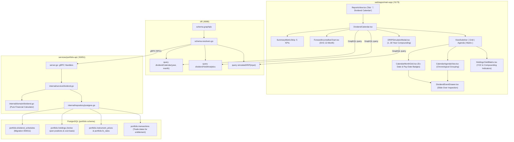

# Implementation Plan: Dividend Calendar, Forward Income & Yield Analytics

> **User Story**: [dividend-calendar-yield-analytics.md](file:///Users/oscargarcia/workspace/graphfolio/docs/user-stories/dividend-calendar-yield-analytics.md) (`US-DIV-101`)  
> **Epic**: Passive Income, Dividend Forecasting & Yield Analytics  
> **Status**: Completed  
> **Standards Compliance**: [financial-calculations skill](file:///Users/oscargarcia/workspace/graphfolio/.agents/skills/financial-calculations/SKILL.md) (Forward Annual Dividend, Yield on Cost [YOC], Trailing Twelve Months [TTM] Yield, Dividend Reinvestment [DRIP] Compounding, Trade-Date vs Ex-Date Entitlement, Foreign Withholding Tax [WHT], Exact Fixed-Point Precision)  
> **Target Layers**: Protobuf (`proto/portfolio/v1/`), Domain Microservice (`services/portfolio-api`), BFF (`bff/`), Web Monorepo (`web/apps/main-app`)  
> **Related Implementations**: [dividend-market-data-ingestion-pipeline.md](file:///Users/oscargarcia/workspace/graphfolio/docs/user-stories/dividend-market-data-ingestion-pipeline.md) (`US-INGEST-103`), Migration `000011_create_dividend_schedules`  

---

## 1. Executive Summary & Financial Architecture

### 1.1 The Income Investor's Motivation
Passive income and dividend growth investors require forward-looking clarity regarding when cash will settle, how much income will be received across the calendar year, and whether holding shares through market cycles is generating compounding returns.

Traditional investment platforms display backward-looking cash received or today's market dividend yield ($0.5\%$ on Apple today), completely obscuring the investor's **Yield on Cost (YOC)** ($12.4\%$ earned on capital invested 10 years ago). Furthermore, because corporate dividend schedules are announced irregularly (US quarterly, Australian semi-annual, European annual), investors suffer from cash flow unpredictability and ex-date entitlement confusion.

This implementation delivers a high-performance **Dividend Calendar & Yield Analytics** hub within GraphFolio's Reports view, featuring:
1. **Summary KPI Strip**: Annual Forward Income, Monthly Average Income, Portfolio Current Yield %, Portfolio Yield on Cost (YOC) %, and Pending Cash Inflows.
2. **12-Month Forward Distribution Bar Chart**: Interactive SVG visualizer displaying projected monthly cash distributions with hover breakdowns by company.
3. **Tri-View Presentation**:
   - **Monthly Calendar Grid**: Full interactive month grid with ex-date alerts (amber) and pay-date cash badges (cyan/emerald) plus event slide-over drawers.
   - **Chronological Agenda List**: Time-sequenced stream of upcoming payouts grouped by week.
   - **Holdings Yield Matrix**: Deep per-asset matrix detailing current yields, YOC, 3-year dividend CAGR, and compounding expansion indicators.
4. **DRIP Compounding Simulator**: Interactive modal modeling 1-to-30-year projections comparing 100% automated Dividend Reinvestment Plans (DRIP) against Cash Payout strategies.

---

### 1.2 Financial, Mathematical & Accounting Mechanics

All monetary amounts and percentages must be computed using arbitrary-precision fixed-point math (`shopspring/decimal` in Go, GraphQL `Decimal` scalars), completely avoiding IEEE 754 floating-point drift.

#### 1. Forward Annual Dividend per Holding ($D_{\text{forward}, i}$)
For an active open position in instrument $i$ with open quantity $Q_{i} > 0$:

$$D_{\text{forward}, i} = Q_{i} \times \text{DPS}_{\text{annualized}, i} \times \text{FX}(C_i \to C_{\text{base}})$$

Where:
- $Q_{i}$: Currently held open share quantity (up to 8 decimal places for fractional shares).
- $\text{DPS}_{\text{annualized}, i}$:
  - **Quarterly Frequency**: $\text{DPS}_{\text{latest}} \times 4$
  - **Semi-Annual Frequency**: $\text{DPS}_{\text{latest}} \times 2$
  - **Monthly Frequency**: $\text{DPS}_{\text{latest}} \times 12$
  - **Annual Frequency**: $\text{DPS}_{\text{latest}} \times 1$
  - **Irregular / Special**: Trailing Twelve Months (TTM) sum of cash distributions.
- $\text{FX}(C_i \to C_{\text{base}})$: Latest spot exchange rate converting instrument currency $C_i$ to portfolio base currency $C_{\text{base}}$.

#### 2. Portfolio Forward Annual Income & Monthly Average
$$D_{\text{forward, portfolio}} = \sum_{i \in \text{OpenHoldings}} D_{\text{forward}, i}$$

$$\text{Monthly Average Income} = \frac{D_{\text{forward, portfolio}}}{12}$$

#### 3. Current Dividend Yield vs Yield on Cost (YOC)
$$\text{Holding Current Yield } Y_{\text{current}, i} = \frac{\text{DPS}_{\text{annualized}, i}}{P_{\text{current}, i}} \times 100$$

$$\text{Holding Yield on Cost } \text{YOC}_i = \frac{\text{DPS}_{\text{annualized}, i}}{\text{Average Buy Price}_i} \times 100$$

$$\text{Portfolio Current Yield} = \frac{D_{\text{forward, portfolio}}}{\text{Total Portfolio Market Value}} \times 100$$

$$\text{Portfolio Yield on Cost} = \frac{D_{\text{forward, portfolio}}}{\sum_{i \in \text{OpenHoldings}} \text{CostBasis}_{\text{base}, i}} \times 100$$

- **Zero-Division Rule**: If $\text{Average Buy Price} \le 0$ or $\text{Cost Basis} \le 0$, YOC is returned as `nil` (rendered as `"—"` in the UI).
- **Yield Expansion Badge**: When $\text{YOC}_i > Y_{\text{current}, i}$, the UI displays an emerald badge highlighting positive dividend growth compounding.

#### 4. Entitlement Rule & Pending Cash Inflows
A dividend payment requires the investor to hold shares before the market open on the Ex-Dividend Date ($T_{\text{ex}}$):
- **Entitlement Condition**: 
  $$\text{Shares Owned Prior to Open on } T_{\text{ex}} > 0$$
  In transaction ledger terms: $\sum_{t < T_{\text{ex}}} \Delta Q_t > 0$.
- **Buying On or After $T_{\text{ex}}$**: Shares bought on or after $T_{\text{ex}}$ are NOT entitled (`is_user_entitled = false`).
- **Selling On or After $T_{\text{ex}}$**: Shares owned before $T_{\text{ex}}$ and sold on or after $T_{\text{ex}}$ REMAIN entitled (`is_user_entitled = true`), and the cash inflow is owed to the investor even if the position is currently closed.
- **Pending Cash Inflow Metric**:
  $$\text{Pending Cash Inflow} = \sum_{e \in \text{Events}} Q_{\text{entitled}, e} \times \text{Net DPS}_e \times \text{FX}_e$$
  where $T_{\text{ex}, e} \le T_{\text{today}} < T_{\text{pay}, e}$ and $e.\text{is\_user\_entitled} = \text{true}$.

#### 5. DRIP Compounding Simulation Formula
Simulating future portfolio compounding comparing a **100% DRIP** strategy against a **Cash Payout** strategy over horizon $Y \in [1, 30]$ years with annual dividend growth rate $d$ (default 5%) and annual asset price growth rate $g$ (default 7%):

For month $m = 1 \dots 12 \times Y$:
1. **Asset Price**: $P_m = P_0 \times (1 + g)^{\frac{m}{12}}$
2. **Monthly Dividend per Share**: $\text{DPS}_m = \frac{\text{DPS}_0}{12} \times (1 + d)^{\frac{m}{12}}$
3. **Monthly Cash Payout**: $\text{Payout}_m = Q_m \times \text{DPS}_m \times (1 - \tau_{\text{wht}})$
4. **DRIP Strategy**:
   $$\Delta Q_m = \frac{\text{Payout}_m}{P_m}, \quad Q_{m+1} = Q_m + \Delta Q_m$$
   $$\text{Portfolio Value}_{m} = Q_m \times P_m$$
5. **Cash Strategy (No Reinvestment)**:
   $$Q_{m+1} = Q_0 \quad (\text{shares constant})$$
   $$\text{Cash Pool}_{m} = \sum_{j=1}^m \text{Payout}_j$$
   $$\text{Portfolio Value}_{m} = (Q_0 \times P_m) + \text{Cash Pool}_m$$

---

## 2. Technical Architecture & End-to-End Data Flow



---

## 3. Layer-by-Layer Implementation Plan

### 3.1 Layer 1: Database & Repository Queries (`services/portfolio-api`)

#### 1. Schema Utilization
The database schema is already provisioned by migration `000011_create_dividend_schedules.up.sql`:
- Table `portfolio.dividend_schedules`:
  - `id uuid`, `instrument_id uuid`, `ex_date date`, `record_date date`, `payment_date date`
  - `amount_per_share numeric(20,8)`, `currency_code char(3)`, `frequency portfolio.dividend_frequency`
  - `status portfolio.dividend_status`, `is_estimated boolean`, `is_override boolean`
  - `franking_percentage numeric(5,2)`, `withholding_tax_pct numeric(5,2)`, `source varchar(32)`
  - Unique constraint on `(instrument_id, ex_date, payment_date)`.
  - Trigger `portfolio.prevent_dividend_override_overwrite` protecting overrides.

#### 2. Repository Queries (`internal/repository/`)
In `internal/repository/repository.go` and `internal/repository/postgres.go`:
1. **`GetDividendCalendarSchedules(ctx context.Context, instrumentIDs []uuid.UUID, fromDate, toDate time.Time) ([]domain.DividendSchedule, error)`**:
   - Queries schedules where:
     ```sql
     WHERE instrument_id = ANY($1)
       AND ((ex_date >= $2 AND ex_date <= $3) OR (payment_date >= $2 AND payment_date <= $3))
     ORDER BY COALESCE(payment_date, ex_date) ASC, ex_date ASC;
     ```
   - Crucial: Fetches events where EITHER `ex_date` OR `payment_date` falls in the requested month window, preventing events from disappearing when the ex-date occurred in late October and the payment date falls in mid-November.
2. **`GetForwardDividendSchedules(ctx context.Context, instrumentIDs []uuid.UUID, fromDate, toDate time.Time) ([]domain.DividendSchedule, error)`**:
   - Queries all forward schedules (official announced and estimated cadence) for the upcoming 12 months for active instruments.
3. **`GetEntitledSharesForExDate(ctx context.Context, portfolioID uuid.UUID, instrumentID uuid.UUID, exDate time.Time) (decimal.Decimal, error)`**:
   - Computes cumulative shares held by the investor strictly prior to market open on `exDate`:
     ```sql
     SELECT COALESCE(SUM(
       CASE 
         WHEN type = 'BUY' THEN quantity
         WHEN type = 'SELL' THEN -quantity
         ELSE 0
       END
     ), 0)
     FROM portfolio.transactions
     WHERE portfolio_id = $1
       AND instrument_id = $2
       AND trade_date < $3;
     ```

---

### 3.2 Layer 2: Domain Models & Calculation Engine (`services/portfolio-api/internal/domain/`)

#### 1. Data Structures (`internal/domain/dividend.go`)
Extend `internal/domain/dividend.go` with domain entities:

```go
// DividendCalendarEvent represents a single ex-date or payment date event on the investor's calendar.
type DividendCalendarEvent struct {
	ID               uuid.UUID         `json:"id"`
	InstrumentID     uuid.UUID         `json:"instrument_id"`
	Symbol           string            `json:"symbol"`
	Name             string            `json:"name"`
	ExDate           time.Time         `json:"ex_date"`
	RecordDate       *time.Time        `json:"record_date,omitempty"`
	PaymentDate      time.Time         `json:"payment_date"`
	SharesHeld       decimal.Decimal   `json:"shares_held"`
	DPSDeclared      Money             `json:"dps_declared"`      // In local instrument currency
	GrossAmountBase  Money             `json:"gross_amount_base"` // In portfolio base currency
	NetAmountBase    Money             `json:"net_amount_base"`   // After withholding tax
	Frequency        DividendFrequency `json:"frequency"`
	Status           DividendStatus    `json:"status"`
	IsUserEntitled   bool              `json:"is_user_entitled"`
	IsEstimated      bool              `json:"is_estimated"`
	FrankingPct      decimal.Decimal   `json:"franking_pct"`
}

// MonthlyDividendProjection aggregates forward cash flows for a specific calendar month.
type MonthlyDividendProjection struct {
	Year            int             `json:"year"`
	Month           int             `json:"month"` // 1..12
	ProjectedIncome Money           `json:"projected_income"`
	DividendCount   int             `json:"dividend_count"`
}

// HoldingYieldItem presents forward dividend metrics for a single portfolio holding.
type HoldingYieldItem struct {
	InstrumentID        uuid.UUID         `json:"instrument_id"`
	Symbol              string            `json:"symbol"`
	Name                string            `json:"name"`
	Quantity            decimal.Decimal   `json:"quantity"`
	CurrentPrice        Money             `json:"current_price"`
	AverageBuyPrice     Money             `json:"average_buy_price"`
	CurrentMarketValue  Money             `json:"current_market_value"`
	CostBasis           Money             `json:"cost_basis"`
	AnnualDPS           Money             `json:"annual_dps"`
	ProjectedAnnualCash Money             `json:"projected_annual_cash"`
	CurrentYieldPct     decimal.Decimal   `json:"current_yield_pct"`
	YieldOnCostPct      *decimal.Decimal  `json:"yield_on_cost_pct"` // Nil when cost basis <= 0
	DividendCAGR3Y      *decimal.Decimal  `json:"dividend_cagr_3y"`  // Nil when insufficient history
	Frequency           DividendFrequency `json:"frequency"`
	NextExDate          *time.Time        `json:"next_ex_date,omitempty"`
	NextPaymentDate     *time.Time        `json:"next_payment_date,omitempty"`
}

// DividendYieldAnalytics aggregates top-level passive income metrics across the portfolio.
type DividendYieldAnalytics struct {
	AnnualForwardIncome   Money                       `json:"annual_forward_income"`
	MonthlyAverageIncome  Money                       `json:"monthly_average_income"`
	PortfolioCurrentYield decimal.Decimal             `json:"portfolio_current_yield"`
	PortfolioYieldOnCost  *decimal.Decimal            `json:"portfolio_yield_on_cost"`
	PendingCashInflow     Money                       `json:"pending_cash_inflow"`
	MonthlyProjections    []MonthlyDividendProjection `json:"monthly_projections"`
	HoldingsYield         []HoldingYieldItem          `json:"holdings_yield"`
}

// DRIPSimulationInput provides parameters for compounding simulation.
type DRIPSimulationInput struct {
	HorizonYears            int             `json:"horizon_years"`             // 1..30
	DividendGrowthRatePct   decimal.Decimal `json:"dividend_growth_rate_pct"`  // Default 5.0%
	CapitalAppreciationPct  decimal.Decimal `json:"capital_appreciation_pct"` // Default 7.0%
}

// DRIPSimulationPoint captures values at yearly intervals.
type DRIPSimulationPoint struct {
	Year                     int             `json:"year"`
	DRIPPortfolioValue       decimal.Decimal `json:"drip_portfolio_value"`
	CashPortfolioValue       decimal.Decimal `json:"cash_portfolio_value"`
	DRIPAccumulatedShares    decimal.Decimal `json:"drip_accumulated_shares"`
	CashAccumulatedCash      decimal.Decimal `json:"cash_accumulated_cash"`
	DRIPAnnualDividend       decimal.Decimal `json:"drip_annual_dividend"`
	CashAnnualDividend       decimal.Decimal `json:"cash_annual_dividend"`
}

// DRIPSimulationResult packages the dual compounding projection curves.
type DRIPSimulationResult struct {
	StartingPortfolioValue decimal.Decimal       `json:"starting_portfolio_value"`
	StartingAnnualDividend decimal.Decimal       `json:"starting_annual_dividend"`
	BaseCurrency           string                `json:"base_currency"`
	HorizonYears           int                   `json:"horizon_years"`
	Points                 []DRIPSimulationPoint `json:"points"`
	TerminalDRIPValue      decimal.Decimal       `json:"terminal_drip_value"`
	TerminalCashValue      decimal.Decimal       `json:"terminal_cash_value"`
	DRIPBenefitAmount      decimal.Decimal       `json:"drip_benefit_amount"`
}
```

#### 2. Pure Financial Calculators
1. **`CalculateDividendYieldAnalytics`**:
   - Takes active holdings (`HoldingWithPrice`), forward 12-month schedules, latest FX rates, and base currency.
   - Computes annualized DPS per holding based on cadence frequency multiplier.
   - Safely computes Current Yield and YOC with zero-division protection.
   - Aggregates 12 monthly projection buckets starting from the current calendar month.
   - Identifies pending cash inflows where $T_{\text{ex}} \le T_{\text{today}} < T_{\text{pay}}$ and user is entitled.
2. **`CalculateDividendCalendarEvents`**:
   - Maps raw schedules for the selected month window.
   - Evaluates entitlement against the investor's cumulative shares owned prior to $T_{\text{ex}}$.
   - Calculates gross base amount and net base amount after withholding tax.
3. **`SimulateDRIPCompounding`**:
   - Simulates month-by-month compounding across $Y \times 12$ periods.
   - Evaluates monthly dividend cash flow, reinvestment share acquisition, and static cash accumulation.
   - Bins results into annual inspection points.

---

### 3.3 Layer 3: Service Layer Orchestration (`services/portfolio-api/internal/service/`)

Create `services/portfolio-api/internal/service/dividend.go`:
```go
func (s *portfolioService) GetDividendCalendar(
    ctx context.Context, 
    userID string, 
    year, month int,
) ([]domain.DividendCalendarEvent, error)

func (s *portfolioService) GetDividendYieldAnalytics(
    ctx context.Context, 
    userID string,
) (*domain.DividendYieldAnalytics, error)

func (s *portfolioService) SimulateDRIP(
    ctx context.Context, 
    userID string, 
    input domain.DRIPSimulationInput,
) (*domain.DRIPSimulationResult, error)
```

**Service Logic Rules**:
1. Resolve portfolio for `userID` (`FindPortfolioByUser`). If not found, return descriptive error.
2. Fetch active holdings with market data (`GetHoldingsWithMarketData(ctx, portfolioID)`). Filter out closed positions (`quantity > 0`).
3. For calendar: Define month boundary $[T_{\text{start}}, T_{\text{end}}]$ with a 7-day padding window to capture edge ex-dates/pay-dates.
4. Retrieve schedules via `repo.GetDividendCalendarSchedules`.
5. For each schedule, query entitled shares via `repo.GetEntitledSharesForExDate`.
6. Convert currencies via `repo.GetCashFXRates(ctx, baseCurrency)`.
7. Compute analytics and projections, returning domain structs.

---

### 3.4 Layer 4: Protobuf Contracts & gRPC Transport Adapter

#### 1. Protobuf Definitions (`proto/portfolio/v1/portfolio.proto`)
Add the following message and RPC definitions:

```protobuf
service PortfolioService {
  // Existing RPCs ...

  // Dividend Calendar & Yield Analytics
  rpc GetDividendCalendar(GetDividendCalendarRequest) returns (GetDividendCalendarResponse);
  rpc GetDividendYieldAnalytics(GetDividendYieldAnalyticsRequest) returns (GetDividendYieldAnalyticsResponse);
  rpc SimulateDRIP(SimulateDRIPRequest) returns (SimulateDRIPResponse);
}

message GetDividendCalendarRequest {
  string user_id = 1;
  int32  year    = 2;
  int32  month   = 3; // 1..12
}

message GetDividendCalendarResponse {
  repeated DividendCalendarEvent events = 1;
}

message DividendCalendarEvent {
  string            id               = 1;
  string            instrument_id    = 2;
  string            symbol           = 3;
  string            name             = 4;
  string            ex_date          = 5; // YYYY-MM-DD
  string            record_date      = 6; // YYYY-MM-DD
  string            payment_date     = 7; // YYYY-MM-DD
  common.v1.Decimal shares_held      = 8;
  common.v1.Money   dps_declared     = 9;  // Instrument currency
  common.v1.Money   gross_amount_base= 10; // Base currency
  common.v1.Money   net_amount_base  = 11; // After WHT
  DividendFrequency frequency        = 12;
  DividendStatus    status           = 13;
  bool              is_user_entitled = 14;
  bool              is_estimated     = 15;
  common.v1.Decimal franking_pct     = 16;
}

message GetDividendYieldAnalyticsRequest {
  string user_id = 1;
}

message MonthlyDividendProjection {
  int32           year             = 1;
  int32           month            = 2;
  common.v1.Money projected_income = 3;
  int32           dividend_count   = 4;
}

message HoldingYieldItem {
  string            instrument_id         = 1;
  string            symbol                = 2;
  string            name                  = 3;
  common.v1.Decimal quantity              = 4;
  common.v1.Money   current_price         = 5;
  common.v1.Money   average_buy_price     = 6;
  common.v1.Money   current_market_value  = 7;
  common.v1.Money   cost_basis            = 8;
  common.v1.Money   annual_dps            = 9;
  common.v1.Money   projected_annual_cash = 10;
  common.v1.Decimal current_yield_pct     = 11;
  common.v1.Decimal yield_on_cost_pct     = 12; // Nullable
  common.v1.Decimal dividend_cagr_3y      = 13; // Nullable
  DividendFrequency frequency             = 14;
  string            next_ex_date          = 15;
  string            next_payment_date     = 16;
}

message GetDividendYieldAnalyticsResponse {
  common.v1.Money                    annual_forward_income   = 1;
  common.v1.Money                    monthly_average_income  = 2;
  common.v1.Decimal                  portfolio_current_yield = 3;
  common.v1.Decimal                  portfolio_yield_on_cost = 4;
  common.v1.Money                    pending_cash_inflow     = 5;
  repeated MonthlyDividendProjection monthly_projections     = 6;
  repeated HoldingYieldItem          holdings_yield          = 7;
}

message SimulateDRIPRequest {
  string            user_id                   = 1;
  int32             horizon_years             = 2;
  common.v1.Decimal dividend_growth_rate_pct  = 3;
  common.v1.Decimal capital_appreciation_pct  = 4;
}

message DRIPSimulationPoint {
  int32             year                     = 1;
  common.v1.Decimal drip_portfolio_value     = 2;
  common.v1.Decimal cash_portfolio_value     = 3;
  common.v1.Decimal drip_accumulated_shares  = 4;
  common.v1.Decimal cash_accumulated_cash    = 5;
  common.v1.Decimal drip_annual_dividend     = 6;
  common.v1.Decimal cash_annual_dividend     = 7;
}

message SimulateDRIPResponse {
  common.v1.Decimal           starting_portfolio_value = 1;
  common.v1.Decimal           starting_annual_dividend = 2;
  string                      base_currency            = 3;
  int32                       horizon_years            = 4;
  repeated DRIPSimulationPoint points                   = 5;
  common.v1.Decimal           terminal_drip_value      = 6;
  common.v1.Decimal           terminal_cash_value      = 7;
  common.v1.Decimal           drip_benefit_amount      = 8;
}
```

#### 2. Code Generation & gRPC Server (`services/portfolio-api/internal/server.go`)
- Execute `make proto` to generate protobuf Go code.
- Implement the 3 gRPC server adapters in `services/portfolio-api/internal/server.go`.
- Map protobuf Decimal and Money using `pkg/decimalpb`.

---

### 3.5 Layer 5: BFF GraphQL Orchestration Layer (`bff/`)

#### 1. GraphQL Schema (`bff/graph/schema.graphqls`)
Add queries and types:

```graphql
type DividendCalendarEvent {
  id: ID!
  instrumentId: ID!
  symbol: String!
  name: String!
  exDate: String!
  recordDate: String
  paymentDate: String!
  sharesHeld: Decimal!
  dpsDeclared: Money!
  grossAmountBase: Money!
  netAmountBase: Money!
  frequency: DividendFrequency!
  status: DividendStatus!
  isUserEntitled: Boolean!
  isEstimated: Boolean!
  frankingPct: Decimal!
}

type MonthlyDividendProjection {
  year: Int!
  month: Int!
  projectedIncome: Money!
  dividendCount: Int!
}

type HoldingYieldItem {
  instrumentId: ID!
  symbol: String!
  name: String!
  quantity: Decimal!
  currentPrice: Money!
  averageBuyPrice: Money!
  currentMarketValue: Money!
  costBasis: Money!
  annualDps: Money!
  projectedAnnualCash: Money!
  currentYieldPct: Decimal!
  yieldOnCostPct: Decimal
  dividendCagr3y: Decimal
  frequency: DividendFrequency!
  nextExDate: String
  nextPaymentDate: String
}

type DividendYieldAnalytics {
  annualForwardIncome: Money!
  monthlyAverageIncome: Money!
  portfolioCurrentYield: Decimal!
  portfolioYieldOnCost: Decimal
  pendingCashInflow: Money!
  monthlyProjections: [MonthlyDividendProjection!]!
  holdingsYield: [HoldingYieldItem!]!
}

input DRIPSimulationInput {
  horizonYears: Int!
  dividendGrowthRatePct: Decimal
  capitalAppreciationPct: Decimal
}

type DRIPSimulationPoint {
  year: Int!
  dripPortfolioValue: Decimal!
  cashPortfolioValue: Decimal!
  dripAccumulatedShares: Decimal!
  cashAccumulatedCash: Decimal!
  dripAnnualDividend: Decimal!
  cashAnnualDividend: Decimal!
}

type DRIPSimulationResult {
  startingPortfolioValue: Decimal!
  startingAnnualDividend: Decimal!
  baseCurrency: String!
  horizonYears: Int!
  points: [DRIPSimulationPoint!]!
  terminalDripValue: Decimal!
  terminalCashValue: Decimal!
  dripBenefitAmount: Decimal!
}

extend type Query {
  dividendCalendar(year: Int!, month: Int!): [DividendCalendarEvent!]!
  dividendYieldAnalytics: DividendYieldAnalytics!
  simulateDRIP(input: DRIPSimulationInput!): DRIPSimulationResult!
}
```

#### 2. Resolvers & Authentication (`bff/graph/schema.resolvers.go`)
- Resolve authenticated user ID via `resolveUserID(ctx)`.
- Forward requests to `portfolioClient.GetDividendCalendar`, `GetDividendYieldAnalytics`, and `SimulateDRIP`.
- Run `go generate ./bff/...` to update gqlgen code.
- Run `npm run codegen` in `web/` to generate typed TypeScript operations for `@graphfolio/api-client`.

---

### 3.6 Layer 6: Web Application UI / UX (`web/apps/main-app`)

#### 1. Reports Navigation Tab
Update `web/apps/main-app/src/components/ReportsView.tsx`:
- Enable the `"📅 Dividend Calendar"` button (remove `disabled` and `report-soon-badge`).
- Render `<DividendCalendar preferredCurrency={preferredCurrency} />` when `activeReport === 'dividends'`.

#### 2. Component Hierarchy in `web/apps/main-app/src/components/`

```
web/apps/main-app/src/components/
├── DividendCalendar.tsx               # Main container: State, queries, layout
├── DividendCalendar.css               # Dark glassmorphic styling
├── DividendMetricStrip.tsx            # 5 KPI cards with trend & badge styling
├── ForwardDistributionChart.tsx       # 12-Month forward SVG bar chart & hover tooltips
├── CalendarMonthGrid.tsx              # Interactive 7-column calendar grid
├── CalendarAgendaView.tsx             # Chronological timeline stream
├── HoldingsYieldMatrix.tsx            # Per-asset yield, YOC, & compounding table
├── DividendEventDrawer.tsx            # Slide-over event inspection drawer
└── DRIPSimulatorModal.tsx             # Interactive compounding simulator modal
```

#### 3. UX Design & Interaction Specifications
- **Metric Strip**:
  - `Annual Forward Income` in large cyan font with `Monthly Average` sub-metric.
  - `Portfolio Yield` and `Yield on Cost` with green compounding indicator when $\text{YOC} > \text{Yield}$.
  - `Pending Cash Inflow` showing upcoming entitled payouts.
- **12-Month SVG Bar Chart**:
  - Dynamic SVG rendering forward months ($m_1 \dots m_{12}$).
  - Bars color-coded by income intensity (higher income = richer emerald/cyan gradient).
  - Hover tooltip displaying company names, dividend amounts, and payment dates.
- **Monthly Calendar Grid**:
  - Standard 7-column layout (Mon–Sun).
  - Previous / Next month buttons and `"Today"` quick-jump button.
  - Day cells contain:
    - Amber warning pill: `[TICKER Ex-Date]` (warning badge if within 7 days of today).
    - Cyan / Emerald pill: `[TICKER $Amount]` for payment dates.
    - Faded styling for unentitled distributions (`is_user_entitled = false`).
  - Clicking any pill opens `DividendEventDrawer` detailing shares held, DPS, gross base amount, withholding tax, and entitlement confirmation.
- **Holdings Yield Matrix**:
  - 10-column table with sorting by Asset, Yield, YOC, and Est. Annual Cash.
  - Emerald `"Yield Expansion"` badge when YOC exceeds current yield.
  - Next Ex-Date highlighted in amber if approaching within 7 trading days.
- **DRIP Simulator Modal**:
  - Accessible via `"DRIP Simulator"` button on top right of the hub.
  - Interactive sliders for Horizon (1–30 years), Dividend Growth (0–15%), and Asset Growth (0–15%).
  - Dual SVG curve comparing DRIP vs Cash Payout over time.
  - Clear summary metric highlighting extra wealth created purely through dividend compounding.

---

## 4. Verification & Automated Test Strategy

### 4.1 Domain Unit Tests (`services/portfolio-api/internal/domain/dividend_test.go`)
1. **`TestCalculateForwardYieldAnalytics`**:
   - Verify calculation of annual DPS across Monthly (12x), Quarterly (4x), Semi-Annual (2x), and Annual (1x) frequencies.
   - Verify correct multiplication by open fractional share quantities (e.g. $14.3821$).
   - Verify zero-division safety: Zero average buy price returns `nil` YOC without panic.
   - Verify multi-currency conversion applies correct FX rates.
2. **`TestCalculateDividendCalendarEvents`**:
   - Verify entitlement rule: Trade date before ex-date $\implies$ entitled (`true`); trade date on or after ex-date $\implies$ unentitled (`false`).
   - Verify post-ex-date sale keeps entitlement intact.
   - Verify statutory withholding tax deduction (e.g. 15% WHT for US assets).
3. **`TestSimulateDRIPCompounding`**:
   - Verify 10-year compounding calculation with 5% dividend growth and 7% capital appreciation.
   - Verify DRIP terminal value strictly exceeds cash payout strategy.
   - Verify exact matching of mathematical formula at discrete year intervals.

### 4.2 Service Integration Tests (`services/portfolio-api/internal/service/dividend_test.go`)
1. **`TestPortfolioService_GetDividendCalendar`**:
   - Mock repository queries for month range. Verify correctly formed calendar events and entitlement resolution.
2. **`TestPortfolioService_GetDividendYieldAnalytics`**:
   - Mock active holdings with prices and dividend schedules. Verify full analytics response and monthly projection binning.
3. **`TestPortfolioService_SimulateDRIP`**:
   - Test DRIP simulation service handler with validation of input parameters (horizon bounds 1..30).

### 4.3 BFF Resolver Unit Tests (`bff/graph/schema.resolvers_test.go`)
1. `TestQueryResolver_DividendCalendar`: Verify resolver forwards request with authenticated user ID and correctly maps response.
2. `TestQueryResolver_DividendYieldAnalytics`: Verify resolver handles empty holdings gracefully.
3. `TestQueryResolver_SimulateDRIP`: Verify input parameters are passed to gRPC client.

### 4.4 Web Frontend Unit Tests (`web/apps/main-app/src/components/`)
1. **`DividendCalendar.test.ts`**:
   - Renders 5 summary metric cards correctly.
   - Tests view switching between Grid, Agenda, and Matrix.
   - Verifies ex-date and pay-date badges render on proper calendar day cells.
2. **`DRIPSimulatorModal.test.ts`**:
   - Slider adjustments trigger chart re-render and recalculate terminal values.

---

## 5. File Change Inventory

| Layer | File Path | Action | Description |
|:---|:---|:---:|:---|
| **Repository** | `services/portfolio-api/internal/repository/repository.go` | **MODIFY** | Add `GetDividendCalendarSchedules` and `GetEntitledSharesForExDate` interfaces |
| **Repository** | `services/portfolio-api/internal/repository/postgres.go` | **MODIFY** | Implement calendar schedule and entitlement SQL queries |
| **Domain** | `services/portfolio-api/internal/domain/dividend.go` | **MODIFY** | Add `DividendCalendarEvent`, `HoldingYieldItem`, `DividendYieldAnalytics`, `DRIPSimulationResult` |
| **Domain Tests** | `services/portfolio-api/internal/domain/dividend_test.go` | **CREATE** | Unit tests for forward yield, YOC zero-division, entitlement, and DRIP formulas |
| **Service** | `services/portfolio-api/internal/service/service.go` | **MODIFY** | Add dividend calendar & analytics methods to `PortfolioService` interface |
| **Service** | `services/portfolio-api/internal/service/dividend.go` | **CREATE** | Implement `GetDividendCalendar`, `GetDividendYieldAnalytics`, and `SimulateDRIP` |
| **Service Tests**| `services/portfolio-api/internal/service/dividend_test.go` | **CREATE** | Table-driven unit tests with `MockRepository` |
| **Protobuf** | `proto/portfolio/v1/portfolio.proto` | **MODIFY** | Add RPCs and message contracts for dividend calendar and DRIP |
| **gRPC Server** | `services/portfolio-api/internal/server.go` | **MODIFY** | Implement gRPC transport handlers |
| **gRPC Tests** | `services/portfolio-api/internal/server_test.go` | **MODIFY** | Add unit tests for gRPC dividend endpoints |
| **BFF Schema** | `bff/graph/schema.graphqls` | **MODIFY** | Add queries `dividendCalendar`, `dividendYieldAnalytics`, `simulateDRIP` |
| **BFF Resolvers**| `bff/graph/schema.resolvers.go` | **MODIFY** | Implement resolvers forwarding queries to `portfolioClient` |
| **BFF Tests** | `bff/graph/schema.resolvers_test.go` | **MODIFY** | Unit tests for dividend queries |
| **Web Hub** | `web/apps/main-app/src/components/ReportsView.tsx` | **MODIFY** | Enable `"📅 Dividend Calendar"` tab in Reports hub |
| **Web UI** | `web/apps/main-app/src/components/DividendCalendar.tsx` | **CREATE** | Main Dividend Calendar & Yield Analytics hub component |
| **Web UI CSS** | `web/apps/main-app/src/components/DividendCalendar.css` | **CREATE** | Dark glassmorphic styles for calendar grid, agenda, and matrix |
| **Web UI** | `web/apps/main-app/src/components/DRIPSimulatorModal.tsx` | **CREATE** | Interactive DRIP compounding simulator modal with SVG curves |
| **Web UI CSS** | `web/apps/main-app/src/components/DRIPSimulatorModal.css` | **CREATE** | Styles for DRIP simulator modal and parameters |
| **Web Tests** | `web/apps/main-app/src/components/DividendCalendar.test.ts`| **CREATE** | Vitest unit tests for calendar interactions and rendering |
| **User Story** | `docs/user-stories/dividend-calendar-yield-analytics.md` | **MODIFY** | Link implementation plan |
| **Catalog** | `docs/USER_STORIES.md` | **MODIFY** | Update status to **PLANNED** and link implementation plan |

---

## 6. Definition of Done (DoD) Checklist

- [x] Repository methods `GetDividendCalendarSchedules` and `GetEntitledSharesForExDate` implemented in `internal/repository/`.
- [x] Pure financial calculation domain functions implemented in `internal/domain/dividend.go` using `shopspring/decimal`.
- [x] Entitlement logic strictly enforced ($T_{\text{trade}} < T_{\text{ex}}$ required for dividend entitlement).
- [x] Yield on Cost (YOC) calculation protects against division by zero (returns `nil` for zero cost basis).
- [x] DRIP compounding simulator formula implemented with month-by-month compounding.
- [x] Protobuf RPCs defined in `proto/portfolio/v1/portfolio.proto` and Go stubs generated via `make proto`.
- [x] gRPC transport handlers implemented in `services/portfolio-api/internal/server.go`.
- [x] BFF GraphQL schema updated and resolvers implemented in `bff/graph/schema.resolvers.go`.
- [x] `@graphfolio/api-client` generated with typed queries via `npm run codegen`.
- [x] Main Investor Web Application Reports view updated with active `"📅 Dividend Calendar"` tab.
- [x] Interactive 12-month forward distribution SVG bar chart rendered with hover company breakdown tooltips.
- [x] Multi-view presentation toggle implemented: Monthly Calendar Grid, Chronological Agenda List, Holdings Yield Matrix.
- [x] Event slide-over inspection drawer displays shares held, declared DPS, gross amount, and estimated withholding tax.
- [x] DRIP Compounding Simulator modal implemented with interactive parameters and dual SVG projection curves.
- [x] Unit tests passing across `internal/domain`, `internal/service`, `bff/graph`, and `web/apps/main-app` with $> 90\%$ test coverage.
- [x] Documentation updated in `docs/user-stories/dividend-calendar-yield-analytics.md` and `docs/USER_STORIES.md`.

