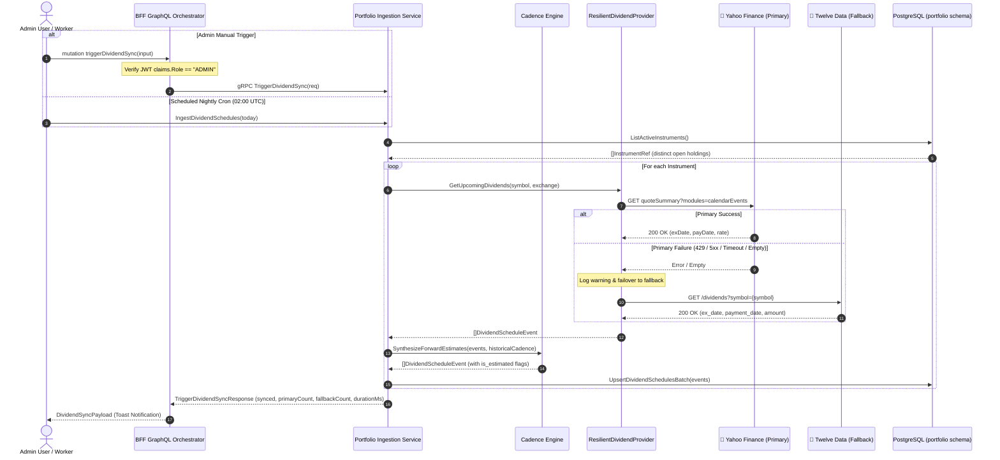

# Implementation Plan: Market Data Sourcing & Dividend Ingestion Pipeline

> **Story Reference**: [dividend-market-data-ingestion-pipeline.md](file:///Users/oscargarcia/workspace/graphfolio/docs/user-stories/dividend-market-data-ingestion-pipeline.md) (`US-INGEST-103`)  
> **Epic**: Automated Market Ingestion, Corporate Actions & Data Pipelines  
> **Target Layers**: Database (`portfolio.dividend_schedules`), Market Data Adapters (`services/portfolio-api/internal/marketdata/`), Domain & Ingestion Service (`services/portfolio-api/internal/service/`), gRPC Protocol Buffers (`proto/portfolio/v1/portfolio.proto`), BFF GraphQL Orchestrator (`bff/`), Admin Web Portal (`web/apps/admin-app/`), CLI & Worker (`cmd/market-ingest/`, `cmd/worker/`)  
> **Primary Feed**: **Yahoo Finance Corporate Actions & QuoteSummary API**  
> **Fallback Feed**: **Twelve Data Dividends & Calendar API**  
> **Calculation & Precision Standard**: [financial-calculations skill](file:///Users/oscargarcia/workspace/graphfolio/.agents/skills/financial-calculations/SKILL.md)  
> **Status**: Completed  

---

## 1. Architectural Overview & System Flow

Accurate forward dividend calendars, Yield on Cost (YOC) metrics, and cash flow forecasting require fresh, authoritative corporate dividend data without exhausting commercial API quotas.

### 1.1 Ingestion Architecture & Failover Cascade
The pipeline uses **Yahoo Finance as the primary corporate actions source** (delivering forward ex-dates, pay-dates, declared rates, and historical distribution series without credit caps) and **Twelve Data as the secondary resilient fallback** (activated only when Yahoo Finance encounters rate throttling, network timeouts, or missing symbols).



---

## 2. Phase 1: Database Migration & Schema Design

### 2.1 Migration Script: `000011_create_dividend_schedules.up.sql`
Create migration in `services/portfolio-api/migrations/000011_create_dividend_schedules.up.sql`:

```sql
-- 000011_create_dividend_schedules.up.sql

CREATE TYPE portfolio.dividend_frequency AS ENUM (
    'MONTHLY', 'QUARTERLY', 'SEMI_ANNUAL', 'ANNUAL', 'IRREGULAR'
);

CREATE TYPE portfolio.dividend_status AS ENUM (
    'ANNOUNCED', 'EX_DATE_PASSED', 'PAID', 'CANCELLED'
);

CREATE TABLE portfolio.dividend_schedules (
    id                  uuid                            PRIMARY KEY DEFAULT uuidv7(),
    instrument_id       uuid                            NOT NULL REFERENCES portfolio.instruments(id) ON DELETE CASCADE,
    ex_date             date                            NOT NULL,
    record_date         date,
    payment_date        date                            NOT NULL,
    amount_per_share    numeric(20,8)                   NOT NULL CHECK (amount_per_share > 0),
    currency_code       char(3)                         NOT NULL REFERENCES portfolio.currencies(code),
    frequency           portfolio.dividend_frequency    NOT NULL DEFAULT 'QUARTERLY',
    status              portfolio.dividend_status       NOT NULL DEFAULT 'ANNOUNCED',
    is_estimated        boolean                         NOT NULL DEFAULT false,
    is_override         boolean                         NOT NULL DEFAULT false,
    franking_percentage numeric(5,2)                   DEFAULT 0.00,
    withholding_tax_pct numeric(5,2)                   DEFAULT 0.00,
    source              varchar(32)                     NOT NULL DEFAULT 'yahoo',
    created_at          timestamptz                     NOT NULL DEFAULT now(),
    updated_at          timestamptz                     NOT NULL DEFAULT now(),
    UNIQUE (instrument_id, ex_date, payment_date)
);

CREATE INDEX idx_dividend_schedules_dates ON portfolio.dividend_schedules (ex_date, payment_date);
CREATE INDEX idx_dividend_schedules_instrument ON portfolio.dividend_schedules (instrument_id);
CREATE INDEX idx_dividend_schedules_status ON portfolio.dividend_schedules (status, is_estimated);

-- Trigger: Protect manual administrator overrides from automated feed overwrites
CREATE OR REPLACE FUNCTION portfolio.prevent_dividend_override_overwrite()
RETURNS TRIGGER AS $$
BEGIN
    IF OLD.is_override = true AND NEW.is_override = false THEN
        RAISE EXCEPTION 'Cannot overwrite manual admin dividend override with automated feed data';
    END IF;
    RETURN NEW;
END;
$$ LANGUAGE plpgsql;

CREATE TRIGGER trg_protect_dividend_overrides
BEFORE UPDATE ON portfolio.dividend_schedules
FOR EACH ROW EXECUTE FUNCTION portfolio.prevent_dividend_override_overwrite();
```

### 2.2 Down Migration: `000011_create_dividend_schedules.down.sql`
```sql
-- 000011_create_dividend_schedules.down.sql

DROP TRIGGER IF EXISTS trg_protect_dividend_overrides ON portfolio.dividend_schedules;
DROP FUNCTION IF EXISTS portfolio.prevent_dividend_override_overwrite();
DROP TABLE IF EXISTS portfolio.dividend_schedules;
DROP TYPE IF EXISTS portfolio.dividend_status;
DROP TYPE IF EXISTS portfolio.dividend_frequency;
```

### 2.3 Repository Layer Extensions (`services/portfolio-api/internal/repository/`)
Add repository methods in `postgres.go`:
1. `UpsertDividendSchedulesBatch(ctx context.Context, schedules []domain.DividendSchedule) (int, error)`:
   - Uses `ON CONFLICT (instrument_id, ex_date, payment_date) DO UPDATE SET amount_per_share = EXCLUDED.amount_per_share, status = EXCLUDED.status, is_estimated = EXCLUDED.is_estimated, updated_at = now() WHERE portfolio.dividend_schedules.is_override = false`.
2. `GetUpcomingDividendSchedules(ctx context.Context, instrumentIDs []uuid.UUID, fromDate, toDate time.Time) ([]domain.DividendSchedule, error)`.
3. `ListDividendSchedulesByInstrument(ctx context.Context, instrumentID uuid.UUID) ([]domain.DividendSchedule, error)`.
4. `LogIngestionJob(ctx context.Context, job domain.IngestionJobRecord) error`.

---

## 3. Phase 2: Market Data Adapters & Resilient Cascading Provider

### 3.1 Provider Interface (`internal/marketdata/provider.go`)
Define the corporate action contracts:

```go
package marketdata

import (
	"context"
	"time"

	"github.com/google/uuid"
	"github.com/shopspring/decimal"
)

type DividendScheduleEvent struct {
	InstrumentID      uuid.UUID
	Symbol            string
	ExchangeCode      string
	ExDate            time.Time
	RecordDate        *time.Time
	PaymentDate       time.Time
	AmountPerShare    decimal.Decimal
	CurrencyCode      string
	Frequency         string // MONTHLY, QUARTERLY, SEMI_ANNUAL, ANNUAL, IRREGULAR
	Status            string // ANNOUNCED, EX_DATE_PASSED, PAID
	IsEstimated       bool
	FrankingPct       decimal.Decimal
	WithholdingTaxPct decimal.Decimal
	Source            string // yahoo, twelvedata, admin_override
}

type DividendHistoryPoint struct {
	Date   time.Time
	Amount decimal.Decimal
}

type DividendProvider interface {
	SourceID() string
	GetUpcomingDividends(ctx context.Context, symbol, exchangeCode string) ([]DividendScheduleEvent, error)
	GetHistoricalDividends(ctx context.Context, symbol, exchangeCode string, fromDate, toDate time.Time) ([]DividendHistoryPoint, error)
}
```

### 3.2 Primary Provider Adapter: `YahooFinanceProvider` (`internal/marketdata/equity_provider.go`)
Extend the existing Yahoo Finance HTTP client:
1. `GetUpcomingDividends`:
   - Endpoint: `https://query1.finance.yahoo.com/v10/finance/quoteSummary/{symbol}?modules=calendarEvents,defaultKeyStatistics,summaryDetail`
   - Maps `calendarEvents.dividends.exDividendDate` and `dividendDate` Unix timestamps into `time.Time`.
   - Parses `dividendRate` or trailing yield into `decimal.Decimal`.
   - Handles Australian exchange suffix `.AX` for franking estimation.
2. `GetHistoricalDividends`:
   - Endpoint: `https://query1.finance.yahoo.com/v8/finance/chart/{symbol}?events=div&interval=1d&range=5y`
   - Parses the `events.dividends` timestamp dictionary into chronological points.

### 3.3 Fallback Provider Adapter: `TwelveDataProvider` (`internal/marketdata/equity_provider.go`)
Extend the existing Twelve Data HTTP client:
1. `GetUpcomingDividends`:
   - Endpoint: `https://api.twelvedata.com/dividends?symbol={symbol}&apikey={key}`
   - Governed by Twelve Data rate limiter (max 8 requests/min).
   - Maps `ex_date`, `payment_date`, `record_date`, and `amount` into `DividendScheduleEvent` with `Source = "twelvedata"`.
2. `GetHistoricalDividends`:
   - Queries historical range from Twelve Data dividends endpoint.

### 3.4 Cascading Failover Wrapper: `ResilientDividendProvider` (`internal/marketdata/resilient_dividend_provider.go`)
```go
package marketdata

import (
	"context"
	"fmt"

	"portfolio-api/pkg/logger"
)

type ResilientDividendProvider struct {
	primary  DividendProvider // YahooFinanceProvider
	fallback DividendProvider // TwelveDataProvider
	logger   *logger.Logger
}

func NewResilientDividendProvider(primary, fallback DividendProvider, log *logger.Logger) *ResilientDividendProvider {
	return &ResilientDividendProvider{
		primary:  primary,
		fallback: fallback,
		logger:   log,
	}
}

func (r *ResilientDividendProvider) SourceID() string {
	return "resilient_yahoo_twelve"
}

func (r *ResilientDividendProvider) GetUpcomingDividends(ctx context.Context, symbol, exchange string) ([]DividendScheduleEvent, error) {
	events, err := r.primary.GetUpcomingDividends(ctx, symbol, exchange)
	if err == nil && len(events) > 0 {
		return events, nil
	}

	r.logger.Warn("Primary dividend feed failed, failing over to Twelve Data fallback",
		"symbol", symbol,
		"primary", r.primary.SourceID(),
		"error", err,
	)

	fallbackEvents, fallbackErr := r.fallback.GetUpcomingDividends(ctx, symbol, exchange)
	if fallbackErr != nil {
		return nil, fmt.Errorf("both primary (%v) and fallback (%v) feeds failed: %w", err, fallbackErr, fallbackErr)
	}

	return fallbackEvents, nil
}
```

---

## 4. Phase 3: Cadence Recognition & Forward Projection Engine

Implement the deterministic cadence estimation engine in `services/portfolio-api/internal/marketdata/cadence.go`:

### 4.1 Frequency Detection Algorithm
```go
func DetectFrequency(history []DividendHistoryPoint) (string, int) {
	if len(history) < 2 {
		return "QUARTERLY", 91 // Default universal fallback
	}

	var intervals []int
	for i := 1; i < len(history); i++ {
		days := int(history[i].Date.Sub(history[i-1].Date).Hours() / 24)
		if days > 10 { // Filter out special distribution adjustments
			intervals = append(intervals, days)
		}
	}

	medianDays := calculateMedian(intervals)
	switch {
	case medianDays >= 25 && medianDays <= 35:
		return "MONTHLY", 30
	case medianDays >= 80 && medianDays <= 105:
		return "QUARTERLY", 91
	case medianDays >= 160 && medianDays <= 200:
		return "SEMI_ANNUAL", 182
	case medianDays >= 340 && medianDays <= 380:
		return "ANNUAL", 365
	default:
		return "QUARTERLY", 91
	}
}
```

### 4.2 Forward 12-Month Projection Synthesizer
- Starting from latest verified announcement $D_{\text{latest}}$, project forward cycles up to $t_{\text{now}} + 365\text{ days}$.
- For each cycle, check if a verified schedule already exists within $\pm 15$ days:
  - If exists: Keep verified schedule (`is_estimated = false`).
  - If absent: Create synthetic placeholder with `is_estimated = true`, `status = 'ANNOUNCED'`, and `amount_per_share = D_latest.AmountPerShare`.
- Automated Upgrade: When a subsequent ingestion run returns the official board declaration, update the estimated placeholder in-place (`is_estimated = false`).

---

## 5. Phase 4: Ingestion Service, Trade Hook & CLI Worker

### 5.1 Service Layer Methods (`services/portfolio-api/internal/service/ingestion.go`)
Implement:
1. `IngestDividendSchedules(ctx context.Context, asOfDate time.Time) (*domain.DividendSyncResult, error)`:
   - Queries `repo.ListActiveInstruments()`.
   - Iterates through distinct symbols with concurrency throttle (worker pool of 5 goroutines).
   - Ingests upcoming schedules via `ResilientDividendProvider`.
   - Synthesizes cadence estimates and persists batch via `repo.UpsertDividendSchedulesBatch`.
   - Returns aggregated statistics (`SchedulesSynced`, `PrimaryCount`, `FallbackCount`, `PlaceholdersUpgraded`).
2. `BackfillInstrumentDividends(ctx context.Context, instrumentID uuid.UUID, symbol, exchange string) (int, error)`:
   - Targeted backfill for a single instrument.

### 5.2 Event-Driven Hook on Trade Entry
In `services/portfolio-api/internal/service/transaction.go` (`AddTransaction`):
- When a `BUY` transaction is entered for an instrument, check if `portfolio.dividend_schedules` has entries for that `instrument_id`.
- If missing, trigger asynchronous goroutine: `go s.ingestion.BackfillInstrumentDividends(context.Background(), instID, symbol, exchange)`.

### 5.3 CLI Worker & Makefile Integration
In `services/portfolio-api/cmd/market-ingest/main.go`:
- Add flag `--sync-dividends` (bool) and `--dividend-symbols` (string).
- Update `Makefile`:
  ```makefile
  ingest-dividends:
  	@cd services/portfolio-api && go run cmd/market-ingest/main.go --sync-dividends
  ```

---

## 6. Phase 5: Protobuf Contracts & gRPC Transport Layer

### 6.1 Protobuf Contract: `proto/portfolio/v1/portfolio.proto`
Add request and response messages:

```protobuf
message TriggerDividendSyncRequest {
  repeated string symbols         = 1; // Empty = all active portfolio holdings
  optional string exchange_code   = 2; // Optional filter by ISO exchange (e.g. 'ASX', 'NASDAQ')
  bool            sync_historical = 3; // Ingest 5Y historical series for CAGR and consistency streaks
  string          force_provider  = 4; // 'YAHOO', 'TWELVE_DATA', or empty for default cascade
}

message TriggerDividendSyncResponse {
  bool            success               = 1;
  int32           schedules_synced      = 2;
  int32           primary_source_count  = 3; // Synced via Yahoo Finance
  int32           fallback_source_count = 4; // Synced via Twelve Data fallback
  int32           placeholders_upgraded = 5; // Estimated schedules upgraded to official board declarations
  string          message               = 6;
  int64           duration_ms           = 7;
  repeated string failed_symbols        = 8;
}

service PortfolioService {
  ...
  rpc TriggerDividendSync(TriggerDividendSyncRequest) returns (TriggerDividendSyncResponse);
}
```

Run code generation:
```bash
make proto-generate
```

### 6.2 gRPC Server Implementation (`services/portfolio-api/internal/server.go`)
Implement `TriggerDividendSync`:
```go
func (s *PortfolioServer) TriggerDividendSync(ctx context.Context, req *pb.TriggerDividendSyncRequest) (*pb.TriggerDividendSyncResponse, error) {
	start := time.Now()
	result, err := s.svc.TriggerDividendSync(ctx, req.GetSymbols(), req.GetExchangeCode(), req.GetSyncHistorical(), req.GetForceProvider())
	if err != nil {
		return nil, status.Errorf(codes.Internal, "failed to trigger dividend sync: %v", err)
	}

	return &pb.TriggerDividendSyncResponse{
		Success:              result.Success,
		SchedulesSynced:      int32(result.SchedulesSynced),
		PrimarySourceCount:  int32(result.PrimarySourceCount),
		FallbackSourceCount: int32(result.FallbackSourceCount),
		PlaceholdersUpgraded: int32(result.PlaceholdersUpgraded),
		Message:              result.Message,
		DurationMs:           time.Since(start).Milliseconds(),
		FailedSymbols:        result.FailedSymbols,
	}, nil
}
```

---

## 7. Phase 6: BFF GraphQL Layer & RBAC Authorization

### 7.1 GraphQL Schema: `bff/graph/schema.graphqls`
Extend mutations:

```graphql
input TriggerDividendSyncInput {
  symbols: [String!]
  exchangeCode: String
  syncHistorical: Boolean
  forceProvider: String # 'YAHOO', 'TWELVE_DATA', or null for default cascade
}

type DividendSyncPayload {
  success: Boolean!
  schedulesSynced: Int!
  primarySourceCount: Int!
  fallbackSourceCount: Int!
  placeholdersUpgraded: Int!
  message: String!
  durationMs: Int!
  failedSymbols: [String!]!
}

extend type Mutation {
  triggerDividendSync(input: TriggerDividendSyncInput): DividendSyncPayload!
}
```

Run GenQL schema compilation:
```bash
cd bff && go run github.com/99designs/gqlgen generate
```

### 7.2 BFF Resolvers & Role Guard (`bff/graph/schema.resolvers.go`)
Implement resolver with strict `ADMIN` role check:

```go
func (r *mutationResolver) TriggerDividendSync(ctx context.Context, input *model.TriggerDividendSyncInput) (*model.DividendSyncPayload, error) {
	// 1. RBAC Guard: Verify Admin Role
	role, err := auth.ResolveUserRole(ctx)
	if err != nil || role != "ADMIN" {
		return nil, status.Errorf(codes.PermissionDenied, "forbidden: admin privileges required")
	}

	// 2. Build gRPC request
	req := &pb.TriggerDividendSyncRequest{
		Symbols:        input.Symbols,
		ExchangeCode:   input.ExchangeCode,
		SyncHistorical: input.SyncHistorical != nil && *input.SyncHistorical,
	}
	if input.ForceProvider != nil {
		req.ForceProvider = *input.ForceProvider
	}

	// 3. Invoke gRPC Client
	resp, err := r.PortfolioClient.TriggerDividendSync(ctx, req)
	if err != nil {
		return nil, err
	}

	return &model.DividendSyncPayload{
		Success:              resp.Success,
		SchedulesSynced:      int(resp.SchedulesSynced),
		PrimarySourceCount:  int(resp.PrimarySourceCount),
		FallbackSourceCount: int(resp.FallbackSourceCount),
		PlaceholdersUpgraded: int(resp.PlaceholdersUpgraded),
		Message:              resp.Message,
		DurationMs:           int(resp.DurationMs),
		FailedSymbols:        resp.FailedSymbols,
	}, nil
}
```

---

## 8. Phase 7: Admin Portal UI Integration

### 8.1 Ingestion Console Update (`web/apps/admin-app/src/components/IngestionPipeline.tsx`)
In `IngestionPipeline.tsx`:
1. Add a dedicated **"Sync Dividends"** action card adjacent to the Stock Prices and FX Rates cards.
2. Add modal state: `showDividendSyncModal: boolean`.
3. Modal controls:
   - **Scope Selector**: Radio buttons for `All Active Holdings`, `Specific Tickers`, `Exchange`.
   - **Symbol Input**: Comma-separated tag list for targeted sync (e.g., `AAPL, BHP.AX, MSFT`).
   - **Exchange Dropdown**: Filter by active exchange MIC.
   - **Provider Mode**: Select `Default (Yahoo Finance ➔ Twelve Data)`, `Force Yahoo Finance`, `Force Twelve Data`.
   - **5Y Historical Series**: Checkbox toggle.
4. Mutation call:
   ```typescript
   const handleTriggerDividendSync = async (options: DividendSyncOptions) => {
     setIsSyncing(true);
     try {
       const res = await client.mutation({
         triggerDividendSync: {
           __args: {
             input: {
               symbols: options.symbols,
               exchangeCode: options.exchangeCode,
               syncHistorical: options.syncHistorical,
               forceProvider: options.forceProvider,
             },
           },
           success: true,
           schedulesSynced: true,
           primarySourceCount: true,
           fallbackSourceCount: true,
           placeholdersUpgraded: true,
           durationMs: true,
           message: true,
         },
       });

       if (res.triggerDividendSync.success) {
         onNotify(`✅ Synced ${res.triggerDividendSync.schedulesSynced} schedules (${res.triggerDividendSync.primarySourceCount} via Yahoo, ${res.triggerDividendSync.fallbackSourceCount} via Twelve Data fallback, ${res.triggerDividendSync.placeholdersUpgraded} estimates upgraded) in ${res.triggerDividendSync.durationMs}ms`);
         fetchStatus();
       }
     } catch (err: any) {
       onNotify(`❌ Dividend sync failed: ${err.message}`);
     } finally {
       setIsSyncing(false);
     }
   };
   ```

---

## 9. Phase 8: Verification & Automated Test Strategy

### 9.1 Unit Tests (`services/portfolio-api/internal/marketdata/`)
1. **`dividend_provider_test.go`**:
   - `TestYahooFinanceProvider_GetUpcomingDividends`: Parse mock `quoteSummary` JSON containing valid `calendarEvents.dividends`. Verify ex-date, pay-date, and DPS.
   - `TestYahooFinanceProvider_GetHistoricalDividends`: Parse mock `chart?events=div` JSON. Verify sort order and decimal amounts.
   - `TestTwelveDataProvider_GetUpcomingDividends`: Parse mock `/dividends` JSON.
   - `TestResilientDividendProvider_FailoverOnPrimaryError`: Mock primary returning HTTP 500; verify Twelve Data fallback is invoked and source is marked `twelvedata`.
   - `TestResilientDividendProvider_PrimarySuccess`: Mock primary returning 200 OK; verify fallback mock is never called.
2. **`cadence_test.go`**:
   - `TestDetectFrequency_Quarterly`: Verify 4 quarterly dates yield `QUARTERLY` and 91 days.
   - `TestDetectFrequency_Monthly`: Verify monthly REIT dates yield `MONTHLY` and 30 days.
   - `TestSynthesizeForwardEstimates_ReconcilesExisting`: Verify verified declaration overrides estimate placeholder.

### 9.2 Repository & Ingestion Service Integration Tests (`services/portfolio-api/internal/service/`)
1. **`ingestion_test.go`**:
   - `TestIngestDividendSchedules_FullCycle`: Mock provider returning events for 3 active instruments; verify batch upsert into `portfolio.dividend_schedules`.
   - `TestTriggerDividendSync_AdminTargeted`: Test targeted symbol ingestion with `symbols = ["AAPL"]`.
   - `TestOverrideGuard`: Insert schedule with `is_override = true`; attempt automated upsert; verify override is preserved.

### 9.3 BFF Resolver Unit Tests (`bff/graph/schema.resolvers_test.go`)
1. `TestMutationResolver_TriggerDividendSync_AdminAuthorized`: Verify resolver succeeds with `claims.Role = "ADMIN"`.
2. `TestMutationResolver_TriggerDividendSync_UserForbidden`: Verify resolver returns `PermissionDenied` (403) with `claims.Role = "USER"`.

---

## 10. File Change Inventory

| Layer | File Path | Action | Description |
|:---|:---|:---:|:---|
| **Database** | `services/portfolio-api/migrations/000011_create_dividend_schedules.up.sql` | **CREATE** | Table schema, enums, indices, and override guard trigger |
| **Database** | `services/portfolio-api/migrations/000011_create_dividend_schedules.down.sql` | **CREATE** | Down migration dropping tables and trigger |
| **Market Data** | `services/portfolio-api/internal/marketdata/provider.go` | **MODIFY** | Define `DividendProvider`, `DividendScheduleEvent`, and `DividendHistoryPoint` |
| **Market Data** | `services/portfolio-api/internal/marketdata/equity_provider.go` | **MODIFY** | Implement Yahoo Finance & Twelve Data dividend endpoints |
| **Market Data** | `services/portfolio-api/internal/marketdata/resilient_dividend_provider.go` | **CREATE** | Cascading failover wrapper (Yahoo ➔ Twelve Data) |
| **Market Data** | `services/portfolio-api/internal/marketdata/cadence.go` | **CREATE** | Deterministic forward cadence synthesizer & frequency detector |
| **Repository** | `services/portfolio-api/internal/repository/postgres.go` | **MODIFY** | Batch upsert and query methods for dividend schedules |
| **Service** | `services/portfolio-api/internal/service/ingestion.go` | **MODIFY** | Implement `IngestDividendSchedules` and `BackfillInstrumentDividends` |
| **Service** | `services/portfolio-api/internal/service/admin.go` | **MODIFY** | Implement `TriggerDividendSync` service method |
| **Protobuf** | `proto/portfolio/v1/portfolio.proto` | **MODIFY** | Add `TriggerDividendSync` RPC and message contracts |
| **gRPC Server**| `services/portfolio-api/internal/server.go` | **MODIFY** | Implement gRPC `TriggerDividendSync` transport adapter |
| **BFF Schema** | `bff/graph/schema.graphqls` | **MODIFY** | Add `triggerDividendSync` mutation and input/payload types |
| **BFF Resolver**| `bff/graph/schema.resolvers.go` | **MODIFY** | Implement resolver with `ADMIN` role authorization guard |
| **Admin Web** | `web/apps/admin-app/src/components/IngestionPipeline.tsx` | **MODIFY** | Add "Sync Dividends" card, modal, and notifications |
| **CLI / Worker**| `services/portfolio-api/cmd/market-ingest/main.go` | **MODIFY** | Add `--sync-dividends` CLI flag and execution logic |
| **User Story** | `docs/user-stories/dividend-market-data-ingestion-pipeline.md` | **MODIFY** | Link completed implementation plan |
| **Catalog** | `docs/USER_STORIES.md` | **MODIFY** | Catalog plan link in Master User Stories directory |

---

## 11. Definition of Done (DoD) Checklist

- [x] Database migration `000011_create_dividend_schedules.up.sql` created and verified locally.
- [x] Database trigger preventing overwrite of `is_override = true` records verified.
- [x] `DividendProvider` interface and adapters for Yahoo Finance (Primary) and Twelve Data (Fallback) implemented.
- [x] `ResilientDividendProvider` failover wrapper verified with mock unit tests.
- [x] Cadence engine synthesizing forward schedules (`is_estimated = true`) implemented and tested.
- [x] Australian equities franking percentage extraction verified for `.AX` tickers.
- [x] Ingestion service method `IngestDividendSchedules` implemented with token-bucket rate limiter.
- [x] Protobuf contract `TriggerDividendSync` defined and Go code generated via `make proto-generate`.
- [x] gRPC server method implemented in `services/portfolio-api/internal/server.go`.
- [x] BFF GraphQL mutation `triggerDividendSync` implemented with `ADMIN` role guard.
- [x] Admin Portal UI console updated with "Sync Dividends" action card, modal, and toast feedback.
- [x] CLI command runnable via `make ingest-dividends`.
- [x] Event-driven trade entry hook enqueues asynchronous backfill for newly acquired securities.
- [x] Unit and integration tests passing with $> 90\%$ test coverage.
- [x] Documentation and Master User Stories catalog updated in `docs/USER_STORIES.md`.
