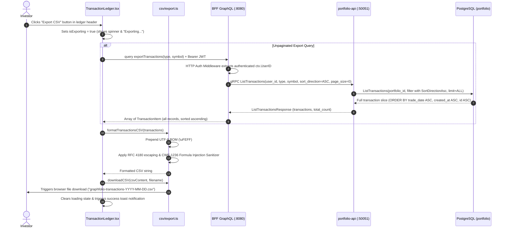

# Implementation Plan: Download Transactions from Transaction Ledger (Ascending Order)

> **Feature Reference**: Transaction Ledger Management & Investor Data Portability  
> **Status**: **COMPLETED**  
> **Story Reference**: [download-transactions-ledger.md](file:///Users/oscargarcia/workspace/graphfolio/docs/user-stories/download-transactions-ledger.md) (`US-TX-103`)  
> **Roadmap Reference**: [FEATURES.md (Section 3.6)](file:///Users/oscargarcia/workspace/graphfolio/FEATURES.md)  
> **Calculation Standard**: [financial-calculations skill](file:///Users/oscargarcia/workspace/graphfolio/.agents/skills/financial-calculations/SKILL.md) (Trade-Date Accounting, FIFO Tax Lot Relief, Chronological Cash Flow Sequences)  
> **Target Layers**: Protobuf (`proto/portfolio/v1/`), Database (`portfolio.transactions`), Portfolio Service (`services/portfolio-api`), BFF (`bff/`), Web Monorepo (`web/apps/main-app`, `web/packages/api-client`, `web/packages/ui`)  
> **Branch**: `feat/download-transactions-ledger`  

---

## 1. Executive Summary & Architectural Overview

The objective of this feature is to enable investors to export and download their complete historical transaction ledger from the **Transaction Ledger** page (`web/apps/main-app/src/components/TransactionLedger.tsx`) as an authoritative, machine-readable CSV file.

### 1.1 The Core Design Imperative: Strict Chronological Ascending Order
In the GraphFolio UI, transactions are intentionally displayed in **descending order** (`trade_date DESC, created_at DESC`) so that users immediately see their most recent trades and dividends at the top of the ledger.

However, for external financial systems, tax reporting platforms (e.g., Sharesight, myTax, BGL Simple Fund, CoinTracker), and spreadsheet models, **chronological ascending order (`trade_date ASC`, oldest first) is mandatory**:
1. **Tax Lot Allocation (FIFO / Average Cost)**: Cost basis relieve engines process buys and capital injections forward in time. An inverted export (newest first) causes sales to precede purchases, triggering negative inventory exceptions or invalid cost basis relieve.
2. **Cash Balance & Running Ledger Reconciliation**: Cash inflows (deposits, dividends, interest) must precede trade debits (buys, fees) on any given timeline.
3. **Data Portability**: If an investor imports their exported file back into GraphFolio or an external tracker, chronological sequence guarantees clean, deterministic execution.

### 1.2 End-to-End Sequence Diagram



---

## 2. Protocol Buffers Contract (`proto/portfolio/v1/portfolio.proto`)

### 2.1 Sort Direction Enum & Message Extensions

Update `proto/portfolio/v1/portfolio.proto`:
1. Define a `SortDirection` enum to support both UI descending pagination and export ascending retrieval.
2. Add `sort_direction` to `ListTransactionsRequest`.
3. Enrich `TransactionItem` with `withholding_tax`, `fx_rate_to_base`, and `external_ref` to ensure the exported CSV provides complete financial fidelity.

```protobuf
enum SortDirection {
  SORT_DIRECTION_UNSPECIFIED = 0;
  SORT_DIRECTION_DESC        = 1; // Default: newest first for UI display
  SORT_DIRECTION_ASC         = 2; // Chronological: oldest first for export/audit
}

message ListTransactionsRequest {
  string          user_id        = 1;
  TransactionType type           = 2; // optional filter (0 = all)
  string          symbol         = 3; // optional symbol filter
  int32           page           = 4; // 1-indexed, default 1
  int32           page_size      = 5; // default 20, max 100 (0 = unpaginated / return all)
  SortDirection   sort_direction = 6; // optional sort direction
}

message TransactionItem {
  string            id                  = 1;
  TransactionType   type                = 2;
  string            symbol              = 3; // empty for cash events
  string            instrument_name     = 4;
  string            trade_date          = 5; // YYYY-MM-DD
  common.v1.Decimal quantity            = 6; // nullable
  common.v1.Money   price               = 7; // nullable
  common.v1.Money   amount              = 8;
  common.v1.Money   fee                 = 9;
  string            notes               = 10;
  string            created_at          = 11;
  common.v1.Money   withholding_tax     = 12; // newly exposed
  common.v1.Decimal fx_rate_to_base     = 13; // newly exposed
  string            external_ref        = 14; // newly exposed
}
```

---

## 3. Portfolio API Microservice (`services/portfolio-api`)

### 3.1 Domain Model Updates (`internal/domain/transaction.go`)

Update `TransactionFilter` and define sort direction constants:

```go
type SortDirection string

const (
    SortDirectionDesc SortDirection = "DESC"
    SortDirectionAsc  SortDirection = "ASC"
)

type TransactionFilter struct {
    Type          *TransactionType
    Symbol        *string
    Page          int
    PageSize      int
    SortDirection SortDirection
}
```

### 3.2 SQL Query Updates (`internal/repository/queries.go`)

Extend SQL queries in `queries.go` to support both descending and ascending ordering, and handle unpaginated export requests:

```go
const (
    listTransactionsDescSQL = `
SELECT 
    t.id, t.portfolio_id, t.instrument_id, t.type, t.trade_date,
    t.quantity, t.price, t.amount, t.currency_code, t.fee,
    t.withholding_tax, t.fx_rate_to_base, t.external_ref, t.notes,
    t.created_at, i.symbol, i.name AS instrument_name,
    t.fee_currency_code,
    COUNT(*) OVER() AS total_count
FROM portfolio.transactions t
LEFT JOIN portfolio.instruments i ON i.id = t.instrument_id
WHERE t.portfolio_id = $1
  AND ($2::text IS NULL OR t.type::text = $2)
  AND (
    $3::text IS NULL 
    OR UPPER(i.symbol) = UPPER($3)
    OR UPPER(i.symbol) = UPPER($3) || '.AX'
    OR (UPPER($3) LIKE '%.AX' AND UPPER(i.symbol) = UPPER(REPLACE($3, '.AX', '')))
    OR (UPPER($3) LIKE '%.ASX' AND UPPER(i.symbol) = UPPER(REPLACE($3, '.ASX', '')) || '.AX')
    OR (UPPER($3) LIKE '%.ASX' AND UPPER(i.symbol) = UPPER(REPLACE($3, '.ASX', '')))
  )
ORDER BY t.trade_date DESC, t.created_at DESC, t.id DESC
LIMIT $4 OFFSET $5;`

    listTransactionsAscSQL = `
SELECT 
    t.id, t.portfolio_id, t.instrument_id, t.type, t.trade_date,
    t.quantity, t.price, t.amount, t.currency_code, t.fee,
    t.withholding_tax, t.fx_rate_to_base, t.external_ref, t.notes,
    t.created_at, i.symbol, i.name AS instrument_name,
    t.fee_currency_code,
    COUNT(*) OVER() AS total_count
FROM portfolio.transactions t
LEFT JOIN portfolio.instruments i ON i.id = t.instrument_id
WHERE t.portfolio_id = $1
  AND ($2::text IS NULL OR t.type::text = $2)
  AND (
    $3::text IS NULL 
    OR UPPER(i.symbol) = UPPER($3)
    OR UPPER(i.symbol) = UPPER($3) || '.AX'
    OR (UPPER($3) LIKE '%.AX' AND UPPER(i.symbol) = UPPER(REPLACE($3, '.AX', '')))
    OR (UPPER($3) LIKE '%.ASX' AND UPPER(i.symbol) = UPPER(REPLACE($3, '.ASX', '')) || '.AX')
    OR (UPPER($3) LIKE '%.ASX' AND UPPER(i.symbol) = UPPER(REPLACE($3, '.ASX', '')))
  )
ORDER BY 
    t.trade_date ASC,
    CASE t.type
        WHEN 'DEPOSIT' THEN 1
        WHEN 'TRANSFER_IN' THEN 2
        WHEN 'BUY' THEN 3
        WHEN 'SPLIT' THEN 4
        WHEN 'DIVIDEND' THEN 5
        WHEN 'INTEREST' THEN 6
        WHEN 'SELL' THEN 7
        WHEN 'TRANSFER_OUT' THEN 8
        WHEN 'FEE' THEN 9
        WHEN 'TAX' THEN 10
        WHEN 'WITHDRAWAL' THEN 11
        ELSE 12
    END,
    t.created_at ASC,
    t.id ASC
LIMIT $4 OFFSET $5;`
)
```

### 3.3 Repository Implementation (`internal/repository/postgres.go`)

Update `ListTransactions`:
- If `filter.PageSize <= 0`, set `limit = 100000` (or `NULL`) and `offset = 0` to return all matching transactions.
- Route to `listTransactionsAscSQL` when `filter.SortDirection == domain.SortDirectionAsc`.
- Otherwise default to `listTransactionsDescSQL`.

```go
func (r *PostgresRepository) ListTransactions(ctx context.Context, portfolioID uuid.UUID, filter domain.TransactionFilter) ([]domain.TransactionWithInstrument, int, error) {
    var limit int
    var offset int

    if filter.PageSize <= 0 {
        // Unpaginated export mode: retrieve all matching transactions
        limit = 100000
        offset = 0
    } else {
        page := filter.Page
        if page < 1 {
            page = 1
        }
        pageSize := filter.PageSize
        if pageSize > 100 {
            pageSize = 100
        }
        limit = pageSize
        offset = (page - 1) * pageSize
    }

    var typeFilter *string
    if filter.Type != nil && *filter.Type != "" {
        s := string(*filter.Type)
        typeFilter = &s
    }

    query := listTransactionsDescSQL
    if filter.SortDirection == domain.SortDirectionAsc {
        query = listTransactionsAscSQL
    }

    rows, err := r.pool.Query(ctx, query, portfolioID, typeFilter, filter.Symbol, limit, offset)
    if err != nil {
        return nil, 0, fmt.Errorf("repository: list transactions failed: %w", err)
    }
    defer rows.Close()

    var items []domain.TransactionWithInstrument
    totalCount := 0
    for rows.Next() {
        var item domain.TransactionWithInstrument
        var txType string
        var count int
        err := rows.Scan(
            &item.ID,
            &item.PortfolioID,
            &item.InstrumentID,
            &txType,
            &item.TradeDate,
            &item.Quantity,
            &item.Price,
            &item.Amount,
            &item.CurrencyCode,
            &item.Fee,
            &item.WithholdingTax,
            &item.FXRateToBase,
            &item.ExternalRef,
            &item.Notes,
            &item.CreatedAt,
            &item.Symbol,
            &item.InstrumentName,
            &item.FeeCurrencyCode,
            &count,
        )
        if err != nil {
            return nil, 0, fmt.Errorf("repository: scan transaction failed: %w", err)
        }
        item.Type = domain.TransactionType(txType)
        totalCount = count
        items = append(items, item)
    }

    return items, totalCount, rows.Err()
}
```

### 3.4 gRPC Server Adapter (`internal/server.go`)

Update `ListTransactions` in `server.go`:
- Map proto `req.SortDirection` to domain `SortDirection`.
- Populate proto `withholding_tax`, `fx_rate_to_base`, and `external_ref` on each `TransactionItem`.

---

## 4. GraphQL BFF Orchestrator (`bff/`)

### 4.1 Schema Definition (`bff/graph/schema.graphqls`)

1. Define `SortDirection` enum.
2. Add `sortDirection` argument to `transactions` query.
3. Add dedicated `exportTransactions` query for unpaginated ascending retrieval.
4. Add missing financial fields to `TransactionItem`:

```graphql
enum SortDirection {
  ASC
  DESC
}

type TransactionItem {
  id: ID!
  type: TransactionType!
  symbol: String
  instrumentName: String
  tradeDate: String!
  quantity: Decimal
  price: Money
  amount: Money!
  fee: Money!
  notes: String
  createdAt: String!
  withholdingTax: Money
  fxRateToBase: Decimal
  externalRef: String
}

extend type Query {
  transactions(
    type: TransactionType
    symbol: String
    page: Int = 1
    pageSize: Int = 20
    sortDirection: SortDirection = DESC
  ): TransactionsConnection!

  exportTransactions(
    type: TransactionType
    symbol: String
  ): [TransactionItem!]!
}
```

### 4.2 Resolvers (`bff/graph/schema.resolvers.go`)

1. **`transactions` Resolver**:
   - Translate GraphQL `SortDirection` to protobuf `SortDirection`.
2. **`exportTransactions` Resolver**:
   - Invoke gRPC `ListTransactions` with `page_size = 0` and `sort_direction = SORT_DIRECTION_ASC`.
   - Return items slice directly.

---

## 5. Web Application Layer (`web/apps/main-app`)

### 5.1 CSV Export & Sanitization Service (`src/services/csv/export.ts`)

Create a dedicated CSV export utility adhering to RFC 4180, UTF-8 BOM, and formula injection prevention ([CWE-1236](https://cwe.mitre.org/data/definitions/1236.html)):

```typescript
import { TransactionItem } from '../../components/TransactionLedger';

/**
 * Escapes a single CSV field following RFC 4180 rules:
 * 1. Sanitizes dangerous formula prefixes (=, +, -, @, \t, \r) by prepending a single quote.
 * 2. Escapes double quotes by doubling them ("" -> """").
 * 3. Wraps value in double quotes if it contains commas, quotes, or newlines.
 */
export function escapeCSVField(value: string | number | null | undefined): string {
  if (value === null || value === undefined) {
    return '';
  }
  let str = String(value);

  // Formula injection prevention (CWE-1236)
  if (/^[=+\-@\t\r]/.test(str)) {
    str = `'${str}`;
  }

  // Check if quoting is needed
  if (str.includes('"') || str.includes(',') || str.includes('\n') || str.includes('\r')) {
    return `"${str.replace(/"/g, '""')}"`;
  }
  return str;
}

/**
 * Formats a list of transactions into an authoritative RFC 4180 CSV string.
 * Prepends UTF-8 BOM (\uFEFF) to guarantee correct rendering in Microsoft Excel.
 */
export function formatTransactionsCSV(transactions: TransactionItem[]): string {
  // Sort ascending by trade date as a client-side safety invariant
  const sorted = [...transactions].sort((a, b) => {
    const diff = a.tradeDate.localeCompare(b.tradeDate);
    if (diff !== 0) return diff;
    return (a.createdAt || '').localeCompare(b.createdAt || '');
  });

  const headers = [
    'Date',
    'Type',
    'Symbol',
    'Instrument Name',
    'Quantity',
    'Price',
    'Currency',
    'Gross Amount',
    'Net Amount',
    'Fee',
    'Fee Currency',
    'Withholding Tax',
    'FX Rate to Base',
    'External Reference',
    'Notes',
  ];

  const rows: string[] = [headers.join(',')];

  for (const tx of sorted) {
    const currency = tx.amount?.currencyCode || tx.price?.currencyCode || '';
    const feeCurrency = tx.fee?.currencyCode || currency;
    
    // Calculate net cash flow (inflow is positive, outflow is negative)
    const grossAmount = tx.amount?.amount || '0.00';
    let netAmount = grossAmount;
    if (['BUY', 'WITHDRAWAL', 'FEE', 'TAX'].includes(tx.type)) {
      netAmount = `-${grossAmount}`;
    }

    const row = [
      escapeCSVField(tx.tradeDate),
      escapeCSVField(tx.type),
      escapeCSVField(tx.symbol || ''),
      escapeCSVField(tx.instrumentName || (tx.symbol ? '' : 'Cash')),
      escapeCSVField(tx.quantity || ''),
      escapeCSVField(tx.price?.amount || ''),
      escapeCSVField(currency),
      escapeCSVField(grossAmount),
      escapeCSVField(netAmount),
      escapeCSVField(tx.fee?.amount || '0.00'),
      escapeCSVField(feeCurrency),
      escapeCSVField((tx as any).withholdingTax?.amount || '0.00'),
      escapeCSVField((tx as any).fxRateToBase || '1.000000'),
      escapeCSVField((tx as any).externalRef || ''),
      escapeCSVField(tx.notes || ''),
    ];
    rows.push(row.join(','));
  }

  // Prepend UTF-8 BOM
  return `\uFEFF${rows.join('\r\n')}`;
}

/**
 * Triggers a browser file download from a CSV content string using Blob API.
 */
export function downloadCSV(content: string, filename: string): void {
  const blob = new Blob([content], { type: 'text/csv;charset=utf-8;' });
  const url = URL.createObjectURL(blob);
  const link = document.createElement('a');
  link.href = url;
  link.setAttribute('download', filename);
  document.body.appendChild(link);
  link.click();
  document.body.removeChild(link);
  URL.revokeObjectURL(url);
}
```

### 5.2 Unit Tests (`src/services/csv/export.test.ts`)
Write comprehensive unit tests covering:
- RFC 4180 escaping (commas, double quotes, newlines).
- Formula injection protection (prepending `'` to `=`, `+`, `-`, `@`).
- UTF-8 BOM presence (`\uFEFF`).
- Strict chronological ascending sorting (`tradeDate ASC`, oldest first).
- Split transaction formatting.
- Multi-currency transactions and fee preservation.

### 5.3 UI Integration in `TransactionLedger.tsx`

1. **State**:
   ```typescript
   const [isExporting, setIsExporting] = useState(false);
   const [exportSuccessMessage, setExportSuccessMessage] = useState<string | null>(null);
   ```

2. **Export Handler**:
   ```typescript
   const handleExportCSV = async () => {
     if (isExporting || totalCount === 0) return;
     setIsExporting(true);

     try {
       const args: any = {};
       if (selectedType) args.type = selectedType;
       const trimmed = symbolQuery.trim();
       if (trimmed) args.symbol = trimmed.toUpperCase();

       const res = await client.query({
         exportTransactions: {
           __args: args,
           id: true,
           type: true,
           symbol: true,
           instrumentName: true,
           tradeDate: true,
           quantity: true,
           price: { amount: true, currencyCode: true },
           amount: { amount: true, currencyCode: true },
           fee: { amount: true, currencyCode: true },
           withholdingTax: { amount: true, currencyCode: true },
           fxRateToBase: true,
           externalRef: true,
           notes: true,
           createdAt: true,
         },
       });

       const items = res.exportTransactions || [];
       if (items.length === 0) {
         return;
       }

       const csvContent = formatTransactionsCSV(items);
       const dateStr = new Date().toISOString().split('T')[0];
       let filename = `graphfolio-transactions-${dateStr}.csv`;
       if (trimmed) {
         filename = `graphfolio-transactions-${trimmed.toLowerCase()}-${dateStr}.csv`;
       } else if (selectedType) {
         filename = `graphfolio-transactions-${selectedType.toLowerCase()}-${dateStr}.csv`;
       }

       downloadCSV(csvContent, filename);
       setExportSuccessMessage(`Exported ${items.length} transactions successfully.`);
       setTimeout(() => setExportSuccessMessage(null), 4000);
     } catch (err: any) {
       console.error('Failed to export transactions:', err);
       setError('Failed to export transactions. Please try again.');
     } finally {
       setIsExporting(false);
     }
   };
   ```

3. **Header Actions Toolbar**:
   ```tsx
   <div className="ledger-header-actions">
     <button
       type="button"
       className="btn-export-csv"
       onClick={handleExportCSV}
       disabled={isExporting || totalCount === 0}
       title="Download complete transaction history sorted chronologically (oldest first)"
     >
       {isExporting ? (
         <>
           <span className="spinner-sm" /> Exporting...
         </>
       ) : (
         <>
           <span className="btn-icon">📤</span> Export CSV
         </>
       )}
     </button>
     
     {onOpenImportModal && (
       <button
         type="button"
         className="btn-import-csv"
         onClick={onOpenImportModal}
         title="Import trades from CommSec or nabtrade CSV"
       >
         📥 Import CSV
       </button>
     )}
   </div>
   ```

### 5.4 Styling Tokens (`TransactionLedger.css`)
- Style `.ledger-header-actions` with `display: flex; gap: 0.75rem; align-items: center;`.
- Style `.btn-export-csv` matching GraphFolio's dark glassmorphic button styling (`background: rgba(255, 255, 255, 0.05)`, border `rgba(255, 255, 255, 0.12)`, hover state with gradient glow).
- Add micro-animation for `.spinner-sm`.

---

## 6. Step-by-Step Implementation Tasks

```mermaid
gantt
    title Transaction Ledger CSV Download Implementation
    dateFormat  X
    axisFormat %s
    section 1. Contract & Backend
    Update Protobuf & Generate Go/BFF code      :active, 0, 1
    Implement Repository Ascending SQL Queries  :1, 2
    Update Portfolio Service & gRPC Server      :2, 3
    section 2. BFF Layer
    Update GraphQL Schema & Types               :3, 4
    Implement BFF exportTransactions Resolver   :4, 5
    section 3. Frontend Web
    Implement CSV Export & Sanitizer Utility    :5, 6
    Add Unit Tests for CSV Builder              :6, 7
    Update TransactionLedger UI & CSS           :7, 8
    section 4. Verification & E2E
    End-to-End Testing & Verification           :8, 9
```



### Phase 1: Contract & Domain Microservice
- [ ] **Task 1.1**: Update `proto/portfolio/v1/portfolio.proto`:
  - Add `SortDirection` enum.
  - Add `sort_direction` to `ListTransactionsRequest`.
  - Add `withholding_tax`, `fx_rate_to_base`, and `external_ref` to `TransactionItem`.
  - Run `make proto` to generate protobuf Go code.
- [ ] **Task 1.2**: Update `services/portfolio-api/internal/domain/transaction.go`:
  - Add `SortDirection` type and constants.
  - Update `TransactionFilter` struct.
- [ ] **Task 1.3**: Update `services/portfolio-api/internal/repository/queries.go`:
  - Add `listTransactionsAscSQL` with lifecycle tie-breakers.
- [ ] **Task 1.4**: Update `services/portfolio-api/internal/repository/postgres.go`:
  - Support `SortDirectionAsc` and `PageSize <= 0` (unpaginated export mode).
- [ ] **Task 1.5**: Update `services/portfolio-api/internal/server.go`:
  - Handle `SortDirection` and populate enriched `TransactionItem` fields.
- [ ] **Task 1.6**: Run backend unit tests: `go test -v ./...` in `services/portfolio-api`.

### Phase 2: BFF GraphQL Layer
- [ ] **Task 2.1**: Update `bff/graph/schema.graphqls`:
  - Add `SortDirection` enum.
  - Add `sortDirection` argument to `transactions`.
  - Add `exportTransactions` query.
  - Add `withholdingTax`, `fxRateToBase`, and `externalRef` to `TransactionItem`.
  - Re-generate GraphQL bindings: `go run github.com/99designs/gqlgen generate` in `bff/`.
- [ ] **Task 2.2**: Implement `exportTransactions` and `sortDirection` in `bff/graph/schema.resolvers.go`.
- [ ] **Task 2.3**: Update BFF unit tests in `bff/graph/schema.resolvers_test.go`.
- [ ] **Task 2.4**: Run `go test -v ./...` in `bff/`.

### Phase 3: Web Application Monorepo
- [ ] **Task 3.1**: Re-generate GraphQL client in `web/packages/api-client` (`npm run generate`).
- [ ] **Task 3.2**: Create `web/apps/main-app/src/services/csv/export.ts`:
  - Implement `escapeCSVField` with CWE-1236 sanitizer.
  - Implement `formatTransactionsCSV` with UTF-8 BOM and ascending sort invariant.
  - Implement `downloadCSV` with Blob & Object URL cleanup.
- [ ] **Task 3.3**: Create unit tests in `web/apps/main-app/src/services/csv/export.test.ts`.
- [ ] **Task 3.4**: Update `web/apps/main-app/src/components/TransactionLedger.tsx`:
  - Add "Export CSV" button, state, and click handler.
  - Render success toast banner upon download.
- [ ] **Task 3.5**: Update `web/apps/main-app/src/components/TransactionLedger.css`:
  - Add layout and glassmorphic styling for `.btn-export-csv` and `.ledger-header-actions`.

### Phase 4: Testing & Verification
- [ ] **Task 4.1**: Execute frontend tests: `npm test` in `web/apps/main-app`.
- [ ] **Task 4.2**: Execute workspace linting: `npm run lint`.
- [ ] **Task 4.3**: End-to-end verification via Browser Subagent / Playwright:
  - Verify "Export CSV" button renders next to "Import CSV".
  - Click "Export CSV" on a populated portfolio and verify downloaded file:
    - First transaction row is the oldest recorded trade date.
    - Last transaction row is the most recent trade date.
    - All 15 columns are properly formatted and escaped.
  - Apply filter (e.g., Ticker `AAPL`), click export, and verify only matching rows are downloaded.

---

## 7. Quality Gates & Acceptance Verification Matrix

| Test Scenario | Input / Action | Expected Result | Layer Verified |
| :--- | :--- | :--- | :--- |
| **Strict Ascending Sort** | Export portfolio with trades from 2023, 2024, 2025 | CSV rows are ordered from 2023 to 2025 (`trade_date ASC`). | Repo, Service, CSV builder |
| **Same-Date Tie Breaking** | Same-day DEPOSIT ($10,000) and BUY ($5,000 AAPL) | DEPOSIT appears before BUY in CSV. | Repo (`listTransactionsAscSQL`) |
| **Pagination Bypass** | Portfolio with 65 transactions (4 UI pages) | Downloaded CSV contains 65 transactions (66 rows with header). | BFF & Service |
| **Symbol Filter** | Search `BHP.AX` and click "Export CSV" | File contains only BHP trades, named `graphfolio-transactions-bhp.ax-YYYY-MM-DD.csv`. | UI & BFF |
| **Formula Sanitization** | Note: `=SUM(A1:B10)` or `@malicious` | Field is escaped as `"'=SUM(A1:B10)"` (prefixed with `'`). | `export.ts` unit test |
| **UTF-8 BOM Header** | Company name `L'Oréal` or currency `€` | Opens in Microsoft Excel without character mangling. | CSV file inspection |
| **Empty State** | Portfolio with 0 transactions | "Export CSV" button is disabled. | UI state |
