# Implementation Plan: In-Place Transaction Editing in Transaction Ledger

> **Feature Reference**: Transaction Ledger Management & Portfolio Accounting Integrity  
> **Status**: **READY FOR IMPLEMENTATION**  
> **Story Reference**: [edit-transaction-ledger.md](file:///Users/oscargarcia/workspace/graphfolio/docs/user-stories/edit-transaction-ledger.md) (`US-TX-102`)  
> **Roadmap Reference**: [FEATURES.md (Feature #37)](file:///Users/oscargarcia/workspace/graphfolio/FEATURES.md)  
> **Calculation Standard**: [financial-calculations skill](file:///Users/oscargarcia/workspace/graphfolio/.agents/skills/financial-calculations/SKILL.md) (FIFO Tax Lot Relief, Negative Inventory Guard, GIPS® Daily Valuation Replay)  
> **Target Layers**: Protobuf (`proto/portfolio/v1/`), Database (`portfolio.transactions`, `portfolio.tax_lots`, `portfolio.projections_holdings`), Portfolio Service (`services/portfolio-api`), BFF (`bff/`), Web Monorepo (`web/apps/main-app`, `web/packages/api-client`, `web/packages/ui`)  
> **Branch**: `feat/edit-transaction`  

---

## 1. Executive Summary & Architectural Overview

The objective of this feature is to empower authenticated investors to edit previously recorded transactions directly in the **Transaction Ledger** without having to delete and re-create them.

Because GraphFolio operates an event-sourced ledger projection engine, modifying any transaction parameter (quantity, price, trade date, fees, currency, or ticker) requires deterministic re-evaluation of downstream financial state:
1. **Tax Lot Allocation**: FIFO relief queues must be unrolled and re-matched chronologically.
2. **Negative Inventory Prevention**: Edits must be pre-validated to ensure share inventory never drops below zero ($Q(t) \ge 0$) at any point in history.
3. **Valuation History Re-anchoring**: Daily valuation snapshots (`portfolio.portfolio_valuations`) must be backfilled from the earliest affected date $\min(T_{\text{old}}, T_{\text{new}})$ through today.
4. **Immediate UI Feedback**: The Transaction Ledger and Dashboard summary cards must update immediately without requiring a full browser refresh.

---

### 1.1 End-to-End Sequence Diagram

```mermaid
sequenceDiagram
    autonumber
    actor Investor as Investor
    participant Web as Main App<br/>(TransactionLedger & Modal)
    participant BFF as BFF GraphQL (:8080)
    participant Svc as portfolio-api (:50051)
    participant Repo as PostgreSQL (portfolio)
    participant Engine as ProcessLedger Engine
    participant ValSvc as Valuation Backfill

    Investor->>Web: Clicks "Edit" icon (pencil) on ledger row
    Web->>Web: Opens EditTransactionModal pre-populated with TransactionItem
    Investor->>Web: Adjusts fields (e.g. Price from $15.00 to $150.00) & clicks "Save Changes"
    Web->>BFF: mutation updateTransaction(id: $id, input: $input) + Bearer JWT
    BFF->>BFF: HTTP Auth Middleware resolves authenticated ctx.UserID
    BFF->>Svc: gRPC UpdateTransaction(UpdateTransactionRequest)

    rect rgb(20, 25, 35)
        Note over Svc,Repo: Atomic Database Transaction with Row Lock
        Svc->>Repo: Fetch existing transaction (T_old, inst_old, qty_old)
        Svc->>Svc: Validate input & simulate ledger replay (Negative Inventory Guard)
        Svc->>Repo: UPDATE portfolio.transactions SET ... WHERE id = $id AND portfolio_id = $pid
        Svc->>Engine: Replay transactions chronologically from inception
        Engine->>Repo: SaveProjectionsTx (recalculated lots, disposals, holdings, cash)
    end

    Svc->>ValSvc: BackfillPortfolioValuations(portfolio_id, min(T_old, T_new))
    Svc->>Repo: Fetch newly projected PortfolioSummary
    Svc-->>BFF: UpdateTransactionResponse (updatedTx, updatedPortfolio)
    BFF-->>Web: UpdateTransactionPayload (success, transaction, portfolio)
    Web->>Web: Closes modal, renders success toast, updates ledger row & dashboard cards
    Web-->>Investor: Displays updated portfolio state
```



---

### 1.2 Risk Analysis & Architectural Guarantees

1. **Short-Sale & Negative Inventory Safety**:
   - *Risk*: A user reduces a historical BUY quantity or moves a BUY date after a subsequent SELL date, which would leave the portfolio with negative shares for an interim window.
   - *Mitigation*: The service executes a simulation pass of `ProcessLedger`. If any interim share balance drops below zero ($Q_i(t) < 0$), the entire database transaction is rolled back and an explicit error `codes.FailedPrecondition` is returned:
     `"Cannot update transaction: trade modification causes negative share inventory (-15.0000000000 shares of AAPL on 2025-04-12)"`.

2. **Concurrency & Race Condition Serialization**:
   - *Risk*: Concurrent edits or statement imports replaying projections simultaneously could cause dirty reads or duplicate lots.
   - *Mitigation*: The existing `SaveProjectionsTx` executes `SELECT id FROM portfolio.portfolios WHERE id = $1 FOR UPDATE`. This ensures strict serial execution per portfolio.

3. **Valuation History Completeness**:
   - *Risk*: Moving a transaction date backward (e.g. from October to August) leaves old valuation snapshots between August and October with obsolete cost basis and cash balances.
   - *Mitigation*: The earliest valuation date is calculated as:
     $$T_{\text{earliest}} = \min(T_{\text{trade, old}}, \, T_{\text{trade, new}})$$
     The valuation service runs `BackfillPortfolioValuations(portfolio_id, T_{\text{earliest}})`, overwriting daily snapshots up to current EOD.

4. **Zero Floating-Point Drift**:
   - *Requirement*: Strict arbitrary precision fixed-point arithmetic (`shopspring/decimal.Decimal` in Go, custom `Decimal` scalar in GraphQL). Zero IEEE-754 binary floats allowed.

---

## 2. Protocol Buffers Contract (`proto/portfolio/v1/portfolio.proto`)

### 2.1 Service & RPC Definitions

Extend `PortfolioService` in [proto/portfolio/v1/portfolio.proto](file:///Users/oscargarcia/workspace/graphfolio/proto/portfolio/v1/portfolio.proto):

```protobuf
service PortfolioService {
  // Existing RPCs
  rpc AddTransaction(AddTransactionRequest) returns (AddTransactionResponse) {}
  rpc ListTransactions(ListTransactionsRequest) returns (ListTransactionsResponse) {}
  rpc DeleteTransaction(DeleteTransactionRequest) returns (DeleteTransactionResponse) {}

  // New RPC:
  rpc UpdateTransaction(UpdateTransactionRequest) returns (UpdateTransactionResponse) {}
}

message UpdateTransactionRequest {
  string                    user_id           = 1;
  string                    transaction_id    = 2;
  TransactionType           type              = 3;
  string                    trade_date        = 4; // YYYY-MM-DD
  optional string           symbol            = 5; // e.g. "AAPL" (optional for DEPOSIT/WITHDRAWAL)
  optional common.v1.Decimal quantity         = 6; // Required for BUY/SELL/SPLIT
  optional common.v1.Money  price             = 7; // Unit price
  common.v1.Money           amount            = 8; // Total cash flow / value
  optional common.v1.Money  fee               = 9; // Brokerage fee
  optional string           notes             = 10;
  optional common.v1.Decimal fx_rate_to_base  = 11; // Optional manual override
}

message UpdateTransactionResponse {
  bool                      success           = 1;
  TransactionItem           transaction       = 2;
  Portfolio                 portfolio         = 3; // Recomputed portfolio snapshot
}
```

### 2.2 Compilation Command
```bash
make proto-all
```
This updates Go pb packages in `pkg/` and service modules.

---

## 3. Database & Repository Layer (`services/portfolio-api`)

### 3.1 SQL Queries (`internal/repository/queries.go`)

Add query definitions for fetching and updating transactions:

```go
const (
    getTransactionByIDSQL = `
SELECT 
    id, portfolio_id, instrument_id, type, trade_date, quantity, price, amount,
    currency_code, fee, withholding_tax, fx_rate_to_base, external_ref, notes,
    fee_currency_code
FROM portfolio.transactions
WHERE id = $1 AND portfolio_id = $2;`

    updateTransactionSQL = `
UPDATE portfolio.transactions
SET 
    instrument_id    = $1,
    type             = $2::portfolio.transaction_type,
    trade_date       = $3,
    quantity         = $4,
    price            = $5,
    amount           = $6,
    currency_code    = $7,
    fee              = $8,
    fee_currency_code = $9,
    fx_rate_to_base  = $10,
    notes            = $11
WHERE id = $12 AND portfolio_id = $13
RETURNING id, portfolio_id, instrument_id, type, trade_date, quantity, price, amount,
          currency_code, fee, withholding_tax, fx_rate_to_base, external_ref, notes, fee_currency_code;`
)
```

### 3.2 Repository Interface (`internal/repository/repository.go`)

Extend the `Repository` interface:

```go
type Repository interface {
    // Existing methods ...
    InsertTransaction(ctx context.Context, tx domain.Transaction) (*domain.Transaction, error)
    DeleteTransaction(ctx context.Context, portfolioID uuid.UUID, transactionID uuid.UUID) error
    ListTransactions(ctx context.Context, portfolioID uuid.UUID, filter domain.TransactionFilter) ([]domain.TransactionWithInstrument, int, error)

    // New methods:
    GetTransactionByID(ctx context.Context, portfolioID uuid.UUID, transactionID uuid.UUID) (*domain.Transaction, error)
    UpdateTransaction(ctx context.Context, portfolioID uuid.UUID, tx domain.Transaction) (*domain.Transaction, error)
}
```

### 3.3 Postgres Implementation (`internal/repository/postgres.go`)

Implement `GetTransactionByID` and `UpdateTransaction`:

```go
func (r *PostgresRepository) GetTransactionByID(ctx context.Context, portfolioID uuid.UUID, transactionID uuid.UUID) (*domain.Transaction, error) {
    row := r.pool.QueryRow(ctx, getTransactionByIDSQL, transactionID, portfolioID)

    var tx domain.Transaction
    var txType string
    err := row.Scan(
        &tx.ID,
        &tx.PortfolioID,
        &tx.InstrumentID,
        &txType,
        &tx.TradeDate,
        &tx.Quantity,
        &tx.Price,
        &tx.Amount,
        &tx.CurrencyCode,
        &tx.Fee,
        &tx.WithholdingTax,
        &tx.FXRateToBase,
        &tx.ExternalRef,
        &tx.Notes,
        &tx.FeeCurrencyCode,
    )
    if err != nil {
        if errors.Is(err, pgx.ErrNoRows) {
            return nil, ErrTransactionNotFound
        }
        return nil, fmt.Errorf("repository: get transaction failed: %w", err)
    }
    tx.Type = domain.TransactionType(txType)
    return &tx, nil
}

func (r *PostgresRepository) UpdateTransaction(ctx context.Context, portfolioID uuid.UUID, tx domain.Transaction) (*domain.Transaction, error) {
    row := r.pool.QueryRow(ctx, updateTransactionSQL,
        tx.InstrumentID,
        string(tx.Type),
        tx.TradeDate,
        tx.Quantity,
        tx.Price,
        tx.Amount,
        tx.CurrencyCode,
        tx.Fee,
        tx.FeeCurrencyCode,
        tx.FXRateToBase,
        tx.Notes,
        tx.ID,
        portfolioID,
    )

    var updated domain.Transaction
    var txType string
    err := row.Scan(
        &updated.ID,
        &updated.PortfolioID,
        &updated.InstrumentID,
        &txType,
        &updated.TradeDate,
        &updated.Quantity,
        &updated.Price,
        &updated.Amount,
        &updated.CurrencyCode,
        &updated.Fee,
        &updated.WithholdingTax,
        &updated.FXRateToBase,
        &updated.ExternalRef,
        &updated.Notes,
        &updated.FeeCurrencyCode,
    )
    if err != nil {
        if errors.Is(err, pgx.ErrNoRows) {
            return nil, ErrTransactionNotFound
        }
        return nil, fmt.Errorf("repository: update transaction failed: %w", err)
    }
    updated.Type = domain.TransactionType(txType)
    return &updated, nil
}
```

---

## 4. Domain & Service Business Logic (`services/portfolio-api`)

### 4.1 Domain Types (`internal/domain/transaction.go`)

Define input structure for transaction updates:

```go
type UpdateTransactionInput struct {
    UserID          string
    TransactionID   string
    Type            TransactionType
    TradeDate       time.Time
    Symbol          *string
    Quantity        *decimal.Decimal
    Price           *decimal.Decimal
    Amount          decimal.Decimal
    CurrencyCode    *string
    Fee             *decimal.Decimal
    FeeCurrencyCode *string
    Notes           *string
    FXRateToBase    *decimal.Decimal
}
```

### 4.2 Service Interface & Implementation (`internal/service/transaction.go`)

Extend `PortfolioService` interface:
```go
UpdateTransaction(ctx context.Context, input domain.UpdateTransactionInput) (*domain.TransactionWithInstrument, *domain.PortfolioSummary, error)
```

Implement the business logic with the **Negative Inventory Guard**:

```go
func (s *portfolioService) UpdateTransaction(ctx context.Context, input domain.UpdateTransactionInput) (*domain.TransactionWithInstrument, *domain.PortfolioSummary, error) {
    userID := input.UserID
    if userID == "" {
        userID = "1"
    }

    txUUID, err := uuid.Parse(input.TransactionID)
    if err != nil {
        return nil, nil, fmt.Errorf("%w: invalid transaction id %q", repository.ErrTransactionNotFound, input.TransactionID)
    }

    portfolio, err := s.repo.FindPortfolioByUser(ctx, userID)
    if err != nil {
        return nil, nil, fmt.Errorf("service: find portfolio: %w", err)
    }

    // 1. Fetch current transaction to capture old parameters
    oldTx, err := s.repo.GetTransactionByID(ctx, portfolio.ID, txUUID)
    if err != nil {
        return nil, nil, fmt.Errorf("service: fetch existing transaction: %w", err)
    }

    // 2. Validate input constraints based on Type
    var instID *uuid.UUID
    var currencyCode string
    var instName string
    var symbol string

    switch input.Type {
    case domain.TxTypeBuy, domain.TxTypeSell:
        if input.Symbol == nil || *input.Symbol == "" {
            return nil, nil, fmt.Errorf("service: symbol is required for %s", input.Type)
        }
        if input.Quantity == nil || !input.Quantity.IsPositive() {
            return nil, nil, fmt.Errorf("service: positive quantity is required for %s", input.Type)
        }
        if input.Price == nil || input.Price.IsNegative() {
            return nil, nil, fmt.Errorf("service: price cannot be negative for %s", input.Type)
        }
        inst, err := s.repo.FindInstrumentBySymbol(ctx, *input.Symbol)
        if err != nil {
            return nil, nil, fmt.Errorf("service: find instrument %s: %w", *input.Symbol, err)
        }
        instID = &inst.ID
        currencyCode = inst.CurrencyCode
        instName = inst.Name
        symbol = inst.Symbol

    case domain.TxTypeDividend:
        if input.Symbol == nil || *input.Symbol == "" {
            return nil, nil, fmt.Errorf("service: symbol is required for DIVIDEND")
        }
        if !input.Amount.IsPositive() {
            return nil, nil, fmt.Errorf("service: positive amount is required for DIVIDEND")
        }
        inst, err := s.repo.FindInstrumentBySymbol(ctx, *input.Symbol)
        if err != nil {
            return nil, nil, fmt.Errorf("service: find instrument %s: %w", *input.Symbol, err)
        }
        instID = &inst.ID
        currencyCode = inst.CurrencyCode
        if input.CurrencyCode != nil && *input.CurrencyCode != "" {
            currencyCode = *input.CurrencyCode
        }
        instName = inst.Name
        symbol = inst.Symbol

    case domain.TxTypeDeposit, domain.TxTypeWithdrawal:
        if !input.Amount.IsPositive() {
            return nil, nil, fmt.Errorf("service: positive amount is required for %s", input.Type)
        }
        currencyCode = portfolio.BaseCurrency
        if input.CurrencyCode != nil && *input.CurrencyCode != "" {
            currencyCode = *input.CurrencyCode
        }

    case domain.TxTypeSplit:
        if input.Symbol == nil || *input.Symbol == "" {
            return nil, nil, fmt.Errorf("service: symbol is required for SPLIT")
        }
        if input.Quantity == nil || !input.Quantity.IsPositive() {
            return nil, nil, fmt.Errorf("service: positive split ratio is required for SPLIT")
        }
        inst, err := s.repo.FindInstrumentBySymbol(ctx, *input.Symbol)
        if err != nil {
            return nil, nil, fmt.Errorf("service: find instrument %s: %w", *input.Symbol, err)
        }
        instID = &inst.ID
        currencyCode = inst.CurrencyCode
        instName = inst.Name
        symbol = inst.Symbol
    }

    // 3. FX Rate lookup
    var fxRateToBase *decimal.Decimal = input.FXRateToBase
    if fxRateToBase == nil && currencyCode != portfolio.BaseCurrency {
        rate, err := s.repo.GetFXRate(ctx, currencyCode, portfolio.BaseCurrency)
        if err == nil && rate.IsPositive() {
            fxRateToBase = &rate
        }
    }

    fee := decimal.Zero
    if input.Fee != nil {
        if input.Fee.IsNegative() {
            return nil, nil, fmt.Errorf("service: fee cannot be negative")
        }
        fee = *input.Fee
    }
    feeCurrencyCode := currencyCode
    if input.FeeCurrencyCode != nil && *input.FeeCurrencyCode != "" {
        feeCurrencyCode = *input.FeeCurrencyCode
    }

    // 4. Construct proposed transaction
    proposedTx := domain.Transaction{
        ID:              txUUID,
        PortfolioID:     portfolio.ID,
        InstrumentID:    instID,
        Type:            input.Type,
        TradeDate:       input.TradeDate,
        Quantity:        input.Quantity,
        Price:           input.Price,
        Amount:          input.Amount,
        CurrencyCode:    currencyCode,
        Fee:             fee,
        FeeCurrencyCode: &feeCurrencyCode,
        FXRateToBase:    fxRateToBase,
        ExternalRef:     oldTx.ExternalRef, // Preserve external reference
        Notes:           input.Notes,
    }

    // 5. Negative Inventory Guard: dry-run ledger simulation
    allTxs, err := s.repo.GetTransactions(ctx, portfolio.ID)
    if err != nil {
        return nil, nil, fmt.Errorf("service: get transactions: %w", err)
    }
    simulatedTxs := make([]domain.Transaction, len(allTxs))
    for i, t := range allTxs {
        if t.ID == txUUID {
            simulatedTxs[i] = proposedTx
        } else {
            simulatedTxs[i] = t
        }
    }
    // Sort chronologically for replay
    sortTransactions(simulatedTxs)

    // Verify interim holding balances
    if err := validateNoNegativeInventory(simulatedTxs); err != nil {
        return nil, nil, err
    }

    // 6. Persist transaction update
    updatedTx, err := s.repo.UpdateTransaction(ctx, portfolio.ID, proposedTx)
    if err != nil {
        return nil, nil, fmt.Errorf("service: update transaction: %w", err)
    }

    // 7. Deterministic Projection Replay
    if err := s.RebuildProjections(ctx, userID); err != nil {
        return nil, nil, fmt.Errorf("service: rebuild projections: %w", err)
    }

    // 8. Valuation Backfill from min(oldTradeDate, newTradeDate)
    earliestDate := oldTx.TradeDate
    if input.TradeDate.Before(earliestDate) {
        earliestDate = input.TradeDate
    }
    if s.valuations != nil {
        _ = s.valuations.BackfillPortfolioValuations(ctx, portfolio.ID, earliestDate)
    }

    // 9. Fetch refreshed portfolio summary
    summary, err := s.GetPortfolioSummary(ctx, userID)
    if err != nil {
        return nil, nil, fmt.Errorf("service: get portfolio summary: %w", err)
    }

    resultItem := &domain.TransactionWithInstrument{
        Transaction:    *updatedTx,
        Symbol:         symbol,
        InstrumentName: instName,
    }

    return resultItem, summary, nil
}
```

### 4.3 gRPC Server Adapter (`internal/server.go`)

Implement `UpdateTransaction` handler:
- Unpack `req *portfoliov1.UpdateTransactionRequest`.
- Convert proto decimal/money fields using `decimalpb`.
- Call `s.portfolioService.UpdateTransaction`.
- Pack `UpdateTransactionResponse` with converted protobuf `TransactionItem` and `Portfolio`.

---

## 5. BFF GraphQL Orchestrator (`bff/`)

### 5.1 GraphQL Schema (`bff/graph/schema.graphqls`)

Add types and mutation:

```graphql
input UpdateTransactionInput {
  type: TransactionType!
  tradeDate: String! # YYYY-MM-DD
  symbol: String
  quantity: Decimal
  price: Decimal
  amount: Decimal!
  currencyCode: String
  fee: Decimal
  feeCurrencyCode: String
  notes: String
}

type UpdateTransactionPayload {
  success: Boolean!
  transaction: TransactionItem!
  portfolio: Portfolio!
}

extend type Mutation {
  updateTransaction(id: ID!, input: UpdateTransactionInput!): UpdateTransactionPayload!
}
```

### 5.2 Code Generation
```bash
cd bff && go run github.com/99designs/gqlgen generate
```

### 5.3 Resolver Implementation (`bff/graph/schema.resolvers.go`)

Implement `UpdateTransaction`:
1. Resolve authenticated user:
   ```go
   userID, err := resolveUserID(ctx)
   if err != nil {
       return nil, err
   }
   ```
2. Build `portfoliov1.UpdateTransactionRequest`:
   ```go
   req := &portfoliov1.UpdateTransactionRequest{
       UserId:        userID,
       TransactionId: id,
       Type:          mapGraphQLTypeToProto(input.Type),
       TradeDate:     input.TradeDate,
       Symbol:        input.Symbol,
       Quantity:      decimalpb.ToProtoDecimal(input.Quantity),
       Price:         decimalpb.ToProtoMoney(input.Price, input.CurrencyCode),
       Amount:        decimalpb.ToProtoMoney(input.Amount, input.CurrencyCode),
       Fee:           decimalpb.ToProtoMoney(input.Fee, input.FeeCurrencyCode),
       Notes:         input.Notes,
   }
   ```
3. Call `r.PortfolioClient.UpdateTransaction(ctx, req)`.
4. Return `&model.UpdateTransactionPayload{...}` with mapped GraphQL models.

---

## 6. Frontend Monorepo (`web/apps/main-app`)

### 6.1 Generated API Client (`web/packages/api-client`)

Re-run GenQL client generation after BFF schema update:
```bash
npm run generate:api-client
```

### 6.2 New Component: `EditTransactionModal.tsx`

Create `web/apps/main-app/src/components/EditTransactionModal.tsx`:
- **Props**:
  ```typescript
  interface EditTransactionModalProps {
    isOpen: boolean;
    transaction: TransactionItem;
    onClose: () => void;
    onSuccess: (updatedPortfolio: any, updatedTx: TransactionItem) => void;
    preferredCurrency?: string;
    supportedCurrencies?: CurrencyOption[];
  }
  ```
- **State Initialization**: Pre-populate fields from `transaction` prop:
  - `type`: `transaction.type`
  - `tradeDate`: `transaction.tradeDate`
  - `symbol`: `transaction.symbol || ''`
  - `quantity`: `transaction.quantity || ''`
  - `price`: `transaction.price?.amount || ''`
  - `amount`: `transaction.amount?.amount || ''`
  - `fee`: `transaction.fee?.amount || '0.00'`
  - `feeCurrencyCode`: `transaction.fee?.currencyCode || preferredCurrency || 'USD'`
  - `notes`: `transaction.notes || ''`
- **Dynamic Interactivity**:
  - Live amount recalculation: `quantity * price` for BUY/SELL.
  - Form validation matching `AddTransactionModal`.
  - Accessible keyboard shortcuts (`Escape` to close).
  - Submit with loading state (`"Saving..."`).
  - Error banner on validation or backend failure (e.g., negative inventory error).

### 6.3 Integrate into `TransactionLedger.tsx`

1. Add state:
   ```typescript
   const [txToEdit, setTxToEdit] = useState<TransactionItem | null>(null);
   ```
2. In table rows, add the **Edit Button** before the Delete button:
   ```tsx
   <button
     type="button"
     className="btn-edit-row"
     onClick={() => setTxToEdit(tx)}
     title="Edit transaction"
   >
     <svg
       width="15"
       height="15"
       viewBox="0 0 24 24"
       fill="none"
       stroke="currentColor"
       strokeWidth="2"
       strokeLinecap="round"
       strokeLinejoin="round"
     >
       <path d="M11 4H4a2 2 0 0 0-2 2v14a2 2 0 0 0 2 2h14a2 2 0 0 0 2-2v-7" />
       <path d="M18.5 2.5a2.121 2.121 0 0 1 3 3L12 15l-4 1 1-4 9.5-9.5z" />
     </svg>
   </button>
   ```
3. Render `EditTransactionModal`:
   ```tsx
   {txToEdit && (
     <EditTransactionModal
       isOpen={true}
       transaction={txToEdit}
       onClose={() => setTxToEdit(null)}
       onSuccess={(updatedPortfolio, updatedTx) => {
         setTxToEdit(null);
         setReloadCount((c) => c + 1);
         if (onTransactionUpdated) {
           onTransactionUpdated(updatedPortfolio);
         }
       }}
       preferredCurrency={preferredCurrency}
       supportedCurrencies={supportedCurrencies}
     />
   )}
   ```

### 6.4 Wire into `Dashboard.tsx`

Pass `onTransactionUpdated` callback to `TransactionLedger`:
```tsx
<TransactionLedger
  refreshTrigger={ledgerRefreshKey}
  onOpenImportModal={() => setIsImportModalOpen(true)}
  onTransactionDeleted={(updatedPortfolio) => {
    setData(updatedPortfolio);
    setToastMessage('Transaction deleted and projections recomputed!');
    setTimeout(() => setToastMessage(null), 4000);
  }}
  onTransactionUpdated={(updatedPortfolio) => {
    setData(updatedPortfolio);
    setToastMessage('Transaction updated and projections recomputed!');
    setTimeout(() => setToastMessage(null), 4000);
  }}
/>
```

---

## 7. Testing & Quality Assurance Plan

### 7.1 Backend Unit Tests
- `internal/repository/postgres_test.go`:
  - `TestGetTransactionByID_FoundAndNotFound`
  - `TestUpdateTransaction_Success`
- `internal/service/transaction_test.go`:
  - `TestUpdateTransaction_BuyQuantityAndPrice`
  - `TestUpdateTransaction_NegativeInventoryGuard_Rejection`
  - `TestUpdateTransaction_EarliestDateValuationTrigger`
  - `TestUpdateTransaction_ExternalRefPreserved`
- `internal/server_test.go`:
  - gRPC `UpdateTransaction` validation and error code mapping.

### 7.2 BFF Tests
- `bff/graph/schema.resolvers_test.go`:
  - `TestUpdateTransactionResolver_Success`
  - `TestUpdateTransactionResolver_Unauthenticated`

### 7.3 Frontend Component Tests
- `EditTransactionModal.test.tsx`:
  - Form pre-population with existing transaction values.
  - Live amount recalculation upon quantity/price changes.
  - Error banner display upon rejection.

---

## 8. Implementation Phases & Checklist

- [ ] **Phase 1: Protocol Buffers**
  - [ ] Add `UpdateTransactionRequest` and `UpdateTransactionResponse` to `portfolio.proto`.
  - [ ] Compile protobuf via `make proto-all`.

- [ ] **Phase 2: Database & Repository**
  - [ ] Add `getTransactionByIDSQL` and `updateTransactionSQL` to `queries.go`.
  - [ ] Add `GetTransactionByID` and `UpdateTransaction` to `Repository` interface and Postgres implementation.
  - [ ] Update mock repository via `go generate ./...`.

- [ ] **Phase 3: Service Business Logic**
  - [ ] Implement `UpdateTransaction` in `transaction.go` with dry-run Negative Inventory Guard.
  - [ ] Trigger `RebuildProjections` and `BackfillPortfolioValuations(portfolio_id, min(T_old, T_new))`.
  - [ ] Implement gRPC server handler in `server.go`.
  - [ ] Write unit tests covering valid edits and negative inventory rejections.

- [ ] **Phase 4: BFF GraphQL Orchestration**
  - [ ] Add `updateTransaction` mutation and `UpdateTransactionInput` to `schema.graphqls`.
  - [ ] Generate gqlgen models and implement resolver in `schema.resolvers.go`.
  - [ ] Add unit tests for resolver.

- [ ] **Phase 5: Frontend UI & Monorepo**
  - [ ] Re-generate `@graphfolio/api-client`.
  - [ ] Implement `EditTransactionModal.tsx` and styling.
  - [ ] Add Edit action button (pencil icon) in `TransactionLedger.tsx`.
  - [ ] Connect `onTransactionUpdated` callback in `Dashboard.tsx`.

- [ ] **Phase 6: End-to-End Verification**
  - [ ] Edit a historical BUY: verify holdings table cost basis and cash balance update.
  - [ ] Test negative inventory edge case: verify modal displays explicit error banner.
  - [ ] Verify historical performance chart reflects updated daily valuations.
