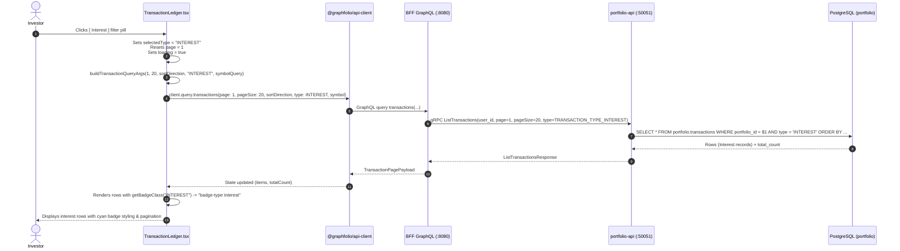

# Implementation Plan: Filter Transactions by Interest in Transaction Ledger

> **Feature Reference**: Transaction Ledger Management & Cash Flow Reconciliation  
> **Status**: Completed  
> **Story Reference**: [filter-transactions-by-interest-ledger.md](file:///Users/oscargarcia/workspace/graphfolio/docs/user-stories/filter-transactions-by-interest-ledger.md) (`US-TX-106`)  
> **Master Catalog**: [USER_STORIES.md](file:///Users/oscargarcia/workspace/graphfolio/docs/USER_STORIES.md) (Entry #22)  
> **Calculation & Accounting Standard**: [financial-calculations skill](file:///Users/oscargarcia/workspace/graphfolio/.agents/skills/financial-calculations/SKILL.md) (Cash Yield & Idle Balance Interest Accounting, Gross vs Net Income, Withholding Tax Reconciliation)  
> **Target Layers**: Primary Investor Application (`web/apps/main-app`), BFF (`bff/`), Portfolio Microservice (`services/portfolio-api`), Protobuf (`proto/portfolio/v1/`), Database (`portfolio.transactions`)  
> **Branch**: `feat/filter-transactions-by-interest`  

---

## 1. Executive Summary & Architectural Overview

The objective of this feature is to introduce a dedicated **"Interest"** filter pill into the **Transaction Ledger** toolbar in the primary investor web application (`web/apps/main-app/src/components/TransactionLedger.tsx`), accompanied by semantic glassmorphic badge styling (`.badge-type.interest`) in `TransactionLedger.css`, contextual empty-state messaging, and filtered CSV export support.

```
+-------------------------------------------------------------------------------------------------------------------------------+
|  TRANSACTION LEDGER TOOLBAR                                                                                                   |
+-------------------------------------------------------------------------------------------------------------------------------+
|  [ All ] [ Buy ] [ Sell ] [ Dividend ] [ Interest ] [ Split ] [ Deposit ] [ Withdrawal ]   [ 🔍 Search ticker (e.g. AAPL)... ]|
|                                        ^^^^^^^^^^^^                                                                           |
|                                     Dedicated Type Filter                                                                     |
+-------------------------------------------------------------------------------------------------------------------------------+
|  DATE ▲/▼    TYPE        ASSET               QUANTITY      PRICE        AMOUNT        FEE         NOTES          ACTIONS        |
|                                                                                                                               |
|  2024-03-31  INTEREST    CASH AUD            -             -            $142.50 AUD   -           NAB cash sweep [✏️] [🗑️]      |
|              ^^^^^^^^                                                                                                         |
|       Cyan / Teal Semantic Badge                                                                                              |
+-------------------------------------------------------------------------------------------------------------------------------+
```

### 1.1 The Business & Financial Context
1. **Auditing Idle Cash Yield**:
   Investors maintaining significant cash buffers in high-yield cash accounts (e.g., CommSec Cash Management Account, nabtrade Cash Account, Interactive Brokers Idle Cash, Webull Cash Sweep) frequently accrue monthly interest. Investors must be able to isolate all interest transactions to evaluate their annual uninvested cash yield.
2. **Tax Filing & Income Statement Reconciliation**:
   During annual tax reporting (such as Australian Taxation Office [ATO] assessable gross interest income, IRS Form 1099-INT in the United States, or HMRC annual certificates in the UK), investors must reconcile non-dividend income streams directly against broker tax statements.
3. **Targeted CSV Data Export**:
   Investors exporting transaction data for external spreadsheet modeling or accounting packages need the ability to export only interest distributions (e.g., downloading `graphfolio-transactions-interest-YYYY-MM-DD.csv`).

### 1.2 Zero Schema Drift & Architectural Readiness
A thorough audit of the backend, gRPC contracts, and GraphQL schema confirms that the system is already **100% prepared** to handle `INTEREST` queries:
- **Database Schema (`portfolio.transactions`)**:
  The `type` column is an enum including `'INTEREST'`. The parameter query `WHERE t.portfolio_id = $1 AND ($2::text IS NULL OR t.type::text = $2)` accepts `'INTEREST'` natively without migration.
- **Protobuf Contracts (`proto/portfolio/v1/portfolio.proto`)**:
  `enum TransactionType` defines `TRANSACTION_TYPE_INTEREST = 6`.
- **Portfolio Microservice (`services/portfolio-api`)**:
  `ListTransactions` filters by `TRANSACTION_TYPE_INTEREST` and correctly computes pagination totals.
- **BFF GraphQL Layer (`bff/graph/schema.graphqls`)**:
  `enum TransactionType` defines `INTEREST`. Both `transactions(type: TransactionType, ...)` and `exportTransactions(type: TransactionType, ...)` accept `INTEREST`.
- **CSV Exporters & Parsers (`apps/main-app/src/services/csv/`)**:
  `formatTransactionCSVRow` and `generateTransactionsCSV` already format `INTEREST` transactions with full fidelity.

Consequently, this implementation is **cleanly scoped to the frontend presentation layer and automated test coverage** in `web/apps/main-app`.

---

## 2. End-to-End Sequence Diagram



---

## 3. Component Architecture & Detailed Code Modifications

### 3.1 Updating `filterTypes` in `TransactionLedger.tsx`

We update the `filterTypes` constant in [TransactionLedger.tsx](file:///Users/oscargarcia/workspace/graphfolio/web/apps/main-app/src/components/TransactionLedger.tsx) to place `'Interest'` adjacent to `'Dividend'`, grouping all portfolio income types together:

```tsx
export const filterTypes: Array<{ label: string; value: string | null }> = [
  { label: 'All', value: null },
  { label: 'Buy', value: 'BUY' },
  { label: 'Sell', value: 'SELL' },
  { label: 'Dividend', value: 'DIVIDEND' },
  { label: 'Interest', value: 'INTEREST' },
  { label: 'Split', value: 'SPLIT' },
  { label: 'Deposit', value: 'DEPOSIT' },
  { label: 'Withdrawal', value: 'WITHDRAWAL' },
];
```

### 3.2 Semantic Badge Styling in `TransactionLedger.css`

Currently, `INTEREST` falls back to `.badge-type.other` (neutral zinc/gray). We introduce a distinctive, high-contrast cyan/teal badge token in [TransactionLedger.css](file:///Users/oscargarcia/workspace/graphfolio/web/apps/main-app/src/components/TransactionLedger.css):

```css
.badge-type.interest {
  background: rgba(6, 182, 212, 0.14);
  color: #22d3ee;
  border: 1px solid rgba(6, 182, 212, 0.3);
}
```

#### Color Token Hierarchy in the Ledger
| Transaction Type | Visual Hue | Background Token | Text Token | Border Token |
| :--- | :--- | :--- | :--- | :--- |
| **BUY** | Emerald Green | `rgba(16, 185, 129, 0.14)` | `#34d399` | `rgba(16, 185, 129, 0.3)` |
| **SELL** | Coral Red | `rgba(239, 68, 68, 0.14)` | `#f87171` | `rgba(239, 68, 68, 0.3)` |
| **DIVIDEND** | Royal Blue | `rgba(59, 130, 246, 0.14)` | `#60a5fa` | `rgba(59, 130, 246, 0.3)` |
| **INTEREST** *(New)* | Cyan / Teal | `rgba(6, 182, 212, 0.14)` | `#22d3ee` | `rgba(6, 182, 212, 0.3)` |
| **SPLIT** | Violet | `rgba(139, 92, 246, 0.16)` | `#c4b5fd` | `rgba(139, 92, 246, 0.35)` |
| **DEPOSIT** | Purple | `rgba(168, 85, 247, 0.14)` | `#c084fc` | `rgba(168, 85, 247, 0.3)` |
| **WITHDRAWAL** | Amber Orange | `rgba(249, 115, 22, 0.14)` | `#fb923c` | `rgba(249, 115, 22, 0.3)` |

### 3.3 Exporting & Updating `getBadgeClass` Helper

We update the badge class generator and export it as a pure function to enable fast, headless unit testing:

```tsx
export function getBadgeClass(type: string): string {
  switch (type) {
    case 'BUY':
      return 'badge-type buy';
    case 'SELL':
      return 'badge-type sell';
    case 'DIVIDEND':
      return 'badge-type dividend';
    case 'INTEREST':
      return 'badge-type interest';
    case 'SPLIT':
      return 'badge-type split';
    case 'DEPOSIT':
      return 'badge-type deposit';
    case 'WITHDRAWAL':
      return 'badge-type withdrawal';
    default:
      return 'badge-type other';
  }
}
```

### 3.4 Contextual Empty-State Messaging

When an investor filters by `INTEREST` and has no interest records (or searches for a ticker that has no interest), we display an informative message rather than a generic fallback. We extract this into a testable pure function:

```tsx
export function getEmptyStateMessage(
  selectedType?: string | null,
  symbolQuery?: string
): string {
  const trimmed = symbolQuery?.trim();
  if (selectedType === 'INTEREST' && trimmed) {
    return `No interest transactions found matching "${trimmed.toUpperCase()}".`;
  }
  if (selectedType === 'INTEREST') {
    return 'No interest transactions found for this portfolio.';
  }
  if (trimmed) {
    return `No transactions found matching "${trimmed.toUpperCase()}".`;
  }
  if (selectedType) {
    return `No ${selectedType.toLowerCase()} transactions found for this portfolio.`;
  }
  return 'No transactions found matching your criteria.';
}
```

In the JSX rendering of [TransactionLedger.tsx](file:///Users/oscargarcia/workspace/graphfolio/web/apps/main-app/src/components/TransactionLedger.tsx):
```tsx
) : transactions.length === 0 ? (
  <div className="ledger-state-msg">
    {getEmptyStateMessage(selectedType, symbolQuery)}
  </div>
) : (
```

### 3.5 Export Filename & Filter Synchronization

When the user clicks **"Export CSV"**, the active `selectedType` is passed directly to the `exportTransactions` GraphQL query:
```tsx
const args: any = {};
if (selectedType) {
  args.type = selectedType;
}
if (symbolQuery.trim()) {
  args.symbol = symbolQuery.trim().toUpperCase();
}
```
In `web/apps/main-app/src/services/csv/export.ts`, `generateTransactionsFilename` automatically prefixes the downloaded filename with the filter:
```ts
// If selectedType === 'INTEREST', filename is:
// graphfolio-transactions-interest-2026-10-18.csv
```
This guarantees complete synchronization between screen filters and downloaded audit statements.

---

## 4. Step-by-Step Implementation Tasks

| Step | Action | Files Affected | Description |
| :--- | :--- | :--- | :--- |
| **1** | **Update Filter Options** | `web/apps/main-app/src/components/TransactionLedger.tsx` | Export `filterTypes` array and add `{ label: 'Interest', value: 'INTEREST' }`. |
| **2** | **Update Badge Resolver** | `web/apps/main-app/src/components/TransactionLedger.tsx` | Export `getBadgeClass` function and map `'INTEREST'` $\rightarrow$ `'badge-type interest'`. |
| **3** | **Contextual Empty State** | `web/apps/main-app/src/components/TransactionLedger.tsx` | Export `getEmptyStateMessage` helper and bind it to the zero-state message container. |
| **4** | **Add CSS Badge Tokens** | `web/apps/main-app/src/components/TransactionLedger.css` | Define `.badge-type.interest` with cyan glassmorphic styling (`#22d3ee`). |
| **5** | **Implement Unit Tests** | `web/apps/main-app/src/components/TransactionLedger.test.ts` | Add unit tests verifying `filterTypes`, query args with `'INTEREST'`, `getBadgeClass('INTEREST')`, and `getEmptyStateMessage`. |
| **6** | **Run Test Suite** | Terminal / Vitest | Execute `npm --prefix web run test` to verify 100% test pass rate across all suites. |

---

## 5. Detailed Test Plan & Verification Matrix

### 5.1 Unit Tests in `TransactionLedger.test.ts`

```ts
describe('Transaction Ledger Interest Filter (US-TX-106)', () => {
  describe('filterTypes constant', () => {
    it('contains the Interest filter pill with value INTEREST', () => {
      const interestPill = filterTypes.find((f) => f.value === 'INTEREST');
      expect(interestPill).toBeDefined();
      expect(interestPill?.label).toBe('Interest');
    });

    it('positions Interest immediately following Dividend in the filter order', () => {
      const dividendIdx = filterTypes.findIndex((f) => f.value === 'DIVIDEND');
      const interestIdx = filterTypes.findIndex((f) => f.value === 'INTEREST');
      expect(interestIdx).toBe(dividendIdx + 1);
    });
  });

  describe('buildTransactionQueryArgs with INTEREST', () => {
    it('passes type = "INTEREST" when selectedType is INTEREST', () => {
      const args = buildTransactionQueryArgs(1, 20, 'DESC', 'INTEREST');
      expect(args).toEqual({
        page: 1,
        pageSize: 20,
        sortDirection: 'DESC',
        type: 'INTEREST',
      });
    });

    it('combines INTEREST type filter with ASC sorting and symbol search', () => {
      const args = buildTransactionQueryArgs(2, 20, 'ASC', 'INTEREST', 'cma');
      expect(args).toEqual({
        page: 2,
        pageSize: 20,
        sortDirection: 'ASC',
        type: 'INTEREST',
        symbol: 'CMA',
      });
    });
  });

  describe('getBadgeClass', () => {
    it('returns "badge-type interest" for INTEREST type', () => {
      expect(getBadgeClass('INTEREST')).toBe('badge-type interest');
    });

    it('returns "badge-type other" for unknown transaction types', () => {
      expect(getBadgeClass('UNKNOWN')).toBe('badge-type other');
    });
  });

  describe('getEmptyStateMessage', () => {
    it('returns interest-specific empty message when selectedType is INTEREST', () => {
      expect(getEmptyStateMessage('INTEREST')).toBe(
        'No interest transactions found for this portfolio.'
      );
    });

    it('returns interest and symbol empty message when both are present', () => {
      expect(getEmptyStateMessage('INTEREST', 'cma')).toBe(
        'No interest transactions found matching "CMA".'
      );
    });

    it('returns default empty message when no filters are active', () => {
      expect(getEmptyStateMessage(null, '')).toBe(
        'No transactions found matching your criteria.'
      );
    });
  });
});
```

### 5.2 Verification Checklist
- [ ] `filterTypes` contains `{ label: 'Interest', value: 'INTEREST' }`.
- [ ] Clicking the **"Interest"** pill filters the ledger table to show only interest records.
- [ ] Active state is properly indicated on the pill (`.filter-pill.active`).
- [ ] Badge in the ledger table displays `INTEREST` with cyan text (`#22d3ee`) and cyan translucent background.
- [ ] Empty state message displays `"No interest transactions found for this portfolio."` if the portfolio has zero interest records.
- [ ] Exporting transactions while filtered on Interest exports only interest transactions.
- [ ] Unit tests pass with 0 failures (`npm --prefix web run test`).
- [ ] TypeScript compilation succeeds with 0 errors (`npm --prefix web run build`).

---

## 6. Rollback & Contingency Strategy

Because the backend and BFF layers already natively support `INTEREST`, this feature involves zero schema migrations, zero gRPC proto alterations, and zero breaking changes to data structures. If any unforeseen UI regression arises, rolling back requires simply reverting the edits to `TransactionLedger.tsx` and `TransactionLedger.css`.
