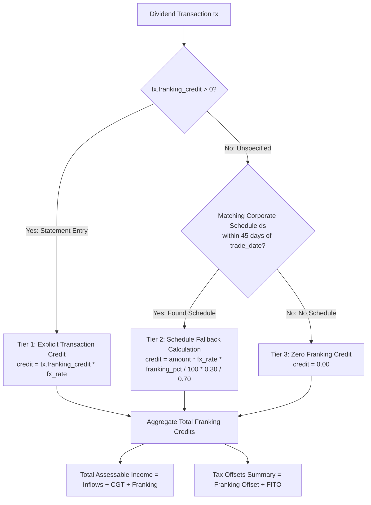
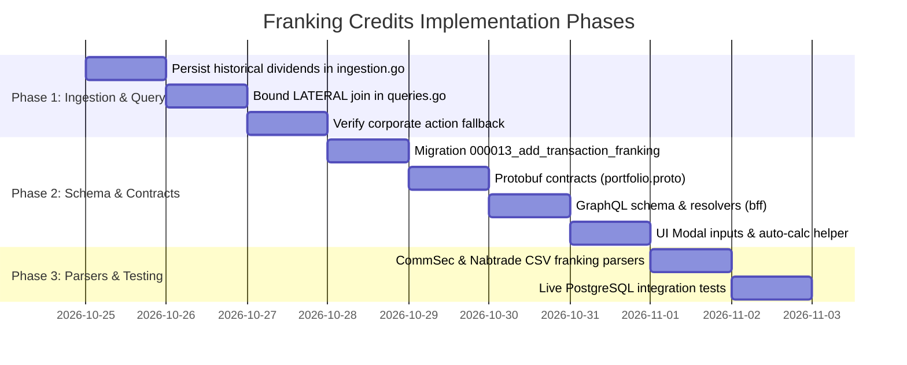

# Implementation Plan: Franking Credits & Tax Offsets Ingestion and Reporting

> **Target Feature**: Franking Credits & Tax Offsets in Tax Lots & Capital Gains Report  
> **Status**: Ready for Implementation  
> **Target Layers**: Database (`portfolio-api/migrations`), Domain Microservice (`services/portfolio-api`), BFF Orchestrator (`bff`), Primary Web Application (`web/apps/main-app`)  
> **Investigation Reference**: [docs/reports/franking-credits-investigation-report.md](file:///Users/oscargarcia/workspace/graphfolio/docs/reports/franking-credits-investigation-report.md)  
> **Standards Reference**: [financial-calculations skill](file:///Users/oscargarcia/workspace/graphfolio/.agents/skills/financial-calculations/SKILL.md), [AGENTS.md](file:///Users/oscargarcia/workspace/graphfolio/AGENTS.md)  

---

## 1. Problem Statement & Executive Summary

### 1.1 The Current Behavior
In the primary investor dashboard (`apps/main-app`), the **Tax Lots & Capital Gains Report** (`TaxLotsReport.tsx`) displays:
- **Franking Credits KPI**: **`$0.00`** (or `—`)
- **Franking Credits Offset**: **`$0.00`**
- **Taxable Income Proportional Bar**: Franking credit ratio is **`0.00%`**
- **Assessable Income**: Consists solely of cash dividends, interest, and net capital gains without the required ATO gross-up.

### 1.2 Identified Root Causes
1. **Ingestion Engine Drops Historical Distributions**: [`SynthesizeForwardEstimates`](file:///Users/oscargarcia/workspace/graphfolio/services/portfolio-api/internal/marketdata/cadence.go#L55-L165) fetches 5 years of historical dividends from Yahoo Finance / Twelve Data solely to calculate cadence frequency, but discards them without persisting them to [`portfolio.dividend_schedules`](file:///Users/oscargarcia/workspace/graphfolio/services/portfolio-api/migrations/000011_create_dividend_schedules.up.sql#L18-L36).
2. **Empty LATERAL Join**: [`getTaxReportIncomeAndOffsetsSQL`](file:///Users/oscargarcia/workspace/graphfolio/services/portfolio-api/internal/repository/queries.go#L1020-L1047) performs a lateral join against `portfolio.dividend_schedules` matching `payment_date = tx.trade_date OR ex_date <= tx.trade_date`. Because the table contains only *future* estimates, past transactions find zero rows, leaving `ds.franking_percentage = NULL`.
3. **Transaction Schema & Ingestion Lack Native Storage**: [`portfolio.transactions`](file:///Users/oscargarcia/workspace/graphfolio/services/portfolio-api/migrations/000002_portfolios_and_transactions.up.sql#L28-L55) has `fee` and `withholding_tax`, but no `franking_credit` column. The application cannot accept franking credits from trade entry modals or brokerage CSV imports (CommSec, Nabtrade).
4. **Trust Distributions & Partial Franking**: Australian ETFs (e.g., VAS, STW) distribute trust income with varying quarterly franking percentages (50%–80%) that cannot be inferred from standard stock market APIs.

---

## 2. Solution Architecture & Design

### 2.1 The Two-Tier Resolution Waterfall

To ensure 100% precision for statements while supporting automated calculations for manual entries, the system will implement a **Two-Tier Resolution Waterfall**:



### 2.2 Mathematical Specifications (ATO Division 207)

For each dividend transaction $i \in \mathcal{T}_{\text{div}}$ in financial year $[T_{\text{from}}, T_{\text{to}}]$:

1. **Transaction Base Amount**:
   $$A_{i,\text{base}} = \text{Amount}_i \times \text{FX}_i$$

2. **Franking Credit Attribution**:
   $$C_{i,\text{franking}} = \begin{cases}
   \text{Credit}_{i,\text{tx}} \times \text{FX}_i & \text{if } \text{Credit}_{i,\text{tx}} > 0 \\
   A_{i,\text{base}} \times \left(\frac{\text{Franking}\%_{i,\text{sched}}}{100}\right) \times \left(\frac{0.30}{0.70}\right) & \text{if } \text{Credit}_{i,\text{tx}} = 0 \text{ and } \text{Schedule exists} \\
   0 & \text{otherwise}
   \end{cases}$$

3. **Assessable Income Aggregation**:
   $$\text{Assessable Dividend Income} = \sum_{i} A_{i,\text{base}} + \sum_{i} C_{i,\text{franking}}$$

4. **Tax Offsets Aggregation**:
   $$\text{Total Available Offsets} = \sum_{i} C_{i,\text{franking}} + \sum_{j} \text{FITO}_{j,\text{base}}$$

---

## 3. Phased Implementation Roadmap



---

## 4. Detailed Implementation Tasks

### 4.1 Phase 1: Ingestion & Lateral Join Fix (Immediate Backend Fix)

#### Task 1.1: Persist Historical Dividends to `portfolio.dividend_schedules`
- **File**: [`services/portfolio-api/internal/service/ingestion.go`](file:///Users/oscargarcia/workspace/graphfolio/services/portfolio-api/internal/service/ingestion.go)
- **Changes**:
  1. In `IngestDividendSchedules`, iterate over `history []DividendHistoryPoint`.
  2. Map each historical point into a `domain.DividendSchedule`:
     - `Status`: `domain.DividendStatusPaid`
     - `IsEstimated`: `false`
     - `Source`: `"historical_ingest"`
     - `FrankingPercentage`: If symbol ends with `.AX` or exchange is `ASX`/`XASX`, set `100.00`, else `0.00`.
     - `PaymentDate`: Default to `hist.Date + 14 days` if unknown.
  3. Include historical records in `schedules` batch passed to `s.repo.UpsertDividendSchedulesBatch`.

#### Task 1.2: Bound the LATERAL Join in Repository SQL
- **File**: [`services/portfolio-api/internal/repository/queries.go`](file:///Users/oscargarcia/workspace/graphfolio/services/portfolio-api/internal/repository/queries.go#L1020-L1047)
- **Changes**:
  Update `getTaxReportIncomeAndOffsetsSQL` to constrain the date matching window to within 45 days of the trade date:
  ```sql
  LEFT JOIN LATERAL (
      SELECT franking_percentage
      FROM portfolio.dividend_schedules
      WHERE instrument_id = tx.instrument_id
        AND (
            payment_date = tx.trade_date OR
            (ex_date <= tx.trade_date AND tx.trade_date <= ex_date + INTERVAL '45 days')
        )
      ORDER BY ex_date DESC LIMIT 1
  ) ds ON (tx.instrument_id IS NOT NULL)
  ```

---

### 4.2 Phase 2: First-Class Franking on Transactions (Schema & UI)

#### Task 2.1: PostgreSQL Migration `000013_add_transaction_franking_credits`
- **Files**:
  - `services/portfolio-api/migrations/000013_add_transaction_franking_credits.up.sql`
  - `services/portfolio-api/migrations/000013_add_transaction_franking_credits.down.sql`
- **Changes**:
  ```sql
  -- up.sql
  ALTER TABLE portfolio.transactions
      ADD COLUMN franking_credit numeric(20,6) NOT NULL DEFAULT 0,
      ADD COLUMN franking_pct    numeric(5,2)  DEFAULT NULL;

  ALTER TABLE portfolio.transactions
      ADD CONSTRAINT non_negative_franking CHECK (franking_credit >= 0);
  ```

#### Task 2.2: Update Domain Model & Repository Mapping
- **Files**:
  - [`services/portfolio-api/internal/domain/transaction.go`](file:///Users/oscargarcia/workspace/graphfolio/services/portfolio-api/internal/domain/transaction.go)
  - [`services/portfolio-api/internal/repository/queries.go`](file:///Users/oscargarcia/workspace/graphfolio/services/portfolio-api/internal/repository/queries.go)
  - [`services/portfolio-api/internal/repository/postgres.go`](file:///Users/oscargarcia/workspace/graphfolio/services/portfolio-api/internal/repository/postgres.go)
- **Changes**:
  1. Add `FrankingCredit decimal.Decimal` and `FrankingPct *decimal.Decimal` to `domain.Transaction` and `domain.TransactionItem`.
  2. Update `insertTransactionSQL`, `updateTransactionSQL`, `listTransactionsDescSQL`, `listTransactionsAscSQL`, and `batchInsertTransactionsSQL` to include `franking_credit` and `franking_pct`.
  3. Update scanner logic in `postgres.go` to scan the new columns.

#### Task 2.3: Update Protobuf Contracts
- **File**: [`proto/portfolio/v1/portfolio.proto`](file:///Users/oscargarcia/workspace/graphfolio/proto/portfolio/v1/portfolio.proto)
- **Changes**:
  1. In `TransactionItem`:
     ```protobuf
     common.v1.Money   franking_credit = 15;
     common.v1.Decimal franking_pct    = 16;
     ```
  2. In `AddTransactionRequest` and `UpdateTransactionRequest`:
     ```protobuf
     common.v1.Money   franking_credit = 11;
     common.v1.Decimal franking_pct    = 12;
     ```
  3. In `BatchImportTransactionsRequest` (`ImportTransactionItem`):
     ```protobuf
     common.v1.Decimal franking_credit = 13;
     common.v1.Decimal franking_pct    = 14;
     ```
  4. Run `make proto` to re-generate Go Protobuf code.

#### Task 2.4: Update Two-Tier Waterfall in `getTaxReportIncomeAndOffsetsSQL`
- **File**: [`services/portfolio-api/internal/repository/queries.go`](file:///Users/oscargarcia/workspace/graphfolio/services/portfolio-api/internal/repository/queries.go#L1020-L1047)
- **Changes**:
  ```sql
  COALESCE(SUM(
      CASE 
          WHEN tx.type = 'DIVIDEND' THEN
              CASE
                  WHEN COALESCE(tx.franking_credit, 0) > 0 THEN
                      tx.franking_credit * COALESCE(tx.fx_rate_to_base, 1.0)
                  WHEN COALESCE(ds.franking_percentage, 0) > 0 THEN
                      (tx.amount * COALESCE(tx.fx_rate_to_base, 1.0)) * (ds.franking_percentage / 100.0) * (0.30 / 0.70)
                  ELSE 0
              END
          ELSE 0 
      END
  ), 0) AS franking_credits_base
  ```

#### Task 2.5: Update BFF GraphQL Schema & Resolvers
- **Files**:
  - [`bff/graph/schema.graphqls`](file:///Users/oscargarcia/workspace/graphfolio/bff/graph/schema.graphqls)
  - [`bff/graph/schema.resolvers.go`](file:///Users/oscargarcia/workspace/graphfolio/bff/graph/schema.resolvers.go)
  - [`bff/graph/helpers.go`](file:///Users/oscargarcia/workspace/graphfolio/bff/graph/helpers.go)
- **Changes**:
  1. Add `frankingCredit: Decimal` and `frankingPct: Decimal` to:
     - `type TransactionItem`
     - `input AddTransactionInput`
     - `input UpdateTransactionInput`
     - `input ImportTransactionInput`
  2. Update resolver mappings and run `make generate`.

#### Task 2.6: Frontend Trade Modals (`AddTransactionModal` & `EditTransactionModal`)
- **Files**:
  - [`web/apps/main-app/src/components/AddTransactionModal.tsx`](file:///Users/oscargarcia/workspace/graphfolio/web/apps/main-app/src/components/AddTransactionModal.tsx)
  - [`web/apps/main-app/src/components/EditTransactionModal.tsx`](file:///Users/oscargarcia/workspace/graphfolio/web/apps/main-app/src/components/EditTransactionModal.tsx)
- **Changes**:
  1. In the `DIVIDEND` form view, add:
     - **Franking Credit ($)** input field.
     - **Franking %** selector / input (0% to 100%).
  2. Auto-calculation helper: If user enters Franking %, automatically calculate and preview:
     $$\text{Franking Credit} = \text{Amount} \times \left(\frac{\text{Franking}\%}{100}\right) \times \left(\frac{0.30}{0.70}\right)$$
  3. If symbol belongs to `XASX` or ends with `.AX`, default Franking % to `100%`.

---

### 4.3 Phase 3: Broker Statement CSV Ingestion & Testing

#### Task 3.1: CommSec & Nabtrade CSV Parsers
- **Files**:
  - [`web/apps/main-app/src/services/csv/parsers/commsec.ts`](file:///Users/oscargarcia/workspace/graphfolio/web/apps/main-app/src/services/csv/parsers/commsec.ts)
  - [`web/apps/main-app/src/services/csv/parsers/nabtrade.ts`](file:///Users/oscargarcia/workspace/graphfolio/web/apps/main-app/src/services/csv/parsers/nabtrade.ts)
- **Changes**:
  1. Parse franked distribution and franking credit columns where available in broker confirmation exports.
  2. Emit `frankingCredit` and `frankingPct` on parsed `ImportTransactionInput` items.

#### Task 3.2: Live PostgreSQL Integration Tests
- **File**: `services/portfolio-api/internal/repository/tax_report_test.go`
- **Changes**:
  1. Add integration tests running `GetTaxReportIncomeAndOffsets` against a real test database.
  2. Test Case A: Fully franked dividend with schedule fallback (expecting exact $0.30/0.70$ attribution).
  3. Test Case B: Partially franked dividend with explicit `tx.franking_credit` (expecting statement override).
  4. Test Case C: Dividend with settlement lag (4 days after ex-date, verifying window match).
  5. Test Case D: Ratio bar percentages in `TaxableIncomeSummary` correctly sum to 100%.

---

## 5. Test Plan & Acceptance Criteria

### 5.1 Acceptance Criteria
| ID | Requirement | Verification Method |
| :--- | :--- | :--- |
| **AC-01** | `portfolio.dividend_schedules` contains historical distributions marked `status = 'PAID'` after dividend sync. | Database query check: `SELECT count(*) FROM portfolio.dividend_schedules WHERE status = 'PAID' AND ex_date < now();` |
| **AC-02** | Tax report shows non-zero franking credits for historical ASX dividend transactions via schedule fallback. | Run `GetTaxReport` on demo portfolio with BHP dividend; inspect `Summary.TaxableIncome.FrankingCredits`. |
| **AC-03** | Explicit `tx.franking_credit` takes priority over corporate schedule calculation. | Add transaction with `franking_credit = 45.00`; assert tax report reflects $45.00 rather than estimated math. |
| **AC-04** | Total assessable income accurately includes franking credits gross-up ($A_{\text{base}} + C_{\text{franking}} + \text{CGT} + \text{Interest}$). | Verify `TotalAssessableIncome` and proportional ratio bar in `TaxableIncomeSummaryCard.tsx`. |
| **AC-05** | Franking credits offset card accurately displays available offsets. | Verify `FrankingCreditsOffset` in `TaxIncomeOffsetsTable.tsx`. |
| **AC-06** | Manual `AddTransactionModal` allows entering franking credit and percentage with real-time auto-calculation. | Manual trade entry test in web app. |
| **AC-07** | Existing transactions and foreign dividends without franking credits remain unaffected. | Regression test suite: `make test`. |

---

## 6. Migration & Verification Commands

```bash
# 1. Apply Schema Migrations
make migrate-up

# 2. Re-generate Protobuf & GraphQL Contracts
make proto
make generate

# 3. Synchronize Dividend Corporate Actions
make ingest-dividends

# 4. Run Full Test Suite
make test

# 5. Launch Services & Verify in UI
make run-portfolio
make run-bff
make run-web
```
