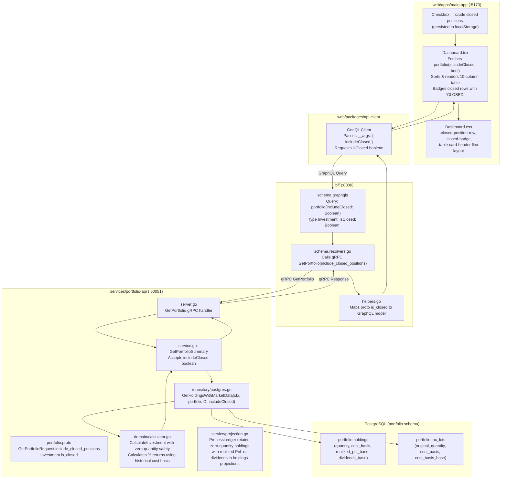

# Implementation Plan: Include Closed Positions in Dashboard Investments Table

> **User Story**: [include-closed-positions-dashboard.md](file:///Users/oscargarcia/workspace/graphfolio/docs/user-stories/include-closed-positions-dashboard.md) (`US-INV-105`)  
> **Status**: Ready for Implementation  
> **Roadmap Reference**: [FEATURES.md (Feature 3.4)](file:///Users/oscargarcia/workspace/graphfolio/FEATURES.md#L434)  
> **Calculation Standard**: [financial-calculations skill](file:///Users/oscargarcia/workspace/graphfolio/.agents/skills/financial-calculations/SKILL.md)  
> **Target Layers**: Protobuf (`proto/portfolio/v1/`), Domain Microservice (`services/portfolio-api`), BFF (`bff/`), Shared Web Client (`packages/api-client`), Main Application (`web/apps/main-app`)  

---

## 1. Executive Summary & Objective

The objective of this feature is to enable investors to toggle an **"Include closed positions"** checkbox in the "Your Investments" table on the primary dashboard (`apps/main-app`). 

By default, the dashboard focuses on open, active holdings ($Q > 0$). When an investor liquidates 100% of an asset, the asset currently disappears from the dashboard, concealing the total realized capital gains, historical dividend income, and lifetime return achieved on that asset. 

This implementation provides:
1. **Interactive UI Control**: A clean, glassmorphic toggle checkbox `"Include closed positions"` located in the "Your Investments" table header.
2. **Clear Position Differentiation**: Closed holdings are badged with a distinct `CLOSED` indicator, rendered with muted opacity (`0.75`), and show exact `$0.00` total value and `0` quantity.
3. **Rigorous Financial Attribution**: Closed holdings display cumulative historical average buy price, lifetime realized capital gain/loss (`realized_pnl_base`), cumulative dividends received (`dividends_base`), and net lifetime return ($\text{Realized PnL} + \text{Dividends}$), calculated against the asset's historical acquisition cost basis without division-by-zero errors.
4. **Valuation Protection**: Zero-quantity closed holdings do not contribute to current invested market value ($V = \$0.00$) or today's return ($R_{\text{today}} = \$0.00$), preventing distortion of portfolio-level wealth totals.
5. **Preference Persistence**: User selection is saved in browser `localStorage` (`graphfolio:include-closed-positions`) to prevent jarring state resets during tab switches or page refreshes.

---

## 2. Technical Architecture & End-to-End Data Flow



---

## 3. Mathematical & Financial Attribution Specification

All calculations adhere strictly to the [financial-calculations guidelines](file:///Users/oscargarcia/workspace/graphfolio/.agents/skills/financial-calculations/SKILL.md), CFA Institute GIPS® standards, and US GAAP trade-date accounting using `shopspring/decimal`.

### 3.1 Holding Input Variables

For an instrument $i$ in portfolio with base currency $C_{\text{base}}$:
- $Q_i$: Current open share quantity ($Q_i = 0$ for closed holdings).
- $P_{\text{latest}}$: Latest market closing price in instrument currency.
- $\text{FX}_t$: Current spot exchange rate converting instrument currency $\to C_{\text{base}}$.
- $C_{\text{open}, \text{local}}$: Remaining cost basis across open lots ($C_{\text{open}, \text{local}} = 0$ for closed holdings).
- $C_{\text{open}, \text{base}}$: Remaining cost basis in base currency ($C_{\text{open}, \text{base}} = 0$ for closed holdings).
- $Q_{\text{hist}}$: Split-adjusted cumulative shares ever purchased: $\sum_{\text{lots}} \text{lot.OriginalQuantity}$.
- $C_{\text{hist}, \text{local}}$: Cumulative acquisition cost in instrument currency: $\sum_{\text{lots}} \text{lot.CostBasis}$.
- $C_{\text{hist}, \text{base}}$: Cumulative acquisition cost in base currency: $\sum_{\text{lots}} \text{lot.CostBasisBase}$.
- $\text{RealizedPnL}_{\text{base}}$: Cumulative net realized gains/losses from all disposed lots of instrument $i$.
- $\text{Dividends}_{\text{base}}$: Cumulative net cash distributions credited to instrument $i$.

---

### 3.2 Closed Position Metric Formulation ($Q_i = 0$)

| Metric Column | Open Position ($Q_i > 0$) | Closed Position ($Q_i = 0$) | Mathematical Formula |
| :--- | :--- | :--- | :--- |
| **Asset** | Ticker + Name | Ticker + Name + `[CLOSED]` | Visual status pill |
| **Price** | Latest close price | Latest close price | $P_{\text{latest}}$ |
| **Avg Buy Price** | Open lot average cost | Historical volume-weighted buy price | $\text{AvgBuyPrice} = \begin{cases} \dfrac{C_{\text{hist}, \text{local}}}{Q_{\text{hist}}} & \text{if } Q_{\text{hist}} > 0 \\ \text{—} & \text{otherwise} \end{cases}$ |
| **Quantity** | $Q_i$ | `0` | Exactly `0` |
| **Total Value** | $Q_i \times P_{\text{latest}} \times \text{FX}_t$ | **$0.00** | $0 \times P_{\text{latest}} \times \text{FX}_t = 0.00$ |
| **Capital Gain** | Unrealized gain in base ccy: $(V_{\text{local}} - C_{\text{local}}) \times \overline{\text{FX}}_0$ | **Realized Capital Gain / Loss** in base ccy: $\text{RealizedPnL}_{\text{base}}$ | Amount: $\text{RealizedPnL}_{\text{base}}$<br>Percent: $\begin{cases} \dfrac{\text{RealizedPnL}_{\text{base}}}{C_{\text{hist}, \text{base}}} \times 100\% & \text{if } C_{\text{hist}, \text{base}} > 0 \\ 0.00\% & \text{otherwise} \end{cases}$ |
| **Income** | Cumulative dividends + Yield on Cost | Cumulative dividends + Historical Yield on Cost | Amount: $\text{Dividends}_{\text{base}}$<br>Percent: $\begin{cases} \dfrac{\text{Dividends}_{\text{base}}}{C_{\text{hist}, \text{base}}} \times 100\% & \text{if } C_{\text{hist}, \text{base}} > 0 \\ 0.00\% & \text{otherwise} \end{cases}$ |
| **Currency Gain** | Unrealized FX movement: $V_{\text{local}} \times (\text{FX}_t - \overline{\text{FX}}_0)$ | Realized FX gain or `—` (domestic) | Neutral `—` if domestic ($C_{\text{inst}} = C_{\text{base}}$) |
| **Total Return** | $\text{Unrealized Gain} + \text{RealizedPnL} + \text{Dividends}$ | **$\text{RealizedPnL}_{\text{base}} + \text{Dividends}_{\text{base}}$** | Amount: $\text{RealizedPnL}_{\text{base}} + \text{Dividends}_{\text{base}}$<br>Percent: $\begin{cases} \dfrac{\text{TotalReturn}_{\text{base}}}{C_{\text{hist}, \text{base}}} \times 100\% & \text{if } C_{\text{hist}, \text{base}} > 0 \\ 0.00\% & \text{otherwise} \end{cases}$ |
| **Today's Return** | $Q_i \times (P_t - P_{t-1}) \times \text{FX}_t$ | **$0.00** / `0.00%` (or `—`) | Zero shares held today $\implies$ Zero day movement |

> [!IMPORTANT]
> **Zero-Division Safeguard**: In all percentage computations, if $C_{\text{hist}, \text{base}} \le 0$, the percentage return must safely resolve to `0.00%` or `—` to prevent runtime NaN or division-by-zero panics.

---

## 4. Layer-by-Layer Implementation Breakdown

### 4.1 Layer 1: Protocol Buffers (`proto/portfolio/v1/portfolio.proto`)

Update `GetPortfolioRequest` and `Investment` messages:

```protobuf
message GetPortfolioRequest {
  string user_id                  = 1;
  bool   include_closed_positions = 2;
}

message Investment {
  string            id                     = 1;
  string            ticker                 = 2;
  string            name                   = 3;
  common.v1.Money   price                  = 4;
  common.v1.Decimal quantity               = 5;
  common.v1.Money   total_value            = 6;
  common.v1.Money   today_return_amount    = 7;
  common.v1.Decimal today_return_percent   = 8;
  common.v1.Money   total_return_amount    = 9;
  common.v1.Decimal total_return_percent   = 10;
  common.v1.Money   capital_gain_amount    = 11;
  common.v1.Decimal capital_gain_percent   = 12;
  common.v1.Money   income_amount          = 13;
  common.v1.Decimal income_yield_percent   = 14;
  common.v1.Money   currency_gain_amount   = 15;
  common.v1.Decimal currency_gain_percent  = 16;
  bool              is_international       = 17;
  common.v1.Money   average_buy_price      = 18;
  bool              is_closed              = 19;
}
```

*Build Command*: Run `make proto` from repository root.

---

### 4.2 Layer 2: Portfolio Domain & Microservice (`services/portfolio-api`)

#### 1. Domain Entities (`internal/domain/holding.go`)
Extend `HoldingWithPrice` and `InvestmentSummary`:
```go
type HoldingWithPrice struct {
    PortfolioID             uuid.UUID
    InstrumentID            uuid.UUID
    Ticker                  string
    Name                    string
    InstrumentCurrency      string
    Quantity                decimal.Decimal
    CostBasis               decimal.Decimal
    CostBasisBase           decimal.Decimal
    RealizedPnLBase         decimal.Decimal
    DividendsBase           decimal.Decimal
    LatestPrice             decimal.Decimal
    PrevPrice               decimal.Decimal
    FXRateToBase            decimal.Decimal
    HistoricalQuantity      decimal.Decimal
    HistoricalCostBasis     decimal.Decimal
    HistoricalCostBasisBase decimal.Decimal
}

func (h HoldingWithPrice) IsClosed() bool {
    return h.Quantity.IsZero()
}

type InvestmentSummary struct {
    // Existing fields...
    IsClosed bool
}
```

#### 2. Domain Calculator (`internal/domain/calculator.go`)
Refactor `CalculateInvestment` to support zero-quantity closed positions:
```go
func CalculateInvestment(h HoldingWithPrice, baseCurrency string) InvestmentSummary {
    isClosed := h.Quantity.IsZero()
    isInternational := h.InstrumentCurrency != "" && h.InstrumentCurrency != baseCurrency

    fxRate := h.FXRateToBase
    if !fxRate.IsPositive() {
        fxRate = one
    }

    if isClosed {
        // Average Buy Price from historical tax lots
        var avgBuyPrice decimal.Decimal
        if h.HistoricalQuantity.IsPositive() && h.HistoricalCostBasis.IsPositive() {
            avgBuyPrice = h.HistoricalCostBasis.DivRound(h.HistoricalQuantity, 4)
        }

        // Percentage calculations using HistoricalCostBasisBase as denominator
        var capGainPercent decimal.Decimal
        if h.HistoricalCostBasisBase.IsPositive() {
            capGainPercent = h.RealizedPnLBase.DivRound(h.HistoricalCostBasisBase, 6).Mul(oneHundred).Round(2)
        }

        var incomeYieldPercent decimal.Decimal
        if h.HistoricalCostBasisBase.IsPositive() {
            incomeYieldPercent = h.DividendsBase.DivRound(h.HistoricalCostBasisBase, 6).Mul(oneHundred).Round(2)
        }

        totalReturnAmountBase := h.RealizedPnLBase.Add(h.DividendsBase)
        var totalReturnPercent decimal.Decimal
        if h.HistoricalCostBasisBase.IsPositive() {
            totalReturnPercent = totalReturnAmountBase.DivRound(h.HistoricalCostBasisBase, 6).Mul(oneHundred).Round(1)
        }

        return InvestmentSummary{
            ID:                  h.InstrumentID.String(),
            Ticker:              h.Ticker,
            Name:                h.Name,
            Price:               NewMoney(h.LatestPrice.Round(2), h.InstrumentCurrency),
            AverageBuyPrice:     NewMoney(avgBuyPrice.Round(2), h.InstrumentCurrency),
            Quantity:            decimal.Zero,
            TotalValue:          NewMoney(decimal.Zero, baseCurrency),
            TodayReturnAmount:   NewMoney(decimal.Zero, baseCurrency),
            TodayReturnPercent:  decimal.Zero,
            TotalReturnAmount:   NewMoney(totalReturnAmountBase.Round(2), baseCurrency),
            TotalReturnPercent:  totalReturnPercent,
            CapitalGainAmount:   NewMoney(h.RealizedPnLBase.Round(2), baseCurrency),
            CapitalGainPercent:  capGainPercent,
            IncomeAmount:        NewMoney(h.DividendsBase.Round(2), baseCurrency),
            IncomeYieldPercent:  incomeYieldPercent,
            CurrencyGainAmount:  NewMoney(decimal.Zero, baseCurrency),
            CurrencyGainPercent: decimal.Zero,
            IsInternational:     isInternational,
            IsClosed:            true,
        }
    }

    // Existing open holding logic for h.Quantity > 0...
}
```

#### 3. Ledger Projections (`internal/service/projection.go`)
In `ProcessLedger`:
Ensure that instruments with zero open quantity but with historical activity (`realizedPnLByInstrument[instID] != 0`, `dividendsByInstrument[instID] != 0`, or historical lots) are retained in `holdingsMap` as closed projections (`Quantity: zero`, `CostBasis: zero`, `CostBasisBase: zero`):
```go
// Flatten all tax lots and build holdings projections
holdingsMap := make(map[uuid.UUID]*domain.Holding)
for instID, lots := range openLots {
    for _, lot := range lots {
        allLots = append(allLots, *lot)
        if lot.RemainingQuantity.IsPositive() {
            h, exists := holdingsMap[instID]
            if !exists {
                h = &domain.Holding{
                    PortfolioID:     portfolio.ID,
                    InstrumentID:    instID,
                    Quantity:        zero,
                    CostBasis:       zero,
                    CostBasisBase:   zero,
                    RealizedPnLBase: realizedPnLByInstrument[instID],
                    DividendsBase:   dividendsByInstrument[instID],
                }
                holdingsMap[instID] = h
            }
            h.Quantity = h.Quantity.Add(lot.RemainingQuantity)
            h.CostBasis = h.CostBasis.Add(lot.CostBasis)
            h.CostBasisBase = h.CostBasisBase.Add(lot.CostBasisBase)
        }
    }
}

// Add closed holdings (instruments with realized PnL or dividends but 0 remaining quantity)
for instID, pnl := range realizedPnLByInstrument {
    if _, exists := holdingsMap[instID]; !exists {
        holdingsMap[instID] = &domain.Holding{
            PortfolioID:     portfolio.ID,
            InstrumentID:    instID,
            Quantity:        zero,
            CostBasis:       zero,
            CostBasisBase:   zero,
            RealizedPnLBase: pnl,
            DividendsBase:   dividendsByInstrument[instID],
        }
    }
}
for instID, div := range dividendsByInstrument {
    if _, exists := holdingsMap[instID]; !exists {
        holdingsMap[instID] = &domain.Holding{
            PortfolioID:     portfolio.ID,
            InstrumentID:    instID,
            Quantity:        zero,
            CostBasis:       zero,
            CostBasisBase:   zero,
            RealizedPnLBase: realizedPnLByInstrument[instID],
            DividendsBase:   div,
        }
    }
}
```

#### 4. Repository Query (`internal/repository/queries.go` & `postgres.go`)
In `getHoldingsWithMarketDataSQL`:
1. Include a `LEFT JOIN LATERAL` aggregating historical tax lot totals (`historical_quantity`, `historical_cost_basis`, `historical_cost_basis_base`).
2. Add parameter `$2` (`include_closed boolean`) to filter:
```sql
LEFT JOIN LATERAL (
    SELECT 
        COALESCE(SUM(original_quantity), 0) AS historical_quantity,
        COALESCE(SUM(cost_basis), 0) AS historical_cost_basis,
        COALESCE(SUM(cost_basis_base), 0) AS historical_cost_basis_base
    FROM portfolio.tax_lots
    WHERE portfolio_id = h.portfolio_id AND instrument_id = h.instrument_id
) hist_lots ON true
WHERE h.portfolio_id = $1 
  AND ($2::boolean IS TRUE OR h.quantity > 0)
ORDER BY (h.quantity * COALESCE(curr_p.close, 0)) DESC, h.realized_pnl_base DESC;
```
Update `GetHoldingsWithMarketData(ctx, portfolioID, includeClosed bool)` signature across `repository.go`, `postgres.go`, and test mocks.

#### 5. Valuation Service Guard (`internal/service/valuation.go`)
In `SnapshotValuation` and `BackfillPortfolioValuations`:
Add an explicit guard `if !h.Quantity.IsPositive() { continue }` to ensure zero-quantity closed holdings never impact historical TWR or market value snapshots.

#### 6. Service & gRPC Handler (`internal/service/service.go` & `internal/server.go`)
- Update `GetPortfolioSummary(ctx context.Context, userID string, includeClosed bool) (*domain.PortfolioSummary, error)`.
- In `internal/server.go`:
```go
func (s *portfolioServer) GetPortfolio(ctx context.Context, req *portfoliov1.GetPortfolioRequest) (*portfoliov1.GetPortfolioResponse, error) {
    summary, err := s.portfolioService.GetPortfolioSummary(ctx, req.GetUserId(), req.GetIncludeClosedPositions())
    if err != nil {
        return nil, toGRPCError(err)
    }
    return &portfoliov1.GetPortfolioResponse{
        Portfolio: mapSummaryToProto(summary),
    }, nil
}
```
In `mapInvestmentToProto`: Map `IsClosed: inv.IsClosed`.

---

### 4.3 Layer 3: Backend-for-Frontend (`bff/`)

#### 1. GraphQL Schema (`bff/graph/schema.graphqls`)
```graphql
extend type Query {
  portfolio(includeClosed: Boolean): Portfolio!
  # other queries...
}

type Investment {
  id: ID!
  ticker: String!
  name: String!
  price: Money!
  averageBuyPrice: Money
  quantity: Decimal!
  totalValue: Money!
  todayReturnAmount: Money!
  todayReturnPercent: Decimal!
  totalReturnAmount: Money!
  totalReturnPercent: Decimal!
  capitalGainAmount: Money!
  capitalGainPercent: Decimal!
  incomeAmount: Money!
  incomeYieldPercent: Decimal!
  currencyGainAmount: Money!
  currencyGainPercent: Decimal!
  isInternational: Boolean!
  isClosed: Boolean!
}
```

#### 2. Resolvers (`bff/graph/schema.resolvers.go`)
```go
func (r *queryResolver) Portfolio(ctx context.Context, includeClosed *bool) (*model.Portfolio, error) {
    includeClosedVal := false
    if includeClosed != nil {
        includeClosedVal = *includeClosed
    }

    resp, err := r.portfolioClient.GetPortfolio(ctx, &portfoliov1.GetPortfolioRequest{
        UserId:                 demoUserID,
        IncludeClosedPositions: includeClosedVal,
    })
    if err != nil {
        return nil, err
    }
    return toModelPortfolio(resp.GetPortfolio()), nil
}
```

#### 3. Helpers (`bff/graph/helpers.go`)
Map protobuf `is_closed` field in `toModelInvestment`:
```go
IsClosed: inv.GetIsClosed(),
```

*Build Command*: Run `make generate` from repository root to regenerate GraphQL models and type definitions.

---

### 4.4 Layer 4: Shared API Client (`web/packages/api-client`)

Re-generate client artifacts using `make generate` to produce typed GenQL definitions supporting:
- `portfolio: [{ includeClosed?: boolean }, { ...fields, isClosed: boolean }]`

---

### 4.5 Layer 5: Main Application UI (`web/apps/main-app`)

#### 1. State Management & Query in `Dashboard.tsx`
Add persisted state:
```tsx
const [includeClosed, setIncludeClosed] = useState<boolean>(() => {
  return localStorage.getItem('graphfolio:include-closed-positions') === 'true';
});

const handleToggleIncludeClosed = (checked: boolean) => {
  setIncludeClosed(checked);
  localStorage.setItem('graphfolio:include-closed-positions', String(checked));
};
```
Include `__args: { includeClosed }` and `isClosed: true` in the `client.query` call. Trigger a data fetch whenever `includeClosed` changes or upon refresh.

#### 2. Table Header Layout in `Dashboard.tsx`
Replace static header with responsive flex header:
```tsx
<div className="table-card-header">
  <div className="table-title-group">
    <h3>Your Investments</h3>
    <span className="assets-count-badge">
      {openCount} active{includeClosed && closedCount > 0 ? `, ${closedCount} closed` : ''}
    </span>
  </div>
  <div className="table-header-controls">
    <label className="checkbox-toggle" title="Show or hide fully liquidated positions">
      <input
        type="checkbox"
        id="include-closed-positions-toggle"
        checked={includeClosed}
        onChange={(e) => handleToggleIncludeClosed(e.target.checked)}
      />
      <span>Include closed positions</span>
    </label>
  </div>
</div>
```

#### 3. Row Rendering & Badging in `Dashboard.tsx`
Apply `closed-position-row` CSS class and display `CLOSED` badge:
```tsx
<tr key={inv.id} className={inv.isClosed ? 'closed-position-row' : ''}>
  <td>
    <div className="asset-info">
      <div className="ticker-wrapper">
        <span className="ticker">{inv.ticker}</span>
        {inv.isClosed && (
          <span className="closed-badge" title="Position fully closed (0 units held)">CLOSED</span>
        )}
        {inv.isInternational && (
          <span className="intl-badge" title={`International holding denominated in ${inv.price?.currencyCode || 'foreign currency'}`}>INTL</span>
        )}
      </div>
      <span className="name">{inv.name}</span>
    </div>
  </td>
  <td className="num-col">{formatMoney(inv.price)}</td>
  <td className="num-col">
    {inv.averageBuyPrice && parseFloat(inv.averageBuyPrice.amount) > 0 ? (
      <span className="avg-buy-price-val">{formatMoney(inv.averageBuyPrice)}</span>
    ) : (
      <span className="neutral-dash" title="Cost basis unavailable">—</span>
    )}
  </td>
  <td className="num-col">{inv.isClosed ? '0' : inv.quantity}</td>
  <td className="num-col">{formatMoney(inv.totalValue)}</td>
  {/* Capital Gain, Income, Currency Gain, Total Return */}
  <td>
    {inv.isClosed ? (
      <span className="neutral-dash" title="Position closed — no open shares held today">—</span>
    ) : (
      <div className={`return-info ${todayPos ? 'positive' : 'negative'}`}>
        <span className="amount">{todayPos ? '+' : ''}{formatMoney(inv.todayReturnAmount)}</span>
        <span className="percent">{formatPercent(inv.todayReturnPercent, 2)}</span>
      </div>
    )}
  </td>
</tr>
```

#### 4. Styling in `Dashboard.css`
Add styling for the header flex layout, toggle control, row opacity, and closed badge:
```css
.table-card-header {
  display: flex;
  justify-content: space-between;
  align-items: center;
  margin-bottom: 1.25rem;
  flex-wrap: wrap;
  gap: 0.75rem;
}

.table-title-group {
  display: flex;
  align-items: center;
  gap: 0.75rem;
}

.table-card-header h3 {
  margin-bottom: 0;
}

.assets-count-badge {
  font-size: 0.75rem;
  padding: 0.2rem 0.55rem;
  background: rgba(255, 255, 255, 0.06);
  border: 1px solid rgba(255, 255, 255, 0.1);
  border-radius: 12px;
  color: var(--text-secondary);
}

.checkbox-toggle {
  display: flex;
  align-items: center;
  gap: 0.5rem;
  cursor: pointer;
  font-size: 0.85rem;
  color: var(--text-secondary);
  user-select: none;
  transition: color 0.15s ease;
}

.checkbox-toggle:hover {
  color: var(--text-primary);
}

.checkbox-toggle input[type="checkbox"] {
  accent-color: var(--accent-color, #3b82f6);
  width: 1rem;
  height: 1rem;
  cursor: pointer;
}

.closed-position-row {
  opacity: 0.75;
  transition: opacity 0.2s ease, background 0.2s ease;
}

.closed-position-row:hover {
  opacity: 1;
  background: rgba(255, 255, 255, 0.03);
}

.closed-badge {
  font-size: 0.65rem;
  font-weight: 700;
  letter-spacing: 0.5px;
  padding: 0.15rem 0.4rem;
  border-radius: 4px;
  background: rgba(148, 163, 184, 0.15);
  border: 1px solid rgba(148, 163, 184, 0.3);
  color: #94a3b8;
}
```

---

## 5. Verification & Testing Plan

### 5.1 Unit Tests

#### 1. Domain Calculator Unit Tests (`services/portfolio-api/internal/domain/calculator_test.go`)
- `TestCalculateInvestment_ClosedPosition`:
  - Verify that a closed holding ($Q = 0$) calculates:
    - `TotalValue == $0.00`
    - `TodayReturnAmount == $0.00`
    - `CapitalGainAmount == RealizedPnLBase`
    - `IncomeAmount == DividendsBase`
    - `TotalReturnAmount == RealizedPnLBase + DividendsBase`
    - `TotalReturnPercent == TotalReturnAmount / HistoricalCostBasisBase * 100`
    - `AverageBuyPrice == HistoricalCostBasis / HistoricalQuantity`
    - `IsClosed == true`
- `TestCalculateInvestment_ClosedPosition_ZeroCostBasis`:
  - Verify zero-cost basis edge cases output `0.00%` without panic.

#### 2. Projection Unit Tests (`services/portfolio-api/internal/service/projection_test.go`)
- `TestProcessLedger_ClosedPositionsRetained`:
  - Replay BUY 10 shares @ $100 followed by SELL 10 shares @ $120.
  - Verify `holdings` contains the liquidated instrument with `Quantity: 0`, `RealizedPnLBase: +$200`.

#### 3. gRPC Server Unit Tests (`services/portfolio-api/internal/server_test.go`)
- Test `GetPortfolio` passing `include_closed_positions: true` vs `false`.

#### 4. BFF Resolvers Unit Tests (`bff/graph/schema.resolvers_test.go`)
- Test `Query.portfolio` passing `includeClosed: true` and verify GraphQL response mapping.

### 5.2 End-to-End & UI Verification
1. Open Main App dashboard (`http://localhost:5173`).
2. Verify "Include closed positions" checkbox is unchecked by default.
3. Check the checkbox $\to$ verify closed position rows appear with `CLOSED` badge and `$0.00` total value.
4. Verify table column sorting functions correctly across open and closed positions.
5. Reload browser $\to$ verify toggle state persists from `localStorage`.

---

## 6. Step-by-Step Execution Sequence

1. **Phase 1: Contracts & Stubs**:
   - Edit [proto/portfolio/v1/portfolio.proto](file:///Users/oscargarcia/workspace/graphfolio/proto/portfolio/v1/portfolio.proto).
   - Run `make proto`.

2. **Phase 2: Portfolio API Service & Domain**:
   - Update [holding.go](file:///Users/oscargarcia/workspace/graphfolio/services/portfolio-api/internal/domain/holding.go) and [calculator.go](file:///Users/oscargarcia/workspace/graphfolio/services/portfolio-api/internal/domain/calculator.go).
   - Update [projection.go](file:///Users/oscargarcia/workspace/graphfolio/services/portfolio-api/internal/service/projection.go).
   - Update [queries.go](file:///Users/oscargarcia/workspace/graphfolio/services/portfolio-api/internal/repository/queries.go), [postgres.go](file:///Users/oscargarcia/workspace/graphfolio/services/portfolio-api/internal/repository/postgres.go), [repository.go](file:///Users/oscargarcia/workspace/graphfolio/services/portfolio-api/internal/repository/repository.go).
   - Update [service.go](file:///Users/oscargarcia/workspace/graphfolio/services/portfolio-api/internal/service/service.go), [server.go](file:///Users/oscargarcia/workspace/graphfolio/services/portfolio-api/internal/server.go), and mocks.
   - Run `go test ./...` in `services/portfolio-api`.

3. **Phase 3: BFF GraphQL & Resolvers**:
   - Update [schema.graphqls](file:///Users/oscargarcia/workspace/graphfolio/bff/graph/schema.graphqls).
   - Run `make generate`.
   - Update [schema.resolvers.go](file:///Users/oscargarcia/workspace/graphfolio/bff/graph/schema.resolvers.go) and [helpers.go](file:///Users/oscargarcia/workspace/graphfolio/bff/graph/helpers.go).
   - Run `go test ./...` in `bff`.

4. **Phase 4: Web Application**:
   - Update [Dashboard.tsx](file:///Users/oscargarcia/workspace/graphfolio/web/apps/main-app/src/components/Dashboard.tsx) and [Dashboard.css](file:///Users/oscargarcia/workspace/graphfolio/web/apps/main-app/src/components/Dashboard.css).
   - Verify layout and functionality in browser.
