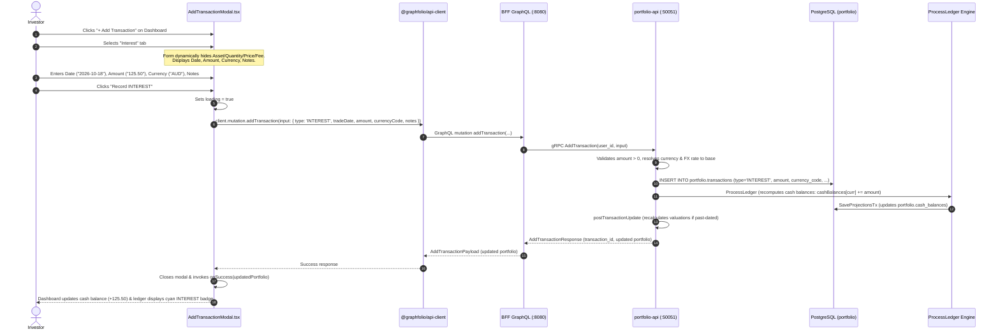

# Implementation Plan: Record Cash Interest Transactions

> **Feature Reference**: Transaction Ingestion & Cash Account Reconciliation  
> **Status**: Completed  
> **Story Reference**: [record-interest-transaction.md](file:///Users/oscargarcia/workspace/graphfolio/docs/user-stories/record-interest-transaction.md) (`US-TX-107`)  
> **Roadmap Reference**: [features.md (Section 3.6)](file:///Users/oscargarcia/workspace/graphfolio/features.md#L655)  
> **Calculation & Accounting Standard**: [financial-calculations skill](file:///Users/oscargarcia/workspace/graphfolio/.agents/skills/financial-calculations/SKILL.md) (Internal Cash Yield vs. External Capital Flows, GIPS® TWR & Modified Dietz Return Neutrality, Trade Date Recognition, Exact Fixed-Point Precision, Cash Balance Reconciliation)  
> **Target Layers**: Web Monorepo (`web/apps/main-app`), BFF (`bff/`), Portfolio Microservice (`services/portfolio-api`), Protobuf (`proto/portfolio/v1/`), Database (`portfolio.transactions`, `portfolio.cash_balances`)  
> **Branch**: `feat/record-interest`  

---

## 1. Executive Summary & Architectural Overview

The objective of this feature is to enable investors to manually record **"Interest"** transactions directly through the primary ingestion modal in GraphFolio (`AddTransactionModal.tsx`). This allows investors to account for monthly cash yields, cash management account (CMA) earnings, and idle cash sweep distributions, ensuring their on-screen cash accounts faithfully reflect their real-world brokerage statements without corrupting portfolio return metrics.

```
+----------------------------------------------------------------------------------------------------+
|  ADD TRANSACTION MODAL                                                                       [ X ] |
|                                                                                                    |
|  [ Buy ]  [ Sell ]  [ Dividend ]  [ Interest ]  [ Split ]  [ Deposit ]  [ Withdrawal ]             |
|                                         ^                                                          |
|                                    (Selected)                                                      |
|  ------------------------------------------------------------------------------------------------  |
|  Date:               [ 2026-10-18 ]                                                                |
|  Amount:             [ $ 125.50                                  ]                                 |
|  Currency:           [ AUD - Australian Dollar                 ▼ ]                                 |
|  Notes:              [ CommSec Cash Management Account Interest  ]                                 |
|  ------------------------------------------------------------------------------------------------  |
|                                                          [ Cancel ]   [ Add Interest Transaction ] |
+----------------------------------------------------------------------------------------------------+
```

### 1.1 The Business & Financial Problem Solved
1. **Accurate Cash Account Balances**:
   Modern retail brokerages (CommSec, nabtrade, Interactive Brokers, Webull) pay 4% to 5%+ annual cash yield on uninvested cash. Without manual interest recording, investors experience cash discrepancies where the tracked portfolio cash balance lags behind actual brokerage holdings, eventually causing negative cash balance errors on subsequent stock purchases.
2. **Elimination of Flawed Workarounds**:
   - *Workaround A (Recording as `DEPOSIT`)*: Mislabeled deposits are categorized under external flows ($F_t > 0$), which falsely inflates invested capital and artificially suppresses Time-Weighted Return (TWR) and Modified Dietz returns.
   - *Workaround B (Recording as `DIVIDEND`)*: Dividends require an equity ticker symbol, forcing investors to falsify equity holdings or create dummy assets.
3. **Internal Income Classification Under GIPS®**:
   By recording cash yield natively as `INTEREST`, the cash flow is recognized as internal investment income ($F_t \equiv 0.00$), correctly attributing the earned yield to investment return.

### 1.2 Architectural Readiness & Scope
- **Protobuf**: `proto/portfolio/v1/portfolio.proto` already defines `TRANSACTION_TYPE_INTEREST` and provides an optional `symbol` field in `AddTransactionRequest`. Zero protobuf schema changes or breaking contract changes are required.
- **Database**: PostgreSQL enum `portfolio.transaction_type` already contains `'INTEREST'`. The ledger replay engine (`service.ProcessLedger`) already handles `domain.TxTypeInterest` by incrementing `cashBalances[tx.CurrencyCode]`.
- **Primary Work Required**:
  1. `services/portfolio-api`: Implement `case domain.TxTypeInterest:` in `AddTransaction` and `UpdateTransaction` in `internal/service/transaction.go`.
  2. `web/apps/main-app`: Extend `AddTransactionModal.tsx` to include `INTEREST`, conditionally show/hide inputs, and apply cyan semantic styling in `AddTransactionModal.css`.
  3. Test Suites: Comprehensive unit tests in `transaction_test.go`, BFF resolver tests, and frontend component tests.

---

## 2. End-to-End Sequence Diagram



---

## 3. Layer-by-Layer Implementation Details

### 3.1 Microservice Layer (`services/portfolio-api`)

#### File: `internal/service/transaction.go`

##### 1. Add `domain.TxTypeInterest` handling in `AddTransaction`:
In `AddTransaction(ctx context.Context, input domain.AddTransactionInput)`:

```go
case domain.TxTypeInterest:
	if input.Amount == nil || !input.Amount.IsPositive() {
		return nil, nil, fmt.Errorf("service: positive amount is required for INTEREST")
	}

	currencyCode = portfolio.BaseCurrency
	if input.CurrencyCode != nil && *input.CurrencyCode != "" {
		currencyCode = *input.CurrencyCode
	}

	if currencyCode != portfolio.BaseCurrency {
		rate, err := s.repo.GetFXRate(ctx, currencyCode, portfolio.BaseCurrency)
		if err == nil && rate.IsPositive() {
			fxRateToBase = &rate
		}
	}

	feeCurrencyCode := currencyCode
	if input.FeeCurrencyCode != nil && *input.FeeCurrencyCode != "" {
		feeCurrencyCode = *input.FeeCurrencyCode
	}

	tx := domain.Transaction{
		PortfolioID:     portfolio.ID,
		Type:            input.Type,
		TradeDate:       tradeDate,
		Amount:          *input.Amount,
		CurrencyCode:    currencyCode,
		Fee:             fee,
		FeeCurrencyCode: &feeCurrencyCode,
		FXRateToBase:    fxRateToBase,
		Notes:           input.Notes,
	}

	savedTx, err := s.repo.InsertTransaction(ctx, tx)
	if err != nil {
		return nil, nil, fmt.Errorf("service: insert transaction: %w", err)
	}

	summary, err := s.postTransactionUpdate(ctx, userID, portfolio.ID, tradeDate)
	if err != nil {
		return nil, nil, err
	}

	return savedTx, summary, nil
```

##### 2. Extend `UpdateTransaction` for `TxTypeInterest`:
Allow editing existing interest transactions by updating line 493 of `internal/service/transaction.go`:

```diff
-	case domain.TxTypeDeposit, domain.TxTypeWithdrawal:
+	case domain.TxTypeDeposit, domain.TxTypeWithdrawal, domain.TxTypeInterest:
 		if input.Amount == nil || !input.Amount.IsPositive() {
 			return nil, nil, fmt.Errorf("service: positive amount is required for %s", input.Type)
 		}
```

#### File: `internal/service/transaction_test.go`
Add unit tests verifying:
1. `TestPortfolioService_AddTransaction_Interest_Success`:
   - Validates that recording an `INTEREST` transaction correctly inserts into repository.
   - Verifies that `ProcessLedger` adds net amount to `cashBalances`.
   - Verifies that external flow $F_t$ is zero and no instrument lookup is attempted.
2. `TestPortfolioService_AddTransaction_Interest_ValidationErrors`:
   - Validates that `Amount == nil` or `Amount <= 0` returns an error.
3. `TestPortfolioService_AddTransaction_Interest_ForeignCurrency`:
   - Validates that interest in a non-base currency (e.g. `USD` interest in an `AUD` portfolio) resolves the FX rate to base.

---

### 3.2 Backend-for-Frontend Layer (`bff/`)

#### File: `bff/graph/schema.resolvers.go`
Review `AddTransaction` mutation resolver:
```go
func (r *mutationResolver) AddTransaction(ctx context.Context, input model.AddTransactionInput) (*model.AddTransactionPayload, error) {
    // Current mapping passes input.Type (mapped via toProtoTransactionType), tradeDate, amount, currency, notes
    // For INTEREST, symbol is nil; req.Symbol defaults to ""
}
```
- Confirm `toProtoTransactionType` maps `model.TransactionTypeInterest` to `pb.TransactionType_TRANSACTION_TYPE_INTEREST`.
- Add test in `bff/graph/schema.resolvers_test.go` verifying that `addTransaction` with `type: INTEREST` succeeds without a symbol.

---

### 3.3 Frontend Layer (`web/apps/main-app`)

#### File: `src/components/AddTransactionModal.tsx`

##### 1. Update Types:
```tsx
type TransactionType = 'BUY' | 'SELL' | 'DIVIDEND' | 'INTEREST' | 'SPLIT' | 'DEPOSIT' | 'WITHDRAWAL';
```

##### 2. Update Type Tabs in JSX:
Insert `'INTEREST'` between `'DIVIDEND'` and `'SPLIT'`:
```tsx
<div className="type-tabs">
  {(['BUY', 'SELL', 'DIVIDEND', 'INTEREST', 'SPLIT', 'DEPOSIT', 'WITHDRAWAL'] as TransactionType[]).map((t) => (
    <button
      key={t}
      type="button"
      className={`type-tab ${type === t ? 'active' : ''} ${type === 'SELL' ? 'sell' : ''} ${type === 'SPLIT' ? 'split' : ''} ${type === 'INTEREST' ? 'interest' : ''}`}
      onClick={() => {
        setType(t);
        setError(null);
      }}
    >
      {t}
    </button>
  ))}
</div>
```

##### 3. Dynamic Field Visibility Rules:
- **Hide Instrument Selection**:
  ```tsx
  {(type === 'BUY' || type === 'SELL' || type === 'DIVIDEND' || type === 'SPLIT') && (
    <div className="form-group">
      <label>Asset / Ticker</label>
      {/* ... */}
    </div>
  )}
  ```
  *(Notice: `INTEREST` is excluded from asset picker).*
- **Hide Brokerage Fee**:
  Keep brokerage fee restricted strictly to `(type === 'BUY' || type === 'SELL')`.
- **Validation in `handleSubmit`**:
  ```tsx
  } else if (type === 'DEPOSIT' || type === 'WITHDRAWAL' || type === 'INTEREST') {
    if (!amount || parseFloat(amount) <= 0) throw new Error('Amount must be greater than zero.');
  }
  ```
- **Payload Construction**:
  ```tsx
  } else if (type === 'DEPOSIT' || type === 'WITHDRAWAL' || type === 'INTEREST') {
    input.amount = amount;
  }
  ```

#### File: `src/components/AddTransactionModal.css`

##### 1. Tab Highlight Styling:
Add cyan/teal active tab styling matching GraphFolio's semantic palette:
```css
.type-tab.active.interest {
  background: rgba(6, 182, 212, 0.9);
  color: #000;
  border-color: #22d3ee;
  box-shadow: 0 0 12px rgba(6, 182, 212, 0.45);
}
```

---

## 4. Financial & Accounting Mechanics

All financial operations adhere to the [financial-calculations skill](file:///Users/oscargarcia/workspace/graphfolio/.agents/skills/financial-calculations/SKILL.md) and GIPS® Standard 2.A:

### 4.1 Cash Balance Verification
When an interest transaction is entered:
$$\text{Cash Balance}_{\text{new}} = \text{Cash Balance}_{\text{prev}} + \text{Amount}$$

### 4.2 External Cash Flow & Return Metric Neutrality
- **External Cash Flow ($F_t$)**:
  $$\text{ExternalFlows}_t = \text{Deposits}_t - \text{Withdrawals}_t$$
  $$\text{ExternalFlow for INTEREST} \equiv 0.00$$
- **Time-Weighted Return ($R_t$)**:
  $$R_t = \frac{V_t - (V_{t-1} + F_t)}{V_{t-1} + F_t} = \frac{V_t - V_{t-1}}{V_{t-1}}$$
  Because $F_t = 0$, the cash added by interest increases ending value $V_t$, and is correctly attributed as portfolio return.
- **Modified Dietz ($R_{\text{Dietz}}$)**:
  $$R_{\text{Dietz}} = \frac{V_1 - V_0 - F}{V_0 + \sum (W_i \times F_i)}$$
  With $F = 0$, interest contributes to $V_1 - V_0$ in the numerator without entering the denominator, preserving the exact return calculation.

---

## 5. Phased Implementation Steps

### Phase 1: Portfolio Service Backend (`services/portfolio-api`)
1. Edit `internal/service/transaction.go`:
   - Add `case domain.TxTypeInterest:` in `AddTransaction`.
   - Update `case domain.TxTypeDeposit, domain.TxTypeWithdrawal, domain.TxTypeInterest:` in `UpdateTransaction`.
2. Add unit tests in `internal/service/transaction_test.go`:
   - Test successful ingestion, cash balance increment, and zero external cash flow.
   - Test non-positive amount rejection.
3. Run `go test ./...` in `services/portfolio-api`.

### Phase 2: BFF GraphQL Verification (`bff/`)
1. Verify `bff/graph/schema.resolvers.go` correctly passes symbol-free `INTEREST` inputs to gRPC.
2. Add unit test in `bff/graph/schema.resolvers_test.go`.
3. Run `go test ./...` in `bff/`.

### Phase 3: Frontend Ingestion Modal (`web/apps/main-app`)
1. Edit `AddTransactionModal.tsx`:
   - Update `TransactionType` union to include `'INTEREST'`.
   - Add `'INTEREST'` to the tab list with `.interest` class.
   - Verify conditional rendering hides equity inputs and shows cash inputs.
   - Update validation and mutation payload creation.
2. Edit `AddTransactionModal.css`:
   - Add `.type-tab.active.interest` styling.
3. Add unit test in `AddTransactionModal.test.tsx`:
   - Verify tab selection, field toggling, validation, and mutation call.
4. Run `npm test` or `oxlint` in `web/apps/main-app`.

### Phase 4: End-to-End Manual Verification
1. Launch full stack via `make run-all-web` / `make run-server`.
2. Open investor dashboard (`http://localhost:5173`).
3. Click `+ Add Transaction` -> Select `Interest`.
4. Enter `$150.00 AUD`, notes `"Macquarie CMA Cash Interest"`, click `Record INTEREST`.
5. Verify cash balance on the dashboard increments by `$150.00`.
6. Open Transaction Ledger -> verify cyan `INTEREST` badge.
7. Click "Interest" filter pill -> verify only the interest record displays.
8. Open Cash Flow Report -> verify interest is categorized under `INTEREST`.

---

## 6. Definition of Done (DoD) Checklist

- [x] `services/portfolio-api/internal/service/transaction.go` updated to support `domain.TxTypeInterest` in `AddTransaction` and `UpdateTransaction`.
- [x] Backend validates positive `Amount` and updates cash balances via deterministic projection engine (`ProcessLedger`).
- [x] Backend unit tests added in `transaction_test.go` verifying interest ingestion and return neutrality.
- [x] BFF GraphQL resolver verified to pass symbol-free `INTEREST` input to gRPC.
- [x] `AddTransactionModal.tsx` updated with `'INTEREST'` type, dedicated tab, and adapted field visibility.
- [x] `.type-tab.active.interest` styled with cyan design tokens in `AddTransactionModal.css`.
- [x] Unit and component tests pass cleanly across `services/portfolio-api`, `bff`, and `web/apps/main-app`.
- [x] No regression in other transaction types (`BUY`, `SELL`, `DIVIDEND`, `SPLIT`, `DEPOSIT`, `WITHDRAWAL`).
- [x] Implementation plan linked in `docs/user-stories/record-interest-transaction.md` and `features.md`.
