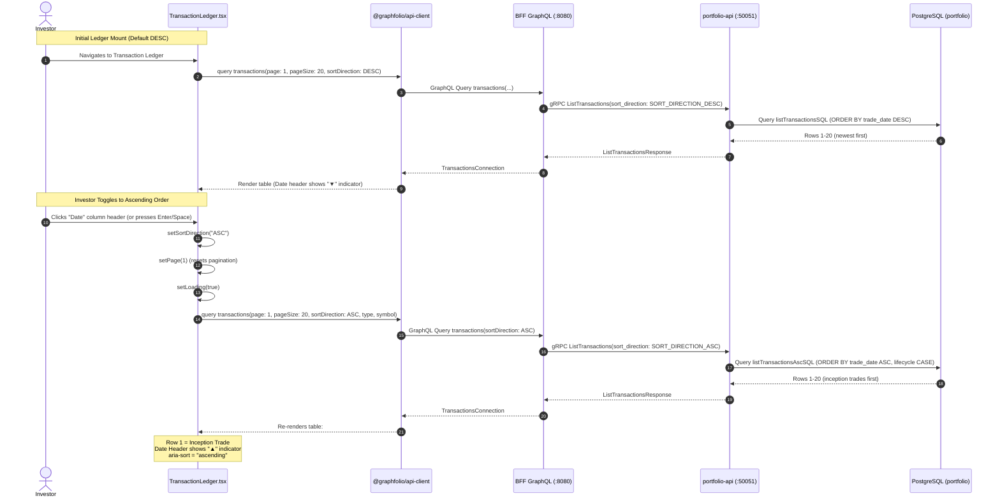
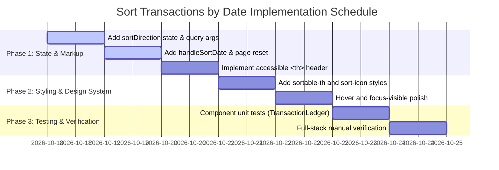

# Implementation Plan: Sort Transactions by Date in Transaction Ledger

> **Feature Reference**: Transaction Ledger Management & Investor Experience  
> **Status**: Completed  
> **Story Reference**: [sort-transactions-by-date-ledger.md](file:///Users/oscargarcia/workspace/graphfolio/docs/user-stories/sort-transactions-by-date-ledger.md) (`US-TX-104`)  
> **Roadmap Reference**: [FEATURES.md (Section 3.6)](file:///Users/oscargarcia/workspace/graphfolio/FEATURES.md)  
> **Calculation & Accounting Standard**: [financial-calculations skill](file:///Users/oscargarcia/workspace/graphfolio/.agents/skills/financial-calculations/SKILL.md) (Trade-Date Accounting, Chronological Inception-to-Date Auditing, Event Lifecycle Sequencing)  
> **Target Layers**: Web Monorepo (`web/apps/main-app`, `web/packages/api-client`, `web/packages/ui`), BFF (`bff/`), Portfolio Microservice (`services/portfolio-api`), Protobuf (`proto/portfolio/v1/`), Database (`portfolio.transactions`)  
> **Branch**: `feat/sort-transactions-by-date`  

---

## 1. Executive Summary & Architectural Overview

The objective of this feature is to empower investors to toggle the chronological sorting order of the **Transaction Ledger** table (`web/apps/main-app/src/components/TransactionLedger.tsx`) between **descending** (`DESC`, newest first) and **ascending** (`ASC`, oldest first) by clicking the **"Date"** column header.

```
+-----------------------------------------------------------------------------------------------------------------------+
|  TRANSACTION LEDGER                                                                                                   |
|  Complete history of trades, corporate actions, and cash flows.                   [ 📤 Export CSV ]  [ 📥 Import CSV ]|
+-----------------------------------------------------------------------------------------------------------------------+
|  [ All ] [ Buy ] [ Sell ] [ Dividend ] [ Split ] [ Deposit ] [ Withdrawal ]       [ 🔍 Search symbol (e.g. AAPL)   ] |
+-----------------------------------------------------------------------------------------------------------------------+
|  DATE ▲ / ▼    TYPE     ASSET               QUANTITY      PRICE        AMOUNT        FEE         NOTES       ACTIONS  |
|  (Clickable)                                                                                                          |
|  2021-03-15    DEPOSIT  Cash                -             -            $10,000.00    -           Opening cap [✏️] [🗑️] |
|  2021-03-16    BUY      BHP.AX BHP Group    100           $42.50       $4,269.95     $19.95      Core parcel [✏️] [🗑️] |
|  ...                                                                                                                  |
+-----------------------------------------------------------------------------------------------------------------------+
|  Page 1 of 12  [ < Prev ] [ Next > ]                                                                                  |
+-----------------------------------------------------------------------------------------------------------------------+
```

### 1.1 The Business & Financial Context
1. **Newest First (`DESC`) — Daily Operational Monitoring**: By default, investors want to inspect their most recent trades, newest dividend payouts, or yesterday's deposits at the top of the table. This matches current user expectations and remains the initial default state.
2. **Oldest First (`ASC`) — Historical Audit & Tax Reconciliation**: Serious investors auditing positions, reconciling tax lots, or verifying corporate actions (such as stock splits) need to inspect transactions forward from portfolio inception. Without ascending sorting, an investor with 500 transactions must paginate 25 times to view initial trades.
3. **Deterministic Intra-Day Sequencing**: When sorted in ascending order, transactions sharing the same trade date must follow an authoritative lifecycle sequence (`DEPOSIT` before `BUY` before `SELL` before `WITHDRAWAL`) so cash and inventory flows remain logically consistent.

### 1.2 Infrastructure Readiness Assessment
A technical audit reveals that GraphFolio's backend and API contract layers **already support bidirectional transaction sorting**:
- **Database (`portfolio.transactions`)**:
  - `listTransactionsSQL`: Orders by `t.trade_date DESC, t.created_at DESC, t.id DESC`.
  - `listTransactionsAscSQL`: Orders by `t.trade_date ASC`, transaction lifecycle priority CASE statement, `t.created_at ASC, t.id ASC`.
- **Portfolio Service (`services/portfolio-api`)**:
  - Repository `PostgresRepository.ListTransactions` conditionally switches to `listTransactionsAscSQL` when `filter.SortDirection == domain.SortDirectionAsc`.
  - gRPC server (`internal/server.go`) translates `req.SortDirection` to domain sort direction.
- **Protocol Buffers (`proto/portfolio/v1/portfolio.proto`)**:
  - `enum SortDirection { SORT_DIRECTION_UNSPECIFIED = 0; SORT_DIRECTION_DESC = 1; SORT_DIRECTION_ASC = 2; }`
  - `ListTransactionsRequest.sort_direction = 6`.
- **BFF Orchestrator (`bff/`)**:
  - Schema (`schema.graphqls`): `transactions(type: TransactionType, symbol: String, page: Int = 1, pageSize: Int = 20, sortDirection: SortDirection = DESC): TransactionsConnection!`.
  - Resolvers (`schema.resolvers.go`): Translates `model.SortDirection` (`ASC` / `DESC`) to gRPC `portfoliopb.SortDirection`.
- **Client SDK (`web/packages/api-client`)**:
  - Auto-generated Genql query supports `sortDirection?: (SortDirection | null)`.

**Conclusion**: The backend, API schema, and gRPC contracts are 100% complete. This implementation plan focuses entirely on **frontend state management, user interface interaction, visual indicators, accessibility (WCAG 2.1 AA), and end-to-end quality assurance** in `web/apps/main-app`.

---

## 2. End-to-End Sequence Diagram



---

## 3. Detailed Component & UI/UX Design

### 3.1 State Management & Hook Logic (`TransactionLedger.tsx`)

#### 1. Sort Direction State Declaration:
```tsx
// Sort direction state: 'DESC' (newest first, default) or 'ASC' (oldest first)
const [sortDirection, setSortDirection] = useState<'DESC' | 'ASC'>('DESC');
```

#### 2. Query Argument Binding & Debounce Effect:
In the existing `useEffect` fetching transactions:
```tsx
useEffect(() => {
  let isCancelled = false;
  const timer = setTimeout(() => {
    const args: any = {
      page,
      pageSize,
      sortDirection, // Explicitly pass active sort direction
    };
    if (selectedType) {
      args.type = selectedType;
    }
    const trimmed = symbolQuery.trim();
    if (trimmed) {
      args.symbol = trimmed.toUpperCase();
    }

    client
      .query({
        transactions: {
          __args: args,
          totalCount: true,
          page: true,
          pageSize: true,
          items: {
            id: true,
            type: true,
            symbol: true,
            instrumentName: true,
            tradeDate: true,
            quantity: true,
            price: { amount: true, currencyCode: true },
            amount: { amount: true, currencyCode: true },
            fee: { amount: true, currencyCode: true },
            withholdingTax: { amount: true, currencyCode: true },
            fxRateToBase: true,
            externalRef: true,
            notes: true,
            createdAt: true,
          },
        },
      })
      .then((res: any) => {
        if (!isCancelled) {
          if (res.transactions) {
            setTransactions(res.transactions.items || []);
            setTotalCount(res.transactions.totalCount || 0);
          }
          setLoading(false);
        }
      })
      .catch((err: any) => {
        if (!isCancelled) {
          console.error('Failed to fetch transactions:', err);
          setError('Failed to load transaction history.');
          setLoading(false);
        }
      });
  }, 250);

  return () => {
    isCancelled = true;
    clearTimeout(timer);
  };
}, [page, pageSize, selectedType, symbolQuery, sortDirection, refreshTrigger, reloadCount]);
```

#### 3. Sort Toggle Handler:
```tsx
const handleSortDate = () => {
  setSortDirection((prev) => (prev === 'DESC' ? 'ASC' : 'DESC'));
  setLoading(true);
  setPage(1); // Always reset to page 1 on sort direction toggle
};
```

---

### 3.2 Accessible Table Header Markup (WCAG 2.1 AA)

Transform the static `<th>Date</th>` into an interactive, keyboard-navigable element:

```tsx
<th
  className="sortable-th"
  onClick={handleSortDate}
  onKeyDown={(e) => {
    if (e.key === 'Enter' || e.key === ' ') {
      e.preventDefault();
      handleSortDate();
    }
  }}
  tabIndex={0}
  role="columnheader"
  aria-sort={sortDirection === 'ASC' ? 'ascending' : 'descending'}
  title={`Sorted by Date: ${
    sortDirection === 'DESC'
      ? 'Newest first (click to sort oldest first)'
      : 'Oldest first (click to sort newest first)'
  }`}
>
  <div className="th-content">
    <span>Date</span>
    <span className="sort-icon active" aria-hidden="true">
      {sortDirection === 'ASC' ? '▲' : '▼'}
    </span>
  </div>
</th>
```

---

### 3.3 CSS Styling Specifications (`TransactionLedger.css`)

Add styles to `web/apps/main-app/src/components/TransactionLedger.css` to match GraphFolio's dark glassmorphism design system (`@graphfolio/ui`):

```css
/* Sortable column header */
.ledger-table th.sortable-th {
  cursor: pointer;
  user-select: none;
  transition: color 0.2s ease, background-color 0.2s ease;
}

.ledger-table th.sortable-th:hover {
  color: var(--text-primary, #ffffff);
  background: rgba(255, 255, 255, 0.035);
}

.ledger-table th.sortable-th .th-content {
  display: inline-flex;
  align-items: center;
  gap: 0.35rem;
}

.ledger-table th.sortable-th .sort-icon {
  font-size: 0.72rem;
  opacity: 0.7;
  color: var(--accent-green, #10b981);
  transition: opacity 0.2s ease, transform 0.2s cubic-bezier(0.16, 1, 0.3, 1);
}

.ledger-table th.sortable-th:hover .sort-icon {
  opacity: 1;
}

.ledger-table th.sortable-th:focus-visible {
  outline: 2px solid var(--accent-green, #10b981);
  outline-offset: -2px;
  border-radius: 4px;
}
```

---

### 3.4 Integration & Interaction Matrix

| Interaction | System Behavior | Rationale / Invariant |
| :--- | :--- | :--- |
| **Initial Page Load** | Loads page 1 with `sortDirection = 'DESC'`. Date header shows `▼`. | Preserves backward compatibility and displays recent activity immediately. |
| **Click "Date" Header** | Toggles `sortDirection` to `'ASC'`, resets `page = 1`, shows loading state. Date header flips to `▲`. | Prevents viewing an out-of-range page offset under the new sort sequence. |
| **Active Type Filter (e.g. `BUY`)** | Toggling sort direction maintains `selectedType = 'BUY'`. | The user is auditing buys chronologically; filter state must be preserved. |
| **Active Symbol Search (e.g. `AAPL`)** | Toggling sort direction maintains `symbolQuery = 'AAPL'`. | The user is examining Apple trading history; search query must remain intact. |
| **Paging While in Ascending Order** | Clicking "Next" loads page 2 with `sortDirection = 'ASC'`. | User can browse chronologically forward across their entire ledger. |
| **In-Place Row Editing** | Clicking `[✏️ Edit]` opens `EditTransactionModal`. Preserves active sort on save. | Editing a transaction reloads ledger without resetting the user's preferred view. |
| **Row Deletion** | Clicking `[🗑️ Delete]` confirms deletion and reloads ledger under active sort order. | Portfolio state and ledger list remain synchronized. |
| **"Export CSV" Button** | Independent of table sort view; uses `exportTransactions` (always chronological ascending). | Standard accounting software requires forward chronological records regardless of UI view. |

---

## 4. Implementation Work Breakdown Structure (WBS)



### Phase 1: Component State Management & Markup
- [x] **Task 1.1**: Open `web/apps/main-app/src/components/TransactionLedger.tsx`.
- [x] **Task 1.2**: Declare `sortDirection` state (`const [sortDirection, setSortDirection] = useState<'DESC' | 'ASC'>('DESC');`).
- [x] **Task 1.3**: Update `handleSortDate` function to toggle between `'DESC'` and `'ASC'`, invoke `setLoading(true)`, and reset page to `1` (`setPage(1)`).
- [x] **Task 1.4**: Update the `useEffect` query arguments to pass `sortDirection: sortDirection` to the GraphQL query.
- [x] **Task 1.5**: Add `sortDirection` to the `useEffect` dependency array.
- [x] **Task 1.6**: Replace static `<th>Date</th>` with interactive `<th className="sortable-th">` including:
  - `onClick={handleSortDate}`
  - `onKeyDown` handler for `Enter` and `Space`
  - `tabIndex={0}`
  - `role="columnheader"`
  - `aria-sort={getSortHeaderAria(sortDirection)}`
  - `title={getSortHeaderTitle(sortDirection)}`
  - Active indicator `▲` (when `ASC`) or `▼` (when `DESC`).

### Phase 2: Styling & Design Tokens
- [x] **Task 2.1**: Open `web/apps/main-app/src/components/TransactionLedger.css`.
- [x] **Task 2.2**: Define `.ledger-table th.sortable-th`, `.th-content`, `.sort-icon`, and `.sort-icon.active`.
- [x] **Task 2.3**: Implement `:hover` background illumination and text color shift.
- [x] **Task 2.4**: Implement `:focus-visible` styling (`outline: 2px solid var(--accent-green)`) for keyboard navigability.
- [x] **Task 2.5**: Ensure responsive table layout preserves column widths and horizontal scroll integrity.

### Phase 3: Automated Testing & Verification
- [x] **Task 3.1**: Create component tests in `web/apps/main-app/src/components/TransactionLedger.test.ts`:
  - Verify default initial sort is `'DESC'` and displays `▼`.
  - Verify clicking "Date" header toggles state to `'ASC'` and renders `▲`.
  - Verify clicking "Date" header resets page from 3 to 1.
  - Verify pressing `Enter` on focused header toggles sort.
  - Verify query client receives `{ sortDirection: 'ASC' }` argument.
- [x] **Task 3.2**: Verify that active filters (`type`, `symbol`) are retained in query arguments during sort toggles.

### Phase 4: Manual Verification & Cross-Browser Validation
- [x] **Task 4.1**: Launch application (`npm run dev:main`).
- [x] **Task 4.2**: Test default load order: confirm recent transactions appear first with `▼`.
- [x] **Task 4.3**: Click "Date": confirm earliest transaction (portfolio inception) appears first on page 1 with `▲`.
- [x] **Task 4.4**: Click "Date" again: confirm newest transactions appear first with `▼`.
- [x] **Task 4.5**: Test pagination: browse to page 2, toggle sort, confirm table resets to page 1.
- [x] **Task 4.6**: Test filter persistence: select `Dividend` filter pill, toggle sort, confirm only dividends remain visible and sorted properly.
- [x] **Task 4.7**: Test search persistence: enter ticker symbol (e.g. `AAPL`), toggle sort, confirm search remains applied and sorted properly.
- [x] **Task 4.8**: Test row actions: edit a transaction while in ascending view; confirm modal works and active sort order is preserved on save.
- [x] **Task 4.9**: Test CSV Export: click "Export CSV" while in ascending view; confirm CSV download functions normally.

---

## 5. Quality Gates & Acceptance Verification Matrix

| Test ID | Scenario | Precondition / Input | Expected Result | Layer Tested |
| :--- | :--- | :--- | :--- | :--- |
| **TC-SORT-01** | **Default Render** | User navigates to Transaction Ledger | Table renders page 1 with `sortDirection = DESC`. Newest trades displayed on top. "Date" header shows `▼`. `aria-sort="descending"`. | Frontend State / UI |
| **TC-SORT-02** | **Toggle to Ascending** | User clicks "Date" header | GraphQL query sent with `sortDirection: "ASC"`. Table reloads. Inception trade appears on row 1. Header shows `▲`. `aria-sort="ascending"`. | Frontend / BFF / Service |
| **TC-SORT-03** | **Toggle to Descending** | User clicks "Date" header while in ASC | GraphQL query sent with `sortDirection: "DESC"`. Table reloads with newest trades. Header shows `▼`. | Frontend / BFF / Service |
| **TC-SORT-04** | **Pagination Reset** | User is on Page 3, clicks "Date" | `page` state is set to 1. Table loads page 1 of the new sort order. Pagination shows "Page 1 of N". | Frontend State |
| **TC-SORT-05** | **Filter Continuity** | `selectedType = "DIVIDEND"`, user clicks "Date" | Query includes both `type: "DIVIDEND"` and `sortDirection: "ASC"`. Only dividend records shown, ordered oldest first. Pill remains active. | Client Query / Filter |
| **TC-SORT-06** | **Search Continuity** | `symbolQuery = "AAPL"`, user clicks "Date" | Query includes both `symbol: "AAPL"` and `sortDirection: "ASC"`. Only AAPL records shown, ordered oldest first. | Client Query / Search |
| **TC-SORT-07** | **Same-Date Ordering** | Same-day DEPOSIT and BUY in portfolio | When sorted ASC, DEPOSIT appears before BUY (via `listTransactionsAscSQL` lifecycle CASE). | Database SQL Query |
| **TC-SORT-08** | **Keyboard Operability** | User tabs to "Date" header, presses `Enter` or `Space` | Header receives visible focus outline (`:focus-visible`). Keypress triggers `handleSortDate()`. | WCAG 2.1 AA Accessibility |
| **TC-SORT-09** | **Row Edit Stability** | User edits note on row 2 while in ASC | `EditTransactionModal` saves successfully. Ledger re-fetches and maintains ASC sort order without resetting to DESC. | Frontend State / Mutation |
| **TC-SORT-10** | **CSV Export Integrity** | User triggers CSV export while in ASC or DESC | Full transaction dataset downloads as CSV sorted chronologically ascending from inception. No formula injection. | CSV Export Service |

---

## 6. Risk Analysis & Mitigation Strategies

| Risk | Impact | Probability | Mitigation Strategy |
| :--- | :--- | :--- | :--- |
| **Stale Page Offset Bug** | High | Low | If an investor is on page 10 of a filtered view and toggles sort, an empty page could display if not reset. **Mitigation**: Enforce `setPage(1)` immediately inside `handleSortDate`. |
| **Double Fetch / Race Condition** | Medium | Low | Rapidly clicking the header could trigger multiple concurrent queries. **Mitigation**: Existing 250ms debounce timer and `isCancelled` flag in `useEffect` prevent duplicate queries and discard out-of-order responses. |
| **Inadvertent Export Sort Corruption** | High | Low | If CSV export inadvertently inherits table pagination sort instead of authoritative ascending sort. **Mitigation**: `exportTransactions` GraphQL query operates independently with its own unpaginated ascending query contract. |
| **Screen Reader Disorientation** | Medium | Low | Screen reader users unaware that clicking column changes entire table sequence. **Mitigation**: Provide semantic `aria-sort="ascending" | "descending"` and explicit descriptive `title` attributes. |

---

## 7. Definition of Done (DoD) Checklist

- [x] `sortDirection` state (`'DESC' | 'ASC'`) added to `TransactionLedger.tsx` with initial value `'DESC'`.
- [x] `sortDirection` passed to `client.query` args in `TransactionLedger.tsx`.
- [x] `handleSortDate` toggles sort direction and unconditionally resets page to `1`.
- [x] "Date" column header rendered with interactive `.sortable-th` class and `▲` / `▼` directional icons.
- [x] WCAG 2.1 AA compliance: `aria-sort`, `role="columnheader"`, `tabIndex={0}`, keyboard handlers (`Enter`, `Space`), and `:focus-visible` styling.
- [x] CSS additions in `TransactionLedger.css` match the dark glassmorphic theme and design tokens.
- [x] Unit and component test coverage validates default state, click toggling, page reset, and filter preservation.
- [x] Manual verification passes all 10 quality gate test cases in Section 5.
- [x] Both [sort-transactions-by-date-ledger.md](file:///Users/oscargarcia/workspace/graphfolio/docs/user-stories/sort-transactions-by-date-ledger.md) and [USER_STORIES.md](file:///Users/oscargarcia/workspace/graphfolio/docs/USER_STORIES.md) reference this implementation plan.
