# Implementation Plan: Tax Lot Inspector, Realized Capital Gains & Comprehensive Annual Tax Report

> **User Story**: [tax-lot-inspector-capital-gains.md](file:///Users/oscargarcia/workspace/graphfolio/docs/user-stories/tax-lot-inspector-capital-gains.md) (`US-TAX-101`)  
> **Epic**: Capital Gains, Tax Accounting & Lot Relief Optimization  
> **Status**: Ready for Implementation  
> **Standards Compliance**: [financial-calculations skill](file:///Users/oscargarcia/workspace/graphfolio/.agents/skills/financial-calculations/SKILL.md) (FIFO vs Average Cost lot relief, GIPS sub-1-year annualization prohibition, ATO 12-month 50% CGT discount rule, optimal loss application priority, wash-sale rule detection / 30-day bed-and-breakfasting, franking credit imputation gross-up, foreign tax offsets / FITO, exact fixed-point precision via `shopspring/decimal`)  
> **Target Layers**: Protobuf (`proto/portfolio/v1/`), Domain Microservice (`services/portfolio-api`), BFF (`bff/`), Web Monorepo (`web/apps/main-app`)  
> **Related Implementations**: [dynamic-cost-basis-switching.md](file:///Users/oscargarcia/workspace/graphfolio/docs/user-stories/dynamic-cost-basis-switching.md) (`US-TAX-102`), [user-preferences-financial-year-end.md](file:///Users/oscargarcia/workspace/graphfolio/docs/user-stories/user-preferences-financial-year-end.md) (`US-PREF-102`), [dividend-calendar-yield-analytics.md](file:///Users/oscargarcia/workspace/graphfolio/docs/user-stories/dividend-calendar-yield-analytics.md) (`US-DIV-101`), Database Migration `000005_tax_lots`  

---

## 1. Executive Summary & Financial Architecture

### 1.1 The Taxpayer's Problem Context
During tax preparation season, investors face an overwhelming administrative burden. Retail brokerages and standard portfolio trackers provide monolithic position averages that obscure individual purchase parcels and produce disconnected trade lists rather than statutory tax summaries. 

Tax authorities (including the Australian Taxation Office [ATO], US Internal Revenue Service [IRS], and UK HMRC) enforce strict rules regarding:
1. **Multi-Tranche Cost Basis Tracking**: Each purchase parcel carries an independent acquisition date, purchase price, capitalized brokerage fee, and currency conversion rate.
2. **Holding Period Thresholds & Concessions**: Holding an asset for at least 365 calendar days unlocks substantial tax relief (e.g. the ATO 50% CGT discount for individuals, or IRS long-term capital gains rates). Selling on Day 364 doubles the tax burden compared to selling on Day 366.
3. **Loss Offset Prioritization (Tax Minimization Principle)**: Realized capital losses must offset capital gains, but taxpayers are legally entitled to apply losses against short-term gains (taxed at 100%) before long-term gains, maximizing the benefit of the 50% CGT discount.
4. **Consolidated Assessable Income & Tax Offsets**: Annual tax returns require declaring **Total Assessable Income** (uniting cash dividends, interest income, net capital gains after statutory discounts, and attached imputation credits), while claiming **Tax Offsets** (franking credits and foreign tax offsets / FITO).

This implementation delivers a high-performance **Tax Lots & Annual Tax Report** hub within GraphFolio, combining:
- **Executive Top KPI Cards**: Total Assessable Income, Net Capital Gain (after CGT discount), Franking Credits, and Foreign Tax Offsets.
- **Dual Visual Summary Cards**:
  1. **Taxable Income Summary**: Showing the proportional contribution of Dividend & Interest Income, Net Capital Gains, and Franking Credits with colored progress ratio bars (Amber, Coral, Purple).
  2. **Capital Gains Summary**: Presenting the statutory waterfall—Total Capital Gains, Losses Applied (with interactive loss-ordering tooltip `ⓘ`), 50% CGT Discount, and Net Capital Gain.
- **Sub-View Navigation Tabs**:
  - `[ 📊 Tax Return Summary ]`: Executive dashboard and category breakdowns.
  - `[ 📜 Realized Disposals Schedule ]`: Granular parcel-level disposal audit trail with holding period days, term classifications, and RFC 4180 CSV export.
  - `[ 🔍 Open Tax Lots & TLH Scanner ]`: Active parcel inventory with unrealized PnL, "Days to Discount" countdown badges, wash-sale guards, and tax-loss harvesting candidates.
  - `[ 💵 Income & Tax Offsets ]`: Itemized dividend and interest receipts, withholding taxes, and franking credits.
- **Interactive Holding Drilldown Modal (`TaxLotInspectorModal.tsx`)**: Direct parcel inspection triggered from the primary Dashboard Holdings table.

---

### 1.2 Financial, Mathematical & Statutory Tax Accounting Mechanics

All monetary calculations, lot depletion, and holding duration calculations must strictly adhere to the [financial-calculations skill](file:///Users/oscargarcia/workspace/graphfolio/.agents/skills/financial-calculations/SKILL.md) and use arbitrary-precision fixed-point arithmetic (`shopspring/decimal`).

#### 1. Tax Lot Acquisition Cost Basis Formulation
For an acquisition transaction $T_{\text{buy}}$ of instrument $i$ on trade date $t_{\text{acq}}$:

$$Q_{\text{orig}} = Q_{\text{buy}}$$

$$\text{CostBasis}_{\text{local}} = \text{Amount}_{\text{buy}} + \text{BrokerageFee}_{\text{local}}$$

$$\text{CostBasis}_{\text{base}} = (\text{Amount}_{\text{buy}} \times \text{FX}(C_i \to C_{\text{base}}, t_{\text{acq}})) + \text{BrokerageFee}_{\text{base}}$$

$$\text{UnitCostBasis}_{\text{base}} = \frac{\text{CostBasis}_{\text{base}}}{Q_{\text{orig}}}$$

*Brokerage Capitalization*: Incidental acquisition costs (brokerage commissions and exchange fees) are capitalized into the asset's tax cost basis under US GAAP ASC 946, ATO s 110-25, and HMRC TCGA 1992 s 38.

#### 2. Realized Capital Gain/Loss on Disposal
When matching and relieving an open lot $k$ for quantity $\Delta Q_k$ upon execution of a disposal transaction $T_{\text{sell}}$ on trade date $t_{\text{sell}}$:

$$\text{NetProceeds}_{\text{base}} = (\text{Amount}_{\text{sell}} \times \text{FX}(C_i \to C_{\text{base}}, t_{\text{sell}})) - \text{BrokerageFee}_{\text{base}}$$

$$\text{CostBasisReleased}_{\text{base}, k} = \text{CostBasis}_{\text{base}, k} \times \left( \frac{\Delta Q_k}{Q_{\text{remaining}, k}} \right)$$

$$\text{LotProceeds}_{\text{base}, k} = \text{NetProceeds}_{\text{base}} \times \left( \frac{\Delta Q_k}{Q_{\text{sell}}} \right)$$

$$\text{RealizedPnL}_{\text{base}, k} = \text{LotProceeds}_{\text{base}, k} - \text{CostBasisReleased}_{\text{base}, k}$$

#### 3. Holding Period & Statutory Term Classification
The holding duration $D_{\text{holding}}$ measures elapsed calendar days:

$$D_{\text{holding}} = t_{\text{disposal}} - t_{\text{acq}}$$

- **Short-Term (< 365 Days)**: Assets held less than 365 days. Taxed at standard marginal rates with zero CGT discount.
- **Long-Term ($\ge 365$ Days)**: Assets held for 365 days or longer. Eligible for statutory concessions (such as the ATO 50% CGT discount).
- **ATO Day-Exclusion Rule (ITAA 1997 s 115-25)**: The day of acquisition is excluded, requiring an asset to be held for at least 12 whole months before disposal. For example, shares bought on 15 March 2024 become eligible on 16 March 2025.

#### 4. Capital Gains Waterfall & Optimal Loss Offsetting (Section 3.5)
For any fiscal period $[T_{\text{start}}, T_{\text{end}}]$:

1. **Total Capital Gains**:
   $$\text{TotalCapitalGains}_{\text{base}} = \sum_{k \in \text{Disposals}, \text{PnL}_k > 0} \text{RealizedPnL}_{\text{base}, k} = G_{\text{ST}} + G_{\text{LT}}$$
   Where $G_{\text{ST}}$ is the sum of short-term gains and $G_{\text{LT}}$ is the sum of long-term gains.

2. **Total Capital Losses**:
   $$\text{TotalCapitalLosses}_{\text{base}} = \sum_{k \in \text{Disposals}, \text{PnL}_k < 0} |\text{RealizedPnL}_{\text{base}, k}|$$

3. **Losses Applied**:
   $$\text{LossesApplied}_{\text{base}} = \min(\text{TotalCapitalGains}_{\text{base}}, \text{TotalCapitalLosses}_{\text{base}} + \text{PriorYearLossesCarriedForward})$$

4. **Optimal Loss Offsetting Order**:
   Under tax law (ATO ITAA 1997 s 102-5), taxpayers can apply losses in the order that minimizes net taxable income. Losses are applied **first against Short-Term gains** ($G_{\text{ST}}$), preserving the 50% CGT discount on remaining long-term gains:
   $$\text{Remaining } G_{\text{ST}} = \max(0, G_{\text{ST}} - \text{LossesApplied})$$
   $$\text{LossesAllocatedToLongTerm} = \max(0, \text{LossesApplied} - G_{\text{ST}})$$
   $$\text{Remaining } G_{\text{LT}} = \max(0, G_{\text{LT}} - \text{LossesAllocatedToLongTerm})$$

5. **CGT Discount (50% Concession)**:
   $$\text{CGTDiscount}_{\text{base}} = 0.50 \times \text{Remaining } G_{\text{LT}}$$

6. **Net Capital Gain**:
   $$\text{NetCapitalGain}_{\text{base}} = \text{Remaining } G_{\text{ST}} + (\text{Remaining } G_{\text{LT}} - \text{CGTDiscount}_{\text{base}})$$
   $$\equiv \text{TotalCapitalGains}_{\text{base}} - \text{LossesApplied}_{\text{base}} - \text{CGTDiscount}_{\text{base}}$$

*Numerical Example from Report*:
- Total capital gains = $\$6,064.99$
- Losses applied = $-\$350.17$
- CGT discount 50% = $-\$2,857.41$
- Net capital gain = $\mathbf{\$2,857.41}$

#### 5. Total Assessable Income Formulation (Section 3.6)
$$\text{TotalAssessableIncome}_{\text{base}} = \text{DividendAndInterestIncome}_{\text{base}} + \text{NetCapitalGain}_{\text{base}} + \text{FrankingCredits}_{\text{base}}$$

Where:
- $\text{DividendAndInterestIncome}_{\text{base}}$: Sum of cash dividends and cash interest received across the financial year converted to base currency.
- $\text{FrankingCredits}_{\text{base}}$ (**Imputation Gross-Up**): Franking credits attached to domestic dividends must be included ("grossed up") into assessable income.
- $\text{NetCapitalGain}_{\text{base}}$: Statutory net capital gain after losses and CGT discount.

*Numerical Example from Report*:
- Dividend & interest income = $\$2,966.80$
- Capital gains (Net) = $\$2,857.41$
- Franking credits = $\$300.33$
- Total assessable income = $\mathbf{\$6,124.54}$ ($\$2,966.80 + \$2,857.41 + \$300.33 \equiv \$6,124.54$)

*Proportional Progress Bar Ratios*:
$$\text{Ratio}_{\text{div\_int}} = \frac{\$2,966.80}{\$6,124.54} \times 100\% = 48.44\% \quad (\text{Amber / Orange Bar})$$
$$\text{Ratio}_{\text{cgt}} = \frac{\$2,857.41}{\$6,124.54} \times 100\% = 46.66\% \quad (\text{Coral / Red Bar})$$
$$\text{Ratio}_{\text{franking}} = \frac{\$300.33}{\$6,124.54} \times 100\% = 4.90\% \quad (\text{Purple Bar})$$

#### 6. Tax Offsets (Section 3.7)
- **Franking Credits Offset (\$300.33)**: Refundable tax offset.
- **Foreign Tax Offsets / FITO (\$324.18)**: Non-refundable tax offset representing foreign withholding taxes ($\sum \text{withholding\_tax}$) deducted at source on foreign dividends.

#### 7. Tax-Loss Harvesting (TLH) Scoring & Wash-Sale Detection
- **TLH Candidate Badge**: Triggered if $\text{UnrealizedPnL}_{\text{base}, j} < 0$, absolute loss $> \$500$ base currency, and loss percentage $<-10\%$.
- **Wash-Sale Guard (IRS §1091 / HMRC 30-Day Rule)**: Triggered if a `BUY` transaction for the same instrument occurred within 30 days prior to or following the evaluation date.

---

## 2. Technical Architecture & End-to-End Data Flow

```mermaid
flowchart TD
    subgraph UI ["web/apps/main-app (:5173)"]
        ReportsView["ReportsView.tsx (Tab: '📜 Tax Lots & CGT')"]
        TaxHub["TaxLotsReport.tsx"]
        KPIStrip["TaxReportKPIStrip.tsx (4 Cards)"]
        DualCards["DualSummaryCards.tsx (Taxable Income & CGT Waterfall)"]
        SubTabs["SubViewSwitcher: [ Summary | Disposals | Open Lots | Income ]"]
        DisposalsTable["RealizedDisposalsTable.tsx (CSV Exporter)"]
        OpenLotsTable["OpenTaxLotsTable.tsx (TLH Scanner & Wash-Sale Alert)"]
        IncomeTable["TaxIncomeOffsetsTable.tsx (Dividends & Offsets)"]
        InspectorModal["TaxLotInspectorModal.tsx (Drilldown from Dashboard)"]

        ReportsView --> TaxHub
        TaxHub --> KPIStrip
        TaxHub --> DualCards
        TaxHub --> SubTabs
        SubTabs --> DisposalsTable
        SubTabs --> OpenLotsTable
        SubTabs --> IncomeTable
        TaxHub --> InspectorModal
    end

    subgraph BFF ["bff (:8080)"]
        GQLSchema["bff/graph/schema.graphqls"]
        GQLResolvers["bff/graph/schema.resolvers.go"]
        GQLTaxReport["query taxReport(financialYear, fromDate, toDate)"]
        GQLTaxLots["query taxLots(instrumentId, status)"]
        GQLExport["query exportTaxScheduleCSV(financialYear)"]

        GQLSchema --> GQLResolvers
        GQLResolvers --> GQLTaxReport
        GQLResolvers --> GQLTaxLots
        GQLResolvers --> GQLExport
    end

    subgraph UserAPI ["services/user-api (:50052)"]
        UserSvc["internal/service/user.go: GetUserPreferences (EOFY Month/Day)"]
    end

    subgraph PortfolioAPI ["services/portfolio-api (:50051)"]
        GRPCServer["internal/server.go: gRPC Handlers"]
        TaxService["internal/service/tax_lot.go"]
        TaxReportDomain["internal/domain/tax_report.go (Pure Financial Calculator)"]
        TaxLotDomain["internal/domain/tax_lot.go (Lot Matching & TLH Rules)"]
        Repo["internal/repository/postgres.go"]

        GRPCServer --> TaxService
        TaxService --> Repo
        TaxService --> TaxReportDomain
        TaxService --> TaxLotDomain
    end

    subgraph DB ["PostgreSQL (portfolio schema)"]
        TaxLots["portfolio.tax_lots (Migration 000005)"]
        LotDisposals["portfolio.lot_disposals (Migration 000005)"]
        Transactions["portfolio.transactions (BUY, SELL, DIVIDEND, INTEREST, WHT)"]
        DividendSchedules["portfolio.dividend_schedules (franking_pct)"]
        Prices["portfolio.instrument_prices & portfolio.fx_rates"]

        Repo --> TaxLots
        Repo --> LotDisposals
        Repo --> Transactions
        Repo --> DividendSchedules
        Repo --> Prices
    end

    TaxHub -->|GraphQL query| GQLTaxReport
    TaxHub -->|GraphQL query| GQLTaxLots
    DisposalsTable -->|CSV Export query| GQLExport
    GQLResolvers -->|Resolve EOFY| UserSvc
    GQLResolvers -->|gRPC GetTaxReport| GRPCServer
    GQLResolvers -->|gRPC ListTaxLots| GRPCServer
```



---

## 3. Database Layer & Ledger Replay Analysis

### 3.1 Existing Tables & Migrations
The database foundation was already created in `000005_tax_lots.up.sql`:
1. **`portfolio.tax_lots`**:
   - `id` (UUIDv7), `portfolio_id`, `instrument_id`, `open_transaction_id`, `acquired_date` (DATE), `original_quantity`, `remaining_quantity`, `cost_basis`, `cost_basis_base`.
   - Index `tax_lots_open_idx` on `(portfolio_id, instrument_id, acquired_date, id) WHERE remaining_quantity > 0`.
2. **`portfolio.lot_disposals`**:
   - `id` (UUIDv7), `tax_lot_id`, `sell_transaction_id`, `quantity`, `cost_basis_released_base`, `proceeds_base`, `realized_pnl_base`.
3. **`portfolio.transactions`**:
   - Contains `amount`, `fee`, `withholding_tax`, `fx_rate_to_base`, `trade_date`, `type` (`BUY`, `SELL`, `DIVIDEND`, `INTEREST`).
4. **`portfolio.dividend_schedules`**:
   - Contains `franking_pct` and `ex_date` for Australian domestic corporate dividends.

### 3.2 Required Index Addition
To optimize financial year date-range slicing joining `lot_disposals` with `transactions`:

```sql
-- Migration 000012_lot_disposals_reporting_index.up.sql
CREATE INDEX IF NOT EXISTS lot_disposals_cgt_reporting_idx
    ON portfolio.lot_disposals (sell_transaction_id, tax_lot_id);
```

---

## 4. Protobuf Contract Specifications (`proto/portfolio/v1/portfolio.proto`)

Add the following messages and service RPCs to `proto/portfolio/v1/portfolio.proto`:

```protobuf
enum TaxLotStatus {
  TAX_LOT_STATUS_UNSPECIFIED = 0;
  TAX_LOT_STATUS_OPEN        = 1;
  TAX_LOT_STATUS_CLOSED      = 2;
  TAX_LOT_STATUS_ALL         = 3;
}

enum HoldingTermClassification {
  HOLDING_TERM_UNSPECIFIED = 0;
  HOLDING_TERM_SHORT_TERM  = 1; // Held < 365 days
  HOLDING_TERM_LONG_TERM   = 2; // Held >= 365 days (CGT discount eligible)
}

message TaxLotItem {
  string                    id                          = 1;
  string                    portfolio_id                = 2;
  string                    instrument_id               = 3;
  string                    ticker                      = 4;
  string                    name                        = 5;
  string                    open_transaction_id         = 6;
  string                    acquired_date               = 7;  // YYYY-MM-DD
  string                    closed_date                 = 8;  // YYYY-MM-DD (null if open)
  common.v1.Decimal         original_quantity           = 9;
  common.v1.Decimal         remaining_quantity          = 10;
  common.v1.Money           cost_basis                  = 11; // In instrument currency
  common.v1.Money           cost_basis_base             = 12; // In portfolio base currency
  common.v1.Money           unit_cost_base              = 13; // Cost basis per share
  common.v1.Money           current_price               = 14;
  common.v1.Money           market_value_base           = 15;
  common.v1.Money           unrealized_pnl_base         = 16;
  common.v1.Decimal         unrealized_pnl_percent      = 17;
  int32                     holding_period_days         = 18;
  HoldingTermClassification term_classification         = 19;
  bool                      is_cgt_discount_eligible    = 20;
  bool                      is_loss_harvesting_candidate = 21;
  bool                      has_wash_sale_risk          = 22;
}

message ListTaxLotsRequest {
  string          user_id       = 1;
  optional string instrument_id = 2; // Optional filter by ticker / asset
  TaxLotStatus    status        = 3; // OPEN, CLOSED, or ALL
}

message ListTaxLotsResponse {
  repeated TaxLotItem tax_lots = 1;
}

message RealizedDisposalItem {
  string                    disposal_id                 = 1;
  string                    tax_lot_id                  = 2;
  string                    sell_transaction_id         = 3;
  string                    instrument_id               = 4;
  string                    ticker                      = 5;
  string                    name                        = 6;
  string                    acquired_date               = 7;  // YYYY-MM-DD
  string                    disposed_date               = 8;  // YYYY-MM-DD
  common.v1.Decimal         quantity_disposed           = 9;
  common.v1.Money           cost_basis_relieved_base    = 10;
  common.v1.Money           proceeds_base               = 11;
  common.v1.Money           realized_pnl_base           = 12;
  common.v1.Decimal         realized_pnl_percent        = 13;
  int32                     holding_period_days         = 14;
  HoldingTermClassification term_classification         = 15;
  bool                      is_cgt_discount_eligible    = 16;
  common.v1.Money           discounted_taxable_pnl_base = 17; // 50% discount if eligible
}

message TaxableIncomeSummary {
  common.v1.Money   dividend_and_interest_income = 1;
  common.v1.Money   net_capital_gains            = 2;
  common.v1.Money   franking_credits             = 3;
  common.v1.Money   total_assessable_income      = 4;
  common.v1.Decimal dividend_interest_ratio_pct  = 5; // e.g. 48.44%
  common.v1.Decimal capital_gains_ratio_pct      = 6; // e.g. 46.66%
  common.v1.Decimal franking_credits_ratio_pct   = 7; // e.g. 4.90%
}

message CapitalGainsSummary {
  common.v1.Money   total_capital_gains          = 1;
  common.v1.Money   losses_applied               = 2;
  common.v1.Money   cgt_discount_amount          = 3; // 50% discount for eligible long-term
  common.v1.Money   net_capital_gain             = 4;
  common.v1.Decimal cgt_discount_rate_pct        = 5; // e.g. 50.0%
  int32             gain_disposals_count         = 6;
  int32             loss_disposals_count         = 7;
}

message TaxOffsetsSummary {
  common.v1.Money   franking_credits_offset      = 1; // Available refundable imputation offset
  common.v1.Money   foreign_tax_offsets          = 2; // Available non-refundable foreign withholding offset (FITO)
  common.v1.Money   total_available_offsets      = 3;
}

message TaxReportSummary {
  TaxableIncomeSummary taxable_income            = 1;
  CapitalGainsSummary  capital_gains             = 2;
  TaxOffsetsSummary    tax_offsets               = 3;
  string               fiscal_year_label         = 4; // e.g. "FY2025-2026"
  string               base_currency             = 5;
}

message GetTaxReportRequest {
  string          user_id      = 1;
  optional int32  fiscal_year  = 2; // e.g. 2026
  optional string from_date    = 3; // YYYY-MM-DD
  optional string to_date      = 4; // YYYY-MM-DD
}

message GetTaxReportResponse {
  TaxReportSummary              summary              = 1;
  repeated RealizedDisposalItem disposals            = 2;
  repeated TaxLotItem           open_lots            = 3;
  string                        from_date            = 4;
  string                        to_date              = 5;
  string                        fiscal_year_label    = 6;
  string                        base_currency        = 7;
}

message RealizedGainsSummary {
  common.v1.Money   total_proceeds_base         = 1;
  common.v1.Money   total_cost_basis_relieved   = 2;
  common.v1.Money   gross_realized_gains_base   = 3;
  common.v1.Money   gross_realized_losses_base  = 4;
  common.v1.Money   net_realized_pnl_base       = 5;
  common.v1.Money   short_term_gains_base       = 6;
  common.v1.Money   long_term_gains_base        = 7;
  common.v1.Money   discounted_taxable_gain_base = 8;
  int32             total_disposal_count        = 9;
}

message GetRealizedGainsReportRequest {
  string          user_id     = 1;
  optional string from_date   = 2; // YYYY-MM-DD
  optional string to_date     = 3; // YYYY-MM-DD
  optional int32  fiscal_year = 4; // e.g. 2025 (FY25)
}

message GetRealizedGainsReportResponse {
  RealizedGainsSummary          summary       = 1;
  repeated RealizedDisposalItem disposals     = 2;
  string                        from_date     = 3;
  string                        to_date       = 4;
  string                        base_currency = 5;
}

service PortfolioService {
  // ... existing RPCs ...
  rpc ListTaxLots(ListTaxLotsRequest) returns (ListTaxLotsResponse) {}
  rpc GetRealizedGainsReport(GetRealizedGainsReportRequest) returns (GetRealizedGainsReportResponse) {}
  rpc GetTaxReport(GetTaxReportRequest) returns (GetTaxReportResponse) {}
}
```

---

## 5. Domain Models & Service Implementation (`services/portfolio-api`)

### 5.1 Domain Layer (`internal/domain/tax_lot.go` & `internal/domain/tax_report.go`)
1. **Tax Lot Domain Model**:
   ```go
   type TaxLot struct {
       ID                uuid.UUID
       PortfolioID       uuid.UUID
       InstrumentID      uuid.UUID
       Ticker            string
       Name              string
       OpenTransactionID uuid.UUID
       AcquiredDate      time.Time
       ClosedDate        *time.Time
       OriginalQuantity  decimal.Decimal
       RemainingQuantity decimal.Decimal
       CostBasis         decimal.Decimal
       CostBasisBase     decimal.Decimal
       UnitCostBase      decimal.Decimal
       CurrentPrice      decimal.Decimal
       MarketValueBase   decimal.Decimal
       UnrealizedPnLBase decimal.Decimal
       UnrealizedPnLPct  decimal.Decimal
       HoldingDays       int
       Term              HoldingTermClassification
       IsCGTDiscountEligible bool
       IsTLHCandidate    bool
       HasWashSaleRisk   bool
   }
   ```
2. **Pure Tax Report Calculator (`internal/domain/tax_report.go`)**:
   - `CalculateHoldingDays(acqDate, evalDate time.Time) int`
   - `IsCGTDiscountEligible(acqDate, disposalDate time.Time) bool`: Respects the ATO 12-month calendar logic (acquisition date excluded; held full 365+ days).
   - `CalculateCapitalGainsWaterfall(disposals []LotDisposal) CapitalGainsSummary`:
     - Aggregates $G_{\text{ST}}$, $G_{\text{LT}}$, and $L_{\text{total}}$.
     - Applies losses against $G_{\text{ST}}$ first, preserving $G_{\text{LT}}$ for 50% discount.
     - Computes 50% CGT discount on remaining $G_{\text{LT}}$.
     - Computes Net Capital Gain.
   - `CalculateTaxableIncomeSummary(dividendIncome, interestIncome, frankingCredits, netCapitalGain decimal.Decimal) TaxableIncomeSummary`:
     - Computes Total Assessable Income as the exact sum.
     - Computes proportional percentage ratios for the visual progress bars.
   - `IsLossHarvestingCandidate(unrealizedLoss decimal.Decimal, unrealizedPct decimal.Decimal) bool`:
     - Checks loss $> \$500$ and $<-10\%$.

### 5.2 Repository Layer (`internal/repository/postgres.go`)
1. `GetTaxLots(ctx context.Context, portfolioID uuid.UUID, instrumentID *uuid.UUID, status TaxLotStatus) ([]domain.TaxLot, error)`:
   - Joins `portfolio.tax_lots tl` with `portfolio.instruments i` and `portfolio.prices p`.
2. `GetRealizedDisposals(ctx context.Context, portfolioID uuid.UUID, fromDate, toDate time.Time) ([]domain.LotDisposal, error)`:
   - Joins `portfolio.lot_disposals ld`, `portfolio.tax_lots tl`, `portfolio.transactions tx_sell`, and `portfolio.instruments i`.
3. `GetTaxReportIncomeAndOffsets(ctx context.Context, portfolioID uuid.UUID, fromDate, toDate time.Time) (dividendIncome, interestIncome, frankingCredits, foreignTaxOffsets decimal.Decimal, err error)`:
   - Slices `DIVIDEND` and `INTEREST` transactions in date range.
   - Sums `withholding_tax * fx_rate_to_base` for Foreign Tax Offsets (FITO).
   - Joins `portfolio.dividend_schedules` to calculate franking credits for Australian domestic dividends ($DPS \times Q_{\text{entitled}} \times \frac{\text{franking\_pct} \times 0.30}{1 - 0.30}$).

### 5.3 Service Layer (`internal/service/tax_lot.go`)
- `GetTaxReport(ctx context.Context, userID string, fiscalYear *int32, fromDate, toDate *string) (*domain.TaxReport, error)`:
  1. Resolves user portfolio and base currency.
  2. Resolves fiscal year date boundaries if fiscal year is specified.
  3. Loads disposals, computes capital gains waterfall.
  4. Loads income transactions, franking credits, and withholding taxes.
  5. Computes assessable income and visual progress bar ratios.
  6. Loads active open lots with TLH and wash-sale risk indicators.

---

## 6. BFF GraphQL Layer (`bff/`)

### 6.1 GraphQL Schema (`bff/graph/schema.graphqls`)

```graphql
enum TaxLotStatus {
  OPEN
  CLOSED
  ALL
}

enum HoldingTermClassification {
  SHORT_TERM
  LONG_TERM
}

type TaxLot {
  id: ID!
  instrumentId: ID!
  ticker: String!
  name: String!
  openTransactionId: ID!
  acquiredDate: String!
  closedDate: String
  originalQuantity: String!
  remainingQuantity: String!
  costBasis: Money!
  costBasisBase: Money!
  unitCostBase: Money!
  currentPrice: Money!
  marketValueBase: Money!
  unrealizedPnlBase: Money!
  unrealizedPnlPercent: String!
  holdingPeriodDays: Int!
  termClassification: HoldingTermClassification!
  isCgtDiscountEligible: Boolean!
  isLossHarvestingCandidate: Boolean!
  hasWashSaleRisk: Boolean!
}

type RealizedDisposal {
  disposalId: ID!
  taxLotId: ID!
  sellTransactionId: ID!
  instrumentId: ID!
  ticker: String!
  name: String!
  acquiredDate: String!
  disposedDate: String!
  quantityDisposed: String!
  costBasisRelievedBase: Money!
  proceedsBase: Money!
  realizedPnlBase: Money!
  realizedPnlPercent: String!
  holdingPeriodDays: Int!
  termClassification: HoldingTermClassification!
  isCgtDiscountEligible: Boolean!
  discountedTaxablePnlBase: Money!
}

type TaxableIncomeSummary {
  dividendAndInterestIncome: Money!
  netCapitalGains: Money!
  frankingCredits: Money!
  totalAssessableIncome: Money!
  dividendInterestRatioPct: String!
  capitalGainsRatioPct: String!
  frankingCreditsRatioPct: String!
}

type CapitalGainsSummary {
  totalCapitalGains: Money!
  lossesApplied: Money!
  cgtDiscountAmount: Money!
  netCapitalGain: Money!
  cgtDiscountRatePct: String!
  gainDisposalsCount: Int!
  lossDisposalsCount: Int!
}

type TaxOffsetsSummary {
  frankingCreditsOffset: Money!
  foreignTaxOffsets: Money!
  totalAvailableOffsets: Money!
}

type TaxReportSummary {
  taxableIncome: TaxableIncomeSummary!
  capitalGains: CapitalGainsSummary!
  taxOffsets: TaxOffsetsSummary!
  fiscalYearLabel: String!
  baseCurrency: String!
}

type TaxReport {
  summary: TaxReportSummary!
  disposals: [RealizedDisposal!]!
  openLots: [TaxLot!]!
  fromDate: String!
  toDate: String!
  fiscalYearLabel: String!
  baseCurrency: String!
}

extend type Query {
  taxReport(financialYear: Int, fromDate: String, toDate: String): TaxReport!
  taxLots(instrumentId: ID, status: TaxLotStatus): [TaxLot!]!
  realizedCapitalGainsReport(financialYear: Int, fromDate: String, toDate: String): RealizedGainsReport!
  exportTaxScheduleCSV(financialYear: Int, fromDate: String, toDate: String): String!
}
```

### 6.2 Resolvers & CSV Exporter (`bff/graph/schema.resolvers.go`)
- `taxReport`:
  - Calls `userService.GetUserPreferences` to resolve `financial_year_end_month` and `financial_year_end_day`.
  - Determines statutory start and end dates (e.g. 1 Jul 2025 to 30 Jun 2026 for FY26).
  - Calls `portfolioService.GetTaxReport` and maps decimal scalars.
- `exportTaxScheduleCSV`:
  - Generates RFC 4180 compliant CSV string containing disposal rows with exact headers:
    `Sell Date, Asset, Ticker, Acquisition Date, Holding Days, Term, Quantity Disposed, Relieved Cost Basis (Base), Gross Proceeds (Base), Brokerage Fees (Base), Net Capital Gain/Loss (Base), CGT Discount (50%), Taxable Net Gain`.

---

## 7. Frontend Monorepo Implementation (`web/apps/main-app`)

### 7.1 Component Architecture & Hierarchy
```text
web/apps/main-app/src/components/
├── ReportsView.tsx                 # Enables "📜 Tax Lots & CGT" tab button
├── TaxLotsReport.tsx               # Main container with data-fetching & tab state
│   ├── TaxReportKPIStrip.tsx       # Top 4 KPI metric cards (Total Assessable, Net CGT, Franking, FITO)
│   ├── DualSummaryCards.tsx        # Two-column container
│   │   ├── TaxableIncomeSummaryCard.tsx # Income rows with Amber, Coral, Purple ratio bars
│   │   └── CapitalGainsSummaryCard.tsx  # CGT waterfall with loss offset tooltip ⓘ
│   ├── RealizedDisposalsTable.tsx  # Disposal schedule table with CSV download trigger
│   ├── OpenTaxLotsTable.tsx        # Parcel inventory with TLH badges and wash-sale warnings
│   └── TaxIncomeOffsetsTable.tsx   # Itemized dividend, interest, franking & withholding taxes
└── TaxLotInspectorModal.tsx        # Modal drilldown from Dashboard Holdings table
```

### 7.2 Visual Polish & Styling Tokens
- **Top KPI Cards**: Dark glassmorphic background `rgba(255, 255, 255, 0.03)` with subtle border `rgba(255, 255, 255, 0.08)`.
- **Proportional Progress Bars**:
  - `Dividend & Interest Income`: `#f59e0b` (Amber/Orange).
  - `Capital Gains (Net)`: `#ef4444` (Coral/Crimson).
  - `Franking Credits`: `#8b5cf6` (Royal Purple).
- **Interactive Tooltip (`ⓘ`)**: Tooltip on `Losses applied` explaining:
  *"Capital losses are applied first against short-term capital gains (taxed at ordinary rates) before offsetting long-term gains, maximizing the benefit of the 50% CGT discount."*
- **Disposal & Lot Status Badges**:
  - `[LONG-TERM]`: Emerald green badge (`#34d399`).
  - `[SHORT-TERM]`: Amber yellow badge (`#fbbf24`).
  - `[TLH CANDIDATE]`: Crimson red pulse badge (`#f87171`).
  - `[XD TO DISCOUNT]`: Cyan countdown badge (`#22d3ee`).
  - `[WASH SALE RISK]`: Orange warning badge (`#f97316`).

---

## 8. Step-by-Step Implementation Roadmap

### Phase 1: Database Index & Protobuf Definitions
- [ ] Create database migration `000012_lot_disposals_reporting_index.up.sql`.
- [ ] Add `TaxableIncomeSummary`, `CapitalGainsSummary`, `TaxOffsetsSummary`, `TaxReportSummary`, `TaxLotItem`, and `RealizedDisposalItem` to `proto/portfolio/v1/portfolio.proto`.
- [ ] Add `ListTaxLots`, `GetRealizedGainsReport`, and `GetTaxReport` RPCs to `PortfolioService`.
- [ ] Run `make proto-gen` to compile Go stubs.

### Phase 2: Domain Calculators & Repository Queries (`services/portfolio-api`)
- [ ] Create `internal/domain/tax_lot.go` (models, holding days, TLH candidates, wash-sale check).
- [ ] Create `internal/domain/tax_report.go` (capital gains waterfall, loss allocation, assessable income summation, ratio bar percentages).
- [ ] Write unit tests for domain calculators in `internal/domain/tax_report_test.go` and `internal/domain/tax_lot_test.go`.
- [ ] Implement `GetTaxLots`, `GetRealizedDisposals`, and `GetTaxReportIncomeAndOffsets` in `internal/repository/postgres.go`.

### Phase 3: Service Layer & gRPC Handlers (`services/portfolio-api`)
- [ ] Create `internal/service/tax_lot.go` implementing business logic, authorization, and financial year boundaries.
- [ ] Wire service handlers into `internal/server.go`.
- [ ] Write service-level unit tests using `MockRepository`.

### Phase 4: BFF GraphQL Schema & Resolvers (`bff/`)
- [ ] Add GraphQL types, enums, and queries to `bff/graph/schema.graphqls`.
- [ ] Run `make bff-gen` to regenerate gqlgen boilerplate.
- [ ] Implement resolvers in `bff/graph/schema.resolvers.go` (resolving user EOFY from `user-api`).
- [ ] Implement CSV generation helper `exportTaxScheduleCSV`.
- [ ] Write resolver unit tests in `bff/graph/schema.resolvers_test.go`.

### Phase 5: Web Frontend Components (`web/apps/main-app`)
- [ ] Update `packages/api-client` by running codegen.
- [ ] Update `src/components/ReportsView.tsx` to enable the "📜 Tax Lots & CGT" tab.
- [ ] Build `TaxReportKPIStrip.tsx` (Top 4 KPI metric cards).
- [ ] Build `DualSummaryCards.tsx`, `TaxableIncomeSummaryCard.tsx` (with proportional progress bars), and `CapitalGainsSummaryCard.tsx` (with waterfall and loss tooltip).
- [ ] Build `RealizedDisposalsTable.tsx` with CSV download action.
- [ ] Build `OpenTaxLotsTable.tsx` with TLH scanner and wash-sale warnings.
- [ ] Build `TaxIncomeOffsetsTable.tsx` for dividends and offsets.
- [ ] Assemble `TaxLotsReport.tsx` with sub-tab navigation and financial year dropdown.

### Phase 6: Holdings Table Drilldown Integration
- [ ] Create `TaxLotInspectorModal.tsx`.
- [ ] Add parcel drilldown icon/button to holdings rows in `web/apps/main-app/src/components/Dashboard.tsx`.

### Phase 7: Verification & Documentation
- [ ] Run backend unit tests: `go test -v ./...`.
- [ ] Run frontend typecheck and build: `npm run build`.
- [ ] Verify cent-accurate arithmetic matching the UI specification.
- [ ] Update `docs/USER_STORIES.md` and `FEATURES.md`.

---

## 9. Verification & Test Matrix

| Test ID | Test Scenario | Expected Outcome |
|---|---|---|
| **TEST-TAX-01** | Asset acquired 2024-03-15 evaluated on 2025-03-14 | Returns `SHORT_TERM` (364 days), `is_cgt_discount_eligible = false`, displays `1D TO DISCOUNT` |
| **TEST-TAX-02** | Asset acquired 2024-03-15 evaluated on 2025-03-16 | Returns `LONG_TERM` (366 days), `is_cgt_discount_eligible = true`, displays `[LONG-TERM]` |
| **TEST-TAX-03** | Gross Gains \$6,064.99, Gross Losses \$350.17 | Losses applied = \$350.17, remaining long-term = \$5,714.82, 50% discount = \$2,857.41, Net CGT = \$2,857.41 |
| **TEST-TAX-04** | Loss allocation sequencing with mixed gains | Losses apply to short-term gains first before long-term gains, preserving the 50% discount |
| **TEST-TAX-05** | Assessable income exact cent summation | Div/Int (\$2,966.80) + CGT (\$2,857.41) + Franking (\$300.33) = Total Assessable Income (\$6,124.54) |
| **TEST-TAX-06** | Visual progress bar ratio percentages | Div/Int 48.44% (Amber), CGT 46.66% (Coral), Franking 4.90% (Purple) |
| **TEST-TAX-07** | Stock split parcel adjustment (2:1 split) | Quantities double, unit cost halves, total cost basis remains invariant |
| **TEST-TAX-08** | Tax-loss harvesting candidate detection | Open lot with loss $> \$500$ and $<-10\%$ flagged with `[TLH CANDIDATE]` |
| **TEST-TAX-09** | Wash-sale guard detection | Buy trade executed within 30 days flags `has_wash_sale_risk = true` |
| **TEST-TAX-10** | Australian EOFY Slicing (30 June) | FY25 strictly includes transactions from 1 Jul 2024 to 30 Jun 2025 |

---

## 10. Definition of Done (DoD) Checklist

- [ ] **Protobuf Contract**: `proto/portfolio/v1/portfolio.proto` compiled cleanly with all summary, item, and RPC messages.
- [ ] **Database & Migrations**: Index created on `portfolio.lot_disposals` for efficient date slicing.
- [ ] **Domain & Service Tests**: $>90\%$ test coverage on capital gains waterfall, loss sequencing, and assessable income math.
- [ ] **GraphQL BFF**: Schema types and queries operational with accurate user EOFY preference resolution.
- [ ] **Frontend Implementation**:
  - Top 4 KPI cards rendering cleanly with design tokens.
  - Dual reconciliation summary cards rendering with proportional colored progress bars.
  - Sub-views (Summary, Disposals, Open Lots, Income & Offsets) functional with reactive filters.
  - RFC 4180 CSV export working cleanly.
  - Drilldown modal working from Dashboard holdings table.
- [ ] **Documentation**: `docs/user-stories/tax-lot-inspector-capital-gains.md`, `docs/USER_STORIES.md`, and `FEATURES.md` cross-referenced and updated.
