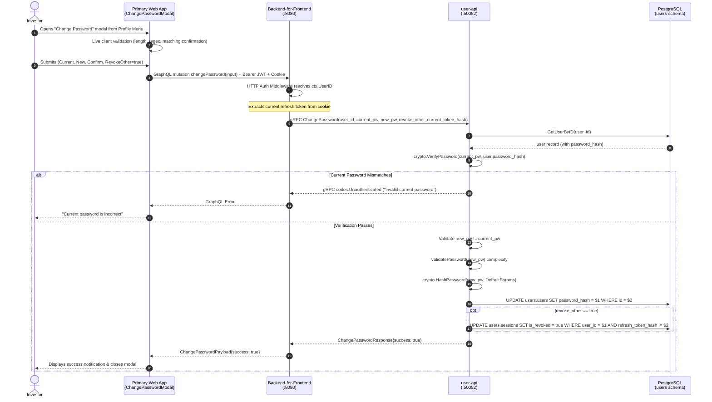

# Implementation Plan: User Password Change & Session Invalidation

> **Feature Reference**: User Identity, Security & Credential Management  
> **Status**: **DONE**  
> **Roadmap Reference**: [FEATURES.md (Feature #36)](file:///Users/oscargarcia/workspace/graphfolio/FEATURES.md)  
> **Security Standards**: OWASP ASVS v4.0 Level 2 (Sections 2.1 & 2.2), NIST SP 800-63B Section 5.1.1.2 (Memorized Secret Verifiers), RFC 9106 (Argon2id)  
> **Target Layers**: Protobuf (`proto/user/v1/`), User Microservice (`services/user-api`), BFF (`bff/`), Web Monorepo (`web/apps/main-app`, `web/packages/api-client`, `web/packages/ui`)  

---

## 1. Executive Summary & Architectural Overview

The objective of this feature is to empower authenticated investors to securely change their account password directly from the primary web application while preventing unauthorized credential modifications, mitigating timing attacks, and enforcing NIST/OWASP credential standards.

### 1.1 Security Requirements & Design Principles

1. **Current Password Re-Authentication**:
   - In accordance with OWASP ASVS v4.0 Section 2.1.2, any credential update must verify the investor's current password to prevent unauthorized takeover on unattended or compromised client devices.
2. **NIST SP 800-63B Password Complexity Validation**:
   - The new password must satisfy institutional-grade complexity constraints:
     - Minimum 10 characters (up to 128 characters).
     - At least 1 uppercase letter (`[A-Z]`).
     - At least 1 lowercase letter (`[a-z]`).
     - At least 1 numerical digit (`[0-9]`).
     - At least 1 special character (`[!@#$%^&*()_+-=[]{}|;':",./<>?~]`).
3. **Password Re-Use Prevention**:
   - The new password must not be identical to the current password (`new_password != current_password`).
4. **Argon2id Re-Hashing (RFC 9106)**:
   - The verified new password is cryptographically hashed with RFC 9106 parameters: $m=64\text{MB}$ (`65536` KiB), $t=3\text{ iterations}$, $p=4\text{ lanes}$, 16-byte cryptographically secure random salt, and 32-byte derived key.
5. **Session Invalidation & Revocation**:
   - Investors can elect to revoke all other active sessions (devices, background tabs) upon password modification.
   - The current session's refresh token is preserved (or rotated) so the active user is not abruptly logged out, while all stale or stolen tokens on other devices are immediately revoked in `users.sessions`.
6. **Timing Attack Protection**:
   - If the requesting user record cannot be resolved, a dummy Argon2id hash verification is executed in constant time to prevent user enumeration / timing side-channel attacks.

---

### 1.2 End-to-End Sequence Diagram



---

## 2. Protocol Buffers Contract (`proto/user/v1/user.proto`)

### 2.1 RPC & Message Definitions

Extend [proto/user/v1/user.proto](file:///Users/oscargarcia/workspace/graphfolio/proto/user/v1/user.proto) with the `ChangePassword` contract:

```protobuf
service UserService {
  // Existing RPCs
  rpc Register(RegisterRequest) returns (RegisterResponse);
  rpc Login(LoginRequest) returns (LoginResponse);
  rpc RefreshToken(RefreshTokenRequest) returns (RefreshTokenResponse);
  rpc Logout(LogoutRequest) returns (LogoutResponse);
  rpc GetMe(GetMeRequest) returns (GetMeResponse);
  rpc GetUserPreferences(GetUserPreferencesRequest) returns (GetUserPreferencesResponse);
  rpc UpdateUserPreferences(UpdateUserPreferencesRequest) returns (UpdateUserPreferencesResponse);
  rpc ListSupportedCurrencies(ListSupportedCurrenciesRequest) returns (ListSupportedCurrenciesResponse);

  // New Credential Management RPC
  rpc ChangePassword(ChangePasswordRequest) returns (ChangePasswordResponse);
}

message ChangePasswordRequest {
  string user_id = 1;
  string current_password = 2;
  string new_password = 3;
  bool revoke_other_sessions = 4;
  string current_refresh_token = 5;
}

message ChangePasswordResponse {
  bool success = 1;
  string message = 2;
}
```

---

## 3. Microservice Layer (`services/user-api`)

### 3.1 Domain Errors (`internal/service/service.go`)

Add standard domain errors:

```go
var (
    ErrInvalidCurrentPassword   = errors.New("invalid current password")
    ErrSamePassword             = errors.New("new password cannot be the same as current password")
    ErrPasswordComplexityFailed = errors.New("new password does not meet complexity requirements")
)
```

### 3.2 Repository Layer (`internal/repository/`)

1. **Interface Update** ([internal/repository/repository.go](file:///Users/oscargarcia/workspace/graphfolio/services/user-api/internal/repository/repository.go)):
   ```go
   type Repository interface {
       // ... existing methods ...
       UpdatePassword(ctx context.Context, id uuid.UUID, passwordHash string) error
       RevokeOtherUserSessions(ctx context.Context, userID uuid.UUID, currentTokenHash string) error
   }
   ```

2. **PostgreSQL Implementation** ([internal/repository/postgres.go](file:///Users/oscargarcia/workspace/graphfolio/services/user-api/internal/repository/postgres.go)):
   ```go
   func (r *postgresRepository) UpdatePassword(ctx context.Context, id uuid.UUID, passwordHash string) error {
       query := `
           UPDATE users.users
           SET password_hash = $1, updated_at = now()
           WHERE id = $2 AND is_active = true
       `
       res, err := r.pool.Exec(ctx, query, passwordHash, id)
       if err != nil {
           return fmt.Errorf("failed to update password: %w", err)
       }
       if res.RowsAffected() == 0 {
           return ErrUserNotFound
       }
       return nil
   }

   func (r *postgresRepository) RevokeOtherUserSessions(ctx context.Context, userID uuid.UUID, currentTokenHash string) error {
       query := `
           UPDATE users.sessions
           SET is_revoked = true, updated_at = now()
           WHERE user_id = $1 
             AND is_revoked = false
             AND ($2 = '' OR refresh_token_hash != $2)
       `
       _, err := r.pool.Exec(ctx, query, userID, currentTokenHash)
       if err != nil {
           return fmt.Errorf("failed to revoke other sessions: %w", err)
       }
       return nil
   }
   ```

### 3.3 Service Business Logic (`internal/service/service.go`)

Add `ChangePassword` to `UserService` interface and struct:

```go
func (s *userService) ChangePassword(
    ctx context.Context,
    userID string,
    currentPassword string,
    newPassword string,
    revokeOtherSessions bool,
    currentRefreshToken string,
) error {
    uid, err := parseUserID(userID)
    if err != nil {
        return ErrInvalidUserID
    }

    // 1. Fetch user by ID
    user, err := s.repo.GetUserByID(ctx, uid)
    if err != nil {
        if errors.Is(err, repository.ErrUserNotFound) {
            // Timing-attack mitigation
            _, _ = crypto.VerifyPassword(currentPassword, crypto.DummyHash)
            return ErrInvalidCredentials
        }
        return err
    }

    if !user.IsActive {
        return ErrAccountInactive
    }

    // 2. Verify current password
    match, err := crypto.VerifyPassword(currentPassword, user.PasswordHash)
    if err != nil || !match {
        return ErrInvalidCurrentPassword
    }

    // 3. Prevent identical password reuse
    if currentPassword == newPassword {
        return ErrSamePassword
    }

    // 4. Validate new password complexity
    if err := validatePassword(newPassword); err != nil {
        return ErrPasswordComplexityFailed
    }

    // 5. Hash new password with Argon2id
    newHashedPassword, err := crypto.HashPassword(newPassword, crypto.DefaultParams)
    if err != nil {
        return fmt.Errorf("failed to hash password: %w", err)
    }

    // 6. Persist new password hash
    if err := s.repo.UpdatePassword(ctx, uid, newHashedPassword); err != nil {
        return err
    }

    // 7. Revoke other active sessions if requested
    if revokeOtherSessions {
        var currentHash string
        if currentRefreshToken != "" {
            currentHash = auth.HashRefreshToken(strings.TrimSpace(currentRefreshToken))
        }
        _ = s.repo.RevokeOtherUserSessions(ctx, uid, currentHash)
    }

    return nil
}
```

### 3.4 gRPC Server Handler (`internal/server.go`)

```go
func (s *UserServer) ChangePassword(
    ctx context.Context,
    req *userpb.ChangePasswordRequest,
) (*userpb.ChangePasswordResponse, error) {
    if s.svc == nil {
        return nil, status.Error(codes.Unavailable, "user service unavailable")
    }
    if req == nil {
        return nil, status.Error(codes.InvalidArgument, "request cannot be nil")
    }

    err := s.svc.ChangePassword(
        ctx,
        req.GetUserId(),
        req.GetCurrentPassword(),
        req.GetNewPassword(),
        req.GetRevokeOtherSessions(),
        req.GetCurrentRefreshToken(),
    )
    if err != nil {
        switch {
        case errors.Is(err, service.ErrInvalidCurrentPassword):
            return nil, status.Error(codes.Unauthenticated, "current password is incorrect")
        case errors.Is(err, service.ErrSamePassword):
            return nil, status.Error(codes.InvalidArgument, "new password cannot be the same as current password")
        case errors.Is(err, service.ErrPasswordComplexityFailed), errors.Is(err, service.ErrInvalidPassword):
            return nil, status.Error(codes.InvalidArgument, "new password does not satisfy complexity requirements")
        case errors.Is(err, service.ErrInvalidUserID):
            return nil, status.Error(codes.InvalidArgument, "invalid user id")
        case errors.Is(err, service.ErrAccountInactive):
            return nil, status.Error(codes.PermissionDenied, "account is inactive")
        default:
            return nil, status.Errorf(codes.Internal, "failed to change password: %v", err)
        }
    }

    return &userpb.ChangePasswordResponse{
        Success: true,
        Message: "Password updated successfully",
    }, nil
}
```

---

## 4. Backend-for-Frontend Orchestration (`bff/`)

### 4.1 GraphQL Schema (`bff/graph/schema.graphqls`)

Add mutation and input types:

```graphql
input ChangePasswordInput {
  currentPassword: String!
  newPassword: String!
  revokeOtherSessions: Boolean = true
}

type ChangePasswordPayload {
  success: Boolean!
  message: String!
}

extend type Mutation {
  changePassword(input: ChangePasswordInput!): ChangePasswordPayload!
}
```

### 4.2 GraphQL Resolver (`bff/graph/schema.resolvers.go`)

```go
func (r *mutationResolver) ChangePassword(
    ctx context.Context,
    input model.ChangePasswordInput,
) (*model.ChangePasswordPayload, error) {
    userID := resolveUserID(ctx)
    if userID == "" {
        return nil, ErrUnauthenticated
    }

    revokeOthers := true
    if input.RevokeOtherSessions != nil {
        revokeOthers = *input.RevokeOtherSessions
    }

    // Extract current refresh token from cookie if available
    var refreshToken string
    if cookie, err := getRefreshTokenFromCookie(ctx); err == nil {
        refreshToken = cookie
    }

    res, err := r.userClient.ChangePassword(ctx, &userpb.ChangePasswordRequest{
        UserId:              userID,
        CurrentPassword:     input.CurrentPassword,
        NewPassword:         input.NewPassword,
        RevokeOtherSessions: revokeOthers,
        CurrentRefreshToken: refreshToken,
    })
    if err != nil {
        return nil, mapGrpcError(err)
    }

    return &model.ChangePasswordPayload{
        Success: res.GetSuccess(),
        Message: res.GetMessage(),
    }, nil
}
```

---

## 5. Frontend Web Monorepo (`web/apps/main-app`)

### 5.1 UI Architecture

1. **`ChangePasswordModal.tsx` & `ChangePasswordModal.css`**:
   - Dark glassmorphic modal with backdrop blur.
   - Form fields:
     - **Current Password** (input type `password`, toggle view/hide).
     - **New Password** (input type `password`, toggle view/hide, live `PasswordStrengthMeter` integration).
     - **Confirm New Password** (input type `password`, match indicator).
     - **"Sign out of all other devices" checkbox** (checked by default).
   - Real-time validation:
     - Disables "Update Password" button if new password criteria are not met or confirmation mismatches.
     - Warning banner if new password matches current password.
   - Status feedback:
     - Loading spinner while submitting.
     - Red alert banner for error messages returned by BFF/gRPC.
     - Green success banner on successful completion with auto-close timer.

2. **`UserProfileMenu.tsx`**:
   - Add new action item:
     ```tsx
     <button
       type="button"
       className="dropdown-item"
       onClick={() => {
         setIsOpen(false);
         onOpenChangePassword();
       }}
     >
       <span className="item-icon">🔑</span>
       <span>Change Password</span>
     </button>
     ```

3. **`App.tsx` Integration**:
   - Maintain state `isChangePasswordOpen: boolean`.
   - Render `<ChangePasswordModal isOpen={isChangePasswordOpen} onClose={() => setIsChangePasswordOpen(false)} />`.

---

## 6. Implementation Phasing & Task Checklist

### Phase 1: Protobuf Contracts & Code Generation
- [x] Update [proto/user/v1/user.proto](file:///Users/oscargarcia/workspace/graphfolio/proto/user/v1/user.proto) with `ChangePasswordRequest` and `ChangePasswordResponse`.
- [x] Run `make generate` to compile protobuf Go code across services and BFF.

### Phase 2: Microservice Persistence & Logic (`services/user-api`)
- [x] Extend `Repository` interface and implement `UpdatePassword` & `RevokeOtherUserSessions` in `internal/repository/postgres.go`.
- [x] Implement `ChangePassword` in `internal/service/service.go` with Argon2id re-hashing and complexity checks.
- [x] Implement `ChangePassword` gRPC handler in `internal/server.go`.
- [x] Write unit tests:
  - Repository mock tests for password update and session revocation.
  - Service tests for invalid current password, identical password, complexity failure, and success paths.
  - gRPC server handler tests.

### Phase 3: BFF GraphQL Layer (`bff/`)
- [x] Update [bff/graph/schema.graphqls](file:///Users/oscargarcia/workspace/graphfolio/bff/graph/schema.graphqls) with `changePassword` mutation and payload types.
- [x] Run `make generate` to generate gqlgen resolver stubs.
- [x] Implement `ChangePassword` resolver in [bff/graph/schema.resolvers.go](file:///Users/oscargarcia/workspace/graphfolio/bff/graph/schema.resolvers.go).
- [x] Write resolver unit tests covering authenticated, unauthenticated, and error paths.

### Phase 4: Frontend Implementation (`web/`)
- [x] Regenerate `@graphfolio/api-client` GraphQL client bindings.
- [x] Create `ChangePasswordModal.tsx` and `ChangePasswordModal.css` in `web/apps/main-app/src/components/`.
- [x] Update `UserProfileMenu.tsx` to include the `Change Password` action item.
- [x] Mount modal in `Dashboard.tsx` and verify end-to-end user interaction.

### Phase 5: Verification & Documentation
- [x] Run all Go unit tests (`make test`).
- [x] Run frontend linter and build (`make build`).
- [x] Update `FEATURES.md` and `README.md` to reflect password management capabilities.

