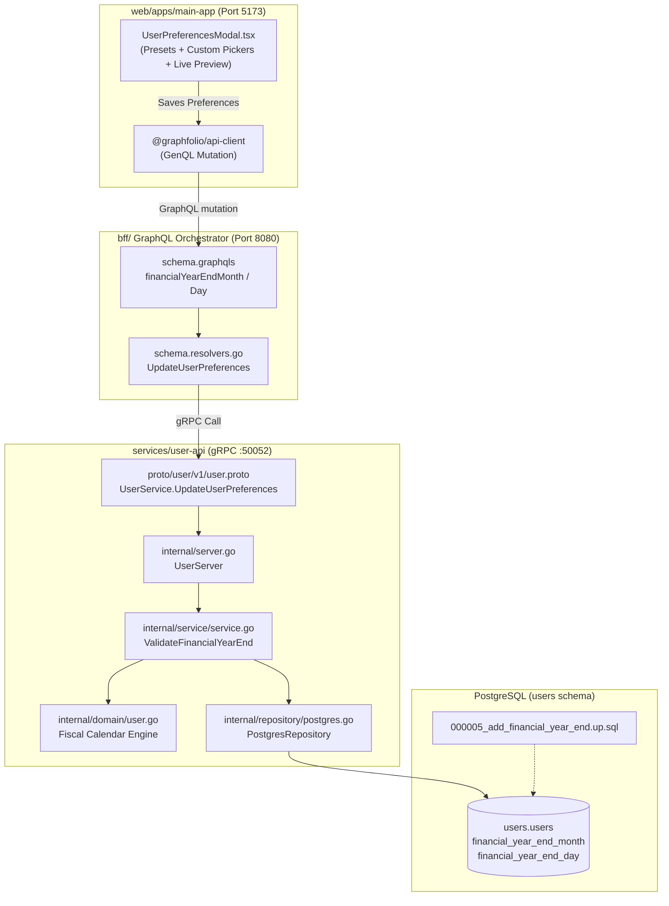
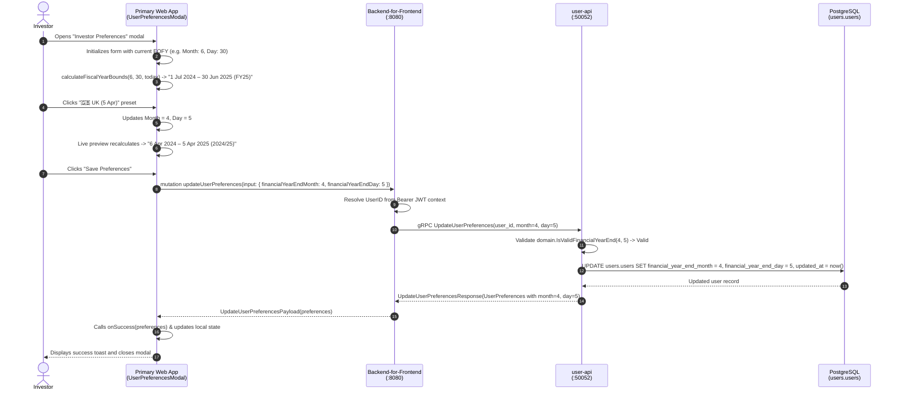

# Implementation Plan: User Preferences — End of Financial Year (EOFY) Configuration

> **Feature Reference**: User Identity, Profile Preferences & Multi-Jurisdictional Tax Accounting Configuration  
> **User Story**: [user-preferences-financial-year-end.md](file:///Users/oscargarcia/workspace/graphfolio/docs/user-stories/user-preferences-financial-year-end.md) (`US-PREF-102`)  
> **Master Catalog**: [USER_STORIES.md](file:///Users/oscargarcia/workspace/graphfolio/docs/USER_STORIES.md#L50) (Entry #42)  
> **Status**: **DONE**  
> **Target Layers**: Database (`users.users`), Protobuf (`proto/user/v1/`), User Microservice (`services/user-api`), BFF (`bff/`), Web Monorepo (`web/apps/main-app`, `web/packages/api-client`, `web/packages/ui`)  
> **Calculation & Accounting Standard**: [financial-calculations skill](file:///Users/oscargarcia/workspace/graphfolio/.agents/skills/financial-calculations/SKILL.md) (Multi-Jurisdictional Tax Calendar Accounting, Fiscal Year-to-Date [FYTD] Boundary Slicing, GIPS® Multi-Period Alignment, Leap Year Adjustments, Regional Tax Regimes: ATO, HMRC, IRS, CRA, IRD, CBDT, SARS)  

---

## 1. Executive Summary & Architectural Overview

The objective of this feature is to empower international investors to configure their personal **End of Financial Year (EOFY)** date directly within GraphFolio's Account Preferences modal. 

Historically, portfolio management platforms default strictly to the Gregorian calendar year (January 1 – December 31). For investors residing in jurisdictions such as Australia (June 30), the United Kingdom (April 5), New Zealand / India (March 31), or South Africa (February 28), this creates severe tax misalignment: calendar-year YTD calculations intermix transactions and income across two distinct tax years.

By capturing `financial_year_end_month` and `financial_year_end_day` on the authoritative user profile (`users.users`), GraphFolio establishes the foundational fiscal calendar engine required for automated tax reporting, financial year-to-date (`FYTD`) performance filtering, and cash flow tax schedules.

---

### 1.1 System Architecture & Layer Breakdown



---

### 1.2 End-to-End Sequence Diagram



---

## 2. Fiscal Calendar & Mathematical Boundary Formulation

All date arithmetic adheres to the [financial-calculations skill](file:///Users/oscargarcia/workspace/graphfolio/.agents/skills/financial-calculations/SKILL.md) and ISO 8601 calendar standards.

### 2.1 Fiscal Year Date Bounds Calculation

Given an evaluation date $T = (\text{Year}_T, \text{Month}_T, \text{Day}_T)$ and an investor's EOFY parameters $(M_{\text{EOFY}}, D_{\text{EOFY}})$:

1. **Candidate End Date in Evaluation Year**:
   $$\text{CandidateEndDate} = \text{Date}(\text{Year}_T, M_{\text{EOFY}}, \text{ResolveDay}( \text{Year}_T, M_{\text{EOFY}}, D_{\text{EOFY}} ))$$
   *Where $\text{ResolveDay}(Y, M, D)$ handles leap years: if $M = 2$ and $D = 29$, returns 29 if $Y$ is a leap year, otherwise 28.*

2. **Active Fiscal Year End ($T_{\text{End}}$)**:
   $$T_{\text{End}} = \begin{cases} \text{CandidateEndDate} & \text{if } T \le \text{CandidateEndDate} \\ \text{Date}(\text{Year}_T + 1, M_{\text{EOFY}}, \text{ResolveDay}(\text{Year}_T + 1, M_{\text{EOFY}}, D_{\text{EOFY}})) & \text{if } T > \text{CandidateEndDate} \end{cases}$$

3. **Active Fiscal Year Start ($T_{\text{Start}}$)**:
   $$T_{\text{Start}} = T_{\text{End}} - \text{1 Year} + \text{1 Day}$$
   *Examples:*
   - Australia ($M=6, D=30$) evaluated on `2024-10-22`:
     $T_{\text{End}} = \text{2025-06-30}$, $T_{\text{Start}} = \text{2024-07-01}$.
   - United Kingdom ($M=4, D=5$) evaluated on `2024-10-22`:
     $T_{\text{End}} = \text{2025-04-05}$, $T_{\text{Start}} = \text{2024-04-06}$.
   - United States ($M=12, D=31$) evaluated on `2024-10-22`:
     $T_{\text{End}} = \text{2024-12-31}$, $T_{\text{Start}} = \text{2024-01-01}$.

4. **Previous Fiscal Year**:
   $$T_{\text{PrevEnd}} = T_{\text{Start}} - \text{1 Day}$$
   $$T_{\text{PrevStart}} = T_{\text{PrevEnd}} - \text{1 Year} + \text{1 Day}$$

### 2.2 Standardized Fiscal Year Labeling

- **Dual-Year Label** (applicable when $M_{\text{EOFY}} \ne 12$):
  $$\text{Label} = \text{"FY"} + \text{String}(\text{Year}(T_{\text{End}}))[-2:] \quad \text{e.g., "FY25" (or "FY2024–25")}$$
- **Calendar-Year Label** (applicable when $M_{\text{EOFY}} = 12$ and $D_{\text{EOFY}} = 31$):
  $$\text{Label} = \text{"FY"} + \text{Year}(T_{\text{End}}) \quad \text{e.g., "FY2024" (or "TY2024")}$$

---

## 3. Layer-by-Layer Technical Specifications

### 3.1 Database Migration Layer (`services/user-api/migrations/`)

#### Up Migration: `000005_add_financial_year_end.up.sql`
```sql
-- Migration: 000005_add_financial_year_end.up.sql
-- Description: Add financial_year_end_month and financial_year_end_day to users.users

ALTER TABLE users.users
    ADD COLUMN IF NOT EXISTS financial_year_end_month smallint NOT NULL DEFAULT 6,
    ADD COLUMN IF NOT EXISTS financial_year_end_day   smallint NOT NULL DEFAULT 30;

-- Range sanity constraints
ALTER TABLE users.users
    DROP CONSTRAINT IF EXISTS users_fy_month_check;
ALTER TABLE users.users
    ADD CONSTRAINT users_fy_month_check CHECK (financial_year_end_month BETWEEN 1 AND 12);

ALTER TABLE users.users
    DROP CONSTRAINT IF EXISTS users_fy_day_check;
ALTER TABLE users.users
    ADD CONSTRAINT users_fy_day_check CHECK (financial_year_end_day BETWEEN 1 AND 31);

-- Intelligent default backfill based on current base_currency
UPDATE users.users
SET financial_year_end_month = 12,
    financial_year_end_day = 31
WHERE base_currency IN ('USD', 'CAD', 'EUR', 'CHF')
  AND financial_year_end_month = 6
  AND financial_year_end_day = 30;
```

#### Down Migration: `000005_add_financial_year_end.down.sql`
```sql
-- Migration: 000005_add_financial_year_end.down.sql
-- Description: Revert financial year end columns

ALTER TABLE users.users
    DROP CONSTRAINT IF EXISTS users_fy_day_check,
    DROP CONSTRAINT IF EXISTS users_fy_month_check,
    DROP COLUMN IF EXISTS financial_year_end_day,
    DROP COLUMN IF EXISTS financial_year_end_month;
```

---

### 3.2 Protocol Buffers Contract (`proto/user/v1/user.proto`)

Extend [proto/user/v1/user.proto](file:///Users/oscargarcia/workspace/graphfolio/proto/user/v1/user.proto) with fields 10 and 11 in `UserPreferences`, and fields 5 and 6 in `UpdateUserPreferencesRequest`:

```protobuf
message UserPreferences {
  string   user_id                  = 1;
  string   email                    = 2;
  string   display_name             = 3;
  string   display_currency         = 4; // 3-letter ISO code: "USD", "EUR", "GBP", "AUD", etc.
  string   theme                    = 5; // "DARK", "LIGHT", "SYSTEM"
  string   created_at               = 6;
  string   updated_at               = 7;
  UserRole role                     = 8; // User role: USER or ADMIN
  bool     must_change_password     = 9; // Forces immediate password rotation on first login
  int32    financial_year_end_month = 10; // Ending month: 1 (Jan) .. 12 (Dec)
  int32    financial_year_end_day   = 11; // Ending day: 1 .. 31
}

message UpdateUserPreferencesRequest {
  string          user_id                  = 1;
  optional string display_name             = 2;
  optional string display_currency         = 3;
  optional string theme                    = 4;
  optional int32  financial_year_end_month = 5;
  optional int32  financial_year_end_day   = 6;
}
```

*Build trigger*: Run `make proto` to re-generate Go pb stubs in `proto/user/v1/`.

---

### 3.3 Domain & Microservice Layer (`services/user-api/`)

#### 1. Domain Entities (`internal/domain/user.go`)
Extend `User` entity and add validation and fiscal calendar calculation utilities:

```go
type User struct {
	ID                     uuid.UUID
	Email                  string
	PasswordHash           string
	IsActive               bool
	DisplayName            string
	DisplayCurrency        string
	Theme                  string
	Role                   string
	MustChangePassword     bool
	FinancialYearEndMonth  int // 1..12
	FinancialYearEndDay    int // 1..31
	EmailVerifiedAt        *time.Time
	LastLoginAt            *time.Time
	CreatedAt              time.Time
	UpdatedAt              time.Time
}

// IsValidFinancialYearEnd checks if month (1-12) and day (1-31) form a possible calendar date.
func IsValidFinancialYearEnd(month, day int) bool {
	if month < 1 || month > 12 || day < 1 || day > 31 {
		return false
	}
	// Max days per month in a leap year (2024 is a leap year)
	maxDays := []int{31, 29, 31, 30, 31, 30, 31, 31, 30, 31, 30, 31}
	return day <= maxDays[month-1]
}
```

#### 2. Domain Errors (`internal/service/service.go`)
```go
var (
	ErrInvalidFinancialYearEnd = errors.New("service: invalid financial year end date")
)

type UpdatePreferencesInput struct {
	UserID                string
	DisplayName           *string
	DisplayCurrency       *string
	Theme                 *string
	FinancialYearEndMonth *int
	FinancialYearEndDay   *int
}
```

#### 3. Service Logic (`internal/service/service.go`)
In `UpdateUserPreferences`:
```go
if input.FinancialYearEndMonth != nil || input.FinancialYearEndDay != nil {
	// If only one was provided, load existing to complete validation
	current, err := s.repo.GetUserByID(ctx, uid)
	if err != nil {
		return nil, err
	}
	m := current.FinancialYearEndMonth
	d := current.FinancialYearEndDay
	if input.FinancialYearEndMonth != nil {
		m = *input.FinancialYearEndMonth
	}
	if input.FinancialYearEndDay != nil {
		d = *input.FinancialYearEndDay
	}
	if !domain.IsValidFinancialYearEnd(m, d) {
		return nil, ErrInvalidFinancialYearEnd
	}
}

return s.repo.UpdateUserPreferences(ctx, uid, displayName, currency, theme, input.FinancialYearEndMonth, input.FinancialYearEndDay)
```

#### 4. Repository Persistence (`internal/repository/postgres.go`)
Update queries and scanner:
- `getUserByIDSQL`, `getUserByEmailSQL`, `createUserSQL`: Include `financial_year_end_month`, `financial_year_end_day`.
- `updateUserPreferencesSQL`:
  ```sql
  UPDATE users.users
  SET display_name = COALESCE($2::text, display_name),
      base_currency = COALESCE($3::char(3), base_currency),
      theme = COALESCE($4::text, theme),
      financial_year_end_month = COALESCE($5::smallint, financial_year_end_month),
      financial_year_end_day = COALESCE($6::smallint, financial_year_end_day),
      updated_at = now()
  WHERE id = $1
  RETURNING id, email, password_hash, is_active, display_name, base_currency, theme, role, must_change_password, financial_year_end_month, financial_year_end_day, email_verified_at, last_login_at, created_at, updated_at;
  ```
- `scanUser`: Scan `&u.FinancialYearEndMonth` and `&u.FinancialYearEndDay`.

#### 5. gRPC Server Mapping (`internal/server.go`)
- In `domainUserToProto`:
  ```go
  FinancialYearEndMonth: int32(u.FinancialYearEndMonth),
  FinancialYearEndDay:   int32(u.FinancialYearEndDay),
  ```
- In `UpdateUserPreferences`: Map `req.FinancialYearEndMonth` and `req.FinancialYearEndDay` into `service.UpdatePreferencesInput`.
- In `mapServiceError`: Map `ErrInvalidFinancialYearEnd` to `codes.InvalidArgument`.

---

### 3.4 BFF GraphQL Orchestrator Layer (`bff/`)

#### 1. Schema Definitions (`bff/graph/schema.graphqls`)
Extend `UserPreferences` and `UpdateUserPreferencesInput`:

```graphql
type UserPreferences {
  userId: ID!
  email: String!
  displayName: String!
  displayCurrency: String!
  theme: Theme!
  role: UserRole!
  mustChangePassword: Boolean!
  financialYearEndMonth: Int!
  financialYearEndDay: Int!
  createdAt: String!
  updatedAt: String!
}

input UpdateUserPreferencesInput {
  displayName: String
  displayCurrency: String
  theme: Theme
  financialYearEndMonth: Int
  financialYearEndDay: Int
}
```

#### 2. Helpers (`bff/graph/helpers.go`)
Update `toModelUserPreferences`:
```go
FinancialYearEndMonth: int(p.FinancialYearEndMonth),
FinancialYearEndDay:   int(p.FinancialYearEndDay),
```

#### 3. Mutation Resolver (`bff/graph/schema.resolvers.go`)
In `UpdateUserPreferences`:
```go
var fyMonth *int32
if input.FinancialYearEndMonth != nil {
	val := int32(*input.FinancialYearEndMonth)
	fyMonth = &val
}
var fyDay *int32
if input.FinancialYearEndDay != nil {
	val := int32(*input.FinancialYearEndDay)
	fyDay = &val
}

req := &userpb.UpdateUserPreferencesRequest{
	UserId:                r.resolveUserID(ctx),
	DisplayName:          input.DisplayName,
	DisplayCurrency:      input.DisplayCurrency,
	Theme:                input.Theme,
	FinancialYearEndMonth: fyMonth,
	FinancialYearEndDay:   fyDay,
}
```

---

### 3.5 Web Frontend Application Layer (`web/apps/main-app/`)

#### 1. Types & Presets (`UserPreferencesModal.tsx`)
```tsx
export interface UserPreferencesData {
  userId: string;
  email: string;
  displayName: string;
  displayCurrency: string;
  theme: string;
  financialYearEndMonth?: number;
  financialYearEndDay?: number;
  createdAt?: string;
  updatedAt?: string;
}

export interface EOFYPreset {
  id: string;
  label: string;
  flag: string;
  month: number;
  day: number;
}

export const EOFY_PRESETS: EOFYPreset[] = [
  { id: 'AU', label: 'Australia (30 Jun)', flag: '🇦🇺', month: 6, day: 30 },
  { id: 'UK', label: 'UK (5 Apr)', flag: '🇬🇧', month: 4, day: 5 },
  { id: 'US', label: 'USA / Canada (31 Dec)', flag: '🇺🇸', month: 12, day: 31 },
  { id: 'NZ', label: 'NZ / India (31 Mar)', flag: '🇳🇿', month: 3, day: 31 },
  { id: 'ZA', label: 'South Africa (28 Feb)', flag: '🇿🇦', month: 2, day: 28 },
];
```

#### 2. Pure Calculation Helpers (Exported for Unit Testing)
```tsx
export function calculateFiscalYearBounds(month: number, day: number, asOfDate: Date = new Date()) {
  const currentYear = asOfDate.getFullYear();
  // Handle leap year for Feb 29
  const isLeap = (year: number) => (year % 4 === 0 && year % 100 !== 0) || (year % 400 === 0);
  const resolveDay = (year: number, m: number, d: number) => {
    if (m === 2 && d === 29 && !isLeap(year)) return 28;
    return d;
  };

  const endThisYear = new Date(currentYear, month - 1, resolveDay(currentYear, month, day), 23, 59, 59, 999);
  let fyEndYear: number;

  if (asOfDate.getTime() <= endThisYear.getTime()) {
    fyEndYear = currentYear;
  } else {
    fyEndYear = currentYear + 1;
  }

  const fyEnd = new Date(fyEndYear, month - 1, resolveDay(fyEndYear, month, day));
  const fyStart = new Date(fyEndYear - 1, month - 1, resolveDay(fyEndYear, month, day));
  fyStart.setDate(fyStart.getDate() + 1);

  const prevEnd = new Date(fyStart);
  prevEnd.setDate(prevEnd.getDate() - 1);
  const prevStart = new Date(prevEnd);
  prevStart.setFullYear(prevStart.getFullYear() - 1);
  prevStart.setDate(prevStart.getDate() + 1);

  const format = (d: Date) => d.toLocaleDateString('en-GB', { day: 'numeric', month: 'short', year: 'numeric' });
  const label = month === 12 && day === 31 
    ? `FY${fyEndYear}` 
    : `FY${String(fyEndYear).slice(-2)}`;

  const prevLabel = month === 12 && day === 31 
    ? `FY${fyEndYear - 1}` 
    : `FY${String(fyEndYear - 1).slice(-2)}`;

  return {
    currentPeriod: `${format(fyStart)} – ${format(fyEnd)} (${label})`,
    prevPeriod: `${format(prevStart)} – ${format(prevEnd)} (${prevLabel})`,
  };
}

export function detectPresetId(month: number, day: number): string {
  const match = EOFY_PRESETS.find((p) => p.month === month && p.day === day);
  return match ? match.id : 'CUSTOM';
}
```

#### 3. Modal Form UX Component
- **Preset Chips**: Horizontal flex wrap of clickable pill buttons (`AU`, `UK`, `US`, `NZ`, `ZA`, `Custom`).
- **Dropdown Pickers**:
  - Month: January (`01`) through December (`12`).
  - Day: Dynamically bounded to the max days of the selected month (e.g. April $\le 30$, February $\le 29$).
- **Live Preview Card**: Dark glassmorphic container with an informational badge displaying:
  - ℹ️ **Current Fiscal Period**: `1 July 2024 – 30 June 2025 (FY25)`
  - **Previous Fiscal Period**: `1 July 2023 – 30 June 2024 (FY24)`
- **Mutation Submission**:
  ```tsx
  await client.mutation({
    updateUserPreferences: {
      __args: {
        input: {
          displayName: trimmedName,
          displayCurrency,
          theme,
          financialYearEndMonth: fyMonth,
          financialYearEndDay: fyDay,
        },
      },
      preferences: {
        userId: true,
        displayName: true,
        displayCurrency: true,
        theme: true,
        financialYearEndMonth: true,
        financialYearEndDay: true,
      },
    },
  });
  ```

---

## 4. Acceptance Criteria & Traceability Matrix

| AC # | Description | Verifying Layer | Test Target |
|:---:|:---|:---:|:---|
| **AC-1** | `000005_add_financial_year_end.up.sql` applies cleanly with range constraints | Database | `make migrate` / pgx pool |
| **AC-2** | Down migration drops columns and check constraints cleanly | Database | Migration teardown test |
| **AC-3** | `user.proto` contracts updated with fields 10/11 & 5/6 | Protobuf | `make proto` compilation |
| **AC-4** | Microservice validates calendar dates, accepts Feb 29, rejects Feb 30/Apr 31 | `services/user-api` | `internal/domain/user_test.go` |
| **AC-5** | `users.users` defaults cleanly based on currency (`AUD` -> 6/30, `USD` -> 12/31) | Database | Seed validation |
| **AC-6** | GraphQL schema exposes `financialYearEndMonth` and `Day` | BFF | GraphQL schema generation |
| **AC-7** | `updateUserPreferences` GraphQL mutation updates backend record | BFF | `schema.resolvers_test.go` |
| **AC-8** | `UserPreferencesModal.tsx` renders dedicated EOFY section | Web | Component rendering |
| **AC-9** | Quick-select preset clicks immediately update month, day, and active chip | Web | `UserPreferencesModal.test.ts` |
| **AC-10** | Custom month selection dynamically clamps invalid days | Web | `UserPreferencesModal.test.ts` |
| **AC-11** | Live preview banner calculates current and previous FY periods in real time | Web | Pure calculation test |
| **AC-12** | Form submission saves preferences, triggers `onSuccess`, and updates UI | Web | End-to-end form test |

---

## 5. Comprehensive Testing & Verification Plan

### 5.1 Unit Tests

#### 1. Domain Unit Tests (`services/user-api/internal/domain/user_test.go`)
- **Table-Driven Date Validation**:
  - Valid: `(6, 30)`, `(4, 5)`, `(12, 31)`, `(3, 31)`, `(2, 28)`, `(2, 29)`, `(1, 1)`.
  - Invalid: `(0, 1)`, `(13, 1)`, `(2, 30)`, `(4, 31)`, `(6, 31)`, `(9, 31)`, `(11, 31)`, `(6, 0)`.

#### 2. Service Unit Tests (`services/user-api/internal/service/service_test.go`)
- Test `UpdateUserPreferences` with invalid EOFY date returns `ErrInvalidFinancialYearEnd`.
- Test `UpdateUserPreferences` with valid EOFY date forwards month and day to mock repository.

#### 3. BFF Resolver Tests (`bff/graph/schema.resolvers_test.go`)
- Test `mutation updateUserPreferences` with `financialYearEndMonth: 6, financialYearEndDay: 30`.
- Verify mock `UserClient.UpdateUserPreferences` receives `Month=6, Day=30` and returns model payload.

#### 4. Frontend Unit Tests (`web/apps/main-app/src/components/UserPreferencesModal.test.ts`)
- `calculateFiscalYearBounds`:
  - Australian EOFY (June 30): Verify evaluation on `2024-10-22` outputs `1 Jul 2024 – 30 Jun 2025 (FY25)`.
  - UK EOFY (April 5): Verify evaluation on `2024-10-22` outputs `6 Apr 2024 – 5 Apr 2025 (FY25)`.
  - Calendar Year (Dec 31): Verify evaluation on `2024-10-22` outputs `1 Jan 2024 – 31 Dec 2024 (FY2024)`.
- `detectPresetId`:
  - `(6, 30)` -> `'AU'`
  - `(4, 5)` -> `'UK'`
  - `(12, 31)` -> `'US'`
  - `(3, 31)` -> `'NZ'`
  - `(7, 15)` -> `'CUSTOM'`
- Day Clamping:
  - Switching from January (`31`) to April clamps day to `30`.
  - Switching from January (`31`) to February clamps day to `29`.

---

## 6. Execution Phases & Work Breakdown

```
Phase 1: Database Migration & Schema Setup
  [x] Create services/user-api/migrations/000005_add_financial_year_end.up.sql
  [x] Create services/user-api/migrations/000005_add_financial_year_end.down.sql
  [x] Apply migrations via go-migrate runner

Phase 2: Protobuf Contracts & Code Generation
  [x] Modify proto/user/v1/user.proto (UserPreferences, UpdateUserPreferencesRequest)
  [x] Run make proto to generate Go protobuf stubs

Phase 3: Domain & Microservice Implementation (user-api)
  [x] Update internal/domain/user.go (Domain User entity + IsValidFinancialYearEnd validator)
  [x] Add internal/domain/user_test.go
  [x] Update internal/repository/postgres.go (SQL queries + scanUser + UpdateUserPreferences)
  [x] Update internal/service/service.go (UpdatePreferencesInput + validation logic)
  [x] Update internal/service/service_test.go
  [x] Update internal/server.go (domainUserToProto + UpdateUserPreferences gRPC handler)

Phase 4: BFF GraphQL Orchestration Layer
  [x] Update bff/graph/schema.graphqls (UserPreferences, UpdateUserPreferencesInput)
  [x] Run make gqlgen in bff/ to regenerate models
  [x] Update bff/graph/helpers.go (toModelUserPreferences)
  [x] Update bff/graph/schema.resolvers.go (UpdateUserPreferences)
  [x] Update bff/graph/schema.resolvers_test.go

Phase 5: Web Application UI & Component Tests (main-app)
  [x] Update web/apps/main-app/src/components/UserPreferencesModal.tsx
  [x] Update web/apps/main-app/src/components/UserPreferencesModal.css
  [x] Create web/apps/main-app/src/components/UserPreferencesModal.test.ts
  [x] Run npm test in web/apps/main-app

Phase 6: Verification & Full-Stack Integration
  [x] Verify end-to-end saving of EOFY preferences in browser
  [x] Validate downstream compatibility with Cash Flow and Ledger components
```

---

## 7. Downstream Feature Enablement Roadmap

Completing this implementation plan directly unblocks:
1. **Cash Flow Report Fiscal Filtering (`US-REP-101`)**: Introducing `FYTD` and `Last FY` timeframe filters.
2. **Capital Gains Tax Parcel Relief (`US-TAX-101`)**: Slicing realized capital gains by the user's official tax year.
3. **Performance Chart Fiscal Slicing (`US-VAL-103`)**: Providing `FYTD` performance tracking against benchmarks.
