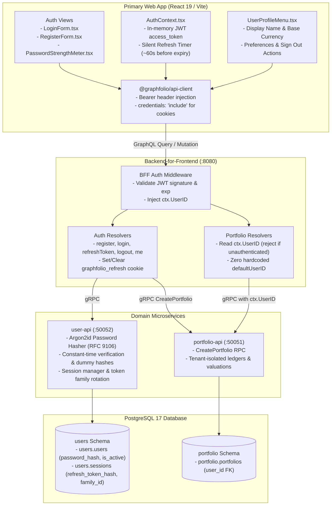

# Implementation Plan: User Registration, Authentication & Session Management

> **User Story**: [user-registration-and-login.md](file:///Users/oscargarcia/workspace/graphfolio/docs/user-stories/user-registration-and-login.md) (`US-AUTH-101`)  
> **Status**: **DONE**  
> **Roadmap Reference**: [FEATURES.md (Feature #35)](file:///Users/oscargarcia/workspace/graphfolio/FEATURES.md#L45)  
> **Security Standards**: OWASP ASVS v4.0 Level 2, NIST SP 800-63B, RFC 9106 (Argon2id), RFC 7519 (JSON Web Tokens)  
> **Target Layers**: Database (`users` & `portfolio` schemas), Protobuf (`proto/user/v1/`, `proto/portfolio/v1/`), User Microservice (`services/user-api`), Portfolio Microservice (`services/portfolio-api`), BFF (`bff/`), Web Monorepo (`web/apps/main-app`, `web/packages/api-client`, `web/packages/ui`)  

---

## 1. Executive Summary & Architectural Overview

The objective of this feature is to transform GraphFolio from a single-tenant demo sandbox into an institutional-grade, multi-tenant investment tracking platform with secure user registration, credential authentication, and session lifecycle management.

### 1.1 Current Architecture vs. Target Multi-Tenant Model

Currently, GraphFolio runs in single-user mode:
- `bff/graph/resolver.go` hardcodes `defaultUserID = "018f0000-0000-7000-8000-000000000001"`.
- `services/user-api` resolves `"1"` and `defaultUserID` to the seeded demo user.
- `web/apps/main-app` loads the dashboard directly with no sign-in requirement or identity boundaries.

In the target architecture:
1. **Isolated Tenants**: Every investor registers their private account and is provisioned an empty default portfolio (`"Main Portfolio"`) anchored to their preferred base currency (`USD`, `EUR`, `AUD`, `GBP`, etc.).
2. **Dual-Token Security Architecture**:
   - **Access Token (JWT)**: Short-lived (15 minutes), passed as `Authorization: Bearer <token>`, held in memory (`AuthContext`).
   - **Refresh Token**: Long-lived (7–30 days), stored in an `httpOnly`, `Secure`, `SameSite=Strict` cookie, tracked in `users.sessions` with token family rotation and reuse detection.
3. **Decoupled BFF**: BFF authentication middleware inspects the JWT, validates claims, injects `ctx.UserID`, and replaces `defaultUserID` across all portfolio resolvers.



---

## 2. Database Schema & Migration Specifications

### 2.1 Database Migrations (`services/user-api/migrations/`)

Create migration `000003_add_auth_and_sessions.up.sql`:

```sql
-- Migration: 000003_add_auth_and_sessions.up.sql
-- Description: Add authentication credentials and session tracking to users schema

-- 1. Extend users.users table
ALTER TABLE users.users
    ADD COLUMN password_hash       text        NOT NULL DEFAULT '',
    ADD COLUMN is_active           boolean     NOT NULL DEFAULT true,
    ADD COLUMN email_verified_at   timestamptz,
    ADD COLUMN last_login_at       timestamptz;

-- 2. Create session & refresh token tracking table
CREATE TABLE users.sessions (
    id                 uuid        PRIMARY KEY DEFAULT users.uuidv7(),
    user_id            uuid        NOT NULL REFERENCES users.users(id) ON DELETE CASCADE,
    refresh_token_hash text        NOT NULL UNIQUE,
    family_id          uuid        NOT NULL DEFAULT users.uuidv7(),
    is_revoked         boolean     NOT NULL DEFAULT false,
    user_agent         text,
    ip_address         inet,
    expires_at         timestamptz NOT NULL,
    created_at         timestamptz NOT NULL DEFAULT now(),
    updated_at         timestamptz NOT NULL DEFAULT now()
);

-- 3. High-performance indexes
CREATE INDEX sessions_user_id_idx ON users.sessions(user_id) WHERE NOT is_revoked;
CREATE INDEX sessions_family_id_idx ON users.sessions(family_id);
CREATE INDEX sessions_expires_at_idx ON users.sessions(expires_at);
```

Down migration `000003_add_auth_and_sessions.down.sql`:
```sql
DROP TABLE IF EXISTS users.sessions;
ALTER TABLE users.users
    DROP COLUMN IF EXISTS password_hash,
    DROP COLUMN IF EXISTS is_active,
    DROP COLUMN IF EXISTS email_verified_at,
    DROP COLUMN IF EXISTS last_login_at;
```

### 2.2 Updating Existing Development Seed Fixtures

Update [dev_seed.sql](file:///Users/oscargarcia/workspace/graphfolio/services/user-api/seeds/dev_seed.sql) to seed a valid Argon2id hash for the demo investor (`password: "GraphFolio2026!"`), ensuring all existing automated tests and local dev flows remain backwards-compatible.

---

## 3. Protocol Buffer & gRPC Service Contracts

### 3.1 User Service Contracts (`proto/user/v1/user.proto`)

Extend `proto/user/v1/user.proto` with identity management and authentication RPCs:

```protobuf
syntax = "proto3";

package user.v1;

option go_package = "graphfolio/proto/user/v1;userpb";

service UserService {
  // Existing RPCs
  rpc GetUserPreferences(GetUserPreferencesRequest) returns (GetUserPreferencesResponse) {}
  rpc UpdateUserPreferences(UpdateUserPreferencesRequest) returns (UpdateUserPreferencesResponse) {}
  rpc ListSupportedCurrencies(ListSupportedCurrenciesRequest) returns (ListSupportedCurrenciesResponse) {}

  // Authentication & Session RPCs
  rpc Register(RegisterRequest) returns (RegisterResponse) {}
  rpc Login(LoginRequest) returns (LoginResponse) {}
  rpc RefreshToken(RefreshTokenRequest) returns (RefreshTokenResponse) {}
  rpc Logout(LogoutRequest) returns (LogoutResponse) {}
  rpc GetMe(GetMeRequest) returns (GetMeResponse) {}
}

message RegisterRequest {
  string email            = 1;
  string password         = 2;
  string display_name     = 3;
  string display_currency = 4;
}

message RegisterResponse {
  UserPreferences user    = 1;
  string access_token     = 2;
  string refresh_token    = 3;
  int64 expires_in        = 4; // Token lifetime in seconds (e.g. 900)
}

message LoginRequest {
  string email            = 1;
  string password         = 2;
  bool remember_me        = 3;
}

message LoginResponse {
  UserPreferences user    = 1;
  string access_token     = 2;
  string refresh_token    = 3;
  int64 expires_in        = 4;
}

message RefreshTokenRequest {
  string refresh_token    = 1;
}

message RefreshTokenResponse {
  string access_token     = 1;
  string refresh_token    = 2;
  int64 expires_in        = 3;
  UserPreferences user    = 4;
}

message LogoutRequest {
  string refresh_token    = 1;
}

message LogoutResponse {
  bool success            = 1;
}

message GetMeRequest {
  string user_id          = 1;
}

message GetMeResponse {
  UserPreferences user    = 1;
}
```

### 3.2 Portfolio Service Initial Provisioning (`proto/portfolio/v1/portfolio.proto`)

Add portfolio creation capability to allow onboarding:

```protobuf
// Add to PortfolioService in proto/portfolio/v1/portfolio.proto:
rpc CreatePortfolio(CreatePortfolioRequest) returns (CreatePortfolioResponse) {}

message CreatePortfolioRequest {
  string user_id           = 1;
  string name              = 2;
  string base_currency     = 3;
  string cost_basis_method = 4; // "AVERAGE_COST" or "FIFO"
}

message CreatePortfolioResponse {
  Portfolio portfolio      = 1;
}
```

---

## 4. Microservice Implementation Specifications

### 4.1 Cryptographic Password Hasher (`services/user-api/internal/crypto/hasher.go`)

Implement an RFC 9106-compliant Argon2id password hasher:

```go
package crypto

import (
	"crypto/rand"
	"crypto/subtle"
	"encoding/base64"
	"errors"
	"fmt"
	"strings"

	"golang.org/x/crypto/argon2
)

type Argon2Params struct {
	Memory      uint32 // 64 MB = 64 * 1024
	Iterations  uint32 // 3
	Parallelism uint8  // 4
	SaltLength  uint32 // 16 bytes
	KeyLength   uint32 // 32 bytes
}

var DefaultParams = Argon2Params{
	Memory:      64 * 1024,
	Iterations:  3,
	Parallelism: 4,
	SaltLength:  16,
	KeyLength:   32,
}

// HashPassword hashes a plain password into an encoded Argon2id string:
// $argon2id$v=19$m=65536,t=3,p=4$<salt>$<hash>
func HashPassword(password string, p Argon2Params) (string, error) {
	salt := make([]byte, p.SaltLength)
	if _, err := rand.Read(salt); err != nil {
		return "", err
	}

	hash := argon2.IDKey([]byte(password), salt, p.Iterations, p.Memory, p.Parallelism, p.KeyLength)

	b64Salt := base64.RawStdEncoding.EncodeToString(salt)
	b64Hash := base64.RawStdEncoding.EncodeToString(hash)

	return fmt.Sprintf("$argon2id$v=%d$m=%d,t=%d,p=%d$%s$%s",
		argon2.Version, p.Memory, p.Iterations, p.Parallelism, b64Salt, b64Hash), nil
}

// VerifyPassword performs constant-time comparison against the encoded Argon2id hash.
func VerifyPassword(password, encodedHash string) (bool, error) {
	vals := strings.Split(encodedHash, "$")
	if len(vals) != 6 {
		return false, errors.New("invalid hash format")
	}

	var version int
	var memory, iterations uint32
	var parallelism uint8
	// Parse version and params...
	// Decode salt and expected hash...
	// Derive key with argon2.IDKey
	// return subtle.ConstantTimeCompare(hash, expectedHash) == 1, nil
}
```

### 4.2 Token Generation & JWT Engine (`services/user-api/internal/auth/jwt.go`)

- **JWT Signing**: Signs claims (`sub: userID`, `email`, `display_name`, `base_currency`, `exp`, `iat`) using HMAC-SHA256 with an injected `JWT_SECRET`.
- **Refresh Token Generation**: Cryptographically secure 256-bit random URL-safe token.
- **Hash on Storage**: Refresh token is hashed with SHA-256 before insertion into `users.sessions` (`refresh_token_hash = sha256(raw_refresh_token)`).

### 4.3 User Service Logic (`services/user-api/internal/service/auth.go`)

Implement registration, login, refresh, and logout business logic:

1. **`Register(ctx, email, password, displayName, currency)`**:
   - Sanitize and lowercase email; trim display name.
   - Validate password strength: $\ge 8$ chars, lowercase, uppercase, number, symbol.
   - Validate currency via `domain.IsSupportedCurrency`.
   - Check if email exists in `users.users`; if so, return `ErrEmailAlreadyRegistered`.
   - Hash password with Argon2id.
   - Insert new user into `users.users`.
   - Issue JWT access token (15m) and refresh token (30d).
   - Save session into `users.sessions`.
2. **`Login(ctx, email, password, rememberMe)`**:
   - Retrieve user by lowercase email.
   - **Timing-Attack Resistance**: If user is not found, run `VerifyPassword(password, dummyArgon2Hash)` with identical parameters before returning `ErrInvalidCredentials`.
   - Check `is_active`; if false, return `ErrAccountSuspended`.
   - Verify password hash. If mismatch, return `ErrInvalidCredentials`.
   - Update `last_login_at = now()`.
   - Issue new access token + refresh token.
   - Insert session into `users.sessions` with appropriate expiration (30 days if `rememberMe`, else 7 days).
3. **`RefreshToken(ctx, rawRefreshToken)`**:
   - Compute `sha256(rawRefreshToken)`.
   - Find active session in `users.sessions` where `refresh_token_hash = $1`.
   - **Reuse Detection**: If session is found but `is_revoked = true`:
     - Potential stolen token replay attack!
     - Immediately revoke **all** sessions in the same `family_id` (`UPDATE users.sessions SET is_revoked = true WHERE family_id = $1`).
     - Return `ErrInvalidSession`.
   - If session is expired or not found, return `ErrInvalidSession`.
   - Invalidate current session (`is_revoked = true`).
   - Issue new access token and rotated refresh token with the same `family_id`.
   - Insert new session row into `users.sessions`.
4. **`Logout(ctx, rawRefreshToken)`**:
   - Compute `sha256(rawRefreshToken)`.
   - Mark session revoked: `UPDATE users.sessions SET is_revoked = true WHERE refresh_token_hash = $1`.

### 4.4 Portfolio Provisioning in `portfolio-api`

Implement `CreatePortfolio` in `services/portfolio-api/internal/service/` and `repository/`:
```sql
INSERT INTO portfolio.portfolios (id, user_id, name, base_currency, cost_basis_method, created_at, updated_at)
VALUES (portfolio.uuidv7(), $1, $2, $3, $4, now(), now())
RETURNING id, user_id, name, base_currency, cost_basis_method, created_at;
```

---

## 5. BFF GraphQL Orchestrator Implementation

### 5.1 GraphQL Schema Extensions (`bff/graph/schema.graphqls`)

```graphql
type AuthPayload {
  user: UserPreferences!
  accessToken: String!
  expiresIn: Int!
}

input RegisterInput {
  email: String!
  password: String!
  displayName: String!
  displayCurrency: String!
}

input LoginInput {
  email: String!
  password: String!
  rememberMe: Boolean
}

extend type Query {
  me: UserPreferences!
}

extend type Mutation {
  register(input: RegisterInput!): AuthPayload!
  login(input: LoginInput!): AuthPayload!
  refreshToken: AuthPayload!
  logout: Boolean!
}
```

### 5.2 Authentication Middleware & Cookie Handling (`bff/internal/auth/middleware.go`)

1. **Extract Access Token**:
   - Inspects `Authorization: Bearer <token>` header.
   - Verifies JWT signature and expiry.
   - If valid, injects `user_id` into context: `ctx = context.WithValue(ctx, UserIDKey, claims.Subject)`.
2. **Context Helpers**:
   - `GetUserID(ctx) (string, error)`: returns the authenticated user ID or `ErrUnauthenticated`.
3. **Cookie Transport for Refresh Token**:
   - On successful `login` or `register`:
     ```go
     http.SetCookie(w, &http.Cookie{
         Name:     "graphfolio_refresh",
         Value:    payload.RefreshToken,
         Path:     "/",
         HttpOnly: true,
         Secure:   true, // true in production/HTTPS
         SameSite: http.SameSiteStrictMode,
         MaxAge:   maxAgeSeconds,
     })
     ```
   - On `logout`:
     ```go
     http.SetCookie(w, &http.Cookie{
         Name:     "graphfolio_refresh",
         Value:    "",
         Path:     "/",
         HttpOnly: true,
         Secure:   true,
         SameSite: http.SameSiteStrictMode,
         MaxAge:   -1,
     })
     ```
4. **CORS Adjustment (`bff/cmd/server/main.go`)**:
   - Update CORS middleware to allow credentials (`Access-Control-Allow-Credentials: true`) and mirror the origin (`http://localhost:5173` or request origin) instead of wildcard `*` (which browsers disallow when `credentials: 'include'` is set).

### 5.3 Decoupling Resolvers from `defaultUserID`

In `bff/graph/schema.resolvers.go`:
- Remove `const defaultUserID = "018f0000-0000-7000-8000-000000000001"`.
- In every protected resolver (`Portfolio`, `PortfolioHistory`, `Transactions`, `CashFlowReport`, `AddTransaction`, `DeleteTransaction`, `UserPreferences`, etc.):
  ```go
  userID, err := auth.GetUserID(ctx)
  if err != nil {
      return nil, fmt.Errorf("unauthenticated: %w", err)
  }
  ```

---

## 6. Frontend Web Architecture (`web/apps/main-app`)

### 6.1 Dynamic Client Auth Transport (`web/packages/api-client/src/client.ts`)

Enhance the GraphQL client factory:
```typescript
let currentAccessToken: string | null = null;

export function setClientAccessToken(token: string | null) {
  currentAccessToken = token;
}

export function createGraphfolioClient(config: ClientConfig = {}): Client {
  return createGenqlClient({
    url: config.url || DEFAULT_BFF_URL,
    headers: () => ({
      ...config.headers,
      ...(currentAccessToken ? { Authorization: `Bearer ${currentAccessToken}` } : {}),
    }),
    fetch: (url, init) => {
      return fetch(url, {
        ...init,
        credentials: 'include', // Ensures graphfolio_refresh cookie is sent
      });
    },
  });
}
```

### 6.2 Authentication State Machine (`web/apps/main-app/src/context/AuthContext.tsx`)

Implement React `AuthContext` and custom `useAuth()` hook:
- State properties: `user: UserPreferences | null`, `isAuthenticated: boolean`, `isLoading: boolean`.
- Methods: `login(email, password, rememberMe)`, `register(email, password, displayName, currency)`, `logout()`.
- **Silent Refresh**:
  - Sets a background timeout to fire `refreshToken` 60 seconds before token expiration.
  - On app launch, attempts an initial silent refresh via the `graphfolio_refresh` cookie. If valid, restores session without prompting for login.
  - If refresh fails or cookie is missing, clears state and sets `isLoading = false`, prompting the user to log in.

### 6.3 Glassmorphic UI Components

1. **`AuthView.tsx`**:
   - Obsidian frosted glass card (`tokens.css`, `backdrop-filter: blur(16px)`).
   - Brand logo and tagline: *"GraphFolio — Institutional-Grade Portfolio Tracking"*.
   - Tab switcher: `[ Sign In | Create Account ]`.
2. **`LoginForm.tsx`**:
   - Email input (`type="email"`), password input with show/hide toggle.
   - "Remember Me" checkbox.
   - Submit button with loading spinner and disabled state during submission.
   - Generic error toast/inline alert on failure.
3. **`RegisterForm.tsx`**:
   - Display name, Email, Base Currency dropdown (`USD`, `AUD`, `EUR`, `GBP`, `CAD`, etc.).
   - Password input with `PasswordStrengthMeter.tsx`.
   - Real-time strength score and checklist indicators.
4. **`UserProfileMenu.tsx` (in `Dashboard.tsx` header)**:
   - Replaces the current static profile avatar button.
   - Glassmorphic dropdown menu showing:
     - User Display Name and Email.
     - Active reporting currency badge (`AUD`, `USD`, etc.).
     - "Preferences" (opens `UserPreferencesModal`).
     - Divider line.
     - "Sign Out" button (red highlight, logs out session and clears cookies).

---

## 7. Security Hardening & Threat Mitigation Matrix

| Threat Vector | Mitigation Strategy | Standard |
|---|---|---|
| **Credential Theft / Data Breach** | Argon2id password hashing ($m=64\text{MB}, t=3, p=4$) with 16-byte cryptographically secure random salt. Zero plaintext passwords in memory or logs. | RFC 9106, NIST SP 800-63B |
| **XSS Token Exfiltration** | Access token kept strictly in JavaScript memory (`useState`), never stored in `localStorage` or `sessionStorage`. | OWASP ASVS v4.0 L2 |
| **CSRF on Session Refresh** | Refresh token cookie has `SameSite=Strict`, `HttpOnly`, and `Secure` attributes. Stored as SHA-256 hash in database. | RFC 6265bis |
| **Token Theft / Replay Attack** | Token Family Pattern: Each rotation generates a new token linked to `family_id`. If an already-used token is re-submitted, the entire token family is immediately revoked. | IETF OAuth 2.0 BCP |
| **User Enumeration / Timing Attacks** | Constant-time password verification (`subtle.ConstantTimeCompare`). Dummy Argon2id hash computed when email does not exist to normalize response times. | OWASP Testing Guide |
| **Brute Force / Credential Stuffing** | Rate limiting at BFF/API gateway: 5 attempts/minute per IP; 15-minute progressive account lockout after 10 failed login attempts. | OWASP Automated Threats (OAT-007) |

---

## 8. Implementation Steps & Task Breakdown

### Phase 1: Database & Service Contracts
- [ ] **Step 1.1**: Create `services/user-api/migrations/000003_add_auth_and_sessions.up.sql` and down migration.
- [ ] **Step 1.2**: Update dev seeds in `services/user-api/seeds/dev_seed.sql` with hashed demo credentials.
- [ ] **Step 1.3**: Extend `proto/user/v1/user.proto` with `Register`, `Login`, `RefreshToken`, `Logout`, and `GetMe` RPCs.
- [ ] **Step 1.4**: Extend `proto/portfolio/v1/portfolio.proto` with `CreatePortfolio` RPC.
- [ ] **Step 1.5**: Recompile protobufs: `make proto`.

### Phase 2: Domain Microservices Implementation
- [ ] **Step 2.1**: Implement Argon2id password hasher and constant-time verifier in `services/user-api/internal/crypto/hasher.go`.
- [ ] **Step 2.2**: Implement JWT generation and token verification in `services/user-api/internal/auth/jwt.go`.
- [ ] **Step 2.3**: Implement session management in `services/user-api/internal/repository/postgres.go` (`InsertUser`, `GetUserByEmail`, `CreateSession`, `GetSessionByHash`, `RevokeSessionFamily`, etc.).
- [ ] **Step 2.4**: Implement `Register`, `Login`, `RefreshToken`, and `Logout` methods in `services/user-api/internal/service/`.
- [ ] **Step 2.5**: Wire gRPC handlers in `services/user-api/internal/server.go`.
- [ ] **Step 2.6**: Implement `CreatePortfolio` in `services/portfolio-api/internal/service/` and `server.go`.
- [ ] **Step 2.7**: Write unit tests for `hasher_test.go`, `service_test.go`, and `server_test.go`.

### Phase 3: BFF Orchestration Layer
- [ ] **Step 3.1**: Update `bff/graph/schema.graphqls` with `AuthPayload`, `RegisterInput`, `LoginInput`, and mutations.
- [ ] **Step 3.2**: Run `make generate` to regenerate `gqlgen` models and resolver stubs.
- [ ] **Step 3.3**: Implement JWT auth middleware in `bff/internal/auth/middleware.go` and inject `ctx.UserID`.
- [ ] **Step 3.4**: Update CORS in `bff/cmd/server/main.go` to support credentials (`Access-Control-Allow-Credentials: true`).
- [ ] **Step 3.5**: Implement resolvers for `Register`, `Login`, `RefreshToken`, `Logout`, and `Me`.
- [ ] **Step 3.6**: Decouple all existing queries/mutations from `defaultUserID` by querying `ctx.UserID`.
- [ ] **Step 3.7**: Update and pass BFF resolver unit tests in `bff/graph/schema.resolvers_test.go`.

### Phase 4: Frontend Client & State Management
- [ ] **Step 4.1**: Re-generate typed GraphQL client (`@graphfolio/api-client` via `make generate`).
- [ ] **Step 4.2**: Update `client.ts` to attach `Authorization: Bearer <token>` and `credentials: 'include'`.
- [ ] **Step 4.3**: Create `AuthContext.tsx` with silent token refresh lifecycle in `web/apps/main-app/src/context/`.
- [ ] **Step 4.4**: Build `PasswordStrengthMeter.tsx` with 4-stage color evaluation and criteria indicators.
- [ ] **Step 4.5**: Build `LoginForm.tsx` and `RegisterForm.tsx` with glassmorphic aesthetics.
- [ ] **Step 4.6**: Build `AuthView.tsx` with tab switching (`Sign In` ↔ `Create Account`).
- [ ] **Step 4.7**: Wrap `App.tsx` with `AuthProvider` and conditionally render `AuthView` or `Dashboard`.
- [ ] **Step 4.8**: Build `UserProfileMenu.tsx` in `Dashboard.tsx` with display name, currency badge, and "Sign Out" button.

### Phase 5: Verification & End-to-End Validation
- [ ] **Step 5.1**: Run backend test suites across `services/user-api`, `services/portfolio-api`, and `bff`.
- [ ] **Step 5.2**: Test interactive registration flow: create user -> verify auto-provisioned portfolio -> view empty dashboard.
- [ ] **Step 5.3**: Test login flow with incorrect password -> verify generic error and timing safety.
- [ ] **Step 5.4**: Test session refresh: verify background token renewal before access token expiry.
- [ ] **Step 5.5**: Test logout: verify session revocation in DB, cookie clearing, and redirect to login screen.

---

## 9. Verification & Testing Matrix

### 9.1 Unit Testing Strategy

1. **Password Hasher Tests (`services/user-api/internal/crypto/hasher_test.go`)**:
   - Verify Argon2id hash formatting matches `$argon2id$v=19$m=65536,t=3,p=4$...`.
   - Verify correct passwords return `true`, incorrect passwords return `false`.
   - Verify tampering with hash string causes verification failure.
2. **Session & Token Rotation Tests (`services/user-api/internal/service/auth_test.go`)**:
   - Table-driven tests for registration validation (invalid email, short password, unsupported currency).
   - Verify token rotation generates new refresh token and marks previous token revoked.
   - Verify replay attack detection: presenting a revoked token revokes the entire `family_id`.
3. **BFF Middleware & Resolver Tests (`bff/graph/schema.resolvers_test.go`)**:
   - Verify valid bearer token extracts user ID and sets it in context.
   - Verify missing/expired token returns `UNAUTHENTICATED` error on protected queries.
   - Verify public mutations (`login`, `register`, `refreshToken`) succeed without bearer token.

### 9.2 End-to-End Verification Scenarios

| Test Case | Steps | Expected Outcome |
|---|---|---|
| **E2E-1: Register New Investor** | 1. Navigate to `/register`<br/>2. Fill email `investor@example.com`, password `Secret#2026!`, currency `AUD`<br/>3. Submit form | Account created, default portfolio provisioned in `AUD`, JWT access token stored in memory, `graphfolio_refresh` cookie set, redirects to dashboard. |
| **E2E-2: Duplicate Email Rejection** | 1. Attempt to register again with `investor@example.com` | Rejection with `"An account with this email address already exists"`. No duplicate DB rows created. |
| **E2E-3: Login Failure Protection** | 1. Navigate to `/login`<br/>2. Enter valid email, wrong password | Generic error `"Invalid email or password"`. Standardized response time. No tokens issued. |
| **E2E-4: Silent Token Refresh** | 1. User logged in with 15-minute token<br/>2. Fast-forward timer to 14 minutes | Background `refreshToken` mutation executes using cookie; memory access token updated silently with zero UI reload. |
| **E2E-5: Explicit Sign Out** | 1. Click Profile avatar -> click "Sign Out" | `logout` mutation dispatched; session marked revoked in DB; cookie cleared (`Max-Age=0`); state reset; redirects to login screen. |
