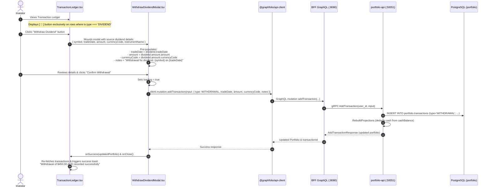
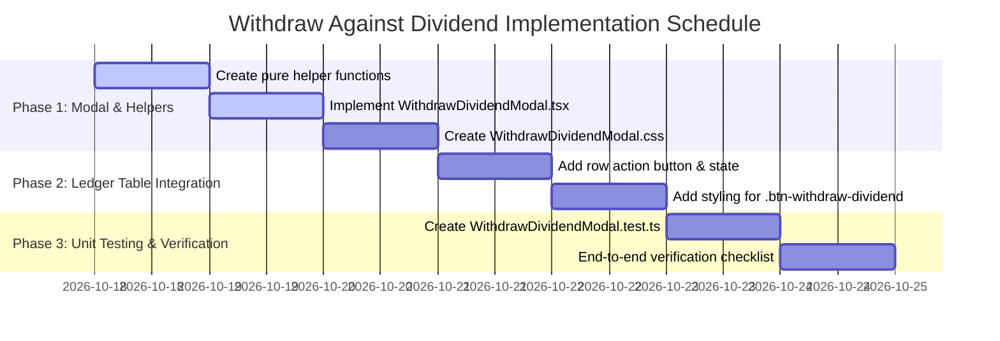

# Implementation Plan: Create Cash Withdrawal Against Dividend Transaction

> **Feature Reference**: Transaction Ledger Management & Cash Flow Reconciliation  
> **Status**: Completed  
> **Story Reference**: [withdraw-against-dividend-transaction.md](file:///Users/oscargarcia/workspace/graphfolio/docs/user-stories/withdraw-against-dividend-transaction.md) (`US-TX-105`)  
> **Roadmap Reference**: [FEATURES.md (Section 3.6)](file:///Users/oscargarcia/workspace/graphfolio/FEATURES.md)  
> **Calculation & Accounting Standard**: [financial-calculations skill](file:///Users/oscargarcia/workspace/graphfolio/.agents/skills/financial-calculations/SKILL.md) (Trade-Date Cash Flow Accounting, Intra-Day Lifecycle Priority, Cash Balance Neutrality, External Cash Flow Weighting in Modified Dietz)  
> **Target Layers**: Web Monorepo (`web/apps/main-app`, `web/packages/api-client`, `web/packages/ui`), BFF (`bff/`), Portfolio Microservice (`services/portfolio-api`), Protobuf (`proto/portfolio/v1/`), Database (`portfolio.transactions`)  
> **Branch**: `feat/withdraw-against-dividend`  

---

## 1. Executive Summary & Architectural Overview

The objective of this feature is to introduce a contextual row action on `DIVIDEND` transactions within the **Transaction Ledger** (`web/apps/main-app/src/components/TransactionLedger.tsx`). This allows investors to generate an exact matching `WITHDRAWAL` transaction with a single click, perfectly matching the dividend's **trade date**, **currency code**, and **total net amount**, while automatically populating descriptive audit reference notes.

```
+---------------------------------------------------------------------------------------------------------------------------------+
|  TRANSACTION LEDGER                                                                                                             |
+---------------------------------------------------------------------------------------------------------------------------------+
|  DATE ▲/▼    TYPE        ASSET               QUANTITY      PRICE        AMOUNT        FEE         NOTES          ACTIONS        |
|                                                                                                                                 |
|  2024-04-15  DIVIDEND    BHP.AX BHP Group    -             -            $450.00 AUD   -           Interim div    [💸] [✏️] [🗑️]  |
|                                                                                                                  ^              |
|                                                                                                   "Withdraw Dividend" action    |
+---------------------------------------------------------------------------------------------------------------------------------+
```

### 1.1 The Business & Financial Problem Solved
1. **Elimination of "Ghost Cash"**:
   Investors who sweep cash dividends out of their brokerage account to personal checking or savings accounts frequently experience artificial cash accumulation in portfolio trackers. Providing an effortless "Withdraw Dividend" action ensures cash balances remain 100% reconciled to the real-world brokerage statement ($\Delta \text{Cash} = +D - D = \$0.00$).
2. **Zero Data Entry Friction**:
   Instead of manually launching the generic trade ingestion modal, switching types, copying dates, re-typing decimal cents, and matching currency codes, the investor reviews an automatically pre-populated confirmation modal and confirms in one click.
3. **Audit Trail Traceability**:
   The generated withdrawal carries an automated audit memo linking the transaction back to the originating equity: `"Withdrawal for dividend: BHP.AX on 2024-04-15"`.

### 1.2 Architectural Readiness & Zero Schema Drift
A review of the backend and API contracts confirms that **zero database migrations, protobuf changes, or BFF schema extensions are required**:
- **GraphQL Mutation**: BFF exposes `addTransaction(input: TransactionInput!): AddTransactionPayload!` which supports `type: WITHDRAWAL`, `tradeDate`, `amount`, `currencyCode`, and `notes`.
- **gRPC Service**: `services/portfolio-api` handles `AddTransaction` with automatic ledger replay, updating cash balances and maintaining tax-lot integrity.
- **Intra-Day Ordering Safety**: PostgreSQL query `listTransactionsAscSQL` orders transactions on the same date using lifecycle priority (`DIVIDEND = 5` before `WITHDRAWAL = 11`), preventing transient negative balance warnings during chronological re-projections.

Therefore, this implementation plan focuses on the **modal component, pure helper functions, row action trigger, glassmorphic styling, accessibility (WCAG 2.1 AA), and unit test coverage** within `web/apps/main-app`.

---

## 2. End-to-End Sequence Diagram



---

## 3. Detailed Component Architecture & Specifications

### 3.1 Pure Helper Functions (`WithdrawDividendModal.tsx`)

To maximize modularity and enable clean unit testing, the formatting, pre-population, and notes generation logic will be extracted as pure functions:

```tsx
/**
 * Generates standardized descriptive notes for a withdrawal created against a dividend.
 */
export function generateDividendWithdrawalNotes(
  symbol?: string | null,
  tradeDate?: string | null
): string {
  const assetLabel = symbol?.trim() ? symbol.trim() : 'Cash';
  const dateLabel = tradeDate?.trim() ? tradeDate.trim() : 'unspecified date';
  return `Withdrawal for dividend: ${assetLabel} on ${dateLabel}`;
}

/**
 * Constructs the GraphQL TransactionInput for a matching withdrawal transaction.
 */
export function buildDividendWithdrawalInput(
  dividendTx: {
    tradeDate: string;
    amount: { amount: string; currencyCode: string };
    symbol?: string | null;
  },
  customNotes?: string
): {
  type: 'WITHDRAWAL';
  tradeDate: string;
  amount: string;
  currencyCode: string;
  notes?: string;
  fee?: string;
  feeCurrencyCode?: string;
} {
  const notes = customNotes !== undefined
    ? customNotes.trim()
    : generateDividendWithdrawalNotes(dividendTx.symbol, dividendTx.tradeDate);

  return {
    type: 'WITHDRAWAL',
    tradeDate: dividendTx.tradeDate,
    amount: dividendTx.amount.amount,
    currencyCode: dividendTx.amount.currencyCode,
    notes: notes || undefined,
    fee: '0.00',
    feeCurrencyCode: dividendTx.amount.currencyCode,
  };
}
```

---

### 3.2 Modal Component Implementation (`WithdrawDividendModal.tsx`)

#### Component Props:
```tsx
export interface WithdrawDividendModalProps {
  isOpen: boolean;
  dividendTx: TransactionItem | null;
  onClose: () => void;
  onSuccess: (updatedPortfolio: any) => void;
}
```

#### Component Structure:
- **Source Dividend Card**: Shows Asset (`BHP.AX - BHP Group Limited`), Distribution Date (`2024-04-15`), and Net Cash Distribution (`$450.00 AUD`).
- **Form Controls**:
  - **Withdrawal Date**: `<input type="date">` pre-filled with `dividendTx.tradeDate`.
  - **Amount**: `<input type="number" step="any">` pre-filled with `dividendTx.amount.amount`.
  - **Currency**: Displayed as an inline badge or read-only input matching `dividendTx.amount.currencyCode`.
  - **Notes**: `<input type="text">` pre-filled with auto-generated reference notes.
- **Accounting Explanation Banner**: An informative callout notifying the user that this action keeps their portfolio cash balance accurate while preserving dividend return history.
- **Action Buttons**:
  - `Cancel` (`.btn-secondary`)
  - `Confirm Withdrawal` (`.btn-primary` with loading spinner during submission)

---

### 3.3 Modal Styling (`WithdrawDividendModal.css`)

Matches GraphFolio's dark glassmorphic design language (`@graphfolio/ui`):

```css
.withdraw-source-card {
  background: rgba(245, 158, 11, 0.08);
  border: 1px solid rgba(245, 158, 11, 0.22);
  border-radius: 12px;
  padding: 1rem 1.25rem;
  margin-bottom: 1.25rem;
}

.withdraw-source-grid {
  display: grid;
  grid-template-columns: repeat(auto-fit, minmax(130px, 1fr));
  gap: 0.75rem;
  margin-top: 0.5rem;
}

.withdraw-source-item .label {
  font-size: 0.75rem;
  color: var(--text-secondary, #9ca3af);
  text-transform: uppercase;
  letter-spacing: 0.5px;
}

.withdraw-source-item .value {
  font-size: 0.95rem;
  font-weight: 600;
  color: #fbbf24;
}

.withdraw-info-callout {
  background: rgba(59, 130, 246, 0.08);
  border: 1px solid rgba(59, 130, 246, 0.2);
  border-radius: 10px;
  padding: 0.75rem 1rem;
  font-size: 0.82rem;
  color: #93c5fd;
  display: flex;
  align-items: flex-start;
  gap: 0.5rem;
  margin-bottom: 1.25rem;
  line-height: 1.4;
}
```

---

### 3.4 Transaction Ledger Table Integration (`TransactionLedger.tsx`)

#### 1. State Declaration:
```tsx
const [dividendToWithdraw, setDividendToWithdraw] = useState<TransactionItem | null>(null);
```

#### 2. Row Action Button Render (in `tbody`):
```tsx
<div className="row-actions">
  {tx.type === 'DIVIDEND' && (
    <button
      type="button"
      className="btn-withdraw-dividend"
      onClick={() => setDividendToWithdraw(tx)}
      title="Create matching cash withdrawal for this dividend"
      aria-label={`Create matching withdrawal for ${tx.symbol || 'Cash'} dividend of ${formatMoney(tx.amount)}`}
    >
      <svg
        width="14"
        height="14"
        viewBox="0 0 24 24"
        fill="none"
        stroke="currentColor"
        strokeWidth="2"
        strokeLinecap="round"
        strokeLinejoin="round"
      >
        <path d="M12 2v10m0 0l-4-4m4 4l4-4" />
        <path d="M2 17l.621 2.485A2 2 0 0 0 4.561 21h14.877a2 2 0 0 0 1.94-1.515L22 17" />
      </svg>
    </button>
  )}
  <button type="button" className="btn-edit-row" onClick={() => setTxToEdit(tx)} title="Edit transaction">
    ...
  </button>
  <button type="button" className="btn-delete-row" onClick={() => setTxToDelete(tx)} title="Delete transaction">
    ...
  </button>
</div>
```

#### 3. Success Handler & Modal Binding:
```tsx
const handleWithdrawalSuccess = (updatedPortfolio: any) => {
  if (onTransactionUpdated) {
    onTransactionUpdated(updatedPortfolio);
  }
  setExportNotice(
    `Withdrawal of ${dividendToWithdraw?.amount ? formatMoney(dividendToWithdraw.amount) : ''} recorded successfully.`
  );
  setTimeout(() => setExportNotice(null), 4000);
  setDividendToWithdraw(null);
  setReloadCount((c) => c + 1);
};
```

Render modal at bottom of `TransactionLedger`:
```tsx
{dividendToWithdraw && (
  <WithdrawDividendModal
    isOpen={!!dividendToWithdraw}
    dividendTx={dividendToWithdraw}
    onClose={() => setDividendToWithdraw(null)}
    onSuccess={handleWithdrawalSuccess}
  />
)}
```

---

## 4. Implementation Work Breakdown Structure (WBS)



### Phase 1: Modal Component & Pure Logic
- [x] **Task 1.1**: Create `web/apps/main-app/src/components/WithdrawDividendModal.tsx`:
  - Implement and export `generateDividendWithdrawalNotes`.
  - Implement and export `buildDividendWithdrawalInput`.
  - Build `WithdrawDividendModal` component with date, amount, currency, and notes inputs.
  - Implement `handleSubmit` calling `client.mutation.addTransaction`.
- [x] **Task 1.2**: Create `web/apps/main-app/src/components/WithdrawDividendModal.css`:
  - Style source dividend summary card (`.withdraw-source-card`).
  - Style amber badges and info callouts (`.withdraw-info-callout`).
  - Support mobile responsiveness and keyboard focus outlines.

### Phase 2: Transaction Ledger Integration
- [x] **Task 2.1**: Update `web/apps/main-app/src/components/TransactionLedger.tsx`:
  - Import `WithdrawDividendModal`.
  - Declare state `const [dividendToWithdraw, setDividendToWithdraw] = useState<TransactionItem | null>(null);`.
  - In `tbody` row actions, conditionally render `.btn-withdraw-dividend` when `tx.type === 'DIVIDEND'`.
  - Implement `handleWithdrawalSuccess` to trigger notification toast and re-fetch ledger rows.
  - Render `<WithdrawDividendModal>` when `dividendToWithdraw` is non-null.
- [x] **Task 2.2**: Update `web/apps/main-app/src/components/TransactionLedger.css`:
  - Add styles for `.btn-withdraw-dividend`, hover states, and focus indicators.

### Phase 3: Unit Testing & Verification
- [x] **Task 3.1**: Create `web/apps/main-app/src/components/WithdrawDividendModal.test.ts`:
  - Test `generateDividendWithdrawalNotes` with standard ticker, domestic asset, international asset, and cash dividend.
  - Test `buildDividendWithdrawalInput`: confirms exact match of `tradeDate`, `amount.amount`, `amount.currencyCode`, and notes.
  - Test custom notes override behavior.
  - Test zero and negative amount validation guards.

### Phase 4: Full Stack Verification & Quality Gates
- [x] **Task 4.1**: Execute unit test suite (`npm test`).
- [x] **Task 4.2**: Verify in browser (`npm run dev:main`):
  - Confirm `[ 💸 ]` button is visible only on `DIVIDEND` rows.
  - Open modal on a dividend (e.g. `BHP.AX` on `2024-04-15` for `$450.00 AUD`).
  - Verify all fields pre-populate identically.
  - Submit withdrawal; verify success toast appears, cash balance decreases by `$450.00 AUD`, and new `WITHDRAWAL` transaction appears in the ledger.
  - Verify that the source `DIVIDEND` transaction remains untouched and retains its income attribution.

---

## 5. Quality Gates & Acceptance Verification Matrix

| Test ID | Scenario | Precondition / Input | Expected Result | Layer Verified |
| :--- | :--- | :--- | :--- | :--- |
| **TC-WDIV-01** | **Action Button Visibility** | Table contains `BUY`, `SELL`, `DIVIDEND`, `DEPOSIT` | "Withdraw Dividend" button appears **only** on the `DIVIDEND` row. | UI Component |
| **TC-WDIV-02** | **Field Pre-population** | Dividend: `tradeDate: '2024-04-15'`, `amount: '450.00'`, `currency: 'AUD'` | Modal opens with Date = `2024-04-15`, Amount = `450.00`, Currency = `AUD`. | Modal Component |
| **TC-WDIV-03** | **Notes Auto-generation** | Dividend from `BHP.AX` on `2024-04-15` | Notes field pre-fills with `"Withdrawal for dividend: BHP.AX on 2024-04-15"`. | Pure Logic Helper |
| **TC-WDIV-04** | **Notes Customization** | User modifies notes to add bank reference | Submitted withdrawal reflects user's custom notes string. | Mutation Input |
| **TC-WDIV-05** | **Zero Fee Default** | Any dividend withdrawal submission | Fee defaults to `'0.00'` and fee currency matches dividend currency. | Mutation Input |
| **TC-WDIV-06** | **Cash Balance Deduction** | Portfolio cash balance is `$1,000.00 AUD`, user withdraws `$450.00 AUD` | Portfolio cash balance updates to `$550.00 AUD`. | BFF & Ledger Engine |
| **TC-WDIV-07** | **Intra-Day Ordering Safety** | Ascending sort view (`trade_date ASC`) | `DIVIDEND` (Priority 5) appears before `WITHDRAWAL` (Priority 11) on same date. | Database SQL Query |
| **TC-WDIV-08** | **Keyboard Accessibility** | User focuses button with `Tab`, presses `Enter` | Modal opens; `Escape` closes modal; visible focus rings throughout. | WCAG 2.1 AA |
| **TC-WDIV-09** | **Error Resilience** | Network failure or server rejection | Modal displays error message in red banner, inputs preserved for retry. | Error Boundary |
| **TC-WDIV-10** | **Return Independence** | Inspect portfolio holdings return table | `income_amount` on `BHP.AX` is unchanged; withdrawal treated as external cash flow. | Financial Return Engine |

---

## 6. Risk Analysis & Mitigation Strategies

| Risk | Impact | Probability | Mitigation Strategy |
| :--- | :--- | :--- | :--- |
| **Accidental Double Withdrawal** | Medium | Medium | User could click button twice and create duplicate withdrawals. **Mitigation**: Submit button is disabled during in-flight mutation; success toast confirms creation and refreshes ledger immediately. |
| **Currency Mismatch** | High | Low | If currency code defaults to user display currency instead of dividend currency. **Mitigation**: Currency code is strictly derived from `dividendTx.amount.currencyCode` and locked to guarantee currency parity. |
| **Negative Cash Balance Warning** | Medium | Low | If withdrawal processed on date where previous balance was $0.00. **Mitigation**: PostgreSQL ascending tie-breaker processes `DIVIDEND` before `WITHDRAWAL`, ensuring balance never drops below zero. |

---

## 7. Definition of Done (DoD) Checklist

- [x] Pure helpers `generateDividendWithdrawalNotes` and `buildDividendWithdrawalInput` created and tested.
- [x] `WithdrawDividendModal.tsx` and `WithdrawDividendModal.css` created with dark glassmorphic styling.
- [x] "Withdraw Dividend" action button added to `TransactionLedger.tsx` for `DIVIDEND` rows only.
- [x] Modal pre-populates trade date, amount, currency code, and descriptive notes 1:1.
- [x] Confirmation executes `addTransaction` mutation and reloads ledger with success toast.
- [x] Unit tests in `WithdrawDividendModal.test.ts` pass all test cases.
- [x] Both [withdraw-against-dividend-transaction.md](file:///Users/oscargarcia/workspace/graphfolio/docs/user-stories/withdraw-against-dividend-transaction.md) and [USER_STORIES.md](file:///Users/oscargarcia/workspace/graphfolio/docs/USER_STORIES.md) reference this implementation plan.
