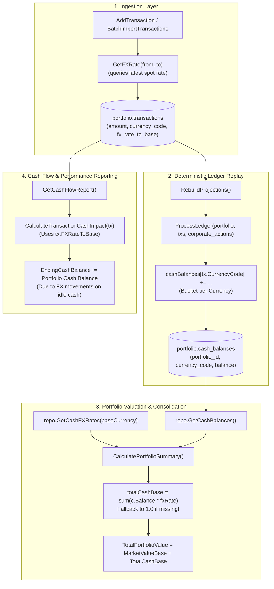

# Investigation Report: Cash Balance Computation & Foreign Exchange (FX) Conversion

---

## 1. Executive Summary

This investigation analyzes how **cash balances** and **foreign exchange (FX) conversions** are modeled, computed, and reported across the GraphFolio platform. It traces data flow from transaction ingestion through deterministic ledger replay, database persistence, base currency consolidation, historical daily valuation snapshots, and frontend presentation.

### Key Findings Overview:

1. **Dual-Layer Architecture**:
   - **Local Currency Layer**: Cash balances are maintained per distinct currency code ($\text{USD}, \text{AUD}, \text{EUR}, \text{GBP}$, etc.) in the non-persistent projection table `portfolio.cash_balances`, produced deterministically by replaying trade activity in [`ProcessLedger`](file:///Users/oscargarcia/workspace/graphfolio/services/portfolio-api/internal/service/projection.go#L55-L105).
   - **Base Currency Consolidation Layer**: When portfolios or valuations are requested, multi-currency cash balances are aggregated into the portfolio base currency via spot rates in [`CalculatePortfolioSummary`](file:///Users/oscargarcia/workspace/graphfolio/services/portfolio-api/internal/domain/calculator.go#L194-L204) and historical daily rates in [`ValuationService`](file:///Users/oscargarcia/workspace/graphfolio/services/portfolio-api/internal/service/valuation.go#L178-L190).

2. **Critical Vulnerabilities & Edge Cases Identified**:
   - **`getCashFXRatesSQL` Query Asymmetry**: The repository query [`getCashFXRatesSQL`](file:///Users/oscargarcia/workspace/graphfolio/services/portfolio-api/internal/repository/queries.go#L224-L229) queries `WHERE quote_currency = $1`. When the portfolio base currency is `USD`, but pairs are stored as `USD/AUD` or `USD/EUR` (or when ECB data stores pairs as `EUR/USD`), the query returns zero rows. When a rate is missing, the system silently falls back to `1.0`, converting foreign cash ($10,000\text{ AUD}$) to base currency as $\$10,000\text{ USD}$ ($1:1$), distorting portfolio net worth by 30–50%.
   - **Missing Trade-Date FX on Batch Import & Addition**: When historical transactions are imported or added, [`GetFXRate`](file:///Users/oscargarcia/workspace/graphfolio/services/portfolio-api/internal/repository/postgres.go#L819-L848) executes `ORDER BY rate_date DESC LIMIT 1`, fetching **today's spot rate** rather than the historical FX rate on `trade_date`.
   - **Unsupported `FX_CONVERSION` Transaction Type**: While defined in protobuf and domain enums, `TRANSACTION_TYPE_FX_CONVERSION` is rejected as unsupported by [`AddTransaction`](file:///Users/oscargarcia/workspace/graphfolio/services/portfolio-api/internal/service/transaction.go#L285) and ignored in [`ProcessLedger`](file:///Users/oscargarcia/workspace/graphfolio/services/portfolio-api/internal/service/projection.go#L79-L110). This prevents investors from recording multi-currency transfers or automatic broker currency sweeps.
   - **Cash Flow Report vs. Portfolio Valuation Discrepancy**: [`GetCashFlowReport`](file:///Users/oscargarcia/workspace/graphfolio/services/portfolio-api/internal/service/cash_flow.go#L58-L80) calculates starting and ending cash balances by converting transactions at their historical trade-time rates (`tx.FXRateToBase`), whereas [`GetPortfolio`](file:///Users/oscargarcia/workspace/graphfolio/services/portfolio-api/internal/domain/calculator.go#L194-L204) converts current cash holdings at spot FX rates. Uninvested foreign cash generates an unreconciled divergence equal to unrealized currency gains/losses.
   - **Base Currency Re-anchoring Incompleteness**: [`UpdatePortfolioBaseCurrency`](file:///Users/oscargarcia/workspace/graphfolio/services/portfolio-api/internal/repository/postgres.go#L98-L119) multiplies snapshot totals and holdings cost basis by a single FX multiplier, but does not update `tx.fx_rate_to_base` on historical transactions or tax lots. Any subsequent projection rebuild or ledger replay reverts cost bases and cash flow reports to values derived from the previous base currency.

---

## 2. End-to-End System Architecture & Data Flow



---

## 3. Deep Dive: Ledger Cash Impact by Transaction Type

In [`ProcessLedger`](file:///Users/oscargarcia/workspace/graphfolio/services/portfolio-api/internal/service/projection.go#L55-L185), cash balances are tracked in a hash map `cashBalances := make(map[string]decimal.Decimal)` where keys are ISO 4217 currency strings (`USD`, `AUD`, `EUR`, etc.).

### Mathematical Cash Impact Formulas

| Transaction Type | Primary Currency Bucket Impact | Fee Bucket Impact | Withholding Tax Impact | Domain Implementation Link |
| :--- | :--- | :--- | :--- | :--- |
| **`DEPOSIT`** | $+\text{Amount}$ | $-\text{Fee}$ (in `FeeCurrencyCode`) | $0$ | [`projection.go:L80-L89`](file:///Users/oscargarcia/workspace/graphfolio/services/portfolio-api/internal/service/projection.go#L80-L89) |
| **`WITHDRAWAL`** | $-\text{Amount}$ | $-\text{Fee}$ (in `FeeCurrencyCode`) | $0$ | [`projection.go:L90-L99`](file:///Users/oscargarcia/workspace/graphfolio/services/portfolio-api/internal/service/projection.go#L90-L99) |
| **`DIVIDEND`** | $+(\text{Amount} - \text{WithholdingTax})$ | $0$ | Subtracted from gross | [`projection.go:L100-L105`](file:///Users/oscargarcia/workspace/graphfolio/services/portfolio-api/internal/service/projection.go#L100-L105) |
| **`INTEREST`** | $+(\text{Amount} - \text{WithholdingTax})$ | $0$ | Subtracted from gross | [`projection.go:L100-L105`](file:///Users/oscargarcia/workspace/graphfolio/services/portfolio-api/internal/service/projection.go#L100-L105) |
| **`BUY`** | $-\text{Amount}$ | $-\text{Fee}$ (in `FeeCurrencyCode`) | $0$ | [`projection.go:L107-L126`](file:///Users/oscargarcia/workspace/graphfolio/services/portfolio-api/internal/service/projection.go#L107-L126) |
| **`SELL`** | $+\text{Amount}$ | $-\text{Fee}$ (in `FeeCurrencyCode`) | $0$ | [`projection.go:L155-L185`](file:///Users/oscargarcia/workspace/graphfolio/services/portfolio-api/internal/service/projection.go#L155-L185) |
| **`TRANSFER_IN`** | Handled identically to `BUY` | Handled identically to `BUY` | $0$ | [`projection.go:L107-L126`](file:///Users/oscargarcia/workspace/graphfolio/services/portfolio-api/internal/service/projection.go#L107-L126) |
| **`TRANSFER_OUT`**| Handled identically to `SELL` | Handled identically to `SELL`| $0$ | [`projection.go:L155-L185`](file:///Users/oscargarcia/workspace/graphfolio/services/portfolio-api/internal/service/projection.go#L155-L185) |
| **`SPLIT`** | $0$ (No cash impact) | $0$ | $0$ | [`projection.go:L294-L313`](file:///Users/oscargarcia/workspace/graphfolio/services/portfolio-api/internal/service/projection.go#L294-L313) |
| **`FX_CONVERSION`**| **NOT HANDLED** (Hits `default`, no-op) | **NOT HANDLED** | $0$ | **Gap in `ProcessLedger`** |

### Split Fee-Currency Handling:
If a trade executes in a foreign currency (e.g. `USD`) but brokerage commissions are charged in the investor's local base currency (e.g. `AUD`), GraphFolio supports split-currency fee attribution:
```go
// projection.go lines 112-126
feeCurr := tx.CurrencyCode
if tx.FeeCurrencyCode != nil && *tx.FeeCurrencyCode != "" {
    feeCurr = *tx.FeeCurrencyCode
}
if feeCurr == tx.CurrencyCode {
    totalCost := tx.Amount.Add(tx.Fee)
    cashBalances[tx.CurrencyCode] = cashBalances[tx.CurrencyCode].Sub(totalCost)
} else {
    cashBalances[tx.CurrencyCode] = cashBalances[tx.CurrencyCode].Sub(tx.Amount)
    cashBalances[feeCurr] = cashBalances[feeCurr].Sub(tx.Fee)
}
```
This correctly debits $100 USD from the USD bucket and $19.95 AUD from the AUD bucket.

---

## 4. FX Conversion Logic & Mathematical Modeling

### A. Spot FX Consolidation in Portfolio Summary

When [`CalculatePortfolioSummary`](file:///Users/oscargarcia/workspace/graphfolio/services/portfolio-api/internal/domain/calculator.go#L194-L204) consolidates cash balances to base currency:

$$\text{TotalCash}_{\text{Base}} = \sum_{c \in \text{CashBalances}} \left( \text{Balance}_c \times \text{FXRate}(c \to \text{Base}) \right)$$

```go
// calculator.go lines 194-204
totalCashBase := decimal.Zero
for _, c := range cashBalances {
    fxRate := one
    if c.CurrencyCode != baseCurrency {
        if rate, ok := cashFXRates[c.CurrencyCode]; ok && rate.IsPositive() {
            fxRate = rate
        }
    }
    totalCashBase = totalCashBase.Add(c.Balance.Mul(fxRate))
}
```

### B. Rate Direction & Conventions in `portfolio.fx_rates`

In foreign exchange markets, quotes are expressed as:
$$\text{Price} = \frac{\text{Quote Currency}}{\text{Base Currency}}$$

In GraphFolio's database schema:
```sql
CREATE TABLE portfolio.fx_rates (
    base_currency  VARCHAR(3) NOT NULL,
    quote_currency VARCHAR(3) NOT NULL,
    rate_date      DATE NOT NULL,
    rate           NUMERIC(20, 10) NOT NULL,
    source         VARCHAR(50) NOT NULL,
    PRIMARY KEY (base_currency, quote_currency, rate_date)
);
```

#### Three Resolution Paths in `GetFXRate`:
In [`GetFXRate`](file:///Users/oscargarcia/workspace/graphfolio/services/portfolio-api/internal/repository/postgres.go#L819-L848):
1. **Direct Pair**:
   $$\text{Rate} = R_{\text{from} \to \text{to}} \quad \text{where } \text{base}=\text{from}, \text{quote}=\text{to}$$
2. **Inverse Pair**:
   $$\text{Rate} = \frac{1}{R_{\text{to} \to \text{from}}} \quad \text{where } \text{base}=\text{to}, \text{quote}=\text{from}$$
3. **Triangulation via USD**:
   $$\text{Rate}(\text{from} \to \text{to}) = \frac{\text{Rate}(\text{USD} \to \text{to})}{\text{Rate}(\text{USD} \to \text{from})}$$

---

## 5. Vulnerability & Risk Analysis

### Vulnerability 1: Flawed `getCashFXRatesSQL` Query

#### The Problem:
In [`queries.go:L224-L229`](file:///Users/oscargarcia/workspace/graphfolio/services/portfolio-api/internal/repository/queries.go#L224-L229):
```sql
SELECT DISTINCT ON (base_currency) 
    base_currency, rate
FROM portfolio.fx_rates
WHERE quote_currency = $1
ORDER BY base_currency, rate_date DESC;
```
When `$1` is the portfolio base currency (e.g. `USD`):
- It only finds rows where `quote_currency = 'USD'`.
- In `demo_seed.sql`, all rates are seeded with `base_currency = 'USD'` (e.g. `base='USD', quote='AUD', rate=1.5230`).
- The query returns **0 rows**.
- `cashFXRates` map is empty (`{}`).
- For any foreign cash holding (e.g. `AUD`), `ok` is false, and `fxRate` defaults to `1.0`.

#### Consequence:
A balance of `10,000 AUD` is evaluated as `$10,000 USD` instead of `$6,566 USD` (an overvaluation of **+$3,434 USD** / **+52%** on that cash line).

#### Contrast with `GetHistoricalFXMatrix`:
[`GetHistoricalFXMatrix`](file:///Users/oscargarcia/workspace/graphfolio/services/portfolio-api/internal/repository/postgres.go#L1620-L1630) handles both direct and inverse:
```go
if baseCode == baseCurrency {
    if rate.IsPositive() {
        effRate := decimal.NewFromInt(1).DivRound(rate, 12)
        obsByCurr[quoteCode] = append(obsByCurr[quoteCode], fxObservation{date: normDate, rate: effRate, isDirect: false})
    }
} else if quoteCode == baseCurrency {
    obsByCurr[baseCode] = append(obsByCurr[baseCode], fxObservation{date: normDate, rate: rate, isDirect: true})
}
```
`GetCashFXRates` must implement the same bidirectional and triangulated resolution.

---

### Vulnerability 2: Non-Historical FX Lookups on Ingestion

#### The Problem:
When `AddTransaction` or `BatchImportTransactions` saves a transaction:
```go
// transaction.go lines 70-75 and 889-894
if inst.CurrencyCode != portfolio.BaseCurrency {
    rate, err := s.repo.GetFXRate(ctx, inst.CurrencyCode, portfolio.BaseCurrency)
    if err == nil && rate.IsPositive() {
        fxRate = &rate
    }
}
```
And [`getDirectFXRateSQL`](file:///Users/oscargarcia/workspace/graphfolio/services/portfolio-api/internal/repository/queries.go#L294-L299):
```sql
SELECT rate
FROM portfolio.fx_rates
WHERE base_currency = $1 AND quote_currency = $2
ORDER BY rate_date DESC
LIMIT 1;
```
Notice that `GetFXRate` does not accept a date argument! It always selects the **most recent rate available in the database**.

#### Consequence:
If a user imports trade confirmations from March 2021 when `AUD/USD` was `0.78`, the system assigns the current October 2026 spot rate (`0.65`) to `tx.fx_rate_to_base`. This permanently miscalculates the transaction's cost basis in base currency (`cost_basis_base`), distorting historical capital gains and Modified Dietz return calculations.

---

### Vulnerability 3: The Untracked `FX_CONVERSION` Operation

#### The Problem:
While `TransactionType.TRANSACTION_TYPE_FX_CONVERSION` exists in `proto/portfolio/v1/portfolio.proto`:
- [`AddTransaction`](file:///Users/oscargarcia/workspace/graphfolio/services/portfolio-api/internal/service/transaction.go#L285) fails with `service: unsupported transaction type: FX_CONVERSION`.
- [`ProcessLedger`](file:///Users/oscargarcia/workspace/graphfolio/services/portfolio-api/internal/service/projection.go#L79-L110) has no case for `TxTypeFXConversion`.
- The frontend `AddTransactionModal` does not offer Currency Conversion as a trade type.

#### Consequence:
Investors who convert cash (e.g. Transfer $15,000 AUD to $10,000 USD) have no mechanism to record it. If they subsequently buy US shares, their USD cash drops to negative (-$10,000 USD) while AUD cash remains inflated (+$15,000 AUD).

---

### Vulnerability 4: Cash Flow Report vs. Portfolio Valuation Discrepancy

| Metric | Valuation / Dashboard Cash Balance | Cash Flow Report Ending Cash |
| :--- | :--- | :--- |
| **Method** | Multi-currency balance converted at **today's spot FX** | Chronological cumulative sum of `tx.Amount * tx.FXRateToBase` |
| **Formula** | $\sum \left( \text{Balance}_c \times \text{SpotFX}_c \right)$ | $\text{StartCash} + \sum \left( \Delta \text{Local} \times \text{TradeDateFX} \right)$ |
| **FX Basis** | Spot / Valuation Date | Historical Trade Execution Date |
| **Idle Cash FX Gain/Loss** | **Included** (fluctuates daily with currency markets) | **Excluded** (only tracks historical transaction costs) |

#### Mathematical Proof of Discrepancy:
Suppose on Date 1:
- Investor deposits 10,000 AUD when $\text{AUD/USD} = 0.70$.
- Cash Flow Report records $+ \$7,000\text{ USD}$ net inflow.
- Cash balance bucket = `10,000 AUD`.
On Date 2:
- No transactions occur.
- Exchange rate shifts to $\text{AUD/USD} = 0.65$.
- Dashboard Cash Balance = $10,000 \times 0.65 = \mathbf{\$6,500\text{ USD}}$.
- Cash Flow Report Ending Cash = $\mathbf{\$7,000\text{ USD}}$.
- **Discrepancy = $-\$500\text{ USD}$**.
This represents an **unrealized currency loss on uninvested cash**. Because GraphFolio has no cash revaluation transaction or "FX Gain/Loss on Cash" category in the Cash Flow Report, users perceive this difference as an accounting error.

---

### Vulnerability 5: Incomplete Base Currency Re-anchoring

In [`UpdatePortfolioBaseCurrency`](file:///Users/oscargarcia/workspace/graphfolio/services/portfolio-api/internal/repository/postgres.go#L98-L119):
```go
if !fxRate.Equal(decimal.NewFromInt(1)) && fxRate.IsPositive() {
    tx.Exec(ctx, updateValuationsBaseCurrencySQL, portfolioID, fxRate)
    tx.Exec(ctx, updateHoldingsBaseCurrencySQL, portfolioID, fxRate)
}
```
1. `portfolio.transactions.fx_rate_to_base` is **not updated**.
2. `portfolio.tax_lots.cost_basis_base` is **not updated**.
3. When the user later enters any transaction or triggers `RebuildProjections`, `ProcessLedger` runs using the old `tx.FXRateToBase`, wiping out the multiplied values in `portfolio.holdings` and reverting cost bases back to the previous currency.

---

## 6. Comparison of FX Usage Across Services

```
┌─────────────────────────────────┬───────────────────────┬────────────────────────────┬────────────────────────────┐
│ Subsystem / Component           │ FX Resolution Method  │ Historical vs. Spot        │ Fallback Behavior          │
├─────────────────────────────────┼───────────────────────┼────────────────────────────┼────────────────────────────┤
│ CalculatePortfolioSummary       │ repo.GetCashFXRates   │ Spot (most recent)         │ 1.0 (Silent 1:1 parity)    │
│ ValuationService (EOD Snapshots)│ repo.GetHistoricalFX  │ Historical (date-matched)  │ 1.0 (LOCF forward fill)    │
│ AddTransaction                  │ repo.GetFXRate        │ Spot (ignores trade_date)  │ 1.0 (Silent 1:1 parity)    │
│ BatchImportTransactions         │ repo.GetFXRate        │ Spot (ignores trade_date)  │ 1.0 (Silent 1:1 parity)    │
│ CashFlowReport                  │ tx.FXRateToBase       │ Frozen at trade execution  │ 1.0 if null                │
│ ModifiedDietz (External Flows)  │ direct/inv/triangulate│ Historical (rate <= date)  │ 1.0                        │
│ DividendCalendar / Analytics    │ repo.GetCashFXRates   │ Spot (most recent)         │ 1.0                        │
│ UpdatePortfolioBaseCurrency     │ repo.GetFXRate        │ Instantaneous spot multiplier 1.0                      │
└─────────────────────────────────┴───────────────────────┴────────────────────────────┴────────────────────────────┘
```

---

## 7. Actionable Recommendations

### Recommendation 1: Fix `GetCashFXRates` to Support Direct, Inverse, and Triangulated Rates
Rewrite [`getCashFXRatesSQL`](file:///Users/oscargarcia/workspace/graphfolio/services/portfolio-api/internal/repository/queries.go#L224-L229) to mirror the robust bidirectional logic of `GetHoldingsWithMarketData`:
```sql
WITH latest_rates AS (
    SELECT DISTINCT ON (base_currency, quote_currency)
        base_currency, quote_currency, rate
    FROM portfolio.fx_rates
    ORDER BY base_currency, quote_currency, rate_date DESC
)
SELECT 
    c.code AS foreign_currency,
    COALESCE(
        direct.rate,
        CASE WHEN inverse.rate > 0 THEN 1.0 / inverse.rate ELSE NULL END,
        triangulated.rate,
        1.0
    ) AS fx_rate_to_base
FROM portfolio.currencies c
LEFT JOIN latest_rates direct 
    ON direct.base_currency = c.code AND direct.quote_currency = $1
LEFT JOIN latest_rates inverse 
    ON inverse.base_currency = $1 AND inverse.quote_currency = c.code
LEFT JOIN LATERAL (
    SELECT (usd_base.rate / usd_foreign.rate) AS rate
    FROM latest_rates usd_base
    JOIN latest_rates usd_foreign ON usd_foreign.base_currency = 'USD' AND usd_foreign.quote_currency = c.code
    WHERE usd_base.base_currency = 'USD' AND usd_base.quote_currency = $1 AND usd_foreign.rate > 0
) triangulated ON (direct.rate IS NULL AND inverse.rate IS NULL)
WHERE c.code <> $1;
```

---

### Recommendation 2: Pass `tradeDate` into `GetFXRate`
Update the `GetFXRate` signature and query:
```go
GetFXRate(ctx context.Context, fromCurrency, toCurrency string, asOf time.Time) (decimal.Decimal, error)
```
Add `WHERE rate_date <= $3 ORDER BY rate_date DESC LIMIT 1`. This ensures historical trade imports lock in true historical exchange rates.

---

### Recommendation 3: Implement Native `FX_CONVERSION` Support
1. In `AddTransaction` and `UpdateTransaction`, accept `TRANSACTION_TYPE_FX_CONVERSION`.
2. In `ProcessLedger`:
   - Debit source currency bucket: `cashBalances[fromCurrency] = cashBalances[fromCurrency].Sub(tx.Amount)`
   - Credit target currency bucket: `cashBalances[targetCurrency] = cashBalances[targetCurrency].Add(tx.Amount.Mul(fxRate))`
   - Deduct fees from fee currency bucket.
3. In `AddTransactionModal.tsx`, add an **"FX Conversion"** tab allowing investors to record transfers between currency accounts with explicit or auto-populated exchange rates.

---

### Recommendation 4: Reconcile Cash Flow Report with Cash FX Unrealized Gain/Loss
Add an explicit line item to the Cash Flow Report summary:
$$\text{Ending Cash Balance} = \text{Starting Cash} + \text{Net Cash Flow} + \mathbf{\text{Unrealized FX Gain/Loss on Cash}}$$
Where:
$$\text{Unrealized FX Gain/Loss on Cash} = \text{Portfolio Cash Balance}_{\text{Spot}} - \left( \text{Starting Cash} + \text{Net Cash Flow} \right)$$
This bridges the gap between ledger transactions and multi-currency mark-to-market balances, achieving mathematical reconciliation.

---

### Recommendation 5: Fix Base Currency Re-anchoring Persistence
When `UpdatePortfolioBaseCurrency` runs:
1. Update `fx_rate_to_base` across `portfolio.transactions`:
   $$\text{new\_fx} = \text{old\_fx} \times \text{conversion\_rate}$$
2. Call `RebuildProjections(ctx, userID)` to recalculate tax lots and holdings natively in the new currency.
3. Rebuild historical valuations using `ValuationService.BackfillPortfolioValuations`.

---

## 8. Summary Table of Code Citations

| Function / Component | File Location | Key Purpose |
| :--- | :--- | :--- |
| `ProcessLedger` | [`projection.go:L55-L185`](file:///Users/oscargarcia/workspace/graphfolio/services/portfolio-api/internal/service/projection.go#L55-L185) | Replays transactions into currency cash buckets |
| `CalculatePortfolioSummary` | [`calculator.go:L160-L255`](file:///Users/oscargarcia/workspace/graphfolio/services/portfolio-api/internal/domain/calculator.go#L160-L255) | Converts multi-currency cash to base currency |
| `GetCashFXRates` | [`postgres.go:L263-L281`](file:///Users/oscargarcia/workspace/graphfolio/services/portfolio-api/internal/repository/postgres.go#L263-L281) | Queries latest cash FX rates for consolidation |
| `getCashFXRatesSQL` | [`queries.go:L224-L229`](file:///Users/oscargarcia/workspace/graphfolio/services/portfolio-api/internal/repository/queries.go#L224-L229) | SQL query with unidirectional `WHERE quote_currency = $1` |
| `GetFXRate` | [`postgres.go:L819-L848`](file:///Users/oscargarcia/workspace/graphfolio/services/portfolio-api/internal/repository/postgres.go#L819-L848) | Resolves direct, inverse, and triangulated rates |
| `GetHistoricalFXMatrix` | [`postgres.go:L1565-L1675`](file:///Users/oscargarcia/workspace/graphfolio/services/portfolio-api/internal/repository/postgres.go#L1565-L1675) | Date-indexed FX matrix with LOCF forward-fill |
| `CalculateTransactionCashImpact` | [`cash_flow.go:L95-L180`](file:///Users/oscargarcia/workspace/graphfolio/services/portfolio-api/internal/domain/cash_flow.go#L95-L180) | Categorizes cash flow impacts using historical FX |
| `GetCashFlowReport` | [`cash_flow.go:L13-L195`](file:///Users/oscargarcia/workspace/graphfolio/services/portfolio-api/internal/service/cash_flow.go#L13-L195) | Generates cash flow report and running balances |
| `UpdatePortfolioBaseCurrency` | [`postgres.go:L98-L119`](file:///Users/oscargarcia/workspace/graphfolio/services/portfolio-api/internal/repository/postgres.go#L98-L119) | Multiplies valuations and holdings by FX multiplier |
