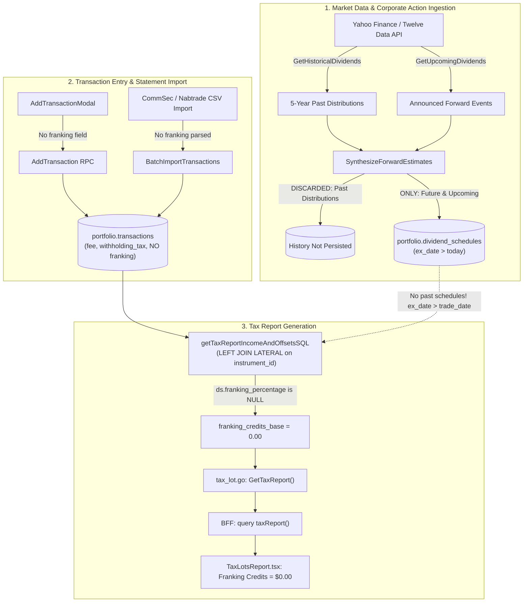

# Investigation Report: Zero Franking Credits in Tax Lots & Capital Gains Report

---

## 1. Executive Summary

This investigation analyzes why the **Franking Credits** metric, the **Franking Credits Tax Offset**, and the taxable income proportional ratio bars in the **Tax Lots & Capital Gains Report** (`TaxLotsReport.tsx`) consistently evaluate to **`$0.00`** (and `0.00%`), even when investors hold dividend-paying Australian equities (e.g., BHP, CBA, TLS, VAS).

The audit covered the complete lifecycle: third-party market data feeds (Yahoo Finance and Twelve Data), the dividend ingestion pipeline and cadence synthesizer, database schema and indexes, repository SQL queries, GraphQL orchestrator resolvers, and frontend trade entry / reporting components.

### Key Findings Overview:

1. **Ingestion Pipeline Discards Historical Corporate Actions**:
   The market data ingestion engine ([`SynthesizeForwardEstimates`](file:///Users/oscargarcia/workspace/graphfolio/services/portfolio-api/internal/marketdata/cadence.go#L55-L165)) queries historical distributions (`GetHistoricalDividends`) purely to infer distribution frequency (`DetectFrequency(history)`). It explicitly excludes `history` from the returned schedule slice, persisting **only future/upcoming estimates** to [`portfolio.dividend_schedules`](file:///Users/oscargarcia/workspace/graphfolio/services/portfolio-api/migrations/000011_create_dividend_schedules.up.sql#L18-L36). Zero historical dividend declarations exist in the database.

2. **Broken LATERAL SQL Join in Tax Reporting**:
   The tax aggregation query [`getTaxReportIncomeAndOffsetsSQL`](file:///Users/oscargarcia/workspace/graphfolio/services/portfolio-api/internal/repository/queries.go#L1020-L1047) executes a `LEFT JOIN LATERAL` matching `payment_date = tx.trade_date OR ex_date <= tx.trade_date`. Because the table contains only future schedules, `ex_date <= tx.trade_date` evaluates to false for past transactions, leaving `ds.franking_percentage = NULL` and franking credits at `$0.00`.

3. **Transaction Schema & Ingestion Lack Native Franking Fields**:
   The [`portfolio.transactions`](file:///Users/oscargarcia/workspace/graphfolio/services/portfolio-api/migrations/000002_portfolios_and_transactions.up.sql#L28-L55) table, Protobuf RPC definitions, GraphQL mutations, and frontend forms support `fee` and `withholding_tax`, but contain **no column or field for `franking_credit` or `franking_pct`**. The application cannot capture franking credits from user entry or brokerage CSV statements (e.g., CommSec, Nabtrade).

4. **Third-Party Provider Limitation & Incomplete Heuristics**:
   Standard Yahoo Finance and Twelve Data endpoints do not transmit Australian tax franking credit metadata. The repository's fallback heuristic (`frankingPct = 100%` for ASX instruments) was only applied to future synthesized estimates and forward declarations, while completely ignoring past dividends and partially franked Australian trusts/ETFs (e.g. VAS, STW).

5. **Mocked Unit Test Blind Spot**:
   Service unit tests in [`tax_lot_test.go`](file:///Users/oscargarcia/workspace/graphfolio/services/portfolio-api/internal/service/tax_lot_test.go#L109-L115) and GraphQL resolver tests in [`schema.resolvers_test.go`](file:///Users/oscargarcia/workspace/graphfolio/bff/graph/schema.resolvers_test.go#L3698) mocked `GetTaxReportIncomeAndOffsets` with static values (`$300.33`), leaving the SQL query and ingestion gaps untested against live data.

---

## 2. Tax Imputation Mechanics (ATO Division 207)

Under Australian tax law (*Income Tax Assessment Act 1997*):
1. **Imputation System**: Corporate tax paid by an Australian resident company is attributed to shareholders via franking credits attached to dividend payments.
2. **Formula**:
   $$\text{Franking Credit} = \text{Net Cash Dividend} \times \frac{t_c}{1 - t_c} \times \text{Franking Percentage}$$
   Where $t_c = 30\%$ for listed public companies:
   $$\text{Franking Credit} = \text{Net Cash Dividend} \times \frac{0.30}{0.70} \times \text{Franking}\% \approx \text{Net} \times 0.428571 \times \text{Franking}\%$$
3. **Assessable Income (Gross-Up)**:
   $$\text{Total Assessable Income} = \text{Net Cash Dividend} + \text{Franking Credit} + \text{Interest} + \text{Net Capital Gains}$$
4. **Tax Offset**: The franking credit is claimed as a tax offset to reduce tax payable, with excess credits refunded to individual taxpayers and compliant super funds.

In GraphFolio, [`domain.CalculateTaxableIncomeSummary`](file:///Users/oscargarcia/workspace/graphfolio/services/portfolio-api/internal/domain/tax_report.go#L124-L147) accurately models this formula:
```go
totalAssessable := dividendAndInterestIncome.Add(netCapitalGains).Add(frankingCredits).Round(2)
```
However, the input `frankingCredits` returned by the repository query is always `0.00`.

---

## 3. End-to-End Data Flow & Vulnerability Map



---

## 4. Detailed Root Cause Analysis

### 4.1 Historical Dividends Are Dropped During Ingestion

In [`services/portfolio-api/internal/service/ingestion.go`](file:///Users/oscargarcia/workspace/graphfolio/services/portfolio-api/internal/service/ingestion.go#L400-L450):
```go
upcoming, upErr := provider.GetUpcomingDividends(ctx, inst)
history, histErr := provider.GetHistoricalDividends(ctx, inst, now.AddDate(-5, 0, 0), now)
...
allEvents := marketdata.SynthesizeForwardEstimates(inst, upcoming, history, now)
```

In [`services/portfolio-api/internal/marketdata/cadence.go`](file:///Users/oscargarcia/workspace/graphfolio/services/portfolio-api/internal/marketdata/cadence.go#L53-L165):
```go
func SynthesizeForwardEstimates(
    inst InstrumentRef,
    announced []DividendScheduleEvent,
    history []DividendHistoryPoint,
    asOf time.Time,
) []DividendScheduleEvent {
    if len(announced) == 0 && len(history) == 0 {
        return announced
    }

    frequency, stepDays := DetectFrequency(history)
    ...
    // Only synthesize events for future dates:
    for !currentDate.After(horizonEnd) {
        if currentDate.After(asOf) {
            synthesized = append(synthesized, DividendScheduleEvent{ ... })
        }
        currentDate = currentDate.AddDate(0, 0, stepDays)
    }

    combined := append(announced, synthesized...)
    return combined
}
```

**Consequence**:
`history` is solely used by `DetectFrequency` to infer cadence. It is **never converted to `DividendScheduleEvent`** and never appended to `combined`. Consequently, `portfolio.dividend_schedules` contains zero rows for past dates.

---

### 4.2 Broken LATERAL Join in Repository SQL

In [`services/portfolio-api/internal/repository/queries.go`](file:///Users/oscargarcia/workspace/graphfolio/services/portfolio-api/internal/repository/queries.go#L1020-L1047):
```sql
SELECT 
    COALESCE(SUM(CASE WHEN tx.type = 'DIVIDEND' THEN tx.amount * COALESCE(tx.fx_rate_to_base, 1.0) ELSE 0 END), 0) AS dividend_income_base,
    COALESCE(SUM(CASE WHEN tx.type = 'INTEREST' THEN tx.amount * COALESCE(tx.fx_rate_to_base, 1.0) ELSE 0 END), 0) AS interest_income_base,
    COALESCE(SUM(COALESCE(tx.withholding_tax, 0) * COALESCE(tx.fx_rate_to_base, 1.0)), 0) AS foreign_tax_offsets_base,
    COALESCE(SUM(
        CASE 
            WHEN tx.type = 'DIVIDEND' AND COALESCE(ds.franking_percentage, 0) > 0 THEN
                (tx.amount * COALESCE(tx.fx_rate_to_base, 1.0)) * (ds.franking_percentage / 100.0) * (0.30 / 0.70)
            ELSE 0 
        END
    ), 0) AS franking_credits_base
FROM portfolio.transactions tx
JOIN portfolio.portfolios p ON p.id = tx.portfolio_id
LEFT JOIN LATERAL (
    SELECT franking_percentage
    FROM portfolio.dividend_schedules
    WHERE instrument_id = tx.instrument_id
      AND (
          payment_date = tx.trade_date OR
          ex_date <= tx.trade_date
      )
    ORDER BY ex_date DESC LIMIT 1
) ds ON (tx.instrument_id IS NOT NULL)
WHERE tx.portfolio_id = $1
  AND tx.trade_date >= $2
  AND tx.trade_date <= $3
  AND tx.type IN ('DIVIDEND', 'INTEREST');
```

**Why this fails**:
1. **Empty Past Table**: Since `portfolio.dividend_schedules` only contains future entries (`ex_date > today`), `ex_date <= tx.trade_date` is false for all historical transactions.
2. **Settlement Date vs Payment Date**: When dividend cash reaches an investor's brokerage cash account, the transaction `trade_date` often lags the company declaration's official `payment_date` by 1–3 business days. `payment_date = tx.trade_date` fails exact equality.
3. **Unbounded Historical Match**: Without an allowable date window (e.g. `tx.trade_date BETWEEN ex_date AND ex_date + INTERVAL '45 days'`), if any ancient schedule existed, it would latch onto an unrelated corporate cycle.

---

### 4.3 Data Model Omission: No Native Franking Storage

In [`portfolio.transactions`](file:///Users/oscargarcia/workspace/graphfolio/services/portfolio-api/migrations/000002_portfolios_and_transactions.up.sql#L28-L55):
- The table stores: `fee`, `withholding_tax`, `fx_rate_to_base`.
- It does **not** store `franking_credit` or `franking_pct`.

In [`AddTransactionModal.tsx`](file:///Users/oscargarcia/workspace/graphfolio/web/apps/main-app/src/components/AddTransactionModal.tsx#L107-L109):
- When recording a `DIVIDEND`, the user can only enter `Symbol`, `Amount`, and `Trade Date`.
- There is no field to specify the Franking Credit or Franking % from their distribution statement.

In Broker CSV Statement Parsers ([`commsec.ts`](file:///Users/oscargarcia/workspace/graphfolio/web/apps/main-app/src/services/csv/parsers/commsec.ts), [`nabtrade.ts`](file:///Users/oscargarcia/workspace/graphfolio/web/apps/main-app/src/services/csv/parsers/nabtrade.ts)):
- Even though Australian contract notes and dividend statements explicitly provide "Franked Amount" and "Franking Credit", the parsers discard these fields because the GraphQL and Protobuf batch import contracts cannot accept them.

---

### 4.4 Australian Trusts / ETFs Variability (VAS, STW, VHY)

The current codebase uses a blanket heuristic:
```go
if strings.ToUpper(inst.Exchange) == "ASX" || strings.ToUpper(inst.Exchange) == "XASX" {
    frankingPct = decimal.NewFromInt(100)
}
```

In Australia, ETFs (like VAS, the default ASX benchmark) and REITs distribute trust distributions that consist of:
- Partially franked dividends (e.g. 60%–75%)
- Unfranked income
- Foreign source income
- Capital gains (discounted and non-discounted)
- AMIT cost base adjustments

A hardcoded 100% assumption is inaccurate for Australian ETFs. Investors must be able to record or override the actual franking credit amount per transaction or distribution statement.

---

## 5. Architectural Recommendations

We propose a phased implementation roadmap:

| Phase | Milestone | Scope | Complexity |
| :--- | :--- | :--- | :---: |
| **Phase 1** | **Ingestion & Lateral Join Fix** | Persist historical dividends; bound SQL LATERAL join | Low |
| **Phase 2** | **Transaction Schema & UI** | Add `franking_credit` & `franking_pct` across DB, Proto, GraphQL, UI | Medium |
| **Phase 3** | **Broker Parsers & Integration Tests** | CommSec/Nabtrade CSV parsing, live PostgreSQL integration tests | Medium |

---

### Phase 1: Ingestion & Lateral Join Fix (Immediate Backend Fix)

#### 1.1 Ingest Historical Dividends as Confirmed Schedules
In [`services/portfolio-api/internal/service/ingestion.go`](file:///Users/oscargarcia/workspace/graphfolio/services/portfolio-api/internal/service/ingestion.go):
Convert historical dividend points (`history []DividendHistoryPoint`) into `DividendScheduleEvent` records with `status = 'PAID'` and `is_estimated = false`:

```go
// Synthesize and append historical distribution records
for _, hist := range history {
    frankingPct := decimal.Zero
    if strings.HasSuffix(strings.ToUpper(inst.Symbol), ".AX") || 
       strings.ToUpper(inst.Exchange) == "ASX" || 
       strings.ToUpper(inst.Exchange) == "XASX" {
        frankingPct = decimal.NewFromInt(100)
    }

    allEvents = append(allEvents, marketdata.DividendScheduleEvent{
        InstrumentID:      inst.ID,
        Symbol:            inst.Symbol,
        ExchangeCode:      inst.Exchange,
        ExDate:            hist.Date,
        PaymentDate:       hist.Date.AddDate(0, 0, 14), // Estimated payment lag
        AmountPerShare:    hist.Amount,
        CurrencyCode:      inst.Currency,
        Frequency:         frequency,
        Status:            "PAID",
        IsEstimated:       false,
        FrankingPct:       frankingPct,
        WithholdingTaxPct: decimal.Zero,
        Source:            "historical_ingest",
    })
}
```

#### 1.2 Add Time-Window Bounds to LATERAL SQL Join
In [`services/portfolio-api/internal/repository/queries.go`](file:///Users/oscargarcia/workspace/graphfolio/services/portfolio-api/internal/repository/queries.go):
Constrain the LATERAL subquery so that `tx.trade_date` must fall within 45 days of `ex_date` or match `payment_date`:

```sql
LEFT JOIN LATERAL (
    SELECT franking_percentage
    FROM portfolio.dividend_schedules
    WHERE instrument_id = tx.instrument_id
      AND (
          payment_date = tx.trade_date OR
          (ex_date <= tx.trade_date AND tx.trade_date <= ex_date + INTERVAL '45 days')
      )
    ORDER BY ex_date DESC LIMIT 1
) ds ON (tx.instrument_id IS NOT NULL)
```

---

### Phase 2: First-Class Franking on Transactions (Schema & UI)

#### 2.1 Database Migration
Create migration `000012_add_transaction_franking_credits.up.sql`:
```sql
ALTER TABLE portfolio.transactions
    ADD COLUMN franking_credit numeric(20,6) NOT NULL DEFAULT 0,
    ADD COLUMN franking_pct    numeric(5,2)  DEFAULT NULL;

ALTER TABLE portfolio.transactions
    ADD CONSTRAINT non_negative_franking CHECK (franking_credit >= 0);
```

#### 2.2 Protobuf & GraphQL Contract Updates
1. **Protobuf (`portfolio.proto`)**:
   Add to `TransactionItem`, `AddTransactionRequest`, and `UpdateTransactionRequest`:
   ```protobuf
   common.v1.Money   franking_credit = 15;
   common.v1.Decimal franking_pct    = 16;
   ```
2. **GraphQL Schema (`schema.graphqls`)**:
   Add to `AddTransactionInput`, `UpdateTransactionInput`, and `ImportTransactionInput`:
   ```graphql
   frankingCredit: Decimal
   frankingPct: Decimal
   ```

#### 2.3 SQL Query Waterfall (Transaction Override with Schedule Fallback)
Update `getTaxReportIncomeAndOffsetsSQL` to prioritize explicit transaction franking:
```sql
COALESCE(SUM(
    CASE 
        WHEN tx.type = 'DIVIDEND' THEN
            CASE
                -- 1. Explicit transaction-level franking credit
                WHEN COALESCE(tx.franking_credit, 0) > 0 THEN
                    tx.franking_credit * COALESCE(tx.fx_rate_to_base, 1.0)
                -- 2. Fall back to schedule-level corporate declaration
                WHEN COALESCE(ds.franking_percentage, 0) > 0 THEN
                    (tx.amount * COALESCE(tx.fx_rate_to_base, 1.0)) * (ds.franking_percentage / 100.0) * (0.30 / 0.70)
                ELSE 0
            END
        ELSE 0 
    END
), 0) AS franking_credits_base
```

#### 2.4 Trade Modal UI Enhancement
In [`AddTransactionModal.tsx`](file:///Users/oscargarcia/workspace/graphfolio/web/apps/main-app/src/components/AddTransactionModal.tsx) and [`EditTransactionModal.tsx`](file:///Users/oscargarcia/workspace/graphfolio/web/apps/main-app/src/components/EditTransactionModal.tsx):
- When `type === 'DIVIDEND'`, display an optional **Franking Credit ($)** input.
- If the symbol is an ASX ticker (`.AX` or exchange `XASX`), auto-suggest 100% franking and compute:
  $$\text{Franking Credit} = \text{Amount} \times \frac{0.30}{0.70} \times \frac{\text{Franking}\%}{100}$$

---

### Phase 3: Broker Statement CSV Parsers & Integration Tests

1. **Broker CSV Statement Parsing**:
   Enhance [`commsec.ts`](file:///Users/oscargarcia/workspace/graphfolio/web/apps/main-app/src/services/csv/parsers/commsec.ts) and [`nabtrade.ts`](file:///Users/oscargarcia/workspace/graphfolio/web/apps/main-app/src/services/csv/parsers/nabtrade.ts) to parse franking credits from dividend statement line items.
2. **PostgreSQL Integration Tests**:
   Implement live integration tests in `services/portfolio-api/internal/repository/postgres_test.go` executing `GetTaxReportIncomeAndOffsets` to assert:
   - Non-zero franking credits from corporate schedule fallback.
   - Non-zero franking credits from explicit transaction-level entry.
   - Exact proportional bar calculation in assessable income summary.
