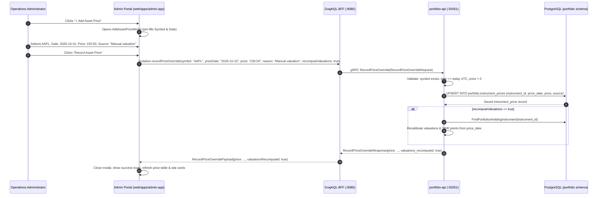

# User Story: Add Asset Prices in Admin Portal

**Story ID:** US-ADM-105  
**Epic:** Market Data & Administrative Operations  
**Target:** Internal Operations Portal (`web/apps/admin-app`)  
**Status:** Completed  
**Implementation Plan:** [add-asset-prices-admin-implementation-plan.md](file:///Users/oscargarcia/workspace/graphfolio/docs/plans/add-asset-prices-admin-implementation-plan.md)  
**Roadmap Reference:** [FEATURES.md (Feature #10 & #20)](file:///Users/oscargarcia/workspace/graphfolio/FEATURES.md)  
**Target Layers:** Web Admin App (`web/apps/admin-app`), BFF (`bff/`), Domain Microservice (`services/portfolio-api`), Proto (`proto/portfolio/v1/`)

---

## 1. User Story Statement

> **As an** operations administrator or portfolio manager,  
> **I want to** manually add and record daily closing asset prices for tracked instruments in the Admin Portal,  
> **So that** I can establish initial pricing marks for newly registered instruments, enter closing valuations for unlisted or thinly traded securities, backfill data feed gaps, and recalibrate portfolio valuations without requiring manual database or CLI intervention.

---

## 2. Business Context & Problem Statement

Currently, closing prices in GraphFolio are primarily ingested through automated market data feeds (e.g., Twelve Data) or bulk historical backfills. While the Admin Portal provides a "Manual Price Override" dialog in `PriceManagement`, several operational gaps exist:

1. **New Instrument Onboarding**: When administrators register new instruments via `AddInstrumentModal`, there is often no closing price available until an external sync occurs. For unlisted equities, private assets, OTC instruments, or newly listed IPOs, external market feeds do not have pricing data, leaving portfolios holding these assets unvalued.
2. **Missing Daily Price Gaps**: Upstream data providers occasionally experience outages, API rate limits, or holiday calendar discrepancies, leaving specific trading days unpriced.
3. **Unclear Workflow & Terminology**: The existing UI frames manual entry exclusively as an "Override" with severe warnings, making it non-intuitive for administrators attempting to simply *add* a legitimate initial or missing historical price record.
4. **Disjointed Navigation**: Administrators in `AssetManagement` inspecting assets cannot quickly jump to add a price for that asset; they must navigate to `PriceManagement`, filter symbols, and launch the override form manually.

Providing a dedicated, first-class **Add Asset Price** capability resolves these operational bottlenecks while maintaining GraphFolio's strict zero floating-point arithmetic and audit compliance standards.

---

## 3. Detailed Acceptance Criteria

### AC 1: Action Entry Points & Modal Triggering
- [x] **Price Management Toolbar**: Add a prominent `+ Add Asset Price` primary action button in the `PriceManagement` toolbar (adjacent to EOD Ingestion and Backfill actions).
- [x] **Asset Management Quick Action**: Add an `+ Add Price` action in the `AssetManagement` table rows (under the Actions column) allowing operators to launch the price recording modal with that instrument's symbol and currency pre-selected.
- [x] **Modal Framing**: The modal must be titled **"Add Asset Price"** and feature clear, instructional copy emphasizing both new entry and existing mark updating.

### AC 2: Form Inputs & Client-Side Validation
The "Add Asset Price" modal must contain the following fields with rigorous validation:
- [x] **Asset / Symbol Selector**:
  - Searchable dropdown listing all active instruments.
  - Option display format: `{SYMBOL} — {Instrument Name} [{Currency}]` (e.g., `AAPL — Apple Inc. [USD]`).
  - Pre-selected with the active filter symbol or row context if invoked from `AssetManagement`.
- [x] **Price Date**:
  - Interactive date picker formatted as `YYYY-MM-DD`.
  - Defaults to the current date (or last business day).
  - **Validation**: Cannot be a future date (UTC boundary matching backend `ErrFutureDate`). An inline error `"Price date cannot be in the future"` must appear if violated.
- [x] **Closing Price**:
  - Text/Numeric input with the instrument's currency symbol prefixed (e.g., `$`, `€`, `£`).
  - **Validation**: Must be a valid positive fixed-point decimal (`> 0.00`). Reject empty, negative, or zero inputs with inline error `"Closing price must be a positive number"`.
  - Strictly adheres to string-based fixed-point representation to avoid IEEE 754 floating-point precision loss.
- [x] **Quote Currency**:
  - Auto-populated and locked to the selected instrument's base trading currency (e.g., `USD`, `AUD`).
  - Displayed as a clear visual badge next to the price input to prevent cross-currency denomination errors.
- [x] **Source / Audit Notes (Reason)**:
  - Text input for audit justification (e.g., `"Manual Entry: AFR EOD Print"`, `"Initial Unlisted Valuation"`, `"OTC Broker Quote"`).
  - Defaults to `"manual"` if omitted by the user.
- [x] **Recalibrate Valuations Checkbox**:
  - Labeled `"Recompute affected portfolio valuations and performance"`.
  - Checked by default.
  - Informational caption: `"Retroactively recalibrates daily portfolio valuations and time-weighted returns (TWR) for portfolios holding this asset."`

### AC 3: Existing Price Conflict Detection & Smart Overwrite Warning
- [x] **Conflict Notice**: When an operator selects an instrument and date for which an authoritative closing price *already exists* in the ledger:
  - Display an inline informational banner:  
    > `ℹ️ Notice: An existing closing price of {CURRENCY} {EXISTING_PRICE} exists for this date. Saving will update this record.`
  - The submit button dynamically updates its label from `"Record Asset Price"` to `"Update Closing Price"`.
- [x] **Non-Destructive Cancel**: Operators can cancel at any time with the `Cancel` button or `Esc` key without saving or losing context.

### AC 4: Submission, Mutation & Feedback
- [x] **Loading & Disabled States**: When the form is submitted:
  - The submit button transitions into a loading spinner (`isLoading={true}`).
  - Form inputs and action buttons are disabled to prevent double submissions.
- [x] **BFF / Microservice Ingestion**:
  - Dispatches the GraphQL mutation `recordPriceOverride` (or dedicated `recordInstrumentPrice` mutation) passing symbol, price date, stringified decimal price, audit reason, and recompute flag.
- [x] **Success Notification**:
  - Closes the modal upon successful response.
  - Displays a toast notification:  
    `"Closing price recorded for {SYMBOL} on {DATE}: {FORMATTED_MONEY} (Valuations recalibrated)"`.
  - Automatically refreshes the `PriceManagement` table to reflect the newly recorded price.
  - Updates the top summary stat cards (`Authoritative Closing Records` count and `Latest Pricing Date`).
- [x] **Error Handling**:
  - Displays any server or network error directly in an alert banner inside the modal without clearing user inputs.

---

## 4. Architecture & Data Flow

---

## 5. Technical & Engineering Specifications

### 5.1 Precision & Zero Floating-Point Standards
- In accordance with the repository's **Zero Floating-Point Policy** (`AGENTS.md`), prices must never be handled or coerced into IEEE 754 floating-point numbers (`float32`/`float64`).
- Frontend forms must maintain prices as sanitized strings.
- BFF and microservices must handle values via `shopspring/decimal.Decimal` and protobuf `common.v1.Decimal`.

### 5.2 Database Integrity & Constraints
- Database persistence targets `portfolio.instrument_prices`:
  - `instrument_id` (UUIDv7 foreign key to `portfolio.instruments`)
  - `price_date` (`DATE`, unique composite constraint with `instrument_id`)
  - `price` (`NUMERIC(18, 4)`)
  - `source` (`VARCHAR(100)`, prefixed with `manual: ...`)
  - `updated_at` (`TIMESTAMPTZ`, updated on upsert)

### 5.3 Audit Traceability
- Any price entered through this user story must store clear attribution in the `source` column (`"manual: " + reason` or `"manual"`).
- Audit timestamps (`created_at`, `updated_at`) must reflect the precise recording time.

---

## 6. Testing & Quality Assurance Plan

### 6.1 Unit Tests
- **UI Modal Unit Tests** (`AddAssetPriceModal.test.tsx`):
  - Validates client-side validation rules (positive numbers only, future date rejections).
  - Confirms pre-population of symbols and instrument currencies.
  - Verifies dynamic conflict notice rendering when date matches an existing row.
- **BFF Resolver Tests** (`schema.resolvers_test.go`):
  - Verifies decimal unmarshaling and error forwarding from gRPC microservices.
- **Service Tests** (`admin_test.go`):
  - Verifies price recording, source tagging, date bounds checking, and valuation recomputation triggering.

### 6.2 Manual Verification Scenario
1. Open Admin Portal at `http://localhost:5174`.
2. Go to **Asset Management** tab, register a new test equity (e.g. `TEST.AX`).
3. Click `+ Add Price` on the newly registered asset row.
4. Verify symbol `TEST.AX` and currency `AUD` are pre-populated.
5. Enter a price of `12.50` and date `2026-10-10`.
6. Submit and verify toast notification confirms successful record.
7. Switch to **Price Management** tab; confirm `TEST.AX` appears with closing price `$12.50` and source badge `manual`.

---

## 7. Related Documentation

- **Architecture Guidelines**: [AGENTS.md](file:///Users/oscargarcia/workspace/graphfolio/AGENTS.md)
- **Features Roadmap**: [FEATURES.md](file:///Users/oscargarcia/workspace/graphfolio/FEATURES.md)
- **Asset Price Date Range Filtering Plan**: [asset-prices-date-range-filter-implementation-plan.md](file:///Users/oscargarcia/workspace/graphfolio/docs/plans/asset-prices-date-range-filter-implementation-plan.md)
- **Admin Historical Backfill Plan**: [admin-historical-backfill-implementation-plan.md](file:///Users/oscargarcia/workspace/graphfolio/docs/plans/admin-historical-backfill-implementation-plan.md)
