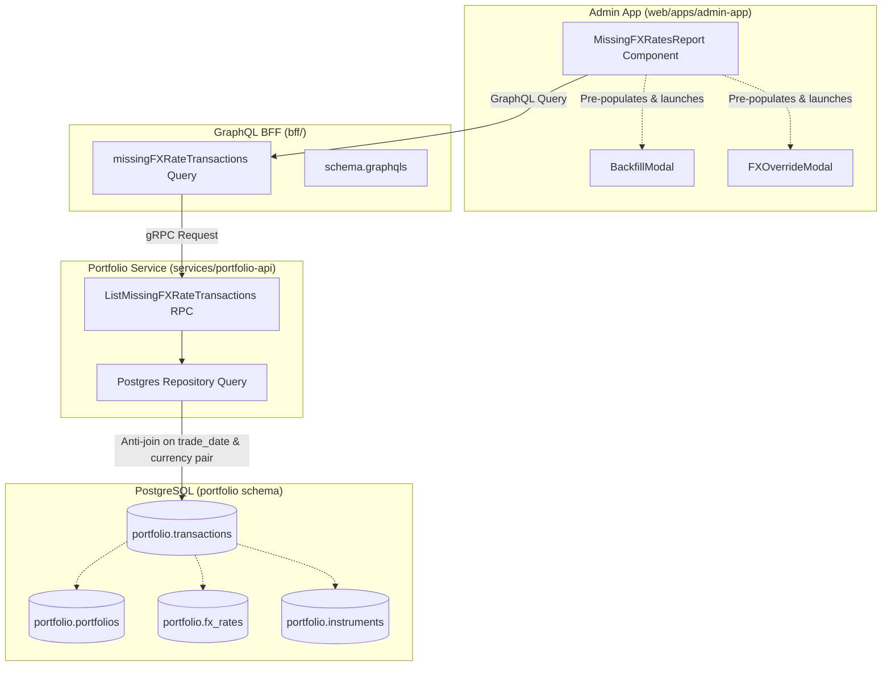

# User Story: Missing FX Rates Report & Date Range Backfill (Admin Portal)

> **Target**: Internal Operations Portal (`web/apps/admin-app`)  
> **Status**: Completed  
> **Implementation Plan**: [admin-missing-fx-rates-report-implementation-plan.md](file:///Users/oscargarcia/workspace/graphfolio/docs/plans/admin-missing-fx-rates-report-implementation-plan.md)  
> **Roadmap Reference**: [FEATURES.md (Feature #32)](file:///Users/oscargarcia/workspace/graphfolio/FEATURES.md)

---

## 1. Story Statement

**As an** Admin Portal user, financial operations manager, and data controller,  
**I want to** generate and view an automated, comprehensive "Missing FX Rates Report" identifying all recorded cross-currency transactions that lack an authoritative daily closing foreign exchange rate on their trade date,  
**So that** I can immediately pinpoint historical currency valuation gaps, eliminate currency conversion distortion in portfolio performance calculations, and trigger targeted on-demand FX backfills or manual rate overrides with a single click.

---

## 2. Background & Context

GraphFolio calculates multi-currency portfolio valuations, GIPS-compliant Modified Dietz returns, time-weighted returns (TWR), and exact 3-pillar return attributions (**Capital Gain**, **Dividend Income**, and **Currency Gain / Loss**) by combining:
1. Immutable transaction ledger entries (`portfolio.transactions`) recorded in execution currencies (`currency_code`, `fee_currency_code`) on specific `trade_date`s.
2. Portfolio base currencies (`portfolio.portfolios.base_currency`).
3. Authoritative daily foreign exchange rates (`portfolio.fx_rates`) matching the base/quote currency pairs on each trade date.

When investors execute or import cross-border transactions (such as purchasing US equities like `AAPL` in an `AUD`-denominated portfolio, receiving `USD` or `EUR` dividends, transferring multi-currency cash deposits, or paying brokerage fees in foreign currencies):
- Upstream central bank and market data ingestion feeds (e.g. European Central Bank - ECB reference rates, open FX feeds) may experience rate-limiting, weekend/holiday gaps, or feed outages.
- Multi-broker statement imports (e.g., CommSec International, Interactive Brokers, nabtrade CSV statements) often introduce historical trade dates predating the initialized history of tracked currency pairs in `portfolio.fx_rates`.
- A newly traded foreign currency pair (e.g. `USD/NZD`, `EUR/AUD`) may be introduced without having historical backfill depth executed back to the investor's inception date.

Without an authoritative daily closing FX rate on a transaction's `trade_date`:
- The ledger projection and valuation engine must fall back to approximations, inverse estimates, or un-converted units ($1.0$), distorting the asset's initial cost basis in base currency (`cost_basis_base`).
- Realized vs. unrealized capital gains and subsequent currency return attributions (`currency_gain_amount`, `currency_gain_percent`) become corrupted.
- Historical cash balances and external cash-flow weights in Modified Dietz calculations deviate from actual portfolio net equity.

While the existing [admin-missing-prices-report.md](file:///Users/oscargarcia/workspace/graphfolio/docs/user-stories/admin-missing-prices-report.md) diagnoses missing instrument closing prices (`portfolio.instrument_prices`), operations teams currently have no automated diagnostic tool to detect missing exchange rates (`portfolio.fx_rates`) across multi-currency transactions.

This user story introduces a dedicated "Missing FX Rates Report" in the Admin Portal that flags every cross-currency transaction missing an official exchange rate mark on its trade date, pre-populating GraphFolio's existing [BackfillModal](file:///Users/oscargarcia/workspace/graphfolio/web/apps/admin-app/src/components/BackfillModal.tsx) and [FXOverrideModal](file:///Users/oscargarcia/workspace/graphfolio/web/apps/admin-app/src/components/FXOverrideModal.tsx) for instant operational resolution.

---

## 3. Scope & Qualifying Transaction Rules

### 3.1 Qualifying Transactions

A transaction qualifies for foreign exchange conversion if its financial settlement currency differs from the owning portfolio's base currency ($t.\text{currency\_code} \neq p.\text{base\_currency}$), or if its brokerage fee currency differs from the portfolio base currency ($t.\text{fee\_currency\_code} \neq p.\text{base\_currency}$).

| Transaction Type | Foreign Currency Impact | Included in Missing FX Check? | Operational Rationale |
| :--- | :---: | :---: | :--- |
| **BUY** | Yes ($t.\text{currency\_code} \neq p.\text{base\_currency}$) | **Yes** | Crucial for converting acquisition cost to base currency (`cost_basis_base`) and establishing the currency return baseline. |
| **SELL** | Yes ($t.\text{currency\_code} \neq p.\text{base\_currency}$) | **Yes** | Essential for converting disposal proceeds into base currency and isolating realized capital gain from currency fluctuations. |
| **DIVIDEND** | Yes ($t.\text{currency\_code} \neq p.\text{base\_currency}$) | **Yes** | Required to convert dividend income to base currency (`dividends_base`) for income attribution and cash flow reporting. |
| **DEPOSIT** | Yes ($t.\text{currency\_code} \neq p.\text{base\_currency}$) | **Yes** | Required for external cash flow valuation and Modified Dietz time-weighting in portfolio base currency. |
| **WITHDRAWAL** | Yes ($t.\text{currency\_code} \neq p.\text{base\_currency}$) | **Yes** | Required for external capital distribution accounting in Modified Dietz return calculations. |
| **TRANSFER_IN / OUT** | Yes ($t.\text{currency\_code} \neq p.\text{base\_currency}$) | **Yes** | Required for mark-to-market cost basis re-anchoring on custody transfer dates. |
| **INTEREST / FEE / TAX** | Yes ($t.\text{currency\_code} \neq p.\text{base\_currency}$) | **Yes** | Required for maintaining accurate multi-currency cash account balances in base currency. |
| **SPLIT** | No (Non-monetary share adjustment) | **No** | Stock splits adjust share counts preserving total historical cost basis; no currency conversion is executed. |
| **Domestic Trades** | No ($t.\text{currency\_code} = p.\text{base\_currency}$) | **No** | When transaction currency matches the portfolio base currency, the rate is identity ($1.0000000000$) and no FX rate lookup is required. |

### 3.2 Detection Criteria

A transaction is flagged as having a **missing FX rate** if:
1. The transaction currency differs from the portfolio base currency:
   $$t \in \text{transactions}, \quad p \in \text{portfolios} \quad \text{where } t.\text{portfolio\_id} = p.\text{id} \quad \text{AND } t.\text{type} \neq \text{'SPLIT'}$$
   $$\text{AND } t.\text{currency\_code} \neq p.\text{base\_currency}$$
2. **Neither** a direct rate nor an inverse rate exists in `portfolio.fx_rates` on the transaction's `trade_date`:
   $$\text{NOT EXISTS } \Big( \text{SELECT 1 FROM portfolio.fx\_rates } fx$$
   $$\text{WHERE } fx.\text{rate\_date} = t.\text{trade\_date}$$
   $$\text{AND } \big( (fx.\text{base\_currency} = t.\text{currency\_code} \land fx.\text{quote\_currency} = p.\text{base\_currency})$$
   $$\lor (fx.\text{base\_currency} = p.\text{base\_currency} \land fx.\text{quote\_currency} = t.\text{currency\_code}) \big) \Big)$$

*(Optional Fee Currency Check)*: A transaction is also flagged if $t.\text{fee} > 0$, $t.\text{fee\_currency\_code} \text{ IS NOT NULL}$, $t.\text{fee\_currency\_code} \neq p.\text{base\_currency}$, and no FX rate exists on `t.trade_date` between $t.\text{fee\_currency\_code}$ and $p.\text{base\_currency}$.

---

## 4. Acceptance Criteria

### AC 1: Navigation & Admin Portal Integration
- **Scenario: Accessing the report from Admin Portal**
  - **Given** an operator is logged into the Admin Portal (`web/apps/admin-app`),
  - **When** they view the sidebar navigation in [AdminLayout.tsx](file:///Users/oscargarcia/workspace/graphfolio/web/apps/admin-app/src/components/AdminLayout.tsx),
  - **Then** they see a dedicated **"Missing FX Rates"** navigation item (positioned logically alongside "Missing Prices" and "Currency Pairs (FX)"),
  - **And** an alert badge is displayed with the dynamic count of unresolved transactions lacking trade-date FX rates.

### AC 2: Summary KPI Metrics
- **Scenario: Reviewing aggregate FX data health**
  - **Given** the Missing FX Rates Report is opened,
  - **Then** the page renders top-level metric cards:
    1. **Unconverted Transactions Count**: Total number of cross-currency transactions lacking a closing FX rate on trade date.
    2. **Impacted Currency Pairs Count**: Number of distinct currency pairs affected (e.g., `USD/AUD`, `EUR/AUD`, `GBP/USD`).
    3. **Earliest Missing FX Date**: Oldest trade date with an unpriced cross-currency transaction.
    4. **Date Span Coverage**: The full bounding date span (`Min Trade Date` to `Max Trade Date`) requiring historical FX backfills.

### AC 3: Filter Controls & Presets
- **Scenario: Filtering the missing FX diagnostic ledger**
  - **Given** the report is loaded,
  - **When** the operator interacts with the filter controls:
    - **Currency Pair Selector**: Filter by a specific currency pair (e.g. `USD/AUD`, `EUR/USD`) or select `ALL`.
    - **Transaction Currency Filter**: Filter by transaction currency (e.g. `USD`, `EUR`, `GBP`, `CAD`).
    - **Portfolio Base Currency Filter**: Filter by portfolio base currency (e.g. `AUD`, `USD`, `EUR`).
    - **Transaction Type Selector**: Filter by `BUY`, `SELL`, `DIVIDEND`, `DEPOSIT`, `WITHDRAWAL`, or view `ALL`.
    - **Date Range Picker**: Select custom `From Date` and `To Date`.
    - **Date Presets**: One-click quick-range buttons for `30D`, `90D`, `YTD`, `1Y`, and `ALL`.
  - **Then** the diagnostic ledger dynamically updates to show only matching unresolved transactions.

### AC 4: Itemized Diagnostic Ledger
- **Scenario: Inspecting unpriced transaction details**
  - **Given** transactions with missing trade-date FX rates exist,
  - **Then** the table displays the following columns for each entry:
    1. `Trade Date`: Execution date formatted as `YYYY-MM-DD`.
    2. `Required Pair`: Canonical pair representation required for conversion (e.g. `USD/AUD` or `EUR/AUD`).
    3. `Type`: Styled badge indicating transaction type (`BUY`, `SELL`, `DIVIDEND`, `DEPOSIT`, `WITHDRAWAL`, `FEE`).
    4. `Asset / Symbol`: Associated ticker symbol and asset name (if applicable, or `Cash / External`).
    5. `Transacted Amount`: Formatted amount with currency code (e.g., `$2,450.00 USD`).
    6. `Portfolio (Base)`: Portfolio name with base currency pill (e.g., `Growth Portfolio [AUD]`).
    7. `Recorded Trade Rate`: Snapshot rate stored in `transactions.fx_rate_to_base` if recorded by broker, or `None` if unrecorded.
    8. `Status`: Warning badge stating `Missing Daily Fixing`.
    9. `Actions`: Interactive buttons for immediate remediation.

### AC 5: One-Click Date Range Backfill Link
- **Scenario: Backfilling from a single transaction row**
  - **Given** a row in the Missing FX Rates Report table,
  - **When** the operator clicks the **"Backfill Pair Range"** action button,
  - **Then** the application opens the [BackfillModal](file:///Users/oscargarcia/workspace/graphfolio/web/apps/admin-app/src/components/BackfillModal.tsx) pre-populated with:
    - `fromDate`: The transaction's `trade_date` (with an optional 3-day buffer to capture preceding Friday fixings for weekend trades).
    - `toDate`: The transaction's `trade_date` (or current date).
    - `currencyPairs`: Array containing the affected pair `["USD/AUD"]`.
    - `backfillFx`: `true`.
    - `backfillAssets`: `false`.
    - `recomputeValuations`: `true` (checked by default to refresh historical valuations).

- **Scenario: Backfilling a grouped currency pair range**
  - **Given** multiple unpriced transactions exist for the same currency pair over time,
  - **When** the operator clicks **"Backfill Pair History"** from the filter or pair header,
  - **Then** the [BackfillModal](file:///Users/oscargarcia/workspace/graphfolio/web/apps/admin-app/src/components/BackfillModal.tsx) opens with `fromDate` set to the pair's earliest missing trade date and `toDate` set to its latest missing trade date.

- **Scenario: Global bulk FX backfill**
  - **Given** multiple unpriced transactions across diverse currency pairs,
  - **When** the operator clicks the primary **"Backfill All Missing FX"** button at the top of the report,
  - **Then** the backfill modal opens pre-configured with the bounding date range of all unpriced transactions and the list of all affected currency pairs.

### AC 6: Direct FX Rate Override / Manual Entry Link
- **Scenario: Manual FX rate override fallback**
  - **Given** a transaction in an exotic currency pair or a date where public central bank feeds are unavailable,
  - **When** the operator clicks the secondary action **"Record Manual FX Rate"**,
  - **Then** the [FXOverrideModal](file:///Users/oscargarcia/workspace/graphfolio/web/apps/admin-app/src/components/FXOverrideModal.tsx) opens pre-populated with:
    - `defaultBaseCurrency`: Transaction currency (e.g. `USD`).
    - `defaultQuoteCurrency`: Portfolio base currency (e.g. `AUD`).
    - `defaultRateDate`: The transaction's `trade_date`.
    - `defaultRate`: Pre-filled with `transactions.fx_rate_to_base` if present on the transaction row, otherwise blank.
    - `recomputeValuations`: `true`.

### AC 7: Post-Backfill Auto-Reconciliation & Table Refresh
- **Scenario: Completing an FX backfill or override**
  - **Given** the operator triggered and successfully completed an FX backfill or manual rate override,
  - **When** the modal closes with a success status,
  - **Then** the Missing FX Rates Report automatically re-fetches data,
  - **And** successfully resolved transactions are removed from the report table,
  - **And** a toast notification displays: `"X foreign exchange rates synced. Report updated."`.

---

## 5. UI/UX Specifications

### 5.1 Layout & Visual Mockup

The report conforms to GraphFolio's dark glassmorphic design system (`@graphfolio/ui`):

```text
+-----------------------------------------------------------------------------------------------------------------------------+
|  GraphFolio Admin > Missing FX Rates Report                                                  [Backfill All Missing FX]     |
+-----------------------------------------------------------------------------------------------------------------------------+
|  [ 18 Unconverted Trades ]     [ 3 Impacted Pairs ]     [ Earliest Date: 2024-02-14 ]     [ Date Span: 242 Days ]          |
+-----------------------------------------------------------------------------------------------------------------------------+
|  Filters: [ Pair: ALL (3) v ]  [ Type: ALL v ]  [ Date Range: 2024-01-01 to 2024-10-12 ]  [ Presets: 30D | 90D | YTD | ALL ]|
+-----------------------------------------------------------------------------------------------------------------------------+
|  TRADE DATE  | REQUIRED PAIR | TYPE | ASSET / SYMBOL | AMOUNT TRANSACTED | PORTFOLIO (BASE) | RECORDED FX | STATUS | ACTIONS |
|--------------+---------------+------+----------------+-------------------+------------------+-------------+--------+---------|
|  2024-02-14  | USD/AUD       | BUY  | AAPL (Apple)   |     $3,600.00 USD | Main Vault (AUD) | 1.52800000  | Missing| [Backfill]
|              |               |      | NASDAQ         |                   |                  | (Broker)    | Fixing | [Manual]
|--------------+---------------+------+----------------+-------------------+------------------+-------------+--------+---------|
|  2024-05-18  | USD/AUD       | DIV  | MSFT (Micro.)  |       $145.20 USD | Main Vault (AUD) | None        | Missing| [Backfill]
|              |               |      | NASDAQ         |                   |                  |             | Fixing | [Manual]
|--------------+---------------+------+----------------+-------------------+------------------+-------------+--------+---------|
|  2024-07-02  | EUR/AUD       | BUY  | SAP (SAP SE)   |     €4,200.00 EUR | Main Vault (AUD) | None        | Missing| [Backfill]
|              |               |      | XETRA          |                   |                  |             | Fixing | [Manual]
|--------------+---------------+------+----------------+-------------------+------------------+-------------+--------+---------|
|  2024-08-11  | USD/AUD       | DEP  | Cash Account   |     $5,000.00 USD | USD Trading(AUD) | None        | Missing| [Backfill]
|              |               |      | —              |                   |                  |             | Fixing | [Manual]
+-----------------------------------------------------------------------------------------------------------------------------+
| Showing 1-4 of 18 records                                                          [ < Prev ] [ Page 1 of 5 ] [ Next > ]    |
+-----------------------------------------------------------------------------------------------------------------------------+
```

### 5.2 Empty State

When all cross-currency transactions have matching daily foreign exchange rates on their trade dates:
- Display a green shield icon and banner:  
  `"All cross-currency transactions have verified daily FX rates on their trade dates. No currency conversion gaps detected."`
- Provide a secondary action button: `"Run FX Verification Audit"`.

---

## 6. Technical Architecture & System Integration

### 6.1 Layer Breakdown



### 6.2 Data Model & Query Contract

#### 1. gRPC Protocol Buffers Contract (`proto/portfolio/v1/portfolio.proto`)

```protobuf
message MissingFXRateTransactionItem {
  string transaction_id       = 1;
  string portfolio_id         = 2;
  string portfolio_name       = 3;
  string portfolio_base_cur   = 4;
  string trade_date           = 5; // YYYY-MM-DD
  TransactionType type        = 6;
  optional string instrument_id = 7;
  optional string symbol      = 8;
  optional string asset_name  = 9;
  common.v1.Money amount      = 10;
  string transaction_cur      = 11;
  string required_pair        = 12; // e.g. "USD/AUD"
  optional common.v1.Decimal recorded_fx_rate = 13; // Snapshot rate on transaction if present
}

message ListMissingFXRateTransactionsRequest {
  optional string currency_pair = 1; // e.g. "USD/AUD"
  optional string from_date     = 2; // YYYY-MM-DD
  optional string to_date       = 3; // YYYY-MM-DD
  optional TransactionType type = 4;
  int32 limit                   = 5; // Default 50, max 200
  int32 offset                  = 6;
}

message ListMissingFXRateTransactionsResponse {
  repeated MissingFXRateTransactionItem items = 1;
  int32 total_count                           = 2;
  int32 unique_pairs_count                    = 3;
  optional string earliest_trade_date         = 4;
  optional string latest_trade_date           = 5;
}
```

#### 2. GraphQL Schema Contract (`bff/graph/schema.graphqls`)

```graphql
type MissingFXRateTransactionItem {
  transactionId: ID!
  portfolioId: ID!
  portfolioName: String!
  portfolioBaseCurrency: String!
  tradeDate: String!
  type: TransactionType!
  instrumentId: ID
  symbol: String
  assetName: String
  amount: Money!
  transactionCurrency: String!
  requiredPair: String!
  recordedFxRate: Decimal
}

type MissingFXRatesReport {
  items: [MissingFXRateTransactionItem!]!
  totalCount: Int!
  uniquePairsCount: Int!
  earliestTradeDate: String
  latestTradeDate: String
}

extend type Query {
  missingFXRateTransactions(
    currencyPair: String
    fromDate: String
    toDate: String
    type: TransactionType
    limit: Int
    offset: Int
  ): MissingFXRatesReport!
}
```

#### 3. Optimized PostgreSQL Query Pattern (`services/portfolio-api/internal/repository/queries.go`)

```sql
SELECT 
    t.id AS transaction_id,
    t.portfolio_id,
    p.name AS portfolio_name,
    p.base_currency AS portfolio_base_currency,
    t.trade_date,
    t.type,
    t.instrument_id,
    COALESCE(i.symbol, '') AS symbol,
    COALESCE(i.name, '') AS asset_name,
    t.amount,
    t.currency_code AS transaction_currency,
    CONCAT(TRIM(t.currency_code), '/', TRIM(p.base_currency)) AS required_pair,
    t.fx_rate_to_base AS recorded_fx_rate
FROM portfolio.transactions t
JOIN portfolio.portfolios p ON t.portfolio_id = p.id
LEFT JOIN portfolio.instruments i ON t.instrument_id = i.id
LEFT JOIN portfolio.fx_rates fx_direct 
    ON fx_direct.rate_date = t.trade_date
   AND fx_direct.base_currency = t.currency_code 
   AND fx_direct.quote_currency = p.base_currency
LEFT JOIN portfolio.fx_rates fx_inverse 
    ON fx_inverse.rate_date = t.trade_date
   AND fx_inverse.base_currency = p.base_currency 
   AND fx_inverse.quote_currency = t.currency_code
WHERE t.type <> 'SPLIT'
  AND t.currency_code <> p.base_currency
  AND fx_direct.rate IS NULL 
  AND fx_inverse.rate IS NULL
  AND ($1::text IS NULL OR 
       CONCAT(TRIM(t.currency_code), '/', TRIM(p.base_currency)) = $1 OR 
       CONCAT(TRIM(p.base_currency), '/', TRIM(t.currency_code)) = $1)
  AND ($2::date IS NULL OR t.trade_date >= $2)
  AND ($3::date IS NULL OR t.trade_date <= $3)
  AND ($4::portfolio.transaction_type IS NULL OR t.type = $4)
ORDER BY t.trade_date DESC, t.id ASC
LIMIT $5 OFFSET $6;
```

---

## 7. Edge Cases & Non-Functional Requirements

1. **Reciprocal Pair Inversion**:
   - Currency rates can be recorded in either direction (e.g. European Central Bank quotes `EUR/USD`, whereas British and Australian markets often quote `GBP/USD` and `AUD/USD`).
   - If either direct $(t.\text{currency}, p.\text{base})$ OR inverse $(p.\text{base}, t.\text{currency})$ exists in `portfolio.fx_rates` for the `trade_date`, the rate is mathematically resolvable via exact 10-decimal reciprocal division ($1 / \text{rate}$) and is **not** flagged as missing.
2. **Weekend and Public Holiday Trades**:
   - Foreign exchange markets close from Friday 17:00 EST to Sunday 17:00 EST. Central banks (such as ECB) do not publish reference fixings on weekends or banking holidays (e.g. Good Friday, Christmas, New Year).
   - If a transaction is dated on a weekend or bank holiday, the backfill engine should synchronize the preceding business day's closing mark, or the report must highlight that the transaction executed on a non-trading day.
3. **Broker Snapshot Rate vs. Canonical EOD Fixing**:
   - A transaction may have an execution FX rate recorded in `portfolio.transactions.fx_rate_to_base` from the broker's trade confirmation slip.
   - However, daily portfolio valuation snapshots (`portfolio.portfolio_valuations`) and end-of-day holdings mark-to-market require the official closing FX rate in `portfolio.fx_rates`.
   - The report displays the recorded broker rate for audit comparison while still flagging the absence of the canonical daily market fixing in `portfolio.fx_rates`.
4. **Brokerage Fee Currency Divergence**:
   - In international trading, brokerage fees may be billed in a third currency (e.g., an Australian investor buying Japanese equities with execution in `JPY`, settled in `USD`, and charged an `AUD` commission).
   - If `t.fee_currency_code` is present and differs from both `t.currency_code` and `p.base_currency`, the system should verify currency pair availability for the fee currency.
5. **Pagination & Query Performance**:
   - For enterprise databases with tens of thousands of multi-currency ledger transactions, the anti-join query must utilize indexes on `portfolio.fx_rates(base_currency, quote_currency, rate_date)` and `portfolio.transactions(portfolio_id, trade_date)` to maintain execution times under 100ms.
6. **Security & Role Restrictions**:
   - The diagnostic report and associated on-demand backfill/override triggers are strictly reserved for the internal Admin Portal (`web/apps/admin-app`) and are excluded from the end-investor dashboard.

---

## 8. Related Documentation

- **Missing Prices Report User Story**: [admin-missing-prices-report.md](file:///Users/oscargarcia/workspace/graphfolio/docs/user-stories/admin-missing-prices-report.md)
- **Currency Pair Historical Prices User Story**: [currency-pair-historical-prices-admin.md](file:///Users/oscargarcia/workspace/graphfolio/docs/user-stories/currency-pair-historical-prices-admin.md)
- **Historical Market Data Backfill (Admin)**: [historical-market-data-backfill-admin.md](file:///Users/oscargarcia/workspace/graphfolio/docs/user-stories/historical-market-data-backfill-admin.md)
- **Backfill Modal Component**: [BackfillModal.tsx](file:///Users/oscargarcia/workspace/graphfolio/web/apps/admin-app/src/components/BackfillModal.tsx)
- **FX Override Modal Component**: [FXOverrideModal.tsx](file:///Users/oscargarcia/workspace/graphfolio/web/apps/admin-app/src/components/FXOverrideModal.tsx)
- **FX Management Layout**: [FXManagement.tsx](file:///Users/oscargarcia/workspace/graphfolio/web/apps/admin-app/src/components/FXManagement.tsx)
- **Feature Matrix & Roadmap**: [FEATURES.md](file:///Users/oscargarcia/workspace/graphfolio/FEATURES.md)
