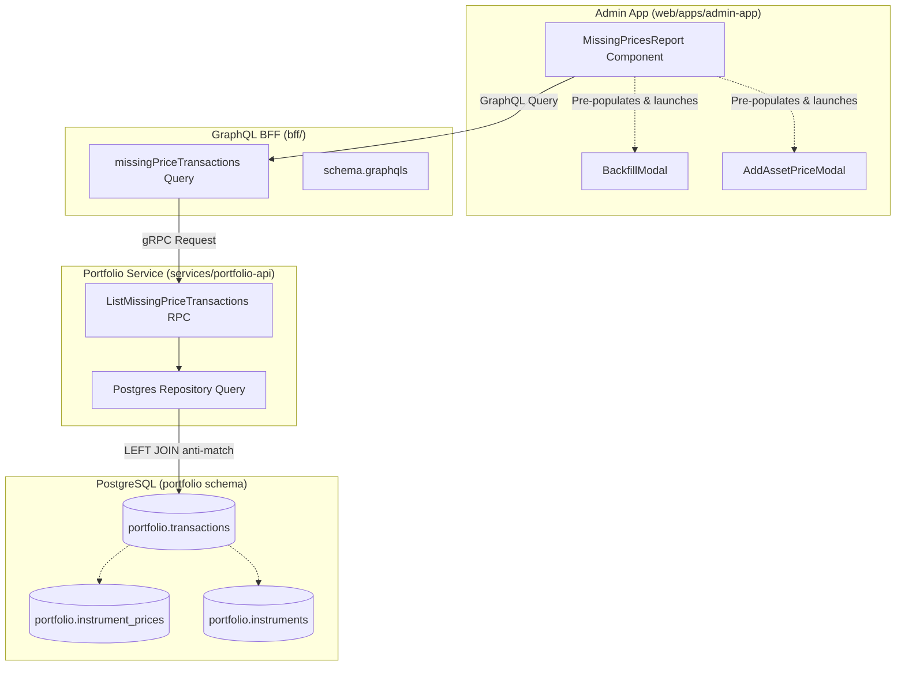

# User Story: Missing Prices Report & Date Range Backfill (Admin Portal)

> **Target**: Internal Operations Portal (`web/apps/admin-app`)  
> **Status**: Completed  
> **Implementation Plan**: [admin-missing-prices-report-implementation-plan.md](file:///Users/oscargarcia/workspace/graphfolio/docs/plans/admin-missing-prices-report-implementation-plan.md)  
> **Roadmap Reference**: [FEATURES.md (Feature #29)](file:///Users/oscargarcia/workspace/graphfolio/FEATURES.md)

---

## 1. Story Statement

**As an** Admin Portal user and data operations manager,  
**I want to** generate and view a comprehensive "Missing Prices Report" that identifies all recorded transactions lacking a daily closing market price on their trade date,  
**So that** I can immediately detect historical market data gaps and trigger targeted on-demand backfills for the specific date ranges and tickers with a single click.

---

## 2. Background & Context

GraphFolio calculates portfolio valuations, time-weighted returns (TWR), GIPS-compliant CAGRs, and multi-pillar return attributions (capital gains vs. dividend income vs. currency fluctuations) by combining:
1. Immutable transaction ledger entries (`portfolio.transactions`) recorded on specific `trade_date`s.
2. Daily historical instrument closing prices (`portfolio.instrument_prices`) matching each traded asset and date.

When investors enter or import historical transactions (via manual entry or multi-broker CSV statements), transactions may fall on dates where:
- The asset was recently added to the master directory and historical closing marks have not yet been backfilled.
- Upstream market data ingestion feeds (e.g. Yahoo Finance, exchange APIs) experienced temporary rate limits, network outages, or feed gaps.
- Corporate action adjustments or trade settlement dates lack corresponding EOD (End-Of-Day) marks.

Without daily closing marks on the transaction's trade date, historical valuation replays must rely on fallback estimates or carry-forward approximations, which can distort initial cost basis valuation and historical performance curves. 

This user story provides operators with an automated diagnostic report in the Admin Portal that flags every transaction missing a closing price on its trade date, accompanied by contextual action buttons that pre-populate the existing backfill engine (`BackfillModal`) with the exact date range and symbol required.

---

## 3. Scope & Qualifying Transaction Rules

### 3.1 Qualifying Transactions
The report inspects transactions associated with an instrument (`instrument_id IS NOT NULL`) where no corresponding row exists in `portfolio.instrument_prices`:

| Transaction Type | Instrument Required | Included in Missing Price Check? | Notes |
| :--- | :---: | :---: | :--- |
| **BUY** | Yes | **Yes** | Crucial for trade-date mark-to-market and valuation inception. |
| **SELL** | Yes | **Yes** | Essential for realized vs. unrealized gain attribution on disposal date. |
| **SPLIT** | Yes | **Yes** | Corporate action requires closing mark to adjust valuation continuity. |
| **TRANSFER_IN / TRANSFER_OUT** | Yes | **Yes** | Custody transfers require mark-to-market on transfer date. |
| **DIVIDEND** | Yes | **No** | Dividend payouts do not represent asset purchases/sales and do not require closing marks on payment date. |
| **DEPOSIT / WITHDRAWAL** | No | **No** | Cash ledger operations without asset association are excluded. |
| **INTEREST / FEE / TAX** | Optional | **No** | Pure cash fee/interest entries are excluded. |

### 3.2 Detection Criteria
A transaction is flagged as having a **missing price** if:
$$\text{Transaction } t \in \text{transactions} \quad \text{where } t.\text{instrument\_id} \text{ IS NOT NULL AND } t.\text{type} \neq \text{'DIVIDEND'}$$
$$\text{AND NOT EXISTS } \left( \text{SELECT 1 FROM instrument\_prices } p \text{ WHERE } p.\text{instrument\_id} = t.\text{instrument\_id} \text{ AND } p.\text{price\_date} = t.\text{trade\_date} \right)$$

---

## 4. Acceptance Criteria

### AC 1: Navigation & Admin Portal Integration
- **Scenario: Accessing the report**
  - **Given** an operator is logged into the Admin Portal (`web/apps/admin-app`),
  - **When** they view the sidebar navigation in [AdminLayout.tsx](file:///Users/oscargarcia/workspace/graphfolio/web/apps/admin-app/src/components/AdminLayout.tsx),
  - **Then** they see a dedicated "Missing Prices" navigation item (or report selector within the Market Prices tab) with an alert badge showing the count of unresolved missing price occurrences.

### AC 2: Summary KPI Metrics
- **Scenario: Reviewing aggregate gap health**
  - **Given** the Missing Prices Report is opened,
  - **Then** the page renders top-level metric cards:
    1. **Unpriced Transactions Count**: Total number of transactions lacking a closing price on trade date.
    2. **Affected Instruments Count**: Total unique ticker symbols impacted.
    3. **Earliest Missing Date**: The oldest trade date with an unpriced transaction.
    4. **Date Span Coverage**: The full bounding date span (`Min Trade Date` to `Max Trade Date`) requiring backfills.

### AC 3: Filter Controls & Presets
- **Scenario: Filtering the diagnostic ledger**
  - **Given** the report is loaded,
  - **When** the operator interacts with the filter controls:
    - **Symbol Selector**: Filter by a specific symbol (e.g. `AAPL`, `BHP.AX`) or view `ALL`.
    - **Date Range Picker**: Select custom `From Date` and `To Date`.
    - **Date Presets**: Quick-select buttons for `30D`, `90D`, `YTD`, `1Y`, and `ALL`.
    - **Transaction Type Filter**: Filter by `BUY`, `SELL`, `DIVIDEND`, `SPLIT`, etc.
  - **Then** the itemized table dynamically updates to display only matching unpriced transactions.

### AC 4: Itemized Diagnostic Ledger
- **Scenario: Inspecting unpriced transaction details**
  - **Given** transactions with missing prices exist,
  - **Then** the table displays the following columns for each entry:
    1. `Trade Date`: The transaction execution date (`YYYY-MM-DD`).
    2. `Symbol / Asset`: Ticker symbol, exchange badge (e.g. `NASDAQ`, `ASX`), and asset name.
    3. `Transaction Type`: Badge styled by type (`BUY` in emerald, `SELL` in blue, `DIVIDEND` in amber, `SPLIT` in purple).
    4. `Quantity`: Number of units/shares transacted.
    5. `Execution Price`: The executed transaction price recorded on the trade.
    6. `Portfolio / User`: Target portfolio identifier or user alias.
    7. `Price Status`: Alert badge stating `Missing Closing Mark`.
    8. `Actions`: Interactive buttons for remediation.

### AC 5: One-Click Date Range Backfill Link
- **Scenario: Backfilling from a single transaction row**
  - **Given** an unpriced transaction row in the report table,
  - **When** the operator clicks the **"Backfill Missing Price"** action button,
  - **Then** the application opens the [BackfillModal](file:///Users/oscargarcia/workspace/graphfolio/web/apps/admin-app/src/components/BackfillModal.tsx) pre-populated with:
    - `fromDate`: The transaction's `trade_date` (or a configurable buffer, e.g. 5 days prior to cover weekend/settlement spans).
    - `toDate`: The transaction's `trade_date` (or today if continuing coverage).
    - `symbols`: Array containing only the affected asset's ticker symbol `[symbol]`.
    - `backfillAssets`: `true`.
    - `backfillFx`: `false`.
    - `recomputeValuations`: `true` (checked by default to refresh historical valuations).

- **Scenario: Backfilling a grouped instrument range**
  - **Given** multiple unpriced transactions exist for the same instrument across a timeframe,
  - **When** the operator clicks **"Backfill Instrument Range"** for that symbol,
  - **Then** the [BackfillModal](file:///Users/oscargarcia/workspace/graphfolio/web/apps/admin-app/src/components/BackfillModal.tsx) opens with `fromDate` set to the symbol's earliest missing trade date and `toDate` set to its latest missing trade date.

- **Scenario: Global bulk backfill**
  - **Given** multiple unpriced transactions across multiple instruments,
  - **When** the operator clicks the primary **"Backfill All Missing Ranges"** button at the top of the report,
  - **Then** the backfill modal opens pre-configured with the bounding date range of all unpriced transactions and the list of all affected symbols.

### AC 6: Direct Price Override / Manual Entry Link
- **Scenario: Manual price entry fallback**
  - **Given** an unpriced transaction for an asset or private instrument not covered by upstream market feeds,
  - **When** the operator clicks the secondary action **"Add Manual Price"**,
  - **Then** the [AddAssetPriceModal](file:///Users/oscargarcia/workspace/graphfolio/web/apps/admin-app/src/components/AddAssetPriceModal.tsx) opens pre-populated with the instrument symbol, the `trade_date`, and the execution price as the default suggested closing price.

### AC 7: Post-Backfill Auto-Reconciliation & Table Refresh
- **Scenario: Completing a backfill job**
  - **Given** the operator triggered and successfully completed a backfill from the report,
  - **When** the [BackfillModal](file:///Users/oscargarcia/workspace/graphfolio/web/apps/admin-app/src/components/BackfillModal.tsx) closes with a success status,
  - **Then** the Missing Prices Report automatically re-fetches data,
  - **And** successfully resolved transactions are removed from the report table,
  - **And** a toast notification displays: `"X closing prices synced. Report updated."`.

---

## 5. UI/UX Specifications

### 5.1 Layout & Visual Mockup
The report follows GraphFolio's dark glassmorphic design system (`@graphfolio/ui`):

```text
+-------------------------------------------------------------------------------------------------------+
|  GraphFolio Admin > Missing Prices Report                                    [Backfill All Missing]  |
+-------------------------------------------------------------------------------------------------------+
|  [ 14 Unpriced Trades ]     [ 3 Affected Assets ]     [ Earliest: 2024-03-15 ]    [ Span: 180 Days ]  |
+-------------------------------------------------------------------------------------------------------+
|  Filters: [ Symbol: ALL (3) v ]  [ Date Range: 2024-01-01 to 2024-10-12 ]  [ Presets: 30D | 90D | YTD | ALL ] |
+-------------------------------------------------------------------------------------------------------+
|  TRADE DATE  | SYMBOL / ASSET        | TYPE | QUANTITY | TRADE PRICE | STATUS       | ACTIONS         |
|--------------+-----------------------+------+----------+-------------+--------------+-----------------|
|  2024-03-15  | NVDA (Nvidia Corp)    | BUY  |    10.00 |     $880.00 | Missing Mark | [Backfill Range]|
|              | NASDAQ                |      |          |             |              | [Manual Entry]  |
|--------------+-----------------------+------+----------+-------------+--------------+-----------------|
|  2024-06-20  | CBA.AX (CommBank)     | BUY  |    50.00 |     $122.50 | Missing Mark | [Backfill Range]|
|              | ASX                   |      |          |             |              | [Manual Entry]  |
|--------------+-----------------------+------+----------+-------------+--------------+-----------------|
|  2024-08-10  | AAPL (Apple Inc)      | DIV  |     0.00 |       $0.00 | Missing Mark | [Backfill Range]|
|              | NASDAQ                |      |          |             |              | [Manual Entry]  |
+-------------------------------------------------------------------------------------------------------+
| Showing 1-3 of 14 records                                                  [ < Prev ] [ Page 1 of 5 ] [ Next > ] |
+-------------------------------------------------------------------------------------------------------+
```

### 5.2 Empty State
When all transactions have matching closing prices on their trade dates:
- Display an informative green shield banner: `"All transactions have verified daily closing prices on their trade dates. No pricing gaps detected."`.
- Provide a button to "Run Verification Sync".

---

## 6. Technical Architecture & System Integration

### 6.1 Layer Breakdown



### 6.2 Data Model & Query Contract

#### gRPC Contract (`proto/portfolio/v1/portfolio.proto`)
```protobuf
message MissingPriceTransactionItem {
  string transaction_id = 1;
  string portfolio_id   = 2;
  string instrument_id  = 3;
  string symbol         = 4;
  string asset_name     = 5;
  string exchange_mic   = 6;
  string trade_date     = 7; // YYYY-MM-DD
  TransactionType type  = 8;
  common.v1.Decimal quantity = 9;
  common.v1.Money execution_price = 10;
  string currency_code  = 11;
}

message ListMissingPriceTransactionsRequest {
  optional string symbol    = 1;
  optional string from_date = 2; // YYYY-MM-DD
  optional string to_date   = 3; // YYYY-MM-DD
  int32 limit               = 4; // Default 50, max 200
  int32 offset              = 5;
}

message ListMissingPriceTransactionsResponse {
  repeated MissingPriceTransactionItem items = 1;
  int32 total_count                          = 2;
  int32 unique_instruments_count             = 3;
  optional string earliest_trade_date        = 4;
  optional string latest_trade_date          = 5;
}
```

#### SQL Query Pattern (`services/portfolio-api/internal/repository/postgres.go`)
```sql
SELECT 
    t.id AS transaction_id,
    t.portfolio_id,
    t.instrument_id,
    i.symbol,
    i.name AS asset_name,
    COALESCE(i.exchange_code, '') AS exchange_mic,
    t.trade_date,
    t.type,
    t.quantity,
    t.price,
    t.currency_code
FROM portfolio.transactions t
JOIN portfolio.instruments i ON t.instrument_id = i.id
LEFT JOIN portfolio.instrument_prices p 
    ON t.instrument_id = p.instrument_id 
    AND t.trade_date = p.price_date
WHERE t.instrument_id IS NOT NULL
  AND p.close IS NULL
  AND ($1::text IS NULL OR i.symbol = $1)
  AND ($2::date IS NULL OR t.trade_date >= $2)
  AND ($3::date IS NULL OR t.trade_date <= $3)
ORDER BY t.trade_date DESC, i.symbol ASC
LIMIT $4 OFFSET $5;
```

---

## 7. Edge Cases & Non-Functional Requirements

1. **Weekend and Public Holiday Trades**:
   - Some cryptocurrency transactions or international exchanges trade 7 days a week, whereas standard equities trade 5 days a week.
   - For equity trades executed on non-trading days or over weekends, the backfill engine or pricing lookup should fall back to the most recent preceding trading day's closing mark, or flag whether the trade date fell on an exchange holiday.
2. **Timezone Normalization**:
   - `trade_date` in `portfolio.transactions` is stored as ISO `date` (`YYYY-MM-DD`), matching `price_date` in `portfolio.instrument_prices`. Date comparisons must strictly use date strings without timezone shifts.
3. **Large Ingestion Sets**:
   - For portfolios with thousands of transactions, the query must be paginated with server-side `limit` and `offset` to maintain sub-100ms response times.
4. **Permissions**:
   - This diagnostic view is restricted to the internal Admin Portal (`web/apps/admin-app`) and is not exposed to end investors on the main investor dashboard.

---

## 8. Related Documentation

- **Historical Market Data Backfill (Admin)**: [historical-market-data-backfill-admin.md](file:///Users/oscargarcia/workspace/graphfolio/docs/user-stories/historical-market-data-backfill-admin.md)
- **Admin Historical Backfill Implementation Plan**: [admin-historical-backfill-implementation-plan.md](file:///Users/oscargarcia/workspace/graphfolio/docs/plans/admin-historical-backfill-implementation-plan.md)
- **Backfill Modal Component**: [BackfillModal.tsx](file:///Users/oscargarcia/workspace/graphfolio/web/apps/admin-app/src/components/BackfillModal.tsx)
- **Feature Matrix & Roadmap**: [FEATURES.md](file:///Users/oscargarcia/workspace/graphfolio/FEATURES.md)
