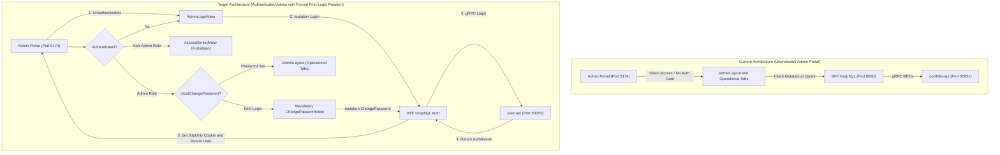
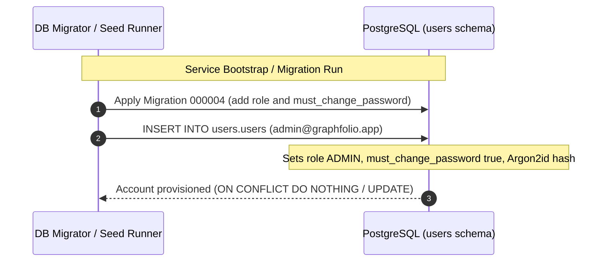
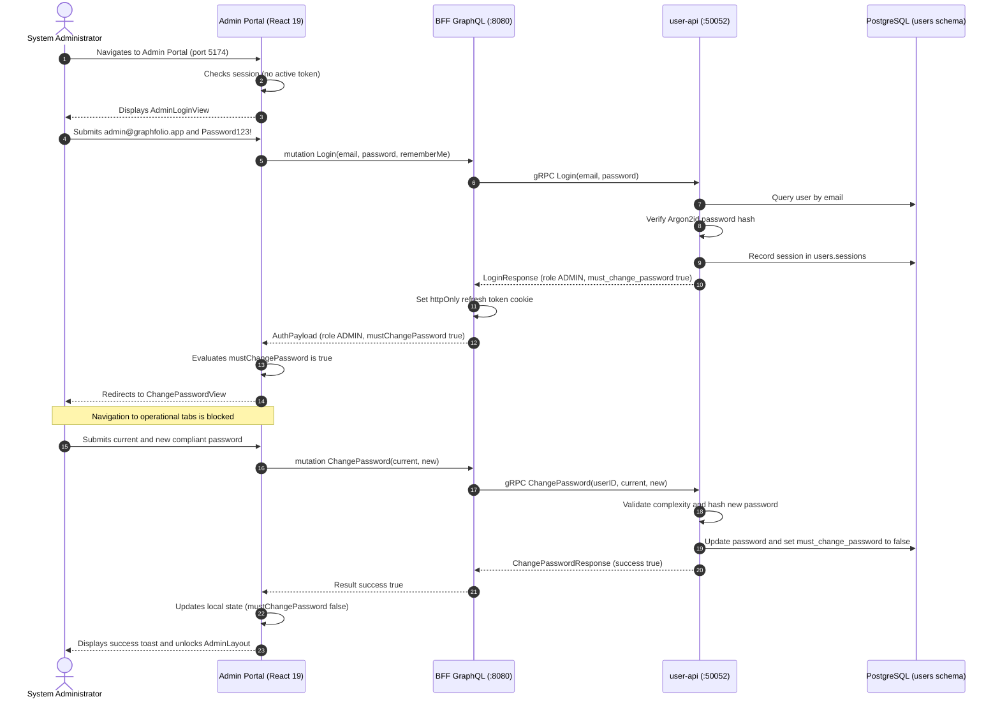
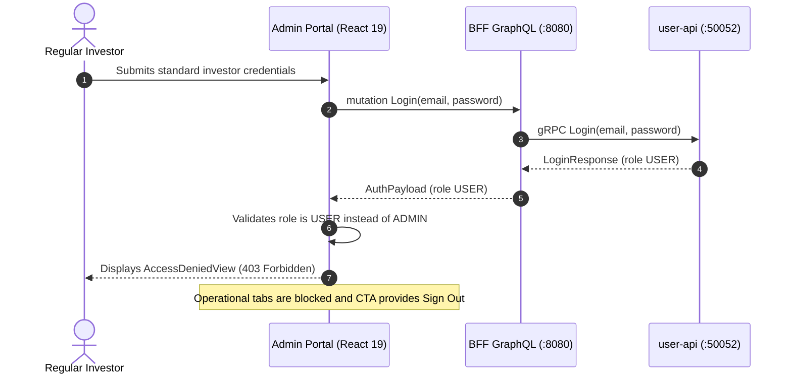

# User Story: Admin Portal Authentication, Auto-Provisioning & Mandatory First-Login Password Change

> **Story ID**: US-ADM-103  
> **Epic**: Internal Administration, Platform Security & Identity Access Management  
> **Target**: Admin Portal Application (`web/apps/admin-app`), BFF GraphQL Orchestrator (`bff/`), User Domain Microservice (`services/user-api`), Proto (`proto/user/v1/user.proto`), Database (`users` schema)  
> **Status**: **DONE**  
> **Implementation Plan**: [admin-portal-login-implementation-plan.md](file:///Users/oscargarcia/workspace/graphfolio/docs/plans/admin-portal-login-implementation-plan.md)  
> **Security Baseline**: OWASP ASVS v4.0 L2, NIST SP 800-63B Section 5.1.1.2 (Memorized Secret Verifiers), RFC 9106 (Argon2id), Role-Based Access Control (RBAC)  
> **Related Documentation**: [admin-portal-asset-and-price-management.md](file:///Users/oscargarcia/workspace/graphfolio/docs/user-stories/admin-portal-asset-and-price-management.md), [user-registration-and-login.md](file:///Users/oscargarcia/workspace/graphfolio/docs/user-stories/user-registration-and-login.md), [user-change-password.md](file:///Users/oscargarcia/workspace/graphfolio/docs/user-stories/user-change-password.md), [AGENTS.md](file:///Users/oscargarcia/workspace/graphfolio/AGENTS.md)  

---

## 1. User Story Statements

### 1.1 Admin Portal Authentication & Route Guard
> **As a** platform operations administrator,  
> **I want to** authenticate securely with my email and password upon visiting the Admin Portal (`web/apps/admin-app`),  
> **So that** unauthenticated visitors cannot inspect or manipulate financial instruments, market closing prices, foreign exchange rates, or ingestion pipeline jobs.

### 1.2 Administrative Account Auto-Provisioning
> **As a** DevOps engineer and system administrator,  
> **I want** an initial administrator account (`admin@graphfolio.app` with default password `Password123!`) to be auto-provisioned idempotently into the database upon startup or migration,  
> **So that** internal operators can immediately access and configure the administrative portal in fresh development, staging, or production deployments without manual SQL intervention.

### 1.3 Mandatory Password Change on First Login
> **As an** administrator logging in with auto-provisioned default credentials for the first time,  
> **I want** the system to detect that my account requires an initial credential rotation and immediately redirect/lock me to a mandatory "Change Password" interface,  
> **So that** I cannot access operational admin tabs or execute sensitive mutations until I replace the well-known bootstrap password with a secure, private credential.

### 1.4 Role-Based Access Control (RBAC) Enforcement
> **As the** platform security officer,  
> **I want** the Admin Portal and backend APIs to strictly enforce the `ADMIN` role, rejecting regular investor credentials with an explicit "Access Denied" state,  
> **So that** standard platform users cannot escalate privileges or execute administrative commands even if they attempt to sign in on the admin port.

### 1.5 Administrative Session Lifecycle & Secure Sign-Out
> **As an** authenticated administrator,  
> **I want to** maintain an active session via silent token refresh during administrative work, view my admin identity in the header, and explicitly sign out when finished,  
> **So that** all session credentials and refresh tokens are immediately invalidated upon completing maintenance tasks.

---

## 2. Business Context & Problem Statement

### 2.1 The Current State of the Admin Portal
Currently, the Admin Portal (`web/apps/admin-app` running on `:5174`) has no authentication barrier:
1. Navigating to `http://localhost:5174` renders `AdminLayout` directly, providing unrestricted access to:
   - Tradable instrument directory creation, updates, and deactivation (`AssetManagement.tsx`).
   - Closing price ledgers and manual price overrides (`PriceManagement.tsx`).
   - Missing closing prices diagnostic audit reports (`MissingPricesReport.tsx`).
   - Missing foreign exchange rate diagnostic audit reports (`MissingFXRatesReport.tsx`).
   - Foreign exchange rate ledgers and currency pair overrides (`FXManagement.tsx`).
   - External market data ingestion pipeline health and on-demand sync triggers (`IngestionPipeline.tsx`).
2. The user microservice (`services/user-api`) currently does not distinguish between ordinary investors and system administrators—there is no `role` or `must_change_password` attribute in the `users.users` schema.
3. If deployed to production, unauthenticated users or malicious actors could alter market data, overwrite historical asset valuations, or trigger resource-intensive market backfills without accountability.



### 2.2 The Necessity of Default Credential Bootstrapping & Forced Rotation
- **Zero-Friction Day 1 Deployment**: When bootstrapping a new GraphFolio environment (local Docker/OrbStack, staging cluster, or cloud container), operations teams require an immediately accessible admin account without requiring ad-hoc database scripts or manual seed execution.
- **NIST SP 800-63B & OWASP ASVS v4.0 Compliance**: Default passwords (such as `Password123!`) represent a critical attack vector if left active. The system must enforce that the bootstrap credential cannot be used for operational tasks—the administrator is intercepted upon first login and compelled to choose a unique, high-entropy password before any admin views can be unlocked.

---

## 3. Workflow & Interaction Diagrams

### 3.1 Initial Admin Auto-Provisioning Workflow



### 3.2 First Login & Mandatory Password Change Sequence



### 3.3 Regular Investor Access Denial Flow



---

## 4. Acceptance Criteria

### 4.1 Account Auto-Provisioning & Database Schema
- [x] **AC-1 (Schema Migration - Role & Password Policy)**: Database migration adds `role` column (`VARCHAR(20) NOT NULL DEFAULT 'USER' CHECK (role IN ('USER', 'ADMIN'))`) and `must_change_password` column (`BOOLEAN NOT NULL DEFAULT false`) to `users.users`.
- [x] **AC-2 (Auto-Provisioned Admin Account)**: Database seed / migration script idempotently creates or updates the default administrator:
  - Email: `admin@graphfolio.app` (stored in lower-case)
  - Display Name: `System Administrator`
  - Default Password: `Password123!` hashed using RFC 9106 Argon2id ($m=65536, t=3, p=4$)
  - Base Currency: `USD`
  - Theme: `DARK`
  - Role: `ADMIN`
  - Must Change Password: `true`
  - Is Active: `true`
- [x] **AC-3 (Idempotent Execution)**: Re-running migrations, seeding scripts, or container restarts does not overwrite an already-rotated password or reset `must_change_password` if the administrator has already updated their credentials.

### 4.2 Admin Portal Login Interface
- [x] **AC-4 (Unauthenticated Route Protection)**: Navigating to the Admin Portal (`web/apps/admin-app`) without an active, validated session renders the `AdminLoginView`. No operational tabs (`AssetManagement`, `PriceManagement`, `MissingPricesReport`, `MissingFXRatesReport`, `FXManagement`, `IngestionPipeline`) are rendered or queried.
- [x] **AC-5 (Admin Login Form UI)**: The login page follows `@graphfolio/ui` dark glassmorphic styling:
  - Header with GraphFolio logo and "Admin Portal" badge.
  - Subtitle: `"Restricted Operations & Market Ingestion Console"`.
  - Email input field with autofocus and email format validation.
  - Password input field with toggleable show/hide eye icon.
  - "Sign In to Admin Portal" submit button with loading spinner during authentication.
  - Descriptive error alert banner for failed authentication attempts.
- [x] **AC-6 (Timing-Safe Credential Verification)**: Authentication requests verify credentials via Argon2id. Invalid emails trigger dummy hash verification to preserve constant-time execution and prevent user enumeration.

### 4.3 Role-Based Access Control (RBAC) & Privilege Validation
- [x] **AC-7 (Role Verification on Login)**: Upon successful credential verification, the system evaluates `user.role`:
  - If `user.role === 'ADMIN'`: proceeds to check `mustChangePassword`.
  - If `user.role !== 'ADMIN'` (e.g. standard investor): renders `AccessDeniedView` with message `"Access Denied: Your account does not have administrative privileges."` and an immediate "Sign Out" button.
- [x] **AC-8 (BFF Admin Mutation/Query Guarding)**: BFF GraphQL resolvers for admin operations (`createInstrument`, `recordPriceOverride`, `recordFXRateOverride`, `triggerMarketSync`, `triggerBackfill`, etc.) verify that the requesting user's JWT / context possesses the `ADMIN` role, rejecting unauthorized requests with `codes.PermissionDenied`.

### 4.4 Mandatory First-Login Password Change
- [x] **AC-9 (First-Login Interception & Redirection)**: If `user.role === 'ADMIN'` and `user.mustChangePassword === true`:
  - The application intercepts navigation and displays the `AdminChangePasswordView`.
  - The navigation sidebar/tabs are completely blocked or hidden.
  - A persistent security banner explains: `"Notice: You are using the default auto-provisioned password. You must set a new secure password before accessing the administrative console."`
  - Attempting to refresh, reload, or navigate directly to internal tabs remains locked on the `AdminChangePasswordView`.
- [x] **AC-10 (Password Complexity & Validation)**: The password change form enforces:
  - Current Password input (must match `Password123!`).
  - New Password input with real-time `PasswordStrengthMeter` checklist (minimum 10 characters, at least 1 uppercase letter, 1 lowercase letter, 1 number, and 1 special symbol).
  - Confirm Password input (must match New Password).
  - Rejection if New Password is identical to Current Password.
- [x] **AC-11 (Successful Rotation & Portal Unlock)**: Submitting a valid new password:
  - Hashes the new password with Argon2id ($m=64\text{MB}, t=3, p=4$).
  - Updates `users.users` setting `password_hash = $newHash` and `must_change_password = false`.
  - Revokes other sessions if selected.
  - Updates in-memory user state in `AdminAuthContext` to `mustChangePassword: false`.
  - Displays a success confirmation toast and seamlessly unlocks the full `AdminLayout` dashboard.

### 4.5 Session Lifecycle, Silent Refresh & Sign-Out
- [x] **AC-12 (Silent Token Refresh)**: The admin app performs silent background token refresh via the `httpOnly` refresh cookie, maintaining the administrator's session across browser reloads without prompting for re-login.
- [x] **AC-13 (Admin Header Profile & Logout)**: The `AdminLayout` header displays:
  - Admin identity indicator (e.g., `admin@graphfolio.app` with an `"ADMIN"` pill badge).
  - A quick "Change Password" action in a dropdown menu.
  - A "Sign Out" button that invokes the `logout` mutation, revokes the active session in `users.sessions`, clears memory access tokens, and returns to the `AdminLoginView`.

---

## 5. Architectural & Technical Specifications

### 5.1 Protobuf Contract Updates (`proto/user/v1/user.proto`)
Extend `UserPreferences` and auth responses with `role` and `must_change_password`:

```protobuf
enum UserRole {
  USER_ROLE_UNSPECIFIED = 0;
  USER_ROLE_USER        = 1;
  USER_ROLE_ADMIN       = 2;
}

message UserPreferences {
  string   user_id              = 1;
  string   email                = 2;
  string   display_name         = 3;
  string   display_currency     = 4;
  string   theme                = 5;
  string   created_at           = 6;
  string   updated_at           = 7;
  UserRole role                 = 8; // User or Administrator
  bool     must_change_password = 9; // Forces immediate password change
}
```

### 5.2 Database Schema Migration (`services/user-api/migrations/`)
File: `000004_add_role_and_password_policy.up.sql`

```sql
-- 1. Add role and must_change_password columns
ALTER TABLE users.users
    ADD COLUMN IF NOT EXISTS role                 text    NOT NULL DEFAULT 'USER',
    ADD COLUMN IF NOT EXISTS must_change_password boolean NOT NULL DEFAULT false;

-- 2. Add constraint for permitted roles
ALTER TABLE users.users
    ADD CONSTRAINT users_role_check CHECK (role IN ('USER', 'ADMIN'));

-- 3. Auto-provision default administrator
-- Password: Password123!
INSERT INTO users.users (
    id,
    email,
    password_hash,
    display_name,
    base_currency,
    theme,
    role,
    must_change_password,
    is_active
)
VALUES (
    '018f0000-0000-7000-8000-000000000002',
    'admin@graphfolio.app',
    '$argon2id$v=19$m=65536,t=3,p=4$z48VmX+qFO9X2FkAfV/Z6Q$WW1NOG+O6TwEwlSDkDIfae3Xi0xOePDpNg+rd7lkWsw',
    'System Administrator',
    'USD',
    'DARK',
    'ADMIN',
    true,
    true
)
ON CONFLICT (lower(email)) DO UPDATE
SET role = 'ADMIN'
WHERE users.users.role != 'ADMIN';
```

### 5.3 User Microservice Updates (`services/user-api`)
1. **Domain Model (`internal/domain/user.go`)**:
   - Add `Role string` (`"USER"`, `"ADMIN"`) and `MustChangePassword bool`.
2. **Repository (`internal/repository/postgres.go`)**:
   - Update SQL select and insert queries to scan `role` and `must_change_password`.
   - Update `UpdatePassword` method to set `must_change_password = false` when an account successfully updates its credentials.
3. **JWT Claims (`internal/auth/jwt.go`)**:
   - Embed `role` claim into standard JWT claims so downstream services and BFF can verify administrator status without repeated database lookups.

### 5.4 BFF GraphQL Schema & Resolver Updates (`bff/`)
1. **GraphQL Schema (`graph/schema.graphqls`)**:
   ```graphql
   enum UserRole {
     USER
     ADMIN
   }

   extend type UserPreferences {
     role: UserRole!
     mustChangePassword: Boolean!
   }
   ```
2. **Resolver Security**:
   - Update `UserPreferences` mapping to include `role` and `mustChangePassword`.
   - Protect Admin mutations (`recordPriceOverride`, `triggerMarketSync`, `triggerBackfill`, etc.) by asserting `claims.Role == "ADMIN"`.

### 5.5 Admin App Component Architecture (`web/apps/admin-app/src`)
1. **`context/AdminAuthContext.tsx`**:
   - Manages `user: AuthUser | null`, `isAuthenticated: boolean`, `isLoading: boolean`, `error: string | null`.
   - Coordinates `login(email, password)`, `logout()`, `changePassword(current, new, revokeOthers)`.
   - Handles silent token refresh on initial app mount.
2. **`components/AdminLoginView.tsx`**:
   - Dark glassmorphic card container with GraphFolio Admin branding.
   - Form fields: Email, Password, and Submit button.
3. **`components/AdminChangePasswordView.tsx`**:
   - Mandatory modal/view displayed when `user.mustChangePassword === true`.
   - Embeds `@graphfolio/ui` `Input` components and `PasswordStrengthMeter`.
   - Disables cancellation or backdrop click dismissal when password change is required.
4. **`components/AccessDeniedView.tsx`**:
   - Rendered when an authenticated user has `role === 'USER'` instead of `'ADMIN'`.
   - Displays clear warning and a "Sign Out" button to allow signing in with an administrative account.
5. **`components/AdminLayout.tsx`**:
   - Displays current admin email and "ADMIN" role badge in header.
   - Header profile menu with "Change Password" and "Sign Out" actions.

---

## 6. Definition of Done (DoD)

- [ ] All database migrations applied successfully with idempotent admin auto-provisioning.
- [ ] Protobuf definitions regenerated and consistent across `services/user-api` and `bff`.
- [ ] GraphQL schema extended with `role` and `mustChangePassword` and verified via GenQL codegen (`@graphfolio/api-client`).
- [ ] `services/user-api` unit tests pass with $\ge 90\%$ test coverage covering:
  - Admin login returning role `ADMIN` and `mustChangePassword = true`.
  - Password change clearing `must_change_password = false`.
  - Non-admin users receiving role `USER`.
- [ ] BFF GraphQL resolver tests pass validating role serialization and admin mutation guarding.
- [ ] Admin Portal UI tests pass:
  - Unauthenticated access prompts `AdminLoginView`.
  - Submitting `admin@graphfolio.app` with `Password123!` redirects to `AdminChangePasswordView`.
  - Successful password change transitions into `AdminLayout`.
  - Non-admin user receives `AccessDeniedView`.
  - Sign-out invalidates session and returns to login screen.
- [ ] All existing repository tests and lint checks pass (`make test`).
