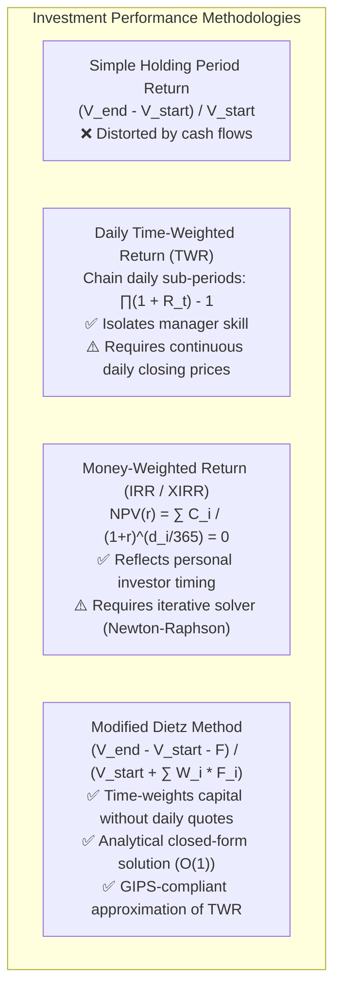
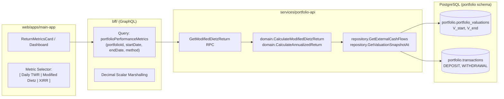

# User Story: Annualized Return Calculation using the Modified Dietz Method

> **Target Layers**: Domain Microservice (`services/portfolio-api`), Protobuf (`proto/portfolio/v1/`), BFF GraphQL (`bff/`), Primary Investor Application (`web/apps/main-app`)  
> **Status**: Ready for Implementation  
> **Story ID**: US-PERF-106  
> **Epic**: Portfolio Performance Measurement & Return Analytics  
> **Implementation Plan**: [annualized-return-modified-dietz-implementation-plan.md](file:///Users/oscargarcia/workspace/graphfolio/docs/plans/annualized-return-modified-dietz-implementation-plan.md)  
> **Calculation Standard**: [financial-calculations skill](file:///Users/oscargarcia/workspace/graphfolio/.agents/skills/financial-calculations/SKILL.md) (GIPS® Standard 2.A.20, CFA Institute Performance Attribution)  
> **Related Plans & Stories**: [annualized-return-twr-fix-implementation-plan.md](file:///Users/oscargarcia/workspace/graphfolio/docs/plans/annualized-return-twr-fix-implementation-plan.md), [portfolio-valuation-engine-and-backfill.md](file:///Users/oscargarcia/workspace/graphfolio/docs/user-stories/portfolio-valuation-engine-and-backfill.md), [investment-holding-capital-gain-income-currency.md](file:///Users/oscargarcia/workspace/graphfolio/docs/user-stories/investment-holding-capital-gain-income-currency.md)  

---

## 1. Story Statement

> **As an** investor tracking my portfolio performance across custom historical date ranges,  
> **I want to** compute cumulative and annualized rates of return using the **Modified Dietz Method** (weighting each external cash flow by the exact proportion of time it was employed in the portfolio),  
> **So that** I have an industry-standard, cash-flow-weighted rate of return that accurately reflects capital allocation efficiency, provides a robust alternative to daily Time-Weighted Return (TWR) when daily market data is sparse, and conforms to CFA Institute GIPS® standards without suffering from external deposit/withdrawal distortion.

---

## 2. Background & Financial Problem Context

In portfolio performance measurement, calculating an accurate rate of return across periods with external capital movements (deposits and withdrawals) presents distinct mathematical challenges:



### 2.1 The Limitations of Simple Return and Daily TWR
1. **Simple Return Failure**: If an investor starts with $\$100,000$, deposits $\$100,000$ on December 30, and finishes the year at $\$205,000$, a simple return calculation $(205,000 - 100,000)/100,000 = +105\%$ grossly exaggerates performance because it treats fresh capital contributions as investment gain.
2. **Daily TWR Dependency on Complete Daily Market Quotes**: Daily Time-Weighted Return requires Level 1 closing prices and FX marks for *every single asset* on *every single calendar day*. In cases where historical statements are imported with sporadic pricing or long holding intervals, daily valuation matrices can introduce valuation noise or require extensive backfilling.
3. **The Modified Dietz Advantage**: Developed by Peter O. Dietz and codified in **GIPS Standard 2.A**, the Modified Dietz Method solves this by weighting each external cash flow $F_i$ by the exact fraction of time $W_i$ it was active in the portfolio. It requires only:
   - Beginning valuation $V_{\text{start}}$
   - Ending valuation $V_{\text{end}}$
   - Net external cash flows $F_i$ with their occurrence timestamps $t_i$

This delivers an exact, non-iterative closed-form solution that can be evaluated instantly over arbitrary time horizons.

---

## 3. Mathematical Formulation & Accounting Standards

All calculations adhere strictly to the [financial-calculations standards](file:///Users/oscargarcia/workspace/graphfolio/.agents/skills/financial-calculations/SKILL.md) using arbitrary-precision fixed-point arithmetic (`shopspring/decimal`) with zero floating-point conversions.

### 3.1 Cash Flow Classification (External vs. Internal)
Only **external capital transfers** between the investor and the portfolio enter the Modified Dietz equation:

| Transaction Type | Flow Category | Included in Net Flow ($F_i$)? | Time-Weighted in Denominator? | Rationale |
| :--- | :--- | :--- | :--- | :--- |
| **`DEPOSIT`** | **External Inflow** | **Yes ($+F_i$)** | **Yes ($+W_i \times F_i$)** | New capital introduced to the portfolio. |
| **`WITHDRAWAL`** | **External Outflow** | **Yes ($-F_i$)** | **Yes ($-W_i \times F_i$)** | Capital removed from the portfolio. |
| **`BUY`** | **Internal Swap** | **No** | **No** | Cash converts to security; portfolio total value is unchanged. |
| **`SELL`** | **Internal Swap** | **No** | **No** | Security converts to cash; realized gain remains within portfolio. |
| **`DIVIDEND`** | **Internal Income** | **No** | **No** | Corporate distribution; recognized as portfolio economic gain. |
| **`FEE`** | **Internal Expense** | **No** | **No** | Trading fee or account charge; reduces net portfolio capital. |
| **`SPLIT`** | **Corporate Action** | **No** | **No** | Non-economic unit quantity adjustment. |

$$\text{Net External Flow } F = \sum_{i=1}^M F_i = \sum \text{Deposits} - \sum \text{Withdrawals}$$

---

### 3.2 Single-Period Modified Dietz Formula

Given an evaluation period from timestamp $T_{\text{start}}$ to $T_{\text{end}}$:

#### 1. Period Calendar Days ($CD$)
$$CD = \text{Days}(T_{\text{start}}, T_{\text{end}})$$

#### 2. Cash Flow Day-Offset ($D_i$) and Time-Weight ($W_i$)
For each external cash flow $i$ occurring on date $t_i$ ($T_{\text{start}} \le t_i \le T_{\text{end}}$):
- $D_i = \text{Days}(T_{\text{start}}, t_i)$ (calendar days elapsed from period start to the transaction date).
- **Time-Weighting Factor ($W_i$)**:
  $$W_i = \frac{CD - D_i}{CD}$$
  *Properties*:
  - If a cash flow occurs on Day 0 ($D_i = 0$), $W_i = \frac{CD - 0}{CD} = 1.00$ (fully invested for the entire period).
  - If a cash flow occurs on the final day ($D_i = CD$), $W_i = \frac{CD - CD}{CD} = 0.00$ (held for zero days).
  - Mid-period flows receive proportional weights: $0.00 \le W_i \le 1.00$.

#### 3. Average Capital Employed ($\text{Capital}_{\text{weighted}}$)
The denominator represents the time-weighted average capital deployed:
$$\text{Capital}_{\text{weighted}} = V_{\text{start}} + \sum_{i=1}^M \left( W_i \times F_i \right)$$

#### 4. Net Investment Gain ($\text{Gain}_{\text{net}}$)
The numerator isolates true economic profit from net capital injections:
$$\text{Gain}_{\text{net}} = V_{\text{end}} - V_{\text{start}} - F$$

#### 5. Cumulative Modified Dietz Period Return ($R_{\text{Dietz}}$)
$$R_{\text{Dietz}} = \frac{\text{Gain}_{\text{net}}}{\text{Capital}_{\text{weighted}}} = \frac{V_{\text{end}} - V_{\text{start}} - F}{V_{\text{start}} + \sum_{i=1}^M (W_i \times F_i)}$$

$$\text{ReturnPercentage} = R_{\text{Dietz}} \times 100\%$$

---

### 3.3 Annualization Formulations & GIPS Rules

The annualized return expresses the geometric compound growth rate per annum:

```text
┌────────────────────────────────────────────────────────────────────────┐
│                        EVALUATION PERIOD LENGTH                        │
├──────────────────────────────────┬─────────────────────────────────────┤
│      Period < 365 Days           │         Period >= 365 Days          │
├──────────────────────────────────┼─────────────────────────────────────┤
│ ❌ GIPS Standard 2.A.20:         │ ✅ Geometric Compound Annualization:│
│ Annualization is PROHIBITED      │                                     │
│ Output: Cumulative Period Return │ R_ann = ((1 + R)^(365.25/CD) - 1)   │
│ Label: "Period Return"           │ Label: "Annualized Return p.a."     │
└──────────────────────────────────┴─────────────────────────────────────┘
```

#### Rule 1: The Sub-1-Year Annualization Prohibition (GIPS Standard 2.A.20)
- If the elapsed period $CD < 365$ calendar days:
  - **Annualization MUST NOT be applied.**
  - Compounding short periods (e.g. annualizing a 30-day return of $+4\%$ into $(1.04)^{12.17} - 1 = +61.2\%$) creates deceptive, misleading volatility.
  - The system must output the non-annualized cumulative period return $R_{\text{Dietz}}$ and return `is_annualized = false`.

#### Rule 2: Geometric Compound Annualization ($CD \ge 365$ Days)
For periods of 365 days or longer:
$$R_{\text{Dietz, annualized}} = \left( (1 + R_{\text{Dietz}})^{\frac{365.25}{CD}} - 1 \right) \times 100\%$$
- Day count convention: **Actual/365.25** (accounting for leap years).
- Clamping: If $(1 + R_{\text{Dietz}}) \le 0$ (total portfolio loss), clamp $R_{\text{Dietz, annualized}} = -100.00\%$.

#### Rule 3: Chained Sub-Period Modified Dietz (Multi-Year Best Practice)
For extended multi-year periods (e.g. 3-Year, 5-Year, or All-Time Inception), GIPS recommends dividing the full horizon into monthly sub-periods $m = 1 \dots K$:
1. Compute single-month Modified Dietz $R_m$ for each calendar month.
2. Geometrically link monthly factors:
   $$\text{TWR}_{\text{linked}} = \prod_{m=1}^K (1 + R_m) - 1$$
3. Annualize the linked cumulative return:
   $$R_{\text{linked, annualized}} = \left( (1 + \text{TWR}_{\text{linked}})^{\frac{365.25}{CD}} - 1 \right) \times 100\%$$

*Advantage*: Eliminates the linear time-weight dilution that occurs when external flows are weighted across a single 5-year denominator.

---

### 3.4 Boundary Conditions & Safe Arithmetic Handling

| Condition | Mathematical Anomaly | Required System Behavior | Rationale |
| :--- | :--- | :--- | :--- |
| **Zero Starting Value ($V_{\text{start}} = 0$)** | First portfolio funding at $t_1$. If $t_1 = T_{\text{start}}$, $W_1 = 1.0 \implies \text{Capital}_{\text{weighted}} = F_1$. | If $\text{Capital}_{\text{weighted}} > 0$, proceed normally. | Correctly handles brand new portfolios funded on period start. |
| **Zero Capital Employed ($\text{Capital}_{\text{weighted}} = 0$)** | Division by zero: $\frac{\text{Gain}}{0}$. | Return `0.00%`, `is_computable: false`, with diagnostic code `ZERO_CAPITAL_EMPLOYED`. | Prevents NaN / `+Inf` panics. |
| **Negative Capital Employed ($\text{Capital}_{\text{weighted}} < 0$)** | Large withdrawal leaving net negative average capital base; produces inverted return sign. | Return `0.00%`, `is_computable: false`, with diagnostic code `NEGATIVE_AVERAGE_CAPITAL`. | Modified Dietz is invalid when net withdrawals exceed capital. |
| **$V_{\text{end}} = 0$ (Full Account Liquidation)** | Portfolio closed out. $\text{Gain} = 0 - V_{\text{start}} - (-V_{\text{start}}) = 0$. | Return `0.00%`. | Properly accounts for full cash withdrawal. |
| **$CD \le 0$ (Invalid Timeframe)** | Negative or zero day count. | Return gRPC `InvalidArgument` error. | End date must follow start date. |

---

## 4. Concrete Worked Numerical Examples

### Example 1: 1-Year Period with Mid-Year Deposit
- **Period**: Jan 1, 2025 to Dec 31, 2025 ($CD = 365$ days)
- **Starting Valuation ($V_{\text{start}}$)**: $\$100,000.00$
- **External Cash Flow ($F_1$)**: Deposit of $\$50,000.00$ on Jul 1, 2025 ($D_1 = 181$ days)
- **Ending Valuation ($V_{\text{end}}$)**: $\$180,000.00$

#### Step 1: Compute Time Weight
$$W_1 = \frac{365 - 181}{365} = \frac{184}{365} \approx 0.50410959$$

#### Step 2: Compute Weighted Capital Employed
$$\text{Capital}_{\text{weighted}} = 100,000.00 + (0.50410959 \times 50,000.00) = 100,000.00 + 25,205.48 = \$125,205.48$$

#### Step 3: Compute Net Investment Gain
$$\text{Gain}_{\text{net}} = 180,000.00 - 100,000.00 - 50,000.00 = \$30,000.00$$

#### Step 4: Compute Cumulative Period Return
$$R_{\text{Dietz}} = \frac{30,000.00}{125,205.48} \approx 0.2396061 \implies \mathbf{+23.96\%}$$

#### Step 5: Annualize ($CD = 365 \ge 365$)
$$R_{\text{annualized}} = \left( (1 + 0.2396061)^{\frac{365.25}{365}} - 1 \right) \times 100\% = \left( (1.2396061)^{1.0006849} - 1 \right) \times 100\% = \mathbf{+23.98\% \text{ p.a.}}$$

---

### Example 2: Sub-1-Year Period (6 Months) — GIPS Prohibition
- **Period**: Jan 1, 2025 to Jun 30, 2025 ($CD = 181$ days)
- **Starting Valuation ($V_{\text{start}}$)**: $\$50,000.00$
- **External Cash Flow ($F_1$)**: Deposit of $\$20,000.00$ on Mar 15, 2025 ($D_1 = 73$ days)
- **Ending Valuation ($V_{\text{end}}$)**: $\$78,000.00$

#### Step 1: Compute Time Weight
$$W_1 = \frac{181 - 73}{181} = \frac{108}{181} \approx 0.596685$$

#### Step 2: Compute Weighted Capital Employed
$$\text{Capital}_{\text{weighted}} = 50,000.00 + (0.596685 \times 20,000.00) = 50,000.00 + 11,933.70 = \$61,933.70$$

#### Step 3: Compute Net Investment Gain
$$\text{Gain}_{\text{net}} = 78,000.00 - 50,000.00 - 20,000.00 = \$8,000.00$$

#### Step 4: Compute Cumulative Return
$$R_{\text{Dietz}} = \frac{8,000.00}{61,933.70} \approx 0.129170 \implies \mathbf{+12.92\%}$$

#### Step 5: Annualization Check
- $CD = 181 < 365$ days.
- **Result**: `is_annualized = false`.
- **Display**: `12.92% (Period Return)` — System explicitly prohibits projecting to an artificial $+27.9\%$ annual figure.

---

## 5. Technical Architecture & Layer Breakdown



### 5.1 Protobuf Contract Updates (`proto/portfolio/v1/portfolio.proto`)
Add dedicated RPC and messages:

```protobuf
syntax = "proto3";

package portfolio.v1;

import "common/v1/decimal.proto";
import "google/protobuf/timestamp.proto";

service PortfolioService {
  // Existing RPCs ...

  // Computes portfolio return using Modified Dietz method with optional GIPS annualization.
  rpc GetModifiedDietzReturn(GetModifiedDietzReturnRequest) returns (GetModifiedDietzReturnResponse);
}

message GetModifiedDietzReturnRequest {
  string portfolio_id = 1;
  google.protobuf.Timestamp start_date = 2;
  google.protobuf.Timestamp end_date = 3;
  // If true, chains monthly sub-period Modified Dietz calculations before annualizing.
  bool use_monthly_linking = 4;
}

message ExternalCashFlowWeight {
  string transaction_id = 1;
  google.protobuf.Timestamp date = 2;
  string type = 3; // "DEPOSIT" or "WITHDRAWAL"
  common.v1.Money amount = 4; // Normalized in portfolio base currency
  common.v1.Decimal weight = 5; // W_i = (CD - D_i) / CD
  common.v1.Money weighted_amount = 6; // W_i * F_i
}

message GetModifiedDietzReturnResponse {
  string portfolio_id = 1;
  google.protobuf.Timestamp start_date = 2;
  google.protobuf.Timestamp end_date = 3;
  int32 elapsed_days = 4;

  common.v1.Money start_valuation = 5;
  common.v1.Money end_valuation = 6;
  common.v1.Money net_external_flows = 7;
  common.v1.Money net_investment_gain = 8;
  common.v1.Money weighted_capital_employed = 9;

  common.v1.Decimal cumulative_return_percent = 10; // R_Dietz * 100
  common.v1.Decimal annualized_return_percent = 11; // GIPS CAGR (if elapsed_days >= 365)
  bool is_annualized = 12; // False if elapsed_days < 365
  bool is_computable = 13; // False if weighted_capital <= 0
  string diagnostic_code = 14; // OK, ZERO_CAPITAL_EMPLOYED, NEGATIVE_AVERAGE_CAPITAL

  repeated ExternalCashFlowWeight cash_flow_weights = 15;
}
```

---

### 5.2 Domain Calculator Implementation (`services/portfolio-api/internal/domain/`)
Create `services/portfolio-api/internal/domain/dietz.go`:

```go
package domain

import (
	"errors"
	"math"
	"time"

	"github.com/shopspring/decimal"
)

var (
	zeroDec       = decimal.Zero
	oneDec        = decimal.NewFromInt(1)
	oneHundredDec = decimal.NewFromInt(100)
)

// ExternalFlow represents a single deposit or withdrawal in base currency.
type ExternalFlow struct {
	TransactionID string
	Date          time.Time
	Amount        decimal.Decimal // Positive for deposit, negative for withdrawal
}

// ModifiedDietzResult encapsulates the outputs of the calculation.
type ModifiedDietzResult struct {
	ElapsedDays             int64
	StartValuation          decimal.Decimal
	EndValuation            decimal.Decimal
	NetExternalFlows        decimal.Decimal
	NetInvestmentGain       decimal.Decimal
	WeightedCapitalEmployed decimal.Decimal
	CumulativeReturnPercent decimal.Decimal
	AnnualizedReturnPercent decimal.Decimal
	IsAnnualized            bool
	IsComputable            bool
	DiagnosticCode          string
	CashFlowWeights         []CashFlowWeight
}

type CashFlowWeight struct {
	TransactionID  string
	Date           time.Time
	Amount         decimal.Decimal
	Weight         decimal.Decimal
	WeightedAmount decimal.Decimal
}

// CalculateModifiedDietz computes the GIPS-compliant Modified Dietz return.
func CalculateModifiedDietz(
	vStart decimal.Decimal,
	vEnd decimal.Decimal,
	startDate time.Time,
	endDate time.Time,
	flows []ExternalFlow,
) (*ModifiedDietzResult, error) {
	if endDate.Before(startDate) {
		return nil, errors.New("endDate cannot be before startDate")
	}

	cdDays := int64(endDate.Sub(startDate).Hours() / 24.0)
	if cdDays <= 0 {
		return nil, errors.New("period length must be at least 1 day")
	}

	cdDec := decimal.NewFromInt(cdDays)
	totalF := zeroDec
	sumWeightedFlows := zeroDec
	weights := make([]CashFlowWeight, 0, len(flows))

	for _, flow := range flows {
		dOffset := int64(flow.Date.Sub(startDate).Hours() / 24.0)
		if dOffset < 0 {
			dOffset = 0
		}
		if dOffset > cdDays {
			dOffset = cdDays
		}

		weight := cdDec.Sub(decimal.NewFromInt(dOffset)).DivRound(cdDec, 8)
		weightedAmount := flow.Amount.Mul(weight)

		totalF = totalF.Add(flow.Amount)
		sumWeightedFlows = sumWeightedFlows.Add(weightedAmount)

		weights = append(weights, CashFlowWeight{
			TransactionID:  flow.TransactionID,
			Date:           flow.Date,
			Amount:         flow.Amount,
			Weight:         weight,
			WeightedAmount: weightedAmount,
		})
	}

	weightedCapital := vStart.Add(sumWeightedFlows)
	netGain := vEnd.Sub(vStart).Sub(totalF)

	// Boundary Condition: Non-computable if weighted capital <= 0
	if weightedCapital.IsZero() {
		return &ModifiedDietzResult{
			ElapsedDays:             cdDays,
			StartValuation:          vStart,
			EndValuation:            vEnd,
			NetExternalFlows:        totalF,
			NetInvestmentGain:       netGain,
			WeightedCapitalEmployed: weightedCapital,
			CumulativeReturnPercent: zeroDec,
			AnnualizedReturnPercent: zeroDec,
			IsAnnualized:            false,
			IsComputable:            false,
			DiagnosticCode:          "ZERO_CAPITAL_EMPLOYED",
			CashFlowWeights:         weights,
		}, nil
	}

	if weightedCapital.IsNegative() {
		return &ModifiedDietzResult{
			ElapsedDays:             cdDays,
			StartValuation:          vStart,
			EndValuation:            vEnd,
			NetExternalFlows:        totalF,
			NetInvestmentGain:       netGain,
			WeightedCapitalEmployed: weightedCapital,
			CumulativeReturnPercent: zeroDec,
			AnnualizedReturnPercent: zeroDec,
			IsAnnualized:            false,
			IsComputable:            false,
			DiagnosticCode:          "NEGATIVE_AVERAGE_CAPITAL",
			CashFlowWeights:         weights,
		}, nil
	}

	cumReturn := netGain.DivRound(weightedCapital, 8)
	cumReturnPercent := cumReturn.Mul(oneHundredDec).Round(2)

	// GIPS Standard 2.A.20: Sub-1-year prohibition
	if cdDays < 365 {
		return &ModifiedDietzResult{
			ElapsedDays:             cdDays,
			StartValuation:          vStart,
			EndValuation:            vEnd,
			NetExternalFlows:        totalF,
			NetInvestmentGain:       netGain,
			WeightedCapitalEmployed: weightedCapital,
			CumulativeReturnPercent: cumReturnPercent,
			AnnualizedReturnPercent: zeroDec,
			IsAnnualized:            false,
			IsComputable:            true,
			DiagnosticCode:          "OK",
			CashFlowWeights:         weights,
		}, nil
	}

	// Geometric compound annualization: ((1 + R)^(365.25 / CD) - 1) * 100
	factor := oneDec.Add(cumReturn)
	if factor.IsNegative() || factor.IsZero() {
		return &ModifiedDietzResult{
			ElapsedDays:             cdDays,
			StartValuation:          vStart,
			EndValuation:            vEnd,
			NetExternalFlows:        totalF,
			NetInvestmentGain:       netGain,
			WeightedCapitalEmployed: weightedCapital,
			CumulativeReturnPercent: cumReturnPercent,
			AnnualizedReturnPercent: decimal.NewFromInt(-100),
			IsAnnualized:            true,
			IsComputable:            true,
			DiagnosticCode:          "OK",
			CashFlowWeights:         weights,
		}, nil
	}

	fVal, _ := factor.Float64()
	exponent := 365.25 / float64(cdDays)
	annVal := math.Pow(fVal, exponent)
	annPercent := decimal.NewFromFloat(annVal).Sub(oneDec).Mul(oneHundredDec).Round(2)

	return &ModifiedDietzResult{
		ElapsedDays:             cdDays,
		StartValuation:          vStart,
		EndValuation:            vEnd,
		NetExternalFlows:        totalF,
		NetInvestmentGain:       netGain,
		WeightedCapitalEmployed: weightedCapital,
		CumulativeReturnPercent: cumReturnPercent,
		AnnualizedReturnPercent: annPercent,
		IsAnnualized:            true,
		IsComputable:            true,
		DiagnosticCode:          "OK",
		CashFlowWeights:         weights,
	}, nil
}
```

---

### 5.3 GraphQL Schema Updates (`bff/graph/schema.graphqls`)

```graphql
extend type Query {
  """
  Retrieves portfolio return metrics using the Modified Dietz method.
  """
  modifiedDietzReturn(
    portfolioId: ID!
    startDate: String!
    endDate: String!
    useMonthlyLinking: Boolean
  ): ModifiedDietzReturnPayload!
}

type ModifiedDietzReturnPayload {
  portfolioId: ID!
  startDate: String!
  endDate: String!
  elapsedDays: Int!

  startValuation: Decimal!
  endValuation: Decimal!
  netExternalFlows: Decimal!
  netInvestmentGain: Decimal!
  weightedCapitalEmployed: Decimal!

  cumulativeReturnPercent: Decimal!
  annualizedReturnPercent: Decimal
  isAnnualized: Boolean!
  isComputable: Boolean!
  diagnosticCode: String!

  cashFlowWeights: [CashFlowWeightItem!]!
}

type CashFlowWeightItem {
  transactionId: ID!
  date: String!
  type: String!
  amount: Decimal!
  weight: Decimal!
  weightedAmount: Decimal!
}
```

---

## 6. Acceptance Criteria

### AC 1: Time-Weighting of External Cash Flows
- **Scenario: Calculating individual flow weights across a date window**
  - **Given** an evaluation period starting on `2025-01-01` and ending on `2025-12-31` ($CD = 365$ days),
  - **When** an external deposit of $\$10,000$ occurs on `2025-07-02` ($D_i = 182$ days),
  - **Then** the system assigns time weight $W_i = \frac{365 - 182}{365} = \frac{183}{365} \approx 0.50137$,
  - **And** the weighted cash flow contribution to average capital is exactly $\$5,013.70$.

### AC 2: GIPS Sub-1-Year Annualization Prohibition
- **Scenario: Querying Modified Dietz return for an elapsed period under 365 calendar days**
  - **Given** an evaluation window where $CD = 180$ days,
  - **When** `modifiedDietzReturn` is requested,
  - **Then** the system returns `is_annualized: false` and `annualized_return_percent: null`,
  - **And** `cumulative_return_percent` contains the exact period return,
  - **And** the UI displays `"XX.XX% (Period Return)"` or `"N/A (< 1 Year)"` without annualizing.

### AC 3: Compound Geometric Annualization for Horizons $\ge 365$ Days
- **Scenario: Querying Modified Dietz return over multi-year horizons**
  - **Given** an evaluation window spanning 730 days ($2.0$ years) with cumulative Dietz return $+44.00\%$,
  - **When** the annualized return is computed,
  - **Then** the engine applies geometric compounding: $\left( (1 + 0.44)^{\frac{365.25}{730}} - 1 \right) \times 100\% \approx \mathbf{+20.02\% \text{ p.a.}}$,
  - **And** `is_annualized` evaluates to `true`.

### AC 4: Strict Separation of Internal Asset Swaps from External Flows
- **Scenario: Ingestion of internal equity trades and dividends**
  - **Given** transactions within the period including stock `BUY`, stock `SELL`, and cash `DIVIDEND`,
  - **When** the Modified Dietz external flow array is populated,
  - **Then** `BUY`, `SELL`, and `DIVIDEND` transactions are excluded from $F_i$ and weighted capital,
  - **And** only `DEPOSIT` and `WITHDRAWAL` transactions are included in the denominator.

### AC 5: Negative or Zero Capital Employed Safety Guards
- **Scenario: Large mid-period capital withdrawal exceeding portfolio base**
  - **Given** a scenario where net withdrawals result in $\text{Capital}_{\text{weighted}} \le 0$,
  - **When** `CalculateModifiedDietz` executes,
  - **Then** the system does not panic or perform invalid division,
  - **And** returns `is_computable: false`, `diagnostic_code: "NEGATIVE_AVERAGE_CAPITAL"`, and return `0.00%`.

### AC 6: Multi-Currency Translation at Historical FX Spot Rates
- **Scenario: External cash flows denominated in foreign currencies**
  - **Given** a portfolio with base currency `AUD` and a deposit of `USD 10,000`,
  - **When** calculating $F_i$ for that transaction,
  - **Then** the amount is converted to `AUD` using the spot exchange rate on the deposit date (`USD/AUD` at $t_i$),
  - **And** foreign exchange fluctuations after the deposit date are captured in portfolio ending valuation $V_{\text{end}}$.

### AC 7: User Interface Integration & Performance Method Comparison
- **Scenario: Viewing return methodology breakdown in Dashboard**
  - **Given** the investor is viewing the Performance overview card,
  - **When** the investor hovers over or toggles the return methodology selector (`[ Time-Weighted (TWR) | Modified Dietz | Money-Weighted (MWR) ]`),
  - **Then** the card updates to display the Modified Dietz cumulative and annualized return,
  - **And** displays an explanatory tooltip:  
    *"Modified Dietz measures your rate of return by time-weighting every cash deposit and withdrawal. Ideal for assessing performance when daily closing prices are unavailable."*

---

## 7. Edge Cases & Risk Mitigation Table

| Risk / Edge Case | Likelihood | Impact | Mitigation Strategy |
| :--- | :--- | :--- | :--- |
| **Deposit on Day 0 vs Final Day** | High | Low | If $t_i = T_{\text{start}}$, $W_i = 1.00$. If $t_i = T_{\text{end}}$, $W_i = 0.00$. Verify bounds $[0, 1]$ clamping. |
| **Same-Day Deposit & Withdrawal** | Medium | Low | Net same-day flows evaluate with the exact same weight $W_i$, netting out linearly. |
| **Leap Year Day-Count Drift** | High | Low | Standardize day count to Actual/365.25 for annualization exponent. |
| **Negative Net Value (Margin Overdraft)** | Low | High | Guard against $V_{\text{start}} < 0$ or $V_{\text{end}} < 0$ with `is_computable = false` flag. |
| **Catastrophic -100% Loss** | Low | Medium | When $(1 + R_{\text{Dietz}}) \le 0$, clamp annualized return to `-100.00%` rather than attempting fractional powers of negative numbers. |

---

## 8. Test Scenarios & Verification Matrix

| Test ID | Test Scenario | Inputs | Expected Output | Verification Layer |
| :--- | :--- | :--- | :--- | :--- |
| **TC-DIETZ-01** | Static period, zero external flows | $V_0 = 100k, V_1 = 120k, CD = 365, F = 0$ | Cumulative: `+20.00%`, Annualized: `+20.01% p.a.` | Unit Test (`dietz_test.go`) |
| **TC-DIETZ-02** | Mid-year deposit ($D_i = 181$) | $V_0 = 100k, V_1 = 180k, F = 50k, CD = 365$ | Weight: `0.5041`, Denom: `$125,205.48`, Ret: `+23.96%` | Unit Test (`dietz_test.go`) |
| **TC-DIETZ-03** | Sub-1-year period ($CD = 90$) | $V_0 = 10k, V_1 = 11k, CD = 90$ | Cumulative: `+10.00%`, `is_annualized: false` | Unit Test (`dietz_test.go`) |
| **TC-DIETZ-04** | Division by zero prevention | $V_0 = 0, F = 0$ | `is_computable: false`, `ZERO_CAPITAL_EMPLOYED` | Unit Test (`dietz_test.go`) |
| **TC-DIETZ-05** | Internal dividends excluded | $V_0 = 100k, V_1 = 105k, \text{Div} = 5k$ | $F = 0$, Denom: `$100k`, Ret: `+5.00%` | Integration Test (`server_test.go`) |
| **TC-DIETZ-06** | Multi-currency FX conversion | Foreign deposit `USD 10k` @ `1.50 AUD` | $F_i = \text{AUD } 15,000.00$ weighted in AUD base | Domain Test (`dietz_test.go`) |

---

## 9. Definition of Done (DoD)

- [ ] Protobuf contract updated with `GetModifiedDietzReturn` RPC and compiled via `make proto`.
- [ ] Domain calculator `CalculateModifiedDietz` implemented with zero floating-point `shopspring/decimal` arithmetic.
- [ ] Sub-1-year annualization restriction strictly enforced per GIPS Standard 2.A.20.
- [ ] Table-driven Go unit tests achieving 100% test coverage across all boundary conditions and worked examples.
- [ ] BFF GraphQL query and schema types implemented with high-precision Decimal scalar serialization.
- [ ] Investor Dashboard / Performance UI exposes the Modified Dietz option with descriptive tooltips and GIPS-compliant period labels.
