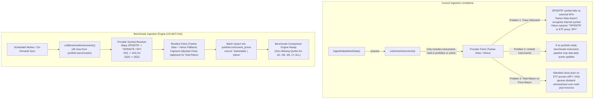

# User Story: Benchmark Instrument Market Price Ingestion & Historical Backfill

> **Target Layers**: Market Data Pipeline (`services/portfolio-api/internal/marketdata/`), Domain Microservice (`services/portfolio-api`), CLI Worker (`cmd/market-ingest/`), Admin Portal (`web/apps/admin-app`), BFF GraphQL (`bff/`)  
> **Status**: Ready for Implementation  
> **Story ID**: `US-MKT-016`  
> **Epic**: Market Data Pipeline & Provider Resilience  
> **Implementation Plan**: [benchmark-instrument-price-ingestion-plan.md](file:///Users/oscargarcia/workspace/graphfolio/docs/plans/benchmark-instrument-price-ingestion-plan.md)  
> **Calculation & Ingestion Standard**: [financial-calculations skill](file:///Users/oscargarcia/workspace/graphfolio/.agents/skills/financial-calculations/SKILL.md) (GIPS® Standard 2.A Total Return Indexing, CFA Institute Performance Attribution)  
> **Related Stories & Plans**: [benchmark-performance-comparison.md](file:///Users/oscargarcia/workspace/graphfolio/docs/user-stories/benchmark-performance-comparison.md) (`US-PERF-107`), [market-data-ingestion-pipeline.md](file:///Users/oscargarcia/workspace/graphfolio/docs/user-stories/market-data-ingestion-pipeline.md) (`US-MKT-014`), [admin-missing-prices-report.md](file:///Users/oscargarcia/workspace/graphfolio/docs/user-stories/admin-missing-prices-report.md) (`US-ADMIN-004`)  

---

## 1. Story Statement

> **As a** system administrator and automated operations workflow,  
> **I want** daily EOD closing prices and multi-year historical price series for all market benchmark instruments (e.g. S&P 500 Total Return, NASDAQ-100, ASX 200) automatically ingested, mapped, validated, and persisted from external market data providers (Twelve Data, Yahoo Finance),  
> **So that** investor performance benchmark comparison charts, alpha attribution, beta, and tracking error analytics remain continuously fresh, accurate, and fully populated across all timeframes without relying on synthetic seed curves or manual price entry.

---

## 2. Background & Problem Context

In Feature #33 (`US-PERF-107`), GraphFolio introduced institutional-grade portfolio benchmark comparisons (`portfolio.benchmarks`), allowing investors to contrast their cumulative time-weighted returns (TWR) against market indices such as the **S&P 500 Total Return** (`SP500TR`), **NASDAQ-100** (`QQQ`), and **ASX 200** (`VAS`).

However, the existing market data ingestion pipeline has two critical operational gaps regarding benchmark instruments:



### 2.1 The Ticker Resolution Challenge
Market benchmark indices and exchange-traded funds (ETFs) do not share uniform ticker symbology across data providers:
- **Index vs. ETF Symbology**: The S&P 500 Total Return index is referenced internally as `SP500TR`. Yahoo Finance represents the index as `^SP500TR` (or `^GSPC` for price return), whereas commercial providers like Twelve Data may require `SPX` or recommend using liquid total return ETF proxies like `SPY` or `VOO`.
- **Exchange Suffix Requirements**: The Australian ASX 200 benchmark uses Vanguard Australian Shares ETF (`VAS`), which requires the `.AX` MIC suffix on Yahoo Finance (`VAS.AX`) and exchange code `ASX` on Twelve Data.
- **Provider Redundancy**: If a primary provider cannot resolve an index symbol or hits rate limits, the secondary fallback provider must seamlessly translate the symbol to its own namespace.

### 2.2 Total Return Reinvestment (Dividend Bias Elimination)
Under CFA Institute **GIPS Standard 2.A**, portfolio returns that include cash dividends must be benchmarked against a **Total Return** index. 
When ETF proxies (e.g. `SPY`, `QQQ`, `VAS`) are utilized as benchmarks:
- Regular `close` prices reflect price-only movements (the share price drops on ex-dividend date).
- Over a 5-year timeframe, comparing against unadjusted `close` introduces a **1.5%–4.0% annualized drag**, deceptively inflating the investor's apparent alpha.
- External feeds must ingest **Adjusted Close (`adjclose`)** for ETF proxies, which mathematically incorporates dividend reinvestment and corporate splits.

---

## 3. Scope & Qualifying Requirements

### 3.1 Supported Benchmark Catalog
The ingestion pipeline must natively resolve and ingest prices for all active benchmarks configured in `portfolio.benchmarks`:

| Benchmark ID | Internal Symbol | Asset Class | Exchange | Currency | Provider Ticker (Twelve Data) | Provider Ticker (Yahoo) | Data Type |
| :--- | :--- | :--- | :--- | :--- | :--- | :--- | :--- |
| `SP500TR` | `SP500TR` | `ETF` / `INDEX` | `XNYS` | `USD` | `SPY` (ETF proxy) | `^SP500TR` / `SPY` (adjclose) | Total Return |
| `NASDAQ100` | `QQQ` | `ETF` | `XNAS` | `USD` | `QQQ` | `QQQ` (adjclose) | Total Return |
| `ASX200TR` | `VAS` | `ETF` | `XASX` | `AUD` | `VAS:ASX` | `VAS.AX` (adjclose) | Total Return |

### 3.2 Ingestion Modes
1. **Daily Scheduled Ingestion (EOD Sync)**:
   - Executed automatically by the market data worker (`cmd/market-ingest/` or background cron) at the close of trading.
   - Fetches the latest trading day closing mark for every benchmark instrument in `portfolio.benchmarks`.
2. **Historical Range Backfill**:
   - Allows administrators or CLI operations to backfill up to 10+ years of daily closing marks across arbitrary date ranges (e.g. `2015-01-01` to `today`).
   - Automatically invoked when a new benchmark is registered in the catalog to populate historical quotes for all user comparison horizons (`1D`, `1W`, `1M`, `1Y`, `ALL`).

---

## 4. Acceptance Criteria

### AC 1: Dedicated Benchmark Instrument Discovery in Daily Ingestion
- **Given** the daily market data ingestion job runs (via `cmd/market-ingest` or `service.IngestionService.IngestDailyMarketData`),
- **When** gathering instruments requiring daily closing prices,
- **Then** the service must query `portfolio.benchmarks` to identify all benchmark instruments (`instrument_id`),
- **And** merge them into the daily price sync list, guaranteeing benchmark quotes are refreshed daily regardless of whether any user holds them in a portfolio.

### AC 2: Multi-Provider Symbol & Ticker Resolution Engine
- **Given** a benchmark instrument with internal symbol (e.g. `SP500TR`, `VAS`, `QQQ`),
- **When** dispatching HTTP requests to Twelve Data or Yahoo Finance,
- **Then** the provider adapter must resolve provider-specific symbols:
  - Twelve Data: Map `SP500TR` $\to$ `SPY`, `VAS` with exchange `XASX` $\to$ `VAS` (with `mic_code=XASX`).
  - Yahoo Finance: Map `SP500TR` $\to$ `^SP500TR` (with fallback to `SPY`), `VAS` $\to$ `VAS.AX`, `QQQ` $\to$ `QQQ`.
- **And** allow optional database-level provider symbol overrides via `portfolio.instruments.provider_symbol` or dedicated mapping metadata.

### AC 3: Total Return Adjusted Close (`adjclose`) Ingestion
- **Given** a benchmark configured with `index_type = 'TOTAL_RETURN'`,
- **When** fetching closing marks for ETF proxies (e.g. `SPY`, `QQQ`, `VAS`),
- **Then** the ingestion adapter must prioritize the provider's `adjclose` (Adjusted Close) field,
- **And** store the dividend-reinvested mark into `portfolio.instrument_prices.close` so that historical compounding reflects true total return.

### AC 4: Historical Multi-Year Backfill for Benchmarks
- **Given** an operator running `cmd/market-ingest` with `-benchmark <ID>` or an Admin calling `TriggerBackfill`,
- **When** specifying a historical date range (e.g. `-from 2020-01-01 -to 2026-10-14`),
- **Then** the ingestion service must retrieve the full daily time series for the benchmark instrument,
- **And** batch upsert all records into `portfolio.instrument_prices` using `ON CONFLICT (instrument_id, price_date) DO UPDATE SET close = EXCLUDED.close, source = EXCLUDED.source`.

### AC 5: Exchange Trading Calendar & Non-Trading Day Resiliency
- **Given** US exchanges (`XNYS`, `XNAS`) are closed on US holidays (e.g. Thanksgiving) while Australian exchanges (`XASX`) are open,
- **When** daily ingestion runs,
- **Then** the ingestion service must not treat an exchange holiday as a fatal error or abort the remaining sync,
- **And** benchmark comparison calculations must continue to use **Last Observation Carried Forward (LOCF)** across missing holiday dates.

### AC 6: Provenance & Idempotent Upsert
- **Given** incoming benchmark price records from Twelve Data or Yahoo Finance,
- **When** persisting prices into `portfolio.instrument_prices`,
- **Then** each record must record its authoritative provenance (`source = 'twelvedata'` or `source = 'yahoo'`),
- **And** re-running ingestion for the same trade date must update existing closing marks without duplicate row creation or primary key violations.

### AC 7: Admin Portal Observability & Missing Benchmark Quote Diagnostics
- **Given** the Admin Portal (`apps/admin-app`),
- **When** an administrator navigates to **Missing Prices Report** or **Asset Prices**,
- **Then** benchmark instruments must appear in instrument filters and search inputs,
- **And** any trading day where a benchmark lacks a closing mark must be highlighted in the diagnostics ledger with a one-click **Backfill Benchmark** action.

### AC 8: Strict Fixed-Point Decimal Arithmetic
- **Given** raw price responses from external market APIs,
- **When** parsing price values,
- **Then** values must be decoded directly into `shopspring/decimal.Decimal` using exact fixed-point string parsing (`decimal.NewFromString` / `json.Number`),
- **And** float32/float64 conversions are strictly prohibited to prevent decimal drift.

---

## 5. Architectural Layer Breakdown

```text
├── services/portfolio-api/
│   ├── internal/
│   │   ├── marketdata/
│   │   │   ├── equity_provider.go    # Ticker resolution logic for benchmark symbols & adjusted close (adjclose)
│   │   │   └── provider.go           # InstrumentRef with ProviderSymbol & IndexType fields
│   │   ├── repository/
│   │   │   ├── queries.go            # listBenchmarkInstrumentsSQL, listMissingBenchmarkPricesSQL
│   │   │   ├── postgres.go           # ListBenchmarkInstruments(), GetBenchmarkPricesWithFX()
│   │   │   └── repository.go         # Repository interface extensions
│   │   └── service/
│   │       ├── ingestion.go          # IngestDailyMarketData() incorporating benchmark instruments
│   │       ├── admin.go              # Admin backfill execution including benchmark scope
│   │       └── benchmark.go          # Benchmark comparison retrieval
│   └── cmd/
│       └── market-ingest/
│           └── main.go               # CLI worker supporting -benchmark flag and automatic benchmark sync
│
├── bff/
│   ├── graph/
│   │   ├── schema.graphqls           # Admin queries & mutations exposing benchmark backfill triggers
│   │   └── schema.resolvers.go       # Forwarding backfill requests to portfolio-api
│
└── web/apps/admin-app/
    └── src/
        ├── components/
        │   ├── MissingPricesReport.tsx # Visual diagnostics detecting missing benchmark daily closes
        │   └── BackfillModal.tsx       # Benchmark selection preset for historical backfill
```

---

## 6. Contract Specifications

### 6.1 Database Schema Extensions (Optional / Non-Breaking)
To allow flexible symbol mapping without hardcoding, `portfolio.benchmarks` or `portfolio.instruments` can optionally maintain external provider ticker overrides:

```sql
-- Optional provider symbol override on instruments
ALTER TABLE portfolio.instruments 
ADD COLUMN IF NOT EXISTS provider_symbol text;

COMMENT ON COLUMN portfolio.instruments.provider_symbol IS 
'Provider-specific ticker override (e.g. ^SP500TR for Yahoo, SPY for Twelve Data). If NULL, uses symbol.';
```

### 6.2 Protobuf Contract (`proto/portfolio/v1/portfolio.proto`)
The administrative backfill request already supports instrument-level backfills, which will now explicitly support benchmark instruments:

```protobuf
message TriggerBackfillRequest {
  string portfolio_id = 1;
  string from_date = 2; // YYYY-MM-DD
  string to_date = 3;   // YYYY-MM-DD
  bool force_rebuild = 4;
  optional string instrument_id = 5; // Can target benchmark instruments
}
```

---

## 7. Edge Cases & Risk Mitigation

| Risk / Edge Case | Failure Mode | Mitigation Strategy |
| :--- | :--- | :--- |
| **Index Ticker Unsupported by Twelve Data** | Twelve Data API returns `404` or `code: 400` when querying `SP500TR`. | Primary Twelve Data adapter resolves `SP500TR` to ETF proxy `SPY` (or secondary fallback Yahoo Finance resolves to `^SP500TR`). |
| **ETF Proxy Dividend Price Drops** | Using unadjusted `close` on `SPY` or `VAS` causes artificial performance lag. | Parser extracts `adjclose` from Yahoo chart API and Twelve Data adjusted series, reflecting full dividend reinvestment. |
| **Divergent Exchange Holiday Calendars** | NYSE closed on July 4th; ASX open for normal trading. | Ingestion runs per-instrument; failure to fetch a closed exchange's price does not block open exchanges. Benchmark calculations apply LOCF. |
| **Missing Quotes on Initial Benchmark Setup** | New benchmark added to database has zero historical prices; comparison chart errors out. | System triggers an asynchronous backfill of historical quotes from `from_date` to `today` upon benchmark creation or first request. |
| **Rate Limit / API Quota Exhaustion** | 5-year daily backfill exceeds provider API request quotas. | `marketdata.RateLimiter` enforces token-bucket pacing (5 req/sec); backfill chunks requests and falls back across resilient providers. |

---

## 8. Test Scenarios & Verification Matrix

### 8.1 Unit Tests (`services/portfolio-api/internal/marketdata/`)
- `TestTwelveDataProvider_BenchmarkTickerResolution`: Verifies `SP500TR` maps to `SPY` and `VAS` includes `XASX` exchange identifier.
- `TestYahooFinanceProvider_AdjustedClosePriority`: Verifies Yahoo parser extracts `adjclose` over unadjusted `close` for ETF proxies.
- `TestResilientPriceProvider_BenchmarkFallback`: Verifies seamless failover to Yahoo when Twelve Data fails on an index ticker.

### 8.2 Service & Ingestion Tests (`services/portfolio-api/internal/service/`)
- `TestIngestionService_DailySyncIncludesBenchmarks`: Verifies that `IngestDailyMarketData` queries benchmark instruments and attempts price fetches.
- `TestIngestionService_BackfillBenchmarkPrices`: Verifies historical multi-day backfill correctly batch upserts daily quotes.

### 8.3 CLI & Integration Verification
- Execute `go run cmd/market-ingest/main.go -as-of 2026-10-14` and verify benchmark instruments are fetched and persisted.
- Execute `go run cmd/market-ingest/main.go -symbol SP500TR -from 2024-01-01` and verify full year of closing prices inserted into `portfolio.instrument_prices`.

---

## 9. Definition of Done (DoD)

- [ ] Dedicated benchmark discovery logic integrated into `IngestionService.IngestDailyMarketData`.
- [ ] Provider ticker mapping and adjusted close (`adjclose`) support implemented for Twelve Data and Yahoo Finance providers.
- [ ] Historical backfill capability verified for all configured benchmarks (`SP500TR`, `QQQ`, `VAS`).
- [ ] Unit tests written and passing for ticker resolution, adjusted close extraction, and provider fallback.
- [ ] Admin Portal `MissingPricesReport` displays benchmark instrument diagnostics with one-click backfill.
- [ ] Zero floating-point arithmetic verified across all ingestion and storage layers.
- [ ] Architectural documentation and roadmap updated in [features.md](file:///Users/oscargarcia/workspace/graphfolio/features.md).
