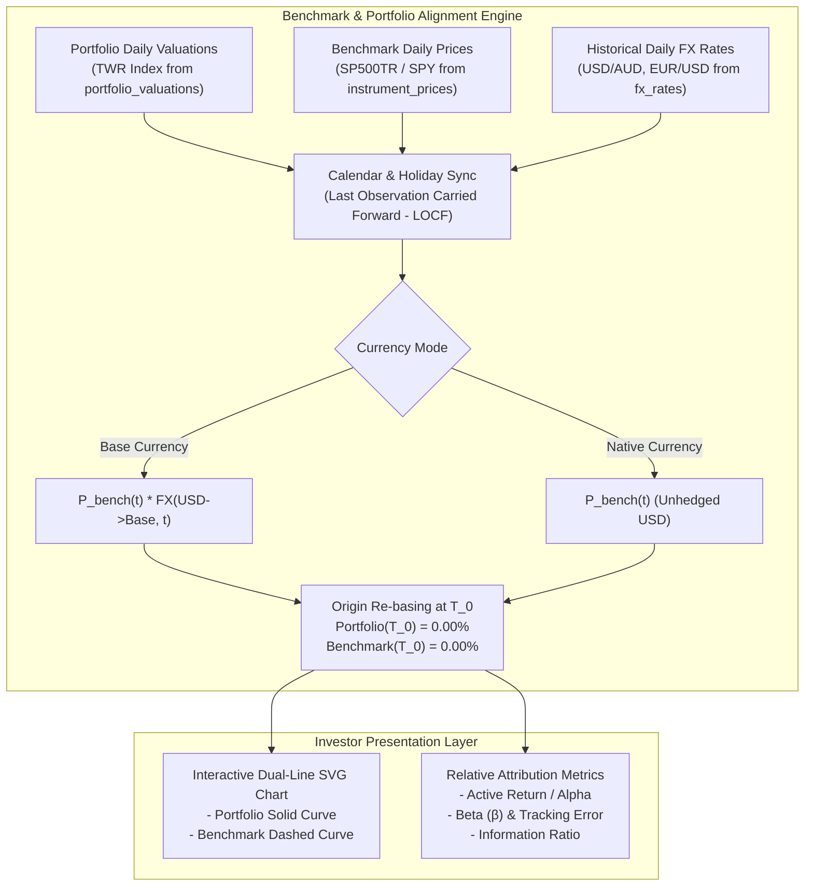

# User Story: Portfolio Benchmark Comparison & Relative Performance Analytics

> **Target Layers**: Domain Microservice (`services/portfolio-api`), Protobuf (`proto/portfolio/v1/`), BFF GraphQL (`bff/`), Primary Investor Application (`web/apps/main-app`)  
> **Status**: Completed  
> **Story ID**: US-PERF-107  
> **Epic**: Portfolio Performance Measurement & Return Analytics  
> **Implementation Plan**: [benchmark-performance-comparison-implementation-plan.md](file:///Users/oscargarcia/workspace/graphfolio/docs/plans/benchmark-performance-comparison-implementation-plan.md)  
> **Calculation Standard**: [financial-calculations skill](file:///Users/oscargarcia/workspace/graphfolio/.agents/skills/financial-calculations/SKILL.md) (GIPS® Standard 2.A, CFA Institute Performance Attribution, ASC 820)  
> **Related Plans & Stories**: [performance-chart-implementation-plan.md](file:///Users/oscargarcia/workspace/graphfolio/docs/plans/performance-chart-implementation-plan.md), [annualized-return-twr-fix-implementation-plan.md](file:///Users/oscargarcia/workspace/graphfolio/docs/plans/annualized-return-twr-fix-implementation-plan.md), [annualized-return-modified-dietz.md](file:///Users/oscargarcia/workspace/graphfolio/docs/user-stories/annualized-return-modified-dietz.md)  

---

## 1. Story Statement

> **As an** investor tracking my investment portfolio in GraphFolio,  
> **I want to** overlay and compare my cumulative and annualized performance against industry-standard market benchmarks (such as the S&P 500, NASDAQ-100, or ASX 200) across any selected timeframe,  
> **So that** I can objectively evaluate whether my active asset allocation and security selection generate excess returns (alpha) over a low-cost passive index, contextualize my returns during bull and bear markets, and measure active risk without currency distortion.

---

## 2. Background & Financial Problem Context

### 2.1 The "Illusion of Absolute Performance"
Evaluating portfolio performance in a vacuum is misleading:
- A portfolio gain of **$+15\%$** in a year when the broader market (S&P 500) gained **$+26\%$** represents an **underperformance of $-11\%$** (negative active return).
- Conversely, a portfolio decline of **$-4\%$** during a severe market drawdown of **$-22\%$** demonstrates **$+18\%$ excess capital preservation alpha**.

Without an objective benchmark, investors cannot distinguish between broad market beta (rising tide lifting all boats) and genuine portfolio management skill.



### 2.2 The Three Critical Challenges in Benchmark Comparison

1. **Cash Flow Neutrality & Time-Weighted Normalization**:
   - Individual portfolios experience external deposits and withdrawals of varying magnitude and timing.
   - Market benchmark indices are pure buy-and-hold unitized funds with zero external cash flows.
   - Under CFA Institute **GIPS Standard 2.A**, comparing an investor's performance against a benchmark requires indexing both time series to a **Time-Weighted Return (TWR)** unitized base ($100.00$ or $0.00\%$) starting at the evaluation horizon ($T_0$).

2. **Total Return vs. Price Return (The Dividend Bias)**:
   - Price-only indices (e.g. S&P 500 `^GSPC`) ignore cash dividends paid by constituent companies.
   - An investor's portfolio recognizes and accumulates dividends. Comparing a dividend-accumulating portfolio against a price-return index creates an artificial, deceptive advantage (~1.5%–2.0% p.a. dividend bias).
   - GraphFolio must prioritize **Total Return indices** (e.g., S&P 500 Total Return `SP500TR` or ETF total return proxies like `SPY` / `VOO` with reinvested dividends) and clearly label the benchmark return type (`TOTAL_RETURN` vs `PRICE_RETURN`).

3. **Currency Incongruity (Triangulated FX vs. Local Currency)**:
   - When an Australian investor (`AUD` base currency) compares their portfolio to the US S&P 500 (`USD`), a naive comparison conflates equity returns with currency swings (`USD/AUD`).
   - The system must provide two distinct comparison lenses:
     - **Portfolio Base Currency (Currency-Adjusted)**: Converts the benchmark's historical prices to the portfolio's base currency using daily spot exchange rates. This measures the true opportunity cost to the local investor (*"What if I had converted my AUD into an S&P 500 index ETF on Day 1?"*).
     - **Native / Local Currency (Unhedged)**: Displays the benchmark in its native currency (`USD`) alongside an explicit currency badge.

---

## 3. Mathematical Formulation & Business Rules

All calculations conform strictly to the [financial-calculations standards](file:///Users/oscargarcia/workspace/graphfolio/.agents/skills/financial-calculations/SKILL.md) using arbitrary-precision fixed-point math (`shopspring/decimal.Decimal` in Go, custom `Decimal` scalars in GraphQL) with zero floating-point conversions.

### 3.1 Common Origin Re-Basing ($T_0$ Normalization)
Given an evaluation window from start date $T_{\text{start}}$ to end date $T_{\text{end}}$:

1. **Portfolio Cumulative Return at Date $t$ ($T_{\text{start}} \le t \le T_{\text{end}}$)**:
   Using the daily unitized TWR index stored in `portfolio.portfolio_valuations`:
   $$R_{p}(t) = \left( \frac{\text{TWRIndex}_p(t)}{\text{TWRIndex}_p(T_{\text{start}})} - 1 \right) \times 100\%$$
   *At $t = T_{\text{start}}$: $R_p(T_{\text{start}}) \equiv 0.00\%$.*

2. **Benchmark Cumulative Return at Date $t$**:
   Using the adjusted benchmark price $P_{b,\text{mode}}(t)$:
   $$R_{b}(t) = \left( \frac{P_{b,\text{mode}}(t)}{P_{b,\text{mode}}(T_{\text{start}})} - 1 \right) \times 100\%$$
   *At $t = T_{\text{start}}$: $R_b(T_{\text{start}}) \equiv 0.00\%$.*

---

### 3.2 Benchmark Currency Modes

1. **Base Currency Mode ($\text{MODE\_PORTFOLIO\_BASE}$)**:
   $$P_{b,\text{base}}(t) = P_{b,\text{local}}(t) \times \text{FX}(C_{\text{bench}} \to C_{\text{base}}, t)$$
   *If the benchmark native currency matches portfolio base currency ($C_{\text{bench}} \equiv C_{\text{base}}$), $\text{FX} \equiv 1.0000000000$.*

2. **Native Currency Mode ($\text{MODE\_BENCHMARK\_NATIVE}$)**:
   $$P_{b,\text{native}}(t) = P_{b,\text{local}}(t)$$

---

### 3.3 Active Return (Alpha / Excess Return)
At any point $t$ during the evaluation period:
$$\text{ActiveReturn}(t) = R_{p}(t) - R_{b}(t)$$

- If $\text{ActiveReturn}(t) > 0$: Portfolio is **outperforming** the benchmark (Green / Positive Alpha).
- If $\text{ActiveReturn}(t) < 0$: Portfolio is **underperforming** the benchmark (Red / Negative Alpha).

---

### 3.4 Annualized Return & GIPS Sub-1-Year Rule (GIPS Standard 2.A.20)
Given period calendar days $CD = \text{Days}(T_{\text{start}}, T_{\text{end}})$:

| Period Length | Rule | Benchmark Output | Active Return Output |
| :--- | :--- | :--- | :--- |
| **$CD < 365$ Days** | **Annualization is PROHIBITED** | Cumulative period return ($R_{b,\text{cum}}$) | Cumulative active spread ($R_{p,\text{cum}} - R_{b,\text{cum}}$) |
| **$CD \ge 365$ Days** | **Compound Geometric Annualization** | $R_{b,\text{ann}} = \left( (1 + R_{b,\text{cum}})^{\frac{365.25}{CD}} - 1 \right) \times 100\%$ | $R_{p,\text{ann}} - R_{b,\text{ann}}$ |

---

### 3.5 Risk & Attribution Metrics (for Periods $\ge 30$ Trading Days)

1. **Daily Returns Series**:
   $$r_{p,t} = \frac{\text{TWRIndex}_p(t)}{\text{TWRIndex}_p(t-1)} - 1$$
   $$r_{b,t} = \frac{P_b(t)}{P_b(t-1)} - 1$$

2. **Portfolio Beta ($\beta$)**:
   $$\beta = \frac{\text{Cov}(r_p, r_b)}{\text{Var}(r_b)} = \frac{\sum (r_{p,t} - \bar{r}_p)(r_{b,t} - \bar{r}_b)}{\sum (r_{b,t} - \bar{r}_b)^2}$$

3. **Tracking Error ($\text{TE}$ - Active Volatility)**:
   $$\text{TE} = \sqrt{\frac{1}{N-1} \sum_{t=1}^N \left( (r_{p,t} - r_{b,t}) - \overline{(r_p - r_b)} \right)^2} \times \sqrt{252}$$

4. **Information Ratio ($\text{IR}$)**:
   For periods $\ge 365$ days:
   $$\text{IR} = \frac{R_{p,\text{ann}} - R_{b,\text{ann}}}{\text{TE}}$$

---

### 3.6 Non-Trading Day & Holiday Calendar Synchronization
Different exchanges follow different holiday calendars (e.g., NYSE is closed on Thanksgiving and Martin Luther King Jr. Day; ASX is closed on Australia Day and ANZAC Day).
- **Rule**: When aligning date series between portfolio and benchmark, missing market quotes on holidays or weekends use **Last Observation Carried Forward (LOCF)**.
- If the start date $T_{\text{start}}$ falls on a weekend or public holiday, the base valuation is resolved to the latest available closing price at or immediately preceding $T_{\text{start}}$ (`GetValuationAtOrBefore`).

---

## 4. Supported Benchmark Catalog

GraphFolio ships with pre-configured reference benchmarks representing major asset classes:

| Benchmark ID | Benchmark Name | Symbol | Exchange | Native Currency | Index Type | Target Asset Class |
| :--- | :--- | :--- | :--- | :--- | :--- | :--- |
| **`SP500TR`** | **S&P 500 Total Return** *(Default)* | `SP500TR` / `SPY` | `XNYS` | `USD` | `TOTAL_RETURN` | US Large Cap Equities |
| **`NASDAQ100`** | **NASDAQ-100 Total Return** | `QQQ` | `XNAS` | `USD` | `TOTAL_RETURN` | US Tech / Growth |
| **`ASX200TR`** | **S&P/ASX 200 Total Return** | `^AXJO` / `VAS` | `XASX` | `AUD` | `TOTAL_RETURN` | Australian Equities |
| **`MSCIWORLD`** | **MSCI World Developed Markets** | `URTH` | `XNYS` | `USD` | `TOTAL_RETURN` | Global Developed Equities |

---

## 5. Architectural Layer Breakdown

```
┌────────────────────────────────────────────────────────────────────────┐
│ 1. Protobuf Contracts (`proto/portfolio/v1/portfolio.proto`)           │
│    - Benchmark, BenchmarkComparisonPoint, BenchmarkMetrics             │
│    - RPC GetBenchmarkComparison, RPC ListBenchmarks                    │
├────────────────────────────────────────────────────────────────────────┤
│ 2. PostgreSQL Storage Layer (`portfolio` schema)                       │
│    - portfolio.benchmarks catalog table                                │
│    - portfolio.instrument_prices (Closing historical prices)           │
│    - portfolio.fx_rates (Daily exchange rates)                         │
│    - portfolio.portfolio_valuations (Daily TWR Index)                  │
├────────────────────────────────────────────────────────────────────────┤
│ 3. Go Domain & Microservice (`services/portfolio-api`)                 │
│    - internal/domain/benchmark.go (Calculators, Re-basing, Active PnL)│
│    - internal/repository/postgres.go (Historical price & FX join)      │
│    - internal/service/benchmark.go (Service orchestration)             │
│    - internal/server.go (gRPC server implementation)                   │
├────────────────────────────────────────────────────────────────────────┤
│ 4. Backend-for-Frontend (`bff/`)                                       │
│    - graph/schema.graphqls (benchmarkComparison query, benchmarks)    │
│    - graph/schema.resolvers.go (gRPC wrapper & Decimal scalar mapping) │
├────────────────────────────────────────────────────────────────────────┤
│ 5. Investor Web Application (`web/apps/main-app`)                      │
│    - components/PerformanceChart.tsx (Dual SVG curves, overlay toggle) │
│    - components/BenchmarkMetricsStrip.tsx (Active return & alpha badge)│
│    - components/BenchmarkSelector.tsx (Dropdown & currency toggle)     │
└────────────────────────────────────────────────────────────────────────┘
```

---

## 6. Contract Specifications

### 6.1 Protobuf Contract (`proto/portfolio/v1/portfolio.proto`)

```protobuf
enum BenchmarkCurrencyMode {
  BENCHMARK_CURRENCY_MODE_UNSPECIFIED = 0;
  BENCHMARK_CURRENCY_MODE_PORTFOLIO_BASE = 1; // Converted to portfolio's base currency via daily FX
  BENCHMARK_CURRENCY_MODE_BENCHMARK_NATIVE = 2; // Expressed in benchmark's local trading currency
}

message Benchmark {
  string id            = 1;
  string symbol        = 2;
  string name          = 3;
  string exchange_code = 4;
  string currency_code = 5;
  string index_type    = 6; // "TOTAL_RETURN" or "PRICE_RETURN"
  bool   is_default    = 7;
}

message ListBenchmarksRequest {}

message ListBenchmarksResponse {
  repeated Benchmark benchmarks = 1;
}

message BenchmarkComparisonPoint {
  string            date                     = 1; // YYYY-MM-DD
  common.v1.Decimal portfolio_return_percent = 2; // Cumulative return % from T_start
  common.v1.Decimal benchmark_return_percent = 3; // Cumulative return % from T_start
  common.v1.Decimal active_return_percent    = 4; // portfolio_return - benchmark_return
  common.v1.Money   portfolio_value          = 5; // Absolute portfolio valuation in base currency
  common.v1.Money   benchmark_price_adjusted = 6; // Price in selected currency mode
}

message BenchmarkMetrics {
  common.v1.Decimal portfolio_cumulative_return_percent = 1;
  common.v1.Decimal benchmark_cumulative_return_percent = 2;
  common.v1.Decimal active_cumulative_return_percent    = 3; // Outperformance (+) or Underperformance (-)
  
  common.v1.Decimal portfolio_annualized_return_percent = 4; // Null if elapsed < 365 days
  common.v1.Decimal benchmark_annualized_return_percent = 5; // Null if elapsed < 365 days
  common.v1.Decimal active_annualized_return_percent    = 6; // Null if elapsed < 365 days
  bool              is_annualized                       = 7; // GIPS Standard 2.A.20 flag
  
  common.v1.Decimal beta                                = 8; // Portfolio beta vs benchmark
  common.v1.Decimal tracking_error_percent              = 9; // Annualized active risk %
  common.v1.Decimal information_ratio                   = 10; // Annualized active return / tracking error
}

message GetBenchmarkComparisonRequest {
  string                portfolio_id   = 1;
  string                benchmark_id   = 2; // e.g. "SP500TR"
  HistoryTimeframe      timeframe      = 3; // 1D, 1W, 1M, 1Y, ALL
  BenchmarkCurrencyMode currency_mode  = 4; // BASE or NATIVE
}

message GetBenchmarkComparisonResponse {
  string                            portfolio_id  = 1;
  Benchmark                         benchmark     = 2;
  BenchmarkCurrencyMode             currency_mode = 3;
  string                            start_date    = 4;
  string                            end_date      = 5;
  int32                             elapsed_days  = 6;
  repeated BenchmarkComparisonPoint points        = 7;
  BenchmarkMetrics                  metrics       = 8;
}

service PortfolioService {
  // Existing RPCs...
  rpc ListBenchmarks(ListBenchmarksRequest) returns (ListBenchmarksResponse);
  rpc GetBenchmarkComparison(GetBenchmarkComparisonRequest) returns (GetBenchmarkComparisonResponse);
}
```

### 6.2 GraphQL Schema (`bff/graph/schema.graphqls`)

```graphql
enum BenchmarkCurrencyMode {
  PORTFOLIO_BASE
  BENCHMARK_NATIVE
}

type Benchmark {
  id: ID!
  symbol: String!
  name: String!
  exchangeCode: String!
  currencyCode: String!
  indexType: String!
  isDefault: Boolean!
}

type BenchmarkComparisonPoint {
  date: String!
  portfolioReturnPercent: Decimal!
  benchmarkReturnPercent: Decimal!
  activeReturnPercent: Decimal!
  portfolioValue: Money!
  benchmarkPriceAdjusted: Money!
}

type BenchmarkMetrics {
  portfolioCumulativeReturnPercent: Decimal!
  benchmarkCumulativeReturnPercent: Decimal!
  activeCumulativeReturnPercent: Decimal!
  portfolioAnnualizedReturnPercent: Decimal
  benchmarkAnnualizedReturnPercent: Decimal
  activeAnnualizedReturnPercent: Decimal
  isAnnualized: Boolean!
  beta: Decimal
  trackingErrorPercent: Decimal
  informationRatio: Decimal
}

type BenchmarkComparisonPayload {
  portfolioId: ID!
  benchmark: Benchmark!
  currencyMode: BenchmarkCurrencyMode!
  startDate: String!
  endDate: String!
  elapsedDays: Int!
  points: [BenchmarkComparisonPoint!]!
  metrics: BenchmarkMetrics!
}

extend type Query {
  benchmarks: [Benchmark!]!
  benchmarkComparison(
    portfolioId: ID!
    benchmarkId: ID!
    timeframe: HistoryTimeframe!
    currencyMode: BenchmarkCurrencyMode = PORTFOLIO_BASE
  ): BenchmarkComparisonPayload!
}
```

---

## 7. Acceptance Criteria

### AC 1: Origin Re-Basing to $0.00\%$ at Horizon Start
- **Scenario: Normalizing portfolio and benchmark curves to common origin**
  - **Given** an investor selects the `"1Y"` timeframe for their portfolio,
  - **When** the benchmark comparison query resolves for benchmark `SP500TR`,
  - **Then** the first data point ($t = T_{\text{start}}$) evaluates to exactly $0.00\%$ for both portfolio and benchmark:
    $$\text{portfolioReturnPercent} = 0.00\%, \quad \text{benchmarkReturnPercent} = 0.00\%$$
  - **And** all subsequent points reflect cumulative percentage change relative to that initial date.

### AC 2: Multi-Currency Translation to Portfolio Base Currency
- **Scenario: Australian investor viewing USD-denominated S&P 500 in AUD**
  - **Given** an investor with base currency `AUD` comparing performance to `SP500TR` (`USD`),
  - **When** `currencyMode` is set to `PORTFOLIO_BASE`,
  - **Then** the benchmark daily prices are converted to `AUD` using daily historical `USD/AUD` spot rates:
    $$P_{\text{bench,AUD}}(t) = P_{\text{bench,USD}}(t) \times \text{FX}(\text{USD} \to \text{AUD}, t)$$
  - **And** the benchmark return accurately reflects the local investor's currency-adjusted return,
  - **And** the UI displays the label `"S&P 500 (in AUD)"`.

### AC 3: Native Currency Unhedged View Toggle
- **Scenario: Toggling to native currency to isolate pure market index performance**
  - **Given** the benchmark comparison is currently displayed in base currency (`AUD`),
  - **When** the investor switches the currency mode to `BENCHMARK_NATIVE`,
  - **Then** the benchmark curve re-renders using unadjusted `USD` closing prices,
  - **And** the UI displays an explanatory tag: `"S&P 500 (Native USD - Unhedged)"`.

### AC 4: GIPS Sub-1-Year Annualization Prohibition
- **Scenario: Viewing benchmark comparison over a 6-month or 1-month horizon ($< 365$ days)**
  - **Given** the investor selects the `"1M"` or `"1W"` timeframe ($CD < 365$ days),
  - **When** the comparison metrics are rendered,
  - **Then** `is_annualized` evaluates to `false`,
  - **And** `portfolio_annualized_return_percent`, `benchmark_annualized_return_percent`, and `active_annualized_return_percent` return `null`,
  - **And** the UI cards display `"Period Return"` without applying annual compounding.

### AC 5: Compound Geometric Annualization for Horizons $\ge 365$ Days
- **Scenario: Viewing benchmark comparison over multi-year horizons**
  - **Given** an investor selects `"1Y"` or `"ALL"` with $CD = 730$ days ($2.0$ years),
  - **When** the comparison metrics are rendered,
  - **Then** both portfolio and benchmark returns are annualized via compound geometric CAGR:
    $$R_{\text{ann}} = \left( (1 + R_{\text{cum}})^{\frac{365.25}{CD}} - 1 \right) \times 100\%$$
  - **And** `active_annualized_return_percent` reports the net difference ($R_{p,\text{ann}} - R_{b,\text{ann}}$) with label `"Annualized Alpha p.a."`.

### AC 6: Holiday and Exchange Calendar Synchronization via LOCF
- **Scenario: Non-overlapping public holidays between exchanges**
  - **Given** US markets are closed for Thanksgiving (`2025-11-27`) while ASX and the user's ledger are active,
  - **When** time-series points are generated,
  - **Then** the benchmark price for `2025-11-27` carries forward the preceding closing price from `2025-11-26` (LOCF),
  - **And** no dates are dropped or produce null coordinates in the SVG chart.

### AC 7: Interactive Dual-Line SVG Performance Chart
- **Scenario: Visualizing comparative performance on the Investor Dashboard**
  - **Given** the investor is viewing `PerformanceChart.tsx`,
  - **When** a benchmark (e.g., `S&P 500`) is selected from the benchmark selector,
  - **Then** the chart displays two distinct paths:
    1. **Portfolio Line**: Primary solid stroke with neon glow (`#22c55e` green or `#3b82f6` blue depending on positive/negative return).
    2. **Benchmark Line**: Secondary dashed or semi-transparent contrasting line (e.g., `#f59e0b` amber/gold).
  - **And** hovering over the chart draws a synchronized crosshair showing tooltip values for both curves on that specific calendar date.

### AC 8: Relative Performance Metrics Strip & Alpha Badges
- **Scenario: Inspecting outperformance / underperformance summary**
  - **Given** a benchmark comparison is active,
  - **When** the summary header updates,
  - **Then** the UI displays an **Active Return Badge**:
    - **Green badge**: `"+4.25% vs S&P 500 (Outperforming)"`
    - **Red badge**: `"-3.10% vs S&P 500 (Underperforming)"`
  - **And** if $N \ge 30$ trading days, displays secondary risk metrics: **Beta ($\beta$)**, **Tracking Error**, and **Information Ratio**.

### AC 9: LocalStorage Persistence of Benchmark Selection
- **Scenario: Persisting user benchmark preference across sessions**
  - **Given** the investor selects `NASDAQ-100` as their preferred benchmark,
  - **When** the page is refreshed or reopened,
  - **Then** the chart automatically loads `NASDAQ-100` without requiring re-selection.

---

## 8. UI/UX Specification

### 8.1 Performance Chart Controls Layout
```text
┌────────────────────────────────────────────────────────────────────────────────────────┐
│  Portfolio Performance                                                                 │
│                                                                                        │
│  [ 1D ] [ 1W ] [ 1M ] [ 1Y ] [ ALL ]   │  Benchmark: [ S&P 500 (SPY) ▼ ]  [ AUD | USD ]│
├────────────────────────────────────────────────────────────────────────────────────────┤
│  Portfolio: +28.40%  │  S&P 500: +21.15%  │  Alpha: +7.25% (Outperforming)  │  β: 0.92 │
├────────────────────────────────────────────────────────────────────────────────────────┤
│  +% │                                                                                  │
│     │                                       ╭─── Portfolio (+28.40%)                   │
│ +20%│                           ╭───────────╯                                          │
│     │               ╭───────────╯  - - - - - ╶╶╶ S&P 500 (+21.15%)                     │
│ +10%│       ╭───────╯  - - - - ╶╶╶                                                     │
│     │  - - -╯ - - - ╶╶╶                                                                │
│   0%├───┴───────────────────────────────────────────────────────────────────────       │
│        Oct 2025             Jan 2026             May 2026             Oct 2026         │
└────────────────────────────────────────────────────────────────────────────────────────┘
```

### 8.2 Interactive Tooltip Content
```text
┌──────────────────────────────────────────────┐
│  Oct 14, 2026                                │
│  Portfolio Value:      $148,250.00 AUD       │
│  Portfolio Return:            +28.40%        │
│  S&P 500 Return:              +21.15%        │
│ ──────────────────────────────────────────── │
│  Active Spread (Alpha):        +7.25% ▲      │
│  Benchmark Price (AUD):        $584.20       │
└──────────────────────────────────────────────┘
```

---

## 9. Edge Cases & Risk Mitigation Table

| Risk / Edge Case | Likelihood | Impact | Mitigation Strategy |
| :--- | :--- | :--- | :--- |
| **Start Date on Weekend / Market Holiday** | High | Low | Use `GetValuationAtOrBefore` / LOCF to anchor initial price $P_b(T_{\text{start}})$ to the latest preceding market close. |
| **Missing FX Rates for Benchmark Conversion** | Medium | Medium | Leverage existing missing FX rate fallback or LOCF on exchange rates; flag diagnostic if FX gap exceeds 5 days. |
| **Benchmark Inception Post-Dates Portfolio** | Low | Low | Only allow comparison for overlapping date ranges; clamp comparison start to `max(portfolio_inception, benchmark_inception)`. |
| **Zero or Negative Benchmark Return Denominator** | Extremely Low | High | Guard against $P_b(T_0) \le 0$ with `is_computable = false` safety check. |
| **Zero Active Variance (Beta Undefined)** | Low | Low | If benchmark daily returns have variance $\text{Var}(r_b) = 0$ (e.g. flat cash index), return `beta: null` rather than division by zero. |
| **Sub-1-Year Horizon Annualization Mistake** | High | High | Enforce CFA Institute GIPS Standard 2.A.20 in the domain engine: return `null` for annualized fields if $CD < 365$. |
| **High Frequency Trading Day Mismatch** | Medium | Low | Normalize date series to a strict continuous trading-day calendar with LOCF prior to computing covariance / beta. |

---

## 10. Test Scenarios & Verification Matrix

| Test ID | Test Scenario | Inputs | Expected Output | Verification Layer |
| :--- | :--- | :--- | :--- | :--- |
| **TC-BENCH-01** | Zero-origin normalization | $T_0 = \text{2025-01-01}$, both series active | Point 0: $R_p(0) = 0.00\%$, $R_b(0) = 0.00\%$, $\text{Active} = 0.00\%$ | Unit Test (`benchmark_test.go`) |
| **TC-BENCH-02** | Multi-currency FX translation | Base: `AUD`, Benchmark: `USD 500.00`, FX: `1.50 AUD/USD` | Benchmark converted to `AUD 750.00` before return calculation | Unit Test (`benchmark_test.go`) |
| **TC-BENCH-03** | Sub-1-year GIPS prohibition | Horizon: $CD = 180$ days | `is_annualized: false`, Annualized alpha: `null`, Period active: exact | Unit Test (`benchmark_test.go`) |
| **TC-BENCH-04** | Compound geometric annualization | Horizon: $CD = 730$ days, $R_p = +44\%$, $R_b = +21\%$ | $R_{p,\text{ann}} = +20.02\%$, $R_{b,\text{ann}} = +10.00\%$, $\alpha = +10.02\%$ | Unit Test (`benchmark_test.go`) |
| **TC-BENCH-05** | Exchange holiday LOCF fill | US holiday on Day $t$ (no US close) | Benchmark price carries forward from Day $t-1$; no nil point | Service Test (`server_test.go`) |
| **TC-BENCH-06** | Beta and Tracking Error accuracy | Synthetic returns with known $\beta = 1.20$, $\text{TE} = 4.5\%$ | Calculated $\beta$ matches $1.20 \pm 0.01$; $\text{TE}$ matches $4.5\% \pm 0.1\%$ | Unit Test (`benchmark_test.go`) |
| **TC-BENCH-07** | BFF GraphQL serialization | Query `benchmarkComparison` with Decimal fields | High-precision string decimal mapping without precision loss | GraphQL Test (`schema.resolvers_test.go`) |
| **TC-BENCH-08** | UI overlay toggle & tooltip | Investor toggles `S&P 500` in `PerformanceChart.tsx` | Dashed benchmark curve renders with synchronized hover tooltip | Web E2E / Component Test |

---

## 11. Definition of Done (DoD)

- [ ] Protobuf definitions added to `proto/portfolio/v1/portfolio.proto` for `GetBenchmarkComparison` and `ListBenchmarks`, compiled via `make proto`.
- [ ] Database reference migration providing `portfolio.benchmarks` table with seed entries for S&P 500, NASDAQ-100, and ASX 200.
- [ ] Domain calculator in `services/portfolio-api/internal/domain/benchmark.go` implementing origin re-basing, FX conversion, active alpha, Beta, and Tracking Error using `shopspring/decimal`.
- [ ] GIPS Standard 2.A.20 sub-1-year annualization prohibition enforced with 100% unit test coverage.
- [ ] gRPC service and server methods implemented with table-driven tests in `benchmark_test.go`.
- [ ] BFF GraphQL query `benchmarkComparison` and `benchmarks` implemented in `bff/graph/schema.resolvers.go`.
- [ ] `PerformanceChart.tsx` in `web/apps/main-app` enhanced with benchmark selector dropdown, currency mode toggle (`AUD` / `USD`), dual-line SVG rendering, and comparative crosshair tooltip.
- [ ] Active return badge and summary metrics strip integrated into the dashboard performance card.
- [ ] LocalStorage persistence implemented for selected benchmark preference.
