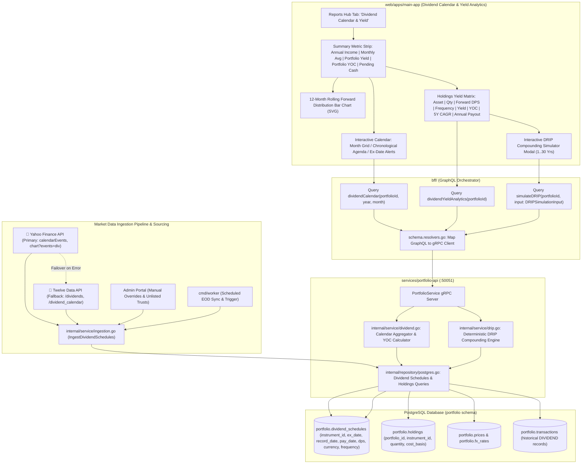

# User Story: Dividend Calendar, Forward Income & Yield Analytics

> **Story ID**: US-DIV-101  
> **Epic**: Passive Income, Dividend Forecasting & Yield Analytics  
> **Target Layers**: Primary Investor Application (`web/apps/main-app`), BFF GraphQL Orchestrator (`bff/`), Portfolio Microservice (`services/portfolio-api`), Protobuf (`proto/portfolio/v1/portfolio.proto`), Database (`portfolio.dividends`, `portfolio.corporate_actions`, `portfolio.transactions`)  
> **Status**: Completed  
> **Implementation Plan**: [dividend-calendar-yield-analytics-implementation-plan.md](file:///Users/oscargarcia/workspace/graphfolio/docs/plans/dividend-calendar-yield-analytics-implementation-plan.md)  
> **Calculation & Accounting Standard**: [financial-calculations skill](file:///Users/oscargarcia/workspace/graphfolio/.agents/skills/financial-calculations/SKILL.md) (Forward Annual Dividend, Yield on Cost [YOC], Trailing Twelve Months [TTM] Yield, Dividend Reinvestment [DRIP] Compounding, Trade-Date vs Ex-Date Entitlement, Foreign Withholding Tax [WHT], Exact Fixed-Point Precision)  
> **Related Stories & Documents**:  
> - [dividend-market-data-ingestion-pipeline.md](file:///Users/oscargarcia/workspace/graphfolio/docs/user-stories/dividend-market-data-ingestion-pipeline.md) (`US-INGEST-103`)  
> - [investment-holding-capital-gain-income-currency.md](file:///Users/oscargarcia/workspace/graphfolio/docs/user-stories/investment-holding-capital-gain-income-currency.md) (`US-INV-101`)  
> - [average_buy_price_column.md](file:///Users/oscargarcia/workspace/graphfolio/docs/user-stories/average_buy_price_column.md) (`US-INV-104`)  
> - [portfolio-cash-flow-report-generation.md](file:///Users/oscargarcia/workspace/graphfolio/docs/user-stories/portfolio-cash-flow-report-generation.md) (`US-REP-101`)  
> - [cash-flow-fee-and-tax-attribution.md](file:///Users/oscargarcia/workspace/graphfolio/docs/user-stories/cash-flow-fee-and-tax-attribution.md) (`US-REP-102`)  
> - [withdraw-against-dividend-transaction.md](file:///Users/oscargarcia/workspace/graphfolio/docs/user-stories/withdraw-against-dividend-transaction.md) (`US-TX-105`)  
> - [interactive-transaction-ingestion-modal.md](file:///Users/oscargarcia/workspace/graphfolio/docs/user-stories/interactive-transaction-ingestion-modal.md) (`US-TX-101`)  
> - [USER_STORIES.md](file:///Users/oscargarcia/workspace/graphfolio/docs/USER_STORIES.md)  
> - [FEATURES.md (Feature #23)](file:///Users/oscargarcia/workspace/graphfolio/FEATURES.md#L33)  

---

## 1. Story Statements

### 1.1 Forward Dividend Calendar & Payment Schedule
> **As an** income-focused investor relying on passive cash distributions for living expenses or reinvestment,  
> **I want to** view an interactive, multi-view dividend calendar highlighting declared ex-dividend dates, record dates, and payment dates for every active asset in my portfolio,  
> **So that** I know exactly when cash will be disbursed to my brokerage accounts, how much income to expect each month, and whether I need to hold shares through an upcoming ex-date to remain entitled to the distribution.

### 1.2 Forward Income Run-Rate & Monthly Projections
> **As a** long-term dividend growth investor,  
> **I want to** see an annualized forward dividend income summary and a 12-month rolling cash flow projection broken down by calendar month,  
> **So that** I can assess my portfolio's annual cash generation power, identify "income dry spells" (months with low dividend distributions), and balance my income cash flow throughout the year.

### 1.3 Yield on Cost (YOC) vs Current Market Yield
> **As a** patient investor who accumulated shares years ago at lower price points,  
> **I want to** view both **Current Dividend Yield** (`Forward Dividend / Current Market Value`) and **Yield on Cost (YOC)** (`Forward Dividend / Average Purchase Cost Basis`) for each individual holding and across my entire portfolio,  
> **So that** I can quantify the compounding reward of long-term dividend growth against my initial capital invested.

### 1.4 Entitlement Tracking & Pending Cash Inflows
> **As an** active portfolio manager buying and selling dividend-paying securities,  
> **I want** the system to track the complete corporate dividend lifecycle—flagging when shares are held on the ex-dividend date and tracking declared dividends as `"Pending Cash Inflow"` until payment date,  
> **So that** I can safely rebalance or liquidate positions post-ex-date without losing track of pending dividend cash owed to me.

### 1.5 Dividend Reinvestment Plan (DRIP) Compounding Simulator
> **As a** wealth-building investor planning long-term financial independence,  
> **I want to** simulate future portfolio compounding by comparing a 100% Cash Sweep scenario against an automated Dividend Reinvestment Plan (DRIP) over 5, 10, 20, and 30 years,  
> **So that** I can visualize the exponential compounding impact of reinvesting distributions back into income-producing assets.

---

## 2. Background & Problem Context

### 2.1 The Income Investor's Core Pain Point
Modern portfolio trackers often treat dividends solely as backward-looking accounting artifacts—recording cash when a transaction is added to the ledger, but failing to provide any forward-looking intelligence. For income investors, retirees, and Dividend Growth Investing (DGI) practitioners:
1. **Income Timing is Critical**: Bills and cash flow commitments are monthly, but equity dividends are dispersed quarterly (US), semi-annually (Australia, UK), or annually (Europe). Investors need to anticipate cash arrivals.
2. **Ex-Date Rules Confuse Investors**: Missing an ex-dividend date by a single trading day forfeits months of dividend entitlement.
3. **Yield on Cost is Hidden**: Traditional brokerages only display the current dividend yield relative to today's market price (e.g., Apple paying 0.5% today). An investor who purchased Apple 10 years ago might be earning a **12% Yield on Cost** on their initial capital. Without YOC, investors underestimate their portfolio's true compounding velocity.
4. **Foreign Withholding Taxes (WHT)**: International dividends (e.g., US stocks held by Australian or European investors) are subject to statutory withholding taxes (15% with W-8BEN, 30% uncertified). Investors need to see both **gross declared dividend** and **estimated net cash received in base currency**.

### 2.2 Corporate Action Dividend Lifecycle
GraphFolio must model the four distinct chronological milestones of every corporate dividend:

```
+----------------------------------------------------------------------------------------------------+
|                                 DIVIDEND LIFECYCLE TIMELINE                                        |
|                                                                                                    |
|  [1. Declaration Date]     [2. Ex-Dividend Date]       [3. Record Date]       [4. Payment Date]    |
|  Company announces:        Cutoff for buyer:           Company finalizes      Cash credited to     |
|  • DPS amount              • Must own BEFORE open      shareholder registry   broker account       |
|  • Ex-Date & Pay Date      • Stock price adjusts       (usually T+1 after ex)                      |
|                                                                                                    |
|  Status: ANNOUNCED         Status: EX_DATE_PASSED      Status: ENTITLED       Status: PAID/SETTLED |
|                            (Pending Settlement)        (Pending Settlement)   (Cash Ledger Credited)|
+----------------------------------------------------------------------------------------------------+
```

### 2.3 Current GraphFolio Architectural State
- **Database (`portfolio.transactions`)**: Fully supports `type = 'DIVIDEND'` with `amount`, `withholding_tax`, `instrument_id`, and `fx_rate_to_base`.
- **Corporate Actions (`portfolio.corporate_actions`)**: Contains table schema for stock splits and mergers, but lacks corporate dividend schedule tracking (ex-dates, pay-dates, declared dividends per share).
- **Holdings Table (`web/apps/main-app/src/components/Investments.tsx`)**: Displays historical `income_amount` and `income_yield_percent` (historical income earned), but has zero forward yield projections or calendar views.
- **Reports Hub (`web/apps/main-app/src/views/ReportsView.tsx`)**: Hosts the Cash Flow Statement and Modified Dietz calculator, providing the natural extensible location for the Dividend Calendar & Yield Analytics hub.

---

## 3. Financial, Mathematical & Accounting Mechanics

All formulas and computations must strictly comply with the [financial-calculations skill](file:///Users/oscargarcia/workspace/graphfolio/.agents/skills/financial-calculations/SKILL.md) and avoid floating-point errors through arbitrary-precision fixed-point math (`shopspring/decimal`).

### 3.1 Forward Annual Dividend per Holding ($D_{\text{forward}, i}$)
For an active open position in instrument $i$ held on evaluation date $t$ with open quantity $Q_{i,t} > 0$:

$$D_{\text{forward}, i} = Q_{i,t} \times \text{DPS}_{\text{annualized}, i} \times \text{FX}(C_i \to C_{\text{base}}, t)$$

Where:
- $Q_{i,t}$: Currently held open share quantity (up to 8 decimal places for fractional holdings).
- $\text{DPS}_{\text{annualized}, i}$: Projected annual dividend per share in local instrument currency $C_i$:
  - **Quarterly Frequency**: $\text{DPS}_{\text{latest}} \times 4$
  - **Semi-Annual Frequency**: $\text{DPS}_{\text{latest}} \times 2$
  - **Monthly Frequency**: $\text{DPS}_{\text{latest}} \times 12$
  - **Annual Frequency**: $\text{DPS}_{\text{latest}} \times 1$
  - **Trailing Twelve Months (TTM) Fallback**: $\sum \text{DPS}_{\text{paid, last 365 days}}$ when dividends are irregular.
- $\text{FX}(C_i \to C_{\text{base}}, t)$: Spot exchange rate converting instrument currency $C_i$ to portfolio base currency $C_{\text{base}}$.

### 3.2 Total Portfolio Forward Annual Income ($D_{\text{forward, portfolio}}$)
The aggregate expected annual dividend cash flow across all open positions:

$$D_{\text{forward, portfolio}} = \sum_{i \in \text{OpenPositions}} D_{\text{forward}, i}$$

$$\text{Monthly Average Income} = \frac{D_{\text{forward, portfolio}}}{12}$$

### 3.3 Current Dividend Yield ($Y_{\text{current}}$)
The annualized yield relative to today's market value:

$$\text{Holding Current Yield } Y_{\text{current}, i} = \frac{\text{DPS}_{\text{annualized}, i}}{P_{\text{current}, i}} \times 100$$

$$\text{Portfolio Current Yield } Y_{\text{current, portfolio}} = \frac{D_{\text{forward, portfolio}}}{\text{Total Portfolio Market Value}} \times 100$$

*(If $P_{\text{current}, i} \le 0$ or $\text{Total Portfolio Market Value} \le 0$, yield evaluates cleanly to $0.00\%$ without division-by-zero errors).*

### 3.4 Yield on Cost (YOC)
The annualized dividend payout relative to original invested purchase cost:

$$\text{Holding Yield on Cost } \text{YOC}_i = \frac{\text{DPS}_{\text{annualized}, i}}{\text{Average Buy Price}_i} \times 100$$

$$\text{Portfolio Yield on Cost } \text{YOC}_{\text{portfolio}} = \frac{D_{\text{forward, portfolio}}}{\sum_{i \in \text{OpenPositions}} \text{CostBasis}_{\text{base}, i}} \times 100$$

Where:
- $\text{Average Buy Price}_i$: Pooled average purchase price per share in instrument currency from `portfolio.holdings.cost_basis / quantity`.
- $\text{CostBasis}_{\text{base}, i}$: Total historical acquisition cost basis of open shares converted to portfolio base currency.
- **Rule**: If an instrument's cost basis is zero (e.g. spin-off distribution with zero tax basis), YOC is flagged as `N/A (Cost Basis = 0)`.

### 3.5 Net Forward Yield & Foreign Withholding Tax (WHT)
For international holdings subject to cross-border dividend withholding:

$$\text{Net DPS}_i = \text{DPS}_i \times (1 - \tau_{\text{wht}, i})$$

$$\text{Estimated Net Payout}_i = Q_{i,t} \times \text{Net DPS}_i \times \text{FX}(C_i \to C_{\text{base}}, t)$$

Where:
- $\tau_{\text{wht}, i}$: Statutory or treaty withholding rate (e.g., $15\%$ for US securities held by Australian investors with an active W-8BEN treaty; $30\%$ standard non-resident rate; $0\%$ for domestic assets).

### 3.6 Dividend Growth Rate (CAGR)
For holdings with multi-year dividend histories:

$$\text{Dividend CAGR}_{N} = \left( \frac{\text{DPS}_{t}}{\text{DPS}_{t - N\text{ years}}} \right)^{\frac{1}{N}} - 1$$

Measures annual growth in dividend payout across 1-year, 3-year, and 5-year rolling windows.

### 3.7 DRIP Compounding Simulation Formula
Simulating future capital accumulation comparing Cash Payout vs Automated Dividend Reinvestment Plan over horizon $Y$ years with annual asset capital appreciation $g$ and annual dividend growth $d$:

For period $t = 1 \dots 12 \times Y$ (monthly compounding):
1. **Asset Price**: $P_t = P_0 \times (1 + g)^{\frac{t}{12}}$
2. **Monthly Dividend per Share**: $\text{DPS}_t = \frac{\text{DPS}_0}{12} \times (1 + d)^{\frac{t}{12}}$
3. **Cash Flow in Month $t$**: $\text{CashPayout}_t = Q_t \times \text{DPS}_t \times (1 - \tau_{\text{wht}})$
4. **Reinvestment (DRIP)**:
   $$\Delta Q_t = \frac{\text{CashPayout}_t}{P_t}$$
   $$Q_{t+1} = Q_t + \Delta Q_t$$
5. **No-DRIP (Cash Payout)**:
   $$Q_{t+1} = Q_0 \quad (\text{share quantity remains static})$$
   $$\text{Accumulated Cash}_{t+1} = \text{Accumulated Cash}_t + \text{CashPayout}_t$$

---

## 4. Architectural & System Design Breakdown

Following the strict layered boundaries defined in `AGENTS.md`:



### 4.1 Database Layer (`services/portfolio-api/migrations/`)
- Migration: `000007_create_dividend_schedules.up.sql`
- Table `portfolio.dividend_schedules`:
  ```sql
  CREATE TYPE portfolio.dividend_frequency AS ENUM (
      'MONTHLY', 'QUARTERLY', 'SEMI_ANNUAL', 'ANNUAL', 'IRREGULAR'
  );

  CREATE TYPE portfolio.dividend_status AS ENUM (
      'ANNOUNCED', 'EX_DATE_PASSED', 'PAID', 'CANCELLED'
  );

  CREATE TABLE portfolio.dividend_schedules (
      id                 uuid                            PRIMARY KEY DEFAULT uuidv7(),
      instrument_id      uuid                            NOT NULL REFERENCES portfolio.instruments(id) ON DELETE CASCADE,
      ex_date            date                            NOT NULL,
      record_date        date,
      payment_date       date                            NOT NULL,
      amount_per_share   numeric(20,8)                   NOT NULL CHECK (amount_per_share > 0),
      currency_code      char(3)                         NOT NULL REFERENCES portfolio.currencies(code),
      frequency          portfolio.dividend_frequency    NOT NULL DEFAULT 'QUARTERLY',
      status             portfolio.dividend_status       NOT NULL DEFAULT 'ANNOUNCED',
      is_estimated       boolean                         NOT NULL DEFAULT false,
      franking_percentage numeric(5,2)                   DEFAULT 0.00,
      withholding_tax_pct numeric(5,2)                   DEFAULT 0.00,
      created_at         timestamptz                     NOT NULL DEFAULT now(),
      updated_at         timestamptz                     NOT NULL DEFAULT now(),
      UNIQUE (instrument_id, ex_date, payment_date)
  );

  CREATE INDEX idx_dividend_schedules_dates ON portfolio.dividend_schedules (ex_date, payment_date);
  CREATE INDEX idx_dividend_schedules_instrument ON portfolio.dividend_schedules (instrument_id);
  ```

### 4.2 Protobuf Contracts Layer (`proto/portfolio/v1/portfolio.proto`)
```protobuf
enum DividendFrequency {
  DIVIDEND_FREQUENCY_UNSPECIFIED = 0;
  DIVIDEND_FREQUENCY_MONTHLY     = 1;
  DIVIDEND_FREQUENCY_QUARTERLY   = 2;
  DIVIDEND_FREQUENCY_SEMI_ANNUAL = 3;
  DIVIDEND_FREQUENCY_ANNUAL      = 4;
  DIVIDEND_FREQUENCY_IRREGULAR   = 5;
}

enum DividendEventStatus {
  DIVIDEND_EVENT_STATUS_UNSPECIFIED    = 0;
  DIVIDEND_EVENT_STATUS_ANNOUNCED      = 1;
  DIVIDEND_EVENT_STATUS_EX_DATE_PASSED = 2;
  DIVIDEND_EVENT_STATUS_PAID           = 3;
}

message DividendCalendarEvent {
  string              id                 = 1;
  string              instrument_id      = 2;
  string              symbol             = 3;
  string              name               = 4;
  string              ex_date            = 5; // YYYY-MM-DD
  string              record_date        = 6; // YYYY-MM-DD
  string              payment_date       = 7; // YYYY-MM-DD
  common.v1.Decimal   shares_held        = 8;
  common.v1.Money     dps_declared       = 9;  // In instrument currency
  common.v1.Money     gross_amount_base  = 10; // In portfolio base currency
  common.v1.Money     net_amount_base    = 11; // After estimated WHT
  DividendFrequency   frequency          = 12;
  DividendEventStatus status             = 13;
  bool                is_user_entitled   = 14; // Owned prior to ex_date
}

message MonthlyDividendProjection {
  int32           year               = 1;
  int32           month              = 2; // 1..12
  common.v1.Money projected_income   = 3;
  int32           dividend_count     = 4;
}

message HoldingYieldItem {
  string            instrument_id         = 1;
  string            symbol                = 2;
  string            name                  = 3;
  common.v1.Decimal quantity              = 4;
  common.v1.Money   current_price         = 5;
  common.v1.Money   average_buy_price     = 6;
  common.v1.Money   current_market_value  = 7;
  common.v1.Money   cost_basis            = 8;
  common.v1.Money   annual_dps            = 9;
  common.v1.Money   projected_annual_cash = 10;
  common.v1.Decimal current_yield_pct     = 11;
  common.v1.Decimal yield_on_cost_pct     = 12;
  common.v1.Decimal dividend_cagr_3y      = 13;
  DividendFrequency frequency             = 14;
  string            next_ex_date          = 15;
  string            next_payment_date     = 16;
}

message DividendYieldAnalyticsResponse {
  common.v1.Money                    annual_forward_income     = 1;
  common.v1.Money                    monthly_average_income    = 2;
  common.v1.Decimal                  portfolio_current_yield   = 3;
  common.v1.Decimal                  portfolio_yield_on_cost   = 4;
  common.v1.Money                    pending_cash_inflow       = 5;
  repeated MonthlyDividendProjection monthly_projections       = 6;
  repeated HoldingYieldItem          holdings_yield            = 7;
}
```

### 4.3 BFF GraphQL Schema Layer (`bff/graph/schema.graphqls`)
```graphql
type DividendCalendarEvent {
  id: ID!
  instrumentId: ID!
  symbol: String!
  name: String!
  exDate: String!
  recordDate: String
  paymentDate: String!
  sharesHeld: Decimal!
  dpsDeclared: Money!
  grossAmountBase: Money!
  netAmountBase: Money!
  frequency: DividendFrequency!
  status: DividendEventStatus!
  isUserEntitled: Boolean!
}

type MonthlyDividendProjection {
  year: Int!
  month: Int!
  projectedIncome: Money!
  dividendCount: Int!
}

type HoldingYieldItem {
  instrumentId: ID!
  symbol: String!
  name: String!
  quantity: Decimal!
  currentPrice: Money!
  averageBuyPrice: Money!
  currentMarketValue: Money!
  costBasis: Money!
  annualDps: Money!
  projectedAnnualCash: Money!
  currentYieldPct: Decimal!
  yieldOnCostPct: Decimal!
  dividendCagr3y: Decimal
  frequency: DividendFrequency!
  nextExDate: String
  nextPaymentDate: String
}

type DividendYieldAnalytics {
  annualForwardIncome: Money!
  monthlyAverageIncome: Money!
  portfolioCurrentYield: Decimal!
  portfolioYieldOnCost: Decimal!
  pendingCashInflow: Money!
  monthlyProjections: [MonthlyDividendProjection!]!
  holdingsYield: [HoldingYieldItem!]!
}

extend type Query {
  dividendCalendar(portfolioId: ID, year: Int, month: Int): [DividendCalendarEvent!]!
  dividendYieldAnalytics(portfolioId: ID): DividendYieldAnalytics!
}
```

---

## 5. Market Data Sourcing & Dividend Ingestion Pipeline

To generate accurate forward dividend projections, populate interactive calendar schedules, and track corporate ex-dividend dates, GraphFolio implements a multi-tiered corporate action ingestion pipeline combining upstream institutional market feeds, automated forward projection algorithms, and admin overrides.

> ℹ️ **Dedicated Ingestion Architecture**: For full technical specifications, provider contracts, and failover mechanics, refer to the dedicated user story: [dividend-market-data-ingestion-pipeline.md](file:///Users/oscargarcia/workspace/graphfolio/docs/user-stories/dividend-market-data-ingestion-pipeline.md) (`US-INGEST-103`).

```
+--------------------------------------------------------------------------------------------------------------------+
|                                    DIVIDEND EVENT DATA SOURCING ARCHITECTURE                                       |
|                                                                                                                    |
|   [ Upstream Feeds ]                  [ Ingestion Worker ]            [ Storage & Modeling ]       [ Consumption ] |
|   • 🥇 Yahoo Finance (Primary)  --->  • Nightly EOD Ingestion  --->   • portfolio.dividend_schedules               |
|     (calendarEvents, chart?div)       • Forward Window (90d)          (ex_date, pay_date, dps,     • Calendar Grid |
|   • 🥈 Twelve Data (Fallback)   --->  • Historical Window (30d)       franking, WHT, frequency)   • Forward Run-Rate|
|     (/dividends, calendar)            • Rate Limiter & Backoff                                     • YOC Matrix    |
|   • CSV Cash Statements         --->  • Match Ingested Tx      --->   • portfolio.transactions     • DRIP Model    |
|     (CommSec, nabtrade)               • Status: PAID Reconciliation   (actual received cash)                       |
|   • Admin Overrides             --->  • Manual Schedule Entry  --->   • Override Guard (Immutable)                 |
|     (Unlisted Trusts, Debt)                                                                                        |
+--------------------------------------------------------------------------------------------------------------------+
```

### 5.1 Primary Upstream Provider: Yahoo Finance Corporate Actions API
GraphFolio's primary external market provider for corporate actions is the **Yahoo Finance API**:
1. **Calendar Events & Forward Yield Module**:
   - **Endpoint**: `GET https://query1.finance.yahoo.com/v10/finance/quoteSummary/{symbol}?modules=calendarEvents,defaultKeyStatistics,summaryDetail`
   - **Data Extracted**:
     - `calendarEvents.dividends.exDividendDate`: Unix timestamp of next ex-date.
     - `calendarEvents.dividends.dividendDate`: Unix timestamp of next payment date.
     - `calendarEvents.dividends.dividendRate`: Forward annualized dividend rate.
     - `defaultKeyStatistics.trailingAnnualDividendRate`: 12-month trailing total DPS.
     - `summaryDetail.dividendYield`: Trailing yield percentage.
2. **Historical Payout Series for Dividend Growth (CAGR)**:
   - **Endpoint**: `GET https://query1.finance.yahoo.com/v8/finance/chart/{symbol}?events=div&interval=1d&range=5y`
   - **Operation**: Extracts all historical cash dividend events to compute 1-year, 3-year, and 5-year compound annual dividend growth rates (CAGR), as well as consecutive payout consistency streaks.

### 5.2 Secondary / Redundant Fallback: Twelve Data Dividends & Calendar API
When Yahoo Finance encounters HTTP 429/5xx errors, rate throttling, or missing corporate events for an international ticker:
1. **Security-Specific Dividend History & Announcements**:
   - **Endpoint**: `GET https://api.twelvedata.com/dividends?symbol={symbol}&apikey={key}`
   - **Data Provided**:
     - `ex_date`: Crucial cutoff date for buyer entitlement.
     - `payment_date`: Expected cash distribution date.
     - `record_date`: Shareholder registry snapshot date.
     - `amount`: Declared cash Dividend Per Share (DPS).
     - `currency`: Denominated distribution currency (e.g. `USD`, `AUD`, `EUR`, `GBP`).
2. **Bulk Forward Dividend Calendar**:
   - **Endpoint**: `GET https://api.twelvedata.com/dividend_calendar?start_date={YYYY-MM-DD}&end_date={YYYY-MM-DD}&apikey={key}`
   - **Operation**: Fallback batch calendar endpoint querying declared distributions across a rolling forward window.

### 5.3 Regional Corporate Registrars & Tax Imputation (e.g. ASX & Franking Credits)
For specific tax jurisdictions such as Australia (ASX), dividends frequently carry **franking credits (tax imputation)**:
- Companies pay corporate tax (standard 30% or 25% base rate) before distributing dividends.
- For ASX-listed securities (e.g., BHP, CBA, TLS), the ingestion pipeline captures:
  - `franking_percentage`: e.g. $100.00\%$ (Fully Franked) or $0.00\%$ (Unfranked).
  - Australian investors receive a tax offset equal to:
    $$\text{Franking Credit} = \text{Cash Dividend} \times \frac{\text{Company Tax Rate}}{1 - \text{Company Tax Rate}} \times \text{Franking Pct}$$
- Captured in `portfolio.dividend_schedules.franking_percentage` to enable downstream grossed-up income tax reporting.

### 5.4 Deterministic Forward Projection & Cadence Recognition Engine
Because most public corporations only declare official dividend dates 3 to 6 weeks before the ex-date, an investor viewing a 12-month forward calendar would suffer from "empty month" drop-offs without predictive estimation:
1. **Distribution Cadence Detection**:
   The engine analyzes the instrument's historical payment dates from `portfolio.dividend_schedules` to determine frequency:
   - **Quarterly**: Interval $\approx 91 \pm 10$ calendar days (common in US, Canada).
   - **Semi-Annual**: Interval $\approx 182 \pm 14$ calendar days (common in Australia, UK).
   - **Monthly**: Interval $\approx 30 \pm 4$ calendar days (REITs, fixed-income ETFs).
   - **Annual**: Interval $\approx 365 \pm 20$ calendar days (common in European equities).
2. **Projected Date & DPS Synthesis**:
   - For future cycles lacking an official corporate declaration:
     $$T_{\text{ex, estimated}} = T_{\text{ex, previous}} + \Delta t_{\text{cadence}}$$
     $$T_{\text{pay, estimated}} = T_{\text{pay, previous}} + \Delta t_{\text{cadence}}$$
     $$\text{DPS}_{\text{estimated}} = \text{DPS}_{\text{latest regular}}$$
   - Synthesized records are inserted with `is_estimated = true` and `status = 'ANNOUNCED'`.
3. **Automated Declaration Reconciliation**:
   - When the official company declaration is ingested from Twelve Data or Yahoo Finance, the estimated placeholder is matched by calendar window and updated to `is_estimated = false` with authoritative board-approved dates and amounts.
   - Special one-off distributions (`is_special = true`) are excluded from cadence projections to avoid distorting recurring forward yield.

### 5.5 Ingestion Execution, Rate Limiting & Worker Schedule
1. **Nightly EOD Synchronization Worker (`cmd/worker/` & `cmd/market-ingest/`)**:
   - Runs daily after global market close (02:00 UTC).
   - Queries `repo.ListActiveInstruments()` to resolve all distinct instruments currently held across active investor portfolios.
   - Queries upstream providers for declared distributions across a rolling forward window $[t_{\text{today}}, t_{\text{today}} + 90\text{ days}]$ and updates past scheduled events $[t_{\text{today}} - 30\text{ days}, t_{\text{today}}]$ from `ANNOUNCED` $\to$ `EX_DATE_PASSED` $\to$ `PAID`.
   - Protects upstream quotas using `marketdata.RateLimiter` (token bucket with exponential jittered backoff on HTTP 429).
2. **Event-Driven Trade Trigger**:
   - When an investor executes a `BUY` or `AddTransaction` for an instrument newly introduced to the system, an asynchronous background worker triggers targeted dividend schedule backfill for that specific ticker.

### 5.6 Admin Overrides & Manual Schedule Entry
For unlisted private trusts, bespoke fixed-income debt securities, or temporary upstream provider discrepancies:
- The GraphFolio Admin Portal (`web/apps/admin-app`) provides a dedicated **Dividend Schedule Management** console.
- Authorized platform administrators can execute `RecordDividendOverride` or `CreateDividendSchedule`, manually specifying:
  - Instrument, Ex-Date, Payment Date, DPS, Currency, Franking %, and Frequency.
- Records flagged with `is_override = true` are protected by database update guards, preventing automated nightly ingestion sweeps from overwriting verified administrative entries.

### 5.7 Automatic Cash Flow Reconciliation with Ingested Brokerage Statements
When investors import actual brokerage account statements (via CommSec CSV, nabtrade CSV, Interactive Brokers, or manual transaction entry):
- Ingested `DIVIDEND` transactions contain the actual cash credited to the user's cash account, including net amounts and withheld taxes.
- The system automatically correlates the settled ledger transaction against the scheduled calendar event matching `(instrument_id, abs(payment_date - tx_date) <= 3 days, net_amount ≈ tx_amount)`.
- Upon matching, the calendar event status transitions to `PAID` / `SETTLED` and embeds a direct deep link to the transaction ledger record for bidirectional reconciliation.

---

## 6. UI / UX Design Specifications

### 6.1 Presentation Philosophy & Styling
The Dividend Calendar & Yield Analytics hub adheres strictly to GraphFolio's dark glassmorphic design system:
- Translucent card containers (`rgba(15, 23, 42, 0.75)`, `backdrop-filter: blur(16px)`).
- Border highlights (`1px solid rgba(255, 255, 255, 0.08)`).
- Semantic financial colors:
  - Income / Dividends: Electric Sky Blue (`#38bdf8`) & Cyan (`#22d3ee`).
  - Outflows / Taxes: Ruby Red (`#f87171`).
  - Positive Yield / Compounding: Emerald Green (`#34d399`).
  - Ex-Date Warnings / Urgency: Amber Orange (`#fbbf24`).

### 6.2 Layout & Component Hierarchy

```
+------------------------------------------------------------------------------------------------------------------------+
| REPORTS / DIVIDEND CALENDAR & YIELD ANALYTICS                                                       [ DRIP Simulator ] |
+------------------------------------------------------------------------------------------------------------------------+
| SUMMARY METRIC STRIP:                                                                                                  |
| [ Annual Forward Income ]  [ Monthly Average ]  [ Portfolio Yield ]  [ Yield on Cost (YOC) ]  [ Pending Cash Inflow ]   |
|   $6,840.50 AUD              $570.04 AUD          4.12%                7.85%                    $412.00 AUD (2 payouts)|
+------------------------------------------------------------------------------------------------------------------------+
| FORWARD MONTHLY DISTRIBUTION (Next 12 Months):                                                                         |
|  $800 |               ■                                                                                                |
|  $600 |       ■       ■       ■               ■       ■       ■               ■                                        |
|  $400 |   ■   ■   ■   ■   ■   ■   ■   ■   ■   ■   ■   ■                                                                |
|  $200 |   ■   ■   ■   ■   ■   ■   ■   ■   ■   ■   ■   ■                                                                |
|    $0 +---+---+---+---+---+---+---+---+---+---+---+---+                                                                |
|        Nov Dec Jan Feb Mar Apr May Jun Jul Aug Sep Oct                                                                 |
+------------------------------------------------------------------------------------------------------------------------+
| VIEW TOGGLE:  (•) Monthly Calendar Grid    ( ) Chronological Agenda List    ( ) Holdings Yield Matrix                   |
+------------------------------------------------------------------------------------------------------------------------+
| CALENDAR VIEW (November 2026):                                                                < Prev Month | Next Month >|
|  Mon             Tue             Wed             Thu             Fri             Sat             Sun                   |
|                  1               2               3               4               5               6                     |
|                                                  [BHP Ex-Date]                                                         |
|  7               8               9               10              11              12              13                    |
|                                  [AAPL $142.50]                                                                        |
|                                  Pay Date                                                                              |
|  14              15              16              17              18              19              20                    |
|                  [MSFT Ex-Date]                                                                                        |
|  21              22              23              24              25              26              27                    |
|                                                  [BHP $280.00]                                                         |
|                                                  Pay Date                                                              |
|  28              29              30                                                                                    |
+------------------------------------------------------------------------------------------------------------------------+
```

### 6.3 Holdings Yield Matrix Columns
When switching to the **Holdings Yield Matrix** view:

| Column | Description | Formatting |
|:---|:---|:---:|
| **Asset** | Symbol & Company Name with country flag | `AAPL` Apple Inc. 🇺🇸 |
| **Shares Held** | Current active open quantity | `150.0000` |
| **Current Price** | Latest market closing price | `$232.50 USD` |
| **Avg Buy Price** | Historical average purchase price | `$112.40 USD` |
| **Current Yield** | Annual DPS / Current Price | `0.45%` |
| **Yield on Cost** | Annual DPS / Avg Buy Price | `0.93%` (compounding badge) |
| **Payout Freq** | Quarterly, Semi-Annual, Monthly | `QUARTERLY` badge |
| **Est. Annual Cash** | Forward annual dividend in base currency | `$352.12 AUD` |
| **Next Ex-Date** | Upcoming ex-dividend cutoff date | `12 Nov 2026` (amber if within 7 days) |
| **Next Pay Date** | Upcoming cash distribution date | `28 Nov 2026` |

---

## 7. Acceptance Criteria (Given - When - Then)

### AC 1: Forward Income Summary & Metric Strip
- **Given** an authenticated investor viewing the Dividend Calendar & Yield Analytics hub,
- **When** the page loads,
- **Then** the summary strip displays five primary financial metrics:
  1. **Annual Forward Income**: Aggregate forward annualized dividends across all open positions converted to base currency.
  2. **Monthly Average Income**: Annual Forward Income divided by 12.
  3. **Portfolio Current Yield**: Annual Forward Income divided by Total Portfolio Market Value.
  4. **Portfolio Yield on Cost (YOC)**: Annual Forward Income divided by Total Cost Basis of open positions.
  5. **Pending Cash Inflow**: Sum of declared dividends whose ex-dividend dates have passed, where the user was entitled to the dividend, and payment date is in the future.

### AC 2: Calendar Grid & Agenda List View
- **Given** open positions in securities with scheduled dividend payments,
- **When** the investor views the **Monthly Calendar Grid**,
- **Then** calendar cells highlight:
  - **Ex-Dividend Dates**: Marked with an amber badge indicating the ex-date and required ownership cutoff.
  - **Payment Dates**: Marked with a vibrant cyan/emerald badge indicating expected cash payout amount.
- **And** clicking any event opens a slide-over drawer with holding details, shares held, DPS, gross amount, and estimated withholding tax.
- **And** toggling to **Agenda List** presents a chronological list of upcoming payouts grouped by week.

### AC 3: Entitlement Rule Enforcement (Ex-Date vs Trade Date)
- **Given** an instrument declares a dividend with ex-dividend date $T_{\text{ex}}$,
- **When** the investor executes a `BUY` transaction on or after $T_{\text{ex}}$,
- **Then** the calendar displays `isUserEntitled = false`,
- **And** the payout is excluded from the user's Pending Cash Inflows and forward estimates for that specific distribution.
- **When** the investor owned the shares before market open on $T_{\text{ex}}$ and subsequently sells them on or after $T_{\text{ex}}$,
- **Then** the dividend remains `isUserEntitled = true` and `Pending Cash Inflow` is preserved even though the position is currently closed.

### AC 4: Yield on Cost (YOC) Calculation & Zero-Division Safety
- **Given** an open position with positive shares and average buy price $> 0$,
- **When** Yield on Cost is calculated,
- **Then** $\text{YOC} = (\text{Annual DPS} / \text{Average Buy Price}) \times 100$.
- **When** an asset has an average buy price of zero (or position is a pure cash asset),
- **Then** YOC displays `"—"` or `"N/A"` without throwing mathematical errors or NaN.
- **When** comparing YOC against Current Yield,
- **Then** if $\text{YOC} > \text{Current Yield}$, the table renders a subtle green `"Yield Expansion"` indicator highlighting positive long-term compounding.

### AC 5: Multi-Currency & Foreign Withholding Tax (WHT)
- **Given** a portfolio with base currency `AUD` holding US securities denominated in `USD`,
- **When** forward dividend income is aggregated,
- **Then** each USD dividend is converted using the latest available FX rate ($\text{USD} \to \text{AUD}$),
- **And** estimated statutory withholding tax (15% US treaty rate) is deducted for net income presentation while gross amounts remain inspectable.

### AC 6: 12-Month Forward Cash Flow Bar Chart
- **Given** active holdings with scheduled or projected payment dates,
- **When** rendering the forward income distribution chart,
- **Then** an interactive SVG bar chart displays projected dividend cash flow for each of the upcoming 12 months,
- **And** hovering over any month bar displays a breakdown tooltip showing which specific companies are paying in that month and their individual contribution amounts.

### AC 7: Closed Positions Exclusion from Forward Income
- **Given** a portfolio that previously received dividends from a security that is now completely liquidated (`quantity = 0`, `is_closed = true`),
- **When** calculating forward annual income and forward yield metrics,
- **Then** closed positions are strictly excluded ($Q = 0 \implies D_{\text{forward}} = 0$),
- **And** historical dividends already received remain fully preserved in historical return attribution and cash flow statements.

### AC 8: Dividend Reinvestment Plan (DRIP) Simulation
- **Given** the user clicks the `"DRIP Simulator"` button,
- **When** the simulator modal opens,
- **Then** it presents an interactive projection comparing:
  - Curve A: Reinvesting 100% of dividends into additional shares (DRIP).
  - Curve B: Sweeping dividends into uninvested cash.
- **And** provides adjustable parameters: Investment Horizon (1 to 30 years), Expected Dividend Growth Rate (default 5%), and Capital Growth Rate (default 7%).
- **And** calculates total projected portfolio value, total shares accumulated, and terminal annual dividend cash flow under both strategies.

### AC 9: Empty States for Zero-Yield Portfolios
- **Given** a portfolio containing only non-dividend-paying growth stocks (e.g. Berkshire Hathaway, Google) or uninvested cash,
- **When** the Dividend Calendar & Yield Analytics hub renders,
- **Then** the summary strip displays `$0.00` forward income and `0.00%` yield,
- **And** the calendar displays a clean, elegant empty state:  
  *"No upcoming dividend payments detected for your current holdings."* with an informational tip explaining how to add dividend-paying assets.

---

## 8. Non-Functional Requirements

### 8.1 Computational Performance & Latency
- Calendar schedule aggregation and forward yield calculation across portfolios with up to 100 active holdings must execute in **$< 150\text{ms}$**.
- Forward income projection queries must leverage pre-indexed `(instrument_id, ex_date, payment_date)` database indices.

### 8.2 Zero Floating-Point Precision
- All dividend amounts, share quantities, currency conversions, and yields must use `github.com/shopspring/decimal` in Go and fixed-point `Decimal` scalars in GraphQL.
- No IEEE 754 floating-point operations are permitted at any layer.

### 8.3 Accessibility & Responsiveness (WCAG 2.1 AA)
- Calendar cells and agenda list items must support keyboard navigation (`Tab`, `Arrow keys`, `Enter`).
- Color contrast for dividend badges (cyan `#22d3ee`, emerald `#34d399`, amber `#fbbf24`) on dark backgrounds must exceed 4.5:1.
- Mobile viewports ($< 768\text{px}$) automatically collapse the multi-column calendar grid into a responsive chronological agenda card stream.

---

## 9. Verification & Test Scenarios

### 9.1 Backend Calculator Unit Tests (`services/portfolio-api/internal/domain/dividend_test.go`)
- **Forward Dividend Math**: Validate $Q \times \text{DPS} \times \text{Freq}$ with fractional share quantities (e.g., $14.3821 \times 0.24 \times 4$).
- **YOC Computation**: Validate $\text{Annual DPS} / \text{Average Buy Price}$ with extreme cost bases ($0.01$, large splits, zero cost basis).
- **Entitlement Logic**: Validate trade date $T_{\text{trade}} < T_{\text{ex}} \implies \text{entitled}$, $T_{\text{trade}} \ge T_{\text{ex}} \implies \text{unentitled}$.
- **Foreign FX Conversion**: Validate foreign currency dividend correctly multiplies by exchange rate.

### 9.2 Service Integration Tests (`services/portfolio-api/internal/service/dividend_test.go`)
- Multi-holding portfolio aggregation test with mixed monthly, quarterly, and semi-annual dividend schedules.
- Closed positions test verifying zero forward income impact.
- 12-month projection matrix generation test verifying correct calendar month binning.

### 9.3 Frontend Component Unit Tests (`web/apps/main-app/src/components/DividendCalendar.test.ts`)
- Verification that calendar grid correctly maps dates to calendar day cells.
- Verification that hovering on monthly distribution bars displays accurate tooltip summaries.
- Verification that toggling between Grid, Agenda, and Matrix views preserves selected month and filter state.

---

## 10. Definition of Done (DoD) Checklist

- [x] Database migration `000011_create_dividend_schedules.up.sql` created and applied.
- [x] Protobuf contracts defined in `proto/portfolio/v1/portfolio.proto` and Go code generated.
- [x] Domain models and calculation engines implemented in `services/portfolio-api/internal/domain/dividend.go`.
- [x] Repository queries and dividend schedule ingestion implemented in `services/portfolio-api/internal/repository/`.
- [x] Service logic and gRPC endpoints implemented in `services/portfolio-api/internal/service/` and `server.go`.
- [x] BFF GraphQL schema and resolvers implemented in `bff/graph/`.
- [x] Frontend components created in `web/apps/main-app/src/components/` (`DividendCalendar.tsx`, `DRIPSimulatorModal.tsx`).
- [x] Navigation integration added to Reports view (`web/apps/main-app/src/components/ReportsView.tsx`).
- [x] Unit tests for all calculation formulas and service methods passing with $> 90\%$ test coverage.
- [x] User story cataloged and status updated in `docs/USER_STORIES.md`.


