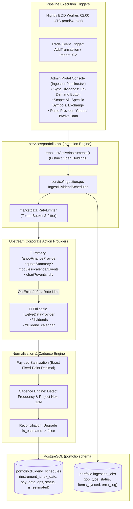

# User Story: Market Data Sourcing & Dividend Ingestion Pipeline

> **Story ID**: US-INGEST-103  
> **Epic**: Automated Market Ingestion, Corporate Actions & Data Pipelines  
> **Target Layers**: Market Data Pipeline (`services/portfolio-api/internal/marketdata/`), Ingestion Service (`services/portfolio-api/internal/service/`), Database (`portfolio.dividend_schedules`), Scheduled Workers (`cmd/market-ingest/`, `cmd/worker/`), Admin Operations (`bff/`, `web/apps/admin-app`)  
> **Status**: Completed  
> **Implementation Plan**: [dividend-market-data-ingestion-implementation-plan.md](file:///Users/oscargarcia/workspace/graphfolio/docs/plans/dividend-market-data-ingestion-implementation-plan.md)  
> **Calculation & Ingestion Standard**: [financial-calculations skill](file:///Users/oscargarcia/workspace/graphfolio/.agents/skills/financial-calculations/SKILL.md) (Exact Fixed-Point Decimal Arithmetic, Corporate Action Ex-Dividend Entitlement, Dividend Growth CAGR, Franking Imputation Credits, Token Bucket Rate Limiting, Automated Multi-Tier Provider Failover)  
> **Primary Source**: **Yahoo Finance Corporate Actions & QuoteSummary API**  
> **Fallback Source**: **Twelve Data Dividends & Calendar API**  
> **Related Stories & Documents**:  
> - [dividend-calendar-yield-analytics.md](file:///Users/oscargarcia/workspace/graphfolio/docs/user-stories/dividend-calendar-yield-analytics.md) (`US-DIV-101`)  
> - [market-data-ingestion-pipeline.md](file:///Users/oscargarcia/workspace/graphfolio/docs/user-stories/market-data-ingestion-pipeline.md) (`US-INGEST-101`)  
> - [benchmark-instrument-price-ingestion.md](file:///Users/oscargarcia/workspace/graphfolio/docs/user-stories/benchmark-instrument-price-ingestion.md) (`US-MKT-016`)  
> - [admin-portal-asset-and-price-management.md](file:///Users/oscargarcia/workspace/graphfolio/docs/user-stories/admin-portal-asset-and-price-management.md) (`US-ADM-101`)  
> - [USER_STORIES.md](file:///Users/oscargarcia/workspace/graphfolio/docs/USER_STORIES.md)  
> - [FEATURES.md (Feature #14 & #23)](file:///Users/oscargarcia/workspace/graphfolio/FEATURES.md)  

---

## 1. Story Statements

### 1.1 Automated Ingestion with Primary Yahoo Finance Feed
> **As an** automated market data pipeline and system operator,  
> **I want** the ingestion engine to automatically query **Yahoo Finance** as the primary corporate actions feed for upcoming dividend announcements, ex-dividend dates, payment dates, and declared dividends per share (DPS),  
> **So that** dividend schedules across global equities and ETFs are synchronized daily without exhausting third-party API rate quotas.

### 1.2 Automated Failover to Twelve Data Fallback
> **As an** automated ingestion pipeline processing international assets,  
> **I want** the market ingestion engine to automatically failover to **Twelve Data** whenever Yahoo Finance returns an HTTP error, malformed response, empty corporate event array, or rate limit,  
> **So that** corporate dividend synchronization maintains 99.9% data availability even during third-party provider outages or schema shifts.

### 1.3 Forward Dividend Cadence Recognition & Predictive Estimation
> **As an** income investor planning long-term cash flow,  
> **I want** the ingestion engine to detect recurring dividend frequencies (Quarterly, Semi-Annual, Monthly, Annual) and synthesize estimated future dividend payments (`is_estimated = true`) for upcoming quarters that have not yet been formally declared by corporate boards,  
> **So that** forward 12-month dividend run-rates and calendars do not show artificial cash flow cliffs 30 to 60 days in the future.

### 1.4 Automated Reconciliation upon Official Declaration
> **As an** investor tracking upcoming cash distributions,  
> **I want** the ingestion pipeline to automatically match official board declarations ingested from Yahoo Finance or Twelve Data against previously synthesized estimate placeholders,  
> **So that** estimated dates and amounts are seamlessly upgraded to verified announcements (`is_estimated = false`) without creating duplicate schedule records.

### 1.5 Multi-Year Historical Distribution Series for Growth & Streak Metrics
> **As an** equity analyst evaluating dividend safety,  
> **I want** the pipeline to ingest 5-year historical dividend payment records,  
> **So that** GraphFolio can automatically calculate 1-year, 3-year, and 5-year compound annual dividend growth rates (CAGR) and highlight consecutive dividend payment streaks.

### 1.6 Regional Franking Credits & Tax Imputation (ASX)
> **As an** Australian investor holding ASX-listed shares,  
> **I want** the dividend ingestion pipeline to capture corporate tax franking percentages (e.g. 100% Fully Franked, 50% Partially Franked, 0% Unfranked),  
> **So that** grossed-up dividend income and Australian Taxation Office (ATO) imputation offsets are accurately tracked.

### 1.7 Event-Driven Ingestion Trigger on New Asset Acquisition
> **As an** investor recording a transaction for a newly acquired stock,  
> **I want** GraphFolio to automatically enqueue an asynchronous dividend backfill task for that instrument upon trade entry,  
> **So that** my dividend calendar and yield analytics immediately reflect the newly added holding without waiting for the nightly batch run.

### 1.8 Admin On-Demand Manual Ingestion Trigger
> **As a** platform administrator managing market data feeds in the Admin Portal,  
> **I want to** click a dedicated **"Sync Dividends"** button in the Ingestion Pipeline console (or trigger targeted syncs for specific symbols or exchanges),  
> **So that** I can immediately force-refresh upcoming corporate dividend declarations, diagnose feed connectivity, and populate newly added assets without waiting for the scheduled nightly cron job.

---

## 2. Background & Problem Context

### 2.1 The Provider Strategy: Why Yahoo Finance Primary & Twelve Data Fallback?
In GraphFolio's existing market price pipeline (`services/portfolio-api/internal/marketdata/`), closing stock prices are ingested via Twelve Data as primary with Yahoo Finance as fallback. However, for **corporate dividends and forward payment calendars**, the economic and architectural trade-offs are inverted:

| Characteristic | 🥇 **Yahoo Finance (Primary)** | 🥈 **Twelve Data (Fallback)** |
|:---|:---|:---|
| **Rate Limit / Quota** | High throughput without strict monthly query caps | Strict free-tier quota (8 credits/min, 800/day) |
| **Forward Calendar** | Built into `quoteSummary` (`calendarEvents.dividends`) | Dedicated `/dividend_calendar` API consumes multiple credits |
| **Historical Series** | Complete 5Y+ split-adjusted series via `/v8/finance/chart?events=div` | Detailed `/dividends` endpoint, but rapid quota depletion on bulk scans |
| **Asset Coverage** | Extensive global equities, mutual funds, REITs, Australian ASX (`.AX`), UK LSE (`.L`) | Strong US coverage, variable international coverage |
| **Cost Profile** | Zero per-call API billing | Tiered credits; best reserved as reliable fallback |

**Strategic Architectural Decision**:  
Configuring **Yahoo Finance as Primary** and **Twelve Data as Fallback** ensures:
1. Daily batch sweeps across hundreds of distinct investor holdings consume **zero Twelve Data quota**.
2. Twelve Data API credits are strictly preserved for targeted backfills, ticker validation, and resilient failover when Yahoo Finance encounters transient network or HTML/JSON anomalies.

### 2.2 Corporate Action Ingestion Challenges
1. **Short Declaration Lead Times**: Many US companies (e.g., Apple, Microsoft, Johnson & Johnson) only declare official ex-dates and dividend amounts 3 to 6 weeks before payment. Without predictive cadence estimation, forward 12-month projection charts drop to zero after 60 days.
2. **Frequency Disparities**: US equities pay quarterly; Australian and UK equities pay semi-annually (Interim and Final dividends); European equities often pay once annually; fixed-income ETFs and REITs pay monthly.
3. **Data Quality & Provider Outages**: Upstream feeds occasionally miss foreign ex-dates or report cash values in local currency without explicit ISO currency codes. The pipeline must sanitize and validate all incoming records.

### 2.3 Operational Need for Administrator-Initiated Ingestion
In a live production environment, relying solely on automated nightly cron jobs creates operational blind spots:
1. **Immediate Verification of Fresh Announcements**: When an issuing corporation announces an interim or final dividend during market hours, investors expect the ex-date to reflect immediately in their dividend calendars. Administrators need an on-demand manual trigger to synchronize feeds on the fly.
2. **Post-Outage Recovery**: If Yahoo Finance experiences transient downtime during the 02:00 UTC nightly run, platform administrators need the ability to manually invoke a catch-up dividend sync once connectivity is restored.
3. **Targeted Symbol Diagnostics & Provider Diagnostics**: Operators diagnosing missing dividend data for a specific security need the ability to trigger a targeted sync for individual symbols (e.g. `BHP.AX`, `AAPL`), inspect the live response, and optionally force a specific provider (Yahoo Finance vs Twelve Data) to evaluate upstream data quality.

---

## 3. Data Sourcing Architecture & Pipeline Flow



---

## 4. Technical Specifications & Provider Contracts

### 4.1 Go Domain Models & Interfaces (`services/portfolio-api/internal/marketdata/`)

```go
package marketdata

import (
	"context"
	"time"

	"github.com/google/uuid"
	"github.com/shopspring/decimal"
)

// DividendScheduleEvent represents a parsed corporate dividend distribution.
type DividendScheduleEvent struct {
	InstrumentID      uuid.UUID
	Symbol            string
	ExchangeCode      string
	ExDate            time.Time
	RecordDate        *time.Time
	PaymentDate       time.Time
	AmountPerShare    decimal.Decimal
	CurrencyCode      string
	Frequency         string // MONTHLY, QUARTERLY, SEMI_ANNUAL, ANNUAL, IRREGULAR
	Status            string // ANNOUNCED, EX_DATE_PASSED, PAID
	IsEstimated       bool
	FrankingPct       decimal.Decimal // e.g. 100.00 for fully franked
	WithholdingTaxPct decimal.Decimal // e.g. 15.00 for treaty WHT
	Source            string          // yahoo, twelvedata, admin_override
}

// DividendHistoryPoint represents a past settled dividend distribution.
type DividendHistoryPoint struct {
	Date   time.Time
	Amount decimal.Decimal
}

// DividendProvider defines the contract for fetching dividend market data.
type DividendProvider interface {
	SourceID() string
	GetUpcomingDividends(ctx context.Context, symbol, exchangeCode string) ([]DividendScheduleEvent, error)
	GetHistoricalDividends(ctx context.Context, symbol, exchangeCode string, fromDate, toDate time.Time) ([]DividendHistoryPoint, error)
}
```

### 4.2 Primary Provider Adapter: Yahoo Finance
1. **Upcoming Dividend Extraction**:
   - **Endpoint**: `https://query1.finance.yahoo.com/v10/finance/quoteSummary/{symbol}?modules=calendarEvents,defaultKeyStatistics,summaryDetail`
   - **Headers**: Standard browser `User-Agent` and crumb session handling.
   - **Parsing Logic**:
     ```json
     {
       "calendarEvents": {
         "dividends": {
           "exDividendDate": { "raw": 1731369600, "fmt": "2024-11-12" },
           "dividendDate": { "raw": 1732752000, "fmt": "2024-11-28" },
           "dividendRate": { "raw": 0.96 }
         }
       },
       "defaultKeyStatistics": {
         "trailingAnnualDividendRate": { "raw": 0.92 }
       }
     }
     ```
   - If `dividendDate` is present and valid, parse into `DividendScheduleEvent` with `Status = "ANNOUNCED"` and `IsEstimated = false`.

2. **Historical Dividend Series & CAGR Extraction**:
   - **Endpoint**: `https://query1.finance.yahoo.com/v8/finance/chart/{symbol}?events=div&interval=1d&range=5y`
   - **Parsing Logic**:
     - Extracts the `chart.result[0].events.dividends` dictionary mapping timestamps to `{ "amount": 0.24, "date": 1699920000 }`.
     - Maps into `[]DividendHistoryPoint` sorted chronologically ascending.

### 4.3 Fallback Provider Adapter: Twelve Data
When Yahoo Finance returns `ErrProviderQuota`, `ErrPriceNotFound`, HTTP 429/5xx, or empty arrays:
1. **Fallback Invocation**:
   - **Endpoint**: `https://api.twelvedata.com/dividends?symbol={symbol}&apikey={key}`
   - **Parsing Logic**:
     ```json
     {
       "items": [
         {
           "ex_date": "2024-11-12",
           "payment_date": "2024-11-28",
           "record_date": "2024-11-13",
           "amount": 0.24
         }
       ]
     }
     ```
   - Emits structured `DividendScheduleEvent` with `Source = "twelvedata"`.
2. **Quota Throttling**:
   - Governed by Twelve Data's dedicated rate limiter (`marketdata.RateLimiter`) with 8 requests per minute maximum.

### 4.4 Resilient Cascading Provider (`ResilientDividendProvider`)
```go
type ResilientDividendProvider struct {
	primary  DividendProvider // YahooFinanceProvider
	fallback DividendProvider // TwelveDataProvider
	logger   *logger.Logger
}

func (r *ResilientDividendProvider) GetUpcomingDividends(ctx context.Context, symbol, exchange string) ([]DividendScheduleEvent, error) {
	events, err := r.primary.GetUpcomingDividends(ctx, symbol, exchange)
	if err == nil && len(events) > 0 {
		return events, nil
	}

	r.logger.Warn("Primary dividend feed failed, failing over to fallback",
		"primary", r.primary.SourceID(),
		"fallback", r.fallback.SourceID(),
		"symbol", symbol,
		"error", err,
	)

	return r.fallback.GetUpcomingDividends(ctx, symbol, exchange)
}
```

---

## 5. Cadence Recognition & Forward Projection Algorithm

Because companies declare dividends only 3–6 weeks prior to payment, the ingestion pipeline implements an automated forward cadence synthesizer:

```
Algorithm: Deterministic Dividend Cadence Synthesizer
Input: Instrument ID, List of Historical Verified Dividends (D_1, D_2, ..., D_N)
Output: 12-Month Forward Dividend Schedule with is_estimated flags

1. Calculate inter-dividend day intervals: delta_t = [date_i - date_{i-1}]
2. Determine modal interval:
   - If 25 <= median(delta_t) <= 35 days: Frequency = MONTHLY (Period = 30d, Multiplier = 12)
   - If 80 <= median(delta_t) <= 105 days: Frequency = QUARTERLY (Period = 91d, Multiplier = 4)
   - If 160 <= median(delta_t) <= 200 days: Frequency = SEMI_ANNUAL (Period = 182d, Multiplier = 2)
   - If 340 <= median(delta_t) <= 380 days: Frequency = ANNUAL (Period = 365d, Multiplier = 1)
   - Else: Frequency = IRREGULAR

3. Find latest verified dividend (D_latest).
4. Project forward until (T_latest + 365 days):
   T_candidate_ex = D_latest.ExDate + Period
   T_candidate_pay = D_latest.PaymentDate + Period
   DPS_candidate = D_latest.AmountPerShare (exclude special dividends)

5. Check if verified announcement already exists in DB for [T_candidate_ex - 15d, T_candidate_ex + 15d]:
   - If EXISTS: Skip (verified announcement takes precedence).
   - If NOT EXISTS: Insert into portfolio.dividend_schedules with:
     status = 'ANNOUNCED', is_estimated = true, frequency = Frequency.
```

---

## 6. Database Storage & Migration Specification

### 6.1 Schema Migration (`000007_create_dividend_schedules.up.sql`)
```sql
CREATE TYPE portfolio.dividend_frequency AS ENUM (
    'MONTHLY', 'QUARTERLY', 'SEMI_ANNUAL', 'ANNUAL', 'IRREGULAR'
);

CREATE TYPE portfolio.dividend_status AS ENUM (
    'ANNOUNCED', 'EX_DATE_PASSED', 'PAID', 'CANCELLED'
);

CREATE TABLE portfolio.dividend_schedules (
    id                  uuid                            PRIMARY KEY DEFAULT uuidv7(),
    instrument_id       uuid                            NOT NULL REFERENCES portfolio.instruments(id) ON DELETE CASCADE,
    ex_date             date                            NOT NULL,
    record_date         date,
    payment_date        date                            NOT NULL,
    amount_per_share    numeric(20,8)                   NOT NULL CHECK (amount_per_share > 0),
    currency_code       char(3)                         NOT NULL REFERENCES portfolio.currencies(code),
    frequency           portfolio.dividend_frequency    NOT NULL DEFAULT 'QUARTERLY',
    status              portfolio.dividend_status       NOT NULL DEFAULT 'ANNOUNCED',
    is_estimated        boolean                         NOT NULL DEFAULT false,
    is_override         boolean                         NOT NULL DEFAULT false,
    franking_percentage numeric(5,2)                   DEFAULT 0.00,
    withholding_tax_pct numeric(5,2)                   DEFAULT 0.00,
    source              varchar(32)                     NOT NULL DEFAULT 'yahoo',
    created_at          timestamptz                     NOT NULL DEFAULT now(),
    updated_at          timestamptz                     NOT NULL DEFAULT now(),
    UNIQUE (instrument_id, ex_date, payment_date)
);

CREATE INDEX idx_dividend_schedules_dates ON portfolio.dividend_schedules (ex_date, payment_date);
CREATE INDEX idx_dividend_schedules_instrument ON portfolio.dividend_schedules (instrument_id);
CREATE INDEX idx_dividend_schedules_status ON portfolio.dividend_schedules (status, is_estimated);
```

### 6.2 Admin Override Protection Trigger
To guarantee manual operator adjustments cannot be wiped out by automated workers:
```sql
CREATE OR REPLACE FUNCTION portfolio.prevent_dividend_override_overwrite()
RETURNS TRIGGER AS $$
BEGIN
    IF OLD.is_override = true AND NEW.is_override = false THEN
        RAISE EXCEPTION 'Cannot overwrite manual admin dividend override with automated feed data';
    END IF;
    RETURN NEW;
END;
$$ LANGUAGE plpgsql;

CREATE TRIGGER trg_protect_dividend_overrides
BEFORE UPDATE ON portfolio.dividend_schedules
FOR EACH ROW EXECUTE FUNCTION portfolio.prevent_dividend_override_overwrite();
```

### 6.3 Admin Portal Console, BFF GraphQL Mutation & Protobuf Contracts

To empower platform administrators with on-demand synchronization controls, targeted backfills, and feed diagnostics:

#### 1. Protobuf Contracts (`proto/portfolio/v1/portfolio.proto`)
```protobuf
message TriggerDividendSyncRequest {
  repeated string symbols         = 1; // Empty = all active portfolio holdings
  optional string exchange_code   = 2; // Optional filter by ISO exchange (e.g. 'ASX', 'NASDAQ')
  bool            sync_historical = 3; // Ingest 5Y historical series for CAGR and consistency streaks
  string          force_provider  = 4; // 'YAHOO', 'TWELVE_DATA', or empty for default cascade
}

message TriggerDividendSyncResponse {
  bool            success               = 1;
  int32           schedules_synced      = 2;
  int32           primary_source_count  = 3; // Synced via Yahoo Finance
  int32           fallback_source_count = 4; // Synced via Twelve Data fallback
  int32           placeholders_upgraded = 5; // Estimated schedules upgraded to official board declarations
  string          message               = 6;
  int64           duration_ms           = 7;
  repeated string failed_symbols        = 8;
}

service PortfolioService {
  ...
  rpc TriggerDividendSync(TriggerDividendSyncRequest) returns (TriggerDividendSyncResponse);
}
```

#### 2. BFF GraphQL Schema Layer (`bff/graph/schema.graphqls`)
```graphql
input TriggerDividendSyncInput {
  symbols: [String!]
  exchangeCode: String
  syncHistorical: Boolean
  forceProvider: String # 'YAHOO', 'TWELVE_DATA', or null for default cascade
}

type DividendSyncPayload {
  success: Boolean!
  schedulesSynced: Int!
  primarySourceCount: Int!
  fallbackSourceCount: Int!
  placeholdersUpgraded: Int!
  message: String!
  durationMs: Int!
  failedSymbols: [String!]!
}

extend type Mutation {
  triggerDividendSync(input: TriggerDividendSyncInput): DividendSyncPayload!
}
```

#### 3. Admin Portal UI Console (`web/apps/admin-app/src/components/IngestionPipeline.tsx`)
In the administrative Ingestion Pipeline view:
- **Dedicated "Sync Dividends" Action Card**: Positioned alongside existing Stock Prices and FX Rate cards.
- **Sync Options Modal / Scope Selector**:
  - `Scope`: `(•) All Active Holdings` `( ) Specific Tickers` `( ) Exchange`.
  - `Tickers Input`: Comma-separated or tag input (e.g., `AAPL, BHP.AX, MSFT, VAS.AX`).
  - `Historical 5Y Series`: Toggle checkbox (default: off for faster forward schedule checks).
  - `Provider Mode`: Dropdown with `Default (Yahoo Finance ➔ Twelve Data)`, `Force Yahoo Finance`, `Force Twelve Data`.
- **Real-Time Spinner & Notification Toast**:
  - Displays progress banner during ingestion execution.
  - Toast notification summarizes execution results:  
    `"✅ Dividend synchronization completed in 1.2s: 64 schedules synced (58 via Yahoo Finance, 6 via Twelve Data fallback, 8 estimates upgraded)."`
- **RBAC Security Guard**:
  - BFF resolver enforces JWT role validation (`claims.Role == "ADMIN"`). Non-administrators attempting execution receive `403 Forbidden` (`codes.PermissionDenied`).
- **Audit Log Trail**:
  - Every manual trigger logs an entry to `portfolio.ingestion_jobs` recording `job_type = 'MANUAL_DIVIDEND_SYNC'`, operator `user_id`, input parameters, success status, and error snippets.

---

## 7. Acceptance Criteria (Given - When - Then)

### AC 1: Yahoo Finance as Primary Ingestion Source
- **Given** an automated nightly synchronization or on-demand market ingestion job executes,
- **When** corporate dividend schedules are ingested for active portfolio instruments,
- **Then** the engine initiates HTTP requests to **Yahoo Finance (`quoteSummary`)** first,
- **And** Twelve Data is **not** called as long as Yahoo Finance returns valid dividend data,
- **And** the ingested records in `portfolio.dividend_schedules` have `source = 'yahoo'`.

### AC 2: Automated Failover to Twelve Data on Primary Failure
- **Given** Yahoo Finance returns an HTTP error (429, 500, 502, 503), network timeout, or empty dividend array for a symbol,
- **When** the cascading provider catches the failure,
- **Then** it automatically triggers a fallback request to **Twelve Data (`/dividends`)**,
- **And** the record is successfully parsed and saved with `source = 'twelvedata'`,
- **And** a warning is logged detailing the primary feed failure and fallback activation.

### AC 3: Schedule Parsing & Attribute Integrity
- **Given** an upstream response containing dividend events,
- **When** the payload is mapped into domain entities,
- **Then** all financial attributes must be stored as exact fixed-point decimals (`shopspring/decimal`),
- **And** `amount_per_share` must be $> 0$ with currency matching the instrument's traded currency,
- **And** `payment_date >= ex_date` constraint is strictly validated.

### AC 4: Predictive Cadence Estimation for Unannounced Quarters
- **Given** an active holding with regular quarterly dividends whose next cycle has not yet been declared by the company board,
- **When** the cadence engine processes the instrument,
- **Then** a synthesized schedule is generated for the upcoming quarter using the latest verified regular DPS,
- **And** the record is stored with `is_estimated = true` and `status = 'ANNOUNCED'`.

### AC 5: Automated Reconciliation of Estimated Records
- **Given** an estimated dividend schedule exists with `is_estimated = true`,
- **When** a subsequent ingestion job retrieves the official board declaration from Yahoo Finance,
- **Then** the existing estimated record is updated in-place with the verified ex-date, payment date, and DPS,
- **And** `is_estimated` is flipped to `false`.

### AC 6: Australian Equities Franking Credit Extraction (ASX)
- **Given** an ASX-listed equity (e.g. `BHP.AX`, `CBA.AX`),
- **When** dividend data is ingested,
- **Then** the engine extracts or computes the franking percentage (e.g. 100%),
- **And** populates `franking_percentage` in `portfolio.dividend_schedules` to support domestic tax-offset reporting.

### AC 7: Event-Driven Backfill on New Trade Entry
- **Given** a user records a `BUY` transaction for a newly acquired instrument that has no records in `portfolio.dividend_schedules`,
- **When** the transaction is committed,
- **Then** an asynchronous background task is enqueued to backfill historical and upcoming dividend schedules for that specific ticker immediately.

### AC 8: Worker Execution & Rate-Limiting Resilience
- **Given** the nightly ingestion worker processes 200 distinct instruments,
- **When** upstream rate limits are encountered,
- **Then** the `RateLimiter` enforces token-bucket pacing with exponential jittered backoff,
- **And** an error on a single instrument does not terminate the batch job,
- **And** the job logs total succeeded, failed, and fell-back counts to `portfolio.ingestion_jobs`.

### AC 9: Admin Override Guard
- **Given** an administrator has manually added or edited a dividend schedule with `is_override = true`,
- **When** the automated nightly ingestion sweeps that instrument,
- **Then** the database trigger rejects any attempt to overwrite the manual entry with automated feed values.

### AC 10: Admin Manual Trigger for Dividend Sync (`triggerDividendSync`)
- **Given** an authenticated platform administrator in the Admin Portal (`web/apps/admin-app`),
- **When** the administrator clicks the **"Sync Dividends"** button in the Ingestion Pipeline console,
- **Then** the UI dispatches the `triggerDividendSync` GraphQL mutation to the BFF,
- **And** the backend invokes `IngestDividendSchedules` across all active portfolio instruments,
- **And** the UI displays an informative toast notification displaying total schedules synced, provider breakdown (Yahoo vs Twelve Data), and estimates upgraded.

### AC 11: Admin Targeted Symbol & Exchange Range Backfill
- **Given** an administrator specifying targeted symbols (e.g. `['BHP.AX', 'RIO.AX']`) or an exchange code (e.g. `'ASX'`),
- **When** triggering manual dividend synchronization,
- **Then** the ingestion engine limits outbound provider requests strictly to the specified securities or exchange filter,
- **And** returns a list of any symbols that failed upstream resolution in `failedSymbols`.

### AC 12: Admin Role Authorization (RBAC 403 Forbidden Guard)
- **Given** an unauthenticated client or a standard investor account with `role = 'USER'`,
- **When** attempting to execute the `triggerDividendSync` mutation via GraphQL,
- **Then** the BFF resolver intercepts the request and verifies JWT claims,
- **And** rejects the request immediately with `codes.PermissionDenied` (403 Forbidden),
- **And** zero upstream market provider requests or database modifications are performed.

### AC 13: Execution Telemetry & Job Audit Logging
- **Given** a manual dividend sync triggered by an admin,
- **When** the job completes (or partially fails),
- **Then** an immutable audit record is saved in `portfolio.ingestion_jobs` capturing:
  - `job_type = 'MANUAL_DIVIDEND_SYNC'`,
  - Admin `user_id`, execution duration (`duration_ms`), items synced, and error trace if any symbols failed.

---

## 8. Non-Functional Requirements

### 8.1 Performance & Batch Throughput
- Daily dividend synchronization across 100 active instruments must complete in **$< 45\text{ seconds}$** under standard network latency.
- Outbound HTTP requests must execute concurrently with a maximum worker pool size of 5 goroutines to avoid triggering IP-level firewalls.

### 8.2 Quota Conservation
- Zero Twelve Data API credits should be consumed during nominal daily runs when Yahoo Finance is operational.

### 8.3 Exact Precision & Zero Floating-Point Arithmetic
- All dividend amounts, share allocations, and foreign exchange conversions must use `github.com/shopspring/decimal` in Go.
- Floating-point representations (`float32`, `float64`) are strictly prohibited.

---

## 9. Verification & Test Scenarios

### 9.1 Unit Tests (`services/portfolio-api/internal/marketdata/dividend_provider_test.go`)
- **Yahoo Finance Parser Test**: Feed mock `quoteSummary` JSON; verify correct extraction of ex-date, pay-date, and DPS.
- **Twelve Data Parser Test**: Feed mock `/dividends` JSON; verify correct mapping of fields and currency.
- **Cascading Failover Test**: Mock primary returning HTTP 500; verify fallback is called and record is returned with `Source = "twelvedata"`.
- **Primary Success Test**: Mock primary returning 200 OK; verify fallback mock is never invoked.

### 9.2 Cadence Engine Unit Tests (`services/portfolio-api/internal/marketdata/cadence_test.go`)
- **Quarterly Cadence**: Feed 4 quarterly dates; verify projected 5th date is $\approx 91$ days later with `is_estimated = true`.
- **Irregular Dividend Rejection**: Feed erratic biotech stock dividends; verify cadence engine returns `frequency = 'IRREGULAR'` without projecting speculative dates.

### 9.3 Ingestion Integration Tests (`services/portfolio-api/internal/service/ingestion_test.go`)
- End-to-end integration test with embedded PostgreSQL verifying upsert deduplication and `is_override` update protection.

### 9.4 Admin gRPC & BFF Authorization Tests
- **Admin Role Verification**: Call `triggerDividendSync` mutation with `claims.Role = "ADMIN"`; verify 200 OK and valid payload.
- **User Role Rejection**: Call `triggerDividendSync` mutation with `claims.Role = "USER"`; verify 403 Forbidden with zero provider requests executed.
- **Targeted Symbol Ingestion**: Call `TriggerDividendSync(symbols: ["AAPL", "MSFT"])`; verify provider is invoked only for the two specified symbols.

---

## 10. Definition of Done (DoD) Checklist

- [ ] Database migration `000007_create_dividend_schedules.up.sql` created and applied.
- [ ] Database override protection trigger implemented.
- [ ] `DividendProvider` interface defined in `services/portfolio-api/internal/marketdata/`.
- [ ] `YahooFinanceProvider` implemented as primary corporate action feed.
- [ ] `TwelveDataProvider` implemented as resilient secondary fallback feed.
- [ ] `ResilientDividendProvider` cascading failover wrapper implemented and unit-tested.
- [ ] Predictive cadence estimation engine implemented in `services/portfolio-api/internal/marketdata/cadence.go`.
- [ ] Ingestion service method `IngestDividendSchedules` integrated into `services/portfolio-api/internal/service/ingestion.go`.
- [ ] gRPC RPC `TriggerDividendSync` implemented in `PortfolioServiceServer` (`services/portfolio-api/internal/server.go`).
- [ ] BFF GraphQL mutation `triggerDividendSync` implemented with `ADMIN` role guard (`bff/graph/schema.resolvers.go`).
- [ ] Admin Portal UI console (`web/apps/admin-app/src/components/IngestionPipeline.tsx`) updated with "Sync Dividends" action button and modal.
- [ ] CLI command runnable via `make ingest-dividends` or integrated into `make ingest-market-data`.
- [ ] Event-driven trade entry hook enqueues asynchronous backfill for newly introduced instruments.
- [ ] Audit logging to `portfolio.ingestion_jobs` verified.
- [ ] Unit and integration tests passing with $> 90\%$ test coverage.
- [ ] User story cataloged in `docs/USER_STORIES.md`.
