# User Story: Download Transactions from Transaction Ledger (Ascending Order)

> **Story ID**: US-TX-103  
> **Epic**: Transaction Ledger Management & Investor Data Portability  
> **Target Layers**: Primary Investor Application (`web/apps/main-app`), BFF GraphQL Orchestrator (`bff/`), Portfolio Microservice (`services/portfolio-api`), Protobuf (`proto/portfolio/v1/`), Database (`portfolio.transactions`)  
> **Status**: Completed  
> **Implementation Plan**: [download-transactions-ledger-implementation-plan.md](file:///Users/oscargarcia/workspace/graphfolio/docs/plans/download-transactions-ledger-implementation-plan.md)  
> **Calculation & Accounting Standard**: [financial-calculations skill](file:///Users/oscargarcia/workspace/graphfolio/.agents/skills/financial-calculations/SKILL.md) (Trade-Date Accounting, FIFO Tax Lot Relief, Chronological Cash Flow Sequences)  
> **Related Stories & Documents**: [edit-transaction-ledger.md](file:///Users/oscargarcia/workspace/graphfolio/docs/user-stories/edit-transaction-ledger.md), [portfolio-cash-flow-report-generation.md](file:///Users/oscargarcia/workspace/graphfolio/docs/user-stories/portfolio-cash-flow-report-generation.md), [FEATURES.md](file:///Users/oscargarcia/workspace/graphfolio/FEATURES.md)  

---

## 1. Story Statements

### 1.1 Complete Historical Transaction Ledger Export
> **As an** active investor maintaining my portfolio records and tax accounts in GraphFolio,  
> **I want to** click an "Export CSV" / "Download" button directly on the Transaction Ledger page,  
> **So that** I can instantly download an authoritative, machine-readable CSV archive containing all my trades, dividends, deposits, withdrawals, and corporate actions.

### 1.2 Strict Chronological Ascending Ordering (Oldest First)
> **As an** investor feeding my historical transactions into external tax accounting software (e.g., Sharesight, myTax, BGL Simple Fund, Excel, or CoinTracker),  
> **I want** the downloaded transaction dataset to be strictly sorted by trade date in ascending order (`trade_date ASC`, oldest first),  
> **So that** financial events are processed in forward chronological sequence—ensuring opening cash deposits precede purchases, share acquisitions precede disposals, and running cost-basis and balance calculations execute without negative inventory errors.

### 1.3 Filter-Aware & Complete Ledger Portability
> **As an** investor who frequently filters my ledger by transaction type (e.g. only `DIVIDEND`) or ticker symbol (e.g. `AAPL`),  
> **I want** the download functionality to intelligently respect my active filters while exporting the entire matching dataset across all pages,  
> **So that** I am not restricted to downloading only the currently visible 20 records per page.

---

## 2. Background & Problem Context

### 2.1 The Need for Chronological Data Portability
In modern portfolio management, investors require seamless data portability to satisfy tax reporting, independent financial auditing, and custom analytical modeling in external tools (Microsoft Excel, Google Sheets, Python Pandas):
1. **Tax Season & Capital Gains Reconciliation**: Tax authorities (e.g., ATO, IRS, HMRC) and accounting platforms calculate capital gains via FIFO or Average Cost matching. These engines evaluate trade lots chronologically from inception.
2. **Offline Data Custody**: Investors demand full ownership of their financial transaction ledger, free from vendor lock-in.
3. **Audit Trail Verification**: Reviewing corporate actions (stock splits), dividend withholding taxes, and foreign exchange execution rates across multi-currency portfolios.

### 2.2 The Problem with UI Order vs. Export Order
In the GraphFolio user interface, the Transaction Ledger (`web/apps/main-app/src/components/TransactionLedger.tsx`) intentionally sorts transactions in **descending order** (`trade_date DESC, created_at DESC`):
- **UI Requirement (Newest First)**: When opening the ledger, investors want to inspect their most recent trades, newest dividends, or yesterday's deposits at the top of the table.
- **Export Requirement (Oldest First)**: In an exported file, reverse-chronological ordering breaks accounting tools. For example, if a `SELL` transaction from October 2026 appears on row 2, and the initial `BUY` from January 2024 appears on row 150, external parsers encounter an illegal disposal of non-existent shares:

```
[Row 2]: SELL 100 AAPL @ $230   <-- FAILS: Holding quantity is 0! (Negative inventory)
...
[Row 150]: BUY 100 AAPL @ $180   <-- Processed too late
```

Therefore, the download feature must sort rows **chronologically ascending** (`trade_date ASC, created_at ASC, id ASC`), starting with the portfolio's inception event and proceeding forward to the most recent transaction.

### 2.3 The Current Limitation: No Transaction Export
Currently:
- The ledger provides an `📥 Import CSV` button for CommSec and nabtrade broker statements, but has **no export mechanism**.
- The Cash Flow Report (`CashFlowReport.tsx`) provides an export for cash movements, but does not provide the complete equity transaction ledger (missing execution share prices, exact share quantities, split ratios, external broker references, and trade fees).
- The ledger pagination (`pageSize = 20`) means copy-pasting from the DOM only captures 20 rows at a time and omits raw database identifiers and metadata.

```mermaid
flowchart TD
    subgraph CurrentState ["Current State (No Export / UI Descending Only)"]
        A1["Investor views Transaction Ledger"] --> A2["Table displays 20 rows (Newest First)"]
        A2 --> A3["Investor wants complete CSV for tax filing"]
        A3 --> A4["No Export button exists - Stuck or manual copy-paste"]
    end

    subgraph ProposedExportFlow ["Target Download Flow (Ascending Chronological Export)"]
        B1["Investor views Transaction Ledger"] --> B2["Applies optional filters (or selects All)"]
        B2 --> B3["Clicks 'Export CSV' button in header toolbar"]
        B3 --> B4["BFF/Service queries all matching records ORDER BY trade_date ASC"]
        B4 --> B5["Client formats RFC 4180 CSV with UTF-8 BOM & Injection Guard"]
        B5 --> B6["Browser downloads 'graphfolio-transactions-YYYY-MM-DD.csv'"]
        B6 --> B7["External accounting software ingests rows seamlessly from inception"]
    end
```



---

## 3. Scope & Feature Taxonomy

### 3.1 Supported Transaction Types in Export
All transaction types supported by GraphFolio must be exported with their respective financial dimensions:

| Transaction Type | Symbol / Asset | Quantity | Price | Gross Amount | Fee | Withholding Tax | Description & Notes |
| :--- | :--- | :--- | :--- | :--- | :--- | :--- | :--- |
| **`BUY`** | Ticker (e.g. `AAPL`) | Shares bought ($> 0$) | Execution price | Outflow ($-\$) | Brokerage fee | — | Trade notes & broker ref |
| **`SELL`** | Ticker (e.g. `AAPL`) | Shares sold ($> 0$) | Execution price | Inflow ($+\$) | Brokerage fee | — | Trade notes & broker ref |
| **`DIVIDEND`** | Ticker (e.g. `BHP.AX`) | — (or DPS) | — | Net dividend | — | Withheld tax | Dividend payout memo |
| **`SPLIT`** | Ticker (e.g. `NVDA`) | Split ratio (e.g. `10`) | — | `0.00` | — | — | Split memo (e.g. 10-for-1) |
| **`DEPOSIT`** | `Cash` | — | — | Inflow ($+\$) | — | — | External bank deposit memo |
| **`WITHDRAWAL`** | `Cash` | — | — | Outflow ($-\$) | — | — | External bank withdrawal memo |
| **`INTEREST`** | `Cash` | — | — | Inflow ($+\$) | — | Withheld tax | Uninvested cash yield |
| **`FEE`** | `Cash` or Ticker | — | — | Outflow ($-\$) | Fee amount | — | Account / custody / management fee |
| **`TAX`** | `Cash` or Ticker | — | — | Outflow ($-\$) | — | Tax amount | Direct tax debit |
| **`TRANSFER_IN`** | Ticker | Transferred qty | Ingestion cost | `0.00` (or cost) | — | — | Custody transfer in |
| **`TRANSFER_OUT`** | Ticker | Transferred qty | Disposal price | `0.00` (or value) | — | — | Custody transfer out |
| **`FX_CONVERSION`** | Currency pair | Units swapped | FX Rate | Swapped value | FX spread/fee | — | Multi-currency cash rebalance |

---

## 4. Sorting & Deterministic Ordering Rules

To ensure mathematical reproducibility and zero ambiguity when multiple transactions occur on the same day:

### 4.1 Multi-Level Ascending Sort Order
1. **Primary Sort: `trade_date ASC`**  
   Oldest execution date appears first (e.g. `2021-03-15` before `2024-06-20`).
2. **Secondary Sort: Transaction Type Lifecycle Priority**  
   If multiple transactions share the exact same `trade_date`:
   - `DEPOSIT` (cash injection to fund subsequent trades)
   - `TRANSFER_IN`
   - `BUY` (stock acquisition)
   - `SPLIT` (corporate action modifying existing inventory)
   - `DIVIDEND` / `INTEREST` (income generated on existing holdings)
   - `SELL` (disposal of existing shares)
   - `TRANSFER_OUT`
   - `FEE` / `TAX`
   - `WITHDRAWAL` (cash removal after sale proceeds settle)
3. **Tertiary Sort: `created_at ASC`**  
   Ingestion timestamp order in PostgreSQL.
4. **Quaternary Tie-Breaker: `id ASC`**  
   Deterministic UUID sorting ensuring stable row sequences across repeated exports.

---

## 5. CSV Schema & Data Specification

### 5.1 Column Definitions

The generated CSV must follow this standardized schema:

| Column Header | Data Type | Nullable | Example | Description |
| :--- | :--- | :--- | :--- | :--- |
| `Date` | ISO Date (`YYYY-MM-DD`) | No | `2024-03-15` | Trade execution or settlement date |
| `Type` | Enum String | No | `BUY` | Normalized transaction type |
| `Symbol` | String | Yes | `AAPL` | Ticker symbol (empty or omitted for pure cash events) |
| `Instrument Name` | String | Yes | `Apple Inc.` | Official corporate name of the security |
| `Quantity` | Fixed-Point Decimal | Yes | `15.000000` | Share quantity (split ratio for `SPLIT`) |
| `Price` | Fixed-Point Decimal | Yes | `172.50` | Unit price in local transaction currency |
| `Currency` | ISO 4217 Code | No | `USD` | Asset execution or transaction currency |
| `Gross Amount` | Fixed-Point Decimal | No | `2587.50` | Unadjusted trade total ($\text{Qty} \times \text{Price}$ or cash flow) |
| `Net Amount` | Fixed-Point Decimal | No | `2597.45` | Net cash impact including fees ($+\text{inflow}$, $-\text{outflow}$) |
| `Fee` | Fixed-Point Decimal | Yes | `9.95` | Brokerage or transaction fee |
| `Fee Currency` | ISO 4217 Code | Yes | `USD` | Currency in which fee was levied |
| `Withholding Tax` | Fixed-Point Decimal | Yes | `0.00` | Foreign dividend withholding tax |
| `FX Rate to Base` | Fixed-Point Decimal | Yes | `1.523400` | Exchange rate to portfolio base currency at trade date |
| `External Reference` | String | Yes | `COMMSEC-892104` | Broker trade confirmation or external import ID |
| `Notes` | String | Yes | `Rebalancing tech allocation` | Investor memo or trade rationale |

### 5.2 Example CSV Output

```csv
Date,Type,Symbol,Instrument Name,Quantity,Price,Currency,Gross Amount,Net Amount,Fee,Fee Currency,Withholding Tax,FX Rate to Base,External Reference,Notes
2023-01-10,DEPOSIT,,Cash,,,AUD,10000.00,10000.00,0.00,AUD,0.00,1.000000,REF-DEP-001,"Initial portfolio capital deposit"
2023-01-15,BUY,BHP.AX,BHP Group Limited,100.000000,45.20,AUD,4520.00,-4539.95,19.95,AUD,0.00,1.000000,COMMSEC-1001,"Long-term resource allocation"
2023-03-20,DIVIDEND,BHP.AX,BHP Group Limited,,,AUD,180.00,180.00,0.00,AUD,0.00,1.000000,COMMSEC-DIV-01,"Interim fully franked dividend"
2023-06-05,BUY,AAPL,Apple Inc.,20.000000,175.00,USD,3500.00,-3509.95,9.95,USD,0.00,1.485000,NAB-8821,"Tech core holding"
2023-08-15,SPLIT,AAPL,Apple Inc.,4.000000,,USD,0.00,0.00,0.00,USD,0.00,1.512000,,"4-for-1 stock split"
2024-02-10,SELL,BHP.AX,BHP Group Limited,50.000000,49.80,AUD,2490.00,2470.05,19.95,AUD,0.00,1.000000,COMMSEC-2002,"Taking partial profits"
```

---

## 6. Acceptance Criteria (Given - When - Then)

### AC 1: Export Button Placement & UI Visibility
- **Given** an authenticated investor is viewing the Transaction Ledger (`/transactions` or ledger section),
- **When** the page renders,
- **Then** a prominent action button labeled **"Export CSV"** (with an export icon `📤`) is displayed in the ledger header toolbar next to the existing **"Import CSV"** button,
- **And** hovering over the button shows a tooltip: *"Download complete transaction history sorted chronologically (oldest first)"*.

### AC 2: Strict Ascending Chronological Sorting (Oldest First)
- **Given** the user triggers the CSV download,
- **When** the file is generated and inspected,
- **Then** Row 1 (after headers) contains the earliest recorded transaction (`trade_date` closest to inception),
- **And** every subsequent row has a `trade_date` greater than or equal to the preceding row ($\text{Date}_{n} \ge \text{Date}_{n-1}$),
- **And** transactions on the same date are ordered deterministically by lifecycle type, creation timestamp, and ID.

### AC 3: Exporting Complete Dataset Beyond Pagination Limit
- **Given** the user's portfolio contains 350 transactions spanning across 18 paginated pages (page size 20),
- **When** the user clicks "Export CSV",
- **Then** the downloaded file contains all 350 transactions plus the header row (351 rows total),
- **And** no transactions are truncated or omitted due to UI pagination state.

### AC 4: Respecting Active Filters vs Full Ledger Download
- **Scenario A: No filters active**
  - **Given** no type filter or search query is applied,
  - **When** the user clicks "Export CSV",
  - **Then** all transactions for the current portfolio are included in the download.
- **Scenario B: Type filter active (e.g., "Dividend")**
  - **Given** the user has clicked the "Dividend" filter pill,
  - **When** the user clicks "Export CSV",
  - **Then** only dividend transactions are included in the downloaded CSV, still ordered ascending by date.
- **Scenario C: Search query active (e.g., "BHP")**
  - **Given** the user has typed "BHP" into the symbol search box,
  - **When** the user clicks "Export CSV",
  - **Then** only transactions matching "BHP" / "BHP.AX" are included in the export.

### AC 5: Security & CSV Formula Injection Prevention (CWE-1236)
- **Given** a user or imported statement includes notes, symbols, or external refs starting with dangerous spreadsheet formula characters (`=`, `+`, `-`, `@`, `\t`, `\r`),
- **When** the CSV export is generated,
- **Then** the system automatically prepends a single quotation mark (`'`) to neutralise formula execution in Microsoft Excel, LibreOffice, and Google Sheets,
- **And** all strings containing commas, double quotes, or newlines are wrapped in standard RFC 4180 double quotes, with internal quotes escaped as `""`.

### AC 6: Unicode & Special Character Encoding (UTF-8 BOM)
- **Given** transactions contain international symbols (e.g., `¥`, `€`, `£`), company names with accents (e.g., `L'Oréal`), or notes in non-ASCII scripts,
- **When** the CSV file is generated,
- **Then** it is encoded in UTF-8 with a Byte Order Mark (`\uFEFF`) at the beginning,
- **So that** Microsoft Excel on both Windows and macOS opens the file cleanly without corrupted characters.

### AC 7: Dynamic Filename Conventions
- **Given** the user downloads the transaction ledger,
- **When** the file is saved to their local filesystem,
- **Then** the filename matches one of the following dynamic patterns:
  - Unfiltered: `graphfolio-transactions-YYYY-MM-DD.csv` (where `YYYY-MM-DD` is the local download date)
  - Symbol filtered: `graphfolio-transactions-AAPL-YYYY-MM-DD.csv`
  - Type filtered: `graphfolio-transactions-dividends-YYYY-MM-DD.csv`

### AC 8: Loading States & User Feedback
- **Given** an export is initiated for a large ledger,
- **When** the network query or CSV generation is in flight,
- **Then** the "Export CSV" button enters a disabled loading state displaying *"Exporting..."* and an animated spinner,
- **And** upon completion, the button returns to its normal state and an accessible toast appears: *"Transactions exported successfully (X records)"*,
- **And** if an error occurs, an error toast notifies the user: *"Failed to export transactions. Please try again."*.

---

## 7. UI / UX Design Specifications

### 7.1 Header Toolbar Integration (`TransactionLedger.tsx`)

The "Export CSV" button is integrated into `.ledger-header` alongside `.btn-import-csv`:

```tsx
<div className="ledger-actions-group">
  <button
    type="button"
    className="btn-export-csv"
    onClick={handleExportCSV}
    disabled={isExporting || totalCount === 0}
    title="Download transactions sorted chronologically (oldest first)"
  >
    {isExporting ? (
      <>
        <span className="spinner-sm" /> Exporting...
      </>
    ) : (
      <>
        <span className="btn-icon">📤</span> Export CSV
      </>
    )}
  </button>
  
  {onOpenImportModal && (
    <button
      type="button"
      className="btn-import-csv"
      onClick={onOpenImportModal}
      title="Import trades from CommSec or nabtrade CSV"
    >
      📥 Import CSV
    </button>
  )}
</div>
```

### 7.2 Styling Tokens (`TransactionLedger.css`)
- **Theme**: Dark glassmorphic background (`rgba(255, 255, 255, 0.05)` with `backdrop-filter: blur(12px)`).
- **Border**: Subtle gradient stroke (`rgba(255, 255, 255, 0.12)`).
- **Hover / Active State**: Highlight glow with slight vertical translation (`transform: translateY(-1px)`).
- **Disabled State**: Opacity `0.4`, cursor `not-allowed`.

---

## 8. Architectural Specifications & Layer Breakdown

### 8.1 Protobuf Contract Updates (`proto/portfolio/v1/portfolio.proto`)

Extend the `ListTransactionsRequest` to support configurable sort direction:

```protobuf
enum SortDirection {
  SORT_DIRECTION_DESC = 0; // Default: newest first for UI display
  SORT_DIRECTION_ASC  = 1; // Chronological: oldest first for export/audit
}

message ListTransactionsRequest {
  string          user_id        = 1;
  TransactionType type           = 2; // optional filter (0 = all)
  string          symbol         = 3; // optional symbol filter
  int32           page           = 4; // 1-indexed, default 1
  int32           page_size      = 5; // default 20, max 100 (or 0 for all when exporting)
  SortDirection   sort_direction = 6; // optional sort direction
}
```

*Alternative / Supplementary RPC for large exports*:
```protobuf
message ExportTransactionsRequest {
  string          user_id = 1;
  TransactionType type    = 2;
  string          symbol  = 3;
}

message ExportTransactionsResponse {
  repeated TransactionItem transactions = 1;
  int32                    total_count  = 2;
}
```

### 8.2 Backend-for-Frontend (BFF) GraphQL Layer (`bff/`)

1. **GraphQL Schema (`bff/graph/schema.graphqls`)**:
   ```graphql
   enum SortDirection {
     ASC
     DESC
   }

   extend type Query {
     transactions(
       type: TransactionType
       symbol: String
       page: Int = 1
       pageSize: Int = 20
       sortDirection: SortDirection = DESC
     ): TransactionsConnection!

     exportTransactions(
       type: TransactionType
       symbol: String
     ): [TransactionItem!]!
   }
   ```

2. **Resolvers (`bff/graph/schema.resolvers.go`)**:
   - Translate GraphQL `sortDirection` to gRPC enum.
   - For `exportTransactions`, execute an unpaginated query returning the full slice of domain transactions sorted ascending.

### 8.3 Portfolio Domain Microservice (`services/portfolio-api`)

1. **Repository Layer (`internal/repository/postgres.go` & `queries.go`)**:
   - Update SQL query generation to accept sort direction:
     ```sql
     -- When sort_direction = 'ASC':
     ORDER BY t.trade_date ASC, t.created_at ASC, t.id ASC
     -- When sort_direction = 'DESC':
     ORDER BY t.trade_date DESC, t.created_at DESC, t.id DESC
     ```
   - Provide an unpaginated query or large batch retrieval for export mode (`GetAllTransactionsForExport`).

2. **Service Layer (`internal/service/transaction.go`)**:
   - Validate sort parameters.
   - Ensure consistent decimal formatting and currency normalization.

### 8.4 Web Application Layer (`web/apps/main-app`)

1. **CSV Builder (`web/apps/main-app/src/services/csv/export.ts`)**:
   - Dedicated utility `generateTransactionsCSV(transactions: TransactionItem[]): string`.
   - Handles RFC 4180 escaping, UTF-8 BOM, and formula sanitization.
2. **Download Trigger (`web/apps/main-app/src/components/TransactionLedger.tsx`)**:
   - Queries `exportTransactions` (or paginates full list if unpaginated query is cached).
   - Generates Blob: `new Blob([csvContent], { type: 'text/csv;charset=utf-8;' })`.
   - Programmatically triggers `<a download="..."/>` and revokes object URL to prevent memory leaks.

---

## 9. Security & Edge Cases

1. **Large Ledger Memory Footprint**: For portfolios with thousands of transactions, memory usage during string concatenation must be handled efficiently using array joins or streaming chunks.
2. **Formula Injection Sanitization**: Prevent `=CMD('...')` or `=HYPERLINK(...)` attacks if user inputs arbitrary notes or symbols.
3. **Zero Transactions**: If a user with a brand new portfolio clicks "Export", the button should be disabled, or download a valid CSV containing only the header row.
4. **Timezone Offset Immunity**: `trade_date` must remain formatted strictly as the literal string date `YYYY-MM-DD` stored in PostgreSQL, without timezone shifting to previous/next day.
5. **Multi-Currency Clarity**: If an asset is bought in USD on an AUD portfolio, both local asset execution price/amount and the conversion rate (`fx_rate_to_base`) are recorded so investors can trace the foreign exchange basis.

---

## 10. Verification & Quality Gates

| Verification Gate | Command / Target | Description |
| :--- | :--- | :--- |
| **Protobuf Linting & CodeGen** | `make proto` | Re-generate Go protobuf and BFF gRPC stubs |
| **Backend Unit Tests** | `go test ./...` in `services/portfolio-api` | Verify repository and service ascending query ordering |
| **BFF Resolver Tests** | `go test ./...` in `bff/` | Verify `exportTransactions` and `sortDirection` resolvers |
| **Frontend Unit Tests** | `npm test` in `web/apps/main-app` | Unit test CSV generator, RFC escaping, and formula injection guard |
| **Lint & Format** | `npm run lint` & `golangci-lint run` | Enforce zero linting warnings across all modified packages |
| **E2E Browser Validation** | Playwright / Browser Subagent | Click "Export CSV" on demo portfolio and verify downloaded file contents and ascending order |
