# User Story: Edit Transaction in Transaction Ledger

> **Story ID**: US-TX-102  
> **Epic**: Transaction Ledger Management & Portfolio Accounting Integrity  
> **Target Layers**: Primary Investor Application (`web/apps/main-app`), BFF GraphQL Orchestrator (`bff/`), Portfolio Domain Microservice (`services/portfolio-api`), Protobuf (`proto/portfolio/v1/`), Database (`portfolio.transactions`, `portfolio.tax_lots`, `portfolio.projections_holdings`, `portfolio.portfolio_valuations`)  
> **Status**: Ready for Implementation  
> **Implementation Plan**: [edit-transaction-implementation-plan.md](file:///Users/oscargarcia/workspace/graphfolio/docs/plans/edit-transaction-implementation-plan.md)  
> **Calculation Standard**: [financial-calculations skill](file:///Users/oscargarcia/workspace/graphfolio/.agents/skills/financial-calculations/SKILL.md) (Trade-Date Accounting, FIFO Tax Lot Relief, GIPS® Daily Valuation Snapshots)  
> **Related Documentation & Stories**: [transaction-history-implementation-plan.md](file:///Users/oscargarcia/workspace/graphfolio/docs/plans/transaction-history-implementation-plan.md), [add-transactions-implementation-plan.md](file:///Users/oscargarcia/workspace/graphfolio/docs/plans/add-transactions-implementation-plan.md), [portfolio-valuation-engine-and-backfill.md](file:///Users/oscargarcia/workspace/graphfolio/docs/user-stories/portfolio-valuation-engine-and-backfill.md), [FEATURES.md](file:///Users/oscargarcia/workspace/graphfolio/FEATURES.md)  

---

## 1. Story Statements

### 1.1 In-Place Transaction Correction
> **As an** active investor reviewing my portfolio history in GraphFolio,  
> **I want to** click an "Edit" action button directly on any transaction row in the Transaction Ledger to open an intuitive, pre-populated editing modal,  
> **So that** I can correct accidental data entry mistakes (such as miskeyed prices, quantities, dates, fees, notes, or execution currencies) without having to delete the transaction and re-enter all details from scratch.

### 1.2 Deterministic Historical Ledger Replay & Tax Lot Rebalancing
> **As an** investor modifying a historical transaction,  
> **I want** GraphFolio's deterministic ledger projection engine to automatically replay the portfolio from the earliest affected date,  
> **So that** FIFO tax-lot relief, open position cost basis, realized capital gains, and cash balances are re-computed with mathematical exactness and zero orphan lots.

### 1.3 Automatic Multi-Day Valuation Backfill & Inception Alignment
> **As an** investor updating a trade date or trade value from weeks or months in the past,  
> **I want** the daily portfolio valuation engine to automatically re-calculate and backfill daily valuation snapshots from $\min(T_{\text{old}}, T_{\text{new}})$ through today,  
> **So that** the historical performance curve, TWR index, Modified Dietz returns, and benchmark comparison charts immediately reflect the corrected history without manual intervention.

---

## 2. Background & Problem Context

### 2.1 The Fallibility of Financial Trade Data Entry
Even meticulous investors encounter data entry discrepancies when maintaining their investment records:
1. **Typographical Errors**: Inadvertently entering a price of `$15.20` instead of `$152.00`, or a quantity of `100` shares instead of `1,000`.
2. **Settlement vs. Trade Date Confusion**: Entering the broker statement's settlement date ($T+2$) rather than the authoritative trade execution date ($T$), distorting mark-to-market valuations and benchmark comparisons.
3. **Omitted or Misallocated Brokerage Fees**: Forgetting to record broker commissions, foreign currency conversion fees, or dividend withholding taxes.
4. **Statement Import Anomalies**: Multi-broker CSV statement imports (e.g., CommSec or nabtrade) where ticker tickers or corporate action notes were misparsed or need manual adjustment.

### 2.2 The Pain of the Current Workaround: "Delete and Re-Create"
Currently, the Transaction Ledger (`web/apps/main-app/src/components/TransactionLedger.tsx`) only provides a **Delete** action (`btn-delete-row`). If an investor notices a small typo in a trade recorded three months ago:
- They must write down or memorize all existing transaction fields (date, ticker, execution price, quantity, fee, currency, notes).
- They must delete the transaction, triggering a projection replay and temporary disruption of their portfolio cash and holding state.
- They must re-open the "Add Transaction" modal, re-select the instrument, re-type every field, and resubmit.
- **External Reference Loss**: If the transaction originated from a CSV statement import, its unique `external_ref` is lost, preventing automatic duplicate prevention on subsequent statement uploads.

```mermaid
flowchart TD
    subgraph CurrentWorkflow ["Current Workaround (Cumbersome & High Risk)"]
        A1["Notice Typo in Ledger Row"] --> A2["Click Delete Transaction"]
        A2 --> A3["Confirm Deletion Modal"]
        A3 --> A4["Ledger Replays - Holding Removed"]
        A4 --> A5["Open Add Transaction Modal"]
        A5 --> A6["Re-enter Symbol, Date, Quantity, Price, Fee, Notes"]
        A6 --> A7["Ledger Replays Again - Holding Restored"]
    end

    subgraph ProposedWorkflow ["Target In-Place Edit Flow (Seamless & Atomic)"]
        B1["Notice Typo in Ledger Row"] --> B2["Click Edit Button (Pencil Icon)"]
        B2 --> B3["Modal Opens Pre-Populated with Existing Data"]
        B3 --> B4["Adjust Target Field (e.g. Fee $9.95 to $0.00)"]
        B4 --> B5["Click Save Changes"]
        B5 --> B6["Single Atomic Transaction: Update + Replay + Backfill"]
        B6 --> B7["Instant Dashboard & Ledger Refresh with Success Toast"]
    end
```



### 2.3 The Architectural Ripple Effect of Editing Historical Transactions
In an event-sourced portfolio ledger, transactions are not isolated database rows. Changing a single parameter creates downstream financial ripple effects:

```mermaid
sequenceDiagram
    autonumber
    actor Investor as Investor
    participant UI as TransactionLedger.tsx
    participant Modal as EditTransactionModal.tsx
    participant BFF as BFF GraphQL (:8080)
    participant Svc as portfolio-api (:50051)
    participant Repo as PostgreSQL (portfolio)
    participant Engine as ProcessLedger Engine
    participant ValSvc as Valuation Backfill

    Investor->>UI: Clicks "Edit" icon on transaction row
    UI->>Modal: Opens modal pre-filled with TransactionItem
    Investor->>Modal: Modifies quantity, price, or date and clicks "Save Changes"
    Modal->>BFF: mutation editTransaction($id, $input)
    BFF->>Svc: gRPC UpdateTransaction(UpdateTransactionRequest)
    
    rect rgb(20, 25, 35)
        Note over Svc,Repo: Atomic Database Transaction
        Svc->>Repo: Fetch existing transaction (T_old, inst_old, qty_old)
        Svc->>Svc: Validate input & execute Negative Inventory Guard
        Svc->>Repo: UPDATE portfolio.transactions SET ... WHERE id = $id
        Svc->>Engine: Replay transactions chronologically from T_start
        Engine->>Repo: SaveProjectionsTx (rebuilt lots, disposals, holdings, cash)
    end

    Svc->>ValSvc: BackfillPortfolioValuations(portfolio_id, min(T_old, T_new))
    Svc->>Repo: Fetch newly projected PortfolioSummary
    Svc-->>BFF: UpdateTransactionResponse (updatedTx, updatedPortfolio)
    BFF-->>Modal: EditTransactionPayload
    Modal->>UI: Closes modal & dispatches onTransactionUpdated
    UI-->>Investor: Updates ledger row, updates dashboard cash & return cards, shows toast
```



---

## 3. Business Rules & Financial Validation

All calculations strictly adhere to the [financial-calculations standards](file:///Users/oscargarcia/workspace/graphfolio/.agents/skills/financial-calculations/SKILL.md) using exact fixed-point arbitrary precision arithmetic (`shopspring/decimal.Decimal` in Go, custom `Decimal` scalars in GraphQL) with zero floating-point conversions.

### 3.1 Permitted Editable Fields by Transaction Type

| Transaction Type | Symbol / Asset | Trade Date | Quantity | Price | Net Amount | Fee & Currency | Notes |
| :--- | :--- | :--- | :--- | :--- | :--- | :--- | :--- |
| **BUY** | Editable (lookup) | Editable | Editable ($> 0$) | Editable ($\ge 0$) | Auto-calc or override | Editable ($\ge 0$) | Editable |
| **SELL** | Editable (lookup) | Editable | Editable ($> 0$) | Editable ($\ge 0$) | Auto-calc or override | Editable ($\ge 0$) | Editable |
| **DIVIDEND** | Editable (lookup) | Editable | Optional | Optional | Editable ($> 0$) | Editable ($\ge 0$) | Editable |
| **SPLIT** | Editable (lookup) | Editable | Ratio ($> 0$) | Optional ratio | Disabled ($0.00$) | Disabled ($0.00$) | Editable |
| **DEPOSIT** | Disabled (Cash) | Editable | Disabled | Disabled | Editable ($> 0$) | Editable ($\ge 0$) | Editable |
| **WITHDRAWAL** | Disabled (Cash) | Editable | Disabled | Disabled | Editable ($> 0$) | Editable ($\ge 0$) | Editable |

### 3.2 The Negative Inventory Guard (Short-Sale Prevention)
GraphFolio supports standard long-only investment portfolios. An investor **cannot hold a negative quantity of shares** at any point in time:
$$\forall t \ge T_{\text{inception}}, \quad Q_i(t) \ge 0$$

When editing a transaction, certain changes could inadvertently cause a subsequent `SELL` transaction to execute with insufficient inventory:
1. **Reducing a BUY Quantity**: e.g., an original BUY was for 100 shares, followed by a SELL of 100 shares. If the BUY is edited to 80 shares, the portfolio would drop to $-20$ shares between the SELL date and today.
2. **Postponing a BUY Trade Date**: e.g., moving a BUY date from `2025-01-10` to `2025-03-15` when a SELL occurred on `2025-02-01`.
3. **Increasing a SELL Quantity**: e.g., selling more shares than were purchased prior to that date.
4. **Advancing a SELL Trade Date**: e.g., moving a SELL date earlier than its corresponding BUY acquisition date.

#### Enforcement Rule
The service must run a dry-run ledger simulation or check interim lot relief during projection replay. If any interim balance drops below zero ($Q_i(t) < 0$), the update must be aborted atomically with an informative domain error:
> *"Cannot update transaction: this change would result in negative share inventory (-20.0000000000 shares of AAPL on 2025-02-01). Please adjust subsequent sell transactions first."*

### 3.3 Dynamic Multi-Currency FX Re-Anchoring
If an edited transaction involves a foreign instrument ($C_{\text{inst}} \ne C_{\text{base}}$) or if the `trade_date` has been modified:
1. The service must re-query `portfolio.fx_rates` for the daily exchange rate between the instrument currency and the portfolio base currency on the updated `trade_date`.
2. If an explicit custom FX rate was originally entered or provided during editing, the custom rate is preserved.
3. If no exchange rate exists for the new date, the system defaults to the nearest historical rate or flags the transaction for administrative FX backfill without crashing.

### 3.4 Valuation History Backfill Window
When a transaction is edited, the earliest affected valuation date is:
$$T_{\text{earliest}} = \min(T_{\text{trade, old}}, \, T_{\text{trade, new}})$$
The valuation service must execute:
`s.valuations.BackfillPortfolioValuations(ctx, portfolio.ID, T_{\text{earliest}})`
This ensures all daily valuation snapshots (`portfolio.portfolio_valuations`), TWR time-series points, cash flow reconciliations, and benchmark comparison curves are re-anchored from $T_{\text{earliest}}$ onwards.

---

## 4. User Interface & Interaction Design

### 4.1 Transaction Ledger Actions Column (`TransactionLedger.tsx`)
In the transactions table on the Main App, the final column (`Actions`) will feature an **Edit** button placed adjacent to the existing **Delete** button:

```text
+------------+------+---------+----------+----------+------------+--------+-------+---------+
| Date       | Type | Asset   | Quantity | Price    | Amount     | Fee    | Notes | Actions |
+------------+------+---------+----------+----------+------------+--------+-------+---------+
| 2025-04-12 | BUY  | AAPL    | 50.0000  | $175.50  | $8,775.00  | $9.95  | Core  | ✏️  🗑️   |
| 2025-04-15 | CASH | Deposit | —        | —        | $5,000.00  | $0.00  | Pay   | ✏️  🗑️   |
+------------+------+---------+----------+----------+------------+--------+-------+---------+
```

- **Edit Button (`btn-edit-row`)**:
  - Displays a crisp, modern SVG pencil icon.
  - Hover tooltip: `"Edit transaction"`.
  - Accessible styling with focused outline and glassmorphic micro-interaction.

### 4.2 Edit Transaction Modal (`EditTransactionModal.tsx`)
Styled using the existing `@graphfolio/ui` dark glassmorphic design language:
1. **Modal Header**:
   - Icon: `✏️ Edit Transaction`
   - Subtitle: Displaying current transaction type and asset identifier (e.g., `BUY • AAPL`).
2. **Form Layout**:
   - **Transaction Type Selector**: Pill/tab selector (disabled or switchable between compatible types).
   - **Trade Date**: Date picker formatted as `YYYY-MM-DD` (defaults to the transaction's existing trade date).
   - **Instrument / Symbol**: Auto-suggest searchable dropdown showing symbol and name (for trade types that require an instrument).
   - **Quantity & Price**: Dual-column numeric inputs with live auto-calculation of the **Amount** field ($\text{Quantity} \times \text{Price}$).
   - **Net Amount**: Number input reflecting total transaction cash flow, with manual override toggle.
   - **Fee & Fee Currency**: Number input with currency code selector (defaults to portfolio base currency or saved fee currency).
   - **Notes**: Text area for user trade notes / memos.
3. **Modal Footer Actions**:
   - **Cancel Button**: Discards changes and closes the modal without mutating state.
   - **Save Changes Button**: Primary gradient action button (`"Save Changes"` / `"Saving..."`).
4. **Feedback & Error Handling**:
   - Inline error banner for validation errors (e.g. Negative Inventory Guard or network failure).
   - Instant optimistic feedback: upon successful response, close modal, trigger toast `"Transaction updated successfully"`, refresh ledger table data, and notify parent `Dashboard` to update cash balance and investment cards.

---

## 5. Architectural Specifications & Layer Breakdown

### 5.1 Protobuf Contract (`proto/portfolio/v1/portfolio.proto`)

Extend the `PortfolioService` gRPC definition with the `UpdateTransaction` RPC:

```protobuf
service PortfolioService {
  // Existing RPCs ...
  rpc AddTransaction(AddTransactionRequest) returns (AddTransactionResponse) {}
  rpc ListTransactions(ListTransactionsRequest) returns (ListTransactionsResponse) {}
  rpc DeleteTransaction(DeleteTransactionRequest) returns (DeleteTransactionResponse) {}
  
  // New RPC:
  rpc UpdateTransaction(UpdateTransactionRequest) returns (UpdateTransactionResponse) {}
}

message UpdateTransactionRequest {
  string                    user_id           = 1;
  string                    transaction_id    = 2;
  TransactionType           type              = 3;
  string                    trade_date        = 4; // YYYY-MM-DD
  optional string           symbol            = 5;
  optional common.v1.Decimal quantity         = 6;
  optional common.v1.Money  price             = 7;
  common.v1.Money           amount            = 8;
  optional common.v1.Money  fee               = 9;
  optional string           notes             = 10;
  optional common.v1.Decimal fx_rate_to_base  = 11;
}

message UpdateTransactionResponse {
  TransactionItem           transaction       = 1;
  PortfolioSummary          portfolio         = 2;
}
```

### 5.2 Portfolio Domain Microservice (`services/portfolio-api`)

1. **Repository Layer (`internal/repository/postgres.go`)**:
   - Add `UpdateTransaction(ctx context.Context, portfolioID, txID uuid.UUID, tx domain.Transaction) error`.
   - Add `GetTransactionByID(ctx context.Context, portfolioID, txID uuid.UUID) (*domain.Transaction, error)`.
   - Update execution inside a database transaction (`pgx.Tx`) with row locking on `portfolio.portfolios`.

2. **Service Layer (`internal/service/transaction.go`)**:
   - Implement `UpdateTransaction(ctx context.Context, input domain.UpdateTransactionInput) (*domain.Transaction, *domain.PortfolioSummary, error)`.
   - Retrieve the current transaction record to extract $T_{\text{old}}$ and previous instrument.
   - Validate field constraints according to the transaction type.
   - Execute the **Negative Inventory Guard** pre-check.
   - Update the transaction record in PostgreSQL.
   - Invoke `s.RebuildProjections(ctx, userID)`.
   - Trigger asynchronous/synchronous valuation backfill:
     ```go
     earliestDate := oldTradeDate
     if newTradeDate.Before(earliestDate) {
         earliestDate = newTradeDate
     }
     if s.valuations != nil {
         _ = s.valuations.BackfillPortfolioValuations(ctx, portfolio.ID, earliestDate)
     }
     ```
   - Return the updated transaction entity and refreshed `PortfolioSummary`.

3. **gRPC Server Adapter (`internal/server.go`)**:
   - Implement `UpdateTransaction(ctx context.Context, req *portfoliov1.UpdateTransactionRequest) (*portfoliov1.UpdateTransactionResponse, error)`.

### 5.3 Backend-for-Frontend GraphQL Orchestrator (`bff/`)

1. **GraphQL Schema (`bff/graph/schema.graphqls`)**:
   ```graphql
   input UpdateTransactionInput {
     type: TransactionType!
     tradeDate: String!
     symbol: String
     quantity: Decimal
     price: MoneyInput
     amount: MoneyInput!
     fee: MoneyInput
     notes: String
   }

   type UpdateTransactionPayload {
     success: Boolean!
     transaction: TransactionItem!
     portfolio: PortfolioSummary!
   }

   extend type Mutation {
     updateTransaction(id: ID!, input: UpdateTransactionInput!): UpdateTransactionPayload!
   }
   ```

2. **Resolver (`bff/graph/schema.resolvers.go`)**:
   - Implement `UpdateTransaction(ctx, id, input)`.
   - Extract authenticated user ID from context via `resolveUserID(ctx)`.
   - Map GraphQL types to protobuf `UpdateTransactionRequest`.
   - Call gRPC `portfolioClient.UpdateTransaction`.
   - Return `UpdateTransactionPayload`.

### 5.4 Main Application Frontend (`web/apps/main-app`)

1. **New Component**: `web/apps/main-app/src/components/EditTransactionModal.tsx` and accompanying CSS.
2. **Update Component**: `web/apps/main-app/src/components/TransactionLedger.tsx`:
   - Add state: `const [txToEdit, setTxToEdit] = useState<TransactionItem | null>(null);`
   - Add edit button in table row:
     ```tsx
     <button
       type="button"
       className="btn-edit-row"
       onClick={() => setTxToEdit(tx)}
       title="Edit transaction"
     >
       {/* Pencil SVG icon */}
     </button>
     ```
   - Render `EditTransactionModal` when `txToEdit !== null`.
   - On edit success: update transaction list, reload current ledger page, and invoke `onTransactionUpdated(payload.portfolio)` to update top-level dashboard metrics.

---

## 6. Acceptance Criteria

### 6.1 Transaction Ledger UI & Modal UX
- [ ] **AC-1 (Edit Button Visibility)**: Every transaction row in the Transaction Ledger table renders a distinct "Edit" button (pencil icon) adjacent to the "Delete" button.
- [ ] **AC-2 (Modal Pre-population)**: Clicking the Edit button opens the `EditTransactionModal` with all form fields pre-populated with the transaction's existing data (type, symbol, trade date, quantity, price, amount, fee, fee currency, notes).
- [ ] **AC-3 (Auto-calculated Amount with Override)**: Changing Quantity or Price automatically re-computes Amount ($\text{Qty} \times \text{Price}$), while allowing manual override if the user specifies.
- [ ] **AC-4 (Form Validation & Feedback)**: Invalid entries (e.g. negative quantity, empty trade date, missing ticker on BUY/SELL) display clear inline validation errors before submission.
- [ ] **AC-5 (Submission State)**: Submitting the form disables action buttons, displays a loading spinner or `"Saving..."` label, and prevents duplicate submissions.
- [ ] **AC-6 (Success Notification & State Sync)**: Upon successful update, the modal closes, a confirmation toast is displayed, the transaction ledger table reflects the updated row without full page reload, and dashboard summary cards (Total Value, Cash Balance, Today's Return) update immediately.

### 6.2 Data Integrity & Negative Inventory Guard
- [ ] **AC-7 (Negative Inventory Prevention)**: Modifying a BUY quantity, BUY date, or SELL quantity that would cause share inventory to drop below zero at any point in historical time is rejected with an explicit error message: `"Cannot update transaction: this change would result in negative share inventory on YYYY-MM-DD"`.
- [ ] **AC-8 (Zero Floating-Point Drift)**: All monetary and numerical adjustments maintain arbitrary decimal precision (`numeric` / `shopspring/decimal.Decimal`) without IEEE-754 floating-point rounding errors.
- [ ] **AC-9 (External Reference Preservation)**: If the transaction contains an `external_ref` from a broker statement import, the external reference is preserved during update.

### 6.3 Projection Replay & Valuation Backfill
- [ ] **AC-10 (Deterministic Projection Replay)**: Updating an entry immediately triggers `RebuildProjections`, re-calculating FIFO tax lots, open position cost basis, and cash balances atomically.
- [ ] **AC-11 (Earliest Date Valuation Backfill)**: The valuation backfill engine recalculates daily valuation snapshots from $\min(T_{\text{old}}, T_{\text{new}})$ through today.
- [ ] **AC-12 (Inception Date Recalculation)**: If the earliest transaction in the portfolio has its date updated, the portfolio's `inception_date` dynamically updates to match the new earliest date.

### 6.4 Security & Multi-Tenancy
- [ ] **AC-13 (Tenant Isolation)**: Users can only view and edit transactions belonging to their own authenticated portfolio. Attempts to edit another user's transaction ID return an authorization / not found error.
- [ ] **AC-14 (Atomic Database Transactions)**: Transaction update and projection recalculations execute within an atomic transaction with row locking (`SELECT ... FOR UPDATE`) to eliminate concurrent edit race conditions.

---

## 7. Non-Functional & Performance Requirements

1. **Latency SLA**: The complete roundtrip for editing a transaction—including gRPC invocation, database update, full ledger replay, and daily valuation snapshot backfill—must execute in **$< 350\text{ms}$** for a standard portfolio of up to 1,000 transactions.
2. **Concurrency Safety**: Database row-level locks on `portfolio.portfolios` prevent simultaneous edits or imports from generating conflicting projection states.
3. **Accessibility**: The Edit button and modal must be fully keyboard accessible (`Enter` to submit, `Escape` to close) with appropriate `aria-label` tags.

---

## 8. Definition of Done (DoD)

- [ ] Protobuf contract updated with `UpdateTransaction` RPC and generated code synced across Go and web client.
- [ ] Database repository methods implemented with unit test coverage.
- [ ] Domain service logic implemented with table-driven tests for Negative Inventory Guard, multi-currency FX lookup, and earliest date valuation backfill.
- [ ] BFF GraphQL schema and resolvers updated with authentication context validation.
- [ ] React `EditTransactionModal` component implemented adhering to `@graphfolio/ui` dark glassmorphic styling.
- [ ] End-to-end integration verified: editing an older BUY updates holdings table cost basis, transaction ledger, cash balance, and historical performance chart.
