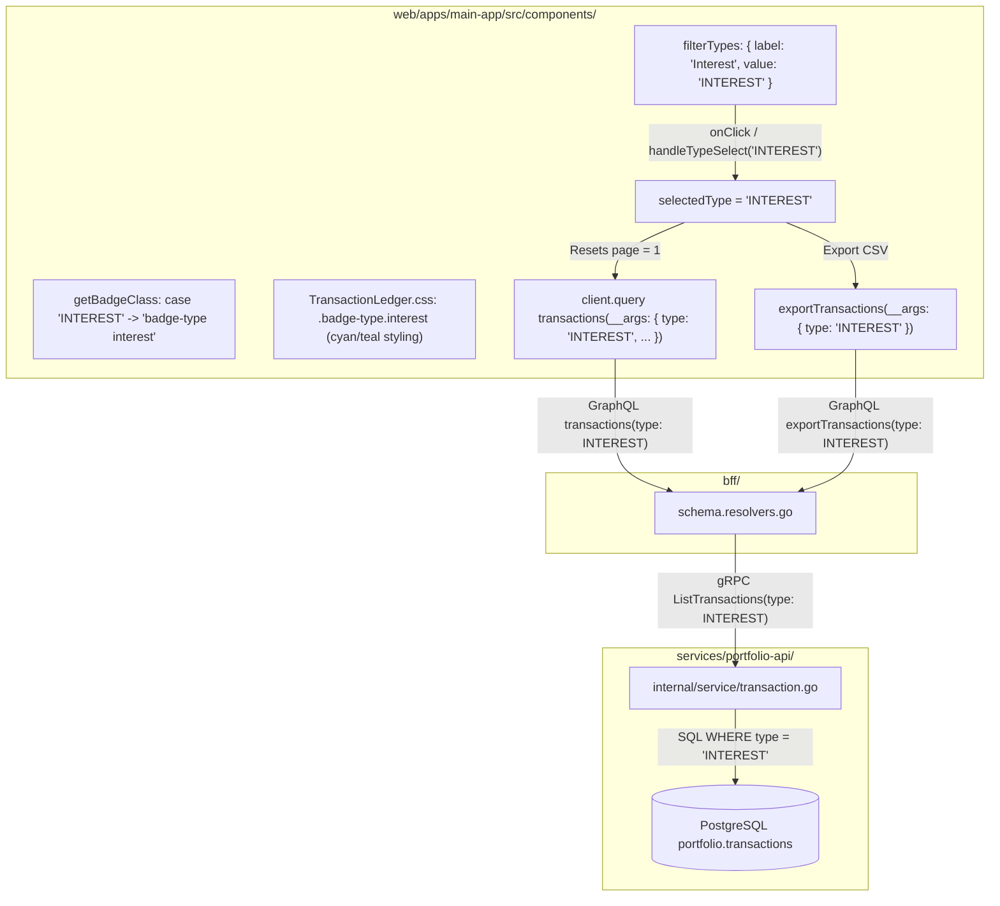

# User Story: Filter Transactions by Interest in Transaction Ledger

> **Story ID**: US-TX-106  
> **Epic**: Transaction Ledger Management & Cash Flow Reconciliation  
> **Target Layers**: Primary Investor Application (`web/apps/main-app`), BFF GraphQL Orchestrator (`bff/`), Portfolio Microservice (`services/portfolio-api`), Protobuf (`proto/portfolio/v1/portfolio.proto`), Database (`portfolio.transactions`)  
> **Status**: Completed  
> **Implementation Plan**: [filter-transactions-by-interest-implementation-plan.md](file:///Users/oscargarcia/workspace/graphfolio/docs/plans/filter-transactions-by-interest-implementation-plan.md)  
> **Calculation & Accounting Standard**: [financial-calculations skill](file:///Users/oscargarcia/workspace/graphfolio/.agents/skills/financial-calculations/SKILL.md) (Cash Yield & Uninvested Capital Accounting, Net vs Gross Interest Income, Tax Withholding Attribution)  
> **Related Stories & Documents**:  
> - [transaction-history-ledger.md](file:///Users/oscargarcia/workspace/graphfolio/docs/user-stories/transaction-history-ledger.md) (`US-TX-101`)  
> - [download-transactions-ledger.md](file:///Users/oscargarcia/workspace/graphfolio/docs/user-stories/download-transactions-ledger.md) (`US-TX-103`)  
> - [sort-transactions-by-date-ledger.md](file:///Users/oscargarcia/workspace/graphfolio/docs/user-stories/sort-transactions-by-date-ledger.md) (`US-TX-104`)  
> - [cash-statement-csv-ingestion.md](file:///Users/oscargarcia/workspace/graphfolio/docs/user-stories/cash-statement-csv-ingestion.md) (`US-INGEST-102`)  
> - [portfolio-cash-flow-report-generation.md](file:///Users/oscargarcia/workspace/graphfolio/docs/user-stories/portfolio-cash-flow-report-generation.md) (`US-REP-101`)  
> - [USER_STORIES.md](file:///Users/oscargarcia/workspace/graphfolio/docs/USER_STORIES.md)  

---

## 1. Story Statements

### 1.1 Dedicated "Interest" Type Filter Pill in Transaction Ledger
> **As an** active investor earning interest yield on uninvested cash, cash management accounts, or margin buffers in GraphFolio,  
> **I want to** click an "Interest" filter pill in the Transaction Ledger filter bar,  
> **So that** I can instantly isolate and audit all cash interest distributions credited to my portfolio across all timeframes.

### 1.2 Tax Season & Income Audit Reconciliation
> **As an** investor preparing my annual tax filings (e.g., ATO gross interest income, IRS 1099-INT, or HMRC interest statements),  
> **I want** to view only `INTEREST` transaction records with their exact credit dates, amounts, currency denominations, and foreign withholding taxes,  
> **So that** I can reconcile assessable non-dividend cash earnings directly against official bank statements without having to sift through hundreds of unrelated stock purchases, sales, or capital deposits.

### 1.3 Distinct Visual Categorization for Interest Records
> **As an** investor browsing a mixed ledger of trades, corporate actions, and income events,  
> **I want** interest transactions to feature a distinct, recognizable semantic badge (e.g., cyan/teal badge styling) rather than a generic neutral gray fallback,  
> **So that** interest cash flows are immediately discernible from dividends, deposits, and equity trades at a glance.

---

## 2. Background & Problem Context

### 2.1 The Role of Cash Yield in Modern Portfolios
In current financial markets, brokerage cash accounts (e.g. CommSec Cash Management Account, nabtrade Cash Account, Interactive Brokers idle cash balance, Webull Cash Sweep) frequently pay 4% to 5%+ annual cash yield on uninvested capital.

In GraphFolio:
- The database schema (`portfolio.transactions.type`) natively supports the `'INTEREST'` enum.
- The Protobuf contract (`proto/portfolio/v1/portfolio.proto`) defines `TRANSACTION_TYPE_INTEREST`.
- Brokerage statement importers (`cash-statement-csv-ingestion`) ingest interest records directly into the portfolio ledger.
- The Cash Flow Report (`CashFlowReport.tsx`) attributes interest as an income category.

### 2.2 The Problem: Missing Filter Pill in the Ledger
Despite `INTEREST` being a fully supported first-class transaction type throughout the backend and BFF, the **Transaction Ledger toolbar** in `web/apps/main-app/src/components/TransactionLedger.tsx` currently only provides the following filter pills:

```tsx
// Current filterTypes in TransactionLedger.tsx
const filterTypes: Array<{ label: string; value: string | null }> = [
  { label: 'All', value: null },
  { label: 'Buy', value: 'BUY' },
  { label: 'Sell', value: 'SELL' },
  { label: 'Dividend', value: 'DIVIDEND' },
  { label: 'Split', value: 'SPLIT' },
  { label: 'Deposit', value: 'DEPOSIT' },
  { label: 'Withdrawal', value: 'WITHDRAWAL' },
];
// NOTICE: 'INTEREST' IS MISSING!
```

```
+---------------------------------------------------------------------------------------------------------------+
|  CURRENT FILTER TOOLBAR (Interest Missing):                                                                   |
|  [ All ] [ Buy ] [ Sell ] [ Dividend ] [ Split ] [ Deposit ] [ Withdrawal ]   [ 🔍 Search symbol (e.g. AAPL) ]|
+---------------------------------------------------------------------------------------------------------------+
|  PROPOSED FILTER TOOLBAR (Interest Included):                                                                 |
|  [ All ] [ Buy ] [ Sell ] [ Dividend ] [ Interest ] [ Split ] [ Deposit ] [ Withdrawal ]   [ 🔍 Search...   ]|
+---------------------------------------------------------------------------------------------------------------+
```

Because the `Interest` pill is missing:
1. **Inability to Isolate Interest**: An investor with 1,000 transactions cannot view solely their interest payments. They are forced to scroll through dozens of pages or manually export the entire CSV.
2. **Badge Degradation**: In `TransactionLedger.tsx`, the `getBadgeClass` helper switches on known types and sends `INTEREST` to `default: 'badge-type other'`, rendering an unstyled gray badge.
3. **Export Friction**: While the "Export CSV" feature respects active type filters (e.g., downloading `graphfolio-transactions-dividends-YYYY-MM-DD.csv`), users cannot generate a filtered `graphfolio-transactions-interest-YYYY-MM-DD.csv` because the filter cannot be activated in the UI.

---

## 3. Scope & Architectural Breakdown

The backend and BFF already support filtering by `INTEREST`:
- **Database (`portfolio.transactions`)**:
  - `WHERE t.portfolio_id = $1 AND ($2::text IS NULL OR t.type::text = $2)` accepts `$2 = 'INTEREST'`.
- **gRPC Service (`services/portfolio-api`)**:
  - `ListTransactionsRequest.type = TRANSACTION_TYPE_INTEREST`.
- **GraphQL API (`bff/graph/schema.graphqls`)**:
  - `enum TransactionType { BUY, SELL, DIVIDEND, SPLIT, DEPOSIT, WITHDRAWAL, INTEREST, ... }`.
  - `transactions(type: TransactionType, ...)` accepts `type: INTEREST`.
  - `exportTransactions(type: TransactionType, ...)` accepts `type: INTEREST`.

Therefore, the architectural scope is entirely concentrated on **frontend integration, visual design tokens, accessibility, and automated verification** in `web/apps/main-app`.



---

## 4. UI / UX Design Specifications

### 4.1 Filter Pill Placement & Layout
In `TransactionLedger.tsx`, the `Interest` pill is inserted logically adjacent to `Dividend` (grouping cash income distributions together):

```tsx
const filterTypes: Array<{ label: string; value: string | null }> = [
  { label: 'All', value: null },
  { label: 'Buy', value: 'BUY' },
  { label: 'Sell', value: 'SELL' },
  { label: 'Dividend', value: 'DIVIDEND' },
  { label: 'Interest', value: 'INTEREST' },
  { label: 'Split', value: 'SPLIT' },
  { label: 'Deposit', value: 'DEPOSIT' },
  { label: 'Withdrawal', value: 'WITHDRAWAL' },
];
```

### 4.2 Semantic Badge Styling (`TransactionLedger.css`)
To give `INTEREST` records immediate visual recognition while harmonizing with GraphFolio's dark glassmorphic palette:

```css
.badge-type.interest {
  background: rgba(6, 182, 212, 0.14);
  color: #22d3ee;
  border: 1px solid rgba(6, 182, 212, 0.3);
}
```

| Transaction Type | Badge Background | Badge Text Color | Semantic Meaning |
| :--- | :--- | :--- | :--- |
| **`BUY`** | `rgba(16, 185, 129, 0.14)` | Emerald `#34d399` | Equity asset acquisition |
| **`SELL`** | `rgba(239, 68, 68, 0.14)` | Ruby `#f87171` | Equity asset disposal |
| **`DIVIDEND`** | `rgba(59, 130, 246, 0.14)` | Blue `#60a5fa` | Equity yield distribution |
| **`INTEREST`** | `rgba(6, 182, 212, 0.14)` | Cyan `#22d3ee` | Cash / debt yield distribution |
| **`SPLIT`** | `rgba(139, 92, 246, 0.16)` | Purple `#c4b5fd` | Corporate share restructuring |
| **`DEPOSIT`** | `rgba(168, 85, 247, 0.14)` | Violet `#c084fc` | External capital injection |
| **`WITHDRAWAL`** | `rgba(249, 115, 22, 0.14)` | Amber `#fb923c` | External capital removal |

---

## 5. Acceptance Criteria (Given - When - Then)

### AC 1: "Interest" Filter Pill Presence & Toolbar Visibility
- **Given** an authenticated investor is viewing the Transaction Ledger,
- **When** the page renders the filter toolbar,
- **Then** an **"Interest"** filter pill is visible in the filter pills group between "Dividend" and "Split",
- **And** the pill follows the standard `.filter-pill` glassmorphic styling.

### AC 2: Filtering Transaction Ledger by Interest
- **Given** the user's portfolio contains a variety of transactions (buys, dividends, interest, deposits),
- **When** the user clicks the **"Interest"** filter pill,
- **Then** the pill becomes highlighted with active styling (`.filter-pill.active`),
- **And** the table reloads displaying **only transactions where `type === 'INTEREST'`**,
- **And** all equity trades, dividends, deposits, and withdrawals are filtered out.

### AC 3: Semantic Cyan Badge Presentation
- **Given** an interest transaction is displayed in the table,
- **When** the Type column is rendered,
- **Then** it displays a pill badge containing the text `"INTEREST"`,
- **And** the badge has class `badge-type interest` with cyan text (`#22d3ee`) and a subtle glowing translucent background,
- **And** it does not use the fallback `badge-type other` class.

### AC 4: Automatic Pagination Reset on Filter Select
- **Given** the user is viewing page 3 of the unfiltered ledger,
- **When** the user clicks the "Interest" filter pill,
- **Then** the page number automatically resets to `1` (`page = 1`),
- **And** the pagination status shows `Showing 1–X of Y transactions` for the interest dataset.

### AC 5: Preservation of Date Sorting
- **Given** the user has sorted the ledger by Date in ascending order (`▲`, oldest first),
- **When** the user clicks the "Interest" filter pill,
- **Then** only interest transactions are displayed,
- **And** they remain sorted chronologically ascending from the earliest interest payment.

### AC 6: Unpaginated Interest CSV Export
- **Given** the user has the "Interest" filter pill active,
- **When** the user clicks the "Export CSV" button,
- **Then** the downloaded CSV contains **only interest transactions** across all pages,
- **And** the exported file is named `graphfolio-transactions-interest-YYYY-MM-DD.csv`,
- **And** each row includes the exact interest settlement date, net amount, and withholding tax.

### AC 7: Resetting Back to All Transactions
- **Given** the "Interest" filter pill is currently active,
- **When** the user clicks the **"All"** filter pill,
- **Then** the filter is cleared (`selectedType = null`),
- **And** the table reloads displaying all transactions across all types.

### AC 8: Empty State Handling
- **Given** a portfolio has never received cash interest payments,
- **When** the user clicks the "Interest" filter pill,
- **Then** the table displays a friendly empty state message:  
  *"No transactions found matching your criteria."*,
- **And** the pagination bar indicates `0 transactions` with disabled pagination buttons.

---

## 6. Non-Functional Requirements

### 6.1 Performance & Responsiveness
- Filter pill activation triggers an immediate query debounced by the existing 250ms timer with zero duplicate queries.
- Switching between filter pills executes smoothly with zero UI jank or layout shift.

### 6.2 Accessibility (WCAG 2.1 AA)
- Filter pills are accessible via keyboard navigation (`Tab` and `Enter` / `Space`).
- Visual contrast ratio of cyan `#22d3ee` on dark background exceeds 4.5:1, satisfying WCAG AA contrast standards.
- Active pill includes `aria-pressed="true"` or semantic active state.

---

## 7. Verification & Testing Strategy

### 7.1 Automated Unit Tests (`TransactionLedger.test.ts`)
- **Filter Types List**: Verify `filterTypes` contains `{ label: 'Interest', value: 'INTEREST' }`.
- **Query Arguments**: Verify `buildTransactionQueryArgs(1, 20, 'DESC', 'INTEREST')` produces `{ page: 1, pageSize: 20, sortDirection: 'DESC', type: 'INTEREST' }`.
- **Badge Class**: Verify `getBadgeClass('INTEREST')` returns `'badge-type interest'`.
- **Export Filename**: Verify CSV export naming logic handles `selectedType = 'INTEREST'` as `graphfolio-transactions-interest-YYYY-MM-DD.csv`.

### 7.2 Manual QA Checklist
1. Open `/transactions` in the browser.
2. Confirm the "Interest" pill appears between "Dividend" and "Split".
3. Click "Interest": confirm table updates to show only interest records with cyan badges.
4. Verify pagination resets to page 1.
5. Click "Date" column header: confirm interest transactions toggle between newest and oldest.
6. Click "Export CSV": confirm downloaded file contains only interest records.
7. Click "All": confirm all transaction types return.

---

## 8. Definition of Done (DoD) Checklist

- [ ] `filterTypes` updated to include `{ label: 'Interest', value: 'INTEREST' }`.
- [ ] `getBadgeClass` updated to return `'badge-type interest'` for `'INTEREST'`.
- [ ] `.badge-type.interest` styled in `TransactionLedger.css` with cyan/teal design tokens.
- [ ] Clicking "Interest" filters table via GraphQL query `type: 'INTEREST'` and resets page to 1.
- [ ] CSV Export while "Interest" is active exports only interest transactions with dynamic filename.
- [ ] Unit tests in `TransactionLedger.test.ts` pass all verification cases.
- [ ] Document cataloged in `docs/USER_STORIES.md`.
