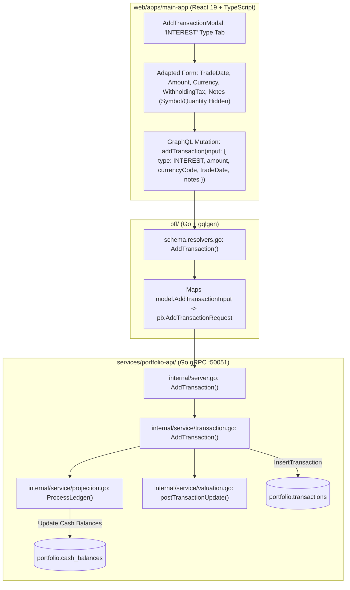

# User Story: Record Cash Interest Transactions

> **Story ID**: US-TX-107  
> **Epic**: Transaction Ledger Management & Cash Flow Reconciliation  
> **Target Layers**: Primary Investor Application (`web/apps/main-app`), BFF GraphQL Orchestrator (`bff/`), Portfolio Microservice (`services/portfolio-api`), Protobuf (`proto/portfolio/v1/portfolio.proto`), Database (`portfolio.transactions`, `portfolio.cash_balances`)  
> **Status**: Completed  
> **Implementation Plan**: [record-interest-transaction-implementation-plan.md](file:///Users/oscargarcia/workspace/graphfolio/docs/plans/record-interest-transaction-implementation-plan.md)  
> **Calculation & Accounting Standard**: [financial-calculations skill](file:///Users/oscargarcia/workspace/graphfolio/.agents/skills/financial-calculations/SKILL.md) (Internal Cash Yield vs. External Capital Flows, GIPS® TWR & Modified Dietz Return Neutrality, Trade Date Recognition, Exact Fixed-Point Precision, Cash Balance Reconciliation)  
> **Related Stories & Documents**:  
> - [interactive-transaction-ingestion-modal.md](file:///Users/oscargarcia/workspace/graphfolio/docs/user-stories/interactive-transaction-ingestion-modal.md) (`US-TX-102`)  
> - [filter-transactions-by-interest-ledger.md](file:///Users/oscargarcia/workspace/graphfolio/docs/user-stories/filter-transactions-by-interest-ledger.md) (`US-TX-106`)  
> - [portfolio-cash-flow-report-generation.md](file:///Users/oscargarcia/workspace/graphfolio/docs/user-stories/portfolio-cash-flow-report-generation.md) (`US-REP-101`)  
> - [annualized-return-modified-dietz.md](file:///Users/oscargarcia/workspace/graphfolio/docs/user-stories/annualized-return-modified-dietz.md) (`US-PERF-102`)  
> - [cash-statement-csv-ingestion.md](file:///Users/oscargarcia/workspace/graphfolio/docs/user-stories/cash-statement-csv-ingestion.md) (`US-INGEST-102`)  
> - [USER_STORIES.md](file:///Users/oscargarcia/workspace/graphfolio/docs/USER_STORIES.md)  

---

## 1. Story Statements

### 1.1 Direct Manual Interest Recording in the Ingestion Modal
> **As an** investor earning regular cash yield on uninvested brokerage funds, cash management accounts (CMAs), or margin credit balances in GraphFolio,  
> **I want to** select **"Interest"** as a first-class transaction type within the "Add Transaction" modal,  
> **So that** I can manually log cash interest credits on demand without being forced to prepare and upload a multi-column broker CSV file.

### 1.2 True Cash Balance Reconciliation Without Negative Balances
> **As an** active investor executing periodic trades and transfers,  
> **I want** recording an interest transaction to immediately and accurately increment my portfolio cash balance in the appropriate currency,  
> **So that** my on-screen cash account balance faithfully reflects my actual brokerage cash balance and prevents false negative cash warnings.

### 1.3 Preservation of Investment Performance Integrity (GIPS® TWR & Modified Dietz)
> **As a** disciplined investor evaluating annualized portfolio returns (CAGR, TWR, and Modified Dietz),  
> **I want** interest transactions to be treated strictly as **internal investment income** rather than **external capital injections** (`DEPOSIT`),  
> **So that** cash interest is recognized as portfolio gain rather than artificially inflating my contributed cost basis and depressing my true rate of return.

### 1.4 Symbol-Free Cash Accounting with Optional Attribution
> **As an** investor receiving monthly interest on liquid cash reserves rather than shares of a specific company,  
> **I want** the transaction form to omit mandatory stock/ETF symbol lookups when "Interest" is selected,  
> **So that** I can cleanly record cash yields without having to create or select a fictitious equity ticker.

---

## 2. Background & Problem Context

### 2.1 The Role of Cash Yield in Modern Portfolios
In current financial environments, brokerage accounts, cash management accounts (e.g. CommSec Cash Management Account, nabtrade Cash Account, Interactive Brokers Idle Cash, Vanguard Cash Plus), and high-yield sweep accounts pay between 4% and 5%+ annualized interest on uninvested capital.

For an investor with substantial dry powder or an active cash buffer, these interest distributions occur monthly and represent meaningful cash flows.

```
+----------------------------------------------------------------------------------------------------+
|                               CASH YIELD & ACCOUNT LIFECYCLE                                       |
|                                                                                                    |
|  [ Brokerage CMA / Bank ]  ====>  Credits $125.50 AUD Monthly Interest  ====> [ Portfolio Cash ]   |
|                                                                                       |            |
|                                                                                       +--> Reinvest|
|                                                                                       +--> Sweep   |
|                                                                                       +--> Buffer  |
+----------------------------------------------------------------------------------------------------+
```

### 2.2 The Problem: Current Frontend & Backend Limitations
Currently, GraphFolio's architecture presents a significant gap for manual interest entry:

1. **Frontend Omission in `AddTransactionModal.tsx`**:
   The `AddTransactionModal` component restricts transaction types to:
   ```tsx
   type TransactionType = 'BUY' | 'SELL' | 'DIVIDEND' | 'SPLIT' | 'DEPOSIT' | 'WITHDRAWAL';
   // NOTICE: 'INTEREST' is completely omitted from the modal type tabs!
   ```
2. **Backend Rejection in `services/portfolio-api/internal/service/transaction.go`**:
   While the database enum (`portfolio.transactions.type`) and protobuf definition (`TRANSACTION_TYPE_INTEREST`) include `INTEREST`, the `AddTransaction` service method explicitly rejects it:
   ```go
   switch input.Type {
   case domain.TxTypeBuy, domain.TxTypeSell:
       // ...
   case domain.TxTypeDeposit, domain.TxTypeWithdrawal:
       // ...
   case domain.TxTypeDividend:
       // ...
   case domain.TxTypeSplit:
       // ...
   default:
       return nil, nil, fmt.Errorf("service: unsupported transaction type: %s", input.Type)
   }
   ```
   If a client attempts to submit an `INTEREST` transaction through `AddTransaction`, the backend returns `codes.InvalidArgument` or `unsupported transaction type: INTEREST`.

3. **Destructive Workarounds and Accounting Corruption**:
   Because investors cannot record `INTEREST`, they are forced into two flawed workarounds:
   - **Workaround A (Recording as `DEPOSIT`)**:
     The investor enters the interest as a `DEPOSIT`. However, under GIPS® and financial accounting standards, a `DEPOSIT` is an **external capital inflow** ($F_t > 0$). In Time-Weighted Return (TWR) and Modified Dietz return formulas:
     $$R_t = \frac{V_t - (V_{t-1} + F_t)}{V_{t-1} + F_t}$$
     Mislabeled deposits are subtracted from the numerator and added to the denominator, **artificially penalizing the portfolio's return**! The earned interest is treated as money the investor transferred from their pocket rather than investment return generated by the portfolio.
   - **Workaround B (Recording as `DIVIDEND`)**:
     The investor enters the interest as a `DIVIDEND`. However, the dividend form strictly requires an equity ticker symbol (`symbol`). Cash accounts do not have an equity ticker, so users must pick a dummy stock or misattribute interest to an unrelated equity holding, distorting individual asset yields and dividend tax reports.

```
+----------------------------------------------------------------------------------------------------+
|  COMPARISON OF TRANSACTION RECORDING METHODS:                                                      |
|                                                                                                    |
|  Method                  Cash Balance   TWR / Dietz Return   Symbol Required?  Accounting Status  |
|  ------------------------------------------------------------------------------------------------  |
|  Record as DEPOSIT       Correct (+)    DEPRESSED (Distorted) No               FAILS GIPS / GAAP   |
|  Record as DIVIDEND      Correct (+)    Correct              YES (Falsified)   FAILS Asset Reports |
|  Record as INTEREST      CORRECT (+)    CORRECT (Income)     NO (Clean Cash)   PERFECT (GIPS/GAAP) |
+----------------------------------------------------------------------------------------------------+
```

---

## 3. Financial & Accounting Mechanics

All cash flow and performance calculations strictly adhere to the [financial-calculations skill](file:///Users/oscargarcia/workspace/graphfolio/.agents/skills/financial-calculations/SKILL.md), GIPS® (Global Investment Performance Standards), US GAAP (ASC 946 / ASC 820), and IFRS standards.

### 3.1 Cash Balance Formulation
When an `INTEREST` transaction is processed on trade date $t$ for currency $c$:

$$\Delta \text{Cash}_c = \text{Amount} - \text{WithholdingTax}$$

$$\text{CashBalance}_{c, t} = \text{CashBalance}_{c, t-1} + \Delta \text{Cash}_c$$

- **Net Yield Recognized**: The net cash increment directly increases liquid reserves in currency $c$.
- **Exact Fixed-Point Arithmetic**: Evaluated with `shopspring/decimal.Decimal` to eliminate any binary floating-point rounding error.

### 3.2 Performance Attribution (Internal Income vs. External Flow)
Under GIPS Standard 2.A:
- **External Cash Flows ($F_t$)**: Capital deposited into or withdrawn from the portfolio by the investor from outside sources.
  $$\text{External Flows}: \text{Deposits} - \text{Withdrawals}$$
- **Internal Cash Flows**: Returns generated organically by the portfolio assets (dividends, cash interest, capital appreciation).
  $$\text{External Flow for INTEREST} \equiv 0.00$$

By correctly classifying `INTEREST` as an **internal income flow**:
1. It increases portfolio ending value $V_t$ through cash expansion.
2. It is **not** subtracted as external capital in the return numerator.
3. In the Modified Dietz formula:
   $$R_{\text{Dietz}} = \frac{V_1 - V_0 - F}{V_0 + \sum (W_i \times F_i)}$$
   With $F = 0$, the interest legitimately contributes to the capital growth ($V_1 - V_0$), yielding the true, uncorrupted return of the portfolio.

### 3.3 Cash Flow Report Integration
In the portfolio's Cash Flow Report (`services/portfolio-api/internal/service/cash_flow.go`):
- `INTEREST` transactions are aggregated under the dedicated `CategoryInterest` category.
- Net interest is reported alongside gross amounts and withholding taxes, feeding into ATO / IRS / HMRC interest income reconciliation schedules.

---

## 4. Architectural & Layer Breakdown

The implementation touches each layer of the GraphFolio architecture:



### 4.1 Layer Responsibilities

| Layer | Component | Changes Required |
|---|---|---|
| **Protobuf** | `proto/portfolio/v1/portfolio.proto` | Verify `TRANSACTION_TYPE_INTEREST` is available for `AddTransactionRequest` (already defined in proto). Confirm optional `symbol` field. |
| **Microservice** | `services/portfolio-api/internal/service/transaction.go` | Add `case domain.TxTypeInterest:` in `AddTransaction`. Validate positive `Amount`, default/validate `CurrencyCode`, compute FX to base if non-base currency, insert transaction, trigger `postTransactionUpdate`, and return updated portfolio summary. |
| **BFF** | `bff/graph/schema.resolvers.go` | Ensure `AddTransaction` GraphQL resolver gracefully passes symbol-free `INTEREST` inputs to gRPC without requiring dummy symbols. |
| **Frontend** | `web/apps/main-app/src/components/AddTransactionModal.tsx` | Extend `TransactionType` union to include `'INTEREST'`. Add "Interest" type tab. Dynamically render only relevant cash fields (Amount, Currency, Date, Withholding Tax, Notes). Hide Symbol, Quantity, Price, and Split Ratios. |
| **Design System** | `web/apps/main-app/src/components/AddTransactionModal.css` | Ensure "Interest" tab styling conforms to cyan/teal semantic highlight (`#22d3ee`). |

---

## 5. UI / UX Design Specifications

### 5.1 Modal Type Selector Tabs
In `AddTransactionModal.tsx`, the type selector bar is expanded to include `Interest` logically grouped between `Dividend` and `Split` / `Deposit`:

```
+----------------------------------------------------------------------------------------------------+
|  Add Transaction                                                                             [ X ] |
|                                                                                                    |
|  [ Buy ]  [ Sell ]  [ Dividend ]  [ Interest ]  [ Split ]  [ Deposit ]  [ Withdrawal ]             |
|                                                                                                    |
|  ------------------------------------------------------------------------------------------------  |
|                                                                                                    |
|  Date:               [ 2026-10-18 ] (YYYY-MM-DD)                                                   |
|                                                                                                    |
|  Amount:             [ $ 125.50                                  ]                                 |
|                                                                                                    |
|  Currency:           [ AUD - Australian Dollar                 ▼ ]                                 |
|                                                                                                    |
|  Withholding Tax:    [ $ 0.00                                    ] (Optional)                      |
|                                                                                                    |
|  Notes / Reference:  [ CommSec Cash Management Account Interest  ] (Optional)                      |
|                                                                                                    |
|  ------------------------------------------------------------------------------------------------  |
|                                                          [ Cancel ]   [ Add Interest Transaction ] |
+----------------------------------------------------------------------------------------------------+
```

### 5.2 Dynamic Form Field Visibility State

When `type === 'INTEREST'`:
- **Hidden Fields**:
  - `Symbol / Asset Picker`: Hidden (cash interest is not an equity transaction).
  - `Quantity`: Hidden.
  - `Price per Share`: Hidden.
  - `Brokerage Fee`: Hidden (interest payments do not carry brokerage trading fees; tax withholding is handled separately).
  - `Stock Split Ratios`: Hidden.
- **Visible Fields**:
  - `Trade Date`: Required, defaults to current local date (`YYYY-MM-DD`).
  - `Amount`: Required, numeric positive decimal (`> 0.00`).
  - `Currency`: Required dropdown, defaults to user's preferred display currency or portfolio base currency.
  - `Notes / Description`: Optional text input for bank/account reference (e.g. "Monthly CMA interest").

---

## 6. Acceptance Criteria (Given - When - Then)

### AC 1: "Interest" Option in Transaction Type Selector
- **Given** an authenticated investor opens the "Add Transaction" modal (`+ Add Transaction`),
- **When** the transaction type selector renders,
- **Then** an **"Interest"** option is available in the type selector,
- **And** clicking "Interest" activates the tab with cyan highlight styling (`#22d3ee`).

### AC 2: Form Adaptation for Interest Entry
- **Given** the user selects the "Interest" transaction type,
- **When** the form updates its fields,
- **Then** equity-specific inputs (Symbol picker, Quantity, Price, Split ratio, Brokerage fee) are hidden from view,
- **And** cash interest inputs (Trade Date, Amount, Currency, Notes) are visible and editable.

### AC 3: Validation of Interest Amount & Date
- **Given** the user is submitting an Interest transaction,
- **When** the Amount field is empty, zero, or negative,
- **Then** the form prevents submission and displays an inline validation message:  
  *"Amount must be greater than zero."*,
- **And** when the Trade Date is missing or invalid, an appropriate date validation error is displayed.

### AC 4: Default Currency Preselection
- **Given** an investor whose preferred display currency is `AUD`,
- **When** they switch the transaction type to "Interest",
- **Then** the Currency selector defaults automatically to `AUD`,
- **And** the investor can change the currency to any other supported currency (e.g., `USD`, `EUR`, `GBP`) if they hold a foreign cash balance.

### AC 5: Successful Interest Submission & Cash Balance Increment
- **Given** an investor enters a valid interest transaction of `$250.00 AUD` on `2026-10-15` with notes *"Macquarie CMA Interest"*,
- **When** they click "Add Interest Transaction",
- **Then** the modal displays a loading spinner and submits the GraphQL mutation `addTransaction`,
- **And** the backend creates an `INTEREST` record in `portfolio.transactions`,
- **And** the deterministic projection engine increments the portfolio's cash balance by exactly `+$250.00 AUD`,
- **And** the modal closes and the dashboard updates instantaneously with the new cash balance and total portfolio value.

### AC 6: Return Metric Neutrality (GIPS® TWR & Modified Dietz)
- **Given** a portfolio with an initial value of `$10,000.00 AUD`,
- **When** an interest transaction of `$100.00 AUD` is recorded,
- **Then** the external cash flow $F_t$ is recorded as `$0.00 AUD` (not `$100.00 AUD`),
- **And** the portfolio return reflects an internal income gain of `+1.00%`,
- **And** the contributed capital / net deposits metric remains unchanged.

### AC 7: Immediate Transaction Ledger Reflection with Cyan Badge
- **Given** a successfully recorded interest transaction,
- **When** the investor navigates to or inspects the Transaction Ledger,
- **Then** the new interest transaction appears in the ledger with its date, net amount, and notes,
- **And** the transaction displays a dedicated **cyan/teal badge** (`badge-type interest`),
- **And** activating the "Interest" filter pill in the ledger displays this transaction.

### AC 8: Cash Flow Report Attribution
- **Given** a successfully recorded interest transaction,
- **When** the investor views the Portfolio Cash Flow Report,
- **Then** the transaction is attributed to the **"Interest"** category under Operating / Investment Income,
- **And** the running cash balance reconciles perfectly with the ledger.

### AC 9: Error Handling on Backend Failure
- **Given** a network interruption or service outage occurs during submission,
- **When** the request fails,
- **Then** an explicit error banner is rendered inside the modal,
- **And** the form inputs are preserved so the investor does not lose their typed data.

---

## 7. Non-Functional Requirements

### 7.1 Strict Zero Floating-Point Arithmetic
- All amount calculations and database persistence must use exact arbitrary-precision decimals (`shopspring/decimal.Decimal` in Go, custom `Decimal` scalar in GraphQL).
- No IEEE 754 floating-point operations (`float32` / `float64`) are permitted at any layer.

### 7.2 Performance & Responsiveness
- End-to-end transaction entry, projection replay, and dashboard refresh must complete in **< 250ms**.
- Modal transition between transaction types must execute instantaneously with zero layout thrashing or cumulative layout shift (CLS).

### 7.3 Accessibility (WCAG 2.1 AA)
- All modal inputs must possess semantic HTML labels and unique `id` attributes.
- The "Interest" tab must be navigable via keyboard (`Tab`, `Space`, `Enter`).
- Color contrast for the active cyan badge and tab (`#22d3ee`) must exceed the 4.5:1 ratio against the dark background.

---

## 8. Verification & Testing Strategy

### 8.1 Automated Backend Unit Tests (`services/portfolio-api/internal/service/transaction_test.go`)
- **`TestPortfolioService_AddTransaction_Interest_Success`**:
  - Test recording an `INTEREST` transaction with valid amount, date, and notes.
  - Verify that `portfolio.cash_balances` is incremented by the net amount.
  - Verify that `F_t` (external cash flow) is zero.
  - Verify that no instrument is required.
- **`TestPortfolioService_AddTransaction_Interest_ValidationErrors`**:
  - Test rejection when `Amount <= 0`.
  - Test rejection when `CurrencyCode` is invalid.

### 8.2 BFF Resolver Unit Tests (`bff/graph/schema.resolvers_test.go`)
- Verify `addTransaction` mutation with `type: INTEREST` constructs the appropriate gRPC request without a symbol and resolves the updated portfolio.

### 8.3 Frontend Component Unit Tests (`AddTransactionModal.test.tsx`)
- Verify "Interest" tab renders in the type selector.
- Verify selecting "Interest" hides symbol and quantity inputs and displays amount, currency, and notes.
- Verify client-side validation displays an error if amount is empty or non-positive.
- Verify submission triggers `client.mutation` with `{ type: 'INTEREST', amount: '...', currencyCode: '...' }`.

### 8.4 Manual QA Checklist
1. Open the investor dashboard at `http://localhost:5173`.
2. Click **"+ Add Transaction"**.
3. Click the **"Interest"** tab. Verify symbol and quantity fields disappear.
4. Enter Amount `50.00`, leave currency as default, and add notes `"Monthly Cash Yield"`.
5. Click **"Add Interest Transaction"**.
6. Verify modal closes and Cash Balance on the dashboard increases by `$50.00`.
7. Navigate to Transaction Ledger: verify the interest transaction appears with a cyan `INTEREST` badge.
8. Filter by "Interest": confirm only interest records are visible.
9. Open Cash Flow Report: confirm `$50.00` appears under the Interest category.

---

## 9. Definition of Done (DoD) Checklist

- [x] `services/portfolio-api/internal/service/transaction.go` updated to support `domain.TxTypeInterest` in `AddTransaction`.
- [x] Backend validates positive `Amount` and updates cash balances via deterministic projection engine.
- [x] Backend unit tests added in `transaction_test.go` verifying interest ingestion and return neutrality.
- [x] BFF GraphQL resolver verified to pass symbol-free `INTEREST` input to gRPC.
- [x] `AddTransactionModal.tsx` updated with `'INTEREST'` type, dedicated tab, and adapted field visibility.
- [x] `.badge-type.interest` / tab highlight styled with cyan design tokens in `AddTransactionModal.css`.
- [x] Unit and integration tests pass cleanly with zero lint or build errors (`make test`).
- [x] Document cataloged in `docs/USER_STORIES.md`.
