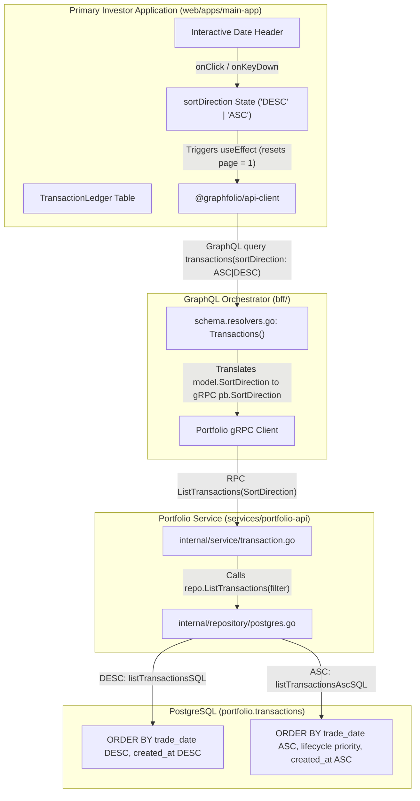

# User Story: Sort Transactions by Date in Transaction Ledger

> **Story ID**: US-TX-104  
> **Epic**: Transaction Ledger Management & Investor Experience  
> **Target Layers**: Primary Investor Application (`web/apps/main-app`), BFF GraphQL Orchestrator (`bff/`), Portfolio Microservice (`services/portfolio-api`), Protobuf (`proto/portfolio/v1/portfolio.proto`), Database (`portfolio.transactions`)  
> **Status**: Completed  
> **Implementation Plan**: [sort-transactions-by-date-implementation-plan.md](file:///Users/oscargarcia/workspace/graphfolio/docs/plans/sort-transactions-by-date-implementation-plan.md)  
> **Calculation & Accounting Standard**: [financial-calculations skill](file:///Users/oscargarcia/workspace/graphfolio/.agents/skills/financial-calculations/SKILL.md) (Trade-Date Accounting, Chronological Inception-to-Date Auditing, Event Lifecycle Sequencing)  
> **Related Stories & Documents**: [transaction-history-ledger.md](file:///Users/oscargarcia/workspace/graphfolio/docs/user-stories/transaction-history-ledger.md), [download-transactions-ledger.md](file:///Users/oscargarcia/workspace/graphfolio/docs/user-stories/download-transactions-ledger.md), [edit-transaction-ledger.md](file:///Users/oscargarcia/workspace/graphfolio/docs/user-stories/edit-transaction-ledger.md), [USER_STORIES.md](file:///Users/oscargarcia/workspace/graphfolio/docs/USER_STORIES.md)  

---

## 1. Story Statements

### 1.1 Bidirectional Date Sorting in Transaction Ledger
> **As an** active investor reviewing my historical transactions in GraphFolio,  
> **I want to** click on the "Date" column header in the Transaction Ledger table to toggle between descending (newest first) and ascending (oldest first) sort orders,  
> **So that** I can seamlessly switch between inspecting my most recent trades and auditing my investment history from portfolio inception forward.

### 1.2 Chronological Inception-to-Date Verification (Oldest First)
> **As an** investor reconciling my portfolio transactions against external broker trade confirmations, tax statements, and bank deposits,  
> **I want to** view my transaction records in chronological order starting from my initial deposit and first share purchase,  
> **So that** I can verify acquisition timelines, corporate actions (splits), dividend accruals, and parcel disposals without repeatedly paging through dozens of ledger pages to reach the earliest records.

### 1.3 State-Preserving Filter & Pagination Integration
> **As an** investor who filters the ledger by transaction type (e.g. `DIVIDEND` or `BUY`) or by ticker symbol (e.g. `AAPL` or `BHP.AX`),  
> **I want** changing the date sort order to preserve my active filters while automatically resetting the table to page 1,  
> **So that** I immediately see the relevant filtered records in my chosen chronological sequence without encountering empty pages or stale pagination offsets.

---

## 2. Background & Problem Context

### 2.1 The Need for Forward Chronological Ledger Inspection
While investors typically monitor recent portfolio activity (yesterday's dividend, last week's rebalancing sale) in **descending order** (`trade_date DESC`), investment accounting and historical audits fundamentally operate in **forward chronological order** (`trade_date ASC`):
1. **Portfolio Lifecycle Reconciliation**: When verifying how a position was built over multiple years (dollar-cost averaging, dividend reinvestment, stock splits, partial sales), an investor needs to see events unfold from inception onward.
2. **Tax & Cost-Basis Verification**: In tax accounting (FIFO lot relief, Average Cost basis), transactions must be evaluated in chronological sequence. An investor auditing their tax lots needs to confirm opening purchases before verifying subsequent disposals.
3. **Corporate Action Auditing**: Stock splits (e.g. `NVDA` 10-for-1 or `AAPL` 4-for-1) alter subsequent share counts and per-share prices. Reviewing transactions chronologically ensures the investor sees the pre-split purchases, the split event itself, and post-split transactions in logical order.

### 2.2 The Current Limitation: Static Date Header
In the GraphFolio user interface (`web/apps/main-app/src/components/TransactionLedger.tsx`):
- The `<th>Date</th>` table header is currently **static text with no click handler or sort indicators**.
- The component hardcodes pagination requests without passing a `sortDirection` argument to the GraphQL client:
  ```tsx
  // Current client query in TransactionLedger.tsx
  client.query({
    transactions: {
      __args: { page, pageSize, type, symbol },
      // sortDirection is omitted -> defaults to DESC
      ...
    }
  });
  ```
- To view their earliest transactions, an investor with 500 transactions must click the pagination "Next" button 25 times to reach page 25.
- Other parts of GraphFolio (such as `Dashboard.tsx` for holdings and `CashFlowReport.tsx` for cash movements) already provide interactive sortable column headers with `▲` and `▼` indicators. The Transaction Ledger currently lacks this standard capability.

### 2.3 Ready Backend & Orchestration Infrastructure
GraphFolio's architectural layers below the frontend already support bidirectional sorting:
1. **Database Queries (`services/portfolio-api/internal/repository/queries.go`)**:
   - Descending (`listTransactionsSQL`):
     ```sql
     ORDER BY t.trade_date DESC, t.created_at DESC, t.id DESC
     ```
   - Ascending with lifecycle tie-breaking (`listTransactionsAscSQL`):
     ```sql
     ORDER BY 
         t.trade_date ASC,
         CASE t.type
             WHEN 'DEPOSIT' THEN 1
             WHEN 'TRANSFER_IN' THEN 2
             WHEN 'BUY' THEN 3
             WHEN 'SPLIT' THEN 4
             WHEN 'DIVIDEND' THEN 5
             WHEN 'INTEREST' THEN 6
             WHEN 'SELL' THEN 7
             WHEN 'TRANSFER_OUT' THEN 8
             WHEN 'FEE' THEN 9
             WHEN 'TAX' THEN 10
             WHEN 'WITHDRAWAL' THEN 11
             ELSE 12
         END,
         t.created_at ASC,
         t.id ASC
     ```
2. **Domain & gRPC (`proto/portfolio/v1/portfolio.proto`)**:
   - `SortDirection` enum (`SORT_DIRECTION_DESC = 0`, `SORT_DIRECTION_ASC = 1`) and `ListTransactionsRequest.sort_direction`.
3. **BFF GraphQL (`bff/graph/schema.graphqls`)**:
   - `enum SortDirection { ASC, DESC }`
   - `transactions(..., sortDirection: SortDirection = DESC): TransactionsConnection!`
4. **Client SDK (`@graphfolio/api-client`)**:
   - Already exports `SortDirection` and accepts `sortDirection` in `transactions` query arguments.

Therefore, this user story focuses on delivering the **frontend user interaction, UI/UX indicators, state management, and accessibility** in `web/apps/main-app`, while ensuring end-to-end integration and verification across the full stack.

---

## 3. Scope & Architectural Integration



### 3.1 Components in Scope
1. **`web/apps/main-app/src/components/TransactionLedger.tsx`**:
   - Introduce `sortDirection` state (`'DESC' | 'ASC'`), defaulting to `'DESC'`.
   - Pass `sortDirection` in GraphQL query arguments.
   - Include `sortDirection` in `useEffect` dependency array.
   - Implement sort toggle handler:
     ```tsx
     const handleSortDate = () => {
       setSortDirection((prev) => (prev === 'DESC' ? 'ASC' : 'DESC'));
       setPage(1);
     };
     ```
   - Transform `<th>Date</th>` into an interactive, accessible sortable header with visual indicator (`▼` for DESC, `▲` for ASC).
2. **`web/apps/main-app/src/components/TransactionLedger.css`**:
   - Add `.sortable-th`, `.th-content`, `.sort-icon`, and `.sort-icon.active` styles aligned with the dark glassmorphic design system.
3. **Automated Component Verification**:
   - Unit and integration tests covering initial sort state, click toggle, pagination reset, and filter preservation.

---

## 4. UI/UX Interaction & Visual Design

### 4.1 Header Presentation & Visual States
The "Date" column header becomes an interactive element matching the styling used across GraphFolio (`Dashboard.css` and `CashFlowReport.css`):

| State | Visual Treatment | Visual Indicator | Tooltip / Title |
| :--- | :--- | :--- | :--- |
| **Default (Descending)** | Bold header text, subtle hover highlight | `▼` (active, accent green / primary text) | *"Sorted by Date: Newest first (click to sort oldest first)"* |
| **Toggled (Ascending)** | Bold header text, subtle hover highlight | `▲` (active, accent green / primary text) | *"Sorted by Date: Oldest first (click to sort newest first)"* |
| **Hover** | Header background subtly brightens (`rgba(255, 255, 255, 0.04)`), text color brightens, cursor pointer | Indicator opacity increases to 1.0 | Contextual tooltip |
| **Keyboard Focus** | Visible outline matching design system (`outline: 2px solid var(--accent-green)`) | Indicator visible | Contextual tooltip |

### 4.2 Component Header Markup & Accessibility
The date header will be implemented with full WCAG 2.1 AA accessibility attributes:

```tsx
<th
  className="sortable-th"
  onClick={handleSortDate}
  onKeyDown={(e) => {
    if (e.key === 'Enter' || e.key === ' ') {
      e.preventDefault();
      handleSortDate();
    }
  }}
  tabIndex={0}
  role="columnheader"
  aria-sort={sortDirection === 'ASC' ? 'ascending' : 'descending'}
  title={`Sorted by Date: ${sortDirection === 'DESC' ? 'Newest first (click for oldest first)' : 'Oldest first (click for newest first)'}`}
>
  <div className="th-content">
    <span>Date</span>
    <span className="sort-icon active">
      {sortDirection === 'ASC' ? '▲' : '▼'}
    </span>
  </div>
</th>
```

### 4.3 Styling Specifications (`TransactionLedger.css`)
```css
.ledger-table th.sortable-th {
  cursor: pointer;
  user-select: none;
  transition: color 0.2s ease, background-color 0.2s ease;
}

.ledger-table th.sortable-th:hover {
  color: var(--text-primary);
  background: rgba(255, 255, 255, 0.03);
}

.ledger-table th.sortable-th .th-content {
  display: inline-flex;
  align-items: center;
  gap: 0.35rem;
}

.ledger-table th.sortable-th .sort-icon {
  font-size: 0.75rem;
  opacity: 0.7;
  color: var(--accent-green, #10b981);
  transition: transform 0.2s ease, opacity 0.2s ease;
}

.ledger-table th.sortable-th:hover .sort-icon {
  opacity: 1;
}

.ledger-table th.sortable-th:focus-visible {
  outline: 2px solid var(--accent-green, #10b981);
  outline-offset: -2px;
  border-radius: 4px;
}
```

---

## 5. Acceptance Criteria (Given - When - Then)

### AC 1: Default Sort State & Visual Indicator
- **Given** an authenticated investor navigates to the Transaction Ledger page,
- **When** the table finishes loading its initial dataset,
- **Then** transactions are displayed in **descending order** by trade date (newest first),
- **And** the "Date" column header displays a downward arrow indicator (`▼`),
- **And** the column header has `aria-sort="descending"`.

### AC 2: Toggling Sort Order to Ascending (Oldest First)
- **Given** the Transaction Ledger is currently sorted in descending order,
- **When** the investor clicks on the "Date" column header (or presses `Enter` / `Space` while focused on it),
- **Then** the table immediately reloads transactions sorted in **chronological ascending order** (`trade_date ASC`),
- **And** the earliest recorded transaction (portfolio inception date / first deposit) appears on row 1 of page 1,
- **And** the "Date" column header updates its visual indicator to an upward arrow (`▲`),
- **And** the column header's accessibility attribute updates to `aria-sort="ascending"`.

### AC 3: Toggling Sort Order Back to Descending (Newest First)
- **Given** the Transaction Ledger is currently sorted in ascending order (`▲`),
- **When** the investor clicks on the "Date" column header,
- **Then** the table reloads transactions sorted in **descending order** (`trade_date DESC`),
- **And** the most recent transaction appears on row 1 of page 1,
- **And** the visual indicator toggles back to `▼`.

### AC 4: Automatic Pagination Reset on Sort Toggle
- **Given** an investor is browsing page 4 of the Transaction Ledger,
- **When** the investor toggles the "Date" column sort order,
- **Then** the current page is automatically reset to page 1 (`page = 1`),
- **And** the table displays the first page of results under the newly selected sort order,
- **And** the pagination controls reflect `Page 1 of N`.

### AC 5: Preservation of Active Transaction Type Filters
- **Given** the investor has selected a transaction type filter (e.g. `DIVIDEND`),
- **When** the investor toggles the date sort order,
- **Then** only dividend transactions remain visible,
- **And** the filtered dividend transactions are ordered according to the newly selected sort direction,
- **And** the active filter pill (e.g. `[Dividend]`) remains highlighted.

### AC 6: Preservation of Active Symbol Search Queries
- **Given** the investor has typed a ticker symbol (e.g. `AAPL` or `BHP.AX`) into the search box,
- **When** the investor toggles the date sort order,
- **Then** the symbol filter remains applied,
- **And** all matching transactions for that symbol are presented in the chosen sort order without clearing the input text.

### AC 7: Deterministic Intra-Day Ordering
- **Given** multiple transactions have occurred on the exact same `trade_date`,
- **When** sorted in ascending order (`ASC`),
- **Then** transactions follow GraphFolio's lifecycle sequence:
  `DEPOSIT` $\rightarrow$ `TRANSFER_IN` $\rightarrow$ `BUY` $\rightarrow$ `SPLIT` $\rightarrow$ `DIVIDEND` $\rightarrow$ `INTEREST` $\rightarrow$ `SELL` $\rightarrow$ `TRANSFER_OUT` $\rightarrow$ `FEE` $\rightarrow$ `TAX` $\rightarrow$ `WITHDRAWAL`,
- **And** when sorted in descending order (`DESC`), transactions are ordered by `created_at DESC, id DESC`.

### AC 8: Accessibility & Keyboard Operability (WCAG 2.1 AA)
- **Given** a user navigating the interface via keyboard only,
- **When** the user presses `Tab` to navigate table headers,
- **Then** the "Date" header receives visible focus outline (`:focus-visible`),
- **And** pressing `Enter` or `Space` toggles the sort order,
- **And** screen readers announce the column as a sortable header with its current sort state (`aria-sort="ascending"` or `"descending"`).

### AC 9: Zero Conflict with CSV Export
- **Given** the investor has set the table view to descending or ascending order,
- **When** the investor clicks the "Export CSV" button,
- **Then** the CSV export continues to operate reliably according to [download-transactions-ledger.md](file:///Users/oscargarcia/workspace/graphfolio/docs/user-stories/download-transactions-ledger.md) (exporting complete dataset in forward chronological sequence for accounting compatibility).

### AC 10: In-Place Editing & Deletion Stability
- **Given** transactions are displayed in ascending order (`ASC`),
- **When** an investor edits or deletes a transaction row,
- **Then** the edit or delete modal functions identically without errors,
- **And** upon modal save/deletion confirmation, the ledger reloads while preserving the active ascending sort order.

---

## 6. Non-Functional Requirements

### 6.1 Performance & Responsiveness
- **Debounce & Query Frequency**: Toggling sort direction triggers a single GraphQL network query via the existing 250ms debounced effect in `TransactionLedger.tsx`.
- **Render Latency**: The table must re-render the 20 paginated rows within $\le 50\text{ms}$ after the network response arrives.
- **No Client Memory Bloat**: Paginated rows are streamed and replaced in state without memory leaks.

### 6.2 Design System & Aesthetics
- Aligned with `@graphfolio/ui` and dark glassmorphic styling tokens (`var(--card-bg)`, `var(--card-border)`, `var(--text-primary)`, `var(--text-secondary)`, `var(--accent-green)`).
- Subdued indicators that avoid visual clutter while remaining unmistakably clear when active.

### 6.3 Security & Zero Regression
- Sort direction input strictly adheres to the GraphQL enum `SortDirection` (`ASC` | `DESC`). Invalid or arbitrary string injection is rejected at schema validation.
- All ledger actions (`EditTransactionModal`, delete confirmation modal, CSV export) remain fully functional under both sort directions.

---

## 7. Verification & Testing Strategy

### 7.1 Automated Testing Matrix

| Test Suite | Target File | Verification Scope |
| :--- | :--- | :--- |
| **Component Unit Tests** | `TransactionLedger.test.tsx` | - Initial render defaults `sortDirection` to `'DESC'` with `▼` icon.<br>- Clicking "Date" header toggles state to `'ASC'` and renders `▲` icon.<br>- Calling `handleSortDate` resets `page` state to `1`.<br>- Pressing `Enter` / `Space` on focused header toggles sort.<br>- GraphQL client query receives `{ sortDirection: 'ASC' }` argument. |
| **Integration Tests** | `web/apps/main-app` | - Verifies that toggling sort while a type filter is active preserves `type` argument.<br>- Verifies that toggling sort while a symbol search query is active preserves `symbol` argument.<br>- Verifies table reloads successfully without breaking edit or delete modal triggers. |
| **Backend Verification** | `bff/` & `services/portfolio-api` | - Existing tests in `bff/graph/schema.resolvers_test.go` and `services/portfolio-api/internal/repository/postgres_test.go` confirm `SortDirection` gRPC and SQL execution. |

### 7.2 Manual Verification Checklist
1. **Initial Load**: Open `/transactions` in the browser. Confirm that the most recent trades appear on top and the "Date" header shows `▼`.
2. **Ascending Toggle**: Click "Date". Confirm that the inception transaction appears at the top, page is 1, and the indicator flips to `▲`.
3. **Descending Toggle**: Click "Date" again. Confirm that the list flips back to newest first and the indicator flips back to `▼`.
4. **Pagination Interaction**: Go to page 3, then click "Date". Confirm the table returns to page 1 under the new sort direction.
5. **Filter Interaction**: Select `Buy` filter pill, then click "Date". Confirm only buy transactions are displayed and sorted appropriately.
6. **Search Interaction**: Enter a ticker (e.g. `AAPL`), then click "Date". Confirm only Apple transactions are displayed and sorted appropriately.
7. **Keyboard Accessibility**: Tab into the "Date" header, press `Enter`. Confirm sorting toggles.
8. **Export Compatibility**: Click "Export CSV". Confirm CSV download succeeds and contains full dataset.

---

## 8. Definition of Done (DoD)

- [x] `TransactionLedger.tsx` manages `sortDirection` state (`'DESC' | 'ASC'`) initialized to `'DESC'`.
- [x] `sortDirection` is passed to the `transactions` GraphQL query arguments.
- [x] `<th>Date</th>` is interactive, keyboard-navigable (`tabIndex={0}`, `Enter`/`Space`), and displays `▼` for DESC and `▲` for ASC.
- [x] `aria-sort` correctly reflects `"descending"` or `"ascending"`.
- [x] Toggling sort direction automatically resets pagination to page 1 (`setPage(1)`).
- [x] Active transaction type filters and symbol search queries are preserved when sort direction is changed.
- [x] Component unit tests are implemented and passing.
- [x] No regression in in-place editing, transaction deletion, or CSV export.
- [x] Documentation cataloged in `docs/USER_STORIES.md`.
