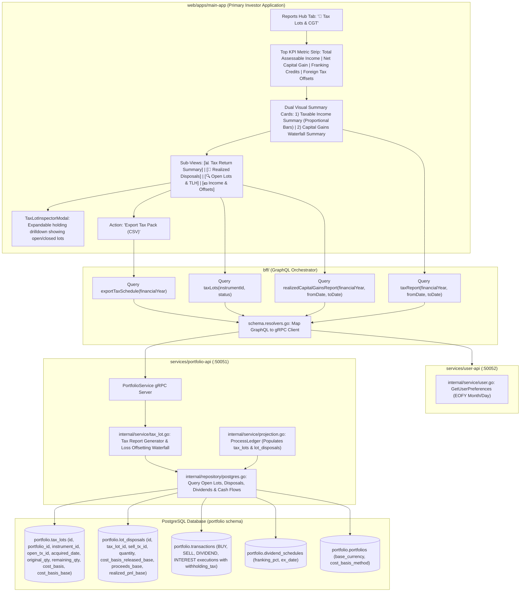

# User Story: Tax Lot Inspector, Realized Capital Gains & Comprehensive Annual Tax Report

> **Story ID**: US-TAX-101  
> **Epic**: Capital Gains, Tax Accounting & Lot Relief Optimization  
> **Target Layers**: Primary Investor Application (`web/apps/main-app`), BFF GraphQL Orchestrator (`bff/`), Portfolio Microservice (`services/portfolio-api`), Protobuf (`proto/portfolio/v1/portfolio.proto`), Database (`portfolio.tax_lots`, `portfolio.lot_disposals`, `portfolio.transactions`, `portfolio.portfolios`, `users.users`)  
> **Status**: Ready for Implementation  
> **Implementation Plan**: [tax-lot-inspector-capital-gains-implementation-plan.md](file:///Users/oscargarcia/workspace/graphfolio/docs/plans/tax-lot-inspector-capital-gains-implementation-plan.md)  
> **Calculation & Accounting Standard**: [financial-calculations skill](file:///Users/oscargarcia/workspace/graphfolio/.agents/skills/financial-calculations/SKILL.md) (FIFO vs Average Cost Lot Relief, Short-Term vs Long-Term CGT Holding Period Rules [ATO 12-Month 50% Discount, IRS 1-Year Preferential Rates, HMRC Section 104 Pooling], Trade-Date Matching, Wash-Sale Rule Detection / 30-Day Bed-and-Breakfasting / Superficial Loss Warnings, Tax-Loss Harvesting Opportunity Scoring, Base Currency vs Instrument Currency FX Gain Decomposition on Disposals, Exact Fixed-Point Precision via `shopspring/decimal`)  
> **Related Stories & Documents**:  
> - [dynamic-cost-basis-switching.md](file:///Users/oscargarcia/workspace/graphfolio/docs/user-stories/dynamic-cost-basis-switching.md) (`US-TAX-102`)  
> - [user-preferences-financial-year-end.md](file:///Users/oscargarcia/workspace/graphfolio/docs/user-stories/user-preferences-financial-year-end.md) (`US-PREF-102`)  
> - [include-closed-positions-dashboard.md](file:///Users/oscargarcia/workspace/graphfolio/docs/user-stories/include-closed-positions-dashboard.md) (`US-INV-102`)  
> - [investment-holding-capital-gain-income-currency.md](file:///Users/oscargarcia/workspace/graphfolio/docs/user-stories/investment-holding-capital-gain-income-currency.md) (`US-INV-101`)  
> - [download-transactions-ledger.md](file:///Users/oscargarcia/workspace/graphfolio/docs/user-stories/download-transactions-ledger.md) (`US-TX-103`)  
> - [portfolio-cash-flow-report-generation.md](file:///Users/oscargarcia/workspace/graphfolio/docs/user-stories/portfolio-cash-flow-report-generation.md) (`US-REP-101`)  
> - [cash-flow-fee-and-tax-attribution.md](file:///Users/oscargarcia/workspace/graphfolio/docs/user-stories/cash-flow-fee-and-tax-attribution.md) (`US-REP-102`)  
> - [interactive-transaction-ingestion-modal.md](file:///Users/oscargarcia/workspace/graphfolio/docs/user-stories/interactive-transaction-ingestion-modal.md) (`US-TX-101`)  
> - [edit-transaction-ledger.md](file:///Users/oscargarcia/workspace/graphfolio/docs/user-stories/edit-transaction-ledger.md) (`US-TX-102`)  
> - [dividend-calendar-yield-analytics.md](file:///Users/oscargarcia/workspace/graphfolio/docs/user-stories/dividend-calendar-yield-analytics.md) (`US-DIV-101`)  
> - [USER_STORIES.md](file:///Users/oscargarcia/workspace/graphfolio/docs/USER_STORIES.md)  
> - [FEATURES.md (Feature #19)](file:///Users/oscargarcia/workspace/graphfolio/FEATURES.md#L686)  

---

## 1. Story Statements

### 1.1 Granular Open Tax Lot Inspection per Holding
> **As an** active investor holding positions accumulated through multiple tranches over several years,  
> **I want to** inspect every individual open purchase tax lot for any selected instrument—viewing acquisition date, original vs remaining share quantity, unit cost basis, total cost basis in both local and base currency, current market price, and unrealized gain/loss,  
> **So that** I know the exact cost anatomy of my position and can make tax-efficient liquidation and rebalancing decisions rather than treating my holding as an opaque aggregated average.

### 1.2 Lot Disposal Traceability & Realized Capital Gain/Loss Audit
> **As a** portfolio owner preparing my annual tax filing,  
> **I want to** trace every historical `SELL` transaction back to the specific purchase lots that were relieved, viewing the relieved cost basis, gross proceeds, selling fees, realized capital gain/loss, and holding period duration,  
> **So that** I have an immutable, auditable paper trail verifying exactly how every dollar of taxable capital gains was computed.

### 1.3 Short-Term vs. Long-Term Capital Gains Classification & CGT Discount Eligibility
> **As a** tax-conscious investor subject to differential capital gains tax rates,  
> **I want** the system to automatically classify open lots and historical disposals as **Short-Term (< 1 Year)** or **Long-Term (≥ 1 Year / 365 Days)** and flag **CGT Discount Eligibility** (such as the Australian ATO 50% discount or US IRS preferential long-term capital gains rates),  
> **So that** I can avoid inadvertently selling shares days before they qualify for concessional tax treatment and maximize my after-tax portfolio wealth.

### 1.4 Tax-Loss Harvesting (TLH) Opportunity Scanner & Wash-Sale Guard
> **As an** investor looking to offset realized capital gains before the financial year ends,  
> **I want** an automated Tax-Loss Harvesting scanner that highlights underwater lots with high cost bases and substantial unrealized capital losses, while warning me if a recent purchase within 30 days risks triggering the Wash-Sale Rule (IRS §1091) or superficial loss / "bed-and-breakfasting" disallowances (ATO / HMRC),  
> **So that** I can capture legal tax deductions without triggering tax authority penalties or disallowed losses.

### 1.5 Consolidated Annual Tax Return Summary (Taxable Income, Capital Gains & Tax Offsets)
> **As an** investor or tax agent preparing an annual tax return (e.g. ATO, IRS, or HMRC),  
> **I want to** view a consolidated Annual Tax Report for any selected financial year that presents high-level KPI cards for **Total Assessable Income**, **Net Capital Gain (after CGT discount)**, **Franking Credits**, and **Foreign Tax Offsets**, accompanied by dual visual summary cards:
> 1. **Taxable Income Summary**: Showing the proportional visual breakdown of Dividend & Interest Income, Net Capital Gains, and Franking Credits culminating in Total Assessable Income with colored progress indicators.
> 2. **Capital Gains Summary**: Reconciling Gross Capital Gains, Capital Losses Applied, 50% CGT Discount, and Net Capital Gain with audit tooltips.
> **So that** I have an instant, audit-ready summary matching statutory tax return line items to plug straight into my tax return or hand to my accountant without manual reconciliation.

### 1.6 Multi-Year Fiscal Year Capital Gains Tax Schedule & Exportable Reports
> **As a** taxpayer or accountant needing tax-ready documentation,  
> **I want to** generate a Capital Gains Tax (CGT) Schedule filtered by my personalized **Financial Year** (using my End of Financial Year setting from [US-PREF-102](file:///Users/oscargarcia/workspace/graphfolio/docs/user-stories/user-preferences-financial-year-end.md)), aggregating Total Realized Capital Gains, Total Realized Losses, Net Capital Gain, and Discounted Taxable Gain, and export the schedule to CSV or print-ready format,  
> **So that** I can complete my annual tax return in minutes or hand my accountant a perfectly reconciled schedule.

### 1.7 Cost Basis Relief Method Comparative Analysis
> **As an** investor evaluating tax planning strategies,  
> **I want to** compare the tax implications of **FIFO (First-In, First-Out)** versus **Average Cost** (and simulate hypothetical Min-Tax / HIFO relief),  
> **So that** I understand how different lot relief conventions impact my current tax liability versus future deferred liabilities.

---

## 2. Background & Problem Context

### 2.1 The Capital Gains "Black Box" in Modern Portfolio Trackers
Retail brokerages and generic investment apps typically treat positions as monolithic averages. While convenient for casual tracking, this abstraction creates serious challenges during tax season:
1. **The Multi-Tranche Cost Basis Dilemma**: An investor who bought 100 shares of Microsoft in 2021 at \$200, 50 shares in 2023 at \$320, and 25 shares in 2024 at \$420 does not own "175 shares at \$265.71". Under tax law (such as US IRC §1012, ATO TR 96/10, or UK TCGA 1992), they hold three discrete tax parcels with different acquisition dates, differing cost bases, and distinct tax treatment.
2. **The "Cliff Edge" of Capital Gains Discounts**: In many jurisdictions, holding an asset for at least 12 months (365 calendar days) unlocks substantial tax relief:
   - **Australia (ATO)**: 50% Capital Gains Tax discount for individuals (only 50% of the net gain is taxable at the marginal rate). Selling at Day 364 doubles the tax burden compared to selling at Day 366.
   - **United States (IRS)**: Long-term capital gains tax rates (0%, 15%, or 20%) vs short-term ordinary income rates (up to 37%).
   - **United Kingdom (HMRC)**: Strict share identification "matching rules" (Same-Day rule, 30-Day "Bed-and-Breakfasting" rule, Section 104 Holding pool).
3. **Currency Distortion on International Assets**: When an Australian or European investor buys US equities, the capital gain consists of two distinct components: the local asset price movement and the foreign exchange (FX) currency movement. Tax authorities require computing the cost basis in the **taxpayer's base currency on the trade date** and proceeds in **base currency on the settlement/trade date**.
4. **The Wash-Sale / Bed-and-Breakfasting Trap**: Investors attempting to harvest tax losses often buy back the same security shortly before or after the sale. Without automated warning indicators, investors unwittingly trigger wash-sale rules that disallow the loss deduction.
5. **Fragmented Tax Return Reporting (The Missing Consolidated Tax Report)**: During annual tax preparation, investors must report overall **Assessable Income** across all investment sources—including dividend income, cash interest, net capital gains after statutory discounts, and attached tax credits (such as Australian franking imputation credits or foreign withholding tax offsets / FITO). Treating capital gains in isolation forces taxpayers and accountants to manually cross-reference separate dividend schedules, cash statements, and trade records. A unified annual tax report dashboard is required to bridge transaction data, capital gains lot relief, and statutory tax return filing.

### 2.2 The Anatomy of a Tax Lot Lifecycle

Every purchase transaction initiates a tax lot that progresses through clear chronological stages:

```
+----------------------------------------------------------------------------------------------------+
|                                    TAX LOT LIFECYCLE IN GRAPHFOLIO                                 |
|                                                                                                    |
|  [1. Acquisition Event]     [2. Corporate Action Adjustment]   [3. Partial / Full Relief]          |
|  BUY Transaction Added:     Stock Split (e.g. 2:1):            SELL Transaction Added:             |
|  • Trade Date = Acq Date    • Qty adjusted: Q_lot * Ratio      • Lot relief algorithm selects lots |
|  • Q_orig = Q_remaining     • Unit cost divided by Ratio       • Cost basis released to disposal   |
|  • Cost Basis = Amt + Fee   • Cost basis remains invariant     • Realized PnL = Proceeds - Basis   |
|                                                                                                    |
|  Status: OPEN (100% Active) Status: ADJUSTED (Open)            Status: CLOSED (If Q_remaining = 0) |
|  Holding Period: Day 0+     Holding Period Preserved           Archived into lot_disposals         |
+----------------------------------------------------------------------------------------------------+
```

### 2.3 Current GraphFolio Architectural State
GraphFolio has already laid the database foundation for tax lots, but has yet to expose this data to the investor:
- **Database Schema**: `portfolio.tax_lots` and `portfolio.lot_disposals` were established in migration `000005_tax_lots.up.sql`.
- **Deterministic Ledger Replay Engine**: In [services/portfolio-api/internal/service/projection.go](file:///Users/oscargarcia/workspace/graphfolio/services/portfolio-api/internal/service/projection.go), `ProcessLedger` already generates `TaxLot` and `LotDisposal` records on every transaction save for both `AVERAGE_COST` and `FIFO` methods.
- **Missing Elements**:
  - `proto/portfolio/v1/portfolio.proto`: Contains zero RPCs or messages to query open tax lots or closed lot disposals.
  - `bff/`: Has no GraphQL types or query resolvers for tax lots or capital gains schedules.
  - `web/apps/main-app`: In [ReportsView.tsx](file:///Users/oscargarcia/workspace/graphfolio/web/apps/main-app/src/components/ReportsView.tsx#L32-L41), the "Tax Lots & CGT" button remains disabled with a `"SOON"` badge.
  - Holdings table in [Dashboard.tsx](file:///Users/oscargarcia/workspace/graphfolio/web/apps/main-app/src/components/Dashboard.tsx) shows aggregated `averageBuyPrice`, `capitalGainAmount`, and `totalValue`, but provides no breakdown into individual open lots.

---

## 3. Financial, Mathematical & Tax Accounting Mechanics

All tax calculations, parcel matching, and holding period categorizations must comply strictly with the [financial-calculations skill](file:///Users/oscargarcia/workspace/graphfolio/.agents/skills/financial-calculations/SKILL.md) and use arbitrary-precision fixed-point math (`shopspring/decimal`).

### 3.1 Tax Lot Acquisition Cost Basis Formulation
For an acquisition transaction $T_{\text{buy}}$ of instrument $i$ on trade date $t_{\text{acq}}$:

$$Q_{\text{orig}} = Q_{\text{buy}}$$

$$\text{CostBasis}_{\text{local}} = \text{Amount}_{\text{buy}} + \text{BrokerageFee}_{\text{local}}$$

$$\text{CostBasis}_{\text{base}} = (\text{Amount}_{\text{buy}} \times \text{FX}(C_i \to C_{\text{base}}, t_{\text{acq}})) + \text{BrokerageFee}_{\text{base}}$$

$$\text{UnitCostBasis}_{\text{base}} = \frac{\text{CostBasis}_{\text{base}}}{Q_{\text{orig}}}$$

- **Brokerage Capitalization**: Brokerage fees paid on acquisition are capitalized into the initial cost basis of the tax lot (under US GAAP ASC 946, ATO s 110-25, and HMRC TCGA 1992 s 38).

### 3.2 Realized Capital Gain/Loss Formulation on Disposal
When a `SELL` transaction occurs on trade date $t_{\text{sell}}$ for quantity $Q_{\text{sell}}$ with gross proceeds and selling fees:

$$\text{NetProceeds}_{\text{base}} = (\text{Amount}_{\text{sell}} \times \text{FX}(C_i \to C_{\text{base}}, t_{\text{sell}})) - \text{BrokerageFee}_{\text{base}}$$

When matching and relieving an open lot $k$ for quantity $\Delta Q_k$ ($\Delta Q_k \le Q_{\text{remaining}, k}$):

$$\text{CostBasisReleased}_{\text{base}, k} = \text{CostBasis}_{\text{base}, k} \times \left( \frac{\Delta Q_k}{Q_{\text{remaining}, k}} \right)$$

$$\text{LotProceeds}_{\text{base}, k} = \text{NetProceeds}_{\text{base}} \times \left( \frac{\Delta Q_k}{Q_{\text{sell}}} \right)$$

$$\text{RealizedPnL}_{\text{base}, k} = \text{LotProceeds}_{\text{base}, k} - \text{CostBasisReleased}_{\text{base}, k}$$

#### Decomposition into Asset Price Gain vs. Currency FX Gain:
For international holdings denominated in currency $C_i \ne C_{\text{base}}$:

$$\text{AssetPriceGain}_{\text{base}, k} = \Delta Q_k \times (P_{\text{sell}} - P_{\text{acq}, k}) \times \text{FX}(C_i \to C_{\text{base}}, t_{\text{acq}})$$

$$\text{CurrencyFXGain}_{\text{base}, k} = \Delta Q_k \times P_{\text{sell}} \times [\text{FX}(C_i \to C_{\text{base}}, t_{\text{sell}}) - \text{FX}(C_i \to C_{\text{base}}, t_{\text{acq}})]$$

$$\text{TotalCapitalGain}_{\text{base}, k} \approx \text{AssetPriceGain}_{\text{base}, k} + \text{CurrencyFXGain}_{\text{base}, k}$$

### 3.3 Holding Period Duration & Term Classification
The holding period duration $D_{\text{holding}}$ measures elapsed calendar days from acquisition date to disposal date (or current evaluation date for open lots):

$$D_{\text{holding}} = t_{\text{disposal}} - t_{\text{acq}}$$

#### Classification Rules:
```text
IF D_holding < 365:
    TermClassification = "SHORT_TERM"
    DiscountEligible   = FALSE
    TaxImplication     = "Taxed at standard marginal income tax rate"
ELSE:
    TermClassification = "LONG_TERM"
    DiscountEligible   = TRUE
    TaxImplication     = "Eligible for concessional capital gains rates / 50% CGT discount"
```

#### ATO 12-Month Rule Specifics:
Under Australian tax law (ITAA 1997 s 115-25):
- The day of acquisition is **excluded**, and the asset must be held for **at least 12 months** before the disposal date.
- Example: Shares acquired on **15 March 2024** become eligible for the 50% CGT discount on **16 March 2025**. A sale on or before 15 March 2025 is classified as Short-Term.
- Leap years (366 days) are respected by calendar date matching: an asset acquired on 28 February in a leap year qualifies on 1 March the following year.

### 3.4 Multi-Lot Relief Sequencing
GraphFolio supports multiple parcel relief methods:

| Method | Order of Lot Depletion | Typical Tax Objective | Supported in GraphFolio |
|---|---|---|:---:|
| **FIFO (First-In, First-Out)** | Earliest `acquired_date ASC` first | Maximum long-term classification; default in US/UK | **Fully Supported** |
| **Average Cost (WAC)** | Pro-rata across all open lots | Smoothed cost basis; standard for mutual funds / trusts | **Fully Supported** |
| **HIFO (Highest-In, First-Out)** | Highest `unit_cost_base DESC` first | **Min-Tax**: Minimizes current realized capital gains | Planned Simulation |
| **LIFO (Last-In, First-Out)** | Latest `acquired_date DESC` first | Preserves older lots; tax deferral | Planned Simulation |

### 3.5 Capital Gains Waterfall Reconciliation & Optimal Loss Application
For any fiscal period $[T_{\text{start}}, T_{\text{end}}]$ defined by the user's EOFY preferences, capital gains are reconciled through the statutory capital gains waterfall:

1. **Total Capital Gains**:
   $$\text{TotalCapitalGains}_{\text{base}} = \sum_{k \in \text{Disposals}, \text{PnL}_k > 0} \text{RealizedPnL}_{\text{base}, k} = G_{\text{ST}} + G_{\text{LT}}$$
   Where $G_{\text{ST}}$ represents Short-Term gains (< 365 days) and $G_{\text{LT}}$ represents Long-Term gains ($\ge 365$ days).

2. **Total Capital Losses**:
   $$\text{TotalCapitalLosses}_{\text{base}} = \sum_{k \in \text{Disposals}, \text{PnL}_k < 0} |\text{RealizedPnL}_{\text{base}, k}|$$

3. **Losses Applied**:
   $$\text{LossesApplied}_{\text{base}} = \min(\text{TotalCapitalGains}_{\text{base}}, \text{TotalCapitalLosses}_{\text{base}} + \text{PriorYearLossesCarriedForward})$$

4. **Optimal Loss Offsetting Order (Tax Minimization Principle)**:
   Under statutory tax law (e.g. ATO ITAA 1997 s 102-5, US IRC §1222), capital losses must offset capital gains, but taxpayers are entitled to apply losses in the order that minimizes net tax liability. Losses are therefore applied **first against Short-Term gains** ($G_{\text{ST}}$) which are taxed at 100% ordinary rates, and only subsequent remaining losses offset Long-Term gains ($G_{\text{LT}}$) so as to preserve the 50% CGT discount on remaining long-term gains:
   $$\text{Remaining } G_{\text{ST}} = \max(0, G_{\text{ST}} - \text{LossesApplied})$$
   $$\text{LossesAllocatedToLongTerm} = \max(0, \text{LossesApplied} - G_{\text{ST}})$$
   $$\text{Remaining } G_{\text{LT}} = \max(0, G_{\text{LT}} - \text{LossesAllocatedToLongTerm})$$

5. **CGT Discount (50% Concession on Remaining Long-Term Gains)**:
   $$\text{CGTDiscount}_{\text{base}} = 0.50 \times \text{Remaining } G_{\text{LT}}$$

6. **Net Capital Gain**:
   $$\text{NetCapitalGain}_{\text{base}} = \text{Remaining } G_{\text{ST}} + (\text{Remaining } G_{\text{LT}} - \text{CGTDiscount}_{\text{base}})$$
   $$\equiv \text{TotalCapitalGains}_{\text{base}} - \text{LossesApplied}_{\text{base}} - \text{CGTDiscount}_{\text{base}}$$

#### Reconciliation Example (From Tax Report View):
- **Total Capital Gains**: \$6,064.99
- **Losses Applied**: -\$350.17
- *Gains after loss offset*: \$6,064.99 - \$350.17 = \$5,714.82
- **CGT Discount 50%**: -\$2,857.41 (50% of \$5,714.82)
- **Net Capital Gain**: **\$2,857.41** (Flows directly to Taxable Income Summary)

---

### 3.6 Taxable & Assessable Income Formulation
During annual tax return filing, investors must consolidate all income streams generated by their portfolio. Total Assessable Income is defined as:

$$\text{TotalAssessableIncome}_{\text{base}} = \text{DividendAndInterestIncome}_{\text{base}} + \text{NetCapitalGain}_{\text{base}} + \text{FrankingCredits}_{\text{base}}$$

Where:
- $\text{DividendAndInterestIncome}_{\text{base}}$: Sum of all cash dividends and cash interest received across the financial year, converted to base currency on receipt date:
  $$\text{DividendAndInterestIncome}_{\text{base}} = \sum_{T \in \{\text{DIVIDEND}, \text{INTEREST}\}} \text{Amount}_T \times \text{FX}(C_T \to C_{\text{base}}, t_T)$$
- $\text{NetCapitalGain}_{\text{base}}$: The statutory net capital gain after losses and CGT discounts computed in Section 3.5.
- $\text{FrankingCredits}_{\text{base}}$ (**Imputation Gross-Up**): Under tax legislation (such as ATO ITAA 1997 Division 207), franking (imputation) credits attached to domestic dividends represent corporate tax already remitted by the paying company and must be included ("grossed up") into assessable income.

#### Reconciliation Example (From Tax Report View):
- **Dividend & Interest Income**: \$2,966.80
- **Capital Gains (Net)**: \$2,857.41
- **Franking Credits**: \$300.33
- **Total Assessable Income**: **\$6,124.54** ($\$2,966.80 + \$2,857.41 + \$300.33 \equiv \$6,124.54$)

#### Proportional Ratio Bar Percentages:
For the visual stacked/horizontal ratio indicators in the UI:
$$\text{Ratio}_{\text{div\_int}} = \frac{\$2,966.80}{\$6,124.54} \times 100\% = 48.44\% \quad (\text{Amber / Orange Bar})$$
$$\text{Ratio}_{\text{cgt}} = \frac{\$2,857.41}{\$6,124.54} \times 100\% = 46.66\% \quad (\text{Coral / Red Bar})$$
$$\text{Ratio}_{\text{franking}} = \frac{\$300.33}{\$6,124.54} \times 100\% = 4.90\% \quad (\text{Purple Bar})$$

---

### 3.7 Tax Offsets (Franking Credits & Foreign Tax Offsets / FITO)
Unlike deductions which reduce assessable income, **Tax Offsets** reduce an investor's net tax payable directly dollar-for-dollar:

1. **Franking Credits Offset (\$300.33 Available Offset)**:
   - Refundable tax offset derived from franked dividends. If the offset exceeds the investor's tax liability, the surplus is refunded to the taxpayer by the tax authority.
2. **Foreign Tax Offsets (FITO / Foreign Withholding Tax, \$324.18 Available Offset)**:
   - Non-refundable tax offset representing foreign withholding taxes ($\sum \text{withholding\_tax}$) deducted at source by foreign jurisdictions (e.g. US IRS 15% WHT under the Australia-US Double Taxation Treaty).
   - Allows investors to prevent double taxation on international dividend income.

---

### 3.8 Tax-Loss Harvesting (TLH) Opportunity Scoring
For every open tax lot $j$ held at evaluation date $t$ with current market price $P_{\text{current}, i}$:

$$\text{CurrentLotValue}_{\text{base}, j} = Q_{\text{remaining}, j} \times P_{\text{current}, i} \times \text{FX}(C_i \to C_{\text{base}}, t)$$

$$\text{UnrealizedPnL}_{\text{base}, j} = \text{CurrentLotValue}_{\text{base}, j} - \text{CostBasis}_{\text{base}, j}$$

$$\text{LossHarvestScore}_j = \begin{cases} |\text{UnrealizedPnL}_{\text{base}, j}| & \text{if } \text{UnrealizedPnL}_{\text{base}, j} < 0 \\ 0 & \text{otherwise} \end{cases}$$

Lots with $\text{LossHarvestScore}_j > \$500$ (or equivalent in base currency) and an unrealized loss exceeding $-10\%$ are flagged with a **"TLH Candidate"** badge.

### 3.9 Wash-Sale & Bed-and-Breakfasting Detection Logic
To protect investors from disallowed loss deductions:
- **US IRS Wash-Sale Rule (IRC §1091)**: Disallows loss deduction if the investor purchases "substantially identical" stock within a **61-day window** (30 days before the sale, the day of the sale, or 30 days after the sale).
- **UK HMRC 30-Day Bed-and-Breakfasting Rule**: If an investor sells shares and buys back shares of the same company within 30 days, the sale is matched against the subsequent purchase rather than the Section 104 holding pool.
- **Rule Formulation**:
  When inspecting an underwater lot for potential sale at date $t$:
  $$\text{HasWashSaleRisk}(i, t) = \exists T \in \text{Transactions} \text{ where } T.\text{InstrumentID} = i \land T.\text{Type} = \text{BUY} \land |T.\text{TradeDate} - t| \le 30 \text{ days}$$
  If true, the UI displays a warning banner:
  > ⚠️ **Wash-Sale Risk**: A purchase of this instrument occurred on [Date] (within 30 days). Realizing a loss now may trigger wash-sale loss deferral rules.

---

## 4. Architectural & System Design Breakdown

Following the layered architecture defined in `AGENTS.md`:



### 4.1 Database Layer (`services/portfolio-api/migrations/`)
The database schema was created in migration `000005_tax_lots.up.sql` and is already operational:
- **`portfolio.tax_lots`**: Tracks every purchase parcel with `remaining_quantity` and `cost_basis_base`.
- **`portfolio.lot_disposals`**: Records every lot relieved by a `SELL` transaction with `cost_basis_released_base`, `proceeds_base`, and `realized_pnl_base`.
- **`portfolio.transactions`**: Slices `DIVIDEND` and `INTEREST` payments, along with `withholding_tax` (for Foreign Tax Offsets) and `fx_rate_to_base`.
- **`portfolio.dividend_schedules`**: Slices corporate dividend declarations and `franking_pct` (for Australian imputation credits).
- **Query Optimization**: Existing index `tax_lots_open_idx` on `(portfolio_id, instrument_id, acquired_date, id) WHERE remaining_quantity > 0` allows instant filtering of active tax parcels.
- **New Index Requirement**:
  ```sql
  -- Index on lot_disposals to optimize fiscal year date-range slicing via sell transactions
  CREATE INDEX IF NOT EXISTS lot_disposals_cgt_reporting_idx
      ON portfolio.lot_disposals (sell_transaction_id, tax_lot_id);
  ```

### 4.2 Protobuf Contract Layer (`proto/portfolio/v1/portfolio.proto`)

Define service contracts in `proto/portfolio/v1/portfolio.proto`:

```protobuf
enum TaxLotStatus {
  TAX_LOT_STATUS_UNSPECIFIED = 0;
  TAX_LOT_STATUS_OPEN        = 1;
  TAX_LOT_STATUS_CLOSED      = 2;
  TAX_LOT_STATUS_ALL         = 3;
}

enum HoldingTermClassification {
  HOLDING_TERM_UNSPECIFIED = 0;
  HOLDING_TERM_SHORT_TERM  = 1; // Held < 365 days
  HOLDING_TERM_LONG_TERM   = 2; // Held >= 365 days (CGT discount eligible)
}

message TaxLotItem {
  string                    id                          = 1;
  string                    portfolio_id                = 2;
  string                    instrument_id               = 3;
  string                    ticker                      = 4;
  string                    name                        = 5;
  string                    open_transaction_id         = 6;
  string                    acquired_date               = 7;  // YYYY-MM-DD
  string                    closed_date                 = 8;  // YYYY-MM-DD (null if open)
  common.v1.Decimal         original_quantity           = 9;
  common.v1.Decimal         remaining_quantity          = 10;
  common.v1.Money           cost_basis                  = 11; // In instrument currency
  common.v1.Money           cost_basis_base             = 12; // In portfolio base currency
  common.v1.Money           unit_cost_base              = 13; // Cost basis per share
  common.v1.Money           current_price               = 14;
  common.v1.Money           market_value_base           = 15;
  common.v1.Money           unrealized_pnl_base         = 16;
  common.v1.Decimal         unrealized_pnl_percent      = 17;
  int32                     holding_period_days         = 18;
  HoldingTermClassification term_classification         = 19;
  bool                      is_cgt_discount_eligible    = 20;
  bool                      is_loss_harvesting_candidate = 21;
  bool                      has_wash_sale_risk          = 22;
}

message ListTaxLotsRequest {
  string          user_id       = 1;
  optional string instrument_id = 2; // Optional filter by ticker / asset
  TaxLotStatus    status        = 3; // OPEN, CLOSED, or ALL
}

message ListTaxLotsResponse {
  repeated TaxLotItem tax_lots = 1;
}

message RealizedDisposalItem {
  string                    disposal_id                 = 1;
  string                    tax_lot_id                  = 2;
  string                    sell_transaction_id         = 3;
  string                    instrument_id               = 4;
  string                    ticker                      = 5;
  string                    name                        = 6;
  string                    acquired_date               = 7;  // YYYY-MM-DD
  string                    disposed_date               = 8;  // YYYY-MM-DD
  common.v1.Decimal         quantity_disposed           = 9;
  common.v1.Money           cost_basis_relieved_base    = 10;
  common.v1.Money           proceeds_base               = 11;
  common.v1.Money           realized_pnl_base           = 12;
  common.v1.Decimal         realized_pnl_percent        = 13;
  int32                     holding_period_days         = 14;
  HoldingTermClassification term_classification         = 15;
  bool                      is_cgt_discount_eligible    = 16;
  common.v1.Money           discounted_taxable_pnl_base = 17; // 50% discount if eligible
}

// ------------------------------------------------------------------
// Tax Return Summary & Reconciliation Contracts
// ------------------------------------------------------------------

message TaxableIncomeSummary {
  common.v1.Money   dividend_and_interest_income = 1;
  common.v1.Money   net_capital_gains            = 2;
  common.v1.Money   franking_credits             = 3;
  common.v1.Money   total_assessable_income      = 4;
  common.v1.Decimal dividend_interest_ratio_pct  = 5; // e.g. 48.44%
  common.v1.Decimal capital_gains_ratio_pct      = 6; // e.g. 46.66%
  common.v1.Decimal franking_credits_ratio_pct   = 7; // e.g. 4.90%
}

message CapitalGainsSummary {
  common.v1.Money   total_capital_gains          = 1;
  common.v1.Money   losses_applied               = 2;
  common.v1.Money   cgt_discount_amount          = 3; // 50% discount for eligible long-term
  common.v1.Money   net_capital_gain             = 4;
  common.v1.Decimal cgt_discount_rate_pct        = 5; // e.g. 50.0%
  int32             gain_disposals_count         = 6;
  int32             loss_disposals_count         = 7;
}

message TaxOffsetsSummary {
  common.v1.Money   franking_credits_offset      = 1; // Available refundable imputation offset
  common.v1.Money   foreign_tax_offsets          = 2; // Available non-refundable foreign withholding offset (FITO)
  common.v1.Money   total_available_offsets      = 3;
}

message TaxReportSummary {
  TaxableIncomeSummary taxable_income            = 1;
  CapitalGainsSummary  capital_gains             = 2;
  TaxOffsetsSummary    tax_offsets               = 3;
  string               fiscal_year_label         = 4; // e.g. "FY2025-2026"
  string               base_currency             = 5;
}

message GetTaxReportRequest {
  string          user_id      = 1;
  optional int32  fiscal_year  = 2; // e.g. 2026
  optional string from_date    = 3; // YYYY-MM-DD
  optional string to_date      = 4; // YYYY-MM-DD
}

message GetTaxReportResponse {
  TaxReportSummary              summary              = 1;
  repeated RealizedDisposalItem disposals            = 2;
  repeated TaxLotItem           open_lots            = 3;
  string                        from_date            = 4;
  string                        to_date              = 5;
  string                        fiscal_year_label    = 6;
  string                        base_currency        = 7;
}

message RealizedGainsSummary {
  common.v1.Money   total_proceeds_base         = 1;
  common.v1.Money   total_cost_basis_relieved   = 2;
  common.v1.Money   gross_realized_gains_base   = 3;
  common.v1.Money   gross_realized_losses_base  = 4;
  common.v1.Money   net_realized_pnl_base       = 5;
  common.v1.Money   short_term_gains_base       = 6;
  common.v1.Money   long_term_gains_base        = 7;
  common.v1.Money   discounted_taxable_gain_base = 8;
  int32             total_disposal_count        = 9;
}

message GetRealizedGainsReportRequest {
  string          user_id     = 1;
  optional string from_date   = 2; // YYYY-MM-DD
  optional string to_date     = 3; // YYYY-MM-DD
  optional int32  fiscal_year = 4; // e.g. 2025 (FY25)
}

message GetRealizedGainsReportResponse {
  RealizedGainsSummary          summary       = 1;
  repeated RealizedDisposalItem disposals     = 2;
  string                        from_date     = 3;
  string                        to_date       = 4;
  string                        base_currency = 5;
}

service PortfolioService {
  // ... existing RPCs ...
  rpc ListTaxLots(ListTaxLotsRequest) returns (ListTaxLotsResponse) {}
  rpc GetRealizedGainsReport(GetRealizedGainsReportRequest) returns (GetRealizedGainsReportResponse) {}
  rpc GetTaxReport(GetTaxReportRequest) returns (GetTaxReportResponse) {}
}
```

### 4.3 Domain & Microservice Layer (`services/portfolio-api`)
1. **Domain Model (`internal/domain/tax_lot.go` & `internal/domain/tax_report.go`)**:
   - Define domain structs `TaxLot`, `LotDisposal`, `TaxLotFilter`, `RealizedGainsReport`, `RealizedGainsSummary`, `TaxReportSummary`, `TaxableIncomeSummary`, `CapitalGainsSummary`, and `TaxOffsetsSummary`.
   - Add business methods:
     - `CalculateHoldingDays(acquiredDate, evalDate time.Time) int`
     - `IsCGTDiscountEligible(acquiredDate, disposalDate time.Time) bool` (respecting ATO 12-month calendar logic)
     - `CalculateCapitalGainsWaterfall(disposals []LotDisposal) CapitalGainsSummary` (allocating losses to short-term gains first before long-term gains)
     - `CalculateTaxableIncomeSummary(dividendIncome, interestIncome decimal.Decimal, frankingCredits decimal.Decimal, netCapitalGain decimal.Decimal) TaxableIncomeSummary`
     - `IsLossHarvestingCandidate(unrealizedLoss decimal.Decimal, unrealizedPercent decimal.Decimal) bool`
2. **Repository Queries (`internal/repository/postgres.go`)**:
   - `GetTaxLots(ctx, portfolioID, instrumentID, status)`: Joined query against `portfolio.tax_lots tl`, `portfolio.instruments i`, and `portfolio.prices p`.
   - `GetRealizedDisposals(ctx, portfolioID, fromDate, toDate)`: Lateral join combining `portfolio.lot_disposals ld`, `portfolio.tax_lots tl`, `portfolio.transactions tx_sell`, and `portfolio.instruments i`.
   - `GetTaxReportIncomeAndOffsets(ctx, portfolioID, fromDate, toDate)`: Aggregates `DIVIDEND` and `INTEREST` amounts, `withholding_tax` (FITO), and franking credits calculated from `portfolio.dividend_schedules`.
3. **Service Logic (`internal/service/tax_lot.go`)**:
   - `ListTaxLots(ctx, userID, filter)`: Enforces user authorization, retrieves open lots, injects latest prices and spot FX rates, computes holding period days and TLH candidate flags.
   - `GetRealizedGainsReport(ctx, userID, fromDate, toDate, fiscalYear)`: Slices disposals according to the user's fiscal year boundaries, calculates gross gains, gross losses, short-term vs long-term buckets, and discounted net taxable gains.
   - `GetTaxReport(ctx, userID, fiscalYear, fromDate, toDate)`: Orchestrates complete annual tax return summary—retrieves realized disposals, runs capital gains waterfall, pulls dividend and interest income, aggregates franking credits and foreign tax offsets, and calculates exact assessable income and visual progress bar ratios.

### 4.4 BFF GraphQL Layer (`bff/`)
1. **GraphQL Schema (`bff/graph/schema.graphqls`)**:
   ```graphql
   enum TaxLotStatus {
     OPEN
     CLOSED
     ALL
   }

   enum HoldingTermClassification {
     SHORT_TERM
     LONG_TERM
   }

   type TaxLot {
     id: ID!
     instrumentId: ID!
     ticker: String!
     name: String!
     openTransactionId: ID!
     acquiredDate: String!
     closedDate: String
     originalQuantity: String!
     remainingQuantity: String!
     costBasis: Money!
     costBasisBase: Money!
     unitCostBase: Money!
     currentPrice: Money!
     marketValueBase: Money!
     unrealizedPnlBase: Money!
     unrealizedPnlPercent: String!
     holdingPeriodDays: Int!
     termClassification: HoldingTermClassification!
     isCgtDiscountEligible: Boolean!
     isLossHarvestingCandidate: Boolean!
     hasWashSaleRisk: Boolean!
   }

   type RealizedDisposal {
     disposalId: ID!
     taxLotId: ID!
     sellTransactionId: ID!
     instrumentId: ID!
     ticker: String!
     name: String!
     acquiredDate: String!
     disposedDate: String!
     quantityDisposed: String!
     costBasisRelievedBase: Money!
     proceedsBase: Money!
     realizedPnlBase: Money!
     realizedPnlPercent: String!
     holdingPeriodDays: Int!
     termClassification: HoldingTermClassification!
     isCgtDiscountEligible: Boolean!
     discountedTaxablePnlBase: Money!
   }

   type TaxableIncomeSummary {
     dividendAndInterestIncome: Money!
     netCapitalGains: Money!
     frankingCredits: Money!
     totalAssessableIncome: Money!
     dividendInterestRatioPct: String!
     capitalGainsRatioPct: String!
     frankingCreditsRatioPct: String!
   }

   type CapitalGainsSummary {
     totalCapitalGains: Money!
     lossesApplied: Money!
     cgtDiscountAmount: Money!
     netCapitalGain: Money!
     cgtDiscountRatePct: String!
     gainDisposalsCount: Int!
     lossDisposalsCount: Int!
   }

   type TaxOffsetsSummary {
     frankingCreditsOffset: Money!
     foreignTaxOffsets: Money!
     totalAvailableOffsets: Money!
   }

   type TaxReportSummary {
     taxableIncome: TaxableIncomeSummary!
     capitalGains: CapitalGainsSummary!
     taxOffsets: TaxOffsetsSummary!
     fiscalYearLabel: String!
     baseCurrency: String!
   }

   type TaxReport {
     summary: TaxReportSummary!
     disposals: [RealizedDisposal!]!
     openLots: [TaxLot!]!
     fromDate: String!
     toDate: String!
     fiscalYearLabel: String!
     baseCurrency: String!
   }

   type RealizedGainsSummary {
     totalProceedsBase: Money!
     totalCostBasisRelieved: Money!
     grossRealizedGainsBase: Money!
     grossRealizedLossesBase: Money!
     netRealizedPnlBase: Money!
     shortTermGainsBase: Money!
     longTermGainsBase: Money!
     discountedTaxableGainBase: Money!
     totalDisposalCount: Int!
   }

   type RealizedGainsReport {
     summary: RealizedGainsSummary!
     disposals: [RealizedDisposal!]!
     fromDate: String!
     toDate: String!
     baseCurrency: String!
   }

   extend type Query {
     taxReport(financialYear: Int, fromDate: String, toDate: String): TaxReport!
     taxLots(instrumentId: ID, status: TaxLotStatus): [TaxLot!]!
     realizedCapitalGainsReport(financialYear: Int, fromDate: String, toDate: String): RealizedGainsReport!
     exportTaxScheduleCSV(financialYear: Int, fromDate: String, toDate: String): String!
   }
   ```
2. **GraphQL Resolvers (`bff/graph/schema.resolvers.go`)**:
   - `taxReport`: Queries `userService.GetUserPreferences` to resolve the user's `financial_year_end_month` and `financial_year_end_day`, computes exact financial year date boundaries $[T_{\text{start}}, T_{\text{end}}]$, and calls `portfolioService.GetTaxReport`.
   - `taxLots`: Calls `portfolioService.ListTaxLots` with caller's authenticated `userID`.
   - `realizedCapitalGainsReport`: Queries `portfolioService.GetRealizedGainsReport`.
   - `exportTaxScheduleCSV`: Returns formatted RFC 4180 CSV string ready for client-side download.

### 4.5 Web Frontend Layer (`web/apps/main-app`)
1. **Reports Hub Integration (`src/components/ReportsView.tsx`)**:
   - Enable the `"📜 Tax Lots & CGT"` tab button (remove `disabled` and replace `"SOON"` with live badge).
   - Render `<TaxLotsReport preferredCurrency={preferredCurrency} />` when active.
2. **Dedicated Component: `TaxLotsReport.tsx`**:
   - **Top KPI Metric Cards Strip (4 Columns)**:
     - `Total assessable income`: Bold headline figure with fiscal year badge (e.g. `$6,124.54` / `FY2025-2026`).
     - `Net capital gain`: Net taxable capital gains after losses and 50% CGT discount (e.g. `$2,857.41` / `After CGT discount`).
     - `Franking credits`: Total imputation credits available as tax offsets (e.g. `$300.33` / `Available offset`).
     - `Foreign tax offsets`: Total foreign withholding taxes paid on dividends available as offsets (e.g. `$324.18` / `Available offset`).
   - **Dual Visual Summary Cards (2 Columns)**:
     - `TaxableIncomeSummaryCard` ("Taxable income summary"):
       - Row 1: `Dividend & interest income` with an amber/orange proportional bar (`#f59e0b`).
       - Row 2: `Capital gains` (Net) with a coral/red proportional bar (`#ef4444`).
       - Row 3: `Franking credits` (Gross-up) with a purple proportional bar (`#8b5cf6`).
       - Bottom Total: `Total assessable income` (bold sum of the three streams).
     - `CapitalGainsSummaryCard` ("Capital gains summary"):
       - Row 1: `Total capital gains` (gross realized gains before deductions).
       - Row 2: `Losses applied` (with interactive info tooltip `ⓘ` detailing loss offset priority: short-term first, then long-term) in red font.
       - Row 3: `CGT discount 50%` in red font.
       - Bottom Total: `Net capital gain` (bold, matching the Capital gains figure in the left card).
   - **Sub-View Navigation Tabs**:
     - `[ 📊 Tax Return Summary ]`: Executive dashboard containing the KPI strip, dual summary cards, and category breakdowns.
     - `[ 📜 Realized Disposals Schedule ]`: Granular lot-by-lot disposal audit trail with CSV exporter.
     - `[ 🔍 Open Tax Lots & TLH Scanner ]`: Open parcel inventory, unrealized PnL, wash-sale guards, and tax-loss harvesting candidates.
     - `[ 💵 Income & Tax Offsets ]`: Itemized dividend and interest receipts, withholding taxes, and franking credits.
   - **Filter & Controls Bar**:
     - Financial Year Dropdown: `FY2025-2026 (1 Jul 2025 – 30 Jun 2026)`, `FY2024-2025`, `All Time`, `Custom Range`.
     - Asset Filter: Search by Ticker / Company Name.
     - Tax-Loss Harvesting Quick Toggle: Checkbox `"Show TLH Candidates Only"`.
     - Action Buttons: `[📥 Export Full Tax Pack (CSV)]`, `[📄 Print Summary]`.
3. **Inspector Modal / Drawer: `TaxLotInspectorModal.tsx`**:
   - Can be triggered directly from the Holdings table (`Dashboard.tsx`) by clicking a new parcel icon next to any asset.
   - Shows all open parcels for that specific holding with timeline visualization (showing how many days until each lot qualifies for the 12-month long-term CGT discount).

---

## 5. UI / UX Design Specifications

### 5.1 Annual Tax Report Executive Dashboard (`TaxLotsReport.tsx`)

The dashboard mirrors statutory tax reporting requirements, presenting an executive overview of taxable income and capital gains alongside granular audit schedules:

```text
+------------------------------------------------------------------------------------------------------------------------------------------------------------------+
| REPORTS HUB > 📜 TAX LOTS & ANNUAL TAX REPORT                                                                                 [ FY2025-2026 ▼ ]  [📥 Export Tax] |
+------------------------------------------------------------------------------------------------------------------------------------------------------------------+
| TOP KPI METRICS STRIP                                                                                                                                            |
|  +--------------------------------+  +--------------------------------+  +--------------------------------+  +--------------------------------+                  |
|  | Total assessable income        |  | Net capital gain               |  | Franking credits               |  | Foreign tax offsets            |                  |
|  | $6,124.54                      |  | $2,857.41                      |  | $300.33                        |  | $324.18                        |                  |
|  | FY2025-2026                    |  | After CGT discount             |  | Available offset               |  | Available offset               |                  |
|  +--------------------------------+  +--------------------------------+  +--------------------------------+  +--------------------------------+                  |
+------------------------------------------------------------------------------------------------------------------------------------------------------------------+
| DUAL RECONCILIATION SUMMARY CARDS                                                                                                                                |
|                                                                                                                                                                  |
|  +-------------------------------------------------------------+    +-------------------------------------------------------------+                              |
|  | Taxable income summary                                      |    | Capital gains summary                                       |                              |
|  |                                                             |    |                                                             |                              |
|  | Dividend & interest income                       $2,966.80  |    | Total capital gains                              $6,064.99  |                              |
|  | [████████████████████████████░░░░░░░░░░░░░░░░░░░] (48.4%)   |    |                                                             |                              |
|  |                                                             |    | Losses applied ⓘ                                  -$350.17  |                              |
|  | Capital gains                                    $2,857.41  |    |                                                             |                              |
|  | [█████████████████████████░░░░░░░░░░░░░░░░░░░░░░] (46.7%)   |    | CGT discount 50%                                -$2,857.41  |                              |
|  |                                                             |    | ----------------------------------------------------------- |                              |
|  | Franking credits                                   $300.33  |    | Net capital gain                                 $2,857.41  |                              |
|  | [███░░░░░░░░░░░░░░░░░░░░░░░░░░░░░░░░░░░░░░░░░░░░]  (4.9%)   |    |                                                             |                              |
|  | ----------------------------------------------------------- |    |                                                             |                              |
|  | Total assessable income                          $6,124.54  |    |                                                             |                              |
|  +-------------------------------------------------------------+    +-------------------------------------------------------------+                              |
+------------------------------------------------------------------------------------------------------------------------------------------------------------------+
| SUB-VIEWS:  [ (•) 📊 Tax Return Summary ]   [ ( ) 📜 Realized Disposals ]   [ ( ) 🔍 Open Lots & TLH ]   [ ( ) 💵 Income & Offsets ]                             |
+------------------------------------------------------------------------------------------------------------------------------------------------------------------+
| CONTROLS:   Search: [ Filter by Ticker/Name... ]   Classification: [ All Terms ▼ ]   [ ] Show TLH Candidates Only         [📥 Export CGT Schedule (CSV)]          |
+------------------------------------------------------------------------------------------------------------------------------------------------------------------+
```

### 5.2 Realized Disposals Schedule View (`RealizedDisposalsTable`)

```text
+------------------------------------------------------------------------------------------------------------------------------------------------------------------+
| REALIZED CAPITAL GAINS DISPOSALS SCHEDULE (FY2025-2026)                                                                                                          |
| Sell Date   | Asset     | Acq Date    | Qty Disposed | Relieved Basis | Net Proceeds   | Realized PnL          | Holding Period | Classification | Taxable Gain    |
|-------------|-----------|-------------|--------------|----------------|----------------|-----------------------|----------------|----------------|-----------------|
| 15 Sep 2025 | NVDA (US) | 12 Nov 2023 | 75.00000000  | $3,712.50      | $10,365.00     | +$6,652.50 (+179.2%)  | 673 days       | [LONG-TERM]    | $3,326.25 (50%) |
| 02 Aug 2025 | TSLA (US) | 15 May 2025 | 40.00000000  | $8,800.00      | $7,400.00      | -$1,400.00 (-15.9%)   | 79 days        | [SHORT-TERM]   | -$1,400.00      |
| 10 Jul 2025 | CBA.AX    | 08 Feb 2022 | 50.00000000  | $4,350.00      | $7,120.00      | +$2,770.00 (+63.7%)   | 1,248 days     | [LONG-TERM]    | $1,385.00 (50%) |
+------------------------------------------------------------------------------------------------------------------------------------------------------------------+
```

### 5.3 Open Tax Lots & Tax-Loss Harvesting Scanner (`OpenTaxLotsTable`)

```text
+------------------------------------------------------------------------------------------------------------------------------------------------------------------+
| OPEN TAX LOTS & TAX-LOSS HARVESTING SCANNER                                                                                                                      |
| Asset      | Acquired Date | Original Qty | Remaining Qty | Unit Cost (AUD) | Current Price | Market Value  | Unrealized PnL        | Holding Period | Status Badges   |
|------------|---------------|--------------|---------------|-----------------|---------------|---------------|-----------------------|----------------|-----------------|
| AAPL (US)  | 14 Jan 2023   | 50.00000000  | 50.00000000   | $172.40         | $232.50       | $11,625.00    | +$3,005.00 (+34.8%)   | 1,012 days     | [LONG-TERM]     |
| BHP.AX     | 10 Aug 2025   | 200.00000000 | 200.00000000  | $44.20          | $38.90        | $7,780.00     | -$1,060.00 (-12.0%)   | 73 days        | [TLH CANDIDATE] |
| MSFT (US)  | 05 Oct 2025   | 30.00000000  | 30.00000000   | $448.10         | $428.00       | $12,840.00    | -$603.00 (-4.5%)      | 17 days        | [SHORT-TERM]    |
| NVDA (US)  | 12 Nov 2024   | 100.00000000 | 25.00000000   | $49.50 (Adj)    | $138.20       | $3,455.00     | +$2,217.50 (+179.2%)  | 344 days       | [12D TO DISCOUNT]|
+------------------------------------------------------------------------------------------------------------------------------------------------------------------+
| * NOTE: NVDA lot qualifies for 50% CGT Discount in 12 days (24 Oct 2025). Consider holding until maturity before liquidating.                                   |
+------------------------------------------------------------------------------------------------------------------------------------------------------------------+
```

### 5.4 UI Badge Design, Visual Bar Palette & Design Tokens
- **Top KPI Cards**: Dark glassmorphic background `rgba(255, 255, 255, 0.03)` with border `rgba(255, 255, 255, 0.08)`. Headline values rendered in `font-size: 1.75rem`, `font-weight: 700`, with uppercase muted labels (`text-transform: uppercase`, `letter-spacing: 0.05em`).
- **Proportional Progress Bars**:
  - `Dividend & Interest Income`: Amber / Warm Orange (`#f59e0b`, background `rgba(245, 158, 11, 0.2)`). Height: `6px`, border-radius `3px`.
  - `Capital Gains (Net)`: Coral / Crimson Red (`#ef4444`, background `rgba(239, 68, 68, 0.2)`). Height: `6px`, border-radius `3px`.
  - `Franking Credits`: Royal Purple / Violet (`#8b5cf6`, background `rgba(139, 92, 246, 0.2)`). Height: `6px`, border-radius `3px`.
- **Negative / Reduction Values**: Crimson text (`#f87171`) prefixed with minus sign `-`.
- **Losses Applied Tooltip (`ⓘ`)**:
  - Content: *"Capital losses are applied first against short-term capital gains (taxed at ordinary rates) before offsetting long-term gains, maximizing the benefit of the 50% CGT discount."*
- **Classification Badges**:
  - `[LONG-TERM]`: Emerald green badge (`rgba(16, 185, 129, 0.15)`, text `#34d399`). Indicates lot held $\ge 365$ days.
  - `[SHORT-TERM]`: Amber yellow badge (`rgba(245, 158, 11, 0.15)`, text `#fbbf24`). Indicates lot held $< 365$ days.
  - `[TLH CANDIDATE]`: Crimson red pulse badge (`rgba(239, 68, 68, 0.20)`, text `#f87171`, border `1px solid rgba(239, 68, 68, 0.4)`). Indicates loss $> \$500$ and $<-10\%$.
  - `[XD TO DISCOUNT]`: Cyan highlight badge (`rgba(6, 182, 212, 0.15)`, text `#22d3ee`). Countdown badge displayed when an open lot is between 335 and 364 days old.
  - `[WASH SALE RISK]`: Orange warning badge with tooltip explaining the 30-day buyback rule.

---

## 6. Acceptance Criteria (Given - When - Then)

### AC-1: Open Tax Lots Granular Inspection
- **Given** an investor has accumulated 100 shares of an instrument across multiple buy dates (e.g., 60 shares on 10 Jan 2023, 40 shares on 15 Feb 2024),
- **When** the investor opens the Tax Lots & CGT Report or opens the holding's Tax Lot Inspector modal,
- **Then** the table displays each distinct purchase lot as an independent row showing exact acquisition date, original quantity, remaining quantity, unit cost basis in base currency, current market price, and unrealized gain/loss.

### AC-2: Holding Period & Term Classification
- **Given** an open lot was acquired on 15 March 2024,
- **When** inspected on 14 March 2025 (364 days elapsed),
- **Then** the system classifies the lot as `SHORT_TERM`, marks `is_cgt_discount_eligible = false`, and displays an `"1D TO DISCOUNT"` badge.
- **When** inspected on 16 March 2025 (366 days elapsed),
- **Then** the system classifies the lot as `LONG_TERM`, marks `is_cgt_discount_eligible = true`, and displays the `[LONG-TERM]` badge.

### AC-3: Closed Lot Disposal Traceability on SELL
- **Given** a portfolio with multiple open lots operating under `FIFO`,
- **When** a `SELL` transaction is recorded,
- **Then** the system depletes the oldest matching purchase lots first, records discrete records in `portfolio.lot_disposals`, and displays the relieved cost basis, gross proceeds, selling fees, and realized capital gain/loss in the Realized Disposals Schedule.

### AC-4: Fiscal Year Slicing via User EOFY Preference
- **Given** the user has configured EOFY as **30 June** (Australia / [US-PREF-102](file:///Users/oscargarcia/workspace/graphfolio/docs/user-stories/user-preferences-financial-year-end.md)),
- **When** viewing the Realized CGT Schedule or Tax Summary for `FY25`,
- **Then** the report strictly includes disposals, dividends, and cash flows executed between **1 July 2024 and 30 June 2025**, correctly excluding transactions from June 2024 or July 2025.

### AC-5: Tax-Loss Harvesting Opportunity Scanner
- **Given** an investor holds open lots with current market price below unit cost basis,
- **When** an open lot has an unrealized capital loss exceeding \$500 AUD (or equivalent) and an unrealized drop greater than $10\%$,
- **Then** the system flags the lot with the `[TLH CANDIDATE]` badge and calculates total harvestable capital losses in the summary card.

### AC-6: Wash-Sale & Bed-and-Breakfasting Guard
- **Given** an investor owns an underwater lot of ticker `XYZ`,
- **When** a `BUY` transaction for `XYZ` occurred within the last 30 calendar days,
- **Then** the lot displays a `[WASH SALE RISK]` warning badge indicating that selling this lot within 30 days of the buy execution risks triggering wash-sale loss disallowance rules under US IRC §1091 or HMRC 30-day rules.

### AC-7: Consistency with Cost Basis Method Switching
- **Given** the user switches their portfolio cost basis method between `AVERAGE_COST` and `FIFO` via [US-TAX-102](file:///Users/oscargarcia/workspace/graphfolio/docs/user-stories/dynamic-cost-basis-switching.md),
- **When** `RebuildProjections` completes,
- **Then** the Tax Lots and Realized Disposals schedule immediately reflect the updated lot relief calculations without data corruption.

### AC-8: Capital Gains Schedule CSV Export
- **Given** an investor has realized capital gains and losses during the selected financial year,
- **When** clicking `"Export CGT Schedule (CSV)"`,
- **Then** the browser downloads an RFC 4180 compliant CSV file containing all disposals, including columns: `Sell Date, Asset, Ticker, Acquisition Date, Holding Days, Term, Quantity Disposed, Relieved Cost Basis (Base), Gross Proceeds (Base), Brokerage Fees (Base), Net Capital Gain/Loss (Base), CGT Discount (50%), Taxable Net Gain`.

### AC-9: Exact Fixed-Point Precision & Zero-Division Safety
- **Given** instruments with fractional share quantities (e.g. 0.00348122 BTC) or zero acquisition cost (e.g., spin-offs or gifted shares),
- **When** calculations are executed,
- **Then** all computations use arbitrary-precision decimal math (`shopspring/decimal`), zero cost basis lots are safely marked `N/A (Cost Basis = 0)` for return percentages, and zero division errors are strictly prevented.

### AC-10: Consolidated Annual Tax Return Summary & Assessable Income Calculation
- **Given** an investor has received cash dividends, interest income, realized capital gains/losses, and franking credits during the selected financial year,
- **When** viewing the Annual Tax Report executive dashboard,
- **Then** the system displays the top KPI cards for `Total assessable income`, `Net capital gain`, `Franking credits`, and `Foreign tax offsets`.
- **And** the left summary card displays `Dividend & interest income`, `Capital gains` (Net), and `Franking credits`, summing exactly to `Total assessable income` ($\$2,966.80 + \$2,857.41 + \$300.33 \equiv \$6,124.54$).

### AC-11: Capital Gains Reconciliation Waterfall & Loss Application Priority
- **Given** an investor has realized gross capital gains (\$6,064.99), realized capital losses (\$350.17), and eligible long-term gains,
- **When** viewing the `Capital gains summary` card,
- **Then** the system displays:
  - `Total capital gains`: \$6,064.99
  - `Losses applied`: -\$350.17
  - `CGT discount 50%`: -\$2,857.41 (50% applied to remaining eligible long-term gains after loss offset)
  - `Net capital gain`: \$2,857.41
- **And** hovering over the `ⓘ` icon next to `Losses applied` displays a tooltip explaining the tax minimization loss application ordering.

### AC-12: Franking Credits & Foreign Tax Offsets Tracking
- **Given** a portfolio holding Australian domestic shares with franked dividends and foreign shares with foreign withholding taxes deducted,
- **When** generating the Tax Report for the fiscal year,
- **Then** franking credits are grossed up into assessable income and displayed in the `Franking credits` top KPI card and row item.
- **And** foreign withholding taxes paid are aggregated and displayed in the `Foreign tax offsets` top KPI card as an available tax offset.

### AC-13: Proportional Visual Ratio Progress Bars
- **Given** the components of assessable income in the `Taxable income summary` card,
- **When** rendered in the UI,
- **Then** each income item displays a horizontal proportional progress bar with its exact contribution percentage (Amber for Dividend & interest income, Coral for Net capital gains, Purple for Franking credits), where the bar widths are strictly proportional to their dollar share of Total assessable income.

---

## 7. Non-Functional Requirements

### 7.1 Precision & Regulatory Compliance
- **Zero IEEE 754 Floating-Point**: Float types (`float32`, `float64`) are strictly prohibited in all financial code paths. All calculations in Go and GraphQL must utilize `shopspring/decimal`.
- **Statutory Standards**: Complies with CFA Institute GIPS® standards, US GAAP ASC 946 / ASC 820, US IRC §1012 / §1091, and Australian ITAA 1997 Division 115 and Division 207.

### 7.2 Performance & Scalability
- **Sub-100ms Query Latency**: Reading open tax lots and realized disposals must complete within 100ms via indexed lookups on `tax_lots_open_idx` and `lot_disposals_sell_idx`.
- **Precomputed Projections**: Because `ProcessLedger` populates `portfolio.tax_lots` and `portfolio.lot_disposals` at transaction write time, tax reporting queries are fast $O(N)$ reads without on-the-fly replay.

### 7.3 Multi-Tenant Isolation & Security
- **Strict Authorization**: Every query and gRPC call strictly requires a verified JWT Bearer token and scopes portfolio queries to `portfolio.user_id = ctx.UserID`. Cross-tenant data leakage is structurally impossible.

---

## 8. Verification & Test Scenarios

### 8.1 Unit Tests (`services/portfolio-api/internal/service/tax_lot_test.go`)
- **Holding Period Threshold Test**: Verify an asset acquired on 2024-03-15 evaluated on 2025-03-14 returns `SHORT_TERM`, and on 2025-03-15/2025-03-16 returns `LONG_TERM`.
- **ATO 50% CGT Discount Computation**: Test that a long-term capital gain of \$10,000 yields \$5,000 discounted taxable gain, while a short-term gain of \$10,000 yields \$10,000 taxable gain.
- **Capital Loss Offset Sequencing**: Test that gross capital losses of \$4,000 offset short-term gains before long-term gains (maximizing the benefit of the 50% discount on remaining long-term gains).
- **Tax Report Assessable Income Exact Sum Test**: Verify that Dividend Income (\$2,966.80) + Net Capital Gain (\$2,857.41) + Franking Credits (\$300.33) yields exactly Total Assessable Income (\$6,124.54) with zero rounding error.
- **Capital Gains Waterfall Arithmetic Test**: Verify that Total Capital Gains (\$6,064.99) - Losses Applied (\$350.17) - 50% CGT Discount (\$2,857.41) equals Net Capital Gain (\$2,857.41).
- **Tax-Loss Harvesting Scoring**: Verify underwater lots with loss $> 10\%$ and absolute loss $> \$500$ are flagged as candidates.
- **Wash-Sale Detection**: Assert that a buy trade 15 days prior to evaluation flags `has_wash_sale_risk = true`.

### 8.2 Ledger Replay Integration Tests
- **Stock Split Parcel Adjustment**: Verify a 2:1 split on a holding with two purchase lots adjusts both lots' `original_quantity` and `remaining_quantity` by $2\times$ while dividing unit cost by $2$.
- **Partial Sale under FIFO**: Assert that selling 50 shares of a 100-share lot leaves `remaining_quantity = 50` and reduces `cost_basis_base` by exactly $50\%$.

### 8.3 Frontend Cypress / Playwright E2E Tests
- Navigate to Reports Hub $\to$ Tax Lots & CGT.
- Verify top 4 KPI cards render: Total Assessable Income, Net Capital Gain, Franking Credits, Foreign Tax Offsets.
- Verify dual reconciliation summary cards render with correct amounts, colors, and proportional bars.
- Switch Financial Year filter from `FY25` to `FY24` and verify summary cards update dynamically.
- Click "Export CGT Schedule (CSV)" and verify downloaded CSV content matches table rows.

---

## 9. Definition of Done (DoD) Checklist

- [ ] **Protobuf Contract**: `proto/portfolio/v1/portfolio.proto` updated with `TaxLotItem`, `RealizedDisposalItem`, `TaxableIncomeSummary`, `CapitalGainsSummary`, `TaxOffsetsSummary`, `TaxReportSummary`, `ListTaxLots`, `GetRealizedGainsReport`, and `GetTaxReport` RPCs.
- [ ] **Proto Code Generation**: Generated Go stubs (`portfoliopb`) and gRPC interfaces compiled cleanly.
- [ ] **Domain & Repository**: `internal/domain/tax_lot.go`, `internal/domain/tax_report.go`, and `internal/repository/postgres.go` queries implemented with test coverage.
- [ ] **Service Layer**: `internal/service/tax_lot.go` business logic, capital gains waterfall, assessable income aggregation, and holding period algorithms implemented with $>90\%$ unit test coverage.
- [ ] **BFF GraphQL Layer**: `schema.graphqls`, `schema.resolvers.go`, and helpers implemented with type-safe mapping for `taxReport`, `taxLots`, and `realizedCapitalGainsReport`.
- [ ] **Frontend UI**:
  - `web/apps/main-app/src/components/ReportsView.tsx` updated to activate the Tax Lots tab.
  - `web/apps/main-app/src/components/TaxLotsReport.tsx` created with:
    - Top 4 KPI metric cards (Total Assessable Income, Net Capital Gain, Franking Credits, Foreign Tax Offsets).
    - Dual reconciliation summary cards (Taxable income summary with colored proportional bars & Capital gains waterfall summary with loss offset tooltip).
    - Sub-view navigation tabs (Tax Return Summary, Realized Disposals, Open Tax Lots & TLH Scanner, Income & Offsets).
    - Open tax lots table, realized disposals table, and CSV exporter.
  - `TaxLotInspectorModal.tsx` created for drilldown from the dashboard holdings table.
- [ ] **Documentation**: `FEATURES.md` and `USER_STORIES.md` updated to reflect the completed status of Feature #19 / `US-TAX-101`.

