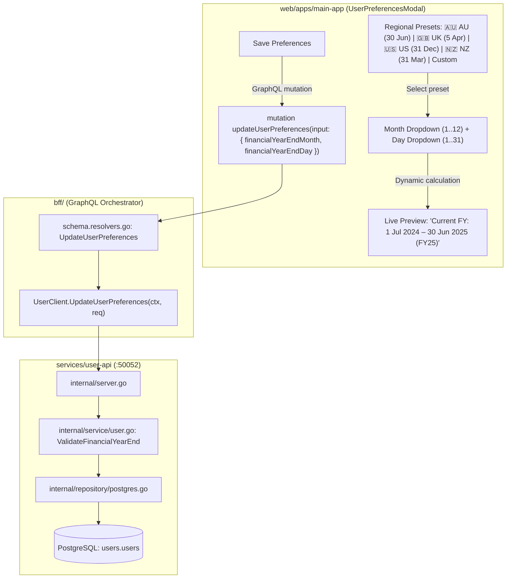

# User Story: User Preferences — End of Financial Year (EOFY) Configuration

> **Story ID**: US-PREF-102  
> **Epic**: Identity, Profile Management & Tax Accounting Configuration  
> **Target Layers**: Primary Investor Application (`web/apps/main-app`), BFF GraphQL Orchestrator (`bff/`), User Domain Microservice (`services/user-api`), Protobuf (`proto/user/v1/user.proto`), Database (`users.users`)  
> **Status**: Completed  
> **Implementation Plan**: [user-preferences-financial-year-end-implementation-plan.md](file:///Users/oscargarcia/workspace/graphfolio/docs/plans/user-preferences-financial-year-end-implementation-plan.md)  
> **Calculation & Accounting Standard**: [financial-calculations skill](file:///Users/oscargarcia/workspace/graphfolio/.agents/skills/financial-calculations/SKILL.md) (Multi-Jurisdictional Tax Calendar Accounting, Fiscal Year-to-Date [FYTD] Boundary Slicing, GIPS® Multi-Period Alignment, Leap Year Adjustments, Regional Tax Regimes: ATO, HMRC, IRS, CRA, IRD, CBDT, SARS)  
> **Related Stories & Documents**:  
> - [user-preferences-and-display-currency.md](file:///Users/oscargarcia/workspace/graphfolio/docs/user-stories/user-preferences-and-display-currency.md) (`US-PREF-101`)  
> - [portfolio-cash-flow-report-generation.md](file:///Users/oscargarcia/workspace/graphfolio/docs/user-stories/portfolio-cash-flow-report-generation.md) (`US-REP-101`)  
> - [cash-flow-fee-and-tax-attribution.md](file:///Users/oscargarcia/workspace/graphfolio/docs/user-stories/cash-flow-fee-and-tax-attribution.md) (`US-REP-102`)  
> - [tax-lot-inspector-capital-gains.md](file:///Users/oscargarcia/workspace/graphfolio/docs/user-stories/tax-lot-inspector-capital-gains.md) (`US-TAX-101`)  
> - [USER_STORIES.md](file:///Users/oscargarcia/workspace/graphfolio/docs/USER_STORIES.md)  

---

## 1. Story Statements

### 1.1 Configurable End of Financial Year in Investor Preferences
> **As an** international investor managing assets in a specific tax jurisdiction (such as Australia, the United Kingdom, the United States, Canada, New Zealand, India, or South Africa),  
> **I want to** configure my personal **End of Financial Year (EOFY)** date (month and day) in my Account Preferences modal,  
> **So that** GraphFolio knows my exact fiscal tax calendar cutoff and can accurately align all tax-year reports, income summaries, and annual performance calculations to my local tax year rather than forcing an arbitrary calendar year (January 1 – December 31).

### 1.2 One-Click Regional Presets with Custom Override
> **As an** investor who may not recall the exact calendar day of my regional tax year end,  
> **I want to** choose from one-click jurisdiction presets (e.g., 🇦🇺 Australia: 30 June, 🇬🇧 UK: 5 April, 🇺🇸 USA / 🇨🇦 Canada: 31 December, 🇳🇿 New Zealand / 🇮🇳 India: 31 March, 🇿🇦 South Africa: 28 February) or customize the exact month and day,  
> **So that** I can configure my tax profile in seconds without confusion while retaining full flexibility for non-standard corporate or personal tax years.

### 1.3 Dynamic Fiscal Year Boundary Preview
> **As an** investor setting my financial year end,  
> **I want** the preferences interface to immediately display an interactive preview showing my **Current Financial Year** (e.g., `"1 July 2024 – 30 June 2025 (FY25)"`) and **Previous Financial Year**,  
> **So that** I can visually confirm that my tax periods are configured correctly before saving my preferences.

### 1.4 Downstream Foundation for Fiscal Reporting & Filters
> **As a** tax-conscious investor preparing for annual tax filing,  
> **I want** my chosen EOFY setting to be persistently stored on my user account and broadcast to downstream services,  
> **So that** portfolio reports (such as the Cash Flow Statement, Dividend Tax Summaries, and Capital Gains reports) and timeframe filters (e.g., `FYTD` — Financial Year to Date, `Last FY`) automatically slice transactions and valuations according to my personalized financial year boundaries.

---

## 2. Background & Problem Context

### 2.1 The Global Disparity in Financial Year Calendars
Modern retail investors frequently trade globally, yet tax and reporting compliance remains strictly local. Unlike calendar years, financial years vary drastically across major investment markets:

| Jurisdiction | Authority | Standard EOFY | Fiscal Year Range (Example: 2024–2025) | Tax Label |
|:---|:---|:---:|:---:|:---:|
| 🇦🇺 **Australia** | Australian Taxation Office (ATO) | **30 June** | 1 July 2024 – 30 June 2025 | **FY25** |
| 🇬🇧 **United Kingdom** | HM Revenue & Customs (HMRC) | **5 April** | 6 April 2024 – 5 April 2025 | **2024/25** |
| 🇺🇸 **United States** | Internal Revenue Service (IRS) | **31 December** | 1 January 2025 – 31 December 2025 | **TY25** |
| 🇨🇦 **Canada** | Canada Revenue Agency (CRA) | **31 December** | 1 January 2025 – 31 December 2025 | **TY25** |
| 🇳🇿 **New Zealand** | Inland Revenue (IRD) | **31 March** | 1 April 2024 – 31 March 2025 | **FY25** |
| 🇮🇳 **India** | Income Tax Department (CBDT) | **31 March** | 1 April 2024 – 31 March 2025 | **AY 2025–26** |
| 🇿🇦 **South Africa** | South African Revenue Service (SARS) | **28 February** | 1 March 2024 – 28 February 2025 | **2025** |

### 2.2 The Problem: Current GraphFolio Limitations
Currently, GraphFolio's user preferences model (`users.users`, `proto/user/v1/user.proto`, `UserPreferencesModal.tsx`) only tracks three fields:
1. `display_name`
2. `display_currency` (ISO-4217 code, e.g. `USD`, `AUD`, `EUR`)
3. `theme` (`DARK`, `LIGHT`, `SYSTEM`)

```
+----------------------------------------------------------------------------------------------------+
| CURRENT USER PREFERENCES MODAL:                                                                    |
|                                                                                                    |
|  [ Avatar / Meta ]  Oscar Garcia (oscar@graphfolio.app)                                            |
|  Display Name:      [ Oscar Garcia                     ]                                           |
|  Display Currency:  [ 🇦🇺 AUD - Australian Dollar    ▼ ]                                           |
|  Interface Theme:   (•) Dark    ( ) Light    ( ) System                                            |
|                                                                                                    |
|  * NOTICE: End of Financial Year (EOFY) configuration is COMPLETELY ABSENT!                        |
+----------------------------------------------------------------------------------------------------+
```

Consequently:
1. **Severe Tax Misalignment for Non-US Investors**:
   For an Australian investor whose tax year runs from July 1 to June 30, a standard calendar-year "YTD" (Jan 1 to Dec 31) groups income and capital gains across **two separate ATO tax years** (the second half of FY24 and the first half of FY25). This makes automated tax preparation impossible without manual spreadsheet manipulation.
2. **Missing Fiscal Year Presets**:
   In reports such as the Cash Flow Statement (`CashFlowReport.tsx`) and historical valuation charts, the timeframe selector offers generic intervals (`1M`, `3M`, `6M`, `1Y`, `YTD`, `ALL`), but cannot offer `FYTD` (Financial Year to Date) or `Last FY` because the platform does not know the user's fiscal year cycle.
3. **UK 5th April Peculiarity Ignored**:
   The UK tax year starts on 6 April and ends on 5 April. A system restricted to calendar month-ends cannot even model UK tax years accurately.

---

## 3. Financial, Calendaring & Date Mechanics

All fiscal year calculations must conform to the [financial-calculations skill](file:///Users/oscargarcia/workspace/graphfolio/.agents/skills/financial-calculations/SKILL.md) and international calendaring standards.

### 3.1 Fiscal Year Parameterization
An investor's financial year end is defined by two immutable integers:
- $M_{\text{EOFY}} \in [1, 12]$ (Ending Month: 1 = January, ..., 12 = December)
- $D_{\text{EOFY}} \in [1, 31]$ (Ending Day: valid for the selected month)

Default value: If not configured, the platform defaults to **Month = 6, Day = 30** for accounts with `base_currency = 'AUD'`, or **Month = 12, Day = 31** as the universal fallback.

### 3.2 Fiscal Year Boundary Determination Algorithm
Given an evaluation date $T = (\text{Year}_T, \text{Month}_T, \text{Day}_T)$ and an EOFY configuration $(M_{\text{EOFY}}, D_{\text{EOFY}})$:

1. **Construct Candidate End Date for Year of $T$**:
   $$\text{CandidateEndDate} = \text{Date}(\text{Year}_T, M_{\text{EOFY}}, D_{\text{EOFY}})$$
2. **Determine Active Financial Year End ($T_{\text{End}}$)**:
   - If $T \le \text{CandidateEndDate}$:
     $$T_{\text{End}} = \text{CandidateEndDate}$$
   - If $T > \text{CandidateEndDate}$:
     $$T_{\text{End}} = \text{Date}(\text{Year}_T + 1, M_{\text{EOFY}}, D_{\text{EOFY}})$$
3. **Determine Active Financial Year Start ($T_{\text{Start}}$)**:
   $$T_{\text{Start}} = T_{\text{End}} - \text{1 Year} + \text{1 Day}$$
   *(e.g., if $T_{\text{End}} = \text{2025-06-30}$, then $T_{\text{Start}} = \text{2024-07-01}$. If $T_{\text{End}} = \text{2025-04-05}$, then $T_{\text{Start}} = \text{2024-04-06}$)*.
4. **Determine Previous Financial Year**:
   $$T_{\text{PrevEnd}} = T_{\text{Start}} - \text{1 Day} = \text{Date}(\text{Year}(T_{\text{End}}) - 1, M_{\text{EOFY}}, D_{\text{EOFY}})$$
   $$T_{\text{PrevStart}} = T_{\text{PrevEnd}} - \text{1 Year} + \text{1 Day}$$

### 3.3 Leap Year Handling (February 28/29)
When $M_{\text{EOFY}} = 2$ and $D_{\text{EOFY}} \in \{28, 29\}$:
- If configured as the last day of February, in non-leap years $T_{\text{End}}$ evaluates to **February 28**, and in leap years (e.g. 2024, 2028) it evaluates to **February 29**.
- The database check constraint and backend validation ensure invalid calendar dates (e.g., February 30, April 31, November 31) are strictly rejected.

### 3.4 Standard Fiscal Year Labeling
To ensure clarity across international investors:
- **Dual-Year Convention** (when $M_{\text{EOFY}} \ne 12$):
  $$\text{Label} = \text{"FY"} + \text{Year}(T_{\text{Start}}) + \text{"–"} + \text{Year}(T_{\text{End}}) \quad \text{or} \quad \text{"FY"} + \text{String}(\text{Year}(T_{\text{End}}))[-2:]$$
  *(e.g., `"FY2024–25"` or `"FY25"`)*.
- **Single-Year Convention** (when $M_{\text{EOFY}} = 12$ and $D_{\text{EOFY}} = 31$):
  $$\text{Label} = \text{"FY"} + \text{Year}(T_{\text{End}}) \quad \text{or} \quad \text{"TY"} + \text{Year}(T_{\text{End}})$$
  *(e.g., `"FY2025"` or `"TY2025"`)*.

---

## 4. Architectural & Layer Breakdown

The solution spans all layers of GraphFolio following the strict boundaries established in `AGENTS.md`:



### 4.1 Database Layer (`services/user-api/migrations/`)
- Migration: `000005_add_financial_year_end.up.sql`
- Add columns to `users.users`:
  ```sql
  ALTER TABLE users.users
      ADD COLUMN IF NOT EXISTS financial_year_end_month smallint NOT NULL DEFAULT 6,
      ADD COLUMN IF NOT EXISTS financial_year_end_day   smallint NOT NULL DEFAULT 30;

  ALTER TABLE users.users
      ADD CONSTRAINT users_fy_month_check CHECK (financial_year_end_month BETWEEN 1 AND 12),
      ADD CONSTRAINT users_fy_day_check   CHECK (financial_year_end_day BETWEEN 1 AND 31);
  ```
- Corresponding down migration: `000005_add_financial_year_end.down.sql`.

### 4.2 Protobuf Contract Layer (`proto/user/v1/user.proto`)
- Extend `UserPreferences` and `UpdateUserPreferencesRequest`:
  ```protobuf
  message UserPreferences {
    string   user_id                  = 1;
    string   email                    = 2;
    string   display_name             = 3;
    string   display_currency         = 4;
    string   theme                    = 5;
    string   created_at               = 6;
    string   updated_at               = 7;
    UserRole role                     = 8;
    bool     must_change_password     = 9;
    int32    financial_year_end_month = 10; // 1 = January, ..., 12 = December
    int32    financial_year_end_day   = 11; // 1 .. 31
  }

  message UpdateUserPreferencesRequest {
    string          user_id                  = 1;
    optional string display_name             = 2;
    optional string display_currency         = 3;
    optional string theme                    = 4;
    optional int32  financial_year_end_month = 5;
    optional int32  financial_year_end_day   = 6;
  }
  ```

### 4.3 Domain & Microservice Layer (`services/user-api/`)
- `internal/domain/user.go`:
  - Add fields `FinancialYearEndMonth int` and `FinancialYearEndDay int` to `User` struct.
  - Implement validator `IsValidFinancialYearEnd(month, day int) bool` asserting that:
    - Month is in $[1, 12]$.
    - Day is valid for that month in a leap year (allowing February 29 for leap-year enders, April/June/September/November $\le 30$).
- `internal/repository/postgres.go`:
  - Update `GetUserByID`, `GetUserByEmail`, `CreateUser`, and `UpdateUserPreferences` SQL queries to scan and persist `financial_year_end_month` and `financial_year_end_day`.
- `internal/service/user.go`:
  - Enforce bounds validation in `UpdateUserPreferences`, returning `codes.InvalidArgument` on invalid dates.

### 4.4 BFF GraphQL Layer (`bff/`)
- `graph/schema.graphqls`:
  ```graphql
  type UserPreferences {
    userId: ID!
    email: String!
    displayName: String!
    displayCurrency: String!
    theme: Theme!
    role: UserRole!
    mustChangePassword: Boolean!
    financialYearEndMonth: Int!
    financialYearEndDay: Int!
    createdAt: String!
    updatedAt: String!
  }

  input UpdateUserPreferencesInput {
    displayName: String
    displayCurrency: String
    theme: Theme
    financialYearEndMonth: Int
    financialYearEndDay: Int
  }
  ```
- `graph/helpers.go`: Map protobuf `FinancialYearEndMonth` and `FinancialYearEndDay` to GraphQL model.
- `graph/schema.resolvers.go`: Pass values to `userpb.UpdateUserPreferencesRequest`.

### 4.5 Web Frontend Layer (`web/apps/main-app/`)
- `UserPreferencesModal.tsx`:
  - Introduce **"Financial Year End (EOFY)"** settings section.
  - Quick-preset pill selectors:
    - `Australia (30 June)`
    - `United Kingdom (5 April)`
    - `United States (31 Dec)`
    - `New Zealand / India (31 Mar)`
    - `Custom...`
  - When "Custom" is selected, show side-by-side dropdowns for Month and Day with dynamic day clamping (e.g., selecting April disables day 31).
  - Dynamic preview banner computing and displaying the active fiscal year window from the current browser date.
- `UserPreferencesModal.css`:
  - Glassmorphic styling matching `@graphfolio/ui` design system tokens.

---

## 5. UI / UX Design Specifications

```
+----------------------------------------------------------------------------------------------------+
| INVESTOR PREFERENCES MODAL                                                                     [X] |
+----------------------------------------------------------------------------------------------------+
|                                                                                                    |
|  [ OG ]  Oscar Garcia                                                                              |
|          oscar@graphfolio.app                                                                      |
|                                                                                                    |
|  Display Name                                                                                      |
|  [ Oscar Garcia                                                                        ] 12/100    |
|                                                                                                    |
|  Display Currency                                                                                  |
|  [ 🇦🇺 AUD - Australian Dollar ($)                                                    ▼ ]           |
|                                                                                                    |
|  Interface Theme                                                                                   |
|  [ (•) Dark ]  [ ( ) Light ]  [ ( ) System ]                                                       |
|                                                                                                    |
|  ────────────────────────────────────────────────────────────────────────────────────────────────  |
|  Financial Year End (EOFY)                                                                         |
|  Configure your tax year cutoff for tax reports, dividend schedules, and FYTD performance.        |
|                                                                                                    |
|  Presets:                                                                                          |
|  [ 🇦🇺 Australia (30 Jun) ]  [ 🇬🇧 UK (5 Apr) ]  [ 🇺🇸 USA (31 Dec) ]  [ 🇳🇿 NZ (31 Mar) ]  [ Custom ]  |
|                                                                                                    |
|  Month                           Day                                                               |
|  [ June (06)                 ▼ ] [ 30                                                    ▼ ]       |
|                                                                                                    |
|  +----------------------------------------------------------------------------------------------+  |
|  | ℹ️ Active Tax Period: 1 July 2024 – 30 June 2025 (FY25)                                       |  |
|  | Previous Tax Period: 1 July 2023 – 30 June 2024 (FY24)                                       |  |
|  +----------------------------------------------------------------------------------------------+  |
|                                                                                                    |
|                                                                   [ Cancel ]  [ Save Preferences ] |
+----------------------------------------------------------------------------------------------------+
```

### 5.1 Interactive Behaviors
1. **Preset Click**: Clicking a preset immediately sets Month and Day, marks the preset pill as active, and updates the preview banner.
2. **Custom Selection**: If the user modifies Month or Day directly, the active preset switches to `"Custom"`.
3. **Invalid Day Safeguard**: If the user selects Month = "February" while Day was "31", the Day automatically clamps to "28" (or "29").
4. **Instant Preview**: The preview banner recalculates in real time using the investor's local system date.

---

## 6. Acceptance Criteria

### 6.1 Database & Migrations
- [x] **AC-1 (Schema Migration)**: Migration `000005_add_financial_year_end.up.sql` applies idempotently, adding `financial_year_end_month` (default `6`) and `financial_year_end_day` (default `30`) to `users.users` with `CHECK` constraints on valid ranges ($1 \le M \le 12$, $1 \le D \le 31$).
- [x] **AC-2 (Down Migration)**: Migration `000005_add_financial_year_end.down.sql` cleanly drops the columns without leaving orphaned constraints.

### 6.2 Protobuf & Microservice Layer (`user-api`)
- [x] **AC-3 (Proto Contract Update)**: `UserPreferences` and `UpdateUserPreferencesRequest` contain `int32 financial_year_end_month` and `int32 financial_year_end_day`.
- [x] **AC-4 (Date Validation Engine)**: The microservice validates calendar date validity:
  - Rejects $M < 1$ or $M > 12$ with `codes.InvalidArgument`.
  - Rejects $D < 1$ or $D > 31$ with `codes.InvalidArgument`.
  - Rejects month/day combinations that never occur in any year (e.g. February 30, April 31, June 31, September 31, November 31).
  - Accepts February 29 (to support leap-year enders).
- [x] **AC-5 (Default Seeding & Backfill)**: Existing users in `users.users` default cleanly to Month = 6, Day = 30 (or Month = 12, Day = 31 if base currency is USD).

### 6.3 BFF GraphQL Orchestrator
- [x] **AC-6 (GraphQL Schema Exposure)**: `UserPreferences` type and `UpdateUserPreferencesInput` expose `financialYearEndMonth: Int!` and `financialYearEndDay: Int!`.
- [x] **AC-7 (Resolver Round-Trip)**: Executing `mutation updateUserPreferences` correctly forwards EOFY fields to `user-api` and returns the updated `UserPreferences`.

### 6.4 Web Application & UI Experience (`web/apps/main-app`)
- [x] **AC-8 (Preferences Modal Section)**: `UserPreferencesModal.tsx` renders a dedicated "Financial Year End (EOFY)" configuration section with clear explanatory copy.
- [x] **AC-9 (Quick-Select Presets)**: Provides clickable presets for Australia (30 June), United Kingdom (5 April), United States / Canada (31 December), and New Zealand / India (31 March).
- [x] **AC-10 (Custom Month & Day Pickers)**: Allows selecting any valid Month (1–12) and Day (1–31) with dynamic day dropdown clamping based on the selected month.
- [x] **AC-11 (Live Fiscal Year Preview Banner)**: Renders a glassmorphic info banner calculating and previewing the current active financial year (start date, end date, and FY label) based on today's date.
- [x] **AC-12 (Form Submission & State Preservation)**: Saving preferences persists the EOFY settings, closes the modal, triggers `onSuccess`, and reloads preferences without full page refresh.

---

## 7. Verification & Testing Procedures

### 7.1 Backend Unit & Integration Tests
1. **Domain Validation Tests (`services/user-api/internal/domain/user_test.go`)**:
   - Table-driven tests validating combinations of month and day:
     - Valid: `(6, 30)`, `(4, 5)`, `(12, 31)`, `(2, 28)`, `(2, 29)`.
     - Invalid: `(2, 30)`, `(4, 31)`, `(13, 1)`, `(0, 1)`, `(6, 0)`, `(11, 31)`.
2. **Repository Integration Tests (`services/user-api/internal/repository/postgres_test.go`)**:
   - Verify `CreateUser` persists default EOFY values.
   - Verify `UpdateUserPreferences` updates and reads back `financial_year_end_month` and `financial_year_end_day`.
3. **gRPC Server Tests (`services/user-api/internal/server_test.go`)**:
   - Verify gRPC handler passes EOFY fields and maps validation errors to `codes.InvalidArgument`.

### 7.2 BFF Unit Tests (`bff/graph/schema.resolvers_test.go`)
- Test `updateUserPreferences` mutation passes `financialYearEndMonth` and `financialYearEndDay` to mock gRPC client and returns model fields.

### 7.3 Frontend Unit Tests (`web/apps/main-app/src/components/UserPreferencesModal.test.tsx`)
- Render modal and assert presence of EOFY preset buttons.
- Click "United Kingdom (5 April)" preset and verify Month select = 4 and Day select = 5.
- Verify live preview banner displays `"6 April 2024 – 5 April 2025"`.
- Submit form and verify `client.mutation` payload contains `financialYearEndMonth: 4, financialYearEndDay: 5`.

---

## 8. Downstream Integration Roadmap

Once implemented, this EOFY user preference unlocks major platform enhancements:

1. **Cash Flow Report Timeframe Filter (`US-REP-101`)**:
   - Add `FYTD` (Financial Year to Date) and `Last FY` options to `CashFlowReport.tsx` timeframe selector, replacing calendar-only presets.
2. **Capital Gains Tax Inspector (`US-TAX-101`)**:
   - Segment realized capital gains and discounted parcel holdings strictly by the user's active financial year for ATO / IRS / HMRC tax filings.
3. **Performance Chart Timeframe Filter (`US-VAL-103`)**:
   - Add `FYTD` button to the SVG performance curve timeframe strip alongside `1M`, `6M`, `1Y`, `ALL`.
4. **Annual Dividend Statement (`US-DIV-101`)**:
   - Group annual dividend distributions and foreign withholding taxes by the user's personalized financial year.
