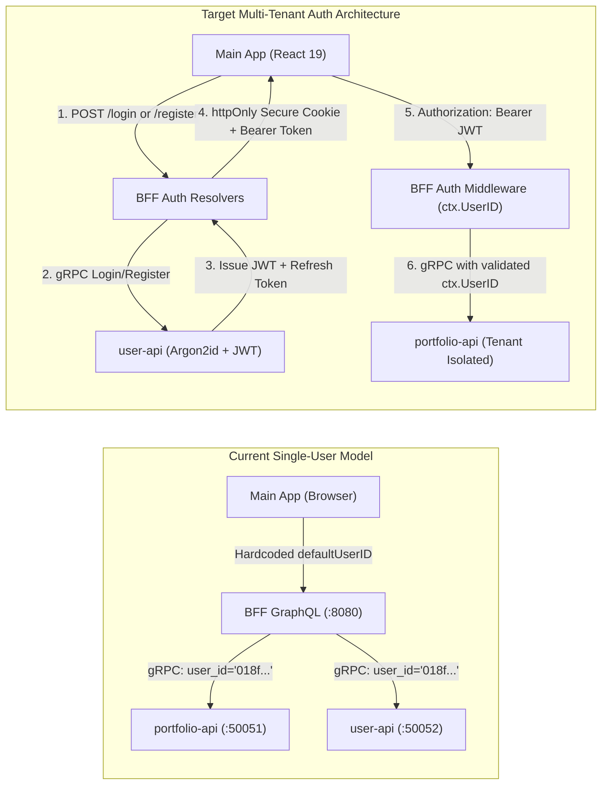
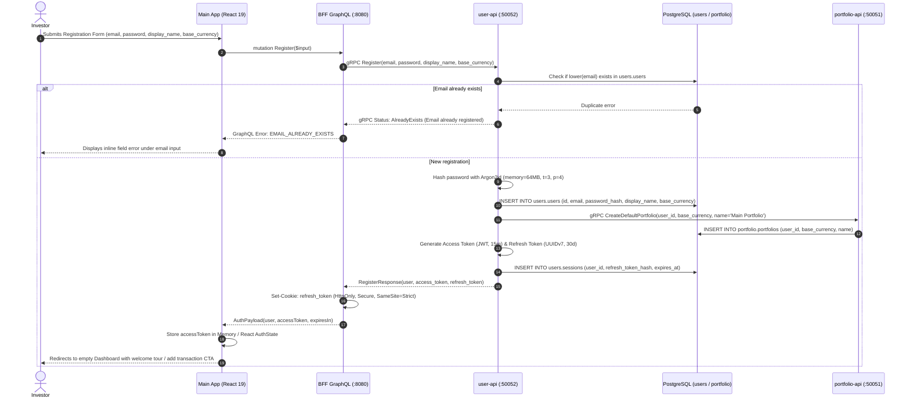
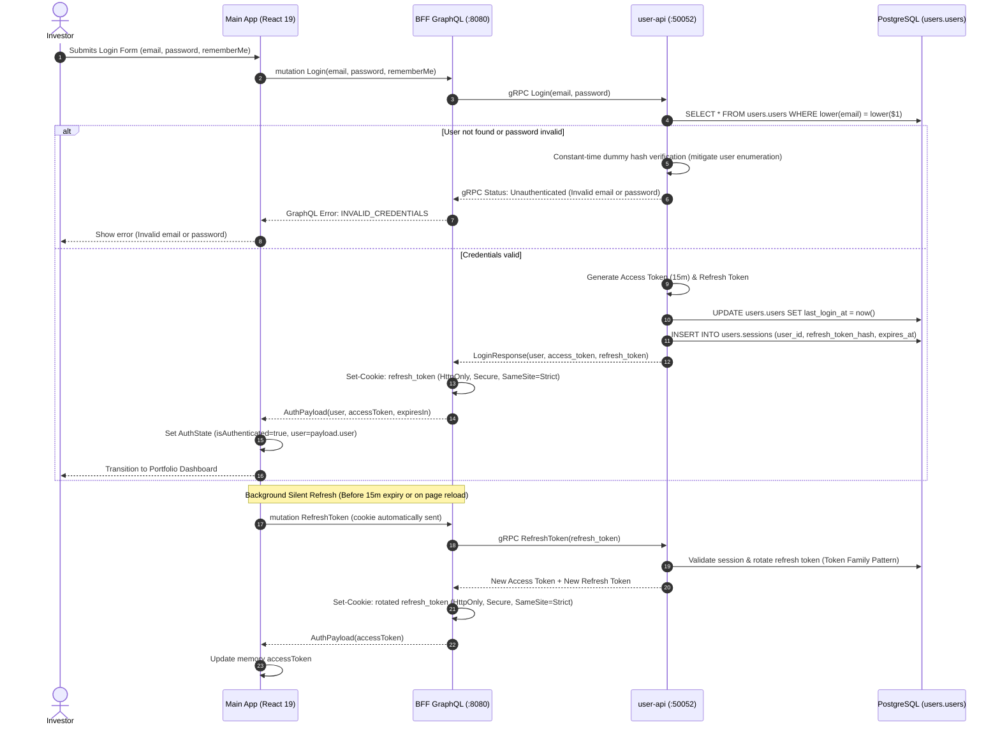

# User Story: User Registration, Authentication & Session Management

> **Story ID**: US-AUTH-101  
> **Epic**: Identity, Authentication & Multi-Tenant Access  
> **Target**: Primary Investor Application (`web/apps/main-app`), BFF GraphQL Orchestrator (`bff/`), User Domain Microservice (`services/user-api`), Proto (`proto/user/v1/`), Database (`users` & `portfolio` schemas)  
> **Status**: Ready for Implementation  
> **Implementation Plan**: [user-registration-and-login-implementation-plan.md](file:///Users/oscargarcia/workspace/graphfolio/docs/plans/user-registration-and-login-implementation-plan.md)  
> **Target Layers**: Web Main App (`web/apps/main-app`), BFF GraphQL (`bff/`), User Service (`services/user-api`), Proto (`proto/user/v1/user.proto`), Database Schema Migrations (`users.users`, `users.sessions`, `portfolio.portfolios`)  
> **Security Baseline**: OWASP Application Security Verification Standard (ASVS v4.0 L2), NIST SP 800-63B, RFC 9106 (Argon2id)  
> **Related Documentation**: [user-preferences-and-display-currency.md](file:///Users/oscargarcia/workspace/graphfolio/docs/user-stories/user-preferences-and-display-currency.md), [db-implementation-plan.md](file:///Users/oscargarcia/workspace/graphfolio/docs/plans/db-implementation-plan.md), [features.md](file:///Users/oscargarcia/workspace/graphfolio/features.md)  

---

## 1. Story Statements

### 1.1 New User Registration
> **As a** new investor visiting GraphFolio,  
> **I want to** register an account by providing my email address, a secure password, display name, and preferred base reporting currency,  
> **So that** I can establish a private, personalized investment space with isolated portfolios, transaction ledgers, and reporting preferences.

### 1.2 User Login & Credential Authentication
> **As a** registered investor returning to GraphFolio,  
> **I want to** authenticate securely using my email and password (with an optional "Remember Me" session persistence option),  
> **So that** I can access my private investment dashboard, historical performance charts, transaction ledger, and cash flow reports across devices without manual reconfiguration.

### 1.3 Session Maintenance & Secure Sign-Out
> **As an** authenticated investor,  
> **I want to** remain securely authenticated via seamless background token refresh while actively using the application, and have the ability to explicitly sign out from any view,  
> **So that** my session credentials are invalidated immediately and my sensitive financial holdings are protected against unauthorized access on shared or unattended devices.

---

## 2. Business Context & Problem Statement

### 2.1 The Current Single-Tenant Limitation
In the current GraphFolio architecture:
- All portfolio queries, transaction ingestion, and performance calculations are tied to a static default user ID (`defaultUserID = "018f0000-0000-7000-8000-000000000001"` in `bff/graph/resolver.go`, aliased as `"1"` in `user-api`).
- There is no registration or authentication gate; the Main App loads the default investor dashboard directly upon opening.
- While the database uses UUID foreign keys on `portfolio.portfolios (user_id)` and isolates `users` in a dedicated PostgreSQL schema, there is no identity verification, credential hashing mechanism, or session issuance layer.



### 2.2 Why Production-Grade Authentication is Vital
1. **Financial Privacy & Confidentiality**: Investment portfolios contain highly sensitive personal net worth, asset allocations, brokerage statements, and cash transaction records. Investors require strict tenant isolation and zero data leakage.
2. **Onboarding & Automatic Portfolio Initialization**: When an investor creates an account, they expect a clean slate: an initial default portfolio provisioned in their chosen base currency (e.g. `USD`, `AUD`, `EUR`) ready for transaction ingestion or CSV statement import.
3. **Session Security & Defense-in-Depth**: Storing long-lived access tokens in `localStorage` exposes users to Cross-Site Scripting (XSS) token extraction. A dual-token architecture—short-lived access tokens in memory accompanied by an `httpOnly`, `Secure`, `SameSite=Strict` refresh token—ensures maximum security for high-value financial data.

---

## 3. Architecture & Interaction Workflows

### 3.1 Registration & Provisioning Sequence



### 3.2 Login & Token Refresh Sequence



---

## 4. Acceptance Criteria

### AC 1: New User Registration Flow
- [ ] **Registration Entry Point**:
  - Accessible via a prominent "Register" / "Create Account" link on the Login screen and header.
  - Dedicated route `/register` (or toggleable tab in a central glassmorphic Auth Modal).
- [ ] **Input Fields & Formatting**:
  - **Display Name**: Text input (e.g. `"Jane Doe"`), required, trimmed, 2 to 60 characters.
  - **Email Address**: Text input with `type="email"`, required, trimmed, validated via RFC 5322 regex. Stored and queried in lowercase.
  - **Password**: Password input with visibility toggle (show/hide eye icon), required.
  - **Base Currency**: Dropdown selector pre-populated from `user-api` `ListSupportedCurrencies` (`USD`, `AUD`, `EUR`, `GBP`, `CAD`, `JPY`, `CHF`). Defaults to `USD` (or browser locale detection).
- [ ] **Password Strength Meter**:
  - Real-time password complexity evaluation requiring:
    - Minimum 8 characters (maximum 128 characters).
    - At least one uppercase letter (`A-Z`).
    - At least one lowercase letter (`a-z`).
    - At least one numerical digit (`0-9`).
    - At least one special symbol (e.g. `!@#$%^&*()_+~`).
  - Visual 4-stage color meter (`Weak` red, `Fair` orange, `Good` blue, `Strong` green) with feedback helper bullets.
  - Submit button remains disabled until all password policy conditions are satisfied.
- [ ] **Duplicate Email Detection**:
  - Attempting to register with an existing registered email returns a clear, user-friendly error message: `"An account with this email address already exists. Please sign in instead."`
  - Prevents database constraint violation crashes (`23505 unique_violation`).
- [ ] **Automatic Account Provisioning**:
  - Upon successful registration, the system automatically creates:
    1. A `users.users` record with Argon2id password hash and chosen preferences.
    2. A default portfolio in `portfolio.portfolios` named `"Main Portfolio"` configured with the user's selected base currency.
  - Issues initial authentication tokens and logs the user in immediately without requiring a redundant manual login step.

### AC 2: User Login & Credential Authentication
- [ ] **Login Form Interface**:
  - Accessible at `/login` or default entry when unauthenticated.
  - Clean glassmorphic card styled with `@graphfolio/ui` tokens.
  - Fields: Email address, Password, "Remember Me" checkbox (controls refresh token cookie lifetime: 30 days vs session-only).
- [ ] **Form Validation**:
  - Immediate client-side validation for empty fields and valid email syntax.
  - Displays inline errors if either field is missing on submit.
- [ ] **Authentication Feedback**:
  - On submit, button transitions to a loading state with spinner and label `"Signing In..."`. Form inputs are disabled to prevent duplicate submissions.
  - **Invalid Credentials**: Returns a generic error: `"Invalid email or password."` (never reveals whether the email exists or not, preventing account enumeration).
  - **Account Inactive/Locked**: If account is suspended or archived, returns `"Your account is inactive. Please contact support."`
- [ ] **Successful Authentication**:
  - Updates application authentication context (`user`, `isAuthenticated = true`).
  - Redirects user to their requested destination (or default `/` dashboard).

### AC 3: Dual-Token Session Lifecycle & Silent Refresh
- [ ] **Token Strategy**:
  - **Access Token (JWT)**:
    - Short-lived (15 minutes).
    - Signed using HMAC-SHA256 (or RS256) with a secret key configured via environment variable `JWT_SECRET`.
    - Payload contains claims: `sub` (user UUID), `email`, `display_name`, `base_currency`, `iat`, `exp`.
    - Stored strictly in frontend memory (`useState` / React Context); never written to `localStorage` or `sessionStorage` to mitigate XSS exfiltration.
  - **Refresh Token**:
    - Long-lived (7 days default, 30 days if "Remember Me" is checked).
    - Stored securely in a cryptographically random UUIDv7 or 256-bit token string.
    - Set by BFF in an HTTP response header as:
      ```http
      Set-Cookie: graphfolio_refresh=...; Path=/; HttpOnly; Secure; SameSite=Strict; Max-Age=2592000
      ```
    - Inaccessible to client-side JavaScript.
- [ ] **Token Family & Reuse Detection**:
  - Stored in database as a SHA-256 hash in `users.sessions` with `family_id` and `is_revoked`.
  - When refreshed, the old refresh token is marked used and a new one is issued (Token Rotation).
  - If an already-used refresh token is presented (potential replay/theft attack), the entire token family is immediately revoked, forcing re-authentication.
- [ ] **Silent Token Renewal**:
  - When the app is opened, or ~60 seconds before access token expiration, the main-app silently dispatches `mutation RefreshToken`.
  - If valid, the new access token is placed in memory without interrupting user activity or flashing the UI.
  - If the refresh token is missing or expired, the user is transitioned gracefully to the login screen.

### AC 4: Secure Sign-Out & Session Revocation
- [ ] **Sign-Out Action**:
  - A dedicated "Sign Out" option placed in the user navigation avatar/profile dropdown in the top right header.
  - Clear confirmation icon and label.
- [ ] **Server-Side Invalidation**:
  - Dispatches `mutation Logout`.
  - The BFF instructs `user-api` to revoke the active session in `users.sessions`.
  - The BFF sends a response clearing the `graphfolio_refresh` cookie (`Max-Age=0`).
- [ ] **Client-Side Cleanup**:
  - Clears access token from memory.
  - Resets all user state, active portfolio state, and Apollo/GenQL query caches.
  - Redirects to `/login`.

### AC 5: BFF Multi-Tenant Authorization & Resolver Decoupling
- [ ] **Context Authentication Middleware**:
  - BFF HTTP server inspects incoming `Authorization: Bearer <token>` header.
  - If valid token present, extracts `user_id` and injects it into Go `context.Context` via `ctx = context.WithValue(ctx, UserIDKey, claims.Subject)`.
  - If no token present, context remains unauthenticated.
- [ ] **Elimination of Hardcoded Default User ID**:
  - Remove all instances of `defaultUserID = "018f0000-0000-7000-8000-000000000001"` from `bff/graph/schema.resolvers.go`.
  - Protected queries (`portfolio`, `portfolioHistory`, `transactions`, `cashFlowReport`, `benchmarks`, `userPreferences`, `addTransaction`, `deleteTransaction`, etc.) must retrieve the user ID from `ctx`.
  - If `ctx.UserID` is missing or invalid, immediately return a GraphQL error with extension code `UNAUTHENTICATED`.
- [ ] **Public Resolvers**:
  - The following operations must remain publicly accessible without an authentication token:
    - `mutation login`
    - `mutation register`
    - `mutation refreshToken`
    - `query supportedCurrencies`

### AC 6: Main-App Visual Aesthetics & User Experience
- [ ] **Glassmorphic Design Alignment**:
  - Built with `@graphfolio/ui` dark design system (`tokens.css`):
    - Frosted glass containers (`backdrop-filter: blur(16px)`), subtle `1px solid rgba(255, 255, 255, 0.08)` borders.
    - Deep obsidian gradient backgrounds (`#0a0d14` to `#121824`).
    - Emerald accent highlights for primary actions (`#10b981`), sapphire focus rings (`#3b82f6`).
    - Crisp Inter/system typography.
- [ ] **Responsive Layout**:
  - Centered auth card on desktop with subtle brand logo, animated subtle background mesh, and marketing value proposition bullet points (*"Institutional-grade portfolio analytics. Exact decimal precision."*).
  - Fully responsive on tablet and mobile viewports with full-width inputs and ergonomic touch targets ($>44\text{px}$).
- [ ] **Accessibility & Usability**:
  - Fully navigable via keyboard (`Tab`, `Shift+Tab`, `Enter`).
  - Standard HTML form autocomplete attributes (`autocomplete="email"`, `autocomplete="current-password"`, `autocomplete="new-password"`).
  - Explicit `<label>` elements for all inputs with screen-reader accessible ARIA attributes (`aria-invalid`, `aria-describedby` for error text).

### AC 7: Security Hardening & OWASP Compliance
- [ ] **Cryptographic Password Hashing**:
  - Passwords hashed using **Argon2id** (configured according to RFC 9106):
    - Memory: 64 MB ($65,536\text{ KB}$)
    - Iterations / Time Cost: 3
    - Parallelism: 4 threads
    - Salt: 16 cryptographically secure random bytes
  - Plaintext passwords must never be logged, printed to console, or included in error traces.
- [ ] **Timing-Attack Resistance**:
  - Comparison of password hashes performed using constant-time algorithms (`subtle.ConstantTimeCompare`).
  - If a requested email is not found during login, execute a dummy Argon2id calculation with identical cost parameters before returning `INVALID_CREDENTIALS` to prevent response-time based account enumeration.
- [ ] **Brute-Force & Rate Limiting**:
  - Implement IP and account-based rate limiting on login/register endpoints:
    - Maximum 5 failed login attempts per minute per IP.
    - Temporary lockout (15 minutes) or progressive backoff after 10 consecutive failed attempts for a specific email address.

---

## 5. Technical Specifications & Data Contracts

### 5.1 Protobuf Contract (`proto/user/v1/user.proto`)

```protobuf
syntax = "proto3";

package user.v1;

option go_package = "graphfolio/proto/user/v1;userpb";

service UserService {
  // Existing RPCs
  rpc GetUserPreferences(GetUserPreferencesRequest) returns (GetUserPreferencesResponse) {}
  rpc UpdateUserPreferences(UpdateUserPreferencesRequest) returns (UpdateUserPreferencesResponse) {}
  rpc ListSupportedCurrencies(ListSupportedCurrenciesRequest) returns (ListSupportedCurrenciesResponse) {}

  // Authentication RPCs
  rpc Register(RegisterRequest) returns (RegisterResponse) {}
  rpc Login(LoginRequest) returns (LoginResponse) {}
  rpc RefreshToken(RefreshTokenRequest) returns (RefreshTokenResponse) {}
  rpc Logout(LogoutRequest) returns (LogoutResponse) {}
  rpc GetMe(GetMeRequest) returns (GetMeResponse) {}
}

message RegisterRequest {
  string email            = 1;
  string password         = 2;
  string display_name     = 3;
  string display_currency = 4;
}

message RegisterResponse {
  UserPreferences user    = 1;
  string access_token     = 2;
  string refresh_token    = 3;
  int64 expires_in        = 4; // Seconds until access_token expires
}

message LoginRequest {
  string email            = 1;
  string password         = 2;
  bool remember_me        = 3;
}

message LoginResponse {
  UserPreferences user    = 1;
  string access_token     = 2;
  string refresh_token    = 3;
  int64 expires_in        = 4;
}

message RefreshTokenRequest {
  string refresh_token    = 1;
}

message RefreshTokenResponse {
  string access_token     = 1;
  string refresh_token    = 2;
  int64 expires_in        = 3;
  UserPreferences user    = 4;
}

message LogoutRequest {
  string refresh_token    = 1;
}

message LogoutResponse {
  bool success            = 1;
}

message GetMeRequest {
  string user_id          = 1;
}

message GetMeResponse {
  UserPreferences user    = 1;
}
```

### 5.2 Database Schema Migrations

#### `services/user-api/migrations/000003_add_auth_and_sessions.up.sql`
```sql
-- Add credentials and status columns to users.users
ALTER TABLE users.users
    ADD COLUMN password_hash       text        NOT NULL DEFAULT '',
    ADD COLUMN is_active           boolean     NOT NULL DEFAULT true,
    ADD COLUMN email_verified_at   timestamptz,
    ADD COLUMN last_login_at       timestamptz;

-- Session and refresh token tracking
CREATE TABLE users.sessions (
    id                 uuid        PRIMARY KEY DEFAULT users.uuidv7(),
    user_id            uuid        NOT NULL REFERENCES users.users(id) ON DELETE CASCADE,
    refresh_token_hash text        NOT NULL UNIQUE,
    family_id          uuid        NOT NULL DEFAULT users.uuidv7(),
    is_revoked         boolean     NOT NULL DEFAULT false,
    user_agent         text,
    ip_address         inet,
    expires_at         timestamptz NOT NULL,
    created_at         timestamptz NOT NULL DEFAULT now(),
    updated_at         timestamptz NOT NULL DEFAULT now()
);

CREATE INDEX sessions_user_id_idx ON users.sessions(user_id) WHERE NOT is_revoked;
CREATE INDEX sessions_expires_at_idx ON users.sessions(expires_at);
```

### 5.3 GraphQL Schema Additions (`bff/graph/schema.graphqls`)

```graphql
type AuthPayload {
  user: UserPreferences!
  accessToken: String!
  expiresIn: Int!
}

input RegisterInput {
  email: String!
  password: String!
  displayName: String!
  displayCurrency: String!
}

input LoginInput {
  email: String!
  password: String!
  rememberMe: Boolean
}

extend type Query {
  me: UserPreferences!
}

extend type Mutation {
  register(input: RegisterInput!): AuthPayload!
  login(input: LoginInput!): AuthPayload!
  refreshToken: AuthPayload!
  logout: Boolean!
}
```

---

## 6. Implementation Task Breakdown

| Phase | Component | Key Deliverables |
|---|---|---|
| **Phase 1: Contracts & DB** | `proto/`, `services/user-api` | - Update `proto/user/v1/user.proto` with auth messages.<br/>- Add migration `000003_add_auth_and_sessions.up.sql`.<br/>- Seed demo user with valid Argon2id hash for backward compatibility. |
| **Phase 2: User Service Logic** | `services/user-api` | - Implement Argon2id hashing helper (`pkg/crypto/hasher.go`).<br/>- Implement `Register`, `Login`, `RefreshToken`, `Logout` repository methods.<br/>- Token rotation logic in `users.sessions`.<br/>- Table-driven unit tests for auth workflows. |
| **Phase 3: BFF Orchestration** | `bff/` | - HTTP auth middleware extracting Bearer token and populating `ctx.UserID`.<br/>- Resolvers for `register`, `login`, `refreshToken`, `logout`, and `me`.<br/>- Set-Cookie / Clear-Cookie response handling for refresh tokens.<br/>- Replace `defaultUserID` in all portfolio resolvers with `ctx.UserID`. |
| **Phase 4: Web UI State & Views** | `web/apps/main-app` | - `AuthContext` and `useAuth` hook managing token, user state, and silent refresh.<br/>- GraphQL client authorization header interceptor.<br/>- Sleek glassmorphic `LoginForm` and `RegisterForm` components with password strength meter.<br/>- Protected route wrapper guarding `/` dashboard.<br/>- Profile dropdown in dashboard header with user details and "Sign Out" action. |
| **Phase 5: Verification & End-to-End** | Monorepo Tests | - Unit tests across backend (`go test ./...`).<br/>- E2E verification of registration -> default portfolio -> trade addition -> logout -> re-login. |

---

## 7. Verification & Test Scenarios

### Scenario 1: New Investor Registration
- **Given** I am an unauthenticated visitor on the registration screen,
- **When** I submit valid details:
  - Display Name: `"Sarah Connor"`
  - Email: `"sarah.connor@example.com"`
  - Password: `"Cyberdyne#2026!"` (Strong)
  - Base Currency: `"AUD"`
- **Then** the account is created, a default `"Main Portfolio"` with base currency `"AUD"` is provisioned, auth cookies and JWT are issued, and I land on the clean dashboard ready to track investments.

### Scenario 2: Attempt Duplicate Registration
- **Given** an existing account registered with `"sarah.connor@example.com"`,
- **When** another user attempts to register with `"Sarah.Connor@example.com"` (case insensitive),
- **Then** the system rejects the registration with inline error `"An account with this email address already exists. Please sign in instead."`, and no duplicate record is written.

### Scenario 3: Login with Invalid Password
- **Given** a registered user `"sarah.connor@example.com"`,
- **When** attempting to log in with an incorrect password,
- **Then** the system returns `"Invalid email or password."`, response time is standardized to prevent timing attacks, and the user is not authenticated.

### Scenario 4: Silent Session Refresh
- **Given** an active authenticated session with an access token expiring in 60 seconds,
- **When** the frontend silent-refresh timer fires,
- **Then** a background `mutation RefreshToken` succeeds using the `httpOnly` cookie, updating the memory access token with zero screen flickering or user interruption.

### Scenario 5: User Sign-Out
- **Given** an authenticated session on the dashboard,
- **When** the investor clicks "Sign Out" from the profile dropdown,
- **Then** the server invalidates the refresh session, clears the refresh cookie, wipes all client memory state, and redirects to the login screen. Attempting to use the old JWT or refresh token is rejected with `UNAUTHENTICATED`.
