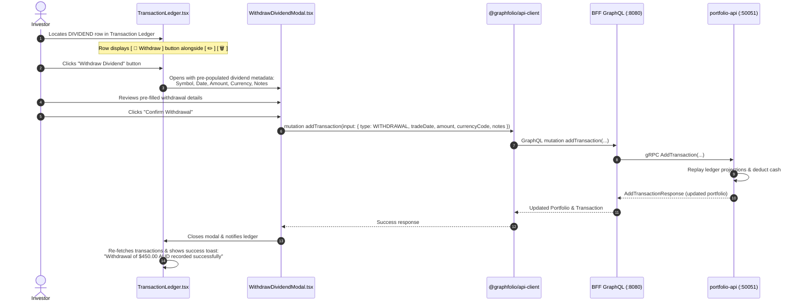

# User Story: Create Cash Withdrawal Against Dividend in Transaction Ledger

> **Story ID**: US-TX-105  
> **Epic**: Transaction Ledger Management & Cash Flow Reconciliation  
> **Target Layers**: Primary Investor Application (`web/apps/main-app`), BFF GraphQL Orchestrator (`bff/`), Portfolio Microservice (`services/portfolio-api`), Protobuf (`proto/portfolio/v1/portfolio.proto`), Database (`portfolio.transactions`)  
> **Status**: Completed  
> **Implementation Plan**: [withdraw-against-dividend-implementation-plan.md](file:///Users/oscargarcia/workspace/graphfolio/docs/plans/withdraw-against-dividend-implementation-plan.md)  
> **Calculation & Accounting Standard**: [financial-calculations skill](file:///Users/oscargarcia/workspace/graphfolio/.agents/skills/financial-calculations/SKILL.md) (Trade-Date Cash Flow Accounting, Intra-Day Lifecycle Priority, Cash Balance Neutrality, External Cash Flow Weighting in Modified Dietz)  
> **Related Stories & Documents**:  
> - [transaction-history-ledger.md](file:///Users/oscargarcia/workspace/graphfolio/docs/user-stories/transaction-history-ledger.md) (`US-TX-101`)  
> - [portfolio-cash-flow-report-generation.md](file:///Users/oscargarcia/workspace/graphfolio/docs/user-stories/portfolio-cash-flow-report-generation.md) (`US-REP-101`)  
> - [annualized-return-modified-dietz.md](file:///Users/oscargarcia/workspace/graphfolio/docs/user-stories/annualized-return-modified-dietz.md) (`US-PERF-102`)  
> - [sort-transactions-by-date-ledger.md](file:///Users/oscargarcia/workspace/graphfolio/docs/user-stories/sort-transactions-by-date-ledger.md) (`US-TX-104`)  
> - [USER_STORIES.md](file:///Users/oscargarcia/workspace/graphfolio/docs/USER_STORIES.md)  

---

## 1. Story Statements

### 1.1 Swift Withdrawal Creation Against Dividend Distributions
> **As an** active investor reviewing dividend distributions in my Transaction Ledger,  
> **I want to** click a dedicated "Withdraw Dividend" action button directly on any `DIVIDEND` transaction row,  
> **So that** I can instantly generate a matching cash withdrawal transaction without having to open the general trade modal and re-type all the transaction details from scratch.

### 1.2 Exact Financial Dimension Mirroring
> **As an** investor who withdraws dividend payouts to an external bank account for living expenses or off-platform re-allocation,  
> **I want** the generated withdrawal transaction to automatically adopt the exact trade date, currency code, and total cash amount of the dividend,  
> **So that** my portfolio cash balance remains perfectly reconciled with zero discrepancy, zero negative cash balance, and zero manual calculation error.

### 1.3 Automatic Audit Reference & Notes Tracking
> **As an** investor maintaining an authoritative audit trail for tax filing and personal accounting,  
> **I want** the newly created withdrawal transaction to automatically include a descriptive reference indicating the originating asset ticker and dividend event,  
> **So that** I can effortlessly trace which cash withdrawal corresponds to which dividend in my Cash Flow Report and CSV exports.

---

## 2. Background & Problem Context

### 2.1 The Real-World Dividend Cash Flow Lifecycle
In investment wealth management, cash dividends paid by equities and ETFs follow one of two investor paths:
1. **Dividend Reinvestment Plan (DRP)**: Distributions are automatically retained in the brokerage account or used to purchase additional shares.
2. **Cash Payout & External Bank Sweep**: Many investors (particularly retirees, passive income seekers, and dividend growth investors) do not leave dividend cash idle in their brokerage account. Instead, the dividend is transferred or swept directly into their personal bank account.

```
+----------------------------------------------------------------------------------------------------+
|                                DIVIDEND CASH FLOW LIFECYCLE                                        |
|                                                                                                    |
|  [ Company / ETF ]  ====>  Pays $450.00 AUD Dividend  ====>  [ Brokerage Cash Account ]            |
|                                                                       |                            |
|                                                                       | Swept out to bank account  |
|                                                                       v                            |
|                                                              [ External Bank Account ]             |
+----------------------------------------------------------------------------------------------------+
```

### 2.2 The Problem: "Ghost Cash" Accumulation & Ledger Friction
In GraphFolio, logging a `DIVIDEND` transaction (e.g. `BHP.AX` pays `$450.00 AUD` on `2024-04-15`) credits the portfolio cash balance by `+$450.00 AUD`.

When the investor sweeps this money out of their brokerage account:
1. **Ghost Cash Accumulation**: If the investor does not manually enter a matching `WITHDRAWAL`, GraphFolio's cash balance grows artificially higher than the investor's actual brokerage balance. Over time, accumulated dividend cash creates a false perception of uninvested capital.
2. **High Friction & Error-Prone Manual Entry**:
   Currently, recording the withdrawal requires:
   - Navigating to the general "Add Transaction" modal (`+ Add Transaction`).
   - Switching the transaction type to `Withdrawal`.
   - Manually looking up the exact dividend date (`2024-04-15`).
   - Manually copying the exact decimal cents (`$450.00`).
   - Selecting the matching currency (`AUD`).
   - Manually typing reference notes.
   A single typo in date or cents distorts running cash balances, generates false cash flow spikes, and misaligns Modified Dietz sub-period returns.

### 2.3 The Solution: Contextual Row Action
By providing a contextual **"Withdraw Dividend"** action button directly within the `.row-actions` group of every `DIVIDEND` row:
- The system automatically extracts the source dividend's `tradeDate`, `amount`, `currencyCode`, `symbol`, and `instrumentName`.
- A streamlined confirmation modal presents pre-populated fields with zero data re-entry required.
- The investor confirms in a single click, recording an exact matching `WITHDRAWAL` transaction that offsets the cash inflow on the exact trade date.

---

## 3. Financial & Accounting Mechanics

All cash flow calculations strictly adhere to the [financial-calculations skill](file:///Users/oscargarcia/workspace/graphfolio/.agents/skills/financial-calculations/SKILL.md), US GAAP / IFRS trade-date accounting, and GIPS® standards.

### 3.1 Cash Balance Neutrality
For an investor who sweeps their dividend out of the portfolio:

$$\Delta \text{Cash}_{\text{net}} = \text{Dividend Amount} - \text{Withdrawal Amount} = +D - D = 0.00$$

- **Inflow**: $\text{Cash}_{\text{post-div}} = \text{Cash}_0 + D$
- **Outflow**: $\text{Cash}_{\text{post-withdrawal}} = \text{Cash}_{\text{post-div}} - D = \text{Cash}_0$

The portfolio cash balance returns precisely to its prior state.

### 3.2 Intra-Day Lifecycle Priority Guarantee
To guarantee that recording a withdrawal on the same day as a dividend never triggers an artificial transient negative cash balance, GraphFolio's chronological query engine ([`listTransactionsAscSQL`](file:///Users/oscargarcia/workspace/graphfolio/services/portfolio-api/internal/repository/queries.go#L351-L369)) applies strict lifecycle tie-breaking on matching trade dates:

```sql
ORDER BY 
    t.trade_date ASC,
    CASE t.type
        WHEN 'DEPOSIT'     THEN 1
        WHEN 'TRANSFER_IN' THEN 2
        WHEN 'BUY'         THEN 3
        WHEN 'SPLIT'       THEN 4
        WHEN 'DIVIDEND'    THEN 5  <-- Evaluates FIRST (Cash credited)
        WHEN 'INTEREST'    THEN 6
        WHEN 'SELL'        THEN 7
        WHEN 'TRANSFER_OUT'THEN 8
        WHEN 'FEE'         THEN 9
        WHEN 'TAX'         THEN 10
        WHEN 'WITHDRAWAL'  THEN 11 <-- Evaluates LATER (Cash withdrawn)
        ELSE 12
    END,
    t.created_at ASC,
    t.id ASC;
```

**Financial Consequence**: The cash dividend is credited at Priority 5 before the withdrawal debit occurs at Priority 11. Even if the portfolio had zero cash prior to the dividend, the balance never dips below zero during the transaction replay.

### 3.3 Return Attribution & Performance Independence
- **Dividend Recognition**: The dividend continues to be recognized as investment income (`income_amount`, `income_yield_percent`) in holdings return attribution.
- **External Cash Flow**: The withdrawal is correctly tagged as an external cash outflow ($CF < 0$), ensuring that the Modified Dietz and Time-Weighted Return (TWR) algorithms do not penalize portfolio performance for money withdrawn.

---

## 4. UI / UX Design & Interaction Flow



### 4.1 Row Action Button (`TransactionLedger.tsx`)
In the `.row-actions` container of each table row:
- If `tx.type === 'DIVIDEND'`: Render a specialized withdrawal action button before the edit and delete buttons:
  ```tsx
  {tx.type === 'DIVIDEND' && (
    <button
      type="button"
      className="btn-withdraw-dividend"
      onClick={() => setDividendToWithdraw(tx)}
      title="Create matching cash withdrawal for this dividend"
      aria-label={`Create matching withdrawal for ${tx.symbol || 'Cash'} dividend of ${formatMoney(tx.amount)}`}
    >
      <svg width="14" height="14" viewBox="0 0 24 24" fill="none" stroke="currentColor" strokeWidth="2">
        <path d="M12 2v10m0 0l-4-4m4 4l4-4" />
        <path d="M2 17l.621 2.485A2 2 0 0 0 4.561 21h14.877a2 2 0 0 0 1.94-1.515L22 17" />
      </svg>
    </button>
  )}
  ```

### 4.2 Action Button Styling (`TransactionLedger.css`)
```css
.btn-withdraw-dividend {
  background: rgba(245, 158, 11, 0.12);
  border: 1px solid rgba(245, 158, 11, 0.25);
  color: #fbbf24;
  cursor: pointer;
  padding: 0.35rem;
  border-radius: 6px;
  display: inline-flex;
  align-items: center;
  justify-content: center;
  transition: all 0.2s cubic-bezier(0.16, 1, 0.3, 1);
}

.btn-withdraw-dividend:hover {
  background: rgba(245, 158, 11, 0.22);
  border-color: rgba(245, 158, 11, 0.45);
  transform: translateY(-1px);
}

.btn-withdraw-dividend:focus-visible {
  outline: 2px solid #fbbf24;
  outline-offset: 1px;
}
```

### 4.3 Dedicated Confirmation Modal (`WithdrawDividendModal.tsx`)
When clicked, a dark glassmorphic modal presents the investor with clear source and target details:

```
+---------------------------------------------------------------------------+
|  WITHDRAW DIVIDEND CASH                                               [X] |
+---------------------------------------------------------------------------+
|                                                                           |
|  Source Dividend:                                                         |
|  +---------------------------------------------------------------------+  |
|  |  Asset:      BHP.AX (BHP Group Limited)                              |  |
|  |  Date:       2024-04-15                                              |  |
|  |  Amount:     $450.00 AUD                                             |  |
|  +---------------------------------------------------------------------+  |
|                                                                           |
|  Matching Cash Withdrawal to Create:                                      |
|                                                                           |
|  Withdrawal Date:      [ 2024-04-15          ]  (Matches dividend date)   |
|  Amount:               [ 450.00              ]  AUD                       |
|  Currency:             [ AUD                 ]                            |
|  Notes:                [ Withdrawal for dividend: BHP.AX on 2024-04-15  ] |
|                                                                           |
|  ℹ️ This records a cash withdrawal matching the dividend payout,          |
|     keeping your portfolio cash balance accurate without affecting your    |
|     dividend return history.                                              |
|                                                                           |
|  [ Cancel ]                                      [ Confirm Withdrawal ]   |
+---------------------------------------------------------------------------+
```

---

## 5. Scope & Layer Breakdown

| Layer | Component | Description of Change |
| :--- | :--- | :--- |
| **Frontend UI** | `web/apps/main-app/src/components/TransactionLedger.tsx` | Conditionally render `.btn-withdraw-dividend` on `tx.type === 'DIVIDEND'` rows. Wire state `dividendToWithdraw: TransactionItem \| null` to trigger modal. |
| **Frontend Modal** | `web/apps/main-app/src/components/WithdrawDividendModal.tsx` | New lightweight modal component displaying dividend metadata and pre-filling withdrawal input fields. Dispatches `addTransaction` mutation. |
| **Frontend CSS** | `TransactionLedger.css`, `WithdrawDividendModal.css` | Glassmorphic styling for `.btn-withdraw-dividend`, amber accent colors, and modal form styling conforming to `@graphfolio/ui`. |
| **API Client** | `web/packages/api-client` | Existing `addTransaction` mutation is reused directly. |
| **BFF & Services** | `bff/`, `services/portfolio-api` | Zero backend modifications required; existing `AddTransaction` gRPC RPC and ledger replay engine fully support `WITHDRAWAL` transactions with arbitrary amounts, dates, and notes. |

---

## 6. Acceptance Criteria (Given - When - Then)

### AC 1: Contextual Action Button Visibility
- **Given** an authenticated investor is viewing the Transaction Ledger,
- **When** the table displays a list of transactions,
- **Then** a "Withdraw Dividend" action button (`btn-withdraw-dividend`) is rendered in the `.row-actions` column **only on rows where `tx.type === 'DIVIDEND'`**,
- **And** the button is **not rendered** for `BUY`, `SELL`, `DEPOSIT`, `WITHDRAWAL`, `SPLIT`, or other transaction types.

### AC 2: Exact Financial Field Pre-Population
- **Given** an investor clicks the "Withdraw Dividend" button on a dividend row (e.g. `BHP.AX`, Date: `2024-04-15`, Net Amount: `$450.00 AUD`),
- **When** the `WithdrawDividendModal` opens,
- **Then** the Withdrawal Date field is pre-populated with the exact dividend date (`2024-04-15`),
- **And** the Withdrawal Amount field is pre-populated with the exact dividend amount (`450.00`),
- **And** the Currency is pre-populated with the exact dividend currency (`AUD`).

### AC 3: Contextual Notes Auto-Generation
- **Given** the modal opens for a dividend transaction,
- **When** the notes field is rendered,
- **Then** it contains a default descriptive memo:  
  `"Withdrawal for dividend: <SYMBOL> on <DATE>"` (e.g. `"Withdrawal for dividend: BHP.AX on 2024-04-15"`),
- **And** the notes field remains editable if the investor wishes to append personal banking details or custom tags.

### AC 4: Successful Withdrawal Creation & State Synchronization
- **Given** the investor reviews the pre-populated modal and clicks **"Confirm Withdrawal"**,
- **When** the mutation completes successfully,
- **Then** a new transaction of type `WITHDRAWAL` is created in the portfolio,
- **And** the modal closes automatically,
- **And** a success toast notice appears: `"Withdrawal of $450.00 AUD recorded successfully"`,
- **And** the Transaction Ledger automatically re-fetches to display the newly created `WITHDRAWAL` row,
- **And** the portfolio cash balance updates immediately without requiring a full page refresh.

### AC 5: Intra-Day Sequence & Non-Negative Cash Integrity
- **Given** a dividend and its matching withdrawal share the exact same `trade_date`,
- **When** transactions are displayed or replayed in chronological order,
- **Then** the `DIVIDEND` transaction is processed before the `WITHDRAWAL` transaction (Lifecycle Priority 5 vs 11),
- **And** running cash calculations reflect the cash addition prior to the cash subtraction.

### AC 6: Accessibility & Keyboard Navigation (WCAG 2.1 AA)
- **Given** a keyboard-only user tabbing through the Transaction Ledger,
- **When** focus reaches a dividend row's actions,
- **Then** the "Withdraw Dividend" button receives a visible focus outline,
- **And** pressing `Enter` or `Space` opens the modal,
- **And** focus moves inside the modal to the confirmation action with `Escape` closing the modal.

### AC 7: Loading State & Error Handling
- **Given** a network interruption occurs during withdrawal submission,
- **When** the request fails,
- **Then** an explicit error message is displayed inside the modal,
- **And** the modal remains open with user inputs intact for retry,
- **And** the submit button is disabled while the mutation is in flight with a loading spinner.

---

## 7. Non-Functional Requirements

### 7.1 Precision & Decimal Integrity
- Zero floating-point drift: Amounts are handled via fixed-point string decimals (`"450.00"`), mapped to `common.v1.Money` via exact shopspring decimal conversions.

### 7.2 Performance & Responsiveness
- Modal opens in $< 16\text{ms}$ with zero DOM lag.
- Transaction submission executes through existing BFF/gRPC pipeline without redundant ledger recalculations beyond the affected date range.

### 7.3 Design System Consistency
- Matches the dark glassmorphic styling tokens (`--card-bg`, `--card-border`, `--accent-green`, `--text-primary`, `--text-secondary`).
- Uses dedicated amber badge tones (`#fbbf24`) to visually denote a cash-outflow action against income.

---

## 8. Verification & Testing Strategy

### 8.1 Automated Unit Tests
- `WithdrawDividendModal.test.ts`:
  - Verify pre-population logic: given a `TransactionItem` of type `DIVIDEND`, verify `tradeDate`, `amount`, `currencyCode`, and `notes` match exactly.
  - Verify auto-generated notes formatting for domestic and international symbols.
  - Verify input validation: prevents submission of zero or negative amounts.

### 8.2 Manual Verification Checklist
1. **Button Presence**: Confirm `[ 💸 Withdraw ]` button only appears on `DIVIDEND` rows in the Transaction Ledger.
2. **Modal Pre-population**: Click button on a dividend row; confirm Date, Amount, Currency, and Notes match the dividend row 1:1.
3. **Submission**: Click "Confirm Withdrawal"; verify modal closes, toast appears, and new `WITHDRAWAL` row appears in the ledger.
4. **Cash Balance**: Confirm portfolio cash balance decreases by the exact dividend amount.
5. **Cash Flow Report**: Navigate to Reports $\rightarrow$ Cash Flow; confirm both the dividend inflow and the withdrawal outflow are registered under their respective categories.

---

## 9. Definition of Done (DoD) Checklist

- [x] Contextual "Withdraw Dividend" button rendered on `DIVIDEND` rows in `TransactionLedger.tsx`.
- [x] `WithdrawDividendModal.tsx` created and styled with dark glassmorphic design tokens.
- [x] Withdrawal fields (date, amount, currency, notes) pre-populate automatically from selected dividend.
- [x] Submitting withdrawal executes `addTransaction` mutation and updates portfolio state.
- [x] Success toast notification and ledger refetch triggered upon completion.
- [x] Unit tests implemented for modal pre-population and validation logic.
- [x] WCAG 2.1 AA keyboard navigation and accessibility attributes verified.
- [x] Document cataloged in `docs/USER_STORIES.md`.
